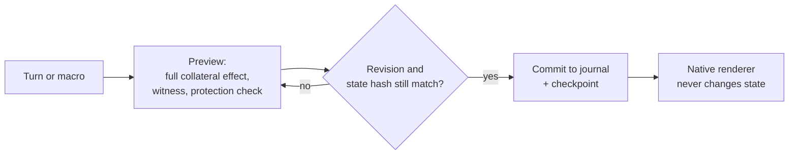

# Magic 600 Cell

**A solving workbench and a research project for the full 600-cell puzzle: a Rubik's-cube-style puzzle on a four-dimensional regular polytope.**

Built around **[Magic Puzzle Ultimate by Andrey Astrelin](https://superliminal.com/andrey/mpu/)**. Primary credit for the original puzzle simulator and renderer belongs to Andrey. Earlier versions of this project were named C600 Studio.

**[Download 0.4 for Windows](https://github.com/KonomiYuzu01/Magic-600-Cell/releases/tag/0.4)** · [Usage](USAGE.md) · [Release guide](docs/RELEASE_0_4.md) · [Mathematics](research/README.md) · [Jumbling research](research/jumbling/README.md) · [Documentation](docs/README.md) · [Roadmap to 1.0](#roadmap-10)

---

## The puzzle at a glance

The 600-cell is the four-dimensional regular polytope bounded by 600 tetrahedra. Its 120 vertices are the unit quaternions of the binary icosahedral group, and its symmetry group H4 has 14,400 elements. The puzzle version cuts it near every cell and lets each cell's cap turn, like a face of a Rubik's cube one dimension up.

| Quantity | Value |
| --- | --- |
| Cells (turnable caps) | 600 |
| Legal generators (half-turn and third-turn per cell) | 1,200 |
| Moving piece orbits | 35 |
| Surface pieces | 177,120 |
| Labelled sticker slots | 259,800 |

Every operation in the application acts on this complete model. Nothing is simplified: display filters and visibility settings never change the mechanical state or relabel a piece.

## Jumbling: when pieces leave the lattice

In the puzzle above, every turn is a symmetry of the cut arrangement, so every piece always lands in a slot. A *jumble twist* turns a cell's cap by a rotation about its axis that is not such a symmetry. The moved pieces leave the lattice: they no longer fill a slot, they can stick across other cuts, and every cap they straddle is blocked until they move away. The puzzle stays rigid, but the rotations of the caps now generate an infinite group. With the twist menu I_a, each of the 600 caps has 12 ordinary rotations and 48 jumble twists, and this menu reaches infinitely many configurations (proved on 17 October 2026). Jumbling enters 1.0 as a second puzzle with its own model identity; 600-cell-Full is unchanged.

The research question is how to get back to the solved state from any reachable configuration, reading only the current state. Results so far (17 October 2026):

| Result | Status |
| --- | --- |
| A 40-twist scramble that takes 94,147 of the 177,120 pieces off the lattice is restored to the solved state: a 62-twist seam descent to 860 off pieces, 14 clean steps (14,098 twists; each step ends with every piece that was on the lattice back on it) to 0, then the lattice phase | **certificate**, checked independently: the off-lattice words and the corrections replayed on the exact simulator, and the retained cascade evaluated as an exact permutation program on all 259,800 sticker labels; the order of the 14 steps was chosen by hand |
| Every run of clean steps terminates, since each lowers the off-lattice count by at least the size of its target (Lemma U) | **proved** |
| At every reachable state a clean step exists, and an exhaustive search that reads only the state finds one | **proved**; no bound on its length |
| A general method that reads only the current state restores every reachable configuration: fast heuristic steps, the exhaustive search when they find nothing, then the lattice phase (Theorem M\*) | **proved**; no bound on the length of a fallback step. The driver implements it; the runs so far used v4, which had no fallback |
| The pure twist: a carrier whose frame belongs to one class and which lies in one cell of that class's arrangement is put back by a word that moves only whole cells of that class. Edge cells are turned in place (at most 720 twists, given three free grips) and so are vertex cells (at most 104), and every piece outside the cell stays exactly in place; triangle and tetrahedron cells cannot be, but a transport word, which moves several whole cells of the same kind, carries the carrier home through another such cell (at most 240 and 192 twists). A clean step then needs the other chambers of the moved cells vacant | **proved**, with exact certificates carried to every cell by symmetry; the last three bounds assume the class's grips are free |
| The retained puzzle's group is exactly the kernel of its invariants (G = 𝒦); its order has 598,061 decimal digits | **certificate**: 35 position and 11 frame certificates, checked by an independent checker |
| The corrections a jumbled history can leave on the lattice form A_J = C2^34 × C5^2 | lower bound **certificate** (40 words); upper bound **proved** |
| With a correction library spanning A_J, every reachable configuration with all pieces on the lattice is solved (Theorem R) | **proved**; the 36-macro library has rank 34 over F2 and 2 over F5 (**certificate**) |
| A step found from the state alone with a bound on its length that depends on the state, at every reachable state | **open**: the core gap (M1). The state-only driver v4 took stop62 from 860 to 269 off pieces in 8 replayed steps and stopped there; it had no fallback |
| Under the menu I_a infinitely many configurations are reachable: an explicit family of words F_t, admissible from the solved state, takes seven pieces to left tree height at least 3888 + 132t, for every t | **proved** with an exact certificate (17 October 2026); checked independently by the integrator, not reviewed by a human |
| A bound on the restoration length that holds for every reachable configuration exists if and only if there are finitely many reachable configurations | **proved**; there are infinitely many, so no such bound exists |
| The lattice phase within reach of a person: with 31 of its 35 seeds replaced by shorter elements, each applied once per three-cycle with the frames set inside the position loop (round 11), the lattice phase restores the two synthetic inputs in 1.58 × 10^7 twists (4.5 × 10^7 with the shorter seeds alone, 2.3 × 10^8 with the committed cascade). It needs at most 20,866,844 twists for every input, plus at most 25,852 for the corrections, or at most 4,655,642 actions (single twists and applications of 70 stored macros) for a person with the program's help; with retained words only, some input needs at least 224,601 twists. It runs as a runner separate from the driver, whose lattice phase still runs the committed cascade | **closed** by owner decision (17 October 2026): the bounds stand, and help for a person moves to the engineering line; the runs are a **certificate** (the stage 03 checker evaluates each solution with its own code); the bounds are **proved** (model review) |

Every legality decision is exact, in arithmetic over Q(√5) with no tolerance. Results are labelled *proved*, *certificate* (an exact computation with a replayable record), *measured* or *open*. On 15 October 2026 a senior model review checked the new proofs, corrected several statements and proved the rows on the existence of a clean step, the general method, the pure twist and the length bounds ([record](research/jumbling/restoration/09-general-method/SENIOR-REVIEW.md)); no human has reviewed them yet. On the owner's RTX 4070 Laptop GPU the jumbling render probe ran the I_a fixture at 613 fps with a p99 frame time of 1.91 ms; overlay costs are not measured yet ([evidence](docs/wiki/evidence/w-j-probe-results.md)).

Start with the [jumbling overview](research/jumbling/README.md), then the [restoration results](research/jumbling/restoration/README.md) (ten stages, each with its replay commands) and the [general method](research/jumbling/restoration/09-general-method/METHOD.md).

## What 0.4 does

- **A native solving workspace** with explicit Prepare / Macro / Cleanup operations.
- **Macros you can trust:** each reusable macro keeps a finite legal witness and its full collateral effect, so you see everything a sequence moves before you commit it.
- **Protection:** solved orbits can be locked, and every commit is checked against the protected-orbit constraints.
- **Recovery:** sessions are journaled with checkpoints; reset and import are transactional and validate their complete input before writing.
- **Inspection:** linked Current / Operation / After cycle views, orientation and buffer tools, and endgame families.
- **Input and exchange:** physical keyboard input with configurable key sets, and C600 / MPUlt v1 log exchange.

The user chooses and executes the solving steps; the application does not solve the puzzle automatically.

## Run 0.4

Download the Windows x64 portable ZIP, extract the complete folder, and open `Magic600Cell.exe`. Keep `Magic600Engine.exe` and `_internal` alongside it. No separate Python or compiler is needed. The native renderer requires .NET Framework 4.x and the supported [Managed DirectX runtime](DIRECTX.md).

The default G2 layout keeps the native puzzle visible. The alternate keyboard workspace is available with `Magic600Cell.exe --mode g1`. Personal data is stored separately under `%LOCALAPPDATA%\Magic600Cell\0.4`; older C600 Studio profiles are not automatically migrated. See [sessions and rollback](USAGE.md#sessions-and-rollback).

## Engineering principles

- **Exact mathematics first.** Geometry is checked in exact arithmetic over Z[φ] (the golden-ratio integers) by a [standard-library checker](research/audit/verify_regular_geometry.py). The model is fixed by an immutable [manifest](assets/manifest.json): any change to geometry, cuts, IDs, seeds or frames requires a new model identity and a migration.
- **Chronological, complete permutations.** Every macro is executed as source-to-destination permutations in order, with its full collateral effect. Preview revisions and full-state hashes are rechecked before commit.
- **No lost work.** Reset and import are transactional and recoverable, and the current preferences and recovery checkpoint are kept.
- **Evidence is labelled.** Release records separate source and fixture checks, synthetic geometry, actual Windows/DirectX runs and performance measurements. A headless result is never presented as a Windows, input or performance result.
- **Certificates over claims.** A computed result ships with the record that reproduces it and a checker that does not share the construction code.
- **Reproducible builds.** Releases carry a [source manifest](SOURCE_MANIFEST.json) and [provenance record](docs/RELEASE_0_4_PROVENANCE.json) that bind the frozen package inputs to their hashes.

## Mathematics

The [theory document](research/PUZZLE_THEORY.md) develops 15 lemmas and a combined theorem with the full 35-orbit census. It covers exact golden-ratio coordinates, incidence and duality, the radial homeomorphism to the three-sphere, binary icosahedral quaternions and the H4 symmetry group, cap signatures and local frames, parity and orientation invariants, conditional configuration bounds, and the difference between geometric symmetry and legal twists. The order of the full legal group is not asserted.

PDF and LaTeX sources: [puzzle theory](research/Full_600cell_Puzzle_Theory.pdf), [technical report](research/Full_600cell_Technical_Report.pdf). The jumbling theory, from the tree model of jumbled poses to the lattice correction group, is in [research/jumbling/theory/](research/jumbling/theory/README.md) and [research/jumbling/restoration/](research/jumbling/restoration/README.md).

## Roadmap: 1.0

0.4 is the last release of the 0.4 line; the planned 0.4.1 release was cancelled. 1.0 is a new application designed from scratch. For 600-cell-Full it keeps the mathematical contract, the protection rules and the model identity; the jumbling puzzle joins it with a model identity and contract of its own.

- **Stage 2 (now).** The charter, two independent inventories of every 0.4 function and the dispositions are done: 503 units, 556 decisions (keep 52, redesign 486, delete 12, automate 6), signed by the owner. The redesign and the experiments (renderer, migration probes, design labs) are in progress. The freeze of the architecture, the migration format and the design system comes last.
- **Renderer target:** all 259,800 sticker slots at full detail during the most complex animation, at an average of at least 30 fps with a 99th-percentile frame time of at most 33.3 ms, on a laptop RTX 4070 (8 GB): PresentMon at native resolution, no frame generation or upscaling, three cold 180-second runs, peak VRAM about 7 GB or less. Direct3D 12 is the base. On the bare gate trace all three candidates met it on the owner's machine (bare Direct3D 12: 788 fps, p99 1.49 ms; Godot 4.7.2: 671 fps, p99 1.91 ms; Qt 6.10.3: 60 fps at its vblank cap, p99 17.4 ms) and passed the [day-7 go/no-go](docs/wiki/decisions/day7-go-no-go-ruling.md). No renderer is selected yet: the selection waits for the run with the design's look. Candidates are listed in the [renderer decision](docs/wiki/decisions/renderer-candidates.md).
- **Correctness:** before the 1.0 engine replaces the 0.4 engine, a differential oracle must show that the two agree on every component they share.
- **Your data:** 0.4 sessions migrate one way into 1.0 from a locked copy; the original session directory is never modified.
- **Platforms:** Windows first. The engine, session store, command layer and view model stay free of Windows-only code, shaders are written once in portable HLSL, and the renderer backend interface stays small, so that macOS and Linux versions can follow after 1.0.

The [1.0 architecture proposal](docs/architecture/1.0/README.md) is future documentation and partly superseded; current decisions are in the [engineering wiki](docs/wiki/index.md) and the progress records in [docs/progress/](docs/progress/1.0/).

## How this project is developed

Development follows a written, review-gated process. The owner sets scope, design and releases. Claude (Anthropic) is the integrating developer. Codex (OpenAI) reviews by risk: a change to a critical path such as the engine, persistence or the model manifest gets a plan check and a valid review of the exact candidate before commit; other code gets one review of the finished change; pages that record owner decisions or measured results get none. Codex also implements separable parts in isolated worktrees, a senior Codex reviewer gives the rulings at three gates, and a separate solver joins on escalation. Each review finding gets a recorded disposition, and decisions are kept in a public [engineering wiki](docs/wiki/index.md). The rules are in [AGENTS.md](AGENTS.md); the [development guide](docs/development-guide/HUMAN_GUIDE.md) explains them for people.

## Repository guide

| Location | Purpose |
| --- | --- |
| [USAGE.md](USAGE.md), [release guide](docs/RELEASE_0_4.md) | Start here for the released application. |
| [work/experiments/magic600-04/](work/experiments/magic600-04/) | Released 0.4 workspace source and packaging inputs; the original path is retained for reproducibility. |
| Root Python modules, [native/](native/), [assets/](assets/) | Shared backend, retained native integration and immutable full-model assets. |
| [oracle/](oracle/) | An independent sparse permutation engine that tests use to cross-check the backend. |
| [Build guide](docs/DEVELOPMENT.md) | Source layout, prerequisites and a clean-checkout build of the retained 0.4 host (Windows, .NET Framework 4.x x86 compiler, Managed DirectX). |
| [RELEASE.json](RELEASE.json), [SOURCE_MANIFEST.json](SOURCE_MANIFEST.json) | Version identity and source inventory; [release provenance](docs/RELEASE_0_4_PROVENANCE.json) binds the frozen package inputs. |
| [research/](research/README.md) | Mathematical references, reports and audits, with their original version and evidence scope. |
| [research/jumbling/](research/jumbling/README.md) | Jumbling: the exact simulator, viewer, explorer, theory and the restoration results. |
| [docs/](docs/README.md) | Current documentation, historical records, 1.0 planning and the engineering wiki. |
| [docs/progress/](docs/progress/1.0/) | Stage 2 records: charter, inventories, dispositions, command table, packets, migration probes, the jumbling plan. |
| [work/experiments/](work/experiments/) | Stage 2.4 renderer probes with their result cards and gate summaries, next to the 0.4 workspace. |
| [tools/](tools/) | Development tools: the review wrapper, the toolchain installer, the development workbench, Taste Lab, Look Lab, the renderer gate, the oracle and migration probes, wiki lint. |
| [tests/](tests/) | Headless regression tests for mechanics, persistence, process ownership, tooling, the renderer gate, the oracle, migration probes and the jumbling simulator; native regressions in `tests/native/`. |
| [.github/workflows/](.github/workflows/) | Continuous integration: the headless checks on Windows. A pass is not DirectX evidence. |

Root launch scripts, `web/` and `packaging/` retain the earlier shared/0.3 paths; they are not the 0.4 portable-package entry point. The `work/experiments/magic600-04` name does not make the published 0.4 release a new experimental build.

Performance optimization of the 0.4 line has ended with the 0.4.1 cancellation. The [release record](docs/RELEASE_0_4.md) distinguishes verified checks from reused evidence and remaining limits. Historical performance measurements are not a 0.4 performance certification.

## Credits and license

Magic 600 Cell is a derivative work of Magic Puzzle Ultimate, © 2010 Andrey Astrelin, distributed under the same terms as the original project. Acknowledgements to ivan216 for source references and Nan Ma for historical solving material.

[Credits](CREDITS.md) · [MIT license](LICENSE) · [Third-party notices](THIRD_PARTY_NOTICES.md)
