# Glossary (M6)

Status: **draft for stage 2.** Generated by `build.py` from `terms.json` and `learning-path.json`; edit the sources, not this page. One term per concept (charter M1). Each term enters at the learning level where it is first needed (charter M6, D7). The levels follow the steps of the [solving workflow](../solving-workflow.md) and are provisional until the owner decides the learning path; the UI locations are the planned surfaces of solving-workflow section 4, not a layout. Diagrams are rendered locally with the Mermaid CLI; sources and digests are in `diagrams/`. The language's entries come from chapter 04 section 6 of the language architecture (EV5.14, EV5.15, EV5.18); an entry marked for review waits for the mathematician.

## Levels

| Level | Name | Workflow step |
|---|---|---|
| L1 | Turning the puzzle | solving-workflow.md section 4.3 (Keyboard) |
| L2 | Orbits and protection | solving-workflow.md section 2 |
| L3 | Buffers and stars | solving-workflow.md section 3.1 |
| L4 | Placement, blocks and frames | solving-workflow.md sections 3.2, 3.3 and 4 |
| L5 | Orientation and the endgame | solving-workflow.md section 3.4 |
| L6 | Beyond the baseline | solving-workflow.md section 2 (pure controllers) |

## Words with more than one sense (EV5.18)

| Word | Senses | Bare word means |
|---|---|---|
| Domain | [Alignment domain](#alignment-domain), [Declared domain](#declared-domain), [Admitted domain](#admitted-domain), [Chart domain](#chart-domain) | never used bare |
| Projection | [Display projection](#display-projection), [Level projection](#level-projection) | never used bare |
| Key | [Keyboard key](#keyboard-key), [Statement key](#statement-key), [Equality key](#equality-key), [Reproducibility key](#reproducibility-key), [Source key](#source-key) | Keyboard key |
| Checkpoint | [Saved checkpoint](#saved-checkpoint), [Retained checkpoint](#retained-checkpoint), [Label checkpoint](#label-checkpoint) | never used bare |
| Branch | [Journal branch](#journal-branch), [Tree branch](#tree-branch) | never used bare |
| Edition | [Language edition](#language-edition), [Evidence edition](#evidence-edition) | never used bare |
| Rank | [Descent rank](#descent-rank), [Matrix rank](#matrix-rank), [Census rank](#census-rank) | never used bare |
| Clean | [Clean grip](#clean-grip), [Clean step](#clean-step) | never used bare |
| Block | [Achievement block](#block), [Jumbling block](#jumbling-block) | Achievement block |
| Provenance | [Assistance provenance](#assistance-provenance), [Result trace](#result-trace), [Attribution](#attribution) | never used bare |
| Macro | [Macro](#macro), [Lowering macro](#lowering-macro), [Macro certificate](#macro-certificate) | Macro |
| Covers | [Covered set](#covered-set), [Cap cover](#cap-cover), [Helper cover](#helper-cover) | never used bare |
| Level | [Identity level](#identity-level), [Learning level](#learning-level), [Grip level](#grip-level) | never used bare |
| Witness | [Witness](#witness), [Witness piece](#witness-piece) | Witness |
| Chamber | [Cut chamber](#cut-chamber), [Flag chamber](#flag-chamber) | Cut chamber |
| Base part | [Decomposition leaf](#decomposition-leaf), [Base-tier function](#base-tier-function) | never used bare |
| Derivation | [Hand derivation](#hand-derivation), [State derivation](#state-derivation) | never used bare |
| Twist | [Twist, 600-cell-Full](#twist-full), [Twist, jumbling puzzle](#twist-jumbling) | never used bare |

## L1: Turning the puzzle

### Admissible

The jumbling-twist outcome that permits the exact proposed rotation on its input state.


- First needed: L1 (Turning the puzzle)
- In the UI: not placed yet
- Source: Chapter 01 KN2.8
- Review: Waits for the mathematician's review (EV5.14; LP4-11 integration).

### Availability

Whether a [command](#command) can run now, and the reason when it cannot.


- First needed: L1 (Turning the puzzle)
- In the UI: not placed yet
- Taught at learning-path step S1
- Source: Chapter 01 KN5.6, KN5.7
- Review: Waits for the mathematician's review (EV5.14; LP4-11 integration).

### Binding

The map from a [key](#keyboard-key) sequence and routing context to a [command](#command) ID with absolute arguments.

- First needed: L1 (Turning the puzzle)
- In the UI: not placed yet
- Taught at learning-path step S3
- Source: EV4.3; DT-M1
- Review: Waits for the mathematician's review (EV5.14; LP4-11 integration).

### Blocked

The jumbling-twist refusal caused by a cut-straddling [piece](#piece), with the state unchanged.


- First needed: L1 (Turning the puzzle)
- In the UI: not placed yet
- Source: Chapter 01 KN2.8; DT-J1 fix-first item 3
- Review: Waits for the mathematician's review (EV5.14; LP4-11 integration).

### Canonical ID

An object's fixed identifier in its model, independent of how it is drawn.


- First needed: L1 (Turning the puzzle)
- In the UI: not placed yet
- Source: Chapter 01 KN1.5; INV-6
- Review: Waits for the mathematician's review (EV5.14; LP4-11 integration).

### Cap

A world-fixed [grip](#grip) and cut; which [pieces](#piece) lie inside it depends on the state.

- First needed: L1 (Turning the puzzle)
- In the UI: Grip highlight in Local; the cap a key will turn
- Source: Chapter 01 KN1.5; partition KN1; research/Full_600cell_Puzzle_Theory.tex, Lemma 6 (cap actions)
- Review: Waits for the mathematician's review (EV5.14; LP4-11 integration).

### Cap cover

"d covers c": the predicate at a named [cap](#cap) c that the solver asks about another named cap d.

- First needed: L1 (Turning the puzzle)
- In the UI: not placed yet
- Source: EV5.18; DT-J1 M4; [manual section 2.2](../../../../research/jumbling/manual/02-descent.md)
- Review: Written in LP4-11 from the cited source; waits for the mathematician's review (EV5.14).

### Cell

One of the 600 tetrahedral cells of the 600-cell; each cell carries 433 [sticker slots](#sticker-slot).

- First needed: L1 (Turning the puzzle)
- In the UI: Local and Global views (cell outlines); cell names such as C013 in inspection and filters
- Source: research/Full_600cell_Puzzle_Theory.tex, Lemma 3; assets/mesh.json (cells, base_stickers)

### Command

A stable command-table row invoked with resolved arguments through the shared gates.


- First needed: L1 (Turning the puzzle)
- In the UI: not placed yet
- Taught at learning-path step S1
- Source: Chapter 01 KN5; EV4.1
- Review: Waits for the mathematician's review (EV5.14; LP4-11 integration).

### Competence check

An isolated task recording correctness, mistakes, help and transfer.


- First needed: L1 (Turning the puzzle)
- In the UI: not placed yet
- Source: EV5.7 to EV5.9; LQ14 (access policy)
- Review: Waits for the mathematician's review (EV5.14; LP4-11 integration).

### Cut cell

A pair of neighbouring [chambers](#cut-chamber) on either side of a [cap](#cap)'s cut, sharing one face on it.

- First needed: L1 (Turning the puzzle)
- In the UI: not placed yet
- Source: [Restoration section 2](../../../../research/jumbling/theory/restoration.md#2-misalignment-and-the-rim-test); [jumbling observation](../jumbling-observation.md)
- Review: Waits for the mathematician's review (EV5.14; LP4-11 integration).

### Cut chamber

One of the 177,120 fixed places a [piece](#piece) can fill. A [position](#position) names one.

- First needed: L1 (Turning the puzzle)
- In the UI: not placed yet
- Source: State contract section 2; [card 6, Model](../../../../research/jumbling/theory/cards/card-6-blocking-structure.md); [theory, cut chambers](../../../../research/Full_600cell_Puzzle_Theory.tex)
- Review: Waits for the mathematician's review (EV5.14; LP4-11 integration). Named per EV5.18 (cut chamber against flag chamber); bare chamber reads as cut chamber here, since flag chambers stay in the theory.

### Display instance

A particular drawn occurrence that maps back to a canonical object.

- First needed: L1 (Turning the puzzle)
- In the UI: not placed yet
- Source: Chapter 10; partition default 7
- Review: Waits for the mathematician's review (EV5.14; LP4-11 integration).

### Display projection

A stated map used to display the geometry, without altering its canonical objects.

- First needed: L1 (Turning the puzzle)
- In the UI: not placed yet
- Source: Chapter 10; charter M2
- Review: Waits for the mathematician's review (EV5.14; LP4-11 integration).

### Filter

A declared query limiting display or interaction without changing the mechanical state.


- First needed: L1 (Turning the puzzle)
- In the UI: not placed yet
- Source: Chapter 05; solving workflow section 4.3
- Review: Waits for the mathematician's review (EV5.14; LP4-11 integration).

### Floor

A lower bound on a [cap](#cap)'s misalignment: the size of the difference between In_c and Out_c. [Twists](#twist-jumbling) of that cap alone keep both, so they cannot go below it.


- First needed: L1 (Turning the puzzle)
- In the UI: not placed yet
- Source: [Descent manual](../../../../research/jumbling/manual/02-descent.md); [open problems](../../../../research/jumbling/theory/open-problems.md); BND.10
- Review: Waits for the mathematician's review (EV5.14; LP4-11 integration).

### Generator

One of the 1,200 generators of 600-cell-Full; a negative number is its inverse. Every count says what it counts.

- First needed: L1 (Turning the puzzle)
- In the UI: Move counts, macro text, history
- Source: Chapter 01 KN1.5; DT-M1 Terms; AGENTS.md (1,200 legal generators); core.py Model.move
- Review: Waits for the mathematician's review (EV5.14; LP4-11 integration).

### Grip

A world-fixed place, the pole of one [cell](#cell). Choosing the grip for the next [twist](#twist-full) or [jumbling twist](#twist-jumbling) changes nothing in the puzzle state.

- First needed: L1 (Turning the puzzle)
- In the UI: Grip keys of the keyboard; grip marker in Local
- Source: Chapter 01 KN1.5; state contract section 1; solving-workflow.md section 4.3; research/Full_600cell_Technical_Report.tex (grips, twists)
- Review: Waits for the mathematician's review (EV5.14; LP4-11 integration).

### Height

How far a [piece](#piece)'s [pose](#pose) lies from the [lattice](#lattice), on the stated side and [menu](#menu). A [jumble twist](#jumble-twist) changes it by at most 2; a [retained twist](#retained-twist) never does.


- First needed: L1 (Turning the puzzle)
- In the UI: not placed yet
- Source: Chapter 03; [card 6, Model and T5](../../../../research/jumbling/theory/cards/card-6-blocking-structure.md), for menu I_a
- Uses Pose before the manual introduces it: Chapter 1 measures height before chapter 3 names a pose; waits for the mathematician's review (EV5.14).
- Uses Retained twist before the manual introduces it: Chapter 1 uses the retained puzzle's twists; the manual names a retained twist in chapter 2; waits for the mathematician's review (EV5.14).
- Review: Waits for the mathematician's review (EV5.14; LP4-11 integration).

### Height counts

The per-revision counts of [pieces](#piece) at the declared exact [height](#height) values.

- First needed: L1 (Turning the puzzle)
- In the UI: not placed yet
- Source: Chapter 01 KN2.4; DT-J1 Outcome A1
- Review: Waits for the mathematician's review (EV5.14; LP4-11 integration).

### In_c, Out_c, A_c

At [cap](#cap) c's cut: the [cut cells](#cut-cell) inside [pieces](#piece) cover, those outside pieces cover, and those covered on both sides by one alignment.

- First needed: L1 (Turning the puzzle)
- In the UI: not placed yet
- Source: [Descent manual](../../../../research/jumbling/manual/02-descent.md)
- Review: Waits for the mathematician's review (EV5.14; LP4-11 integration).

### Invalid

The outcome of a request that is not an exact element of the active [menu](#menu); the state is not tested.

- First needed: L1 (Turning the puzzle)
- In the UI: not placed yet
- Source: Chapter 01 KN2.8
- Review: Waits for the mathematician's review (EV5.14; LP4-11 integration).

### Jumble on and Jumble off

The two session modes, without merging the two puzzles' model identities.

- First needed: L1 (Turning the puzzle)
- In the UI: not placed yet
- Source: Overview 3.6; chapter 01 KN0.2
- Review: Waits for the mathematician's review (EV5.14; LP4-11 integration).

### Jumble twist

An active-menu [twist](#twist-jumbling) outside that retained subgroup, refused when Jumble is off.

- First needed: L1 (Turning the puzzle)
- In the UI: not placed yet
- Source: DT-M1 Outcome C6, Terms
- Review: Waits for the mathematician's review (EV5.14; LP4-11 integration).

### Keyboard key

A key on the keyboard. A [binding](#binding) maps key sequences to [commands](#command).

- First needed: L1 (Turning the puzzle)
- In the UI: not placed yet
- Taught at learning-path step S3
- Source: EV5.18; EV4.7
- Review: Written in LP4-11 from the cited source; waits for the mathematician's review (EV5.14).

### Label

A [sticker](#sticker)'s identity at a [lattice](#lattice) slot; the label array is the state of record for 600-cell-Full.

- First needed: L1 (Turning the puzzle)
- In the UI: Inspection panel; exact-label progress; colour is drawn from the label
- Source: Chapter 01 KN1; partition LG2; core.py PuzzleState (labels, state_hash)
- Review: Waits for the mathematician's review (EV5.14; LP4-11 integration).

### Lattice

Configurations where every [piece](#piece)'s [pose](#pose) is a rotation symmetry of the 600-cell, so each piece fills a [chamber](#cut-chamber) and its [stickers](#sticker) sit on slots.

- First needed: L1 (Turning the puzzle)
- In the UI: not placed yet
- Source: Chapter 01 KN1.9; state contract section 2 (K⁺); [card 6, Model](../../../../research/jumbling/theory/cards/card-6-blocking-structure.md)
- Uses Pose before the manual introduces it: The manual describes the lattice by slots in chapter 1 and names a pose only in chapter 3; waits for the mathematician's review (EV5.14).
- Review: Waits for the mathematician's review (EV5.14; LP4-11 integration).

### Learning level

One of the glossary's levels L1 to L6, at which a term is first needed.

- First needed: L1 (Turning the puzzle)
- In the UI: not placed yet
- Source: EV5.18; charter M6
- Review: Written in LP4-11 from the cited source; waits for the mathematician's review (EV5.14).

### Lifted

The [lattice](#lattice) [pieces](#piece) a proposed operation takes off the lattice, distinct from its full moving set.

- First needed: L1 (Turning the puzzle)
- In the UI: not placed yet
- Source: DT-J1 M22, fix-first item 4; chapter 03
- Review: Waits for the mathematician's review (EV5.14; LP4-11 integration).

### Menu

The pinned set of rotations available to a [grip](#grip) in the named puzzle.

- First needed: L1 (Turning the puzzle)
- In the UI: not placed yet
- Source: Chapter 01 KN1; partition LG2
- Review: Waits for the mathematician's review (EV5.14; LP4-11 integration).

### Menu letter

A [grip](#grip) and a menu-item number, meaningful only under its named [menu](#menu) and that menu's order.

- First needed: L1 (Turning the puzzle)
- In the UI: not placed yet
- Taught at learning-path step S4
- Source: Chapter 01 KN1.3
- Review: Waits for the mathematician's review (EV5.14; LP4-11 integration).

### Model identity

The immutable identity fixing the mechanical objects and interpretation of their data.


- First needed: L1 (Turning the puzzle)
- In the UI: not placed yet
- Source: Chapter 01 KN1; INV-7
- Review: Waits for the mathematician's review (EV5.14; LP4-11 integration).

### N

The total misalignment: how many times a [cut cell](#cut-cell), on any rotated cut, is covered on one side and not by the same alignment on the other.


- First needed: L1 (Turning the puzzle)
- In the UI: not placed yet
- Source: Chapter 03; [restoration section 2](../../../../research/jumbling/theory/restoration.md#2-misalignment-and-the-rim-test)
- Uses Cut cell before the manual introduces it: Chapter 1 counts cells along a cut; the manual names a cut cell in chapter 2; waits for the mathematician's review (EV5.14).
- Review: Waits for the mathematician's review (EV5.14; LP4-11 integration).

### N_c

A [cap](#cap)'s misalignment: In_c + Out_c − 2·A_c.

- First needed: L1 (Turning the puzzle)
- In the UI: not placed yet
- Source: [Descent manual](../../../../research/jumbling/manual/02-descent.md)
- Review: Waits for the mathematician's review (EV5.14; LP4-11 integration).

### None: off the lattice

A known absence of a [lattice](#lattice) value, distinct from insufficient knowledge.


- First needed: L1 (Turning the puzzle)
- In the UI: not placed yet
- Taught at learning-path step S1
- Source: EV3.9; chapter 01 KN0.4; DT-L1 R2-E4
- Review: Waits for the mathematician's review (EV5.14; LP4-11 integration).

### Overlay

Declarative information attached to a [view](#view).

- First needed: L1 (Turning the puzzle)
- In the UI: not placed yet
- Taught at learning-path step S6
- Source: Chapter 10; partition EV3
- Review: Waits for the mathematician's review (EV5.14; LP4-11 integration).

### Piece

A rigid labelled object with [stickers](#sticker); slot occupancy is defined only on the [lattice](#lattice) in the jumbling puzzle.

- First needed: L1 (Turning the puzzle)
- In the UI: Picking, inspection and tracking act on pieces
- Source: Chapter 01 KN1; DT-L1 M3, M6; core.py PuzzleState.piece; research/Full_600cell_Puzzle_Theory.tex, Lemma 6
- Review: Waits for the mathematician's review (EV5.14; LP4-11 integration).

### Pose

A [piece](#piece)'s exact rotation in the jumbling puzzle, independent of whether its [stickers](#sticker) occupy [lattice](#lattice) slots.


- First needed: L1 (Turning the puzzle)
- In the UI: not placed yet
- Source: Chapter 01 KN1.5, KN1.6
- Review: Waits for the mathematician's review (EV5.14; LP4-11 integration).

### Position

The [chamber](#cut-chamber) occupied by a [piece](#piece), derived from [labels](#label) and undefined off the [lattice](#lattice).

- First needed: L1 (Turning the puzzle)
- In the UI: not placed yet
- Source: Chapter 01 KN1.5, KN1.9
- Review: Waits for the mathematician's review (EV5.14; LP4-11 integration).

### Preference

A persisted user setting whose stored meaning is versioned by chapter 05.

- First needed: L1 (Turning the puzzle)
- In the UI: not placed yet
- Taught at learning-path step S3
- Source: Chapter 05; partition PS1
- Review: Waits for the mathematician's review (EV5.14; LP4-11 integration).

### Relation

A stated connection between named objects in one state, such as which [piece](#piece) occupies a [position](#position).

- First needed: L1 (Turning the puzzle)
- In the UI: not placed yet
- Source: EV3.8; chapters 02, 06
- Review: Waits for the mathematician's review (EV5.14; LP4-11 integration).

### Relationship strip

The strip that shows stated relations, in the grammar shared by the code and the theory book, inside Global and Local.

- First needed: L1 (Turning the puzzle)
- In the UI: not placed yet
- Source: EV3.8; owner design decisions section 2
- Review: Waits for the mathematician's review (EV5.14; LP4-11 integration).

### Repair list

The neutral-order repair pairs at a [cap](#cap) the solver names under the 17 October exception.

- First needed: L1 (Turning the puzzle)
- In the UI: not placed yet
- Source: Chapter 01 KN2.4; DT-J1
- Review: Waits for the mathematician's review (EV5.14; LP4-11 integration).

### Retained twist

A [twist](#twist-jumbling) in the [cap](#cap)'s retained rotation subgroup, with the same rotation when Jumble is on.


- First needed: L1 (Turning the puzzle)
- In the UI: not placed yet
- Source: DT-M1 Outcome C6, Terms
- Review: Waits for the mathematician's review (EV5.14; LP4-11 integration).

### Revision

One numbered moment of a session; each change makes a new revision.

- First needed: L1 (Turning the puzzle)
- In the UI: not placed yet
- Taught at learning-path step S1
- Source: Chapter 01 KN0.2
- Review: Waits for the mathematician's review (EV5.14; LP4-11 integration).

### Rim summary

Per [revision](#revision), for every [cap](#cap): [N_c](#n-c), [In_c, Out_c, A_c](#in-out-a), blocked, and whether it is at its [floor](#floor). It selects no [twist](#twist-jumbling) and no cap.


- First needed: L1 (Turning the puzzle)
- In the UI: not placed yet
- Source: Chapter 01 KN2.4; DT-J1 rule 6
- Review: Waits for the mathematician's review (EV5.14; LP4-11 integration).

### Routing class

The key-routing context that separates text, list or [view](#view) navigation, and global dispatch.

- First needed: L1 (Turning the puzzle)
- In the UI: not placed yet
- Taught at learning-path step S3
- Source: EV4.4; DT-M1 Outcome C2
- Review: Waits for the mathematician's review (EV5.14; LP4-11 integration).

### Seam

A misaligned [cut cell](#cut-cell). An off-grip seam lies on a rotated cut that is no [cap](#cap)'s cut, so no single [twist](#twist-jumbling) closes it.

- First needed: L1 (Turning the puzzle)
- In the UI: not placed yet
- Source: [Restoration section 2](../../../../research/jumbling/theory/restoration.md#2-misalignment-and-the-rim-test); [jumbling observation](../jumbling-observation.md)
- Uses Cut cell before the manual introduces it: Chapter 1 counts cells along a cut; the manual names a cut cell in chapter 2; waits for the mathematician's review (EV5.14).
- Review: Waits for the mathematician's review (EV5.14; LP4-11 integration).

### Seat

One of the four sets of twelve [jumble twists](#jumble-twist) at a [cap](#cap); hold a seat, then press a [twist](#twist-jumbling) [key](#keyboard-key).

- First needed: L1 (Turning the puzzle)
- In the UI: not placed yet
- Source: DT-M1 Outcome Seats; DT-M1 Q7 (a), only if Q7 picks seats
- Review: Waits for the mathematician's review (EV5.14; LP4-11 integration).

### Soft disclosure

Gradual introduction of [key](#keyboard-key) information while the palette continues to offer every [command](#command).

- First needed: L1 (Turning the puzzle)
- In the UI: not placed yet
- Source: EV5.8; owner design decisions section 5
- Review: Waits for the mathematician's review (EV5.14; LP4-11 integration).

### Sticker

The identified region attached to a [piece](#piece) and its home host facet.

- First needed: L1 (Turning the puzzle)
- In the UI: not placed yet
- Taught at learning-path step S1
- Source: Chapter 01 KN1.5
- Review: Waits for the mathematician's review (EV5.14; LP4-11 integration).

### Sticker slot

A fixed place for one [sticker](#sticker); the full model has 600 x 433 = 259,800 slots. The mechanical state always keeps all of them; display [filters](#filter) may hide some from drawing, never from the state.


- First needed: L1 (Turning the puzzle)
- In the UI: Views draw all slots unless a display filter hides some; inspection shows slot numbers
- Source: AGENTS.md (Mechanics and model); assets/mesh.json

### Straddler set

The complete set of [pieces](#piece) straddling a named [cap](#cap)'s cut at a named [revision](#revision).

- First needed: L1 (Turning the puzzle)
- In the UI: not placed yet
- Source: Chapter 01 KN2.4; DT-J1 fix-first item 3
- Review: Waits for the mathematician's review (EV5.14; LP4-11 integration).

### Twist, 600-cell-Full

A turn of one [grip](#grip) by a non-identity retained [menu](#menu) rotation, which can be a sequence of [generators](#generator).

- First needed: L1 (Turning the puzzle)
- In the UI: Twist keys; the move list and history
- Source: Overview 3.6; DT-M1 Terms; core.py Model.move (primitive IDs +-1..+-1200)
- Review: Waits for the mathematician's review (EV5.14; LP4-11 integration).

### Twist, jumbling puzzle

A turn of one [grip](#grip) by a non-identity active [menu](#menu) element, represented by a pinned [menu letter](#menu-letter).

- First needed: L1 (Turning the puzzle)
- In the UI: Twist keys; the move list and history
- Source: Overview 3.6; DT-M1 Terms; core.py Model.move (primitive IDs +-1..+-1200)
- Review: Waits for the mathematician's review (EV5.14; LP4-11 integration).

### Typed partial result

A result that says which part it covers, which part is missing, or why it is undefined.

- First needed: L1 (Turning the puzzle)
- In the UI: not placed yet
- Taught at learning-path step S1
- Source: Chapter 01 KN0.4
- Review: Waits for the mathematician's review (EV5.14; LP4-11 integration).

### u

The number of [pieces](#piece) that straddle a [cap](#cap)'s cut and so block it.


- First needed: L1 (Turning the puzzle)
- In the UI: not placed yet
- Source: Chapter 01 KN2.4; chapter 03; [engineering handoff](../jumbling-handoff/engineering.md)
- Review: Waits for the mathematician's review (EV5.14; LP4-11 integration).

### Uncertain

The distinct unresolved jumbling-twist outcome that permits no state change.


- First needed: L1 (Turning the puzzle)
- In the UI: not placed yet
- Source: Chapter 01 KN2.8
- Review: Waits for the mathematician's review (EV5.14; LP4-11 integration).

### Unknown

Not enough is known for the requested conclusion; never false or a numeric zero.

- First needed: L1 (Turning the puzzle)
- In the UI: not placed yet
- Taught at learning-path step S1
- Source: Chapter 01 KN0.5; INV-5
- Review: Waits for the mathematician's review (EV5.14; LP4-11 integration).

### View

A presentation of information at one [revision](#revision); further views are allowed in every [profile](#profile).

- First needed: L1 (Turning the puzzle)
- In the UI: not placed yet
- Taught at learning-path step S1
- Source: Chapter 10 RPI.81 to RPI.83; EV3.11; owner, 6 November 2026, LQ6
- Forward reference to Profile, waiting for review: Views are allowed in every profile; profiles enter at L6.
- Review: Waits for the mathematician's review (EV5.14; LP4-11 integration).

## L2: Orbits and protection

### Admitted domain

A named set of inputs with a test for membership, such as D[k].

- First needed: L2 (Orbits and protection)
- In the UI: not placed yet
- Taught at learning-path step S1
- Source: Chapter 06 section 2; [stage 19 README](../../../../research/jumbling/restoration/19-height-depth-framework/README.md)
- Review: Waits for the mathematician's review (EV5.14; LP4-11 integration).

### Assistance provenance

The origin of a [word](#word): whether the solver wrote it or a tool supplied it, carried with the word through storage and import.

- First needed: L2 (Orbits and protection)
- In the UI: not placed yet
- Taught at learning-path step S3
- Source: EV5.18; partition BM2; PS1.32; LB7.3
- Review: Written in LP4-11 from the cited source; waits for the mathematician's review (EV5.14).

### Assistance summary

The per-solve account of the assistance the system recorded.

- First needed: L2 (Orbits and protection)
- In the UI: not placed yet
- Source: Chapter 07 BND.35
- Review: Waits for the mathematician's review (EV5.14; LP4-11 integration).

### Base revision

The [revision](#revision) a result or [view](#view) read. Once it is replaced, the output is [stale](#stale) until recomputed.

- First needed: L2 (Orbits and protection)
- In the UI: not placed yet
- Taught at learning-path step S1
- Source: EV3.3; RPI.5
- Review: Waits for the mathematician's review (EV5.14; LP4-11 integration).

### Basis

The [theorem](#theorem), [certificate](#certificate), exhaustive computation, exact computation or sample on which a [claim](#claim) rests.


- First needed: L2 (Orbits and protection)
- In the UI: not placed yet
- Taught at learning-path step S1
- Source: Chapter 06; partition 8.1
- Review: Waits for the mathematician's review (EV5.14; LP4-11 integration).

### Budget

Deterministic limits on steps, declared kernel cost, logical memory and output.


- First needed: L2 (Orbits and protection)
- In the UI: not placed yet
- Taught at learning-path step S1
- Source: Chapter 01 KN7.7
- Review: Waits for the mathematician's review (EV5.14; LP4-11 integration).

### Certificate

Data supporting stated [claims](#claim) for an independent checker of a named kind.

- First needed: L2 (Orbits and protection)
- In the UI: not placed yet
- Taught at learning-path step S1
- Source: Chapter 01 KN6; chapter 06
- Review: Waits for the mathematician's review (EV5.14; LP4-11 integration).

### Check

A recorded confirmation with its checker or reviewer identity and mode.

- First needed: L2 (Orbits and protection)
- In the UI: not placed yet
- Taught at learning-path step S1
- Source: Chapter 06; partition 8.1
- Review: Waits for the mathematician's review (EV5.14; LP4-11 integration).

### Check report

The checker's [verdict](#verdict), identity, input [digest](#digest) and [per-claim trace](#per-claim-trace) reference.


- First needed: L2 (Orbits and protection)
- In the UI: not placed yet
- Taught at learning-path step S7
- Source: Chapter 01 KN6.1
- Review: Waits for the mathematician's review (EV5.14; LP4-11 integration).

### Claim

A typed [statement](#statement) with an [evidence](#evidence) state, without conflating score or execution permission.

- First needed: L2 (Orbits and protection)
- In the UI: not placed yet
- Taught at learning-path step S1
- Source: Chapter 06; INV-5
- Review: Waits for the mathematician's review (EV5.14; LP4-11 integration).

### Collateral

What a [word](#word) moves outside the [orbit](#orbit) being worked on; 23 of the 35 raw [seeds](#seed) have collateral, and it is always kept, never discarded.

- First needed: L2 (Orbits and protection)
- In the UI: Complete-effect panel; support and conflict lists before execution
- Source: solving-workflow.md section 2; assets/seed_atlas.json (collateral)

### Conditional

A [statement](#statement) that stands once every [premise](#premise) not refuted is assumed; the [word](#evidence-words) names the premises.


- First needed: L2 (Orbits and protection)
- In the UI: not placed yet
- Source: Chapter 06; partition 8.1
- Review: Waits for the mathematician's review (EV5.14; LP4-11 integration).

### Cost alphabet

The named unit of a [word](#word) or action count, such as retained [generators](#generator) or [menu letters](#menu-letter).

- First needed: L2 (Orbits and protection)
- In the UI: not placed yet
- Taught at learning-path step S4
- Source: Chapter 02; partition LG2
- Review: Waits for the mathematician's review (EV5.14; LP4-11 integration).

### Counterexample

A checked case that lies in a [statement](#statement)'s [scope](#scope), meets its hypotheses and breaks its conclusion.

- First needed: L2 (Orbits and protection)
- In the UI: not placed yet
- Taught at learning-path step S5
- Source: Chapter 06 EVD.42; chapter 03 LB6.2
- Review: Waits for the mathematician's review (EV5.14; LP4-11 integration).

### Covered set

What a [claim](#claim) is about: one instance, a declared search set, an [admitted domain](#admitted-domain) or every reachable state. The field name `covers` is not learner-facing.


- First needed: L2 (Orbits and protection)
- In the UI: not placed yet
- Taught at learning-path step S1
- Source: Chapter 06 section 2; EVD.32. Not the kernel row `covers`
- Review: Waits for the mathematician's review (EV5.14; LP4-11 integration).

### Decomposition

The generated list of the parts a tool calls, down to [base parts](#decomposition-leaf). It shows how the tool is built, not why its answer is right.

- First needed: L2 (Orbits and protection)
- In the UI: not placed yet
- Taught at learning-path step S5
- Source: Chapter 03 LB6.2; EV5.4
- Review: Waits for the mathematician's review (EV5.14; LP4-11 integration).

### Decomposition leaf

A shipped function at which a tool's [decomposition](#decomposition) stops.

- First needed: L2 (Orbits and protection)
- In the UI: not placed yet
- Taught at learning-path step S5
- Source: Chapter 03 LB6.1, LB6.2 (meaning inferred)
- Review: Waits for the mathematician's review (EV5.14; LP4-11 integration). Named per EV5.18 (decomposition leaf against base-tier function); EV5.6 step 5's Base part.

### Difference

A comparison of named states at a declared model and [level](#identity-level).

- First needed: L2 (Orbits and protection)
- In the UI: not placed yet
- Source: Partition 4.1; chapters 02, 03
- Review: Waits for the mathematician's review (EV5.14; LP4-11 integration).

### Digest

A short value computed from exact bytes, used to name them. Digests compare only at the same [level](#identity-level).

- First needed: L2 (Orbits and protection)
- In the UI: not placed yet
- Taught at learning-path step S1
- Source: Chapter 01 KN1.8
- Review: Waits for the mathematician's review (EV5.14; LP4-11 integration).

### Editable parameter

A value a tool's source declares editable. Changing it makes a new version of the tool with no inherited [evidence](#evidence).

- First needed: L2 (Orbits and protection)
- In the UI: not placed yet
- Taught at learning-path step S2
- Source: EV3.7; chapter 03 LB6.3
- Review: Waits for the mathematician's review (EV5.14; LP4-11 integration).

### Empty answer

A completed exhaustive search that found nothing: a negative over its whole declared set.

- First needed: L2 (Orbits and protection)
- In the UI: not placed yet
- Taught at learning-path step S1
- Source: EVD.33; partition default 6
- Review: Written in LP4-11 from the cited source; waits for the mathematician's review (EV5.14).

### Equality key

A [word](#word)'s normal form used for equality, without replacing its literal execution path.

- First needed: L2 (Orbits and protection)
- In the UI: not placed yet
- Taught at learning-path step S4
- Source: Chapter 01 KN2.7; partition default 10
- Review: Waits for the mathematician's review (EV5.14; LP4-11 integration).

### Evidence

The support for a scoped [claim](#claim), separate from who wrote the tool, score and permission.


- First needed: L2 (Orbits and protection)
- In the UI: not placed yet
- Taught at learning-path step S1
- Source: INV-5; chapter 06
- Review: Waits for the mathematician's review (EV5.14; LP4-11 integration).

### Evidence graph

The record of how supports combine: an argument needs all its parts, and any one argument that clears the [threshold](#threshold) carries the [statement](#statement).


- First needed: L2 (Orbits and protection)
- In the UI: not placed yet
- Taught at learning-path step S1
- Source: Chapter 06 EVD.15, EVD.39
- Review: Waits for the mathematician's review (EV5.14; LP4-11 integration).

### Evidence words

The versioned display vocabulary for [evidence](#evidence) and run status, interpreted by source and field.

- First needed: L2 (Orbits and protection)
- In the UI: not placed yet
- Taught at learning-path step S1
- Source: Chapter 06; EV5.13
- Review: Waits for the mathematician's review (EV5.14; LP4-11 integration).

### Finite instance

The [word](#evidence-words) for a [statement](#statement) that stands on one input or on a declared search set. Nothing outside that set is claimed.

- First needed: L2 (Orbits and protection)
- In the UI: not placed yet
- Source: Chapter 06; partition 8.1
- Review: Waits for the mathematician's review (EV5.14; LP4-11 integration).

### Fixture

A fixed input with its expected results, kept apart from the solver's session. A pass shows the tool reproduced those results at that input, nothing wider.

- First needed: L2 (Orbits and protection)
- In the UI: not placed yet
- Taught at learning-path step S5
- Source: Chapter 03 LB6.2; EV5.7
- Review: Waits for the mathematician's review (EV5.14; LP4-11 integration).

### Fork

Your own copy of a built-in tool. It keeps a link to its origin and inherits none of the origin's [evidence](#evidence).

- First needed: L2 (Orbits and protection)
- In the UI: not placed yet
- Taught at learning-path step S2
- Source: Chapter 03 LB6.3; EV5.5
- Review: Waits for the mathematician's review (EV5.14; LP4-11 integration).

### Goal

A predicate typed by puzzle and [identity level](#identity-level), with its completion meaning stated.


- First needed: L2 (Orbits and protection)
- In the UI: not placed yet
- Source: Chapter 01 KN1.11; chapter 02
- Review: Waits for the mathematician's review (EV5.14; LP4-11 integration).

### Hand derivation

The written working of a [worked instance](#worked-instance): the givens read from named parts, and the steps a person checks from them, with the step count.

- First needed: L2 (Orbits and protection)
- In the UI: not placed yet
- Taught at learning-path step S5
- Source: Chapter 03 LB6.2
- Review: Waits for the mathematician's review (EV5.14; LP4-11 integration).

### Human-solve boundary

The rule that the program never chooses or outputs a solving [macro](#macro) by itself, never executes without the solver's action and never solves automatically. Tools may track, analyse, check, protect and reuse the solver's own macros.

- First needed: L2 (Orbits and protection)
- In the UI: not placed yet
- Taught at learning-path step S6
- Source: Owner, 2 October 2026; KN2.5
- Review: Written in LP4-11 from the cited source; waits for the mathematician's review (EV5.14).

### Hypothesis

A condition a [statement](#statement) assumes; the statement says nothing about cases where it fails.

- First needed: L2 (Orbits and protection)
- In the UI: not placed yet
- Taught at learning-path step S5
- Source: Chapter 03 LB6.2; chapter 06
- Review: Waits for the mathematician's review (EV5.14; LP4-11 integration).

### Identity block

Chapter 01's bundle of puzzle, model, [menu](#menu), menu order and contract references.

- First needed: L2 (Orbits and protection)
- In the UI: not placed yet
- Source: Chapter 01 KN0.1
- Review: Waits for the mathematician's review (EV5.14; LP4-11 integration).

### Identity level

How finely a value describes a state: from each [piece](#piece)'s exact [pose](#pose) down to what the [stickers](#sticker) show and coarser. Every stored value names its level.

- First needed: L2 (Orbits and protection)
- In the UI: not placed yet
- Taught at learning-path step S1
- Source: Chapter 01 KN1.7, KN1.8
- Review: Waits for the mathematician's review (EV5.14; LP4-11 integration).

### Incomplete

The [job](#job) was cancelled, failed, or hit a resource stop, so it gives no negative. A search stopped by its own declared [budget](#budget) reads "[not found within budget](#not-found-within-budget)".

- First needed: L2 (Orbits and protection)
- In the UI: not placed yet
- Source: Chapter 01 KN7; chapter 06
- Review: Waits for the mathematician's review (EV5.14; LP4-11 integration).

### Invariant

A quantity or property that a named set of [twists](#twist-full) or [jumbling twists](#twist-jumbling) leaves unchanged.

- First needed: L2 (Orbits and protection)
- In the UI: not placed yet
- Taught at learning-path step S5
- Source: Chapter 03 LB6.2
- Review: Waits for the mathematician's review (EV5.14; LP4-11 integration).

### Job

Admitted cancellable work with a pinned input, [budget](#budget) and typed outcome.

- First needed: L2 (Orbits and protection)
- In the UI: not placed yet
- Taught at learning-path step S1
- Source: Chapter 01 KN7
- Review: Waits for the mathematician's review (EV5.14; LP4-11 integration).

### Job result

A value with outcome, input [digest](#digest), parameters, coverage and [budget](#budget) use.

- First needed: L2 (Orbits and protection)
- In the UI: not placed yet
- Taught at learning-path step S1
- Source: Chapter 01 KN7.3
- Review: Waits for the mathematician's review (EV5.14; LP4-11 integration).

### Journal

The session store's parent-linked durable events, distinct from the [debugger](#debugger)'s inspection cursor.

- First needed: L2 (Orbits and protection)
- In the UI: not placed yet
- Source: Chapter 01 KN4.1; chapter 08
- Forward reference to Debugger, waiting for review: A contrast only: the journal is not the debugger's cursor (L6).
- Review: Waits for the mathematician's review (EV5.14; LP4-11 integration).

### Latest wins

Admission or recomputation that supersedes an older request with the newest applicable input.

- First needed: L2 (Orbits and protection)
- In the UI: not placed yet
- Source: Chapter 01 KN7.2
- Review: Waits for the mathematician's review (EV5.14; LP4-11 integration).

### Layout

A saved arrangement of what a [view](#view) shows; a program's layout can change only where its source declares it editable.

- First needed: L2 (Orbits and protection)
- In the UI: not placed yet
- Taught at learning-path step S3
- Source: Chapters 05, 10; EV3.7
- Review: Waits for the mathematician's review (EV5.14; LP4-11 integration).

### Leaf specification

A written [statement](#statement) of what an opaque [base part](#decomposition-leaf) computes, naming the test that covers it.

- First needed: L2 (Orbits and protection)
- In the UI: not placed yet
- Taught at learning-path step S5
- Source: Chapter 03 LB6.2
- Review: Waits for the mathematician's review (EV5.14; LP4-11 integration).

### Lemma

A [statement](#statement) with a written proof, used as a step towards other statements; cited by stage and source commit.


- First needed: L2 (Orbits and protection)
- In the UI: not placed yet
- Taught at learning-path step S5
- Source: Chapter 06 EVD.2
- Review: Waits for the mathematician's review (EV5.14; LP4-11 integration).

### Level-qualified digest

A [digest](#digest) of normalised bytes naming the [identity level](#identity-level) it covers.

- First needed: L2 (Orbits and protection)
- In the UI: not placed yet
- Source: Chapter 01 KN1.8
- Review: Waits for the mathematician's review (EV5.14; LP4-11 integration).

### Literal word

The [word](#word) as written before normalisation, whose prefixes are checked and executed.

- First needed: L2 (Orbits and protection)
- In the UI: not placed yet
- Taught at learning-path step S4
- Source: Chapter 01 KN2.7
- Review: Waits for the mathematician's review (EV5.14; LP4-11 integration).

### Macro

A reusable named [word](#word) with its identity, exact length, start reference and [provenance](#assistance-provenance).

- First needed: L2 (Orbits and protection)
- In the UI: not placed yet
- Taught at learning-path step S4
- Source: EV4.9; DT-J1 Outcome E1, E3
- Review: Waits for the mathematician's review (EV5.14; LP4-11 integration).

### Macro base

The shared collection of typed [macros](#macro) for both puzzles, with per-entry identities and [provenance](#assistance-provenance).

- First needed: L2 (Orbits and protection)
- In the UI: not placed yet
- Taught at learning-path step S4
- Source: EV4.8, EV4.9; DT-J1 Outcome E1
- Review: Waits for the mathematician's review (EV5.14; LP4-11 integration).

### Menu identity

The order-independent identity of the [menu](#menu)'s rotations.

- First needed: L2 (Orbits and protection)
- In the UI: not placed yet
- Source: Chapter 01 KN1.3
- Review: Waits for the mathematician's review (EV5.14; LP4-11 integration).

### Menu-order digest

The [digest](#digest) fixing the ordered [menu](#menu) that gives an item index its meaning.

- First needed: L2 (Orbits and protection)
- In the UI: not placed yet
- Source: Chapter 01 KN1.3
- Review: Waits for the mathematician's review (EV5.14; LP4-11 integration).

### Mixed statement

A [statement](#statement) of the form every case has some answer, such as every admitted state having a legal selected [macro](#macro). One found case discharges nothing, and one failed search refutes nothing.

- First needed: L2 (Orbits and protection)
- In the UI: not placed yet
- Taught at learning-path step S5
- Source: Chapter 06 section 9 (E2); EV5.6
- Review: Written in LP4-11 from the cited source; waits for the mathematician's review (EV5.14).

### Negation pair

A [statement](#statement) and its exact opposite, recorded together, so that one record can settle both.

- First needed: L2 (Orbits and protection)
- In the UI: not placed yet
- Taught at learning-path step S1
- Source: Chapter 06 EVD.9
- Review: Waits for the mathematician's review (EV5.14; LP4-11 integration).

### Net and Strict checks

[Protection](#protection) on the whole end state or on every executed literal prefix, at the puzzle's [protection level](#identity-level).

- First needed: L2 (Orbits and protection)
- In the UI: Protection check mode in preview
- Taught at learning-path step S4
- Source: Chapter 01 KN2.7; partition default 10; solving-workflow.md section 2 (Boundaries, not intermediate steps)
- Review: Waits for the mathematician's review (EV5.14; LP4-11 integration).

### Not found within budget

A search stopped at its [budget](#budget) or declared limit without covering its set, and found no [witness](#witness). It gives no negative over that set; only a part it examined completely can carry a narrower [claim](#claim) of its own.

- First needed: L2 (Orbits and protection)
- In the UI: not placed yet
- Taught at learning-path step S1
- Source: Chapter 01 KN7.11; chapter 06
- Review: Waits for the mathematician's review (EV5.14; LP4-11 integration). EVD.33's not found (row 5) reads as this word.

### Not meant

The [principle record](#principle-record)'s part that says what an empty or negative answer does not mean.

- First needed: L2 (Orbits and protection)
- In the UI: not placed yet
- Taught at learning-path step S1
- Source: LB6.2
- Review: Written in LP4-11 from the cited source; waits for the mathematician's review (EV5.14).

### Not run

No record of the [job](#job), or the import value of EVD.47. It supports nothing.

- First needed: L2 (Orbits and protection)
- In the UI: not placed yet
- Taught at learning-path step S1
- Source: EVD.33; EVD.41
- Review: Written in LP4-11 from the cited source; waits for the mathematician's review (EV5.14).

### Open

The stated [claim](#claim) is unresolved by the available [evidence](#evidence).

- First needed: L2 (Orbits and protection)
- In the UI: not placed yet
- Source: Chapter 06; partition 8.1
- Review: Waits for the mathematician's review (EV5.14; LP4-11 integration).

### Orbit

A retained label-position orbit; a centre's fixed [labels](#label) do not imply a fixed jumbling [pose](#pose).


- First needed: L2 (Orbits and protection)
- In the UI: Orbit selector; per-orbit progress and residuals; filters such as O33
- Source: Chapter 01 KN1; DT-L1 M3; assets/census.json (orbits); research/Full_600cell_Puzzle_Theory.tex (35-orbit census)
- Review: Waits for the mathematician's review (EV5.14; LP4-11 integration).

### Per-claim trace

The independent checker's own steps and outcomes for each checked [claim](#claim).

- First needed: L2 (Orbits and protection)
- In the UI: not placed yet
- Taught at learning-path step S7
- Source: Chapter 01 KN6.4; EV2.6
- Review: Waits for the mathematician's review (EV5.14; LP4-11 integration).

### Premise

A named obligation on which a conditional [claim](#claim) depends.

- First needed: L2 (Orbits and protection)
- In the UI: not placed yet
- Taught at learning-path step S1
- Source: Chapter 06; partition 8.1
- Review: Waits for the mathematician's review (EV5.14; LP4-11 integration).

### Preview

What the engine says will happen if you commit: the exact [word](#word) and what it does, fixed at one [base revision](#base-revision).

- First needed: L2 (Orbits and protection)
- In the UI: not placed yet
- Taught at learning-path step S4
- Source: Chapter 01 KN5.9
- Review: Waits for the mathematician's review (EV5.14; LP4-11 integration).

### Principle

The [statement](#statement) named as a tool's reason in its [principle record](#principle-record), with that statement's hypotheses: why an answer means what the [specification](#specification) says.

- First needed: L2 (Orbits and protection)
- In the UI: not placed yet
- Taught at learning-path step S5
- Source: Chapter 03 LB6.2, a working definition with no owner text
- Review: Waits for the mathematician's review (EV5.14; LP4-11 integration).

### Principle record

A tool's [specification](#specification), justification, [worked instance](#worked-instance), generated [decomposition](#decomposition) and the parts a person writes: [step map](#step-map), reason, failure, what an answer does not mean, [hand derivation](#hand-derivation), prerequisites and [leaf specifications](#leaf-specification).

- First needed: L2 (Orbits and protection)
- In the UI: not placed yet
- Taught at learning-path step S5
- Source: Chapter 03; INV-12
- Review: Waits for the mathematician's review (EV5.14; LP4-11 integration).

### Promised reachability

A reachability assumption supplied by the source and not upgraded by input validation.

- First needed: L2 (Orbits and protection)
- In the UI: not placed yet
- Source: Chapter 01 KN2.13, KN2.14
- Review: Waits for the mathematician's review (EV5.14; LP4-11 integration).

### Proposal

A [word](#word), with a record of where it came from, submitted for a [preview](#preview) at a [base revision](#base-revision).

- First needed: L2 (Orbits and protection)
- In the UI: not placed yet
- Taught at learning-path step S4
- Source: Chapter 01 KN5.9
- Review: Waits for the mathematician's review (EV5.14; LP4-11 integration).

### Protection

The solver's instruction that an [orbit](#orbit), [position](#position), [piece](#piece) or [block](#block) must not change; an operation that would change it is refused, not hidden.

- First needed: L2 (Orbits and protection)
- In the UI: Protection indicator on every view; conflict warnings in preview
- Taught at learning-path step S4
- Source: session.py Session.preview and commit (protected orbits); solving-workflow.md section 3.3
- Forward reference to Achievement block, waiting for review: The solving glossary names a block among protected objects at L2; achievement blocks enter at L4.

### Proved

The [word](#evidence-words) shown when a [statement](#statement) stands at the [threshold](#threshold) with no [premise](#premise) assumed, over an [admitted domain](#admitted-domain) or every reachable state. It always carries its [scope](#scope) phrase. It says the recorded argument passes the threshold, not that a person has reviewed it.


- First needed: L2 (Orbits and protection)
- In the UI: not placed yet
- Source: Chapter 06; partition LQ3
- Review: Waits for the mathematician's review (EV5.14; LP4-11 integration).

### Reachability claim

What is on record about whether a state can be reached in a named puzzle: witnessed, by [theorem](#theorem) without a [witness](#witness), promised, refuted or open.


- First needed: L2 (Orbits and protection)
- In the UI: not placed yet
- Taught at learning-path step S1
- Source: Chapter 01 KN2.13; chapter 06
- Review: Waits for the mathematician's review (EV5.14; LP4-11 integration).

### Reachable by theorem without a witness

A [reachability claim](#reachability-claim) supported by the cited [theorem](#theorem) without a stored legal [word](#word).

- First needed: L2 (Orbits and protection)
- In the UI: not placed yet
- Source: Chapter 01 KN2.13
- Review: Waits for the mathematician's review (EV5.14; LP4-11 integration).

### Receipt

An invocation's [command](#command) identity, request [digest](#digest) and typed execution outcome; retention follows its kind.

- First needed: L2 (Orbits and protection)
- In the UI: not placed yet
- Source: Chapter 01 KN5.21, KN5.23; LI.30
- Review: Waits for the mathematician's review (EV5.14; LP4-11 integration).

### Recorded

A source's [claim](#claim) or result retained without treating it as a fresh independent [check](#check).

- First needed: L2 (Orbits and protection)
- In the UI: not placed yet
- Source: Chapter 06; partition PS3
- Review: Waits for the mathematician's review (EV5.14; LP4-11 integration).

### Recording

A sequence of semantic [commands](#command) and resolved objects with [revision references](#revision-reference).

- First needed: L2 (Orbits and protection)
- In the UI: not placed yet
- Taught at learning-path step S4
- Source: EV4.10; chapter 05
- Review: Waits for the mathematician's review (EV5.14; LP4-11 integration).

### Refuted

A [claim](#claim) contradicted by [evidence](#evidence) of the kind required for that [statement](#statement).

- First needed: L2 (Orbits and protection)
- In the UI: not placed yet
- Source: Chapter 06; partition 8.1
- Review: Waits for the mathematician's review (EV5.14; LP4-11 integration).

### Result trace

The linked computation and [evidence](#evidence) edges through which a result can be traced; only evidence edges are support.

- First needed: L2 (Orbits and protection)
- In the UI: not placed yet
- Source: Chapter 06; EV2.5
- Review: Waits for the mathematician's review (EV5.14; LP4-11 integration).

### Revision reference

The session, epoch, identity and state, workspace and [protection](#protection) [revisions](#revision) bound to a result.


- First needed: L2 (Orbits and protection)
- In the UI: not placed yet
- Taught at learning-path step S4
- Source: Chapter 01 KN0.2
- Review: Waits for the mathematician's review (EV5.14; LP4-11 integration).

### Saved checkpoint

A stored session point with the replay path needed to reconstruct and validate it.

- First needed: L2 (Orbits and protection)
- In the UI: not placed yet
- Source: Chapter 01 KN4; chapter 05
- Review: Waits for the mathematician's review (EV5.14; LP4-11 integration).

### Scope

The declared inputs, identities and set for which a [claim](#claim) is asserted, every field immutable.

- First needed: L2 (Orbits and protection)
- In the UI: not placed yet
- Taught at learning-path step S1
- Source: Chapter 06; partition 8.1
- Review: Waits for the mathematician's review (EV5.14; LP4-11 integration).

### Seed

A legal [word](#word), one per [orbit](#orbit), whose effect on that orbit is a cycle of three [pieces](#piece).

- First needed: L2 (Orbits and protection)
- In the UI: Macro base (per orbit); star construction details
- Source: solving-workflow.md section 2; core.py Model.certify_seed

### Snapshot

A read-only handle pinned to one [revision](#revision) for its lifetime.

- First needed: L2 (Orbits and protection)
- In the UI: not placed yet
- Taught at learning-path step S6
- Source: Chapter 01 KN2.2
- Review: Waits for the mathematician's review (EV5.14; LP4-11 integration).

### Solve record

The [journal](#journal) of a solve, read as its record, with the assistance the system recorded.


- First needed: L2 (Orbits and protection)
- In the UI: not placed yet
- Source: Chapter 07 BND.14, BND.35 (the mathematician's reading; the term is used and never defined)
- Review: Waits for the mathematician's review (EV5.14; LP4-11 integration).

### Solving session

A session whose [journal](#journal) can stand as a [solve record](#solve-record); every ordinary session is one.

- First needed: L2 (Orbits and protection)
- In the UI: not placed yet
- Source: Chapter 07 BND.14
- Review: Waits for the mathematician's review (EV5.14; LP4-11 integration).

### Specification

The [principle record](#principle-record)'s part that states the tool's procedure, inputs, parameters and [budget](#budget), output type, puzzle, [menu](#menu) and [level](#identity-level), [domain](#declared-domain), tie rule, what an [empty answer](#empty-answer) means and the [scope](#scope) of a negative answer.

- First needed: L2 (Orbits and protection)
- In the UI: not placed yet
- Taught at learning-path step S1
- Source: LB6.2
- Forward reference to Declared domain, waiting for review: The record's specification names its domain at L2, while chapter 04 proposes Declared domain at L6.
- Review: Written in LP4-11 from the cited source; waits for the mathematician's review (EV5.14).

### Stage order

An order of [orbits](#orbit) in which every [seed](#seed)'s [collateral](#collateral) falls on orbits not yet solved, so that finished orbits stay solved at every [macro](#macro) boundary. More than one such order exists.


- First needed: L2 (Orbits and protection)
- In the UI: Orbit list order, labelled as one admissible order
- Source: BND.65; LB2.5; solving-workflow.md section 2; research/Full_600cell_Technical_Report.tex, 'Triangular stage invariant'
- Review: Waits for the mathematician's review (EV5.14; LP4-11 integration).

### Stale

Output read at a [revision](#revision) whose dependencies no longer match the current one. It stays marked with that revision and is never passed off as current.

- First needed: L2 (Orbits and protection)
- In the UI: not placed yet
- Taught at learning-path step S1
- Source: EV3.3; RPI.12, RPI.13
- Review: Waits for the mathematician's review (EV5.14; LP4-11 integration).

### Standing

Whether a [statement](#statement)'s recorded arguments clear the [threshold](#threshold): first with no [premise](#premise) assumed, then with every premise assumed except those refuted in the first pass. It describes records, not truth.

- First needed: L2 (Orbits and protection)
- In the UI: not placed yet
- Taught at learning-path step S1
- Source: Chapter 06 EVD.30
- Review: Waits for the mathematician's review (EV5.14; LP4-11 integration).

### Statement

A precise sentence about named objects that records can support or refute.

- First needed: L2 (Orbits and protection)
- In the UI: not placed yet
- Taught at learning-path step S1
- Source: Chapter 06 section 2
- Review: Waits for the mathematician's review (EV5.14; LP4-11 integration).

### Statement form

Whether a [statement](#statement) concerns one finite case, every case, some case, or a mix such as every case having some answer.

- First needed: L2 (Orbits and protection)
- In the UI: not placed yet
- Taught at learning-path step S1
- Source: Chapter 06 EVD.9, section 2
- Review: Waits for the mathematician's review (EV5.14; LP4-11 integration).

### Step map

A stated relation between a [decomposition](#decomposition)'s parts and the steps of a proof, reporting what is unmapped on both sides.

- First needed: L2 (Orbits and protection)
- In the UI: not placed yet
- Taught at learning-path step S5
- Source: Chapter 03 LB6.2
- Review: Waits for the mathematician's review (EV5.14; LP4-11 integration).

### Theorem

A [statement](#statement) with a written proof, cited by stage and source commit. As a basis it says a proof is cited; who checked it is separate.


- First needed: L2 (Orbits and protection)
- In the UI: not placed yet
- Taught at learning-path step S1
- Source: Chapter 06 EVD.1, EVD.2
- Review: Waits for the mathematician's review (EV5.14; LP4-11 integration).

### Threshold

The versioned bar a recorded argument must clear before a [word](#evidence-words) such as proved or conditional appears.

- First needed: L2 (Orbits and protection)
- In the UI: not placed yet
- Taught at learning-path step S1
- Source: Chapter 06 EVD.29 (raising it is LQ3)
- Review: Waits for the mathematician's review (EV5.14; LP4-11 integration).

### Typed error

A stable category and code with typed context and a defined continuation.


- First needed: L2 (Orbits and protection)
- In the UI: not placed yet
- Taught at learning-path step S2
- Source: Chapter 01 KN5.24; chapter 13
- Review: Waits for the mathematician's review (EV5.14; LP4-11 integration).

### Typed inconsistency

The [word](#evidence-words) shown when the records behind a [statement](#statement) contradict each other or break a record rule. It states no [claim](#claim).

- First needed: L2 (Orbits and protection)
- In the UI: not placed yet
- Source: Chapter 06 EVD.32 row 0, EVD.40
- Review: Waits for the mathematician's review (EV5.14; LP4-11 integration).

### Unchecked

A declared [check](#check) has not been performed for the stated input and context.


- First needed: L2 (Orbits and protection)
- In the UI: not placed yet
- Source: Chapter 06; H-08
- Review: Waits for the mathematician's review (EV5.14; LP4-11 integration).

### User-action token

The shell's single-use authority bound to the displayed [preview](#preview) and its literal letters.

- First needed: L2 (Orbits and protection)
- In the UI: not placed yet
- Taught at learning-path step S4
- Source: Chapter 01 KN5.14, KN5.15
- Review: Waits for the mathematician's review (EV5.14; LP4-11 integration).

### Verdict

Yes or no with [evidence](#evidence), or unknown with a reason, for a stated decision.

- First needed: L2 (Orbits and protection)
- In the UI: not placed yet
- Taught at learning-path step S1
- Source: Chapter 01 KN0.5
- Review: Waits for the mathematician's review (EV5.14; LP4-11 integration).

### Verified

The command-layer [evidence](#evidence) label interpreted in its [check](#check) context, without granting execution.

- First needed: L2 (Orbits and protection)
- In the UI: not placed yet
- Source: Chapter 06; H-08
- Review: Waits for the mathematician's review (EV5.14; LP4-11 integration).

### Witness

A concrete object that proves something exists; for reachability, a finite legal [word](#word) from solved.


- First needed: L2 (Orbits and protection)
- In the UI: not placed yet
- Taught at learning-path step S1
- Source: Chapter 01 KN2.13; chapter 06 EVD.44
- Review: Waits for the mathematician's review (EV5.14; LP4-11 integration). EV5.18's witness word is this row's reachability case; the witness piece has its own row.

### Witnessed reachability

Reachability accompanied by a finite legal [witness](#witness) in the named puzzle.

- First needed: L2 (Orbits and protection)
- In the UI: not placed yet
- Source: Chapter 01 KN2.13
- Review: Waits for the mathematician's review (EV5.14; LP4-11 integration).

### Word

A chronological list of letters in a named alphabet and identity.

- First needed: L2 (Orbits and protection)
- In the UI: not placed yet
- Source: Overview 3.6; chapter 01 KN2
- Review: Waits for the mathematician's review (EV5.14; LP4-11 integration).

### Worked instance

A small instance on the real geometry whose steps a person can check by hand from named givens.

- First needed: L2 (Orbits and protection)
- In the UI: not placed yet
- Taught at learning-path step S5
- Source: Chapter 03 LB6.1
- Review: Waits for the mathematician's review (EV5.14; LP4-11 integration).

### Workspace record

Persistent work around the puzzle changed only through workspace [commands](#command), with [provenance](#assistance-provenance) where required.

- First needed: L2 (Orbits and protection)
- In the UI: not placed yet
- Taught at learning-path step S3
- Source: Chapter 01 KN4.4; chapter 05
- Review: Waits for the mathematician's review (EV5.14; LP4-11 integration).

### Workspace undo

Taking back the latest action on a history; an undo whose action a later action superseded is refused. Puzzle moves and [layout](#layout) changes keep separate histories.

- First needed: L2 (Orbits and protection)
- In the UI: not placed yet
- Taught at learning-path step S3
- Source: EV4.15; [owner, 23 November 2026, decision 2.7 (X1)](../../../wiki/decisions/owner-decisions-2026-11-23-lp4-lp5-start.md)
- Review: Written in LP4-11 from the cited source; waits for the mathematician's review (EV5.14). X1 overrules EV4.15's single undo order (two histories).

## L3: Buffers and stars

### Buffer

One of two fixed [positions](#position), A and B, chosen for an [orbit](#orbit); [pieces](#piece) pass through them while others are placed. A buffer is a place, not a piece.


- First needed: L3 (Buffers and stars)
- In the UI: A and B markers in Local; buffer keys
- Source: solving-workflow.md section 3.1

### Commutator

The [word](#word) M N M⁻¹ N⁻¹, read in chronological order. Where M and N move no common [piece](#piece) it changes nothing, so a small overlap gives a small effect.


- First needed: L3 (Buffers and stars)
- In the UI: not placed yet
- Taught at learning-path step S4
- Source: EV5.6 (step 4, the mathematician's inference)
- Review: Written in LP4-11 from the cited source; waits for the mathematician's review (EV5.14). The order convention is for the mathematician to fix.

### Conjugate

The [word](#word) S⁻¹ M S, read in chronological order: a [setup](#setup) undone, then M, then the setup. It acts as M acts, at the places the setup carries M's places to; a [star](#star) is one.

- First needed: L3 (Buffers and stars)
- In the UI: not placed yet
- Taught at learning-path step S4
- Source: EV5.6 (step 4, the mathematician's inference); solving-workflow.md section 3.1
- Review: Written in LP4-11 from the cited source; waits for the mathematician's review (EV5.14). The chronological convention follows the star entry.

### Occupant

The [piece](#piece) currently sitting in a [position](#position); partial off the [lattice](#lattice), where it has no value.

- First needed: L3 (Buffers and stars)
- In the UI: Inspection; buffer status line
- Source: Chapter 01 KN1.9; EV3.8; solving-workflow.md section 3.1
- Review: Waits for the mathematician's review (EV5.14; LP4-11 integration).

### Recipe

An operation composed of [word](#word) and [star](#star) steps with their complete chronological expansion.

- First needed: L3 (Buffers and stars)
- In the UI: not placed yet
- Taught at learning-path step S4
- Source: Partition 4.1, 10.2; chapter 05
- Review: Waits for the mathematician's review (EV5.14; LP4-11 integration).

### Relocation

The fixed [word](#word) that moves the [seed](#seed)'s three-cycle onto [buffer](#buffer) A, buffer B and a reference [position](#position).

- First needed: L3 (Buffers and stars)
- In the UI: Star construction details
- Source: core.py Model.certify_seed (relocation); solving-workflow.md section 3.1

### Setup

A [word](#word) S, chosen for a [target](#target), that carries the reference [position](#position) to the target X without moving the [buffers](#buffer); a [star](#star) runs S^-1 first and S last.


- First needed: L3 (Buffers and stars)
- In the UI: Prepare phase of the work sheet; proposed setups for a named target
- Taught at learning-path step S4
- Source: solving-workflow.md sections 3.1 and 7; research/Full_600cell_Puzzle_Theory.tex, Lemma 15

### Star

The [macro](#macro) that cycles [buffer](#buffer) A to B to [target](#target) X; in chronological order it runs [setup](#setup)^-1, [relocation](#relocation)^-1, the [seed](#seed), relocation, setup (as Model.expand writes it). Its inverse cycles A to X to B.

- First needed: L3 (Buffers and stars)
- In the UI: Macro base (star macros); preview of the cycle
- Taught at learning-path step S4
- Source: solving-workflow.md section 3.1; core.py Model.star_net and expand

### Target

The [position](#position) X the solver wants to fill next; the solver always names it, the program never chooses it alone.

- First needed: L3 (Buffers and stars)
- In the UI: Target marker; list of unfinished positions in position-id order
- Source: BND.65; LB2.5; solving-workflow.md sections 3.3 and 7
- Review: Waits for the mathematician's review (EV5.14; LP4-11 integration).

## L4: Placement, blocks and frames

### Achievement block

A group of [pieces](#piece) the solver declares as an achievement, with members, required [positions](#position) or relations, a reference and a preservation policy; Home blocks and referenced blocks are distinct.

- First needed: L4 (Placement, blocks and frames)
- In the UI: Block panel; block boundary in Local; block protection
- Source: solving-workflow.md section 3.3
- Review:  Named per EV5.18: bare block means achievement block.

### Complete effect

The whole operation's effect at its declared puzzle and [level](#identity-level), including every hidden mechanical part.

- First needed: L4 (Placement, blocks and frames)
- In the UI: Preview: cycles, collateral, support, conflicts
- Taught at learning-path step S4
- Source: Chapter 01 KN5.10; charter S4; solving-workflow.md section 4.1
- Review: Waits for the mathematician's review (EV5.14; LP4-11 integration).

### Frame

Unqualified, an ordered choice of reference [stickers](#sticker) that fixes how a [piece](#piece) or [block](#block) is read. Every other use carries a qualifier.


- First needed: L4 (Placement, blocks and frames)
- In the UI: Reference and frame display in Local; frame comparison of hidden buffers
- Source: Theory Lemma 7; DT-L1 R3-M4; research/Full_600cell_Puzzle_Theory.tex, Lemma 7; core.py star_net (frame checks)
- Review: Waits for the mathematician's review (EV5.14; LP4-11 integration).

### Home

The [position](#position) where a [piece](#piece) belongs when the puzzle is solved.

- First needed: L4 (Placement, blocks and frames)
- In the UI: Home and current structure toggle; home(C...) filters
- Source: core.py Filters (home and current predicates); solving-workflow.md section 3.3

### Work sheet

A saved operation with its roles and three phases, Prepare, Macro and Cleanup; reusing it always triggers a fresh review.

- First needed: L4 (Placement, blocks and frames)
- In the UI: Work sheet editor; phase editor
- Source: solving-workflow.md section 4

## L5: Orientation and the endgame

### Frame group

The group of permutations of a [piece](#piece)'s [sticker](#sticker) regions that turns keeping its region can make; trivial, C2, C5, D5 or A5 by [orbit](#orbit).

- First needed: L5 (Orientation and the endgame)
- In the UI: Orbit details; endgame stage display
- Source: Chapter 01 KN1.7 (R_A/S_A); Theory Lemma 7; DT-L1 N1; assets/census.json (orientation_group); solving-workflow.md section 3.4
- Review: Waits for the mathematician's review (EV5.14; LP4-11 integration).

### Label checkpoint

A reachable [lattice](#lattice) configuration with [ν](#nu) = 0 (state contract A5). Its reachability clause reads the [pose](#pose) and the [journal](#journal), so [labels](#label) alone cannot establish it.

- First needed: L5 (Orientation and the endgame)
- In the UI: not placed yet
- Source: Chapter 01 KN2.4; DT-J1 O8 (1)
- Review: Waits for the mathematician's review (EV5.14; LP4-11 integration).

### Orientation

How a [piece](#piece) sits in its [position](#position) as its [labels](#label) show it; a piece can be at Home and wrongly oriented. A3's [pose-level](#identity-level) orientation is a separate quantity that labels do not read, and takes its own name.

- First needed: L5 (Orientation and the endgame)
- In the UI: Orientation marks in Local; orientation_wrong counts
- Source: Chapter 01 KN1; DT-L1 M3; core.py PuzzleState (orientation_wrong)
- Review: Waits for the mathematician's review (EV5.14; LP4-11 integration).

### Orientation transfer

The operation P_X(q) = K_{X,q} K_X^-1, built from [stars](#star): on the working [orbit](#orbit) it fixes every [position](#position) and moves an [orientation](#orientation) change from X to a [buffer](#buffer); like every star product, it may also move [pieces](#piece) of other orbits ([collateral](#collateral)), which [preview](#preview) shows.

- First needed: L5 (Orientation and the endgame)
- In the UI: Endgame tools; both ends shown in preview
- Source: solving-workflow.md section 3.4

### Residual

What is still wrong in an [orbit](#orbit): [pieces](#piece) not at Home, wrong [buffer](#buffer) [occupants](#occupant), wrong [orientations](#orientation) and unknown [frames](#frame); the final buffer may keep only a residual the orientation group allows.


- First needed: L5 (Orientation and the endgame)
- In the UI: Residuals panel per orbit; stage display; completion
- Source: solving-workflow.md section 3.4

### Retained checkpoint

A [lattice](#lattice) configuration with a witnessed legal [word](#word) in the 1,200 retained [generators](#generator) from solved, or certified equal to such a state. Every retained checkpoint is a [label checkpoint](#label-checkpoint).

- First needed: L5 (Orientation and the endgame)
- In the UI: not placed yet
- Source: Chapter 01 KN2.4; partition default 9
- Review: Waits for the mathematician's review (EV5.14; LP4-11 integration).

### Sticker test

The label-based completion test, distinct from equality of every exact [pose](#pose).

- First needed: L5 (Orientation and the endgame)
- In the UI: not placed yet
- Source: Chapter 01 KN2.4; DT-J1 O8 (1)
- Review: Waits for the mathematician's review (EV5.14; LP4-11 integration).

### ν

The 45 coordinates read from the [labels](#label) of a [lattice](#lattice) configuration: 35 sign bits, 8 [frame](#frame) bits and two values modulo 5. [Retained twists](#retained-twist) do not change them, and jumble [words](#word) can. Undefined off the lattice.

- First needed: L5 (Orientation and the endgame)
- In the UI: not placed yet
- Source: Chapter 01 KN2.4; DT-J1 Outcome A3
- Review: Waits for the mathematician's review (EV5.14; LP4-11 integration).

### ν-correction

One of the 36 named constructions in the static catalogue, with a fixed effect on [ν](#nu).

- First needed: L5 (Orientation and the endgame)
- In the UI: not placed yet
- Source: DT-J1 O7 (a); chapter 03
- Uses ν before the manual introduces it: Section 4.1 announces the corrections before section 4.3 defines ν; waits for the mathematician's review (EV5.14).
- Review: Waits for the mathematician's review (EV5.14; LP4-11 integration).

## L6: Beyond the baseline

### Action

The declared mathematical action on the typed objects of a representation.

- First needed: L6 (Beyond the baseline)
- In the UI: not placed yet
- Source: Chapter 03; partition LB4
- Review: Waits for the mathematician's review (EV5.14; LP4-11 integration).

### Alignment domain

A [coset](#coset) γK⁺: [pieces](#piece) whose [poses](#pose) fit one rotated copy of the [lattice](#lattice).

- First needed: L6 (Beyond the baseline)
- In the UI: not placed yet
- Source: [Card 6, Model](../../../../research/jumbling/theory/cards/card-6-blocking-structure.md)
- Uses Pose before the manual introduces it: Chapter 1 describes domains by pieces that fit together; the manual names a pose in chapter 3; waits for the mathematician's review (EV5.14).
- Review: Waits for the mathematician's review (EV5.14; LP4-11 integration).

### Alternative

One argument's summary: its weakest [grades](#grade) and its [premises](#premise). A [statement](#statement)'s summary keeps the undominated ones.

- First needed: L6 (Beyond the baseline)
- In the UI: not placed yet
- Taught at learning-path step S7
- Source: Chapter 06 EVD.23
- Review: Waits for the mathematician's review (EV5.14; LP4-11 integration).

### Approximate value

A value of the approximate type, made from an exact one only by an explicit conversion that names a precision. It never converts back and never decides legality, admissibility, [protection](#protection), equality of exact objects, goals, [digests](#digest) or [evidence](#evidence).


- First needed: L6 (Beyond the baseline)
- In the UI: not placed yet
- Taught at learning-path step S6
- Source: LG2.4; LG1.7; INV-4
- Review: Written in LP4-11 from the cited source; waits for the mathematician's review (EV5.14).

### Atlas

A collection of linked [charts](#chart) with their [domains](#chart-domain) and object correspondences.

- First needed: L6 (Beyond the baseline)
- In the UI: not placed yet
- Source: Chapters 03, 10; partition LB4
- Review: Waits for the mathematician's review (EV5.14; LP4-11 integration).

### Attribution

Who authored, reproduced or set the [scope](#scope) of a record, and its review class.

- First needed: L6 (Beyond the baseline)
- In the UI: not placed yet
- Source: EV5.18; EVD.6; PS1.35
- Review: Written in LP4-11 from the cited source; waits for the mathematician's review (EV5.14).

### Author class

The recorded source class of a tool, distinct from mathematical [evidence](#evidence) and understanding.

- First needed: L6 (Beyond the baseline)
- In the UI: not placed yet
- Taught at learning-path step S6
- Source: Chapter 07; partition BM2
- Review: Waits for the mathematician's review (EV5.14; LP4-11 integration).

### Base-tier function

A function in the base tier of built-in tools under option BS2 of LQ2.

- First needed: L6 (Beyond the baseline)
- Not learner-facing
- In the UI: not placed yet
- Source: EV5.18; LQ2
- Review: Written in LP4-11 from the cited source; waits for the mathematician's review (EV5.14). Not learner-facing while LQ2's option set is open.

### Boundary class

A shipped tool's reviewed class under the [human-solve boundary](#human-solve-boundary).

- First needed: L6 (Beyond the baseline)
- In the UI: not placed yet
- Source: Chapter 07; partition BM5
- Review: Waits for the mathematician's review (EV5.14; LP4-11 integration).

### Capability declaration

A [module](#module)'s request for authority that the host must grant for the [profile](#profile) and run.

- First needed: L6 (Beyond the baseline)
- In the UI: not placed yet
- Taught at learning-path step S6
- Source: Chapters 02, 09
- Review: Waits for the mathematician's review (EV5.14; LP4-11 integration).

### Capability separation

LQ21's selected mechanism (owner, 14 November 2026; RTE.24), separating state-reading programs from preview-preparing programs.

- First needed: L6 (Beyond the baseline)
- In the UI: not placed yet
- Source: Chapter 07; partition BM2
- Review: Waits for the mathematician's review (EV5.14; LP4-11 integration).

### Cell complex

A representation of cells and their incidence relations at a stated dimension.

- First needed: L6 (Beyond the baseline)
- In the UI: not placed yet
- Source: Chapter 03; partition LB4
- Review: Waits for the mathematician's review (EV5.14; LP4-11 integration).

### Census rank

The [orbit](#orbit) field `rank` in the census; what it counts is not established.

- First needed: L6 (Beyond the baseline)
- Not learner-facing
- In the UI: not placed yet
- Source: EV5.18; assets/census.json
- Review: Written in LP4-11 from the cited source; waits for the mathematician's review (EV5.14). Not learner-facing until what it counts is established.

### Chart

A display map governed by chapter 10's [declared domain](#declared-domain) and precision, with a user vertex stage checked under its stage safety contract.


- First needed: L6 (Beyond the baseline)
- In the UI: not placed yet
- Source: Chapter 10 RPI.68 to RPI.80; owner, 6 November 2026, LQ7
- Review: Waits for the mathematician's review (EV5.14; LP4-11 integration).

### Chart domain

Where a [chart](#chart)'s map is defined.

- First needed: L6 (Beyond the baseline)
- In the UI: not placed yet
- Source: EV5.18; Chapter 10 RPI.68 to RPI.80
- Review: Written in LP4-11 from the cited source; waits for the mathematician's review (EV5.14).

### Check mode

The recorded distinction among reused transport, fresh exact audit and actual replay.

- First needed: L6 (Beyond the baseline)
- In the UI: not placed yet
- Taught at learning-path step S7
- Source: Chapter 06; partition 8.1
- Review: Waits for the mathematician's review (EV5.14; LP4-11 integration).

### Clean grip

A [grip](#grip) with no straddlers, so all its [twists](#twist-jumbling) are admissible. The opposite of blocked.

- First needed: L6 (Beyond the baseline)
- In the UI: not placed yet
- Source: [Card 6, Model](../../../../research/jumbling/theory/cards/card-6-blocking-structure.md)
- Review: Waits for the mathematician's review (EV5.14; LP4-11 integration).

### Clean step

A legal [word](#word) landing its unit, keeping prior [lattice](#lattice) [pieces](#piece) on the lattice and preserving other off pieces outside its free set.


- First needed: L6 (Beyond the baseline)
- In the UI: not placed yet
- Source: Chapter 03; [tail section 3.2](../../../../research/jumbling/manual/03-tail.md)
- Review: Waits for the mathematician's review (EV5.14; LP4-11 integration).

### Clean-step unit

A [jumbling block](#jumbling-block) or one frame part of a [block](#jumbling-block), as used by the tail's [clean-step](#clean-step) contract.

- First needed: L6 (Beyond the baseline)
- In the UI: not placed yet
- Source: Chapter 03; [tail section 3.2](../../../../research/jumbling/manual/03-tail.md)
- Review: Waits for the mathematician's review (EV5.14; LP4-11 integration).

### Compressed word

A [word](#word) represented by a finite composition of named parts with an exact expanded length.

- First needed: L6 (Beyond the baseline)
- In the UI: not placed yet
- Source: Chapter 01 KN2.10; chapter 05
- Review: Waits for the mathematician's review (EV5.14; LP4-11 integration).

### Computed

A research label whose meaning is mapped from its format, field and value.

- First needed: L6 (Beyond the baseline)
- In the UI: not placed yet
- Source: Chapter 06; partition PS3
- Review: Waits for the mathematician's review (EV5.14; LP4-11 integration).

### Control

A view-model element naming a typed [command](#command) interaction.

- First needed: L6 (Beyond the baseline)
- In the UI: not placed yet
- Source: Chapter 10; EV3.2
- Review: Waits for the mathematician's review (EV5.14; LP4-11 integration).

### Coset

The set g·H of products of one group element g with every element of a subgroup H. The cosets of H split the group into parts of equal size.

- First needed: L6 (Beyond the baseline)
- In the UI: not placed yet
- Taught at learning-path step S6
- Source: EV5.6 (step 6), standard mathematics
- Review: Written in LP4-11 from the cited source; waits for the mathematician's review (EV5.14).

### Cost profile

A report of declared deterministic costs, [budget](#budget) usage and stop reason in KN7 units.


- First needed: L6 (Beyond the baseline)
- In the UI: not placed yet
- Taught at learning-path step S6
- Source: EV2.7
- Review: Waits for the mathematician's review (EV5.14; LP4-11 integration).

### Debugger

The read-only service for stepping checked evaluation and checker traces and inspecting their values.

- First needed: L6 (Beyond the baseline)
- In the UI: not placed yet
- Source: EV2.1, EV2.6
- Review: Waits for the mathematician's review (EV5.14; LP4-11 integration).

### Declared domain

The inputs on which an operation or [claim](#claim) is defined.

- First needed: L6 (Beyond the baseline)
- In the UI: not placed yet
- Taught at learning-path step S5
- Source: Chapters 02, 06; partition 4.1
- Review: Waits for the mathematician's review (EV5.14; LP4-11 integration).

### Declassifier

A fixed policy-enabled entry that permits a named information flow; programs cannot declare one.

- First needed: L6 (Beyond the baseline)
- In the UI: not placed yet
- Taught at learning-path step S6
- Source: Chapter 07; partition BM2
- Review: Waits for the mathematician's review (EV5.14; LP4-11 integration).

### Depth Φ

Under I_a, the sum over [pieces](#piece) of their left [height](#height) above two, counting no negative contribution.

- First needed: L6 (Beyond the baseline)
- In the UI: not placed yet
- Source: Chapter 03; [card 6, Model](../../../../research/jumbling/theory/cards/card-6-blocking-structure.md)
- Review: Waits for the mathematician's review (EV5.14; LP4-11 integration).

### Derived model

A [quotient](#quotient), restriction or simplified model represented by a [derivation](#state-derivation) and claim-preserving maps.


- First needed: L6 (Beyond the baseline)
- In the UI: not placed yet
- Source: Chapter 01 KN1.12, KN1.13
- Review: Waits for the mathematician's review (EV5.14; LP4-11 integration).

### Derived state

An immutable kernel-computed value with a [derivation](#state-derivation) and [reachability claim](#reachability-claim), without a session [revision](#revision).

- First needed: L6 (Beyond the baseline)
- In the UI: not placed yet
- Taught at learning-path step S6
- Source: Chapter 01 KN2.11 to KN2.14
- Review: Waits for the mathematician's review (EV5.14; LP4-11 integration).

### Descent rank

A declared quantity with stated decrease obligations on the admitted operations.

- First needed: L6 (Beyond the baseline)
- In the UI: not placed yet
- Source: Chapter 03; partition 10.3
- Review: Waits for the mathematician's review (EV5.14; LP4-11 integration).

### Deterministic replay

Re-evaluation from a complete [run record](#run-record) under its [reproducibility key](#reproducibility-key), with an explicit result comparison.

- First needed: L6 (Beyond the baseline)
- In the UI: not placed yet
- Taught at learning-path step S7
- Source: EV2.3, EV2.4
- Review: Waits for the mathematician's review (EV5.14; LP4-11 integration).

### Diagnostic

A typed code, [source range](#source-range) and context explaining a failed or incomplete source check.


- First needed: L6 (Beyond the baseline)
- In the UI: not placed yet
- Taught at learning-path step S2
- Source: EV1.4
- Review: Waits for the mathematician's review (EV5.14; LP4-11 integration).

### Display plan

The renderer-independent description consumed by the adapter, with its base and [derivation](#state-derivation) references.

- First needed: L6 (Beyond the baseline)
- In the UI: not placed yet
- Source: Chapter 10
- Review: Waits for the mathematician's review (EV5.14; LP4-11 integration).

### Domain ID

The exact identifier of a [pose](#pose)'s alignment class, supplied with the [height](#height) batch at its input [revision](#revision).


- First needed: L6 (Beyond the baseline)
- In the UI: not placed yet
- Source: Chapter 01 KN2.4; chapter 03
- Review: Waits for the mathematician's review (EV5.14; LP4-11 integration).

### Editor service

A source-bound operation for parsing, completion, [diagnostics](#diagnostic), hover, definition or rename.


- First needed: L6 (Beyond the baseline)
- In the UI: not placed yet
- Source: EV1.1 to EV1.6
- Review: Waits for the mathematician's review (EV5.14; LP4-11 integration).

### Effect

A declared and checked kind of interaction a program can perform.

- First needed: L6 (Beyond the baseline)
- In the UI: not placed yet
- Taught at learning-path step S6
- Source: Chapter 02; partition LG3
- Review: Waits for the mathematician's review (EV5.14; LP4-11 integration).

### Embedding

A representation map with its source objects and stated mathematical properties.

- First needed: L6 (Beyond the baseline)
- In the UI: not placed yet
- Source: Chapter 03; partition LB4
- Review: Waits for the mathematician's review (EV5.14; LP4-11 integration).

### Evidence edition

The version of the four tables that are the only inputs of an [evidence word](#evidence-words) besides its facts: the order on [grades](#grade) and the other tables of EVD.14.

- First needed: L6 (Beyond the baseline)
- In the UI: not placed yet
- Taught at learning-path step S7
- Source: EV5.18; EVD.14
- Review: Written in LP4-11 from the cited source; waits for the mathematician's review (EV5.14).

### Evidence envelope

Chapter 05's stored [evidence](#evidence) carrier, whose facts or judgements depend on LQ10.

- First needed: L6 (Beyond the baseline)
- In the UI: not placed yet
- Taught at learning-path step S7
- Source: Chapters 05, 06; partition LQ10
- Review: Waits for the mathematician's review (EV5.14; LP4-11 integration).

### Exact transport

A lemma-justified move of a [claim](#claim) to another input that preserves its subject, with no re-run. Along a [gauge](#gauge), the [lemma](#lemma) is [Theorem](#theorem) 1 of note N1 and the checked relation is Z = X·γ.

- First needed: L6 (Beyond the baseline)
- In the UI: not placed yet
- Taught at learning-path step S7
- Source: Chapter 01 KN1.16, KN7.5; chapter 06 EVD.18
- Review: Waits for the mathematician's review (EV5.14; LP4-11 integration).

### Excursion

The largest rise of the named depth measure along a [literal word](#literal-word) relative to its starting value.

- First needed: L6 (Beyond the baseline)
- In the UI: not placed yet
- Source: Chapter 03; [card 7](../../../../research/jumbling/theory/cards/card-7-lowering-machine.md)
- Review: Waits for the mathematician's review (EV5.14; LP4-11 integration).

### F2

The field with two elements, 0 and 1, where 1 + 1 = 0. Sign bits and [frame](#frame) bits take values in it.

- First needed: L6 (Beyond the baseline)
- In the UI: not placed yet
- Taught at learning-path step S6
- Source: EV5.6 (step 6), standard mathematics
- Review: Written in LP4-11 from the cited source; waits for the mathematician's review (EV5.14).

### F5

The field with five elements: the integers modulo 5.

- First needed: L6 (Beyond the baseline)
- In the UI: not placed yet
- Taught at learning-path step S6
- Source: EV5.6 (step 6), standard mathematics
- Review: Written in LP4-11 from the cited source; waits for the mathematician's review (EV5.14).

### Flag chamber

A spherical tetrahedron of the 600-cell's barycentric subdivision, one for each flag. The symmetry group permutes them simply transitively, so there are 14,400.

- First needed: L6 (Beyond the baseline)
- In the UI: not placed yet
- Source: EV5.18; research/Full_600cell_Puzzle_Theory.tex, Coxeter presentation
- Review: Written in LP4-11 from the cited source; waits for the mathematician's review (EV5.14).

### Flow label

The [provenance](#assistance-provenance) information following permitted data and control dependencies; not selected, since LQ21 chose [capability separation](#capability-separation) (RTE.24).

- First needed: L6 (Beyond the baseline)
- In the UI: not placed yet
- Source: Chapter 07; partition LQ21
- Review: Waits for the mathematician's review (EV5.14; LP4-11 integration).

### Flow rule

A policy switch: when on, in the solving [profile](#profile), a [preview](#preview)'s [word](#word) and [target](#target) may depend on the state or computed results only through [declassifiers](#declassifier).

- First needed: L6 (Beyond the baseline)
- Not learner-facing
- In the UI: not placed yet
- Source: Chapter 07 BND.33
- Review: Waits for the mathematician's review (EV5.14; LP4-11 integration). Flag: not learner-facing unless LQ2 turns it on. Not taught by the learning path until LQ2 turns it on (EV5.6 step 6 lists it).

### Foreign load

The number of [pieces](#piece) in [grip](#grip) x's [cap](#cap) of [height](#height) at least 2 and [tree branch](#tree-branch) other than the grip's class.

- First needed: L6 (Beyond the baseline)
- In the UI: not placed yet
- Source: [Card 6, Model](../../../../research/jumbling/theory/cards/card-6-blocking-structure.md); chapter 03
- Review: Waits for the mathematician's review (EV5.14; LP4-11 integration). EV5.18: F_x stays foreign load.

### Free mode

The simulator's infinite field-valued alphabet in place of a finite [menu](#menu). On Γ(Λ) left and right [height](#height) 0 together mean the [lattice](#lattice); in free mode they do not.

- First needed: L6 (Beyond the baseline)
- Not learner-facing
- In the UI: not placed yet
- Source: State contract; chapter 02
- Review: Waits for the mathematician's review (EV5.14; LP4-11 integration). Flag: not learner-facing.

### Gauge

A pair (σ, t): σ permutes the [pieces](#piece), and each t_A is a rotation carrying A's reference region onto that of σA. Piece A takes the place σA had, so the same regions stay occupied. By [Theorem](#theorem) 1 of note N1 (status: theorem, producer) every [word](#word) stays admissible and the two runs stay related by the same gauge. A gauge is not equality and does not carry reachability.

- First needed: L6 (Beyond the baseline)
- In the UI: not placed yet
- Taught at learning-path step S7
- Source: Chapter 01 KN1.7, KN1.14; DT-L1 N1
- Review: Waits for the mathematician's review (EV5.14; LP4-11 integration).

### Grade

A (basis, [check](#check)) pair in chapter 06's partial order.

- First needed: L6 (Beyond the baseline)
- In the UI: not placed yet
- Taught at learning-path step S7
- Source: Chapter 06 EVD.19
- Review: Waits for the mathematician's review (EV5.14; LP4-11 integration).

### Graph

A representation with typed vertices and edges whose meanings are declared.

- First needed: L6 (Beyond the baseline)
- In the UI: not placed yet
- Source: Chapter 03; partition LB4
- Review: Waits for the mathematician's review (EV5.14; LP4-11 integration).

### Grip level

lev(c), a [grip](#grip)'s level in the lowering machine.

- First needed: L6 (Beyond the baseline)
- In the UI: not placed yet
- Source: EV5.18; [card 7](../../../../research/jumbling/theory/cards/card-7-lowering-machine.md)
- Review: Written in LP4-11 from the cited source; waits for the mathematician's review (EV5.14).

### Helper cover

Helpers whose inside sets together cover a target's straddlers.

- First needed: L6 (Beyond the baseline)
- In the UI: not placed yet
- Source: EV5.18; [card 7](../../../../research/jumbling/theory/cards/card-7-lowering-machine.md)
- Review: Written in LP4-11 from the cited source; waits for the mathematician's review (EV5.14).

### Homomorphism

A map between groups that preserves products: the image of a product is the product of the images.

- First needed: L6 (Beyond the baseline)
- In the UI: not placed yet
- Taught at learning-path step S6
- Source: EV5.6 (step 6), standard mathematics
- Review: Written in LP4-11 from the cited source; waits for the mathematician's review (EV5.14).

### Identity tower

The puzzle's [levels](#identity-level), a partial order, and the exact [projections](#level-projection) from finer information to coarser information.

- First needed: L6 (Beyond the baseline)
- In the UI: not placed yet
- Source: Chapter 01 KN1.7; DT-L1 R2-E2
- Review: Waits for the mathematician's review (EV5.14; LP4-11 integration).

### Journal branch

An engine-owned [journal](#journal) line whose [availability](#availability) in [solving sessions](#solving-session) remains LQ4.

- First needed: L6 (Beyond the baseline)
- In the UI: not placed yet
- Source: Chapters 01, 08
- Review: Waits for the mathematician's review (EV5.14; LP4-11 integration).

### Jumbling block

[Pieces](#piece) that no cut separates and therefore move together, distinct from a solver-declared [achievement block](#block).

- First needed: L6 (Beyond the baseline)
- In the UI: not placed yet
- Source: Chapter 03; [tail section 3.1](../../../../research/jumbling/manual/03-tail.md)
- Review: Waits for the mathematician's review (EV5.14; LP4-11 integration).

### Jumbling frame domain

A height-two [alignment domain](#alignment-domain) in the jumbling tree, distinct from an ordered [sticker](#sticker) reference [frame](#frame).

- First needed: L6 (Beyond the baseline)
- In the UI: not placed yet
- Source: Chapter 03; [card 6, Model](../../../../research/jumbling/theory/cards/card-6-blocking-structure.md)
- Review: Waits for the mathematician's review (EV5.14; LP4-11 integration).

### Kernel row

A command-layer row invoking kernel behavior through its gates without language execution.

- First needed: L6 (Beyond the baseline)
- In the UI: not placed yet
- Source: Chapter 01 KN5
- Review: Waits for the mathematician's review (EV5.14; LP4-11 integration).

### Lane

A named admission rule for concurrent [commands](#command) or [jobs](#job).

- First needed: L6 (Beyond the baseline)
- In the UI: not placed yet
- Source: Chapter 01 KN7.2
- Review: Waits for the mathematician's review (EV5.14; LP4-11 integration).

### Language edition

A named source or semantic version whose changes preserve recorded saved meaning through migration.

- First needed: L6 (Beyond the baseline)
- In the UI: not placed yet
- Taught at learning-path step S6
- Source: Chapters 02, 05
- Review: Waits for the mathematician's review (EV5.14; LP4-11 integration).

### Language overlay

The data-only command-table rows registered by checked language [modules](#module).

- First needed: L6 (Beyond the baseline)
- In the UI: not placed yet
- Source: Chapter 01 KN5.3 to KN5.5
- Review: Waits for the mathematician's review (EV5.14; LP4-11 integration).

### Lead

A source-qualified research indication retained without promotion to a proof.

- First needed: L6 (Beyond the baseline)
- In the UI: not placed yet
- Source: Chapter 06; partition 8.1
- Review: Waits for the mathematician's review (EV5.14; LP4-11 integration).

### Level projection

The exact, possibly partial map from a value to a coarser [identity level](#identity-level), called explicitly; off the [lattice](#lattice) it returns a [typed partial result](#typed-partial-result). The [label](#label) projection π is one.

- First needed: L6 (Beyond the baseline)
- In the UI: not placed yet
- Source: EV5.18; Chapter 01 KN1.9
- Review: Written in LP4-11 from the cited source; waits for the mathematician's review (EV5.14).

### Library entry

A source-addressed operation with its checked [domain](#declared-domain), effects and supporting references.

- First needed: L6 (Beyond the baseline)
- In the UI: not placed yet
- Source: Chapter 03
- Review: Waits for the mathematician's review (EV5.14; LP4-11 integration).

### Lockfile

The dependency resolution that pins the [digests](#digest) used by a run.

- First needed: L6 (Beyond the baseline)
- In the UI: not placed yet
- Taught at learning-path step S6
- Source: Chapter 02
- Review: Waits for the mathematician's review (EV5.14; LP4-11 integration).

### Lowering count D_x(h)

The number of inside [pieces](#piece) of [height](#height) at least 4 and [branch](#tree-branch) CLS(x) that item h lowers at [grip](#grip) x.

- First needed: L6 (Beyond the baseline)
- In the UI: not placed yet
- Source: Chapter 03; [card 7, Terms](../../../../research/jumbling/theory/cards/card-7-lowering-machine.md)
- Review: Waits for the mathematician's review (EV5.14; LP4-11 integration).

### Lowering macro

A [word](#word) ending in a [jumble twist](#jumble-twist) that lowers the [depth Φ](#depth-phi).

- First needed: L6 (Beyond the baseline)
- In the UI: not placed yet
- Source: EV5.18; [stage 15 README](../../../../research/jumbling/restoration/15-lowering-machine/README.md)
- Review: Written in LP4-11 from the cited source; waits for the mathematician's review (EV5.14).

### Macro certificate

[Theorem](#theorem) MC's event-by-event [certificate](#certificate) of a [word](#word).

- First needed: L6 (Beyond the baseline)
- In the UI: not placed yet
- Source: EV5.18; [stage 15 README](../../../../research/jumbling/restoration/15-lowering-machine/README.md)
- Review: Written in LP4-11 from the cited source; waits for the mathematician's review (EV5.14).

### Matrix rank

The rank of a matrix in linear algebra: the largest number of its rows that are linearly independent.

- First needed: L6 (Beyond the baseline)
- In the UI: not placed yet
- Source: EV5.18; Chapter 03
- Review: Written in LP4-11 from the cited source; waits for the mathematician's review (EV5.14).

### Measured

In the research [evidence](#evidence) vocabulary, exact computation on finite inputs, not a performance timing.

- First needed: L6 (Beyond the baseline)
- In the UI: not placed yet
- Source: Chapter 06; partition 8.1
- Review: Waits for the mathematician's review (EV5.14; LP4-11 integration).

### Module

A digest-addressed source unit with its [edition](#language-edition), manifest and dependencies.

- First needed: L6 (Beyond the baseline)
- In the UI: not placed yet
- Taught at learning-path step S6
- Source: Chapter 02; partition LG5
- Review: Waits for the mathematician's review (EV5.14; LP4-11 integration).

### Module manifest

The [module](#module)'s declared supported identities, capabilities, [edition](#language-edition) and dependencies.

- First needed: L6 (Beyond the baseline)
- In the UI: not placed yet
- Taught at learning-path step S6
- Source: Chapter 02
- Review: Waits for the mathematician's review (EV5.14; LP4-11 integration).

### Panel

A declared host container for view-model content and its [command](#command) references.

- First needed: L6 (Beyond the baseline)
- In the UI: not placed yet
- Source: Chapter 10; EV3.2
- Review: Waits for the mathematician's review (EV5.14; LP4-11 integration).

### Pick record

The record of a solver's choice among listed options, with the list that offered them.

- First needed: L6 (Beyond the baseline)
- In the UI: not placed yet
- Source: Chapter 07 BND.54
- Review: Waits for the mathematician's review (EV5.14; LP4-11 integration).

### Policy table

The versioned data that fills the boundary mechanisms with a joint setting's choices.

- First needed: L6 (Beyond the baseline)
- In the UI: not placed yet
- Source: Chapter 07 BND.28
- Review: Waits for the mathematician's review (EV5.14; LP4-11 integration).

### Portable key layer

The physical-code [binding](#binding) data below platform character labels and IME handling.

- First needed: L6 (Beyond the baseline)
- In the UI: not placed yet
- Source: EV4.7; DT-M1 Outcome K5
- Review: Waits for the mathematician's review (EV5.14; LP4-11 integration).

### Pose unit

A set of [pieces](#piece) with one exact [pose](#pose), as used in the blocking-structure card.

- First needed: L6 (Beyond the baseline)
- In the UI: not placed yet
- Source: Chapter 03; [card 6, Terms](../../../../research/jumbling/theory/cards/card-6-blocking-structure.md)
- Review: Waits for the mathematician's review (EV5.14; LP4-11 integration).

### Profile

The chapter 07 capability and labelling context, without deciding a separate product entrance.

- First needed: L6 (Beyond the baseline)
- In the UI: not placed yet
- Taught at learning-path step S6
- Source: Chapters 07, 09; partition LQ1
- Review: Waits for the mathematician's review (EV5.14; LP4-11 integration).

### Provenance block

Chapter 07's assistance-origin information carried by [previews](#preview) and stored [words](#word).

- First needed: L6 (Beyond the baseline)
- In the UI: not placed yet
- Taught at learning-path step S6
- Source: Chapter 07; partition BM2
- Review: Waits for the mathematician's review (EV5.14; LP4-11 integration).

### Pure controller

A raw [seed](#seed) followed by corrections of all its [collateral](#collateral) through previously built pure controllers; its net effect touches only its own [orbit](#orbit).

- First needed: L6 (Beyond the baseline)
- In the UI: Macro base (advanced); theory book
- Source: solving-workflow.md section 2; research/Full_600cell_Puzzle_Theory.tex (certificate C)

### Q(√5)

The field of numbers a + b√5 with rational a and b. The 600-cell's coordinates are exact in it.

- First needed: L6 (Beyond the baseline)
- In the UI: not placed yet
- Taught at learning-path step S6
- Source: EV5.6 (step 6), standard mathematics; research/Full_600cell_Puzzle_Theory.tex
- Review: Written in LP4-11 from the cited source; waits for the mathematician's review (EV5.14).

### Quotient

The set of classes of an equivalence, such as the [cosets](#coset) of a subgroup, with the structure that passes to the classes.

- First needed: L6 (Beyond the baseline)
- In the UI: not placed yet
- Taught at learning-path step S6
- Source: EV5.6 (step 6), standard mathematics
- Review: Written in LP4-11 from the cited source; waits for the mathematician's review (EV5.14).

### Recovered parse

A source structure retaining invalid or missing spans for [editor services](#editor-service) without executable gaps.

- First needed: L6 (Beyond the baseline)
- In the UI: not placed yet
- Source: EV1.2
- Review: Waits for the mathematician's review (EV5.14; LP4-11 integration).

### Region class

The class g_A·R_A of a [pose](#pose), which is the [piece](#piece)'s posed region.

- First needed: L6 (Beyond the baseline)
- In the UI: not placed yet
- Source: Chapter 01 KN1.7; DT-L1 N1
- Review: Waits for the mathematician's review (EV5.14; LP4-11 integration).

### Reported

Computed by a program that is not committed, so the repository cannot replay it.

- First needed: L6 (Beyond the baseline)
- In the UI: not placed yet
- Source: Chapter 06; partition 8.1
- Review: Waits for the mathematician's review (EV5.14; LP4-11 integration).

### Reproducibility key

The complete identity of a deterministic run's source, inputs, seed, units and [budgets](#budget).

- First needed: L6 (Beyond the baseline)
- In the UI: not placed yet
- Taught at learning-path step S7
- Source: Chapter 09
- Review: Waits for the mathematician's review (EV5.14; LP4-11 integration).

### Research tier

The entries that search, minimise, rank or select over [twists](#twist-full), [jumbling twists](#twist-jumbling), [words](#word) or [caps](#cap). They ship in 1.0 and stay out of the solving [profile](#profile).

- First needed: L6 (Beyond the baseline)
- In the UI: not placed yet
- Source: Chapter 03 LB1.5; EV5.17; owner, 6 November 2026, LQ16
- Review: Waits for the mathematician's review (EV5.14; LP4-11 integration).

### Round trip

A checked source edit derived from an explicitly [editable parameter](#editable-parameter), [layout](#layout) or default.

- First needed: L6 (Beyond the baseline)
- In the UI: not placed yet
- Source: EV3.7
- Review: Waits for the mathematician's review (EV5.14; LP4-11 integration).

### Run record

The stored run inputs, reproducibility references, stop reason and results.

- First needed: L6 (Beyond the baseline)
- In the UI: not placed yet
- Taught at learning-path step S7
- Source: Chapter 05
- Review: Waits for the mathematician's review (EV5.14; LP4-11 integration).

### Search record

The inputs, coverage and outcome of a search, including a bounded failure to find a [witness](#witness).

- First needed: L6 (Beyond the baseline)
- In the UI: not placed yet
- Source: Chapters 03, 05, 06
- Review: Waits for the mathematician's review (EV5.14; LP4-11 integration).

### Search space

The declared set and alphabet over which a research search ranges.

- First needed: L6 (Beyond the baseline)
- In the UI: not placed yet
- Source: Chapter 03; partition LB5
- Review: Waits for the mathematician's review (EV5.14; LP4-11 integration).

### Section

A declared representation of a geometric section with its exact mathematical basis.

- First needed: L6 (Beyond the baseline)
- In the UI: not placed yet
- Source: Chapters 03, 10; partition LB4
- Review: Waits for the mathematician's review (EV5.14; LP4-11 integration).

### Shape

The multiset of posed regions of a state, forgetting which [piece](#piece) fills which region. On a state without collisions, the set.

- First needed: L6 (Beyond the baseline)
- In the UI: not placed yet
- Source: Chapter 01 KN1.7; DT-L1 N1
- Review: Waits for the mathematician's review (EV5.14; LP4-11 integration).

### Sink

A place a labelled value can reach: a [preview](#preview), a draft, a display, a workspace, a file or a record.

- First needed: L6 (Beyond the baseline)
- In the UI: not placed yet
- Source: Chapter 07 BND.26
- Review: Waits for the mathematician's review (EV5.14; LP4-11 integration).

### Source key

A [display instance](#display-instance)'s entry in the [source map](#source-map), which links the drawn occurrence to its canonical object and its source.

- First needed: L6 (Beyond the baseline)
- In the UI: not placed yet
- Source: EV5.18; Chapter 10 RPI.20, RPI.21
- Review: Written in LP4-11 from the cited source; waits for the mathematician's review (EV5.14).

### Source map

Chapter 10's linkage between produced [display instances](#display-instance), [canonical IDs](#canonical-id) and source locations.

- First needed: L6 (Beyond the baseline)
- In the UI: not placed yet
- Source: Chapter 10
- Review: Waits for the mathematician's review (EV5.14; LP4-11 integration).

### Source range

A digest-bound source span under the editor protocol's declared position convention.

- First needed: L6 (Beyond the baseline)
- In the UI: not placed yet
- Taught at learning-path step S2
- Source: EV1.1, EV1.10
- Review: Waits for the mathematician's review (EV5.14; LP4-11 integration).

### Stabiliser

The elements of a group that leave a given object unchanged. They form a subgroup.

- First needed: L6 (Beyond the baseline)
- In the UI: not placed yet
- Taught at learning-path step S6
- Source: EV5.6 (step 6), standard mathematics
- Review: Written in LP4-11 from the cited source; waits for the mathematician's review (EV5.14).

### State derivation

How a [derived state](#derived-state) was computed, by the same exact kernels as the engine.

- First needed: L6 (Beyond the baseline)
- In the UI: not placed yet
- Taught at learning-path step S6
- Source: EV5.18; KN2.11
- Review: Written in LP4-11 from the cited source; waits for the mathematician's review (EV5.14).

### State graph

A graph of named states and declared transitions, without making its nodes authoritative sessions.

- First needed: L6 (Beyond the baseline)
- In the UI: not placed yet
- Source: Chapters 03, 10; partition LB4
- Review: Waits for the mathematician's review (EV5.14; LP4-11 integration).

### State reference

The typed reference to a [snapshot](#snapshot) or derived value used by kernel reads.

- First needed: L6 (Beyond the baseline)
- In the UI: not placed yet
- Taught at learning-path step S6
- Source: Chapter 01 KN0.3
- Review: Waits for the mathematician's review (EV5.14; LP4-11 integration).

### Statement ID

A typed-statement [digest](#digest) or stage-qualified, commit-pinned [statement](#statement) name.

- First needed: L6 (Beyond the baseline)
- In the UI: not placed yet
- Taught at learning-path step S7
- Source: Chapter 06; DT-L1 R2-E1
- Review: Waits for the mathematician's review (EV5.14; LP4-11 integration).

### Statement key

A [statement ID](#statement-id) with its [scope](#scope): what [evidence](#evidence) discharges, refutes or transports.

- First needed: L6 (Beyond the baseline)
- In the UI: not placed yet
- Taught at learning-path step S7
- Source: Chapter 06 EVD.7
- Review: Waits for the mathematician's review (EV5.14; LP4-11 integration).

### Sticker class

The class g_A·S_A of a [pose](#pose): poses that show every labelled [sticker](#sticker) in the same place. Earlier name: visible pose class.

- First needed: L6 (Beyond the baseline)
- In the UI: not placed yet
- Source: Chapter 01 KN1.7; DT-L1 N1
- Review: Waits for the mathematician's review (EV5.14; LP4-11 integration).

### Strategy

A research procedure composed over a declared [search space](#search-space) and [budget](#budget).

- First needed: L6 (Beyond the baseline)
- In the UI: not placed yet
- Source: Chapter 03; partition LB5
- Review: Waits for the mathematician's review (EV5.14; LP4-11 integration).

### Tame

Of a [word](#word): no letter raises Φ. Stronger than every prefix staying at or below the start.

- First needed: L6 (Beyond the baseline)
- In the UI: not placed yet
- Source: [Card 6, Model](../../../../research/jumbling/theory/cards/card-6-blocking-structure.md)
- Review: Waits for the mathematician's review (EV5.14; LP4-11 integration).

### Transparent entry

A shipped function on the policy's list whose output carries only the join of its inputs.

- First needed: L6 (Beyond the baseline)
- In the UI: not placed yet
- Source: Chapter 07 BND.25
- Review: Waits for the mathematician's review (EV5.14; LP4-11 integration).

### Tree

A tree representation with declared node identities and edge relations.

- First needed: L6 (Beyond the baseline)
- In the UI: not placed yet
- Source: Chapter 03; partition LB1, LB4
- Review: Waits for the mathematician's review (EV5.14; LP4-11 integration).

### Tree branch

The class b(A) of a [piece](#piece)'s first step in the jumbling tree.

- First needed: L6 (Beyond the baseline)
- In the UI: not placed yet
- Source: EV5.18; [card 6, Model](../../../../research/jumbling/theory/cards/card-6-blocking-structure.md)
- Review: Written in LP4-11 from the cited source; waits for the mathematician's review (EV5.14).

### Typed IR

The checked intermediate representation consumed by execution and environment services.

- First needed: L6 (Beyond the baseline)
- In the UI: not placed yet
- Source: Chapter 02; partition LG4, LQ9
- Review: Waits for the mathematician's review (EV5.14; LP4-11 integration).

### View-model node

The declarative node by which program content reaches the host.

- First needed: L6 (Beyond the baseline)
- In the UI: not placed yet
- Taught at learning-path step S6
- Source: Chapter 10; EV3.2
- Review: Waits for the mathematician's review (EV5.14; LP4-11 integration).

### Witness piece

The [piece](#piece) a [certificate](#certificate) point targets, with its [grip](#grip) recorded separately.

- First needed: L6 (Beyond the baseline)
- In the UI: not placed yet
- Source: EV5.18; Chapter 10 RPI.12, RPI.13
- Review: Written in LP4-11 from the cited source; waits for the mathematician's review (EV5.14).

## Learning path (EV5.6)

The language learning path of EV5.6 (LP4-11): seven steps, each with the concepts it teaches, the command routes it exercises and one fixture task. `concepts` are EV5.6's lists with each phrase resolved to its glossary row; `closure` adds the rows those concepts' definitions use, so every concept is taught before its step's task; `revisits` names a concept an earlier step taught; `waiting` names one the path cannot teach yet. `assumed` lists the terms the path takes from the manual (first use is the manual: owner, 23 November 2026) and from the solving glossary. Each fixture reads recorded instances only, at their recorded digests, and its answer is a value the learner reads or checks: no fixture chooses or outputs a word or a macro (the human-solve boundary). The steps, their order and the fixtures are LP4-11's proposal under the mathematician's review; the human tests wait for the owner's form (EV5.12).

Assumed from the manual and the solving glossary: Word, Lattice, Menu, Piece, Pose, Position, Orbit, Frame, N_c, Floor, Grip, Generator, Target, Buffer, Relocation, Seed, Achievement block, Collateral, Twist, 600-cell-Full, Twist, jumbling puzzle.

### S1: Use tools and read results

- After: none
- Concepts: Command, Availability, Revision, Base revision, Stale, Claim, Scope, Covered set, Basis, Check, Evidence words, Standing, Threshold, Premise, Statement form, Negation pair, Witness, Empty answer, Not found within budget, Not run, Unknown, None: off the lattice, Typed partial result, Verdict, Job, Budget, Job result, Reachability claim, Evidence graph, Specification, Not meant
- Also taught, because the concepts' definitions use them: View, Statement, Evidence, Admitted domain, Theorem, Certificate, Digest, Identity level, Sticker
- Used before it is taught: Specification uses Principle record: EV5.6 reads the record's specification at step 1 and the whole record at step 5.
- Used before it is taught: Not meant uses Principle record: EV5.6 reads the record's not-meant part at step 1 and the whole record at step 5.
- Note: EV5.6's 'every, some and negation' are the Statement form and Negation pair rows; 'empty, not found, not run' (EVD.33) are Empty answer, Not found within budget and Not run; 'record parts specification and not meant' are the Specification and Not meant rows. The closure adds what these definitions use: View, Statement, Evidence, Admitted domain, Theorem, Certificate, Digest, Identity level and Sticker.
- Command routes: H-08 `command.find`, `object.inspect`, `view.findings`, `view.residuals`, `operation.check`, `job.stop`. `invoke` on an overlay row (chapter 01), `word` (chapter 06), `follow_pick` (EV3). Explanation and provenance view: owed
- Fixture task: The search record at the 7302 stop ran the family search with beam 64 to depth 3 and stopped. Read its Φ, beam, depth and status, then give the evidence word for E₃, 'some family-R word with at most three retained letters lowers Φ here', with its scope.
- Answer: evidence word: not found within budget: the beamed search did not cover its set, so it gives no negative over it
- Reads: `research/jumbling/restoration/15-lowering-machine/results/runs/s7302-pstar.json`
- Review: Waits for the mathematician's review (EV5.14); the human test of this step waits for the owner's form (EV5.12).

### S2: Change a parameter

- After: S1
- Concepts: Editable parameter, Fork, Diagnostic, Typed error
- Also taught, because the concepts' definitions use them: Source range
- Note: EV5.6's 'new version' and 'a fork inherits no evidence' are said by the Editable parameter and Fork rows.
- Command routes: `edit_declared_part` (EV3), `diagnose` (EV1). Workspace command that persists it, host fork operation: owed
- Fixture task: You fork the built-in stage-order entry (library module seeds) to change a parameter. Read the built-in's principle record: which evidence file does its argument cite, and how many of its arguments does your fork inherit?
- Answer: count: 0: a fork inherits no evidence; the built-in's argument cites assets/seed_atlas.json
- Reads: `docs/progress/1.0/principle-records/seeds.json`
- Review: Waits for the mathematician's review (EV5.14); the human test of this step waits for the owner's form (EV5.12).

### S3: Save layouts and bindings

- After: S1
- Concepts: Layout, Workspace record, Binding, Routing class, Preference, Workspace undo
- Also taught, because the concepts' definitions use them: Keyboard key, Assistance provenance
- Note: EV5.6's 'Binding with absolute arguments' is the Binding row. Workspace undo follows the owner's overrule X1 of 23 November 2026: moves and layouts keep separate histories.
- Command routes: H-08 `keymap.edit`, `file.keymap.export`, `file.keymap.check`, `file.keymap.apply`, `grip.capture`. `edit_declared_part`. Save layout: owed
- Fixture task: Read the command table's row for changing a key. Which kind of command is it, which gate does it pass, and which history does its undo use?
- Answer: value: a workspace command behind the confirm gate, undone on the layout history
- Reads: `docs/progress/1.0/command-table.json`
- Review: Waits for the mathematician's review (EV5.14); the human test of this step waits for the owner's form (EV5.12).

### S4: Compose recipes and macros

- After: S1, S3
- Concepts: Literal word, Equality key, Cost alphabet, Setup, Star, Conjugate, Commutator, Recipe, Macro, Macro base, Proposal, Preview, User-action token, Protection, Net and Strict checks, Complete effect, Recording
- Also taught, because the concepts' definitions use them: Menu letter, Revision reference
- Revisits: Assistance provenance
- Note: Word is taught by the manual (chapter 1) and is assumed here. Assistance provenance moves to step 3, where the workspace record needs it, and is revisited here; step 4 therefore comes after step 3. 'Fresh preview on reuse' (LB7.2) is the Preview row's rule: a reused macro or work sheet gets a fresh preview. Conjugate and commutator at this step are the mathematician's inference (EV5.6).
- Command routes: H-08 `macro.base.open`, `macro.select`, `macro.add`, `macro.save`, `macro.variant.create`, `macro.compare`, `operation.new`, `operation.phase.edit`, `operation.reuse`, `operation.check`, `operation.preview`, `operation.execute`, `worksheet.save`, `worksheet.load`. `propose` (chapter 01), `word_key` (chapter 02). `recording.start`, `recording.stop`, `recording.play`, `recording.convert` (EV4)
- Fixture task: Read the seed atlas entry for orbit 26. What is its seed's exact length, what is the outer form of its formula, and which orbits does its collateral move?
- Answer: list of objects: length 46; a nested commutator; its collateral moves orbit 30 only
- Reads: `assets/seed_atlas.json`
- Review: Waits for the mathematician's review (EV5.14); the human test of this step waits for the owner's form (EV5.12).

### S5: Read a record, state your principle

- After: S4
- Concepts: Principle, Principle record, Hypothesis, Lemma, Invariant, Counterexample, Mixed statement, Decomposition, Decomposition leaf, Step map, Leaf specification, Worked instance, Hand derivation, Fixture, Declared domain
- Revisits: Theorem
- Note: EV5.6's 'Base part' is the Decomposition leaf row (EV5.18), and 'a domain inside its lemma's scope' is the Declared domain row with LB6.2's rule. Stating a principle of one's own has no data route (EV5.9). Theorem is taught at step 1, where a basis names it, and revisited here as a proof.
- Command routes: `hover`, `definition` (EV1). Reading a record: owed. Stating your own: owed; no data route exists, and EV5.9 leaves the map to the joint setting
- Fixture task: Read the floor instance's givens in the manual: after the 40-twist scramble numbered 7101, cap 30 has In_30 = 840, Out_30 = 737 and A_30 = 0. Check N_30 and the floor by hand, as the worked instance's hand derivation does.
- Answer: count: N_30 = 840 + 737 − 2·0 = 1,577; floor = 840 − 737 = 103; two steps
- Reads: `research/jumbling/manual/02-descent.md`
- Review: Waits for the mathematician's review (EV5.14); the human test of this step waits for the owner's form (EV5.12).

### S6: Write tools

- After: S2, S3, S5
- Concepts: Module, Module manifest, Lockfile, Language edition, Approximate value, Snapshot, State reference, Derived state, Cost profile, Effect, Capability declaration, Profile, Author class, Provenance block, View-model node, Overlay, Human-solve boundary, Declassifier, Stabiliser, Coset, Quotient, Homomorphism, F2, F5, Q(√5)
- Also taught, because the concepts' definitions use them: State derivation
- Revisits: Typed partial result, Verdict, Budget, Job, Identity level
- Waiting: Flow rule: Not learner-facing unless LQ2 turns it on (EV5.9, LQ2's joint setting).
- Note: EV5.6's 'exact against approximate' is the Approximate value row, 'Identity level typing' the Identity level row, and 'view nodes and overlays' the View-model node and Overlay rows. 'Boundary: KN2.5' and 'why a preview is refused' are the Human-solve boundary and Declassifier rows. Partial results, verdicts, budgets and jobs are read at step 1 and written here. Library explanations stay under LB6 and EV5.17.
- Command routes: `parse`, `complete`, `diagnose`, `hover`, `definition`, `rename` (EV1), `debug_step`, `inspect_value` (EV2), `open_snapshot`, `project`, `derive`, `propose` (chapter 01), `publish_view` (chapter 10). Create a module: owed
- Fixture task: Read the library module seeds. Which capabilities does its header request, and which effects does its exported entry stage_order declare?
- Answer: list of objects: none and none: the module requests no capability and stage_order declares no effect
- Reads: `rust/c600-library/src/seeds.6cs`
- Review: Waits for the mathematician's review (EV5.14); the human test of this step waits for the owner's form (EV5.12).

### S7: Maintain modules and evidence

- After: S6
- Concepts: Reproducibility key, Run record, Deterministic replay, Check report, Per-claim trace, Grade, Alternative, Check mode, Statement ID, Statement key, Evidence envelope, Exact transport, Evidence edition
- Also taught, because the concepts' definitions use them: Gauge
- Revisits: Digest, Certificate
- Note: Digest and Certificate are taught at step 1, where a job result and a basis name them, and revisited here.
- Command routes: `replay_run` (EV2), `reproduce` (chapter 09), `check` (chapter 01), `word` (chapter 06), `import_archive`, `export_check_bundle`, `migrate_record` (chapter 05)
- Fixture task: The stage-order record cites the seed atlas by digest. Recompute the atlas's SHA-256 and compare it with the digest in the record.
- Answer: yes or no: yes: the recomputed digest equals the record's
- Reads: `docs/progress/1.0/principle-records/seeds.json`, `assets/seed_atlas.json`
- Review: Waits for the mathematician's review (EV5.14); the human test of this step waits for the owner's form (EV5.12).

### The manual's first-use order

Where the manual's chapters first use each term they introduce, in reading order (computed by `build.py` from each row's `manual` words; owner, 23 November 2026):

1. [Cap](#cap): `01-what-you-see.md:5`, 1.1 Caps and twists
2. [Piece](#piece): `01-what-you-see.md:8`, 1.1 Caps and twists
3. [Menu](#menu): `01-what-you-see.md:9`, 1.1 Caps and twists
4. [Jumble twist](#jumble-twist): `01-what-you-see.md:10`, 1.1 Caps and twists
5. [Lattice](#lattice): `01-what-you-see.md:11`, 1.1 Caps and twists
6. [None: off the lattice](#none-off-the-lattice): `01-what-you-see.md:11`, 1.1 Caps and twists
7. [Blocked](#blocked): `01-what-you-see.md:21`, 1.2 Blocking
8. [Jumbling block](#jumbling-block): `01-what-you-see.md:24`, 1.2 Blocking
9. [Alignment domain](#alignment-domain): `01-what-you-see.md:26`, 1.3 Domains
10. [Proved](#proved): `01-what-you-see.md:31`, 1.3 Domains
11. [Height](#height): `01-what-you-see.md:38`, 1.4 Heights
12. [Measured](#measured): `01-what-you-see.md:44`, 1.4 Heights
13. [N_c](#n-c): `01-what-you-see.md:50`, 1.5 Seams and misalignment
14. [Seam](#seam): `01-what-you-see.md:50`, 1.5 Seams and misalignment
15. [N](#n-total): `01-what-you-see.md:65`, 1.5 Seams and misalignment
16. [Word](#word): `01-what-you-see.md:65`, 1.5 Seams and misalignment
17. [Label](#label): `01-what-you-see.md:73`, 1.6 The one rule of the descent
18. [Cap cover](#cap-cover): `02-descent.md:6`, 2. The descent
19. [Cut cell](#cut-cell): `02-descent.md:30`, 2.1 Face match
20. [Floor](#floor): `02-descent.md:36`, 2.1 Face match
21. [Retained twist](#retained-twist): `02-descent.md:44`, 2.1 Face match
22. [Repair list](#repair-list): `02-descent.md:165`, 2.3 Three-twist repair
23. [Position](#position): `02-descent.md:192`, 2.3 Three-twist repair
24. [Clean step](#clean-step): `03-tail.md:15`, 3.2 Clean steps: vacate, act, put back
25. [Frame](#frame): `03-tail.md:17`, 3.2 Clean steps: vacate, act, put back
26. [Pose](#pose): `03-tail.md:19`, 3.2 Clean steps: vacate, act, put back
27. [Orbit](#orbit): `03-tail.md:52`, 3.4 Vacating
28. [ν-correction](#nu-correction): `04-lattice.md:17`, 4.1 Where you are
29. [ν](#nu): `04-lattice.md:37`, 4.3 What the jumbling can leave behind, and how to remove it
30. [Star](#star): `04-lattice.md:131`, 4.4 The retained method
