# Glossary (M6)

Status: **draft for stage 2.** Generated by `build.py` from `terms.json` and `learning-path.json`; edit the sources, not this page. One term per concept (charter M1). Each term enters at the learning level where it is first needed (charter M6, D7). The levels follow the steps of the [solving workflow](../solving-workflow.md) and are provisional until the owner decides the learning path; the UI locations are the planned surfaces of solving-workflow section 4, not a layout. Diagrams are rendered locally with the Mermaid CLI; sources and digests are in `diagrams/`. The language's entries come from chapter 04 section 6 of the language architecture (EV5.14, EV5.15, EV5.18). The mathematician reviewed every entry, step and key on 24 November 2026 (EV5.14); each entry's review line says what they found.

## Levels

| Level | Name | Workflow step |
|---|---|---|
| L1 | Turning the puzzle | solving-workflow.md section 4.3 (Keyboard) |
| L2 | Orbits and protection | solving-workflow.md section 2 |
| L3 | Buffers and stars | solving-workflow.md section 3.1 |
| L4 | Placement, blocks and frames | solving-workflow.md sections 3.2, 3.3 and 4 |
| L5 | Orientation and the endgame | solving-workflow.md section 3.4 |
| L6 | Beyond the baseline | solving-workflow.md section 2 (pure controllers) |

## Words with more than one sense (EV5.18)

| Word | Senses | Bare word means |
|---|---|---|
| Domain | [Alignment domain](#alignment-domain), [Declared domain](#declared-domain), [Admitted domain](#admitted-domain), [Chart domain](#chart-domain) | never used bare |
| Projection | [Display projection](#display-projection), [Level projection](#level-projection) | never used bare |
| Key | [Keyboard key](#keyboard-key), [Statement key](#statement-key), [Equality key](#equality-key), [Reproducibility key](#reproducibility-key), [Source key](#source-key) | Keyboard key |
| Checkpoint | [Saved checkpoint](#saved-checkpoint), [Retained checkpoint](#retained-checkpoint), [Label checkpoint](#label-checkpoint) | never used bare |
| Branch | [Journal branch](#journal-branch), [Tree branch](#tree-branch) | never used bare |
| Edition | [Language edition](#language-edition), [Evidence edition](#evidence-edition) | never used bare |
| Rank | [Descent rank](#descent-rank), [Matrix rank](#matrix-rank), [Census rank](#census-rank) | never used bare |
| Clean | [Clean grip](#clean-grip), [Clean step](#clean-step) | never used bare |
| Block | [Achievement block](#block), [Jumbling block](#jumbling-block) | Achievement block |
| Provenance | [Assistance provenance](#assistance-provenance), [Result trace](#result-trace), [Attribution](#attribution) | never used bare |
| Macro | [Macro](#macro), [Lowering macro](#lowering-macro), [Macro certificate](#macro-certificate) | Macro |
| Covers | [Covered set](#covered-set), [Cap cover](#cap-cover), [Helper cover](#helper-cover) | never used bare |
| Level | [Identity level](#identity-level), [Learning level](#learning-level), [Grip level](#grip-level) | never used bare |
| Witness | [Witness](#witness), [Witness piece](#witness-piece) | Witness |
| Chamber | [Cut chamber](#cut-chamber), [Flag chamber](#flag-chamber) | Cut chamber |
| Base part | [Decomposition leaf](#decomposition-leaf), [Base-tier function](#base-tier-function) | never used bare |
| Derivation | [Hand derivation](#hand-derivation), [State derivation](#state-derivation) | never used bare |
| Twist | [Twist, 600-cell-Full](#twist-full), [Twist, jumbling puzzle](#twist-jumbling) | never used bare |
| Unit | [Pose unit](#pose-unit), [Clean-step unit](#clean-step-unit) | never used bare |

## L1: Turning the puzzle

### Admissible

The jumbling-twist outcome that permits the exact proposed rotation on its input state.

- First needed: L1 (Turning the puzzle)
- In the UI: not placed yet
- Source: Chapter 01 KN2.8
- Review: Reviewed by the mathematician on 24 November 2026 (EV5.14): no finding.

### Alignment domain

The [poses](#pose) that fit one rotated copy of the [lattice](#lattice): one coset γK⁺ of the lattice rotations. The [pieces](#piece) whose poses lie in one alignment domain share one tree position (card 6, T6).


- First needed: L1 (Turning the puzzle)
- In the UI: not placed yet
- Source: [Card 6, Model](../../../../research/jumbling/theory/cards/card-6-blocking-structure.md)
- Uses Pose before the manual introduces it: Chapter 1 describes domains by pieces that fit together; the manual names a pose in chapter 3; reviewed by the mathematician on 24 November 2026 (EV5.14).
- Review: The mathematician's pass of 23 November 2026 found M24 (the definition mixed up the coset with the set of pieces). Reviewed by the mathematician on 24 November 2026 (EV5.14): the M24 fix holds; the row moves to L1, where N and In_c, A_c use it, without the coset link; fixed.

### Availability

Whether a [command](#command) can run now, and the reason when it cannot.

- First needed: L1 (Turning the puzzle)
- In the UI: not placed yet
- Taught at learning-path step S1
- Source: Chapter 01 KN5.6, KN5.7
- Review: Reviewed by the mathematician on 24 November 2026 (EV5.14): no finding.

### Binding

The map from a [key](#keyboard-key) sequence and routing context to a [command](#command) ID with absolute arguments.

- First needed: L1 (Turning the puzzle)
- In the UI: not placed yet
- Taught at learning-path step S3
- Source: EV4.3; DT-M1
- Review: Reviewed by the mathematician on 24 November 2026 (EV5.14): no finding.

### Blocked

The jumbling-twist refusal caused by a cut-straddling [piece](#piece), with the state unchanged.

- First needed: L1 (Turning the puzzle)
- In the UI: not placed yet
- Source: Chapter 01 KN2.8; DT-J1 fix-first item 3
- Review: Reviewed by the mathematician on 24 November 2026 (EV5.14): no finding.

### Canonical ID

An object's fixed identifier in its model, independent of how it is drawn.

- First needed: L1 (Turning the puzzle)
- In the UI: not placed yet
- Taught at learning-path step S1
- Source: Chapter 01 KN1.5; INV-6
- Review: Reviewed by the mathematician on 24 November 2026 (EV5.14): no finding.

### Cap

A world-fixed [grip](#grip) and cut; which [pieces](#piece) lie inside it depends on the state.


- First needed: L1 (Turning the puzzle)
- In the UI: Grip highlight in Local; the cap a key will turn
- Source: Chapter 01 KN1.5; partition KN1; research/Full_600cell_Puzzle_Theory.tex, Lemma 6 (cap actions)
- Review: Reviewed by the mathematician on 24 November 2026 (EV5.14): no finding.

### Cap cover

"d covers c": at [cap](#cap) c's cut, the face [pieces](#piece) whose centres lie in the region of a neighbouring cap d all sit on aligned [cut cells](#cut-cell), with the same number of them, at least ten, on each side of the cut. It hints that a later turn of d erased c's [seam](#seam) there, so that d was turned after c and comes off first. The hint can fail: other turns may have moved the overlap away, and the descent's techniques are no guarantee.

- First needed: L1 (Turning the puzzle)
- In the UI: not placed yet
- Source: EV5.18; DT-J1 M4; [manual sections 2.2 and 2.6](../../../../research/jumbling/manual/02-descent.md)
- Uses Cut cell before the manual introduces it: The chapter 2 introduction names the cover step before section 2.1 names cut cells; section 2.2, which defines covering, comes after both. Reviewed by the mathematician on 24 November 2026 (EV5.14).
- Review: The mathematician's pass of 23 November 2026 found M10 (the definition did not say what covering is) and their re-check M25 (the order is a hint that can fail: manual 2.2 and 2.6). Reviewed by the mathematician on 24 November 2026 (EV5.14): no finding.

### Cell

One of the 600 tetrahedral cells of the 600-cell; each cell carries 433 [sticker slots](#sticker-slot).


- First needed: L1 (Turning the puzzle)
- In the UI: Local and Global views (cell outlines); cell names such as C013 in inspection and filters
- Source: research/Full_600cell_Puzzle_Theory.tex, Lemma 3; assets/mesh.json (cells, base_stickers)
- Review: Reviewed by the mathematician on 24 November 2026 (EV5.14): no finding.

### Command

A stable command-table row invoked with resolved arguments through the shared gates.

- First needed: L1 (Turning the puzzle)
- In the UI: not placed yet
- Taught at learning-path step S1
- Source: Chapter 01 KN5; EV4.1
- Review: Reviewed by the mathematician on 24 November 2026 (EV5.14): no finding.

### Competence check

An isolated task recording correctness, mistakes, help and transfer.

- First needed: L1 (Turning the puzzle)
- In the UI: not placed yet
- Source: EV5.7 to EV5.9; LQ14 (access policy)
- Review: Reviewed by the mathematician on 24 November 2026 (EV5.14): no finding.

### Cut cell

A pair of neighbouring places on either side of a [cap](#cap)'s cut, sharing one face on it: two [chambers](#cut-chamber), or a chamber and the fixed core, the region in no cap. The core never moves and counts as on the [lattice](#lattice). There are 469,800 cut cells, 600 of them against the core.

- First needed: L1 (Turning the puzzle)
- In the UI: not placed yet
- Source: [Restoration section 2](../../../../research/jumbling/theory/restoration.md#2-misalignment-and-the-rim-test); [jumbling observation](../jumbling-observation.md)
- Review: Reviewed by the mathematician on 24 November 2026 (EV5.14): the 600 cut cells against the fixed core were left out (restoration section 2), so N disagreed with the program's count; fixed.

### Cut chamber

One of the 177,120 fixed places a [piece](#piece) can fill. A [position](#position) names one. The fixed core, the region of the polytope in no cap, is also a chamber of the cuts, but no piece fills it.

- First needed: L1 (Turning the puzzle)
- In the UI: not placed yet
- Source: State contract section 2; [card 6, Model](../../../../research/jumbling/theory/cards/card-6-blocking-structure.md); [theory, cut chambers](../../../../research/Full_600cell_Puzzle_Theory.tex); [restoration section 2](../../../../research/jumbling/theory/restoration.md#2-misalignment-and-the-rim-test)
- Review: Reviewed by the mathematician on 24 November 2026 (EV5.14): the fixed core is also a chamber of the cuts, which no piece fills (restoration section 2); fixed. Named per EV5.18 (cut chamber against flag chamber); bare chamber reads as cut chamber here, since flag chambers stay in the theory.

### Display instance

A particular drawn occurrence that maps back to a canonical object.

- First needed: L1 (Turning the puzzle)
- In the UI: not placed yet
- Source: Chapter 10; partition default 7
- Review: Reviewed by the mathematician on 24 November 2026 (EV5.14): no finding.

### Display projection

A stated map used to display the geometry, without altering its canonical objects.

- First needed: L1 (Turning the puzzle)
- In the UI: not placed yet
- Source: Chapter 10; charter M2
- Review: Reviewed by the mathematician on 24 November 2026 (EV5.14): no finding.

### Filter

A declared query limiting display or interaction without changing the mechanical state.

- First needed: L1 (Turning the puzzle)
- In the UI: not placed yet
- Source: Chapter 05; solving workflow section 4.3
- Review: Reviewed by the mathematician on 24 November 2026 (EV5.14): no finding.

### Floor

A lower bound on a [cap](#cap)'s misalignment: the size of the difference between In_c and Out_c. [Twists](#twist-jumbling) of that cap alone keep both, so they cannot go below it.

- First needed: L1 (Turning the puzzle)
- In the UI: not placed yet
- Source: [Descent manual](../../../../research/jumbling/manual/02-descent.md); [open problems](../../../../research/jumbling/theory/open-problems.md); BND.10
- Review: Reviewed by the mathematician on 24 November 2026 (EV5.14): no finding.

### Generator

One of the 1,200 primitive moves of 600-cell-Full: the half-turn H_c and the third-turn T_c of each of the 600 [caps](#cap) (Theory F), numbered 1 to 1,200 (cap c, counted from 0, has 2c+1 for H_c and 2c+2 for T_c); a negative number names the inverse. Every count says what it counts.


- First needed: L1 (Turning the puzzle)
- In the UI: Move counts, macro text, history
- Source: Chapter 01 KN1.5; DT-M1 Terms; Theory F and Lemma 6; AGENTS.md (1,200 legal generators); core.py Model.move and star_net
- Review: Reviewed by the mathematician on 24 November 2026 (EV5.14): the definition named the word by itself; it now names the half-turn H_c and third-turn T_c of each cap and their numbering (Theory F, Lemma 6); fixed.

### Grip

A world-fixed place, the pole of one [cell](#cell). Choosing the grip for the next [twist](#twist-full) or [jumbling twist](#twist-jumbling) changes nothing in the puzzle state.


- First needed: L1 (Turning the puzzle)
- In the UI: Grip keys of the keyboard; grip marker in Local
- Source: Chapter 01 KN1.5; state contract section 1; solving-workflow.md section 4.3; research/Full_600cell_Technical_Report.tex (grips, twists)
- Review: Reviewed by the mathematician on 24 November 2026 (EV5.14): no finding.

### Height

How far a [piece](#piece)'s [pose](#pose) lies from the [lattice](#lattice), on the stated side and [menu](#menu). A [jumble twist](#jumble-twist) changes it by at most 2; a [retained twist](#retained-twist) never does.

- First needed: L1 (Turning the puzzle)
- In the UI: not placed yet
- Source: Chapter 03; [card 6, Model and T5](../../../../research/jumbling/theory/cards/card-6-blocking-structure.md), for menu I_a
- Uses Pose before the manual introduces it: Chapter 1 measures height before chapter 3 names a pose; reviewed by the mathematician on 24 November 2026 (EV5.14).
- Uses Retained twist before the manual introduces it: Chapter 1 uses the retained puzzle's twists; the manual names a retained twist in chapter 2; reviewed by the mathematician on 24 November 2026 (EV5.14).
- Review: Reviewed by the mathematician on 24 November 2026 (EV5.14): no finding.

### Height counts

The per-revision counts of [pieces](#piece) at the declared exact [height](#height) values.

- First needed: L1 (Turning the puzzle)
- In the UI: not placed yet
- Source: Chapter 01 KN2.4; DT-J1 Outcome A1
- Review: Reviewed by the mathematician on 24 November 2026 (EV5.14): no finding.

### In_c, Out_c, A_c

At [cap](#cap) c's cut: the [cut cells](#cut-cell) inside [pieces](#piece) cover, those that outside pieces or the fixed core cover, and those covered on both sides by one [alignment domain](#alignment-domain), the core counting as the lattice's.


- First needed: L1 (Turning the puzzle)
- In the UI: not placed yet
- Source: [Descent manual](../../../../research/jumbling/manual/02-descent.md); [restoration section 2](../../../../research/jumbling/theory/restoration.md#2-misalignment-and-the-rim-test)
- Review: The mathematician's pass of 23 November 2026 found M24 (write alignment domain). Reviewed by the mathematician on 24 November 2026 (EV5.14): the M24 fix holds; the fixed core now counts as the lattice's, and Alignment domain moves to L1, so the forward record is dropped; fixed.

### Invalid

The outcome of a request that is not an exact element of the active [menu](#menu); the state is not tested.


- First needed: L1 (Turning the puzzle)
- In the UI: not placed yet
- Source: Chapter 01 KN2.8
- Review: Reviewed by the mathematician on 24 November 2026 (EV5.14): no finding.

### Jumble on and Jumble off

The two session modes, without merging the two puzzles' model identities.

- First needed: L1 (Turning the puzzle)
- In the UI: not placed yet
- Source: Overview 3.6; chapter 01 KN0.2
- Review: Reviewed by the mathematician on 24 November 2026 (EV5.14): no finding.

### Jumble twist

A [twist](#twist-jumbling) by an element of the active [menu](#menu) outside the [cap](#cap)'s retained rotation subgroup (48 per cap under I_a); refused when Jumble is off.


- First needed: L1 (Turning the puzzle)
- In the UI: not placed yet
- Source: DT-M1 Outcome C6, Terms
- Review: Reviewed by the mathematician on 24 November 2026 (EV5.14): 'that retained subgroup' had no antecedent in the row; fixed.

### Keyboard key

A key on the keyboard. A [binding](#binding) maps key sequences to [commands](#command).

- First needed: L1 (Turning the puzzle)
- In the UI: not placed yet
- Taught at learning-path step S3
- Source: EV5.18; EV4.7
- Review: Reviewed by the mathematician on 24 November 2026 (EV5.14): no finding.

### Label

A [sticker](#sticker)'s identity at a [lattice](#lattice) slot; the label array is the state of record for 600-cell-Full.

- First needed: L1 (Turning the puzzle)
- In the UI: Inspection panel; exact-label progress; colour is drawn from the label
- Source: Chapter 01 KN1; partition LG2; core.py PuzzleState (labels, state_hash)
- Review: Reviewed by the mathematician on 24 November 2026 (EV5.14): no finding.

### Lattice

Configurations where every [piece](#piece)'s [pose](#pose) is a rotation symmetry of the 600-cell, so each piece fills a [chamber](#cut-chamber) and its [stickers](#sticker) sit on slots.


- First needed: L1 (Turning the puzzle)
- In the UI: not placed yet
- Source: Chapter 01 KN1.9; state contract section 2 (K⁺); [card 6, Model](../../../../research/jumbling/theory/cards/card-6-blocking-structure.md)
- Uses Pose before the manual introduces it: The manual describes the lattice by slots in chapter 1 and names a pose only in chapter 3; reviewed by the mathematician on 24 November 2026 (EV5.14).
- Review: Reviewed by the mathematician on 24 November 2026 (EV5.14): no finding.

### Learning level

One of the glossary's levels L1 to L6, at which a term is first needed.

- First needed: L1 (Turning the puzzle)
- In the UI: not placed yet
- Source: EV5.18; charter M6
- Review: Reviewed by the mathematician on 24 November 2026 (EV5.14): no finding.

### Lifted

The [lattice](#lattice) [pieces](#piece) a proposed operation takes off the lattice, distinct from its full moving set.

- First needed: L1 (Turning the puzzle)
- In the UI: not placed yet
- Source: DT-J1 M22, fix-first item 4; chapter 03
- Review: Reviewed by the mathematician on 24 November 2026 (EV5.14): no finding.

### Menu

The pinned set of rotations available at each [grip](#grip) in the jumbling puzzle (under I_a, 60 per grip, the identity included). 600-cell-Full has no menu.

- First needed: L1 (Turning the puzzle)
- In the UI: not placed yet
- Source: Chapter 01 KN0.1, KN1; partition LG2
- Review: Reviewed by the mathematician on 24 November 2026 (EV5.14): 600-cell-Full has no menu (KN0.1); fixed.

### Menu letter

A [grip](#grip) and a menu-item number, meaningful only under its named [menu](#menu) and that menu's order.


- First needed: L1 (Turning the puzzle)
- In the UI: not placed yet
- Taught at learning-path step S4
- Source: Chapter 01 KN1.3
- Review: Reviewed by the mathematician on 24 November 2026 (EV5.14): no finding.

### Model identity

The immutable identity fixing the mechanical objects and interpretation of their data.

- First needed: L1 (Turning the puzzle)
- In the UI: not placed yet
- Taught at learning-path step S1
- Source: Chapter 01 KN1; INV-7
- Review: Reviewed by the mathematician on 24 November 2026 (EV5.14): no finding.

### N

The total misalignment: how many times a [cut cell](#cut-cell), on any rotated cut, is covered on one side and not by the same [alignment domain](#alignment-domain) on the other, where the fixed core counts as the lattice's alignment domain.

- First needed: L1 (Turning the puzzle)
- In the UI: not placed yet
- Source: Chapter 03; [restoration section 2](../../../../research/jumbling/theory/restoration.md#2-misalignment-and-the-rim-test)
- Uses Cut cell before the manual introduces it: Chapter 1 counts cells along a cut; the manual names a cut cell in chapter 2; reviewed by the mathematician on 24 November 2026 (EV5.14).
- Review: The mathematician's pass of 23 November 2026 found M24 (write alignment domain). Reviewed by the mathematician on 24 November 2026 (EV5.14): the M24 fix holds; the fixed core now counts as the lattice's alignment domain, and Alignment domain moves to L1, so the forward record is dropped; fixed.

### N_c

A [cap](#cap)'s misalignment: In_c + Out_c − 2·A_c.


- First needed: L1 (Turning the puzzle)
- In the UI: not placed yet
- Source: [Descent manual](../../../../research/jumbling/manual/02-descent.md)
- Review: Reviewed by the mathematician on 24 November 2026 (EV5.14): no finding.

### None: off the lattice

A known absence of a [lattice](#lattice) value, distinct from insufficient knowledge.

- First needed: L1 (Turning the puzzle)
- In the UI: not placed yet
- Taught at learning-path step S1
- Source: EV3.9; chapter 01 KN0.4; DT-L1 R2-E4
- Review: Reviewed by the mathematician on 24 November 2026 (EV5.14): no finding.

### Overlay

Declarative information attached to a [view](#view).

- First needed: L1 (Turning the puzzle)
- In the UI: not placed yet
- Taught at learning-path step S6
- Source: Chapter 10; partition EV3
- Review: Reviewed by the mathematician on 24 November 2026 (EV5.14): no finding.

### Piece

A rigid labelled object with [stickers](#sticker); slot occupancy is defined only on the [lattice](#lattice) in the jumbling puzzle.


- First needed: L1 (Turning the puzzle)
- In the UI: Picking, inspection and tracking act on pieces
- Source: Chapter 01 KN1; DT-L1 M3, M6; core.py PuzzleState.piece; research/Full_600cell_Puzzle_Theory.tex, Lemma 6
- Review: Reviewed by the mathematician on 24 November 2026 (EV5.14): no finding.

### Pose

A [piece](#piece)'s exact rotation in the jumbling puzzle, independent of whether its [stickers](#sticker) occupy [lattice](#lattice) slots.

- First needed: L1 (Turning the puzzle)
- In the UI: not placed yet
- Source: Chapter 01 KN1.5, KN1.6
- Review: Reviewed by the mathematician on 24 November 2026 (EV5.14): no finding.

### Position

The [chamber](#cut-chamber) occupied by a [piece](#piece), derived from [labels](#label) and undefined off the [lattice](#lattice).


- First needed: L1 (Turning the puzzle)
- In the UI: not placed yet
- Source: Chapter 01 KN1.5, KN1.9
- Review: Reviewed by the mathematician on 24 November 2026 (EV5.14): no finding.

### Preference

A persisted user setting whose stored meaning is versioned by chapter 05.


- First needed: L1 (Turning the puzzle)
- In the UI: not placed yet
- Taught at learning-path step S3
- Source: Chapter 05; partition PS1
- Review: Reviewed by the mathematician on 24 November 2026 (EV5.14): no finding.

### Relation

A stated connection between named objects in one state, such as which [piece](#piece) occupies a [position](#position).

- First needed: L1 (Turning the puzzle)
- In the UI: not placed yet
- Source: EV3.8; chapters 02, 06
- Review: Reviewed by the mathematician on 24 November 2026 (EV5.14): no finding.

### Relationship strip

The strip that shows stated relations, in the grammar shared by the code and the theory book, inside Global and Local.


- First needed: L1 (Turning the puzzle)
- In the UI: not placed yet
- Source: EV3.8; owner design decisions section 2
- Review: Reviewed by the mathematician on 24 November 2026 (EV5.14): no finding.

### Repair list

The neutral-order repair pairs at a [cap](#cap) the solver names under the 17 October exception.

- First needed: L1 (Turning the puzzle)
- In the UI: not placed yet
- Source: Chapter 01 KN2.4; DT-J1
- Review: Reviewed by the mathematician on 24 November 2026 (EV5.14): no finding.

### Retained twist

A non-identity rotation of a [cap](#cap)'s A4, its retained rotation subgroup (11 per cap): a [twist](#twist-full) with Jumble off, and the same rotation as a [twist](#twist-jumbling) with Jumble on.

- First needed: L1 (Turning the puzzle)
- In the UI: not placed yet
- Source: DT-M1 Outcome C6, Terms
- Review: Reviewed by the mathematician on 24 November 2026 (EV5.14): the row named only the jumbling puzzle's twist; it now names the twist of both puzzles; fixed.

### Revision

One numbered moment of a session; each change makes a new revision.

- First needed: L1 (Turning the puzzle)
- In the UI: not placed yet
- Taught at learning-path step S1
- Source: Chapter 01 KN0.2
- Review: Reviewed by the mathematician on 24 November 2026 (EV5.14): no finding.

### Rim summary

Per [revision](#revision), for every [cap](#cap): [N_c](#n-c), [In_c, Out_c, A_c](#in-out-a), blocked, and whether it is at its [floor](#floor). It selects no [twist](#twist-jumbling) and no cap.

- First needed: L1 (Turning the puzzle)
- In the UI: not placed yet
- Source: Chapter 01 KN2.4; DT-J1 rule 6
- Review: Reviewed by the mathematician on 24 November 2026 (EV5.14): no finding.

### Routing class

The key-routing context that separates text, list or [view](#view) navigation, and global dispatch.


- First needed: L1 (Turning the puzzle)
- In the UI: not placed yet
- Taught at learning-path step S3
- Source: EV4.4; DT-M1 Outcome C2
- Review: Reviewed by the mathematician on 24 November 2026 (EV5.14): no finding.

### Seam

A misaligned [cut cell](#cut-cell). An off-grip seam lies on a rotated cut that is no [cap](#cap)'s cut, so no single [twist](#twist-jumbling) closes it.

- First needed: L1 (Turning the puzzle)
- In the UI: not placed yet
- Source: [Restoration section 2](../../../../research/jumbling/theory/restoration.md#2-misalignment-and-the-rim-test); [jumbling observation](../jumbling-observation.md)
- Uses Cut cell before the manual introduces it: Chapter 1 counts cells along a cut; the manual names a cut cell in chapter 2; reviewed by the mathematician on 24 November 2026 (EV5.14).
- Review: Reviewed by the mathematician on 24 November 2026 (EV5.14): no finding.

### Seat

One of the four sets of twelve [jumble twists](#jumble-twist) at a [cap](#cap); hold a seat, then press a [twist](#twist-jumbling) [key](#keyboard-key).


- First needed: L1 (Turning the puzzle)
- In the UI: not placed yet
- Source: DT-M1 Outcome Seats; DT-M1 Q7 (a), only if Q7 picks seats
- Review: Reviewed by the mathematician on 24 November 2026 (EV5.14): no finding.

### Soft disclosure

Gradual introduction of [key](#keyboard-key) information while the palette continues to offer every [command](#command).


- First needed: L1 (Turning the puzzle)
- In the UI: not placed yet
- Source: EV5.8; owner design decisions section 5
- Review: Reviewed by the mathematician on 24 November 2026 (EV5.14): no finding.

### Sticker

The identified region attached to a [piece](#piece) and its home host facet.

- First needed: L1 (Turning the puzzle)
- In the UI: not placed yet
- Taught at learning-path step S1
- Source: Chapter 01 KN1.5
- Review: Reviewed by the mathematician on 24 November 2026 (EV5.14): no finding.

### Sticker slot

A fixed place for one [sticker](#sticker); the full model has 600 x 433 = 259,800 slots. The mechanical state always keeps all of them; display [filters](#filter) may hide some from drawing, never from the state.

- First needed: L1 (Turning the puzzle)
- In the UI: Views draw all slots unless a display filter hides some; inspection shows slot numbers
- Source: AGENTS.md (Mechanics and model); assets/mesh.json
- Review: Reviewed by the mathematician on 24 November 2026 (EV5.14): no finding.

### Straddler set

The complete set of [pieces](#piece) straddling a named [cap](#cap)'s cut at a named [revision](#revision).

- First needed: L1 (Turning the puzzle)
- In the UI: not placed yet
- Source: Chapter 01 KN2.4; DT-J1 fix-first item 3
- Review: Reviewed by the mathematician on 24 November 2026 (EV5.14): no finding.

### Twist, 600-cell-Full

A turn of one [grip](#grip) c by a non-identity rotation of its [cap](#cap)'s A4 (Theory F), written as a sequence of the cap's two [generators](#generator) H_c and T_c.


- First needed: L1 (Turning the puzzle)
- In the UI: Twist keys; the move list and history
- Source: Overview 3.6; DT-M1 Terms; Theory F; core.py Model.move (primitive IDs +-1..+-1200)
- Review: The mathematician's pass of 23 November 2026 found M11 (600-cell-Full has no menu). Reviewed by the mathematician on 24 November 2026 (EV5.14): no finding.

### Twist, jumbling puzzle

A turn of one [grip](#grip) c by a non-identity element of the active [menu](#menu) at c, written as a pinned [menu letter](#menu-letter). The full menu Λ_c has 60 items: the 12 retained rotations and 48 jumbles.


- First needed: L1 (Turning the puzzle)
- In the UI: Twist keys; the move list and history
- Source: Overview 3.6; DT-M1 Terms; [card 6, Model](../../../../research/jumbling/theory/cards/card-6-blocking-structure.md)
- Review: The mathematician's pass of 23 November 2026 found M19 (cite the menu Λ_c of card 6, not core.py). Reviewed by the mathematician on 24 November 2026 (EV5.14): no finding.

### Typed partial result

A result that says which part it covers, which part is missing, or why it is undefined.

- First needed: L1 (Turning the puzzle)
- In the UI: not placed yet
- Taught at learning-path step S1
- Source: Chapter 01 KN0.4
- Review: Reviewed by the mathematician on 24 November 2026 (EV5.14): no finding.

### u

The number of [pieces](#piece) that straddle a [cap](#cap)'s cut and so block it.

- First needed: L1 (Turning the puzzle)
- In the UI: not placed yet
- Source: Chapter 01 KN2.4; chapter 03; [engineering handoff](../jumbling-handoff/engineering.md)
- Review: Reviewed by the mathematician on 24 November 2026 (EV5.14): no finding.

### Uncertain

The distinct unresolved jumbling-twist outcome that permits no state change.

- First needed: L1 (Turning the puzzle)
- In the UI: not placed yet
- Source: Chapter 01 KN2.8
- Review: Reviewed by the mathematician on 24 November 2026 (EV5.14): no finding.

### Unknown

Not enough is known for the requested conclusion; never false or a numeric zero.

- First needed: L1 (Turning the puzzle)
- In the UI: not placed yet
- Taught at learning-path step S1
- Source: Chapter 01 KN0.5; INV-5
- Review: Reviewed by the mathematician on 24 November 2026 (EV5.14): no finding.

### View

A presentation of information at one [revision](#revision).

- First needed: L1 (Turning the puzzle)
- In the UI: not placed yet
- Taught at learning-path step S1
- Source: Chapter 10 RPI.81 to RPI.83; EV3.11; owner, 6 November 2026, LQ6
- Review: Reviewed by the mathematician on 24 November 2026 (EV5.14): the profile clause (L6) moves to this note: further views are allowed in every profile (RPI.81); the forward record is dropped; fixed.

## L2: Orbits and protection

### Admitted domain

A named set of inputs with a test for membership, such as D[k]: the certified domain of a bound with parameter k, whose test is the admission check Adm_k.

- First needed: L2 (Orbits and protection)
- In the UI: not placed yet
- Taught at learning-path step S1
- Source: Chapter 06 section 2; [stage 19 README](../../../../research/jumbling/restoration/19-height-depth-framework/README.md); Chapter 06 EVD.45
- Review: The mathematician's pass of 23 November 2026 found a nit (the example D[k] was not explained at step 1). Reviewed by the mathematician on 24 November 2026 (EV5.14): the source now cites chapter 06 EVD.45 for Adm_k; fixed.

### Assistance provenance

The record of how a [word](#word) entered: typed or picked by the solver, entered by a program, or imported, with its author class and what the producing run may depend on; a missing record reads unknown. It says how the word entered, not who thought of it, and it is carried with the word through storage and import.


- First needed: L2 (Orbits and protection)
- In the UI: not placed yet
- Taught at learning-path step S4
- Source: EV5.18; partition BM2; PS1.32; LB7.3; Chapter 07 BND.20, BND.21, BND.23
- Review: Reviewed by the mathematician on 24 November 2026 (EV5.14): it read as authorship; it now records how the word entered, not who thought of it (BND.20, BND.23); fixed.

### Assistance summary

The per-solve account of the assistance the system recorded.

- First needed: L2 (Orbits and protection)
- In the UI: not placed yet
- Source: Chapter 07 BND.35
- Review: Reviewed by the mathematician on 24 November 2026 (EV5.14): no finding.

### Base revision

The [revision](#revision) a result or [view](#view) read. Once a later revision changes what the output depends on, the output is [stale](#stale) until recomputed.

- First needed: L2 (Orbits and protection)
- In the UI: not placed yet
- Taught at learning-path step S1
- Source: EV3.3; RPI.5
- Review: Reviewed by the mathematician on 24 November 2026 (EV5.14): a replaced revision makes the output stale only when what it depends on changes (RPI.12, RPI.13); fixed.

### Basis

The [theorem](#theorem), [certificate](#certificate), exhaustive computation, exact computation or sample on which a [claim](#claim) rests.

- First needed: L2 (Orbits and protection)
- In the UI: not placed yet
- Taught at learning-path step S1
- Source: Chapter 06; partition 8.1
- Review: Reviewed by the mathematician on 24 November 2026 (EV5.14): no finding.

### Budget

Deterministic limits on steps, declared kernel cost, logical memory and output.

- First needed: L2 (Orbits and protection)
- In the UI: not placed yet
- Taught at learning-path step S1
- Source: Chapter 01 KN7.7
- Review: Reviewed by the mathematician on 24 November 2026 (EV5.14): no finding.

### Certificate

Data supporting stated [claims](#claim) for an independent checker of a named kind.

- First needed: L2 (Orbits and protection)
- In the UI: not placed yet
- Taught at learning-path step S1
- Source: Chapter 01 KN6; chapter 06
- Review: Reviewed by the mathematician on 24 November 2026 (EV5.14): no finding.

### Check

A recorded confirmation with its checker or reviewer identity and mode.

- First needed: L2 (Orbits and protection)
- In the UI: not placed yet
- Taught at learning-path step S1
- Source: Chapter 06; partition 8.1
- Review: Reviewed by the mathematician on 24 November 2026 (EV5.14): no finding.

### Check report

The checker's [verdict](#verdict), identity, input [digest](#digest) and [per-claim trace](#per-claim-trace) reference.

- First needed: L2 (Orbits and protection)
- In the UI: not placed yet
- Taught at learning-path step S7
- Source: Chapter 01 KN6.1
- Review: Reviewed by the mathematician on 24 November 2026 (EV5.14): no finding.

### Claim

A typed [statement](#statement) with an [evidence](#evidence) state, without conflating score or execution permission.

- First needed: L2 (Orbits and protection)
- In the UI: not placed yet
- Taught at learning-path step S1
- Source: Chapter 06; INV-5
- Review: Reviewed by the mathematician on 24 November 2026 (EV5.14): no finding.

### Collateral

What a [word](#word) moves outside the [orbit](#orbit) being worked on; 23 of the 35 raw [seeds](#seed) have collateral, and it is always kept, never discarded.


- First needed: L2 (Orbits and protection)
- In the UI: Complete-effect panel; support and conflict lists before execution
- Source: solving-workflow.md section 2; assets/seed_atlas.json (collateral)
- Review: Reviewed by the mathematician on 24 November 2026 (EV5.14): no finding.

### Conditional

The [word](#evidence-words) shown when a [statement](#statement) does not stand with no [premise](#premise) assumed but stands once every premise not refuted is assumed (EVD.32 row 4); the word names those premises.

- First needed: L2 (Orbits and protection)
- In the UI: not placed yet
- Taught at learning-path step S1
- Source: Chapter 06 EVD.30, EVD.32; partition 8.1
- Review: Reviewed by the mathematician on 24 November 2026 (EV5.14): the truth condition left out that the statement does not stand with no premise assumed (EVD.32 row 4); fixed.

### Cost alphabet

The named unit of a [word](#word) or action count, such as retained [generators](#generator) or [menu letters](#menu-letter).

- First needed: L2 (Orbits and protection)
- In the UI: not placed yet
- Taught at learning-path step S4
- Source: Chapter 02; partition LG2
- Review: Reviewed by the mathematician on 24 November 2026 (EV5.14): no finding. Its word unit is marked as an ordinary word, since Unit is now a homonym.

### Counterexample

A checked case that lies in a [statement](#statement)'s [scope](#scope), meets its hypotheses and breaks its conclusion.


- First needed: L2 (Orbits and protection)
- In the UI: not placed yet
- Taught at learning-path step S5
- Source: Chapter 06 EVD.42; chapter 03 LB6.2
- Review: Reviewed by the mathematician on 24 November 2026 (EV5.14): no finding.

### Covered set

What a [claim](#claim) is about: one instance, a declared search set, an [admitted domain](#admitted-domain) or every reachable state. The field name `covers` is not learner-facing.

- First needed: L2 (Orbits and protection)
- In the UI: not placed yet
- Taught at learning-path step S1
- Source: Chapter 06 section 2; EVD.32. Not the kernel row `covers`
- Review: Reviewed by the mathematician on 24 November 2026 (EV5.14): no finding.

### Declared domain

The inputs on which an operation or [claim](#claim) is defined.

- First needed: L2 (Orbits and protection)
- In the UI: not placed yet
- Taught at learning-path step S1
- Source: Chapters 02, 06; partition 4.1
- Review: Reviewed by the mathematician on 24 November 2026 (EV5.14): no finding. Its level moves from L6 to L2, for the Specification row's finding: it is the genus of Admitted domain (L2), and step 1 teaches it.

### Decomposition

The generated call graph of the parts a tool calls, down to [base parts](#decomposition-leaf). It shows how the tool is built, not why its answer is right.

- First needed: L2 (Orbits and protection)
- In the UI: not placed yet
- Taught at learning-path step S5
- Source: Chapter 03 LB6.2; EV5.4
- Review: Reviewed by the mathematician on 24 November 2026 (EV5.14): the decomposition is a generated call graph, not a list (LB6.2); fixed.

### Decomposition leaf

A shipped function at which a tool's [decomposition](#decomposition) stops.

- First needed: L2 (Orbits and protection)
- In the UI: not placed yet
- Taught at learning-path step S5
- Source: Chapter 03 LB6.1, LB6.2 (meaning inferred)
- Review: Reviewed by the mathematician on 24 November 2026 (EV5.14): no finding. Named per EV5.18 (decomposition leaf against base-tier function); EV5.6 step 5's Base part.

### Difference

A comparison of named states at a declared model and [level](#identity-level).


- First needed: L2 (Orbits and protection)
- In the UI: not placed yet
- Source: Partition 4.1; chapters 02, 03
- Review: Reviewed by the mathematician on 24 November 2026 (EV5.14): no finding.

### Digest

A short value computed from exact bytes, used to name them. A digest of a state names its [identity level](#identity-level), and digests at different identity levels never compare (KN1.8).


- First needed: L2 (Orbits and protection)
- In the UI: not placed yet
- Taught at learning-path step S1
- Source: Chapter 01 KN1.8
- Review: Reviewed by the mathematician on 24 November 2026 (EV5.14): the identity-level rule is KN1.8's rule for state digests, not for every digest; fixed.

### Editable parameter

A literal value that a tool's source declares editable (EV3.7); a directive on a computed value declares nothing. Changing it makes a new version of the tool with no inherited [evidence](#evidence).

- First needed: L2 (Orbits and protection)
- In the UI: not placed yet
- Taught at learning-path step S2
- Source: EV3.7; chapter 03 LB6.3; rust/c600-editor/tests/ct_ev3_05.rs
- Review: Reviewed by the mathematician on 24 November 2026 (EV5.14): a directive on a computed value declares nothing (EV3.7), as step 2's fixture shows; fixed.

### Empty answer

A completed exhaustive search that found nothing: a negative over its whole declared set.

- First needed: L2 (Orbits and protection)
- In the UI: not placed yet
- Taught at learning-path step S1
- Source: EVD.33; partition default 6
- Review: Reviewed by the mathematician on 24 November 2026 (EV5.14): no finding.

### Equality key

A [word](#word)'s normal form used for equality, without replacing its literal execution path.

- First needed: L2 (Orbits and protection)
- In the UI: not placed yet
- Taught at learning-path step S4
- Source: Chapter 01 KN2.7; partition default 10
- Review: Reviewed by the mathematician on 24 November 2026 (EV5.14): no finding.

### Evidence

The support for a scoped [claim](#claim), separate from who wrote the tool, score and permission.

- First needed: L2 (Orbits and protection)
- In the UI: not placed yet
- Taught at learning-path step S1
- Source: INV-5; chapter 06
- Review: Reviewed by the mathematician on 24 November 2026 (EV5.14): no finding.

### Evidence graph

The record of how supports combine: an argument needs all its parts, and any one argument that clears the [threshold](#threshold) carries the [statement](#statement).

- First needed: L2 (Orbits and protection)
- In the UI: not placed yet
- Taught at learning-path step S1
- Source: Chapter 06 EVD.15, EVD.39
- Review: Reviewed by the mathematician on 24 November 2026 (EV5.14): no finding.

### Evidence words

The versioned display vocabulary for [evidence](#evidence) and run status, interpreted by source and field.


- First needed: L2 (Orbits and protection)
- In the UI: not placed yet
- Taught at learning-path step S1
- Source: Chapter 06; EV5.13
- Review: Reviewed by the mathematician on 24 November 2026 (EV5.14): no finding.

### Finite instance

The [word](#evidence-words) for a [statement](#statement) that stands at the [threshold](#threshold) with no [premise](#premise) assumed, on one input or on a declared search set. Nothing outside that set is claimed.

- First needed: L2 (Orbits and protection)
- In the UI: not placed yet
- Taught at learning-path step S1
- Source: Chapter 06 EVD.32; partition 8.1
- Review: Reviewed by the mathematician on 24 November 2026 (EV5.14): the statement must stand with no premise assumed (EVD.32 row 2); fixed.

### Fixture

A fixed input with its expected results, kept apart from the solver's session. A pass shows the tool reproduced those results at that input, nothing wider.


- First needed: L2 (Orbits and protection)
- In the UI: not placed yet
- Taught at learning-path step S5
- Source: Chapter 03 LB6.2; EV5.7
- Review: Reviewed by the mathematician on 24 November 2026 (EV5.14): no finding.

### Fork

Your own copy of a built-in tool. It keeps a link to its origin and inherits none of the origin's [evidence](#evidence).

- First needed: L2 (Orbits and protection)
- In the UI: not placed yet
- Taught at learning-path step S2
- Source: Chapter 03 LB6.3; EV5.5
- Review: Reviewed by the mathematician on 24 November 2026 (EV5.14): no finding.

### Goal

A predicate typed by puzzle and [identity level](#identity-level), with its completion meaning stated.

- First needed: L2 (Orbits and protection)
- In the UI: not placed yet
- Source: Chapter 01 KN1.11; chapter 02
- Review: Reviewed by the mathematician on 24 November 2026 (EV5.14): no finding.

### Hand derivation

The written working of a [worked instance](#worked-instance): the givens read from named parts, and the steps a person checks from them, with the step count.

- First needed: L2 (Orbits and protection)
- In the UI: not placed yet
- Taught at learning-path step S5
- Source: Chapter 03 LB6.2
- Review: Reviewed by the mathematician on 24 November 2026 (EV5.14): no finding.

### Human-solve boundary

The rule that the program never chooses or outputs a solving [macro](#macro) by itself, never executes without the solver's action and never solves automatically. Tools may track, analyse, check, protect and reuse the solver's own macros. Setup search for a target the solver names is allowed, and in the jumbling puzzle's descent, at a cap the solver names, the program may list the repairs that lower N in a neutral order without ranking, and the solver picks one. A tool the solver writes in their own workspace is not the program: in a solving session its word is accepted at preview, and a word from someone else's package is refused there (owner, 3 November 2026; ADR-D01.8).


- First needed: L2 (Orbits and protection)
- In the UI: not placed yet
- Taught at learning-path step S6
- Source: Owner, 2 October 2026; Owner, 17 October 2026 (the repair list); Owner, 3 November 2026; KN2.5; docs/architecture/1.0/design/adr/ADR-D01-design-system.md (ADR-D01.8)
- Review: The mathematician's pass of 23 November 2026 found M21 (setup search and the 17 October repair-list exception). Reviewed by the mathematician on 24 November 2026 (EV5.14): the M21 fix holds; the solver's own tool's rule (owner, 3 November 2026; ADR-D01.8) was missing; fixed.

### Hypothesis

A condition a [statement](#statement) assumes; the statement says nothing about cases where it fails.

- First needed: L2 (Orbits and protection)
- In the UI: not placed yet
- Taught at learning-path step S5
- Source: Chapter 03 LB6.2; chapter 06
- Review: Reviewed by the mathematician on 24 November 2026 (EV5.14): no finding.

### Identity block

Chapter 01's bundle of puzzle, model, [menu](#menu), menu order and contract references.


- First needed: L2 (Orbits and protection)
- In the UI: not placed yet
- Source: Chapter 01 KN0.1
- Review: Reviewed by the mathematician on 24 November 2026 (EV5.14): no finding.

### Identity level

How finely a value describes a state: from each [piece](#piece)'s exact [pose](#pose) down to what the [stickers](#sticker) show and coarser. Every stored value names its level.


- First needed: L2 (Orbits and protection)
- In the UI: not placed yet
- Taught at learning-path step S1
- Source: Chapter 01 KN1.7, KN1.8
- Review: Reviewed by the mathematician on 24 November 2026 (EV5.14): no finding.

### Incomplete

The [job](#job) was cancelled, ended in error or at a wall-clock or resource stop, or, not being a search, was cut off at its [budget](#budget); it gives no negative (KN7.4). A search stopped by its own declared budget or limit reads "[not found within budget](#not-found-within-budget)".


- First needed: L2 (Orbits and protection)
- In the UI: not placed yet
- Taught at learning-path step S1
- Source: Chapter 01 KN7; chapter 06 EVD.32
- Review: Reviewed by the mathematician on 24 November 2026 (EV5.14): a wall-clock stop and a job that is not a search cut off at its budget were missing (EVD.32 row 6); fixed.

### Invariant

A quantity or property that a named set of [twists](#twist-full) or [jumbling twists](#twist-jumbling) leaves unchanged.

- First needed: L2 (Orbits and protection)
- In the UI: not placed yet
- Taught at learning-path step S1
- Source: Chapter 03 LB6.2
- Review: Reviewed by the mathematician on 24 November 2026 (EV5.14): no finding.

### Job

Admitted cancellable work with a pinned input, [budget](#budget) and typed outcome.

- First needed: L2 (Orbits and protection)
- In the UI: not placed yet
- Taught at learning-path step S1
- Source: Chapter 01 KN7
- Review: Reviewed by the mathematician on 24 November 2026 (EV5.14): no finding.

### Job result

A value with outcome, input [digest](#digest), parameters, coverage and [budget](#budget) use.


- First needed: L2 (Orbits and protection)
- In the UI: not placed yet
- Taught at learning-path step S1
- Source: Chapter 01 KN7.3
- Review: Reviewed by the mathematician on 24 November 2026 (EV5.14): no finding.

### Journal

The session store's parent-linked durable events.

- First needed: L2 (Orbits and protection)
- In the UI: not placed yet
- Source: Chapter 01 KN4.1; chapter 08
- Review: Reviewed by the mathematician on 24 November 2026 (EV5.14): the contrast with the debugger (L6) moves to this note: the journal is not the debugger's inspection cursor; the forward record is dropped; fixed.

### Latest wins

Admission or recomputation that supersedes an older request with the newest applicable input.

- First needed: L2 (Orbits and protection)
- In the UI: not placed yet
- Source: Chapter 01 KN7.2
- Review: Reviewed by the mathematician on 24 November 2026 (EV5.14): no finding.

### Layout

A saved arrangement of what a [view](#view) shows; a program's layout can change only where its source declares it editable.

- First needed: L2 (Orbits and protection)
- In the UI: not placed yet
- Taught at learning-path step S3
- Source: Chapters 05, 10; EV3.7
- Review: Reviewed by the mathematician on 24 November 2026 (EV5.14): no finding.

### Leaf specification

A written [statement](#statement) of what an opaque [base part](#decomposition-leaf) computes, naming the test that covers it.

- First needed: L2 (Orbits and protection)
- In the UI: not placed yet
- Taught at learning-path step S5
- Source: Chapter 03 LB6.2
- Review: Reviewed by the mathematician on 24 November 2026 (EV5.14): no finding.

### Lemma

A [statement](#statement) with a written proof, used as a step towards other statements; cited by stage and source commit.

- First needed: L2 (Orbits and protection)
- In the UI: not placed yet
- Taught at learning-path step S5
- Source: Chapter 06 EVD.2
- Review: Reviewed by the mathematician on 24 November 2026 (EV5.14): no finding.

### Level-qualified digest

A [digest](#digest) of normalised bytes naming the [identity level](#identity-level) it covers.

- First needed: L2 (Orbits and protection)
- In the UI: not placed yet
- Source: Chapter 01 KN1.8
- Review: Reviewed by the mathematician on 24 November 2026 (EV5.14): no finding.

### Literal word

The [word](#word) as written before normalisation, whose prefixes are checked and executed.

- First needed: L2 (Orbits and protection)
- In the UI: not placed yet
- Taught at learning-path step S1
- Source: Chapter 01 KN2.7
- Review: Reviewed by the mathematician on 24 November 2026 (EV5.14): no finding.

### Macro

A reusable named [word](#word) with its identity, exact length, start reference and [provenance](#assistance-provenance).


- First needed: L2 (Orbits and protection)
- In the UI: not placed yet
- Taught at learning-path step S4
- Source: EV4.9; DT-J1 Outcome E1, E3
- Review: Reviewed by the mathematician on 24 November 2026 (EV5.14): no finding.

### Macro base

The shared collection of typed [macros](#macro) for both puzzles, with per-entry identities and [provenance](#assistance-provenance).

- First needed: L2 (Orbits and protection)
- In the UI: not placed yet
- Taught at learning-path step S4
- Source: EV4.8, EV4.9; DT-J1 Outcome E1
- Review: Reviewed by the mathematician on 24 November 2026 (EV5.14): no finding.

### Menu identity

The order-independent identity of the [menu](#menu)'s rotations.

- First needed: L2 (Orbits and protection)
- In the UI: not placed yet
- Source: Chapter 01 KN1.3
- Review: Reviewed by the mathematician on 24 November 2026 (EV5.14): no finding.

### Menu-order digest

The [digest](#digest) fixing the ordered [menu](#menu) that gives an item index its meaning.

- First needed: L2 (Orbits and protection)
- In the UI: not placed yet
- Source: Chapter 01 KN1.3
- Review: Reviewed by the mathematician on 24 November 2026 (EV5.14): no finding.

### Mixed statement

A [statement](#statement) whose quantifiers mix: every case has some answer (outer every), such as every admitted state having a legal selected [macro](#macro), or some case has no answer (outer some); each form is the other's negation. For one with outer every, one found case discharges nothing, and one failed budgeted search refutes nothing. At one admitted case, a completed exhaustive search of exactly the whole finite set that 'some' ranges over, under EVD.42's guard, that finds no answer does refute it; an exhaustive search of a smaller set, such as three letters of family R, refutes nothing. One with outer some is refuted only by a proof or a complete [certificate](#certificate).


- First needed: L2 (Orbits and protection)
- In the UI: not placed yet
- Taught at learning-path step S5
- Source: Chapter 06 EVD.9, section 9 (E2, E3); EVD.42; EV5.6
- Review: The mathematician's pass of 23 November 2026 found M2 (a failed budgeted search, not any failed search) and their re-check M26 (the refuting search covers the whole set, under EVD.42's guard). Reviewed by the mathematician on 24 November 2026 (EV5.14): the M2 and M26 fixes hold; the outer-some form, each form's negation, was missing (EVD.9, EVD.42); fixed.

### Negation pair

A [statement](#statement) and its exact opposite, recorded together, so that one record can settle both.

- First needed: L2 (Orbits and protection)
- In the UI: not placed yet
- Taught at learning-path step S1
- Source: Chapter 06 EVD.9
- Review: Reviewed by the mathematician on 24 November 2026 (EV5.14): no finding.

### Net and Strict checks

[Protection](#protection) on the whole end state or on every executed literal prefix, at the puzzle's [protection level](#identity-level).


- First needed: L2 (Orbits and protection)
- In the UI: Protection check mode in preview
- Taught at learning-path step S4
- Source: Chapter 01 KN2.7; partition default 10; solving-workflow.md section 2 (Boundaries, not intermediate steps)
- Review: Reviewed by the mathematician on 24 November 2026 (EV5.14): no finding.

### Not found within budget

A search stopped at its [budget](#budget) or declared limit without covering its set, and found no [witness](#witness). It gives no negative over that set; only a part it examined completely can carry a narrower [claim](#claim) of its own.


- First needed: L2 (Orbits and protection)
- In the UI: not placed yet
- Taught at learning-path step S1
- Source: Chapter 01 KN7.11; chapter 06
- Review: Reviewed by the mathematician on 24 November 2026 (EV5.14): no finding. EVD.33's not found (row 5) reads as this word.

### Not meant

The [principle record](#principle-record)'s part that says what an empty or negative answer does not mean.

- First needed: L2 (Orbits and protection)
- In the UI: not placed yet
- Taught at learning-path step S1
- Source: LB6.2
- Review: Reviewed by the mathematician on 24 November 2026 (EV5.14): no finding.

### Not run

No record of the [job](#job), or the import value of EVD.47. It supports nothing.

- First needed: L2 (Orbits and protection)
- In the UI: not placed yet
- Taught at learning-path step S1
- Source: EVD.33; EVD.41
- Review: Reviewed by the mathematician on 24 November 2026 (EV5.14): no finding.

### Open

The stated [claim](#claim) is unresolved by the available [evidence](#evidence).


- First needed: L2 (Orbits and protection)
- In the UI: not placed yet
- Taught at learning-path step S1
- Source: Chapter 06; partition 8.1
- Review: Reviewed by the mathematician on 24 November 2026 (EV5.14): no finding.

### Orbit

A retained label-position orbit; a centre's fixed [labels](#label) do not imply a fixed jumbling [pose](#pose).

- First needed: L2 (Orbits and protection)
- In the UI: Orbit selector; per-orbit progress and residuals; filters such as O33
- Source: Chapter 01 KN1; DT-L1 M3; assets/census.json (orbits); research/Full_600cell_Puzzle_Theory.tex (35-orbit census)
- Review: Reviewed by the mathematician on 24 November 2026 (EV5.14): no finding.

### Per-claim trace

The independent checker's own steps and outcomes for each checked [claim](#claim).

- First needed: L2 (Orbits and protection)
- In the UI: not placed yet
- Taught at learning-path step S7
- Source: Chapter 01 KN6.4; EV2.6
- Review: Reviewed by the mathematician on 24 November 2026 (EV5.14): no finding.

### Premise

A named obligation on which a conditional [claim](#claim) depends.

- First needed: L2 (Orbits and protection)
- In the UI: not placed yet
- Taught at learning-path step S1
- Source: Chapter 06; partition 8.1
- Review: Reviewed by the mathematician on 24 November 2026 (EV5.14): no finding.

### Preview

What the engine says will happen if you commit: the exact [word](#word) and what it does, fixed at one [base revision](#base-revision).


- First needed: L2 (Orbits and protection)
- In the UI: not placed yet
- Taught at learning-path step S4
- Source: Chapter 01 KN5.9
- Review: Reviewed by the mathematician on 24 November 2026 (EV5.14): no finding.

### Principle

The [statement](#statement) named as a tool's reason in its [principle record](#principle-record), with that statement's hypotheses: why an answer means what the [specification](#specification) says.

- First needed: L2 (Orbits and protection)
- In the UI: not placed yet
- Taught at learning-path step S5
- Source: Chapter 03 LB6.2, a working definition with no owner text
- Review: Reviewed by the mathematician on 24 November 2026 (EV5.14): no finding.

### Principle record

A tool's [specification](#specification), justification, [worked instance](#worked-instance), generated [decomposition](#decomposition) and the parts a person writes: [step map](#step-map), reason, failure, what an answer does not mean, [hand derivation](#hand-derivation), prerequisites and [leaf specifications](#leaf-specification).


- First needed: L2 (Orbits and protection)
- In the UI: not placed yet
- Taught at learning-path step S5
- Source: Chapter 03; INV-12
- Review: Reviewed by the mathematician on 24 November 2026 (EV5.14): no finding.

### Promised reachability

A reachability assumption supplied by the source and not upgraded by input validation.

- First needed: L2 (Orbits and protection)
- In the UI: not placed yet
- Source: Chapter 01 KN2.13, KN2.14
- Review: Reviewed by the mathematician on 24 November 2026 (EV5.14): no finding.

### Proposal

A [word](#word), with a record of where it came from, submitted for a [preview](#preview) at a [base revision](#base-revision).


- First needed: L2 (Orbits and protection)
- In the UI: not placed yet
- Taught at learning-path step S4
- Source: Chapter 01 KN5.9
- Review: Reviewed by the mathematician on 24 November 2026 (EV5.14): no finding.

### Protection

The solver's instruction that an [orbit](#orbit), [position](#position), [piece](#piece) or a group of pieces the solver declares must not change; an operation that would change it is refused, not hidden.


- First needed: L2 (Orbits and protection)
- In the UI: Protection indicator on every view; conflict warnings in preview
- Taught at learning-path step S4
- Source: session.py Session.preview and commit (protected orbits); solving-workflow.md section 3.3
- Review: Reviewed by the mathematician on 24 November 2026 (EV5.14): the L2 definition linked Achievement block (L4); the link and its forward record are dropped, and the Achievement block row says that a block can be protected; fixed.

### Proved

The [word](#evidence-words) shown when a [statement](#statement) stands at the [threshold](#threshold) with no [premise](#premise) assumed, over an [admitted domain](#admitted-domain) or every reachable state. It always carries its [scope](#scope) phrase. It says the recorded argument passes the threshold, not that a person has reviewed it.

- First needed: L2 (Orbits and protection)
- In the UI: not placed yet
- Taught at learning-path step S1
- Source: Chapter 06; partition LQ3
- Review: Reviewed by the mathematician on 24 November 2026 (EV5.14): no finding.

### Reachability claim

What is on record about whether a state can be reached in a named puzzle: witnessed, by [theorem](#theorem) without a [witness](#witness), promised, refuted or open.

- First needed: L2 (Orbits and protection)
- In the UI: not placed yet
- Taught at learning-path step S1
- Source: Chapter 01 KN2.13; chapter 06
- Review: Reviewed by the mathematician on 24 November 2026 (EV5.14): no finding.

### Reachable by theorem without a witness

A [reachability claim](#reachability-claim) supported by the cited [theorem](#theorem) without a stored legal [word](#word).


- First needed: L2 (Orbits and protection)
- In the UI: not placed yet
- Source: Chapter 01 KN2.13
- Review: Reviewed by the mathematician on 24 November 2026 (EV5.14): no finding.

### Receipt

An invocation's [command](#command) identity, request [digest](#digest) and typed execution outcome; retention follows its kind.

- First needed: L2 (Orbits and protection)
- In the UI: not placed yet
- Source: Chapter 01 KN5.21, KN5.23; LI.30
- Review: Reviewed by the mathematician on 24 November 2026 (EV5.14): no finding.

### Recorded

A source's [claim](#claim) or result retained without treating it as a fresh independent [check](#check).

- First needed: L2 (Orbits and protection)
- In the UI: not placed yet
- Source: Chapter 06; partition PS3
- Review: Reviewed by the mathematician on 24 November 2026 (EV5.14): no finding.

### Recording

A sequence of semantic [commands](#command) and resolved objects with [revision references](#revision-reference).

- First needed: L2 (Orbits and protection)
- In the UI: not placed yet
- Taught at learning-path step S4
- Source: EV4.10; chapter 05
- Review: Reviewed by the mathematician on 24 November 2026 (EV5.14): no finding.

### Refuted

A [claim](#claim) whose negation stands at the [threshold](#threshold) with no [premise](#premise) assumed, on [evidence](#evidence) of the kind its [statement](#statement)'s form requires (EVD.42). A refutation that holds only under premises leaves the claim open.

- First needed: L2 (Orbits and protection)
- In the UI: not placed yet
- Taught at learning-path step S1
- Source: Chapter 06 EVD.32, EVD.37, EVD.42; partition 8.1
- Review: Reviewed by the mathematician on 24 November 2026 (EV5.14): the negation must stand with no premise assumed (EVD.32 row 1); a refutation under premises leaves the claim open; fixed.

### Result trace

The linked computation and [evidence](#evidence) edges through which a result can be traced; only evidence edges are support.

- First needed: L2 (Orbits and protection)
- In the UI: not placed yet
- Source: Chapter 06; EV2.5
- Review: Reviewed by the mathematician on 24 November 2026 (EV5.14): no finding.

### Revision reference

The session, engine epoch, identity block, mode, journal head, the state, workspace and [protection](#protection) [revisions](#revision), and the state [digest](#digest) named with its [identity level](#identity-level), bound to a result (KN0.2).

- First needed: L2 (Orbits and protection)
- In the UI: not placed yet
- Taught at learning-path step S4
- Source: Chapter 01 KN0.2
- Review: Reviewed by the mathematician on 24 November 2026 (EV5.14): the field list left out mode, journal head and the level-named digest (KN0.2); fixed.

### Saved checkpoint

A stored session point with the replay path needed to reconstruct and validate it.


- First needed: L2 (Orbits and protection)
- In the UI: not placed yet
- Source: Chapter 01 KN4; chapter 05
- Review: Reviewed by the mathematician on 24 November 2026 (EV5.14): no finding.

### Scope

The declared inputs, identities and set for which a [claim](#claim) is asserted, every field immutable.


- First needed: L2 (Orbits and protection)
- In the UI: not placed yet
- Taught at learning-path step S1
- Source: Chapter 06; partition 8.1
- Review: Reviewed by the mathematician on 24 November 2026 (EV5.14): no finding.

### Seed

A legal [word](#word), one per [orbit](#orbit), whose effect on that orbit is a cycle of three [pieces](#piece).


- First needed: L2 (Orbits and protection)
- In the UI: Macro base (per orbit); star construction details
- Source: solving-workflow.md section 2; core.py Model.certify_seed
- Review: Reviewed by the mathematician on 24 November 2026 (EV5.14): no finding.

### Snapshot

A read-only handle pinned to one [revision](#revision) for its lifetime.

- First needed: L2 (Orbits and protection)
- In the UI: not placed yet
- Taught at learning-path step S6
- Source: Chapter 01 KN2.2
- Review: Reviewed by the mathematician on 24 November 2026 (EV5.14): no finding.

### Solve record

The [journal](#journal) of a solve, read as its record, with the assistance the system recorded.

- First needed: L2 (Orbits and protection)
- In the UI: not placed yet
- Source: Chapter 07 BND.14, BND.35 (the mathematician's reading; the term is used and never defined)
- Review: Reviewed by the mathematician on 24 November 2026 (EV5.14): no finding.

### Solving session

A session whose [journal](#journal) can stand as a [solve record](#solve-record); every ordinary session is one.

- First needed: L2 (Orbits and protection)
- In the UI: not placed yet
- Source: Chapter 07 BND.14
- Review: Reviewed by the mathematician on 24 November 2026 (EV5.14): no finding.

### Specification

The [principle record](#principle-record)'s part that states the tool's procedure, inputs, parameters and [budget](#budget), output type, puzzle, [menu](#menu) and [level](#identity-level), [domain](#declared-domain), tie rule, what an [empty answer](#empty-answer) means and the [scope](#scope) of a negative answer.


- First needed: L2 (Orbits and protection)
- In the UI: not placed yet
- Taught at learning-path step S1
- Source: LB6.2
- Review: Reviewed by the mathematician on 24 November 2026 (EV5.14): Declared domain moves to L2, so the forward record is dropped; step 1 teaches it; fixed.

### Stage order

An order of [orbits](#orbit) in which every [seed](#seed)'s [collateral](#collateral) falls on orbits not yet solved, so that finished orbits stay solved at every [macro](#macro) boundary. More than one such order exists.

- First needed: L2 (Orbits and protection)
- In the UI: Orbit list order, labelled as one admissible order
- Source: BND.65; LB2.5; solving-workflow.md section 2; research/Full_600cell_Technical_Report.tex, 'Triangular stage invariant'
- Review: Reviewed by the mathematician on 24 November 2026 (EV5.14): no finding.

### Stale

Output read at a [revision](#revision) whose dependencies no longer match the current one. It stays marked with that revision and is never passed off as current.


- First needed: L2 (Orbits and protection)
- In the UI: not placed yet
- Taught at learning-path step S1
- Source: EV3.3; RPI.12, RPI.13
- Review: Reviewed by the mathematician on 24 November 2026 (EV5.14): no finding.

### Standing

Whether a [statement](#statement)'s recorded arguments clear the [threshold](#threshold): first with no [premise](#premise) assumed, then with every premise assumed except those refuted in the first pass. It describes records, not truth.


- First needed: L2 (Orbits and protection)
- In the UI: not placed yet
- Taught at learning-path step S1
- Source: Chapter 06 EVD.30
- Review: Reviewed by the mathematician on 24 November 2026 (EV5.14): no finding.

### Statement

A precise sentence about named objects that records can support or refute.

- First needed: L2 (Orbits and protection)
- In the UI: not placed yet
- Taught at learning-path step S1
- Source: Chapter 06 section 2
- Review: Reviewed by the mathematician on 24 November 2026 (EV5.14): no finding.

### Statement form

Whether a [statement](#statement) concerns one finite case, every case, some case, or a mix such as every case having some answer.


- First needed: L2 (Orbits and protection)
- In the UI: not placed yet
- Taught at learning-path step S1
- Source: Chapter 06 EVD.9, section 2
- Review: Reviewed by the mathematician on 24 November 2026 (EV5.14): no finding.

### Step map

A stated relation between a [decomposition](#decomposition)'s parts and the steps of a proof, reporting what is unmapped on both sides.


- First needed: L2 (Orbits and protection)
- In the UI: not placed yet
- Taught at learning-path step S5
- Source: Chapter 03 LB6.2
- Review: Reviewed by the mathematician on 24 November 2026 (EV5.14): no finding.

### Theorem

A [statement](#statement) with a written proof, cited by stage and source commit. As a basis it says a proof is cited; who checked it is separate.

- First needed: L2 (Orbits and protection)
- In the UI: not placed yet
- Taught at learning-path step S1
- Source: Chapter 06 EVD.1, EVD.2
- Review: Reviewed by the mathematician on 24 November 2026 (EV5.14): no finding.

### Threshold

The versioned bar a recorded argument must clear before a [word](#evidence-words) such as proved or conditional appears.

- First needed: L2 (Orbits and protection)
- In the UI: not placed yet
- Taught at learning-path step S1
- Source: Chapter 06 EVD.29 (raising it is LQ3)
- Review: Reviewed by the mathematician on 24 November 2026 (EV5.14): no finding.

### Typed error

A stable category and code with typed context and a defined continuation.

- First needed: L2 (Orbits and protection)
- In the UI: not placed yet
- Taught at learning-path step S2
- Source: Chapter 01 KN5.24; chapter 13
- Review: Reviewed by the mathematician on 24 November 2026 (EV5.14): no finding.

### Typed inconsistency

The [word](#evidence-words) shown when the records behind a [statement](#statement) contradict each other or break a record rule. It states no [claim](#claim).

- First needed: L2 (Orbits and protection)
- In the UI: not placed yet
- Taught at learning-path step S1
- Source: Chapter 06 EVD.32 row 0, EVD.40
- Review: Reviewed by the mathematician on 24 November 2026 (EV5.14): no finding.

### Unchecked

A declared [check](#check) has not been performed for the stated input and context.

- First needed: L2 (Orbits and protection)
- In the UI: not placed yet
- Source: Chapter 06; H-08
- Review: Reviewed by the mathematician on 24 November 2026 (EV5.14): no finding.

### User-action token

The shell's single-use authority bound to the displayed [preview](#preview) and its literal letters.

- First needed: L2 (Orbits and protection)
- In the UI: not placed yet
- Taught at learning-path step S4
- Source: Chapter 01 KN5.14, KN5.15
- Review: Reviewed by the mathematician on 24 November 2026 (EV5.14): no finding.

### Verdict

Yes or no with [evidence](#evidence), or unknown with a reason, for a stated decision.

- First needed: L2 (Orbits and protection)
- In the UI: not placed yet
- Taught at learning-path step S1
- Source: Chapter 01 KN0.5
- Review: Reviewed by the mathematician on 24 November 2026 (EV5.14): no finding.

### Verified

The command-layer [evidence](#evidence) label interpreted in its [check](#check) context, without granting execution.

- First needed: L2 (Orbits and protection)
- In the UI: not placed yet
- Source: Chapter 06; H-08
- Review: Reviewed by the mathematician on 24 November 2026 (EV5.14): no finding.

### Witness

A concrete object that proves something exists; for reachability, a finite legal [word](#word) from solved.

- First needed: L2 (Orbits and protection)
- In the UI: not placed yet
- Taught at learning-path step S1
- Source: Chapter 01 KN2.13; chapter 06 EVD.44
- Review: Reviewed by the mathematician on 24 November 2026 (EV5.14): no finding. EV5.18's witness word is this row's reachability case; the witness piece has its own row.

### Witnessed reachability

Reachability accompanied by a finite legal [witness](#witness) in the named puzzle.

- First needed: L2 (Orbits and protection)
- In the UI: not placed yet
- Source: Chapter 01 KN2.13
- Review: Reviewed by the mathematician on 24 November 2026 (EV5.14): no finding.

### Word

A chronological list of letters in a named alphabet and identity.

- First needed: L2 (Orbits and protection)
- In the UI: not placed yet
- Source: Overview 3.6; chapter 01 KN2
- Review: Reviewed by the mathematician on 24 November 2026 (EV5.14): no finding.

### Worked instance

A small instance on the real geometry whose steps a person can check by hand from named givens.

- First needed: L2 (Orbits and protection)
- In the UI: not placed yet
- Taught at learning-path step S5
- Source: Chapter 03 LB6.1
- Review: Reviewed by the mathematician on 24 November 2026 (EV5.14): no finding.

### Workspace record

Persistent work around the puzzle changed only through workspace [commands](#command), with [provenance](#assistance-provenance) where required.

- First needed: L2 (Orbits and protection)
- In the UI: not placed yet
- Taught at learning-path step S3
- Source: Chapter 01 KN4.4; chapter 05
- Review: Reviewed by the mathematician on 24 November 2026 (EV5.14): no finding.

### Workspace undo

Taking back the latest action on a history; an undo whose action a later action superseded is refused. Puzzle moves and [layout](#layout) changes keep separate histories.

- First needed: L2 (Orbits and protection)
- In the UI: not placed yet
- Taught at learning-path step S3
- Source: EV4.15; [owner, 23 November 2026, decision 2.7 (X1)](../../../wiki/decisions/owner-decisions-2026-11-23-lp4-lp5-start.md)
- Review: Reviewed by the mathematician on 24 November 2026 (EV5.14): no finding. X1 overrules EV4.15's single undo order (two histories).

## L3: Buffers and stars

### Buffer

One of two fixed [positions](#position), A and B, chosen for an [orbit](#orbit); [pieces](#piece) pass through them while others are placed. A buffer is a place, not a piece.

- First needed: L3 (Buffers and stars)
- In the UI: A and B markers in Local; buffer keys
- Source: solving-workflow.md section 3.1
- Review: Reviewed by the mathematician on 24 November 2026 (EV5.14): no finding.

### Commutator

The [word](#word) M N M⁻¹ N⁻¹ in chronological order: M first, N⁻¹ last. In the seed atlas [H0, T5] expands to 1, 12, 1, −12, since the half-turn H0 is its own inverse. Where M and N have disjoint supports (they move disjoint sets of slots) it changes nothing, so a small overlap gives a small effect.

- First needed: L3 (Buffers and stars)
- In the UI: not placed yet
- Taught at learning-path step S4
- Source: EV5.6 (step 4, the mathematician's inference); assets/seed_atlas.json
- Review: The mathematician's pass of 23 November 2026 found M20 (the order is settled; disjoint supports, not no common piece). Reviewed by the mathematician on 24 November 2026 (EV5.14): no finding.

### Conjugate

The [word](#word) S⁻¹ M S, read in chronological order: a [setup](#setup) undone, then M, then the setup. It acts as M acts, at the places the setup carries M's places to; a [star](#star) is one.

- First needed: L3 (Buffers and stars)
- In the UI: not placed yet
- Taught at learning-path step S4
- Source: EV5.6 (step 4, the mathematician's inference); solving-workflow.md section 3.1
- Review: Reviewed by the mathematician on 24 November 2026 (EV5.14): no finding. The chronological convention follows the star entry.

### Occupant

The [piece](#piece) currently sitting in a [position](#position); partial off the [lattice](#lattice), where it has no value.

- First needed: L3 (Buffers and stars)
- In the UI: Inspection; buffer status line
- Source: Chapter 01 KN1.9; EV3.8; solving-workflow.md section 3.1
- Review: Reviewed by the mathematician on 24 November 2026 (EV5.14): no finding.

### Recipe

An operation composed of [word](#word) and [star](#star) steps with their complete chronological expansion.

- First needed: L3 (Buffers and stars)
- In the UI: not placed yet
- Taught at learning-path step S4
- Source: Partition 4.1, 10.2; chapter 05
- Review: Reviewed by the mathematician on 24 November 2026 (EV5.14): no finding.

### Relocation

The fixed [word](#word) that moves the [seed](#seed)'s three-cycle onto [buffer](#buffer) A, buffer B and a reference [position](#position).

- First needed: L3 (Buffers and stars)
- In the UI: Star construction details
- Source: core.py Model.certify_seed (relocation); solving-workflow.md section 3.1
- Review: Reviewed by the mathematician on 24 November 2026 (EV5.14): no finding.

### Setup

A [word](#word) S, chosen for a [target](#target), that carries the reference [position](#position) to the target X without moving the [buffers](#buffer); a [star](#star) runs S^-1 first and S last.

- First needed: L3 (Buffers and stars)
- In the UI: Prepare phase of the work sheet; proposed setups for a named target
- Taught at learning-path step S4
- Source: solving-workflow.md sections 3.1 and 7; research/Full_600cell_Puzzle_Theory.tex, Lemma 15
- Review: Reviewed by the mathematician on 24 November 2026 (EV5.14): no finding.

### Star

The [macro](#macro) that cycles [buffer](#buffer) A to B to [target](#target) X; in chronological order it runs [setup](#setup)^-1, [relocation](#relocation)^-1, the [seed](#seed), relocation, setup (as Model.expand writes it). Its inverse cycles A to X to B.

- First needed: L3 (Buffers and stars)
- In the UI: Macro base (star macros); preview of the cycle
- Taught at learning-path step S4
- Source: solving-workflow.md section 3.1; core.py Model.star_net and expand
- Review: Reviewed by the mathematician on 24 November 2026 (EV5.14): no finding.

### Target

The [position](#position) X the solver wants to fill next; the solver always names it, the program never chooses it alone.

- First needed: L3 (Buffers and stars)
- In the UI: Target marker; list of unfinished positions in position-id order
- Source: BND.65; LB2.5; solving-workflow.md sections 3.3 and 7
- Review: Reviewed by the mathematician on 24 November 2026 (EV5.14): no finding.

## L4: Placement, blocks and frames

### Achievement block

A group of [pieces](#piece) the solver declares as an achievement, with members, required [positions](#position) or relations, a reference and a preservation policy; Home blocks and referenced blocks are distinct. A block can be put under [protection](#protection).

- First needed: L4 (Placement, blocks and frames)
- In the UI: Block panel; block boundary in Local; block protection
- Source: solving-workflow.md section 3.3
- Review: Reviewed by the mathematician on 24 November 2026 (EV5.14): no finding. Its definition now says that a block can be protected, for the Protection row's finding. Named per EV5.18: bare block means achievement block.

### Complete effect

The whole operation's effect at its declared puzzle and [level](#identity-level), including every hidden mechanical part.

- First needed: L4 (Placement, blocks and frames)
- In the UI: Preview: cycles, collateral, support, conflicts
- Taught at learning-path step S1
- Source: Chapter 01 KN5.10; charter S4; solving-workflow.md section 4.1
- Review: Reviewed by the mathematician on 24 November 2026 (EV5.14): no finding.

### Frame

Unqualified, an ordered choice of reference [stickers](#sticker) that fixes how a [piece](#piece) or [block](#block) is read. Every other use carries a qualifier.

- First needed: L4 (Placement, blocks and frames)
- In the UI: Reference and frame display in Local; frame comparison of hidden buffers
- Source: Theory Lemma 7; DT-L1 R3-M4; research/Full_600cell_Puzzle_Theory.tex, Lemma 7; core.py star_net (frame checks)
- Review: Reviewed by the mathematician on 24 November 2026 (EV5.14): no finding.

### Home

The [position](#position) where a [piece](#piece) belongs when the puzzle is solved.

- First needed: L4 (Placement, blocks and frames)
- In the UI: Home and current structure toggle; home(C...) filters
- Source: core.py Filters (home and current predicates); solving-workflow.md section 3.3
- Review: Reviewed by the mathematician on 24 November 2026 (EV5.14): no finding.

### Work sheet

A saved operation with its roles and three phases, Prepare, Macro and Cleanup; reusing it always triggers a fresh review.

- First needed: L4 (Placement, blocks and frames)
- In the UI: Work sheet editor; phase editor
- Source: solving-workflow.md section 4
- Review: Reviewed by the mathematician on 24 November 2026 (EV5.14): no finding.

## L5: Orientation and the endgame

### Frame group

The group of permutations of a [piece](#piece)'s [sticker](#sticker) regions that turns keeping its region can make; trivial, C2, C5, D5 or A5 by [orbit](#orbit).

- First needed: L5 (Orientation and the endgame)
- In the UI: Orbit details; endgame stage display
- Source: Chapter 01 KN1.7 (R_A/S_A); Theory Lemma 7; DT-L1 N1; assets/census.json (orientation_group); solving-workflow.md section 3.4
- Review: Reviewed by the mathematician on 24 November 2026 (EV5.14): no finding.

### Label checkpoint

A reachable [lattice](#lattice) configuration with [ν](#nu) = 0 (state contract A5). Its reachability clause reads the [pose](#pose) and the [journal](#journal), so [labels](#label) alone cannot establish it.

- First needed: L5 (Orientation and the endgame)
- In the UI: not placed yet
- Source: Chapter 01 KN2.4; DT-J1 O8 (1)
- Review: Reviewed by the mathematician on 24 November 2026 (EV5.14): no finding.

### Orientation

How a [piece](#piece) sits in its [position](#position) as its [labels](#label) show it; a piece can be at Home and wrongly oriented. A3's [pose-level](#identity-level) orientation is a separate quantity that labels do not read, and takes its own name.

- First needed: L5 (Orientation and the endgame)
- In the UI: Orientation marks in Local; orientation_wrong counts
- Source: Chapter 01 KN1; DT-L1 M3; core.py PuzzleState (orientation_wrong)
- Review: Reviewed by the mathematician on 24 November 2026 (EV5.14): no finding.

### Orientation transfer

The operation P_X(q) = K_{X,q} K_X^-1, built from [stars](#star): on the working [orbit](#orbit) it fixes every [position](#position) and moves an [orientation](#orientation) change from X to a [buffer](#buffer); like every star product, it may also move [pieces](#piece) of other orbits ([collateral](#collateral)), which [preview](#preview) shows.

- First needed: L5 (Orientation and the endgame)
- In the UI: Endgame tools; both ends shown in preview
- Source: solving-workflow.md section 3.4
- Review: Reviewed by the mathematician on 24 November 2026 (EV5.14): no finding.

### Residual

What is still wrong in an [orbit](#orbit): [pieces](#piece) not at Home, wrong [buffer](#buffer) [occupants](#occupant), wrong [orientations](#orientation) and unknown [frames](#frame). Only the final buffer can keep a residual, and the orbit's [frame group](#frame-group) limits it: none for the trivial, C2 and C5 groups, one inside the rotation subgroup for D5, and for A5 one that a certified table covers.

- First needed: L5 (Orientation and the endgame)
- In the UI: Residuals panel per orbit; stage display; completion
- Source: solving-workflow.md section 3.4
- Review: The mathematician's pass of 23 November 2026 found M17 (frame group, not orientation group). Reviewed by the mathematician on 24 November 2026 (EV5.14): the M17 fix holds, but 'a residual the frame group allows' read as any element of it; the limit is now stated by group (solving workflow section 3.4); fixed.

### Retained checkpoint

A [lattice](#lattice) configuration with a witnessed legal [word](#word) in the 1,200 retained [generators](#generator) from solved, or certified equal to such a state. Every retained checkpoint is a [label checkpoint](#label-checkpoint).

- First needed: L5 (Orientation and the endgame)
- In the UI: not placed yet
- Source: Chapter 01 KN2.4; partition default 9
- Review: Reviewed by the mathematician on 24 November 2026 (EV5.14): no finding.

### Sticker test

The label-based completion test, distinct from equality of every exact [pose](#pose).

- First needed: L5 (Orientation and the endgame)
- In the UI: not placed yet
- Source: Chapter 01 KN2.4; DT-J1 O8 (1)
- Review: Reviewed by the mathematician on 24 November 2026 (EV5.14): no finding.

### ν

The 45 coordinates read from the [labels](#label) of a [lattice](#lattice) configuration: 35 sign bits, 8 [frame group](#frame-group) bits and two values modulo 5. [Retained twists](#retained-twist) do not change them, and jumble [words](#word) can. Undefined off the lattice.

- First needed: L5 (Orientation and the endgame)
- In the UI: not placed yet
- Source: Chapter 01 KN2.4; DT-J1 Outcome A3
- Review: Reviewed by the mathematician on 24 November 2026 (EV5.14): the 8 bits are frame group bits, not frame bits; fixed.

### ν-correction

One of the 36 named constructions in the static catalogue, with a fixed effect on [ν](#nu).

- First needed: L5 (Orientation and the endgame)
- In the UI: not placed yet
- Source: DT-J1 O7 (a); chapter 03
- Uses ν before the manual introduces it: Section 4.1 announces the corrections before section 4.3 defines ν; reviewed by the mathematician on 24 November 2026 (EV5.14).
- Review: Reviewed by the mathematician on 24 November 2026 (EV5.14): no finding.

## L6: Beyond the baseline

### Action

The declared mathematical action on the typed objects of a representation.

- First needed: L6 (Beyond the baseline)
- In the UI: not placed yet
- Source: Chapter 03; partition LB4
- Review: Reviewed by the mathematician on 24 November 2026 (EV5.14): no finding.

### Alternative

One argument's summary: its weakest [grades](#grade) and its [premises](#premise). A [statement](#statement)'s summary keeps the undominated ones.

- First needed: L6 (Beyond the baseline)
- In the UI: not placed yet
- Taught at learning-path step S7
- Source: Chapter 06 EVD.23
- Review: Reviewed by the mathematician on 24 November 2026 (EV5.14): no finding.

### Approximate value

A value of the approximate type: an approximate literal, or an exact value converted by an explicit conversion that names a precision. It never converts back and never decides legality, admissibility, [protection](#protection), equality of exact objects, goals, [digests](#digest) or [evidence](#evidence).

- First needed: L6 (Beyond the baseline)
- In the UI: not placed yet
- Taught at learning-path step S6
- Source: LG2.4; LG1.7; INV-4
- Review: Reviewed by the mathematician on 24 November 2026 (EV5.14): approximate literals were excluded (LG1.7); fixed.

### Atlas

A collection of linked [charts](#chart) with their [domains](#chart-domain) and object correspondences.

- First needed: L6 (Beyond the baseline)
- In the UI: not placed yet
- Source: Chapters 03, 10; partition LB4
- Review: Reviewed by the mathematician on 24 November 2026 (EV5.14): no finding.

### Attribution

Who authored, reproduced or set the [scope](#scope) of a record, and its review class.

- First needed: L6 (Beyond the baseline)
- In the UI: not placed yet
- Source: EV5.18; EVD.6; PS1.35
- Review: Reviewed by the mathematician on 24 November 2026 (EV5.14): no finding.

### Author class

The recorded source class of a tool, distinct from mathematical [evidence](#evidence) and understanding.

- First needed: L6 (Beyond the baseline)
- In the UI: not placed yet
- Taught at learning-path step S6
- Source: Chapter 07; partition BM2
- Review: Reviewed by the mathematician on 24 November 2026 (EV5.14): no finding.

### Base-tier function

A function in the base tier of built-in tools under option BS2 of LQ2.

- First needed: L6 (Beyond the baseline)
- Not learner-facing
- In the UI: not placed yet
- Source: EV5.18; LQ2
- Review: Reviewed by the mathematician on 24 November 2026 (EV5.14): no finding. Not learner-facing while LQ2's option set is open.

### Boundary class

A shipped tool's reviewed class under the [human-solve boundary](#human-solve-boundary).

- First needed: L6 (Beyond the baseline)
- In the UI: not placed yet
- Source: Chapter 07; partition BM5
- Review: Reviewed by the mathematician on 24 November 2026 (EV5.14): no finding.

### Capability declaration

A [module](#module)'s request for authority that the host must grant for the [profile](#profile) and run.

- First needed: L6 (Beyond the baseline)
- In the UI: not placed yet
- Taught at learning-path step S6
- Source: Chapters 02, 09
- Review: Reviewed by the mathematician on 24 November 2026 (EV5.14): no finding.

### Capability separation

LQ21's selected mechanism (owner, 14 November 2026; RTE.24), separating state-reading programs from preview-preparing programs.

- First needed: L6 (Beyond the baseline)
- In the UI: not placed yet
- Taught at learning-path step S6
- Source: Chapter 07; partition BM2
- Review: Reviewed by the mathematician on 24 November 2026 (EV5.14): no finding.

### Cell complex

A representation of cells and their incidence relations at a stated dimension.

- First needed: L6 (Beyond the baseline)
- In the UI: not placed yet
- Source: Chapter 03; partition LB4
- Review: Reviewed by the mathematician on 24 November 2026 (EV5.14): no finding.

### Census rank

The [orbit](#orbit) field `rank` in the census, the Theory's application rank: r(A) = |M(A)| − 1, one less than the number of [caps](#cap) in the complete cap signature M(A) of the orbit's piece positions, the caps whose region holds the piece's [chamber](#cut-chamber) interior (Theory Lemma 6). It is neither a dimension nor a codimension.

- First needed: L6 (Beyond the baseline)
- In the UI: not placed yet
- Source: EV5.18; Theory Lemma 6; assets/census.json
- Review: The mathematician's pass of 23 November 2026 (M9) established what the field counts: r(A) = |M(A)| − 1 (Theory Lemma 6), and rank = len(mask) − 1 holds for all 35 orbits of assets/census.json (LP4-11 follow-up). This replaces EV5.18's 'what it counts is not established', a reading for the integrator; the row is learner-facing. The re-check (M29) added the Theory's name, application rank. Reviewed by the mathematician on 24 November 2026 (EV5.14): no finding.

### Chart

A display map governed by its [chart domain](#chart-domain) and precision, with a user vertex stage checked under its stage safety contract.

- First needed: L6 (Beyond the baseline)
- In the UI: not placed yet
- Source: Chapter 10 RPI.68 to RPI.80; owner, 6 November 2026, LQ7
- Review: Reviewed by the mathematician on 24 November 2026 (EV5.14): a chart's domain is the chart domain, not the declared domain (EV5.18); fixed.

### Chart domain

Where a [chart](#chart)'s map is defined.

- First needed: L6 (Beyond the baseline)
- In the UI: not placed yet
- Source: EV5.18; Chapter 10 RPI.68 to RPI.80
- Review: Reviewed by the mathematician on 24 November 2026 (EV5.14): no finding.

### Check mode

The recorded distinction among reused transport, fresh exact audit and actual replay.

- First needed: L6 (Beyond the baseline)
- In the UI: not placed yet
- Taught at learning-path step S7
- Source: Chapter 06; partition 8.1
- Review: Reviewed by the mathematician on 24 November 2026 (EV5.14): no finding.

### Clean grip

A [grip](#grip) with no straddlers, so all its [twists](#twist-jumbling) are admissible. The opposite of blocked.

- First needed: L6 (Beyond the baseline)
- In the UI: not placed yet
- Source: [Card 6, Model](../../../../research/jumbling/theory/cards/card-6-blocking-structure.md)
- Review: Reviewed by the mathematician on 24 November 2026 (EV5.14): no finding.

### Clean step

A legal [word](#word) landing its [unit](#clean-step-unit), keeping prior [lattice](#lattice) [pieces](#piece) on the lattice and every other off piece at its exact pose, except the pieces of its declared free set.

- First needed: L6 (Beyond the baseline)
- In the UI: not placed yet
- Source: Chapter 03; [tail section 3.2](../../../../research/jumbling/manual/03-tail.md)
- Review: Reviewed by the mathematician on 24 November 2026 (EV5.14): bare 'unit' where two senses occur; it now links Clean-step unit, and Unit is registered as a homonym with no bare sense; fixed.

### Clean-step unit

A [jumbling block](#jumbling-block) or, when its [pieces](#piece) lie in several [jumbling frame domains](#jumbling-frame-domain), the part of it in one of them, as used by the tail's [clean-step](#clean-step) contract.

- First needed: L6 (Beyond the baseline)
- In the UI: not placed yet
- Source: Chapter 03; [tail section 3.2](../../../../research/jumbling/manual/03-tail.md)
- Review: Reviewed by the mathematician on 24 November 2026 (EV5.14): 'frame part' used frame without its qualifier; it is the part in one jumbling frame domain (tail section 3.2); fixed.

### Compressed word

A [word](#word) represented by a finite composition of named parts with an exact expanded length.

- First needed: L6 (Beyond the baseline)
- In the UI: not placed yet
- Source: Chapter 01 KN2.10; chapter 05
- Review: Reviewed by the mathematician on 24 November 2026 (EV5.14): no finding.

### Computed

A research label whose meaning is mapped from its format, field and value.

- First needed: L6 (Beyond the baseline)
- In the UI: not placed yet
- Source: Chapter 06; partition PS3
- Review: Reviewed by the mathematician on 24 November 2026 (EV5.14): no finding.

### Control

A view-model element naming a typed [command](#command) interaction.

- First needed: L6 (Beyond the baseline)
- In the UI: not placed yet
- Source: Chapter 10; EV3.2
- Review: Reviewed by the mathematician on 24 November 2026 (EV5.14): no finding.

### Coset

The set g·H of products of one group element g with every element of a subgroup H. The cosets of H split the group into parts of equal size.

- First needed: L6 (Beyond the baseline)
- In the UI: not placed yet
- Taught at learning-path step S6
- Source: EV5.6 (step 6), standard mathematics
- Review: Reviewed by the mathematician on 24 November 2026 (EV5.14): no finding.

### Cost profile

A report of declared deterministic costs, [budget](#budget) usage and stop reason in KN7 units.

- First needed: L6 (Beyond the baseline)
- In the UI: not placed yet
- Taught at learning-path step S6
- Source: EV2.7
- Review: Reviewed by the mathematician on 24 November 2026 (EV5.14): no finding. Its word units is marked as an ordinary word, since Unit is now a homonym.

### Debugger

The read-only service for stepping checked evaluation and checker traces and inspecting their values.

- First needed: L6 (Beyond the baseline)
- In the UI: not placed yet
- Source: EV2.1, EV2.6
- Review: Reviewed by the mathematician on 24 November 2026 (EV5.14): no finding.

### Declassifier

A fixed policy-enabled entry that permits a named information flow; programs cannot declare one.

- First needed: L6 (Beyond the baseline)
- In the UI: not placed yet
- Taught at learning-path step S6
- Source: Chapter 07; partition BM2
- Review: Reviewed by the mathematician on 24 November 2026 (EV5.14): no finding.

### Depth Φ

Under I_a, the sum over [pieces](#piece) of their left [height](#height) above two, counting no negative contribution.

- First needed: L6 (Beyond the baseline)
- In the UI: not placed yet
- Source: Chapter 03; [card 6, Model](../../../../research/jumbling/theory/cards/card-6-blocking-structure.md)
- Review: Reviewed by the mathematician on 24 November 2026 (EV5.14): no finding.

### Derived model

A [quotient](#quotient), restriction or simplified model, held as a value with the recorded map from its source and the claims that map preserves (KN1.12, KN1.13); it is never a new authoritative puzzle.

- First needed: L6 (Beyond the baseline)
- In the UI: not placed yet
- Source: Chapter 01 KN1.12, KN1.13
- Review: Reviewed by the mathematician on 24 November 2026 (EV5.14): it linked State derivation, a different concept; it now names the recorded map and the claims it preserves (KN1.12, KN1.13); fixed.

### Derived state

An immutable kernel-computed value with a [derivation](#state-derivation) and [reachability claim](#reachability-claim), without a session [revision](#revision).

- First needed: L6 (Beyond the baseline)
- In the UI: not placed yet
- Taught at learning-path step S6
- Source: Chapter 01 KN2.11 to KN2.14
- Review: Reviewed by the mathematician on 24 November 2026 (EV5.14): no finding.

### Descent rank

A declared quantity with stated decrease obligations on the admitted operations.

- First needed: L6 (Beyond the baseline)
- In the UI: not placed yet
- Source: Chapter 03; partition 10.3
- Review: Reviewed by the mathematician on 24 November 2026 (EV5.14): no finding.

### Deterministic replay

Re-evaluation from a complete [run record](#run-record) under its [reproducibility key](#reproducibility-key), with an explicit result comparison.

- First needed: L6 (Beyond the baseline)
- In the UI: not placed yet
- Taught at learning-path step S7
- Source: EV2.3, EV2.4
- Review: Reviewed by the mathematician on 24 November 2026 (EV5.14): no finding.

### Diagnostic

A typed code, [source range](#source-range) and context explaining a failed or incomplete source check.

- First needed: L6 (Beyond the baseline)
- In the UI: not placed yet
- Taught at learning-path step S2
- Source: EV1.4
- Review: Reviewed by the mathematician on 24 November 2026 (EV5.14): no finding.

### Display plan

The renderer-independent description consumed by the adapter, with its base and [derivation](#state-derivation) references.

- First needed: L6 (Beyond the baseline)
- In the UI: not placed yet
- Source: Chapter 10
- Review: Reviewed by the mathematician on 24 November 2026 (EV5.14): no finding.

### Domain ID

The exact identifier of a [pose](#pose)'s [alignment domain](#alignment-domain), supplied with the [height](#height) batch at its input [revision](#revision).

- First needed: L6 (Beyond the baseline)
- In the UI: not placed yet
- Source: Chapter 01 KN2.4; chapter 03
- Review: Reviewed by the mathematician on 24 November 2026 (EV5.14): 'alignment class' named no registered term; it is the alignment domain (EV5.18); fixed.

### Editor service

A source-bound operation for parsing, completion, [diagnostics](#diagnostic), hover, definition or rename.

- First needed: L6 (Beyond the baseline)
- In the UI: not placed yet
- Source: EV1.1 to EV1.6
- Review: Reviewed by the mathematician on 24 November 2026 (EV5.14): no finding.

### Effect

A declared and checked kind of interaction a program can perform.

- First needed: L6 (Beyond the baseline)
- In the UI: not placed yet
- Taught at learning-path step S6
- Source: Chapter 02; partition LG3
- Review: Reviewed by the mathematician on 24 November 2026 (EV5.14): no finding.

### Embedding

A representation map with its source objects and stated mathematical properties.

- First needed: L6 (Beyond the baseline)
- In the UI: not placed yet
- Source: Chapter 03; partition LB4
- Review: Reviewed by the mathematician on 24 November 2026 (EV5.14): no finding.

### Evidence edition

The version of the four tables that are the only inputs of an [evidence word](#evidence-words) besides its facts: the order on [grades](#grade) and the other tables of EVD.14.

- First needed: L6 (Beyond the baseline)
- In the UI: not placed yet
- Taught at learning-path step S7
- Source: EV5.18; EVD.14
- Review: Reviewed by the mathematician on 24 November 2026 (EV5.14): no finding.

### Evidence envelope

Chapter 05's stored [evidence](#evidence) carrier: identity, immutable scope and a payload of facts, from which chapter 06's versioned functions compute the [words](#evidence-words).

- First needed: L6 (Beyond the baseline)
- In the UI: not placed yet
- Taught at learning-path step S7
- Source: Chapter 05 PS1.35; Chapter 06; Owner, 6 November 2026, LQ10
- Review: Reviewed by the mathematician on 24 November 2026 (EV5.14): LQ10 is answered (the envelope stores facts); the row now says so; fixed.

### Exact transport

A lemma-justified move of a [claim](#claim) to another input that preserves its subject, with no re-run. Along a [gauge](#gauge), the [lemma](#lemma) is [Theorem](#theorem) 1 of note N1 and the checked relation is Z = X·γ.

- First needed: L6 (Beyond the baseline)
- In the UI: not placed yet
- Taught at learning-path step S7
- Source: Chapter 01 KN1.16, KN7.5; chapter 06 EVD.18
- Review: Reviewed by the mathematician on 24 November 2026 (EV5.14): no finding.

### Excursion

The largest rise of the named depth measure along a [literal word](#literal-word) relative to its starting value.

- First needed: L6 (Beyond the baseline)
- In the UI: not placed yet
- Source: Chapter 03; [card 7](../../../../research/jumbling/theory/cards/card-7-lowering-machine.md)
- Review: Reviewed by the mathematician on 24 November 2026 (EV5.14): no finding.

### F2

The field with two elements, 0 and 1, where 1 + 1 = 0. Sign bits and [frame](#frame) bits take values in it.

- First needed: L6 (Beyond the baseline)
- In the UI: not placed yet
- Taught at learning-path step S6
- Source: EV5.6 (step 6), standard mathematics
- Review: Reviewed by the mathematician on 24 November 2026 (EV5.14): no finding.

### F5

The field with five elements: the integers modulo 5.

- First needed: L6 (Beyond the baseline)
- In the UI: not placed yet
- Taught at learning-path step S6
- Source: EV5.6 (step 6), standard mathematics
- Review: Reviewed by the mathematician on 24 November 2026 (EV5.14): no finding.

### Flag chamber

A spherical tetrahedron of the 600-cell's barycentric subdivision, one for each flag. The symmetry group permutes them simply transitively, so there are 14,400.

- First needed: L6 (Beyond the baseline)
- In the UI: not placed yet
- Source: EV5.18; research/Full_600cell_Puzzle_Theory.tex, Coxeter presentation
- Review: Reviewed by the mathematician on 24 November 2026 (EV5.14): no finding.

### Flow label

The [provenance](#assistance-provenance) information following permitted data and control dependencies; not selected, since LQ21 chose [capability separation](#capability-separation) (RTE.24).

- First needed: L6 (Beyond the baseline)
- In the UI: not placed yet
- Source: Chapter 07; partition LQ21
- Review: Reviewed by the mathematician on 24 November 2026 (EV5.14): no finding.

### Flow rule

A policy switch: when on, in the solving [profile](#profile), a [preview](#preview)'s [word](#word) and [target](#target) may depend on the state or computed results only through [declassifiers](#declassifier).

- First needed: L6 (Beyond the baseline)
- Not learner-facing
- In the UI: not placed yet
- Source: Chapter 07 BND.33
- Review: Reviewed by the mathematician on 24 November 2026 (EV5.14): no finding. Flag: not learner-facing unless LQ2 turns it on. Not taught by the learning path until LQ2 turns it on (EV5.6 step 6 lists it).

### Foreign load

The number of [pieces](#piece) in [grip](#grip) x's [cap](#cap) of [height](#height) at least 2 and [tree branch](#tree-branch) other than the grip's class.

- First needed: L6 (Beyond the baseline)
- In the UI: not placed yet
- Source: [Card 6, Model](../../../../research/jumbling/theory/cards/card-6-blocking-structure.md); chapter 03
- Review: Reviewed by the mathematician on 24 November 2026 (EV5.14): no finding. EV5.18: F_x stays foreign load.

### Free mode

The simulator's infinite field-valued alphabet in place of a finite [menu](#menu). On Γ(Λ) left and right [height](#height) 0 together mean the [lattice](#lattice); in free mode they do not.

- First needed: L6 (Beyond the baseline)
- Not learner-facing
- In the UI: not placed yet
- Source: State contract; chapter 02
- Review: Reviewed by the mathematician on 24 November 2026 (EV5.14): no finding. Flag: not learner-facing.

### Gauge

A pair (σ, t): σ permutes the [pieces](#piece), and each t_A is a rotation carrying A's reference region onto that of σA. Piece A takes the place σA had, so the same regions stay occupied. By [Theorem](#theorem) 1 of note N1 (status: theorem, producer), a [word](#word) is admissible from a configuration X exactly when it is admissible from X·γ, X moved by the gauge γ, and the two runs stay related by the same gauge. A gauge is not equality and does not carry reachability.

- First needed: L6 (Beyond the baseline)
- In the UI: not placed yet
- Taught at learning-path step S7
- Source: Chapter 01 KN1.7, KN1.14; DT-L1 N1
- Review: Reviewed by the mathematician on 24 November 2026 (EV5.14): admissibility under a gauge is an equivalence (KN1.14), not 'every word stays admissible'; fixed.

### Grade

A (basis, [check](#check)) pair in chapter 06's partial order.

- First needed: L6 (Beyond the baseline)
- In the UI: not placed yet
- Taught at learning-path step S7
- Source: Chapter 06 EVD.19
- Review: Reviewed by the mathematician on 24 November 2026 (EV5.14): no finding.

### Graph

A representation with typed vertices and edges whose meanings are declared.

- First needed: L6 (Beyond the baseline)
- In the UI: not placed yet
- Source: Chapter 03; partition LB4
- Review: Reviewed by the mathematician on 24 November 2026 (EV5.14): no finding.

### Grip level

lev(c), a [grip](#grip)'s level in the lowering machine.

- First needed: L6 (Beyond the baseline)
- In the UI: not placed yet
- Source: EV5.18; [card 7](../../../../research/jumbling/theory/cards/card-7-lowering-machine.md)
- Review: Reviewed by the mathematician on 24 November 2026 (EV5.14): no finding.

### Helper cover

Helpers whose inside sets together cover a target's straddlers.

- First needed: L6 (Beyond the baseline)
- In the UI: not placed yet
- Source: EV5.18; [card 7](../../../../research/jumbling/theory/cards/card-7-lowering-machine.md)
- Review: Reviewed by the mathematician on 24 November 2026 (EV5.14): no finding.

### Homomorphism

A map between groups that preserves products: the image of a product is the product of the images.

- First needed: L6 (Beyond the baseline)
- In the UI: not placed yet
- Taught at learning-path step S6
- Source: EV5.6 (step 6), standard mathematics
- Review: Reviewed by the mathematician on 24 November 2026 (EV5.14): no finding.

### Identity tower

The puzzle's [levels](#identity-level), a partial order, and the exact [projections](#level-projection) from finer information to coarser information.

- First needed: L6 (Beyond the baseline)
- In the UI: not placed yet
- Source: Chapter 01 KN1.7; DT-L1 R2-E2
- Review: Reviewed by the mathematician on 24 November 2026 (EV5.14): no finding.

### Journal branch

An engine-owned [journal](#journal) line. Exactly one line per session is active; other branches can be viewed and compared, and programs cannot change them (KN4.6; owner, 6 November 2026, LQ4; ADR-D01.16).

- First needed: L6 (Beyond the baseline)
- In the UI: not placed yet
- Source: Chapter 01 KN4.6; chapter 08; owner, 6 November 2026, LQ4; docs/architecture/1.0/design/adr/ADR-D01-design-system.md (ADR-D01.16)
- Review: Reviewed by the mathematician on 24 November 2026 (EV5.14): LQ4 is answered (KN4.6), and Availability named another concept; fixed.

### Jumbling block

[Pieces](#piece) that no cut separates and therefore move together, distinct from a solver-declared [achievement block](#block).

- First needed: L6 (Beyond the baseline)
- In the UI: not placed yet
- Source: Chapter 03; [tail section 3.1](../../../../research/jumbling/manual/03-tail.md)
- Review: Reviewed by the mathematician on 24 November 2026 (EV5.14): no finding.

### Jumbling frame domain

A height-two [alignment domain](#alignment-domain) in the jumbling tree, distinct from an ordered [sticker](#sticker) reference [frame](#frame).

- First needed: L6 (Beyond the baseline)
- In the UI: not placed yet
- Source: Chapter 03; [card 6, Model](../../../../research/jumbling/theory/cards/card-6-blocking-structure.md)
- Review: Reviewed by the mathematician on 24 November 2026 (EV5.14): no finding.

### Kernel row

A command-layer row invoking kernel behavior through its gates without language execution.

- First needed: L6 (Beyond the baseline)
- In the UI: not placed yet
- Source: Chapter 01 KN5
- Review: Reviewed by the mathematician on 24 November 2026 (EV5.14): no finding.

### Lane

A named admission rule for concurrent [commands](#command) or [jobs](#job).

- First needed: L6 (Beyond the baseline)
- In the UI: not placed yet
- Source: Chapter 01 KN7.2
- Review: Reviewed by the mathematician on 24 November 2026 (EV5.14): no finding.

### Language edition

A named source or semantic version whose changes preserve recorded saved meaning through migration.

- First needed: L6 (Beyond the baseline)
- In the UI: not placed yet
- Taught at learning-path step S6
- Source: Chapters 02, 05
- Review: Reviewed by the mathematician on 24 November 2026 (EV5.14): no finding.

### Language overlay

The data-only command-table rows registered by checked language [modules](#module).

- First needed: L6 (Beyond the baseline)
- In the UI: not placed yet
- Source: Chapter 01 KN5.3 to KN5.5
- Review: Reviewed by the mathematician on 24 November 2026 (EV5.14): no finding.

### Lead

A source-qualified research indication retained without promotion to a proof.

- First needed: L6 (Beyond the baseline)
- In the UI: not placed yet
- Source: Chapter 06; partition 8.1
- Review: Reviewed by the mathematician on 24 November 2026 (EV5.14): no finding.

### Level projection

The exact, possibly partial map from a value to a coarser [identity level](#identity-level), called explicitly; off the [lattice](#lattice) it returns a [typed partial result](#typed-partial-result). The [label](#label) projection π is one.

- First needed: L6 (Beyond the baseline)
- In the UI: not placed yet
- Source: EV5.18; Chapter 01 KN1.9
- Review: Reviewed by the mathematician on 24 November 2026 (EV5.14): no finding.

### Library entry

A source-addressed operation with its checked [domain](#declared-domain), effects and supporting references.

- First needed: L6 (Beyond the baseline)
- In the UI: not placed yet
- Source: Chapter 03
- Review: Reviewed by the mathematician on 24 November 2026 (EV5.14): no finding.

### Lockfile

The dependency resolution that pins the [digests](#digest) used by a run.

- First needed: L6 (Beyond the baseline)
- In the UI: not placed yet
- Taught at learning-path step S6
- Source: Chapter 02
- Review: Reviewed by the mathematician on 24 November 2026 (EV5.14): no finding.

### Lowering count D_x(h)

The number of inside [pieces](#piece) of [height](#height) at least 4 and [branch](#tree-branch) CLS(x) that item h lowers at [grip](#grip) x.

- First needed: L6 (Beyond the baseline)
- In the UI: not placed yet
- Source: Chapter 03; [card 7, Terms](../../../../research/jumbling/theory/cards/card-7-lowering-machine.md)
- Review: Reviewed by the mathematician on 24 November 2026 (EV5.14): no finding.

### Lowering macro

A [word](#word) that ends with a [jumble twist](#jumble-twist) and lowers the [depth Φ](#depth-phi) from its start to its end.

- First needed: L6 (Beyond the baseline)
- In the UI: not placed yet
- Source: EV5.18; [stage 15 README](../../../../research/jumbling/restoration/15-lowering-machine/README.md)
- Review: Reviewed by the mathematician on 24 November 2026 (EV5.14): the whole word lowers Φ, not only its last jumble (stage 15, section 1); fixed.

### Macro certificate

[Theorem](#theorem) MC's event-by-event [certificate](#certificate) of a [word](#word).

- First needed: L6 (Beyond the baseline)
- In the UI: not placed yet
- Source: EV5.18; [stage 15 README](../../../../research/jumbling/restoration/15-lowering-machine/README.md)
- Review: Reviewed by the mathematician on 24 November 2026 (EV5.14): no finding.

### Matrix rank

The rank of a matrix in linear algebra: the largest number of its rows that are linearly independent.

- First needed: L6 (Beyond the baseline)
- In the UI: not placed yet
- Source: EV5.18; Chapter 03
- Review: Reviewed by the mathematician on 24 November 2026 (EV5.14): no finding.

### Measured

In the research [evidence](#evidence) vocabulary, exact computation on finite inputs, not a performance timing.

- First needed: L6 (Beyond the baseline)
- In the UI: not placed yet
- Source: Chapter 06; partition 8.1
- Review: Reviewed by the mathematician on 24 November 2026 (EV5.14): no finding.

### Module

A digest-addressed source unit with its [edition](#language-edition), manifest and dependencies.

- First needed: L6 (Beyond the baseline)
- In the UI: not placed yet
- Taught at learning-path step S6
- Source: Chapter 02; partition LG5
- Review: Reviewed by the mathematician on 24 November 2026 (EV5.14): no finding. Its word unit is marked as an ordinary word, since Unit is now a homonym.

### Module manifest

The [module](#module)'s declared supported identities, capabilities, [edition](#language-edition) and dependencies.

- First needed: L6 (Beyond the baseline)
- In the UI: not placed yet
- Taught at learning-path step S6
- Source: Chapter 02
- Review: Reviewed by the mathematician on 24 November 2026 (EV5.14): no finding.

### Panel

A declared host container for view-model content and its [command](#command) references.

- First needed: L6 (Beyond the baseline)
- In the UI: not placed yet
- Source: Chapter 10; EV3.2
- Review: Reviewed by the mathematician on 24 November 2026 (EV5.14): no finding.

### Pick record

The record of a solver's choice among listed options, with the list that offered them.

- First needed: L6 (Beyond the baseline)
- In the UI: not placed yet
- Source: Chapter 07 BND.54
- Review: Reviewed by the mathematician on 24 November 2026 (EV5.14): no finding.

### Policy table

The versioned data that fills the boundary mechanisms with a joint setting's choices.

- First needed: L6 (Beyond the baseline)
- In the UI: not placed yet
- Source: Chapter 07 BND.28
- Review: Reviewed by the mathematician on 24 November 2026 (EV5.14): no finding.

### Portable key layer

The physical-code [binding](#binding) data below platform character labels and IME handling.

- First needed: L6 (Beyond the baseline)
- In the UI: not placed yet
- Source: EV4.7; DT-M1 Outcome K5
- Review: Reviewed by the mathematician on 24 November 2026 (EV5.14): no finding.

### Pose unit

A set of [pieces](#piece) with one exact [pose](#pose), as used in the blocking-structure card.

- First needed: L6 (Beyond the baseline)
- In the UI: not placed yet
- Source: Chapter 03; [card 6, Terms](../../../../research/jumbling/theory/cards/card-6-blocking-structure.md)
- Review: Reviewed by the mathematician on 24 November 2026 (EV5.14): no finding.

### Profile

The chapter 07 capability and labelling context, without deciding a separate product entrance.

- First needed: L6 (Beyond the baseline)
- In the UI: not placed yet
- Taught at learning-path step S6
- Source: Chapters 07, 09; partition LQ1
- Review: Reviewed by the mathematician on 24 November 2026 (EV5.14): no finding.

### Provenance block

Chapter 07's assistance-origin information carried by [previews](#preview) and stored [words](#word).

- First needed: L6 (Beyond the baseline)
- In the UI: not placed yet
- Taught at learning-path step S6
- Source: Chapter 07; partition BM2
- Review: Reviewed by the mathematician on 24 November 2026 (EV5.14): no finding.

### Pure controller

A raw [seed](#seed) followed by corrections of all its [collateral](#collateral) through previously built pure controllers; its net effect touches only its own [orbit](#orbit).

- First needed: L6 (Beyond the baseline)
- In the UI: Macro base (advanced); theory book
- Source: solving-workflow.md section 2; research/Full_600cell_Puzzle_Theory.tex (certificate C)
- Review: Reviewed by the mathematician on 24 November 2026 (EV5.14): no finding.

### Q(√5)

The field of numbers a + b√5 with rational a and b. The 600-cell's coordinates are exact in it.

- First needed: L6 (Beyond the baseline)
- In the UI: not placed yet
- Taught at learning-path step S6
- Source: EV5.6 (step 6), standard mathematics; research/Full_600cell_Puzzle_Theory.tex
- Review: Reviewed by the mathematician on 24 November 2026 (EV5.14): no finding.

### Quotient

The set of classes of an equivalence, such as the [cosets](#coset) of a subgroup, with the structure that passes to the classes.

- First needed: L6 (Beyond the baseline)
- In the UI: not placed yet
- Taught at learning-path step S6
- Source: EV5.6 (step 6), standard mathematics
- Review: Reviewed by the mathematician on 24 November 2026 (EV5.14): no finding.

### Recovered parse

A source structure retaining invalid or missing spans for [editor services](#editor-service) without executable gaps.

- First needed: L6 (Beyond the baseline)
- In the UI: not placed yet
- Source: EV1.2
- Review: Reviewed by the mathematician on 24 November 2026 (EV5.14): no finding.

### Region class

The class g_A·R_A of a [pose](#pose), which is the [piece](#piece)'s posed region.

- First needed: L6 (Beyond the baseline)
- In the UI: not placed yet
- Source: Chapter 01 KN1.7; DT-L1 N1
- Review: Reviewed by the mathematician on 24 November 2026 (EV5.14): no finding.

### Reported

Computed by a program that is not committed, so the repository cannot replay it.

- First needed: L6 (Beyond the baseline)
- In the UI: not placed yet
- Source: Chapter 06; partition 8.1
- Review: Reviewed by the mathematician on 24 November 2026 (EV5.14): no finding.

### Reproducibility key

The complete identity of a deterministic run's source, inputs, seed, units and [budgets](#budget).

- First needed: L6 (Beyond the baseline)
- In the UI: not placed yet
- Taught at learning-path step S7
- Source: Chapter 09
- Review: Reviewed by the mathematician on 24 November 2026 (EV5.14): no finding. Its word units is marked as an ordinary word, since Unit is now a homonym.

### Research tier

The entries marked research tier candidate (LB1.5): those that search, minimise, rank or select over [twists](#twist-full), [jumbling twists](#twist-jumbling), [words](#word) or [caps](#cap), apart from setup search for a target the solver names and the [repair list](#repair-list) at a cap the solver names. They ship in 1.0 and stay out of the solving [profile](#profile) (BND.64).

- First needed: L6 (Beyond the baseline)
- In the UI: not placed yet
- Source: Chapter 03 LB1.5; Chapter 07 BND.27, BND.64; EV5.17; owner, 6 November 2026, LQ16
- Review: Reviewed by the mathematician on 24 November 2026 (EV5.14): LB1.5's two exceptions, setup search for a named target and the repair list at a named cap, were missing; fixed.

### Round trip

A checked source edit derived from an explicitly [editable parameter](#editable-parameter), [layout](#layout) or default.

- First needed: L6 (Beyond the baseline)
- In the UI: not placed yet
- Source: EV3.7
- Review: Reviewed by the mathematician on 24 November 2026 (EV5.14): no finding.

### Run record

The stored run inputs, reproducibility references, stop reason and results.

- First needed: L6 (Beyond the baseline)
- In the UI: not placed yet
- Taught at learning-path step S7
- Source: Chapter 05
- Review: Reviewed by the mathematician on 24 November 2026 (EV5.14): no finding.

### Search record

The inputs, coverage and outcome of a search, including a bounded failure to find a [witness](#witness).

- First needed: L6 (Beyond the baseline)
- In the UI: not placed yet
- Source: Chapters 03, 05, 06
- Review: Reviewed by the mathematician on 24 November 2026 (EV5.14): no finding.

### Search space

The declared set and alphabet over which a research search ranges.

- First needed: L6 (Beyond the baseline)
- In the UI: not placed yet
- Source: Chapter 03; partition LB5
- Review: Reviewed by the mathematician on 24 November 2026 (EV5.14): no finding.

### Section

A declared representation of a geometric section with its exact mathematical basis.

- First needed: L6 (Beyond the baseline)
- In the UI: not placed yet
- Source: Chapters 03, 10; partition LB4
- Review: Reviewed by the mathematician on 24 November 2026 (EV5.14): no finding.

### Shape

The multiset of posed regions of a state, forgetting which [piece](#piece) fills which region. On a state without collisions, the set.

- First needed: L6 (Beyond the baseline)
- In the UI: not placed yet
- Source: Chapter 01 KN1.7; DT-L1 N1
- Review: Reviewed by the mathematician on 24 November 2026 (EV5.14): no finding.

### Sink

A place a labelled value can reach: a [preview](#preview), a draft, a display, a workspace, a file or a record.

- First needed: L6 (Beyond the baseline)
- In the UI: not placed yet
- Source: Chapter 07 BND.26
- Review: Reviewed by the mathematician on 24 November 2026 (EV5.14): no finding.

### Source key

A [display instance](#display-instance)'s entry in the [source map](#source-map), which links the drawn occurrence to its canonical object and its source.

- First needed: L6 (Beyond the baseline)
- In the UI: not placed yet
- Source: EV5.18; Chapter 10 RPI.20, RPI.21
- Review: Reviewed by the mathematician on 24 November 2026 (EV5.14): no finding.

### Source map

Chapter 10's linkage between produced [display instances](#display-instance), [canonical IDs](#canonical-id) and source locations.

- First needed: L6 (Beyond the baseline)
- In the UI: not placed yet
- Source: Chapter 10
- Review: Reviewed by the mathematician on 24 November 2026 (EV5.14): no finding.

### Source range

A digest-bound source span under the editor protocol's declared position convention.

- First needed: L6 (Beyond the baseline)
- In the UI: not placed yet
- Taught at learning-path step S2
- Source: EV1.1, EV1.10
- Review: Reviewed by the mathematician on 24 November 2026 (EV5.14): no finding.

### Stabiliser

The elements of a group that leave a given object unchanged. They form a subgroup.

- First needed: L6 (Beyond the baseline)
- In the UI: not placed yet
- Taught at learning-path step S6
- Source: EV5.6 (step 6), standard mathematics
- Review: Reviewed by the mathematician on 24 November 2026 (EV5.14): no finding.

### State derivation

How a [derived state](#derived-state) was computed, by the same exact kernels as the engine.

- First needed: L6 (Beyond the baseline)
- In the UI: not placed yet
- Taught at learning-path step S6
- Source: EV5.18; KN2.11
- Review: Reviewed by the mathematician on 24 November 2026 (EV5.14): no finding.

### State graph

A graph of named states and declared transitions, without making its nodes authoritative sessions.

- First needed: L6 (Beyond the baseline)
- In the UI: not placed yet
- Source: Chapters 03, 10; partition LB4
- Review: Reviewed by the mathematician on 24 November 2026 (EV5.14): no finding.

### State reference

The typed reference to a [snapshot](#snapshot) or derived value used by kernel reads.

- First needed: L6 (Beyond the baseline)
- In the UI: not placed yet
- Taught at learning-path step S6
- Source: Chapter 01 KN0.3
- Review: Reviewed by the mathematician on 24 November 2026 (EV5.14): no finding.

### Statement ID

A typed-statement [digest](#digest) or stage-qualified, commit-pinned [statement](#statement) name.

- First needed: L6 (Beyond the baseline)
- In the UI: not placed yet
- Taught at learning-path step S7
- Source: Chapter 06; DT-L1 R2-E1
- Review: Reviewed by the mathematician on 24 November 2026 (EV5.14): no finding.

### Statement key

A [statement ID](#statement-id) with its [scope](#scope): what [evidence](#evidence) discharges, refutes or transports.

- First needed: L6 (Beyond the baseline)
- In the UI: not placed yet
- Taught at learning-path step S7
- Source: Chapter 06 EVD.7
- Review: Reviewed by the mathematician on 24 November 2026 (EV5.14): no finding.

### Sticker class

The class g_A·S_A of a [pose](#pose): poses that show every labelled [sticker](#sticker) in the same place. Earlier name: visible pose class.

- First needed: L6 (Beyond the baseline)
- In the UI: not placed yet
- Source: Chapter 01 KN1.7; DT-L1 N1
- Review: Reviewed by the mathematician on 24 November 2026 (EV5.14): no finding.

### Strategy

A research procedure composed over a declared [search space](#search-space) and [budget](#budget).

- First needed: L6 (Beyond the baseline)
- In the UI: not placed yet
- Source: Chapter 03; partition LB5
- Review: Reviewed by the mathematician on 24 November 2026 (EV5.14): no finding.

### Tame

Of a [word](#word): no letter raises Φ. Stronger than every prefix staying at or below the start.

- First needed: L6 (Beyond the baseline)
- In the UI: not placed yet
- Source: [Card 6, Model](../../../../research/jumbling/theory/cards/card-6-blocking-structure.md)
- Review: Reviewed by the mathematician on 24 November 2026 (EV5.14): no finding.

### Transparent entry

A shipped function on the policy's list whose output carries only the join of its inputs. It belongs to flow labels, which LQ21 did not select (BND.25).

- First needed: L6 (Beyond the baseline)
- In the UI: not placed yet
- Source: Chapter 07 BND.25
- Review: Reviewed by the mathematician on 24 November 2026 (EV5.14): the entry belongs to flow labels, which LQ21 did not select (BND.25); fixed.

### Tree

A tree representation with declared node identities and edge relations.

- First needed: L6 (Beyond the baseline)
- In the UI: not placed yet
- Source: Chapter 03; partition LB1, LB4
- Review: Reviewed by the mathematician on 24 November 2026 (EV5.14): no finding.

### Tree branch

The class b(A) of a [piece](#piece)'s first step in the jumbling tree, defined only for a piece of [height](#height) 2 or more.

- First needed: L6 (Beyond the baseline)
- In the UI: not placed yet
- Source: EV5.18; [card 6, Model](../../../../research/jumbling/theory/cards/card-6-blocking-structure.md)
- Review: The mathematician's pass of 23 November 2026 found M18 (defined only at height 2 or more). Reviewed by the mathematician on 24 November 2026 (EV5.14): no finding.

### Typed IR

The checked intermediate representation consumed by execution and environment services.

- First needed: L6 (Beyond the baseline)
- In the UI: not placed yet
- Source: Chapter 02; partition LG4, LQ9
- Review: Reviewed by the mathematician on 24 November 2026 (EV5.14): no finding.

### View-model node

The declarative node by which program content reaches the host.

- First needed: L6 (Beyond the baseline)
- In the UI: not placed yet
- Taught at learning-path step S6
- Source: Chapter 10; EV3.2
- Review: Reviewed by the mathematician on 24 November 2026 (EV5.14): no finding.

### Witness piece

The [piece](#piece) a [certificate](#certificate) point targets, with its [grip](#grip) recorded separately.

- First needed: L6 (Beyond the baseline)
- In the UI: not placed yet
- Source: EV5.18; Chapter 10 RPI.23 and section 3's certified geometric overlay row
- Review: Reviewed by the mathematician on 24 November 2026 (EV5.14): the source cited RPI.12 and RPI.13 instead of RPI.23; fixed.

## Learning path (EV5.6)

The language learning path of EV5.6 (LP4-11): seven steps, each with the concepts it teaches, the command routes it exercises and one fixture task. `concepts` are EV5.6's lists with each phrase resolved to its glossary row; `closure` adds the rows those concepts' definitions use, and the rows the step's keys need (EV5.8), so every concept is taught before its step's task and before its keys open; `revisits` names a concept an earlier step taught; `waiting` names one the path cannot teach yet. `assumed` lists the terms the path takes from the manual (first use is the manual: owner, 23 November 2026) and from the solving glossary. Each fixture reads recorded instances only, at their recorded digests, and its answer is a value the learner reads or checks: no fixture chooses or outputs a word or a macro (the human-solve boundary). The mathematician reviewed the steps, their order, the fixtures and the keys on 24 November 2026 (EV5.14), and their findings are fixed; the human tests wait for the owner's form (EV5.12).

Assumed from the manual and the solving glossary: Word, Lattice, Menu, Piece, Pose, Position, Orbit, Frame, N_c, Floor, Grip, Generator, Target, Buffer, Relocation, Seed, Achievement block, Collateral, Twist, 600-cell-Full, Twist, jumbling puzzle, Residual, Work sheet.

### S1: Use tools and read results

- After: none
- Concepts: Command, Availability, Revision, Base revision, Stale, Claim, Scope, Covered set, Basis, Check, Evidence words, Proved, Conditional, Finite instance, Refuted, Open, Incomplete, Typed inconsistency, Standing, Threshold, Premise, Statement form, Negation pair, Witness, Empty answer, Not found within budget, Not run, Unknown, None: off the lattice, Typed partial result, Verdict, Job, Budget, Job result, Reachability claim, Evidence graph, Specification, Not meant
- Also taught, because the concepts' definitions use them: View, Statement, Evidence, Admitted domain, Theorem, Certificate, Digest, Identity level, Sticker, Declared domain, Canonical ID, Model identity, Literal word, Complete effect, Invariant
- Used before it is taught: Specification uses Principle record: EV5.6 reads the record's specification at step 1 and the whole record at step 5.
- Used before it is taught: Not meant uses Principle record: EV5.6 reads the record's not-meant part at step 1 and the whole record at step 5.
- Note: EV5.6's 'evidence words' are the Evidence words row and the seven word rows Proved, Conditional, Finite instance, Refuted, Open, Incomplete and Typed inconsistency, with Not found within budget; 'every, some and negation' are the Statement form and Negation pair rows; 'empty, not found, not run' (EVD.33) are Empty answer, Not found within budget and Not run; 'record parts specification and not meant' are the Specification and Not meant rows. The closure adds what these definitions use: View, Statement, Evidence, Admitted domain, Declared domain, Theorem, Certificate, Digest, Identity level and Sticker. It also adds what this step's keys need (EV5.8): Canonical ID and Model identity for object.inspect and file.keymap.check, Literal word and Complete effect for operation.check, and Invariant for view.residuals; step 4 revisits Literal word and Complete effect, and step 5 Invariant.
- Command routes: H-08 `command.find`, `object.inspect`, `view.findings`, `view.residuals`, `operation.check`, `job.stop`. `invoke` on an overlay row (chapter 01), `word` (chapter 06), `follow_pick` (EV3). Explanation and provenance view: owed
- Fixture task: In the jumbling puzzle under menu I_a, the search record at the 7302 stop ran family R's search with beam 64 to depth 3. Read Φ, family R's beam and depth, whether its search was exhausted, through how many letters it was exhaustive and how many candidates it found. Then give the evidence word for E₃, 'some family-R word with at most three retained letters lowers Φ here', with its scope, and the word for the narrower claim that the two-letter subset was searched exhaustively.
- Answer: evidence word: E₃ reads not found within budget: family R's beam-64 search of three letters was not exhausted, so it gives no negative over its set. The two-letter subset was searched exhaustively and found none: that narrower claim has its own key and reads finite instance.
- Reads: `research/jumbling/restoration/15-lowering-machine/results/runs/s7302-pstar.json`
- Review: Reviewed by the mathematician on 24 November 2026 (EV5.14): the evidence words themselves were taught at no step though the fixture answers with one, Specification used Declared domain (step 5) and View used Profile (step 6), and the path check skipped a use that a row records as a level forward; fixed. The human test of this step waits for the owner's form (EV5.12).

### S2: Change a parameter

- After: S1
- Concepts: Editable parameter, Fork, Diagnostic, Typed error
- Also taught, because the concepts' definitions use them: Source range
- Note: EV5.6's 'new version' and 'a fork inherits no evidence' are said by the Editable parameter and Fork rows. The fixture's fork is CT-EV3-05's: LP4-7's draft directive marks default_layer, a literal, and drawn_size, a computed value; the directive on a computed value declares nothing (EV3.7), so only default_layer is an editable parameter and round-trips.
- Command routes: `edit_declared_part` (EV3), `diagnose` (EV1). Workspace command that persists it, host fork operation: owed
- Fixture task: CT-EV3-05 forks the built-in 600-cell-Full tool and puts the editable-parameter directive on two functions: default_layer and drawn_size. Read the fork's declarations: which of the two round-trips, which value does it hold, and why is an edit of the other refused? Then read the built-in's principle record: which file does its certificate argument cite, how much of that evidence does the fork inherit, and what does it keep of the record's cited statements?
- Answer: value: default_layer round-trips, a parameter holding 2; drawn_size is a computed value, exact_add(1, 2), so an edit of it is refused (EV3:input.round_trip_undeclared). The certificate argument cites assets/manifest.json; the fork inherits none of that evidence, and keeps the record's two cited statements as references, never as evidence (EV5.5).
- Reads: `rust/c600-editor/tests/ct_ev3_05.rs`, `docs/progress/1.0/principle-records/full_600_cell.json`
- Review: Reviewed by the mathematician on 24 November 2026 (EV5.14): no finding. Its note and task now say that the directive on drawn_size declares nothing, for the Editable parameter row's finding. The human test of this step waits for the owner's form (EV5.12).

### S3: Save layouts and bindings

- After: S1
- Concepts: Layout, Workspace record, Binding, Routing class, Preference, Workspace undo
- Also taught, because the concepts' definitions use them: Keyboard key
- Used before it is taught: Workspace record uses Assistance provenance: Its 'where required' applies only to stored words (PS1.32, LB7.3), which step 4 teaches (the mathematician's ruling on OV-3, 23 November 2026).
- Note: EV5.6's 'Binding with absolute arguments' is the Binding row. Workspace undo follows the owner's overrule X1 of 23 November 2026: moves and layouts keep separate histories.
- Command routes: H-08 `keymap.edit`, `file.keymap.export`, `file.keymap.check`, `file.keymap.apply`, `grip.capture`. `edit_declared_part`. Save layout: owed
- Fixture task: Read the command table's row for changing a key. Which kind of command is it, which gate does it pass, and which history does its undo use?
- Answer: value: a workspace command behind the confirm gate, undone on the layout history
- Reads: `docs/progress/1.0/command-table.json`
- Review: Reviewed by the mathematician on 24 November 2026 (EV5.14): no finding. The human test of this step waits for the owner's form (EV5.12).

### S4: Compose recipes and macros

- After: S1
- Concepts: Equality key, Cost alphabet, Setup, Star, Conjugate, Commutator, Recipe, Macro, Macro base, Proposal, Preview, User-action token, Protection, Net and Strict checks, Assistance provenance, Recording
- Also taught, because the concepts' definitions use them: Menu letter, Revision reference
- Revisits: Word, Literal word, Complete effect
- Note: Word is taken from the manual, whose chapter 1 shows jumbling words only; this step revisits it for its named alphabet and identity (the mathematician, 23 November 2026). Assistance provenance keeps its frozen step; the workspace record of step 3 records a forward use of it. 'Fresh preview on reuse' (LB7.2) is the Work sheet row's rule, which the path takes from the solving glossary: reusing a work sheet always triggers a fresh review. Literal word and Complete effect are taught at step 1, where operation.check's key opens, and revisited here. Conjugate and commutator at this step are the mathematician's inference (EV5.6).
- Command routes: H-08 `macro.base.open`, `macro.select`, `macro.add`, `macro.save`, `macro.variant.create`, `macro.compare`, `operation.new`, `operation.phase.edit`, `operation.reuse`, `operation.check`, `operation.preview`, `operation.execute`, `worksheet.save`, `worksheet.load`. `propose` (chapter 01), `word_key` (chapter 02). `recording.start`, `recording.stop`, `recording.play`, `recording.convert` (EV4)
- Fixture task: Read the seed atlas entry for orbit 26. What is its seed's exact length, what is the outer form of its formula, and which orbits does its collateral move?
- Answer: list of objects: length 46; a nested commutator; its collateral moves orbit 30 only
- Reads: `assets/seed_atlas.json`
- Review: Reviewed by the mathematician on 24 November 2026 (EV5.14): 'fresh preview on reuse' was mapped to the Preview row, which does not state it; it is the Work sheet row's rule, and the path now assumes Work sheet; fixed. The human test of this step waits for the owner's form (EV5.12).

### S5: Read a record, state your principle

- After: S4
- Concepts: Principle, Principle record, Hypothesis, Lemma, Counterexample, Mixed statement, Decomposition, Decomposition leaf, Step map, Leaf specification, Worked instance, Hand derivation, Fixture
- Revisits: Theorem, Declared domain, Invariant
- Note: EV5.6's 'Base part' is the Decomposition leaf row (EV5.18), and 'a domain inside its lemma's scope' is the Declared domain row with LB6.2's rule. Declared domain is taught at step 1, where the specification names it, and Invariant at step 1, where view.residuals' key opens; both are revisited here. Stating a principle of one's own has no data route (EV5.9). Theorem is taught at step 1, where a basis names it, and revisited here as a proof.
- Command routes: `hover`, `definition` (EV1). Reading a record: owed. Stating your own: owed; no data route exists, and EV5.9 leaves the map to the joint setting
- Fixture task: In the jumbling puzzle under menu I_a, read the floor instance's givens in the manual: after the 40-twist scramble numbered 7101, cap 30 has In_30 = 840, Out_30 = 737 and A_30 = 0. Check N_30 and the floor by hand, as the worked instance's hand derivation does.
- Answer: count: N_30 = 840 + 737 − 2·0 = 1,577; floor = 840 − 737 = 103; two steps
- Reads: `research/jumbling/manual/02-descent.md`
- Review: Reviewed by the mathematician on 24 November 2026 (EV5.14): no finding. The human test of this step waits for the owner's form (EV5.12).

### S6: Write tools

- After: S2, S3, S5
- Concepts: Module, Module manifest, Lockfile, Language edition, Approximate value, Snapshot, State reference, Derived state, Cost profile, Effect, Capability declaration, Profile, Author class, Provenance block, View-model node, Overlay, Human-solve boundary, Declassifier, Capability separation, Stabiliser, Coset, Quotient, Homomorphism, F2, F5, Q(√5)
- Also taught, because the concepts' definitions use them: State derivation
- Revisits: Typed partial result, Verdict, Budget, Job, Identity level
- Waiting: Flow rule: Not learner-facing unless LQ2 turns it on (EV5.9, LQ2's joint setting).
- Note: EV5.6's 'exact against approximate' is the Approximate value row, 'Identity level typing' the Identity level row, and 'view nodes and overlays' the View-model node and Overlay rows. 'Boundary: KN2.5' is the Human-solve boundary row, and 'why a preview is refused' the Capability separation and Declassifier rows: a program either reads state or prepares previews (RTE.24), and declassifiers are the fixed exceptions. Partial results, verdicts, budgets and jobs are read at step 1 and written here. Library explanations stay under LB6 and EV5.17.
- Command routes: `parse`, `complete`, `diagnose`, `hover`, `definition`, `rename` (EV1), `debug_step`, `inspect_value` (EV2), `open_snapshot`, `project`, `derive`, `propose` (chapter 01), `publish_view` (chapter 10). Create a module: owed
- Fixture task: Read the library module seeds. Which capabilities does its header request, and which effects does its exported entry stage_order declare?
- Answer: list of objects: none and none: the module requests no capability and stage_order declares no effect
- Reads: `rust/c600-library/src/seeds.6cs`
- Review: Reviewed by the mathematician on 24 November 2026 (EV5.14): 'why a preview is refused' mapped to Declassifier only, and Capability separation, the rule that refuses a state-reading preview program, was taught at no step; fixed. The human test of this step waits for the owner's form (EV5.12).

### S7: Maintain modules and evidence

- After: S6
- Concepts: Reproducibility key, Run record, Deterministic replay, Check report, Per-claim trace, Grade, Alternative, Check mode, Statement ID, Statement key, Evidence envelope, Exact transport, Evidence edition
- Also taught, because the concepts' definitions use them: Gauge
- Revisits: Digest, Certificate
- Note: Digest and Certificate are taught at step 1, where a job result and a basis name them, and revisited here.
- Command routes: `replay_run` (EV2), `reproduce` (chapter 09), `check` (chapter 01), `word` (chapter 06), `import_archive`, `export_check_bundle`, `migrate_record` (chapter 05)
- Fixture task: The guarded-setups record cites the certified execution trees by digest. Recompute the table's SHA-256, compare it with the digest in the record, and say what a match shows.
- Answer: yes or no: yes: the recomputed digest equals the record's. A match shows that these are the cited bytes; it does not check the certificate.
- Reads: `docs/progress/1.0/principle-records/guarded_setups.json`, `assets/execution_trees.json.gz`
- Review: Reviewed by the mathematician on 24 November 2026 (EV5.14): no finding. The human test of this step waits for the owner's form (EV5.12).

### The manual's first-use order

Where the manual's chapters first use each term they introduce, in reading order (computed by `build.py` from each row's `manual` words; owner, 23 November 2026):

1. [Cap](#cap): `01-what-you-see.md:5`, 1.1 Caps and twists
2. [Piece](#piece): `01-what-you-see.md:8`, 1.1 Caps and twists
3. [Menu](#menu): `01-what-you-see.md:9`, 1.1 Caps and twists
4. [Jumble twist](#jumble-twist): `01-what-you-see.md:10`, 1.1 Caps and twists
5. [Lattice](#lattice): `01-what-you-see.md:11`, 1.1 Caps and twists
6. [None: off the lattice](#none-off-the-lattice): `01-what-you-see.md:11`, 1.1 Caps and twists
7. [Blocked](#blocked): `01-what-you-see.md:21`, 1.2 Blocking
8. [Jumbling block](#jumbling-block): `01-what-you-see.md:24`, 1.2 Blocking
9. [Alignment domain](#alignment-domain): `01-what-you-see.md:26`, 1.3 Domains
10. [Proved](#proved): `01-what-you-see.md:31`, 1.3 Domains
11. [Height](#height): `01-what-you-see.md:38`, 1.4 Heights
12. [Measured](#measured): `01-what-you-see.md:44`, 1.4 Heights
13. [N_c](#n-c): `01-what-you-see.md:50`, 1.5 Seams and misalignment
14. [Seam](#seam): `01-what-you-see.md:50`, 1.5 Seams and misalignment
15. [N](#n-total): `01-what-you-see.md:65`, 1.5 Seams and misalignment
16. [Word](#word): `01-what-you-see.md:65`, 1.5 Seams and misalignment
17. [Label](#label): `01-what-you-see.md:73`, 1.6 The one rule of the descent
18. [Cap cover](#cap-cover): `02-descent.md:6`, 2. The descent
19. [Cut cell](#cut-cell): `02-descent.md:30`, 2.1 Face match
20. [Floor](#floor): `02-descent.md:36`, 2.1 Face match
21. [Retained twist](#retained-twist): `02-descent.md:44`, 2.1 Face match
22. [Repair list](#repair-list): `02-descent.md:165`, 2.3 Three-twist repair
23. [Position](#position): `02-descent.md:192`, 2.3 Three-twist repair
24. [Clean step](#clean-step): `03-tail.md:15`, 3.2 Clean steps: vacate, act, put back
25. [Frame](#frame): `03-tail.md:17`, 3.2 Clean steps: vacate, act, put back
26. [Pose](#pose): `03-tail.md:19`, 3.2 Clean steps: vacate, act, put back
27. [Orbit](#orbit): `03-tail.md:52`, 3.4 Vacating
28. [ν-correction](#nu-correction): `04-lattice.md:17`, 4.1 Where you are
29. [ν](#nu): `04-lattice.md:37`, 4.3 What the jumbling can leave behind, and how to remove it
30. [Star](#star): `04-lattice.md:131`, 4.4 The retained method
