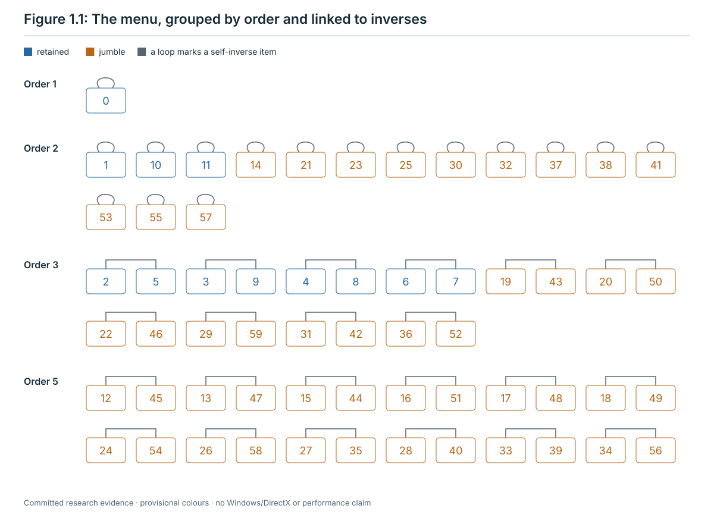
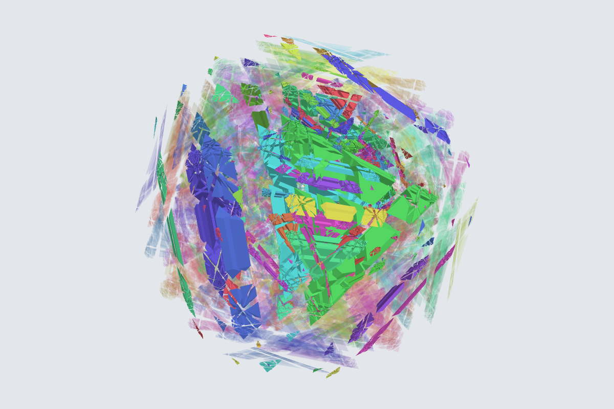
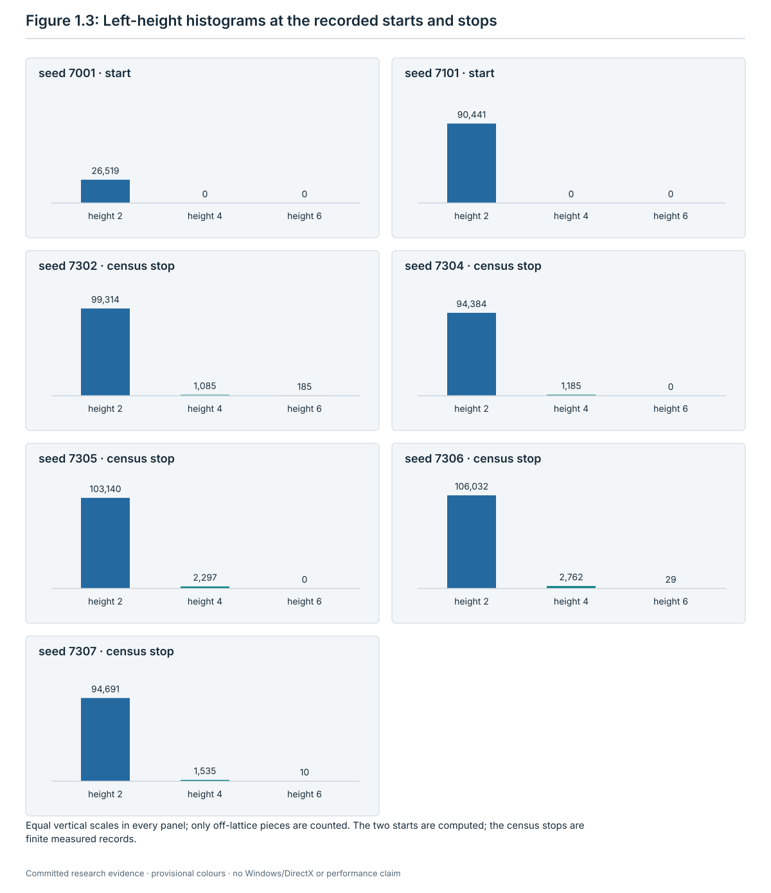
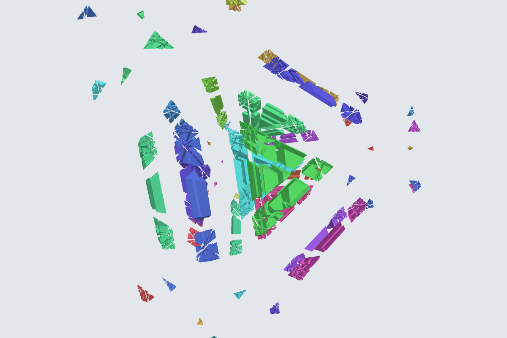
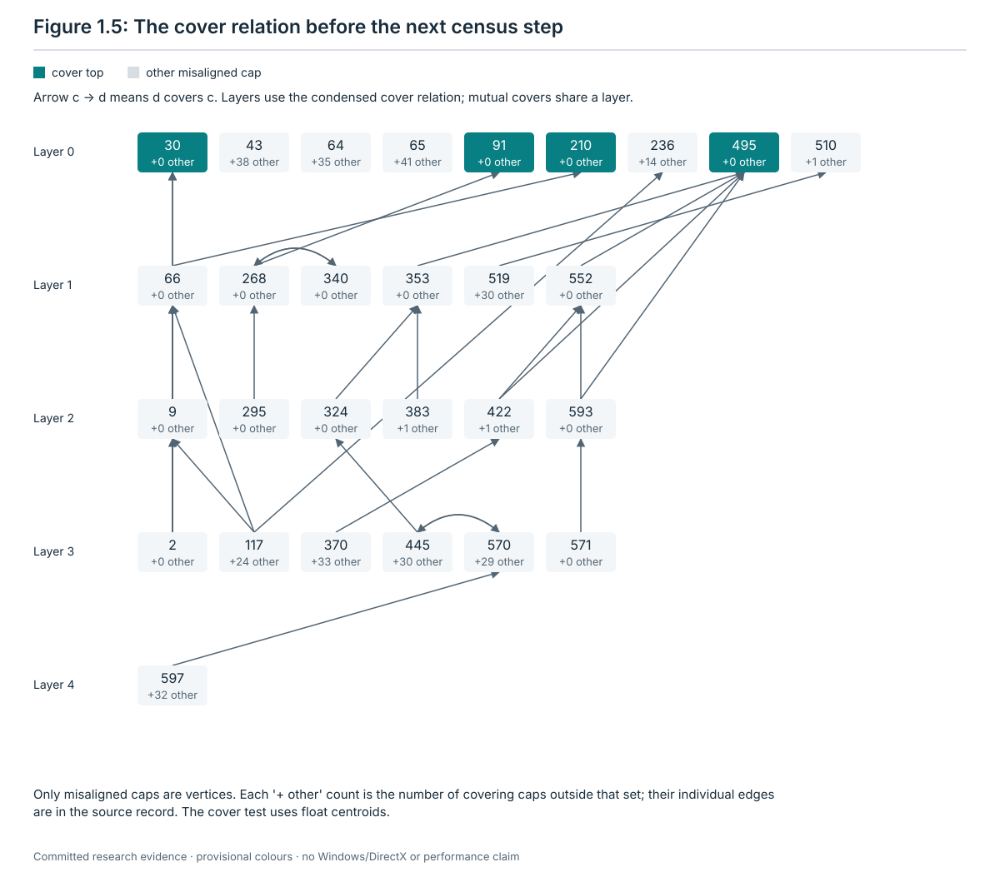
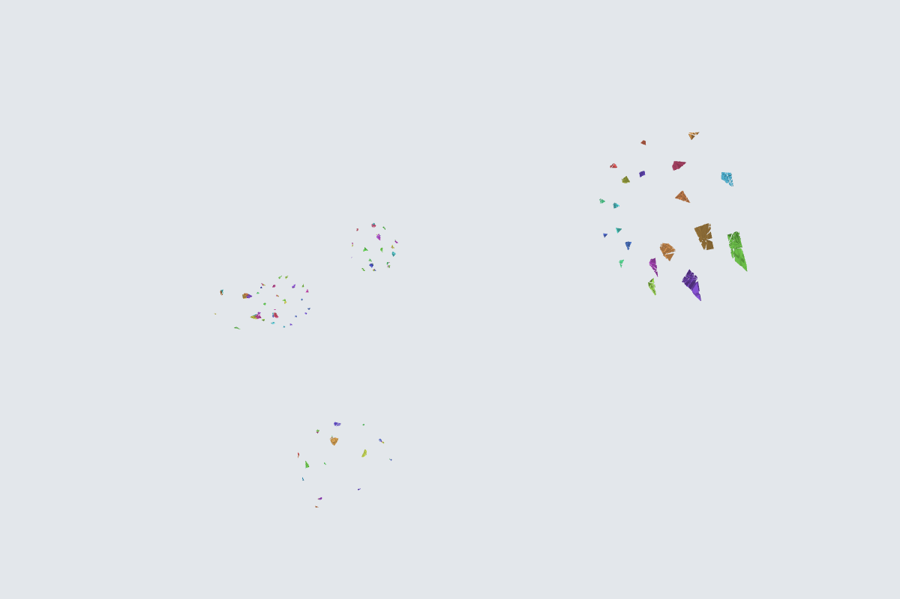
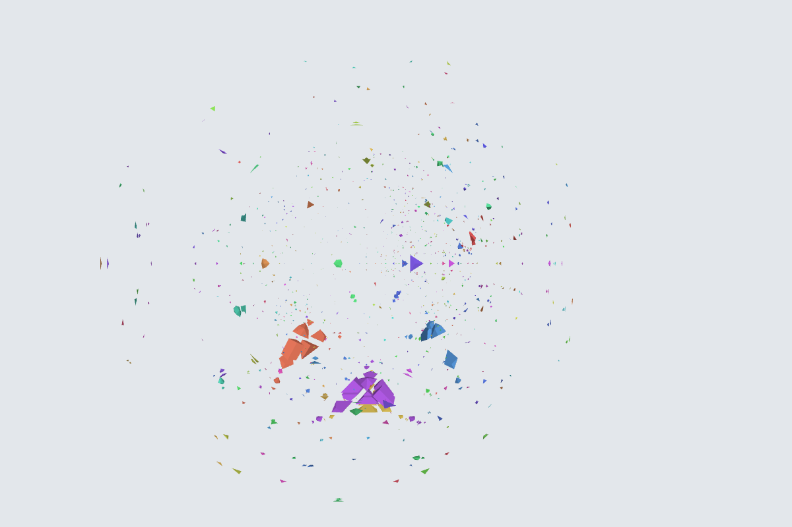
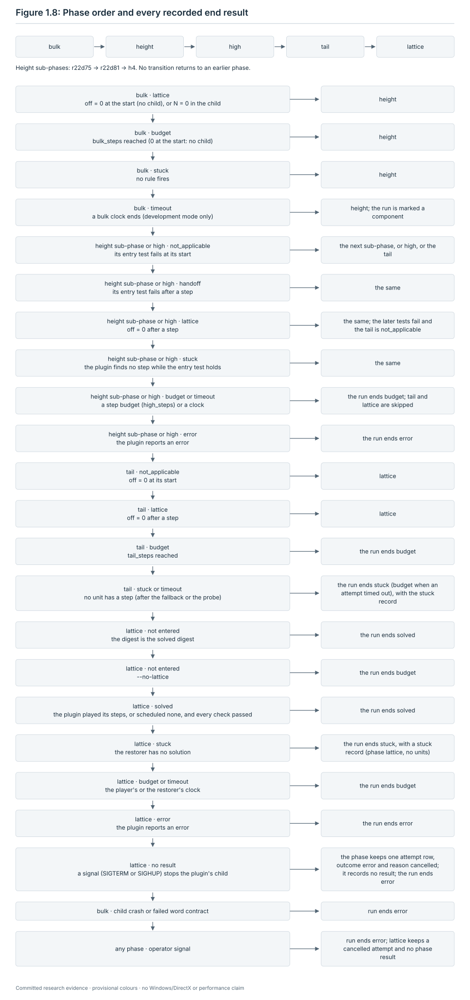
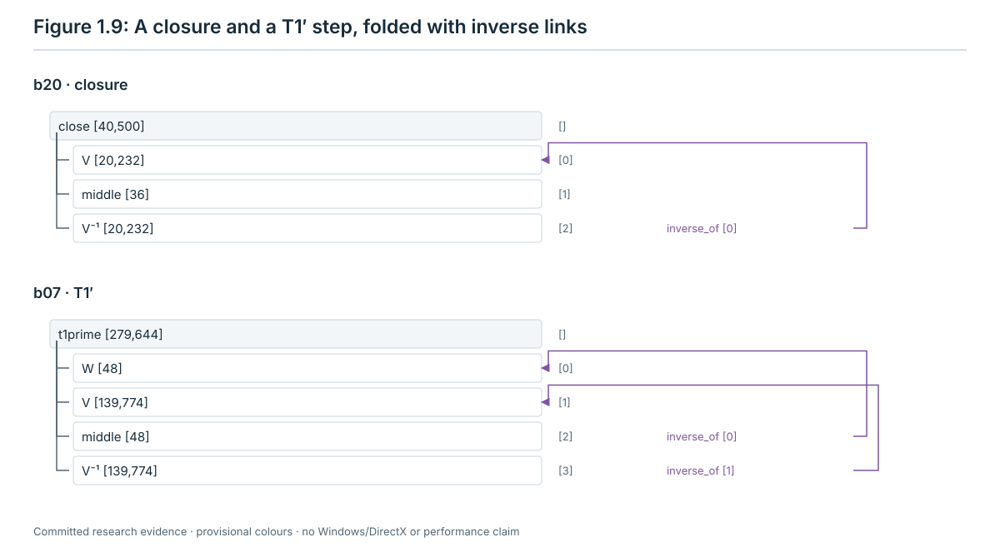

# 1. What the machine reads

This chapter defines every quantity that the later chapters use. Each one is a function of the current state alone:
the exact pose of every piece. Nothing here reads the scramble, the history of the run or a clock.

The machine that follows the tutorial is the tutorial runner,
[`runner.py`](../restoration/13-tutorial-runner/scripts/runner.py). Its phases come in a fixed order: bulk
(chapter 2), height (chapter 3), high (chapter 4), tail (chapter 5) and lattice (chapter 6). Chapter 7 describes the
record it writes. This chapter gives the words those chapters use, says where each one is computed, and says which
component plays each kind of step (section 1.4) and how the runner moves from one phase to the next (section 1.12).

Code citations give `path:line` from the repository root. Every line number refers to commit `35c3d4f`, for every
file. After its first citation, a file is cited by its name alone. Each name stands for one path:

| Name | Path |
| --- | --- |
| `runner.py`, `runner_api.py`, `check_run.py`, `check_lattice.py`, `lattice_phase.py`, `literal_lattice.py`, `test_runner.py`, `test_literal_lattice.py` | `research/jumbling/restoration/13-tutorial-runner/scripts/` |
| `state.py`, `kplus.py`, `twists.py`, `model.py` | `research/jumbling/sim/` |
| `restore.py`, `rim.py`, `seams.py`, `blocks.py`, `trees.py`, `groups.py`, `orient.py`, `buffer.py` | `research/jumbling/theory/` |
| `mkblocks2.py` | `research/jumbling/restoration/09-general-method/scripts/gm/` |
| `verify_late.py` | `research/jumbling/restoration/09-general-method/scripts/lattice/checker/` |

The chapter's own script and record are
[`scripts/ch01_examples.py`](scripts/ch01_examples.py) and [`records/ch01-examples.json`](records/ch01-examples.json),
cited as `research/jumbling/tutorial/scripts/ch01_examples.py:line`. The script is read-only. It imports the simulator
and the theory modules, computes, and writes the record. It runs in about three minutes:
`python3 -I -B research/jumbling/tutorial/scripts/ch01_examples.py --out <new file> --cache <new directory>`.

## 1.1 How to read this tutorial

**Evidence labels.** Every claim carries one of these labels.

| Label | Meaning |
| --- | --- |
| **computed** | An exact computation with a replayable record or script. |
| **proved (model review only)** | A proof that models have checked. No person has checked it yet. |
| **measured** | A result on finite inputs, such as a set of runs. |
| **run on one instance** | A result on one input. |

A finite test never shows that every scramble is restored. No uniform bound on the length of a restoration exists:
the left heights of reachable states are unbounded, and one twist changes a left height by at most 2 (**proved
(model review only)**, [stage 10](../restoration/10-x1-unbounded/README.md); section 1.6).

**The frame of a definition.** Rule sections in chapters 2 to 6 use the frame **Reads** / **Candidates and order** /
**Test** / **Step played (tree)** / **Contract** / **No step** / **Evidence** / **Where in the code**. This chapter
has no rules that play words. Its sections use the same frame, adapted to a quantity:

| Field | What it says here |
| --- | --- |
| **Reads** | the parts of the state the quantity depends on |
| **Order** | the order in which its entries are listed, with every tie-break |
| **Definition** | the exact test or formula |
| **Value** | what the machine stores or records |
| **Undefined** | when the quantity does not exist, and what the machine does then |
| **Evidence** | the status of the facts used |
| **Where in the code** | `path:line` |

**Two modes.** The runner has two modes (`--mode`, `research/jumbling/restoration/13-tutorial-runner/scripts/runner.py:1606-1607`).

| | Acceptance mode | Development mode (the default) |
| --- | --- | --- |
| Options | Frozen. Eleven options must equal [`acceptance-config.json`](../restoration/13-tutorial-runner/acceptance-config.json); the runner refuses any other value (`runner.py:145-158`, `:445-447`). The checker compares them again (fail `acceptance_config`, `research/jumbling/restoration/13-tutorial-runner/scripts/check_run.py:297-323`). | Any value. |
| Values | The file's values. They are also the runner's defaults (`runner.py:1593-1615`): `literal_limit` 10,000,000, `seeds` `atlas`, the four tail rules, `lattice_restorer` `schedule11`, `fallback_max_length` 1, `par` 1, `pair_shards` 4, `bulk_steps` null, `tail_steps` 0 and `high_steps` null (no step budget; a `tail_steps` of 0 means none, `runner.py:1264`), `no_lattice` false. | |
| Clocks | None. The record keeps every clock as null (`runner.py:483-486`). | Each clock has a default of 3600 s or less. |
| Lattice restorer | `schedule11`, the round 11 schedule: at most 20,866,844 retained twists plus at most 25,852 for the corrections. | `schedule11`, or `late` with `--lattice-restorer late`: at most 1,324,660,182 retained twists plus at most 25,852. |
| Certificate closures and fallback | A closure built from a certificate is played twist by twist; a fallback word is only a probe and is never played (`runner.py:1188-1195`, `:1246-1255`, `:1281-1283`). | A certificate step loads the gate's end table; a fallback step is played. |

The two lattice bounds are **proved (model review only)**
([METHOD](../restoration/09-general-method/METHOD.md), "Lattice-phase length", line 175). On the depth 20 scramble
of seed 7106, the lattice phase played 8,701,310 twists with `late` and 1,516,410 with `schedule11`, with no
correction in either (**run on one instance** each; two runs D0 on uncommitted candidates before commit `35c3d4f`,
the `late` run in acceptance mode while the configuration still named `late`, the `schedule11` run in development
mode; [stage 13 README](../restoration/13-tutorial-runner/README.md) section 9). They are to be repeated on the
committed head.

**Examples.** All examples come from development seeds and committed records. No acceptance seed is used.

| State | Where it comes from |
| --- | --- |
| the start of seed 7001 (10 twists) | `restore.scramble(I_a, 10, 7001)`; record sections A to E |
| the start of seed 7106 (20 twists) | only the D0 numbers above |
| the start of seed 7101 (40 twists), and the state before the 17th step of its census run | record section F; census record [`ia-k40-s7101.json`](../restoration/11-scramble-census/runs/round1/ia-k40-s7101.json) |
| the depth 40 stop: the end of census round 2 of seed 7101 | [stage 12](../restoration/12-low-height/README.md) section 4 |
| the ends of the census descents from 3000 twists of seeds 7302 and 7304 to 7307 | [stage 11](../restoration/11-scramble-census/README.md), "A descent from 3000 twists". Seed 7303 has no census descent. |
| two states of E2's literal replay (stage 12), used by the runner's tests | section 1.13 |

## 1.2 The puzzle, caps and the menu I_a

**The puzzle.** The puzzle is the full 600-cell model, 600-cell-Full. It has 177,120 pieces, the 600 cell centres
included, and 259,800 labelled sticker slots, 433 per cell (`research/jumbling/sim/model.py:16-18`). The jumbled
puzzle keeps this geometry. Only the twists are new (owner decision of
[9 October 2026](../../../docs/wiki/decisions/owner-decisions-2026-10-09-jumbling.md)).

**Caps.** Each cell c (0 to 599) has a pole n_c and a cut, the hyperplane n_c · x = κ. The **cap** c is the closed
half-space n_c · x ≥ κ. All poles have the same length, |n|² = 12 + 4√5, and κ = (121/125)·|n|²
(`research/jumbling/sim/model.py:36-40`; the float value used by `seams.py` is at
`research/jumbling/theory/seams.py:65`). In code a cap index is also called a **grip**.

- At home, every cap holds exactly 3,097 chambers (**computed**, record `B_geometry.chambers_per_cap_min_max`,
  `research/jumbling/tutorial/scripts/ch01_examples.py:110-111`).
- Each cap meets exactly 80 other caps (**computed**: an exact check of all 359,400 ordered pairs,
  [stage 12 README](../restoration/12-low-height/README.md) lines 367-370,
  [`eb6_meet.py`](../restoration/12-low-height/scripts/eb6_meet.py)).
- `restore.NEAR[c]` lists the caps whose pole lies within 55.7° of n_c. The list is computed in floating point, from
  the float poles (`research/jumbling/theory/restore.py:54-57`). The same exact check certifies it: it holds c itself
  and the 80 caps that meet c, and no other cap (the next angle is 56.01°). Every list has 81 entries, contains c, and
  is in increasing order (**computed**, record `B_geometry.near_sizes`, `near_contains_self_and_sorted`).

**The menu I_a.** The owner chose the menu I_a on
[13 October 2026](../../../docs/wiki/decisions/owner-decisions-2026-10-13-jumbling-menu.md). At every cap the menu
has 60 **items**, numbered 0 to 59. They are the 60 rotations of one icosahedral group that fixes the pole. The item
i of cap c is the exact rotation

E(c, i) = F_c · m_i · F_cᵀ,

where m_i is the i-th rotation of the base menu at cap 0 and F_c is the retained frame of cap c, a rotation in K⁺
that takes pole 0 to pole c (`research/jumbling/theory/restore.py:67-69`).

- **Item numbers.** m_0, …, m_59 are numbered in the order in which `groups.build()` finds them. It closes the
  group breadth first from the identity, multiplying on the left by the 12 rotations of A4₀ (in the order of
  `sim.a4_element(ctx, 0, i)`, i = 0 to 11) and then by the fifth-turn about the axis (0, 1, φ), and checks the
  closure exactly (`research/jumbling/theory/groups.py:35-47`, `:54-73`). Each rotation is lifted to R⁴, fixing
  pole 0 (`groups.py:30-33`). `TwistMenu` keeps this order (`research/jumbling/fixtures/wj.py:50-56`,
  `research/jumbling/sim/twists.py:441-474`).
- **The base matrices.** The record keeps the 60 exact matrices in item order (`A_menu.base_items`) and the SHA-256
  of their compact JSON list, `5a0429d2…` (`A_menu.ordered_items_sha256`; script `:54-55`, `:102`). The order-free
  menu identity is `fddc8532…` (`A_menu.menu_identity_sorted`; `research/jumbling/sim/twists.py:482-483`).
- **The frames.** F_c is the K⁺ element `kplus.frame_idx[c]`: the element whose permutation of the poles is row c
  of `frameperms` in `assets/model.npz` (`research/jumbling/sim/kplus.py:68`, `research/jumbling/sim/twists.py:488-489`).
  The record keeps the 600 K⁺ indices (`A_menu.frame_kplus_index`) and the SHA-256 of the 600 frames, `18392401…`
  (`A_menu.frames_sha256`).
- Another numbering, or another choice of frames, would permute the item numbers. Every literal word in this tutorial
  uses this numbering and these frames.

| Items | Name | What they do | Evidence |
| --- | --- | --- | --- |
| 0 | identity | nothing | **computed** (`A_menu.item0_is_identity`) |
| 0 to 11 | **retained** items | the 12 rotations of A4_c, the twists of the retained puzzle; they keep the lattice | **computed** (`A_menu.retained`: the items whose base rotation lies in A4₀, `research/jumbling/theory/restore.py:72-74`) |
| 12 to 59 | **jumble** items | the other 48 rotations; on a lattice piece they give left height 2 | **computed** (`A_menu.jumble`; left height: `trees.py --check`, [restoration](../theory/restoration.md) T4) |

Every item fixes its pole n_c, at all 600 caps (**computed**, `A_menu.every_item_fixes_its_pole_at_all_600_caps`,
script `:85-90`).

**Orders of the items.** A4 has 1 identity, 3 half-turns and 8 third-turns. The icosahedral rotation group has 1
identity, 15 half-turns, 20 third-turns and 24 fifth-turns. Item by item (**computed**, `A_menu.orders`, script
`:58-64`, `:81-83`):

| Order | Retained items | Jumble items |
| ---: | --- | --- |
| 1 | 0 | – |
| 2 | 1, 10, 11 | 14, 21, 23, 25, 30, 32, 37, 38, 41, 53, 55, 57 |
| 3 | 2 to 9 | 19, 20, 22, 29, 31, 36, 42, 43, 46, 50, 52, 59 |
| 5 | – | 12, 13, 15, 16, 17, 18, 24, 26, 27, 28, 33, 34, 35, 39, 40, 44, 45, 47, 48, 49, 51, 54, 56, 58 |

**Inverse items.** The inverse item ī of i is the item with E(c, ī) = E(c, i)ᵀ. Each E(c, i) is m_i conjugated by
F_c, so the table is the same at every cap; the script checks it at all 600 caps (**computed**,
`A_menu.inverse_table_same_at_all_600_caps`, script `:85-89`). The runner computes it in `Mechanics.inverse_word`
(`runner.py:300-303`), the checker in `inverse_items` (`check_run.py:440-443`) and the lattice checker in
`check_tree_ranges` (`research/jumbling/restoration/13-tutorial-runner/scripts/check_lattice.py:186-188`), all from
the exact matrices. The table (**computed**, `A_menu.inverse`):

| Kind | Pairs i ↔ ī |
| --- | --- |
| self-inverse (16 items: the identity and the 15 half-turns) | 0, 1, 10, 11, 14, 21, 23, 25, 30, 32, 37, 38, 41, 53, 55, 57 |
| retained pairs | 2 ↔ 5, 3 ↔ 9, 4 ↔ 8, 6 ↔ 7 |
| jumble pairs | 12 ↔ 45, 13 ↔ 47, 15 ↔ 44, 16 ↔ 51, 17 ↔ 48, 18 ↔ 49, 19 ↔ 43, 20 ↔ 50, 22 ↔ 46, 24 ↔ 54, 26 ↔ 58, 27 ↔ 35, 28 ↔ 40, 29 ↔ 59, 31 ↔ 42, 33 ↔ 39, 34 ↔ 56, 36 ↔ 52 |



## 1.3 Pieces, poses and the lattice

**Pieces and poses.** Every piece P has a home chamber and an exact **pose** γ_P, a rotation of R⁴ with entries in
Q(√5). The region of P is γ_P applied to its home chamber. The identity pose means "at home"
(`research/jumbling/sim/state.py:1-8`).

**K⁺.** K⁺ is the rotation group of the 600-cell, of order 7,200 (**proved (model review only)** with two
**computed** inputs, [restoration](../theory/restoration.md) T3). The pieces fall into 36 K⁺-orbits, the piece
**types** (**computed**: the simulator builds the orbits exactly, [sim README](../sim/README.md) line 43;
[PROOFS-U](../restoration/08-units-and-clean-steps/PROOFS-U.md) section 1).

**Lattice and off pieces.**

- **Reads**: the pose of every piece.
- **Definition**: a piece is **on the lattice** when its pose lies in K⁺. Otherwise it is **off** the lattice.
- **Value**: `off`, the number of off pieces (`State.off_lattice_count`, `research/jumbling/sim/state.py:156-157`),
  and the **off set**, the set of off pieces by index (`Mechanics.off_set`, `runner.py:286-287`). A state is a
  **lattice state** when `off` = 0.
- **Evidence**: in a reachable state the regions are distinct, so the empty chambers (holes) number exactly `off`
  (**proved (model review only)**, Fact 1 of [PROOFS-U](../restoration/08-units-and-clean-steps/PROOFS-U.md)
  section 1). A reachable lattice state holds every chamber exactly once (**proved (model review only)**, Lemma 1.2a
  of the [theory draft](../theory/theory-draft.md)).

**Pose tables.** The runner stores a state as a **pose table**, a JSON file written with `json.dumps` and its
default separators, followed by a newline (`buffer.export_pose_table`, `research/jumbling/theory/buffer.py:829-834`):

| Key | Content |
| --- | --- |
| `poses` | the exact matrix of every pose in the state's pose table, in pose order; pose 0 is the identity |
| `pose_id` | for every piece, the index of its pose |
| `digest` | the state's digest (section 1.10) |
| `journal` | always `[]`: a table holds no history |

Loading a table interns the matrices, puts the pose table in canonical order (section 1.5) and fails unless the
digest matches (`orient.set_pose_table`, `research/jumbling/theory/orient.py:424-436`, the ordering at `:431`;
`Mechanics.load`, `runner.py:254-257`).

## 1.4 Letters, words and admissibility

**Letters.** A **letter** is a pair (c, i): a cap c from 0 to 599 and an item i from 0 to 59. In a JSON word it is
the pair `[c, i]` of two integers. In the compact encoding `ia16` it is the code 60·c + i, below 36,000.

**Admissibility.**

- **Reads**: the poses of all pieces.
- **Definition**: the letter (c, i) is **admissible** at X when no piece straddles the cut of c. Each piece is
  classified exactly as inside cap c, outside it, or straddling it, with a certificate
  (`research/jumbling/sim/state.py:10-23`, `State.classify` at `:213-281`). The **inside set** of c is the set of
  pieces inside (`Restorer.inside`, `research/jumbling/theory/restore.py:112-117`).
- **Step played**: the letter multiplies the pose of every piece of the inside set by E(c, i) on the left and leaves
  every other piece in place (`State.apply` and `State._commit`, `research/jumbling/sim/state.py:341-377`). A played
  letter is a **twist**.
- **Undefined**: a straddled cap is **blocked**; a piece left without a certificate makes the letter **uncertain**; a
  rotation that is not an exact menu element is **invalid**. None of them changes the state (`state.py:341-357`).
- **Evidence**: admissibility is decided in exact arithmetic over Q(√5) (**computed**; the simulator's acceptance
  run, [sim README](../sim/README.md)).

**Who plays each kind of step.** The runner checks every word it records, but it does not play every word itself.

| Step | Who plays its letters | An inadmissible letter | Where in the code |
| --- | --- | --- | --- |
| bulk | the bulk child's rules, through `Restorer.apply`. After the child ends, the runner reloads the start table and replays every bulk word with `Mechanics.apply_word`. | A rule that tries an inadmissible trial letter skips it and goes on (lock, shift, conj). In the runner's replay it raises, and the run ends `error`. | `research/jumbling/theory/restore.py:130-135`, `:254`, `:287`; `research/jumbling/theory/seams.py:234`; `runner.py:604-611` |
| height, high | the plugin proposes a literal word; the runner plays it with `Mechanics.apply_word` | `ValueError`; the run ends `error` | `runner.py:737-766`, `:289-298` |
| tail and fallback, acceptance mode; development mode without a certificate | the runner, with `Mechanics.apply_word` | the same | `runner.py:1193-1195` |
| tail with a certificate, development mode only | nobody: the runner loads the gate's end table and checks its digest | – | `runner.py:1188-1192` |
| lattice | the literal lattice player (`literal_lattice.py`) in the lattice plugin's child, twist by twist. The runner checks each step's word file, tree and digest chain and loads the end table; it does not replay the words. | The player refuses it (for example `correction_admissible`) and the plugin ends the phase `error`. | `runner.py:1392-1437`; `research/jumbling/restoration/13-tutorial-runner/scripts/lattice_phase.py:543-563`; `research/jumbling/restoration/13-tutorial-runner/scripts/literal_lattice.py:426` |
| every step, again | the checker replays every word letter by letter: JSON words itself, `ia16` words through `check_lattice.replay_lattice_step` | fail `admissible` | `check_run.py:1318-1348` |

**Words.** A **word** is a finite sequence of letters w = ℓ₁ ℓ₂ … ℓ_n, played left to right. Its **length** |w| is
the number of letters, also called twists. X·w is the state reached from X by playing w. The theory writes a single
twist on the left, as (c, g)X; this is the same state as X·(c, g).

- A **literal** word is the list of its letters. The runner's `literal` refuses anything else: a word given as
  segments, a straight-line program or a certificate, any letter outside 0 ≤ c < 600, 0 ≤ i < 60, and a word whose
  `input_digest` or `output_digest` differs from the expected one (`runner.py:204-224`).
- A word is **admissible from X** when each letter is admissible at the state where it is played.
- The **inverse letter** of (c, i) is (c, ī). The **inverse word** of w is w⁻¹ = ℓ_n⁻¹ … ℓ₁⁻¹: the letters in reverse
  order, each inverted (`runner.py:300-303`). If w is admissible from X, then w⁻¹ is admissible from X·w and returns
  X (**proved (model review only)**, Proposition 1.2 of the [theory draft](../theory/theory-draft.md) applied letter
  by letter).
- Consecutive letters at one cap compose: (c, i)(c, j) has the same effect as the one letter (c, k) with
  E(c, k) = E(c, j)·E(c, i) (**proved (model review only)**, Proposition 2.2 of the theory draft).

**Word files.** A word is stored in one of two encodings.

| Encoding | File | Bytes | Its `word_sha256` |
| --- | --- | --- | --- |
| `json` | `words/NNNNN.json`, or `.json.gz` (gzip, modification time 0) above 100,000 letters | `{"word": [[c, i], ...], "input_digest": ..., "output_digest": ...}` written with `indent=1`, then a newline (`runner.py:89-98`, `:726-730`) | SHA-256 of `json.dumps(word)` with the default separators, as ASCII (`runner.py:106-107`; checker `check_run.py:436-437`) |
| `ia16` | `words/NNNNN.ia16.gz`, lattice steps only | gzip with modification time 0 of the codes 60·c + i as little-endian unsigned 16-bit integers, nothing else (`research/jumbling/restoration/13-tutorial-runner/scripts/runner_api.py:226-265`) | SHA-256 of the uncompressed bytes; `ia16_digest` recomputes it and the length from the file (`runner_api.py:268-290`) |

**Notation used in the later chapters.**

| Notation | Meaning |
| --- | --- |
| (c, i) | one letter |
| u·v | the word u, then the word v |
| w⁻¹ | the inverse word |
| wᵉ | w repeated e times |
| V·W·V⁻¹ | a closure: V, then the middle W, then V inverted (chapter 5) |
| [x, y] = x·y·x⁻¹·y⁻¹ | a commutator of two words |
| u⁻ˢ·x·uˢ | a conjugate, as in the lattice cascade (chapter 6) |
| X·w | the state after playing w from X |

**The start state.** A run starts from a pose table (`--table`) or from a census scramble (`--scramble k seed`)
(`runner.py:450-456`). `restore.scramble` draws k admissible letters, each at a uniformly random cap with a uniformly
random jumble item, skips inadmissible draws, and forgets the letters (`research/jumbling/theory/restore.py:77-91`;
`Mechanics.scramble`, `runner.py:250-252`). The scramble is used only to build the start state. Every rule reads only
the current state.

## 1.5 Domains

**Reads**: the poses of all pieces.

**Definition.** Two pieces P and Q are in the same **domain** when γ_Q⁻¹ γ_P lies in K⁺: their regions lie in one
rotated copy of the chamber pattern. A domain is a left coset γK⁺. The **lattice domain** is K⁺ itself, the domain of
every lattice piece.

**Order.**

- The simulator keeps the pose table in a canonical order: pose 0 is the identity, and the other poses in use follow
  in increasing order of a string key. The key of a pose in K⁺ is `'K%05d'` of its K⁺ index; the key of any other
  pose is `'M'` followed by `json.dumps(matrix_json(M))` (section 1.10). So the poses in K⁺ come first by K⁺ index,
  and the others follow in the lexicographic order of the JSON text of their matrices, not in any numeric order
  (`State._sort_key` and `State._compact`, `research/jumbling/sim/state.py:379-397`). Every played letter and every
  loaded table compacts the state this way (`state.py:369`; `research/jumbling/theory/orient.py:431`).
- `rim.Domains` reads the poses in increasing pose index. Domain 0 is the lattice domain. Each pose not in K⁺ either
  joins the first domain whose representative R gives Rᵀ·M in K⁺, or starts a new domain with itself as its
  representative (`research/jumbling/theory/rim.py:98-127`). So the domains are numbered in the order of their first
  pose.

**Representative and chamber.** The **representative** γ_D of a domain D is the identity for the lattice domain, and
otherwise the first pose of D in pose order (`rim.py:105`, `:117`). The **chamber** of a piece P in D is the chamber
that γ_D⁻¹ γ_P maps its home chamber to: the chamber its region occupies in D's frame (`rim.py:121-125`).

**Value**: for every piece, its domain index and its chamber (`Domains.dom`, `Domains.cham`), and the list of members
of each domain.

**Evidence.** Two pieces are in one domain exactly when they have the same positions on the two trees of section 1.6
(**proved (model review only)**, [restoration](../theory/restoration.md) T6). Domain membership is tested exactly,
with the K⁺ lookup of an exact matrix (**computed**, `rim.py:108-116`). N, every N_c, the scores and the cover graph
(sections 1.7 and 1.8) are the same for any choice of representatives: at the start of seed 7001, the script replaces
each representative by the last pose of its domain and gets the same N, the same N_c at all 407 admissible caps, the
same scores at cap 72 and the same cover graph (**run on one instance**, record `D_representatives`, script
`:171-209`). A proof for every state is an open question (section 1.15).

**Example.** At the start of seed 7001 (10 twists; digest `1438ebed…`), 26,519 pieces are off and the state has 8
domains. In domain order (**computed**, record `C_seed7001.domain_sizes_in_domain_order` and `poses_by_domain`):

| Domain | 0 | 1 | 2 | 3 | 4 | 5 | 6 | 7 |
| --- | ---: | ---: | ---: | ---: | ---: | ---: | ---: | ---: |
| pieces | 150,601 | 3,097 | 2,762 | 3,097 | 8,956 | 3,097 | 2,808 | 2,702 |
| poses (index) | 0 | 1 | 2 | 3 | 4, 6, 8 | 5 | 7 | 9 |

Only domain 4 holds more than one pose. With the last pose as representative, its representative changes from pose 4
to pose 8 (`D_representatives.representative_pose_id`).



## 1.6 Left heights and the height histogram

**Tree positions.** Every pose has the form x ↦ s · l x r̄ with quaternions l, r over Q(√5) and a scalar s
(**proved (model review only)**, [restoration](../theory/restoration.md) T1). The quaternion l has a position on a
5-regular tree, the Bruhat–Tits tree at 2, and its distance from the root vertex v₀ is the **left height** d_L of the
pose. The same holds on the right with r (T2).

**Left height of a piece.**

- **Reads**: the pose of the piece.
- **Definition**: d_L = `trees.dist(trees.factors(M)[0])`. `factors` extracts l and r exactly and checks the
  extraction; `dist` returns the tree distance from v₀ (`research/jumbling/theory/trees.py:70-86`, `:196-198`).
- **Facts** (all **proved (model review only)**, [restoration](../theory/restoration.md)):
  - a piece is on the lattice exactly when d_L = d_R = 0 (T3);
  - under I_a, d_R = 0 for every reachable pose, and d_L is even (T5);
  - one twist changes d_L of each piece it moves by −2, 0 or +2 (T5);
  - a piece at left height h needs at least h/2 more jumble twists before it is on the lattice (T7);
  - left heights of reachable states are unbounded ([stage 10](../restoration/10-x1-unbounded/README.md)).

**The height histogram.**

- **Reads**: the poses of the off pieces only.
- **Order**: keys in increasing height.
- **Definition**: for each left height h > 0, the number of off pieces at height h. Lattice pieces are not counted.
- **Value**: a JSON object with string keys, for example `{"2": 99314, "4": 1085, "6": 185}` at the end of the census
  descent from 3000 twists of seed 7302. On a lattice state it is `{}` (`Mechanics.heights`, `runner.py:262-271`).
- **Derived numbers** (`Runner.heights`, `runner.py:621-623`):

  | Name | Definition |
  | --- | --- |
  | max | the largest key, 0 when the histogram is empty |
  | n4 | the count at height 4, 0 when absent |
  | n6 | the count at height 6, 0 when absent |

**Examples.**

| State | Off | Height histogram | Evidence |
| --- | ---: | --- | --- |
| seed 7001, 10 twists | 26,519 | 2: 26,519 | **computed** (record `C_seed7001`) |
| seed 7101, 40 twists | 90,441 | 2: 90,441 | **computed** (record `F_seed7101.start`) |
| seed 7302, end of the census descent from 3000 twists | 100,584 | 2: 99,314; 4: 1,085; 6: 185 | **measured** (stage 11 README line 120) |
| seed 7304, same | 95,569 | 2: 94,384; 4: 1,185 | **measured** (line 142) |
| seed 7305, same | 105,437 | 2: 103,140; 4: 2,297 | **measured** (line 143) |
| seed 7306, same | 108,823 | 2: 106,032; 4: 2,762; 6: 29 | **measured** (line 144) |
| seed 7307, same | 96,236 | 2: 94,691; 4: 1,535; 6: 10 | **measured** (line 145) |

In three scrambles of 3000 twists (seeds 7301 to 7303), checked every 250 twists, no piece was above left height 6
(**measured**, [stage 11](../restoration/11-scramble-census/README.md), "Deeper scrambles", lines 95-108). This is a
finite sample: constructed states reach every height (stage 10).



## 1.7 Misalignment: N, N_c, scores and survey

**Signatures and cut cells.** The **signature** of a chamber is the set of caps that contain it. For a pole e, a
**cut cell** of the cut H_e is a pair of chambers whose signatures are s and s ∪ {e}, with e ∉ s: the **lower** and
the **upper** chamber. The two chambers share a 3-face on H_e. For s = ∅ the lower side is the fixed **core**, the
region in no cap, which counts as part of the lattice domain.

- **Value**: the list of all cut cells as (lower, upper) pairs (`rim.cell_pairs`, `research/jumbling/theory/rim.py:70-84`).
- **How a partner is found.** `rim.partner` finds the chamber with signature s ∪ {e} or s − {e} by a 64-bit additive
  hash of signatures, with random weights from seed 12345 (`rim.py:35-50`, `:53-64`). The code checks at import that
  the 177,120 chamber hashes are distinct (`rim.py:49-50`). The script checks every lookup the code can make: for every
  chamber and every pole, the partner it returns has exactly the expected signature, and `CORE` is returned only for a
  one-pole signature. There are 469,200 hits adding a pole, 469,200 removing one, 600 down to the core, and no false
  hit (**computed**, record `B_geometry.hash_lookups_checked`, script `:112-128`). A true partner is never missed,
  because the hash of s ∪ {e} is the hash of s plus the weight of e, exactly, and the chamber hashes are distinct. So
  every N below is exact.
- The chamber tiling has 469,800 cut cells, 600 of them against the core (**computed**, record
  `B_geometry.cut_cells`, `cut_cells_against_core`; [restoration](../theory/restoration.md) section 2).

**Total misalignment N.**

- **Reads**: the domains and chambers of all pieces.
- **Definition**: N(X) counts the pairs (domain D, cut cell) such that D holds exactly one of the two chambers of the
  cell, over every cut cell of every pole, in each domain's own frame. So it counts seams on rotated cuts that are no
  cap's cut as well (`Domains.total_misalignment`, `research/jumbling/theory/rim.py:176-188`).
- **Value**: an integer. The bulk phase records it as `N` (section 1.11).
- **Evidence**: N(X) = 0 exactly when X is a lattice state (**proved (model review only)**, M3 of
  [restoration](../theory/restoration.md)). N is computed exactly (**computed**, as above).

**Misalignment of a cap, N_c.**

- **Reads**: the inside set of c and the domains.
- **Undefined**: when c is blocked or uncertain, N_c is not computed.
- **Definition**: take each domain D for which γ_D⁻¹ n_c is a pole e (`Domains.pole`, `rim.py:130-136`). Let In_D(c)
  be the cut cells of H_e whose upper chamber holds a piece of D inside c, and Out_D(c) the cut cells of H_e whose
  lower chamber holds a piece of D outside c, plus the core for the lattice domain. Cells are named by their lower
  chamber. Then N_c = Σ_D |In_D(c) △ Out_D(c)| (`Domains.rim_sets` and `Domains.misalignment`,
  `research/jumbling/theory/rim.py:152-174`, `:190-194`). The cut of c is **closed** when N_c = 0.
- **Evidence** (**proved (model review only)**, [restoration](../theory/restoration.md) section 2):
  - M1: N_c = 0 exactly when every contact across the cut joins pieces of one domain and no face on the cut is exposed;
  - M2: an admissible twist of c changes N by exactly the change of N_c.

**Scores of a cap.**

- **Reads**: the state, through the inside set of c and the domains.
- **Definition**: `scores(c)` is
  - `None` when c is blocked or uncertain (no inside set);
  - (N_c, {}) when N_c = 0;
  - otherwise (N_c, {i: N_c after (c, i)}) for all 60 items i, the identity item included.
- **The value after (c, i)** is computed from the current state, without playing the letter. The Out sets do not
  change. For each domain D with a non-empty In_D(c), let g = E(c, i), and look for the domain D′ with
  g·γ_D = γ_D′·k, k in K⁺ (`Domains.coset`, `rim.py:138-150`):
  - if D′ is a present domain, the cells of In_D(c) are carried into D′ by k (`chamber_image`, `rim.py:87-95`);
  - if g·γ_D lies in no present domain, the twist would make a new domain, and every cell of In_D(c) counts 1.

  Then N_c after (c, i) = (the cells counted 1) + Σ_D′ |(cells carried into D′) △ Out_D′(c)| (`rim.py:195-205`;
  `Restorer.scores`, `research/jumbling/theory/restore.py:144-159`).
- **Evidence**: by M2, N after (c, i) equals N − N_c + (N_c after (c, i)) (**proved (model review only)**).

**Survey.**

- **Reads**: `scores(c)` for every cap.
- **Order**: increasing cap index.
- **Definition**: the **misaligned caps** are the caps c with `scores(c)` not `None` and N_c > 0. The survey maps each
  of them to its scores (`Restorer.survey`, `research/jumbling/theory/restore.py:161-167`). A blocked cap is never in
  the survey, whatever its cut looks like.
- **Derived**: `grip_N`, the sum of N_c over the survey (`restore.py:169-171`). It counts only seams on the cuts of
  admissible caps, so it can differ from N. The rules of chapter 2 list caps in their own orders, for example by
  decreasing N_c and then increasing cap (`research/jumbling/theory/seams.py:181-192`, `:222`); the survey itself is
  in cap order.

**Example** (the start of seed 7001; **computed**, record `C_seed7001`, script `:141-169`):

| Quantity | Value |
| --- | --- |
| N | 13,270 |
| misaligned caps in survey order (cap: N_c) | 11: 1,360; 72: 1,566; 151: 1,154; 279: 1,360; 310: 1,360; 380: 1,566; 519: 1,566 |
| grip_N | 9,932 |
| items that close cap 72 (N_c after = 0) | 15, 18, 22, 33, 52, 53, 54, 55, 56, 57, 58, 59 |

The twelve closing items of cap 72 are the items of m_r·m_18 for the twelve retained items r: in letters, (72, 18)
followed by any retained letter of cap 72 (**computed**, `cap72_right_coset_of_item18`, script `:154`). This is the
coset A4·m_18; for an isolated cap, see [restoration](../theory/restoration.md) section 2.

The first bulk step at this state, with the rules in the runner's bulk order, is the rule `seam` with the letter
(72, 18): N falls from 13,270 to 11,704, off from 26,519 to 23,422, and the digest becomes `ab254e2a…` (**computed**,
record `E_bulk0`, script `:211-223`). Chapter 2 gives the rule.



## 1.8 Seams, face pieces and the cover graph

**Seams.** A **seam** is a contact between pieces of two different domains, or a face of a piece that touches
nothing ([restoration](../theory/restoration.md) section 3; [manual](../manual/01-what-you-see.md) section 1.5).
N counts seams cut cell by cut cell.

**Balance of a cap.**

- **Reads**: the rim sets of an admissible cap c (section 1.7).
- **Definition**: (In_c, Out_c, A_c) = (Σ_D |In_D(c)|, Σ_D |Out_D(c)|, Σ_D |In_D(c) ∩ Out_D(c)|): cut cells covered
  inside, covered outside, and covered on both sides by one domain, the **aligned** cells
  (`SeamRestorer.balance`, `research/jumbling/theory/seams.py:107-119`).
- **Undefined**: `None` for a blocked or uncertain cap.
- **Example**: cap 72 at the start of seed 7001 has (783, 783, 0) (**computed**, `C_seed7001.cap72_balance`).

**Face pieces of a cap.**

- **Reads**: the domains, chambers and inside set of c.
- **Definition**: for each domain D with a pole e as in section 1.7, the face pieces are the pieces of D inside c whose
  chamber is the upper chamber of a cut cell of H_e, and the pieces of D outside c whose chamber is the lower chamber
  of a cut cell of H_e. A face piece is **aligned** when the other side of its cell is held by D too: for an inside
  face piece, the cell is in Out_D(c) (for the lattice domain the core counts); for an outside face piece, the cell
  is in In_D(c) (`SeamRestorer.face`, `research/jumbling/theory/seams.py:130-159`).
- **Value**: three lists: the pieces, their aligned flags, and their side, +1 inside and −1 outside.

**Cover relation.**

- **Reads**: the face pieces of a misaligned cap c and the float centroids of the pieces.
- **Centroid of a piece.** The home centroid of a piece is the mean of the exact vertices of its home region (not a
  volume centroid; `wj.centroid`, `research/jumbling/fixtures/wj.py:83-86`), rounded coordinate by coordinate to a
  float (`q5_float`, `research/jumbling/sim/kernel.py:61`). The home centroids are cached in a file
  (`seams.home_centroids`, `research/jumbling/theory/seams.py:70-80`; the runner points the cache into its own
  directory, `runner.py:245`, `:430-433`). The centroid in the current state is the home centroid times the pose
  matrix rounded to floats (`seams.positions`, `seams.py:83-91`).
- **Candidates and order**: every cap d in `NEAR[c]` other than c, in increasing order. A candidate need not be
  admissible or misaligned.
- **Test**: let m be the face pieces of c whose centroid x satisfies x · n_d > κ in floats, with the float poles of
  `restore._NF` and κ = 121/125 · float(|n|²) (`seams.py:64-65`). Count i (inside c) and o (outside c), and the
  aligned ones among them, ai and ao. Cap d **covers** c when i ≥ 10 and i = o = ai = ao: on d's side, c's cut is
  covered on both sides and every face there is aligned (`SeamRestorer.cover_graph`,
  `research/jumbling/theory/seams.py:161-179`).
- **Value**: the **cover graph**, the map from each misaligned cap c to the set of caps that cover it.
- **Cover tops**: the misaligned caps that no cap covers and that cover at least one misaligned cap, in survey order
  (`SeamRestorer.cover_tops`, `research/jumbling/theory/seams.py:194-197`). Chapter 2 uses them.
- **Evidence**: this is the one test in the chapter that is not certified exactly. `NEAR` is computed in floats too,
  but its result is certified exactly (section 1.2). The centroid test compares float centroids with a float κ, and a
  reimplementation with other rounding, or with volume centroids, can disagree for a piece whose centroid lies near
  the cut of d. The test only chooses a cap; every N is exact ([restoration](../theory/restoration.md) U1b). See the
  open questions (section 1.15).

**Example.** Before the 17th step of the census run of seed 7101 (40 twists; census record
[`ia-k40-s7101.json`](../restoration/11-scramble-census/runs/round1/ia-k40-s7101.json), whose first 16 steps are one
letter each), the state has 52,580 off pieces, N = 30,286 and 28 misaligned caps. No cap passes the face match of
chapter 2, and the cover tops are caps 30, 91, 210 and 495. The record's next step is the `cover` step (30, 49)
(**computed**, record `F_seed7101.before_step_16`, script `:225-241`; the census record agrees on N and off).



## 1.9 Blocks and units of the tail

The tail phase (chapter 5) works unit by unit. A unit is a set of off pieces read from the state.

**Cut labels.**

- **Reads**: the poses of the off pieces.
- **Definition**: for every off piece P and every cap c, the label is 1 when P is inside cap c, 2 when P straddles
  its cut, 0 otherwise. Every cap is classified, blocked caps included (`Blocks`,
  `research/jumbling/theory/blocks.py:233-257`).
- **Undefined**: an uncertain classification raises an error (`blocks.py:245-246`), and so does a piece that is
  neither inside, outside nor straddling (`:255-256`). Section 1.9's census program then exits with an error, and the
  run ends `error` (`runner.py:556-569`, `:768-771`).

**Blocks.**

- **Definition**: two off pieces are **joined** when no cap has one of them inside (label 1) and the other outside
  (label 0). A straddle never separates. A **block** is a connected component of this relation
  (`rigid_components`, `research/jumbling/theory/blocks.py:59-77`).
- **Order and names**: blocks are numbered from 0 in increasing order of their smallest piece (`blocks.py:77`). The
  census program writes block j of a state named `<name>` to the file `<name>-bNN.json`, with NN = j in two digits
  (`research/jumbling/restoration/09-general-method/scripts/gm/mkblocks2.py:34`). So "b20" is block 20 of its state.
- **Movers**: the admissible caps that hold the block whole: every piece inside, none straddling
  (`blocks.py:259-264`; `mkblocks2.py:27-28`).
- **Evidence**: a block is rigid: an admissible twist moves either all of it or none of it, since a cap that held one
  piece inside and another outside would separate them, and a cap that a piece straddles is not admissible. This
  follows from the definitions.

**Units.**

- **Reads**: the blocks and the domains (section 1.5).
- **Definition** (`research/jumbling/restoration/09-general-method/scripts/gm/mkblocks2.py:25-46`):
  - a block whose pieces all lie in one domain is one unit;
  - a block whose pieces lie in several domains gives one unit per domain: the pieces of that domain. The rest of the
    block is the unit's **free set**.
- **Value**: for each unit, its **key** (the smallest piece index in it), its **size** (number of pieces), a target
  file with its pieces (`<name>-bNN.json`, or `<name>-bNN-dD.json` for domain D of a split block) and, for a split
  block, a free file (`mkblocks2.py:37-46`).
- **Order**: decreasing size, then increasing key (`Runner.units`, `runner.py:775-776`). Keys are distinct, so the
  order is total.
- **Undefined**: on a lattice state there are no units, and the tail is not entered (section 1.12). The runner
  refuses a unit census whose digest is not the current one (`runner.py:773-774`). In development mode the census
  program runs under the rule clock; a timeout raises from `units`, which the tail does not catch, so the run ends
  `error` (`runner.py:549-554`, `:561-562`, `:1270`, `:1479-1486`). Acceptance mode has no clock.
- **Example** (**measured**, exact geometry, [stage 12](../restoration/12-low-height/README.md) section 4, lines 80,
  107 and 114): the depth 40 stop of seed 7101 (the end of census round 2; 1,193 off pieces; table digest
  `7e128820…`) has 22 units: 5 edges, 12 triangles, 4 tetrahedra and 1 vertex. Every unit there is the whole content
  of one **class cell**: the set of off pieces of one domain with the same sign vector over the 120 caps of their frame
  class (stage 12, LC-01, lines 83-84).



## 1.10 The digest and the solved test

**The digest.**

- **Reads**: the exact pose of every piece that is not at the identity pose.
- **Definition** (`State.digest`, `research/jumbling/sim/state.py:473-486`):
  1. Group the moved pieces by pose.
  2. For each pose M, the key is `json.dumps(matrix_json(M))` with the default separators `", "` and `": "`.
     `matrix_json` writes the 4 × 4 matrix row by row, each entry (a + b√5)/d as `[a, b, d]` with d > 0 and
     gcd(a, b, d) = 1 (`research/jumbling/sim/kplus.py:214-231`, `research/jumbling/exact.py:14-20`).
  3. The members are the sorted piece indices as 32-bit integers in the machine's byte order
     (`np.sort(members).astype(np.int32).tobytes()`; little-endian on x86-64).
  4. Sort the pairs (key, members) in Python's order: by key string, then by the bytes.
  5. Feed each pair to SHA-256: the key encoded as UTF-8, then the member bytes.
- **Value**: 64 hexadecimal digits.
- **Evidence**: equal states have equal digests, because the serialization is canonical. The converse, that equal
  digests mean equal states, assumes that SHA-256 has no collision here. The state contract defines equality by the
  digest (`state.py:474-475`).
- **The solved digest**: at the solved state no piece is moved, so the digest is SHA-256 of no bytes,
  `e3b0c44298fc1c149afbf4c8996fb92427ae41e4649b934ca495991b7852b855` (`SOLVED`, `runner.py:45`; `check_run.py:48`).

**Identity labels.**

- **Reads**: a lattice state.
- **Definition** (`State.lattice_stickers`, `research/jumbling/sim/state.py:550-581`; [sim README](../sim/README.md)
  line 68, A3). A sticker s (0 to 259,799) is the home slot s: it lies on piece A = `slot_piece[s]` and on cell
  f = s div 433. Let k in K⁺ be the pose of A.
  1. **Slot map.** The sticker sits in slot t = slot(B, k(f)), where B is the piece whose home chamber A now occupies
     and k(f) is the image of cell f. The map s ↦ t must be a bijection.
  2. **Label.** The label of slot t is the sticker s that sits in it.
  3. **Frame.** L = F_{k(f)}⁻¹ · k · F_f must lie in A4₀, the stabilizer of pole 0 (otherwise the call fails).
  4. **Frame agreement.** The sticker agrees when the base-cell region permutation of L maps s mod 433 to t mod 433
     (`base_region_perm`, `research/jumbling/sim/__init__.py:37-46`).

  The labels are the **identity** when every slot t holds sticker t and every sticker agrees
  (`Mechanics.labels_identity`, `runner.py:277-284`; the checker's copy, `check_run.py:946-952`; the player's
  `state_labels` and final test, `research/jumbling/restoration/13-tutorial-runner/scripts/literal_lattice.py:215-221`,
  `:584-588`).
- **Undefined**: off the lattice the labels are not defined; `lattice_stickers` and the player refuse them
  (`state.py:559-560`, `literal_lattice.py:216`), and `labels_identity` returns false (`runner.py:279-280`).

**Two tests, and why they differ.** The owner's definition of restored is the sticker one: all 259,800 slots carry
their home labels ([decision of 15 October 2026](../../../docs/wiki/decisions/owner-decisions-2026-10-15-jumbling-restored.md)).
Identity labels do not fix the exact poses. A piece may carry a rotation in K⁺ that maps the piece onto its own
chamber and each of its stickers onto its own slot, with agreeing frames. Its pose then differs from home, so the
digest differs from the solved digest, while the labels are the identity. Such a rotation is **invisible** to the
labels. Examples:

- the 600 cell centres: a retained twist turns a centre in place while its sticker label stays
  ([sim README](../sim/README.md), "Labelled stickers and frames");
- one-sticker pieces turned about their own sticker ([restoration](../theory/restoration.md) section 4);
- the test `InvisibleRotationTests` builds a lattice state with one piece rotated invisibly, plays a correction word on
  it and ends with identity labels and a digest that is not the solved one (**computed**,
  `research/jumbling/restoration/13-tutorial-runner/scripts/test_literal_lattice.py:637-704`);
- D0's two runs on seed 7106 both ended with identity labels, at two different digests, `a71580bf…` and `71dbda5c…`,
  neither of them the solved digest (**run on one instance**, stage 13 README section 9).

**Where each test is used.**

| Place | Test | Where in the code |
| --- | --- | --- |
| the run reaches the lattice phase at the solved digest | the run is solved; the lattice phase is not entered | `runner.py:1302-1305` |
| a played lattice phase | every row's `after` is a lattice snapshot (off = 0), the last row has `labels_identity` true, and the end table loads to the last row's state; the digest may differ from the solved digest | `runner.py:1418-1437`, `:1459-1460` |
| a lattice phase with no step (the restorer scheduled nothing) | the runner tests the labels of the current state itself | `runner.py:1403-1417` |
| the checker, played lattice phase | identity labels on the last lattice row and no piece off (fail `labels_identity`); a table on the last lattice row only (fail `table`); the plugin's report (fail `lattice_report`, below) | `check_run.py:1432-1450` |
| the checker, lattice phase with no step | the replayed state is on the lattice with identity labels, and the report is checked | `check_run.py:1451-1458` |
| the checker, lattice phase checked by composition (format 1 records and stub plugins) | `verify_late.py` must report the state restored to identity | `check_run.py:1459-1464`, `:1019` |
| the checker, no lattice phase, run `solved` | replayed digest = solved digest (fail `solved_digest`) | `check_run.py:1465-1466` |

**The lattice report.** The checker compares the report that the lattice plugin returned with its own replay (fail
`lattice_report`, `check_run.py:955-975`): the report file must be unchanged (its SHA-256); its restorer must be the
one the configuration names; the player's input digest must be the replayed digest at the start of the phase and its
final digest the replayed end digest, with identity labels; the player's result must be `solved` with no failure; the
played retained and correction twists must add up to the phase's twists; and the scheduled counts must equal the
played ones.

**Example.** The bulk phase of seed 7001 ends at the solved digest after nine one-letter `seam` steps, so the lattice
phase is not entered (**run on one instance**: D0 in acceptance mode on an uncommitted candidate, stage 13 README
section 9; the runner's test `test_01_scramble_10_matches_census`,
`research/jumbling/restoration/13-tutorial-runner/scripts/test_runner.py:2637-2654`, checks the same nine steps
against the census record [`ia-k10-s7001.json`](../restoration/11-scramble-census/runs/round1/ia-k10-s7001.json)).
The committed record [`runs/depth10-seed7001/run.json`](../restoration/13-tutorial-runner/runs/depth10-seed7001/run.json)
shows the same nine steps. It is a format 1 record (`runner-run/1`), made on 19 October 2026 by an earlier runner
whose bulk order still ended with `reopen`, a rule that never fires there (stage 13 README section 5).



## 1.11 Snapshots: what the runner records about a state

The runner records a state by a **snapshot**, never by its history. Chapter 7 gives the whole record.

| Snapshot | Fields | Where it appears | Where in the code |
| --- | --- | --- | --- |
| standard | `digest`, `off`, `heights` (the histogram of section 1.6) | `start` (with the source); the bulk phase's `end` (with its table); the `start` and `end` of each height sub-phase, of the height phase and of the high phase; `before` and `after` of every height, high, tail and fallback step; the `stuck` record | `Mechanics.snapshot`, `runner.py:273-275`; `:468`; `:492-493`, `:614`; `:647`, `:689`, `:696-697`; `:746`, `:754`, `:1182`, `:1196`; `:1287-1288`, `:1382` |
| bulk step | `digest`, `off`, `N` (section 1.7) | `before` and `after` of every bulk step | `runner.py:1550`, `:1560-1561` |
| lattice | `digest`, `off` = 0, `heights` = {} | `before` and `after` of every lattice step; the runner refuses any other | `lattice_snapshot`, `runner.py:227-231`, `:1421` |

The `stuck` record is a standard snapshot plus `phase`, `reason` and `units` (the units and their attempts; empty for
the lattice phase), and in acceptance mode possibly a `probe` (`runner.py:1287-1292`, `:1382`).

**Pose tables in the record.**

| Phase | Table | Where in the code |
| --- | --- | --- |
| bulk | no table per step. The bulk child rewrites `tables/bulk-end.json` after every step, and the runner writes it again after its replay. | `runner.py:1568`, `:612` |
| height, high | `tables/NNNNN.json` after every step, NNNNN the step index | `runner.py:757-758` |
| tail, fallback | `tables/NNNNN.json` after every step: exported from the state in acceptance mode, a copy of the gate's end table in development mode | `runner.py:1206-1210` |
| lattice | one table, on the last lattice row only: the plugin's end table | `runner.py:1451-1453` |

The checker loads every row's table and requires it to be `tables/<index:05d>.json` and to load to the state it
replayed after that row (fail `table`, `check_run.py:978-987`, called at `:1367-1368`). A played lattice phase must
have a table on its last row and on no other (`check_run.py:1445-1446`).

**Other state fields.**

- `start.kind`: `scramble` with `k` and `seed`, or `table` with the stored start table (`runner.py:450-456`, `:468`).
- On every tail and fallback step: `unit`, a copy of the unit's target file at `units/NNNNN.json`; `unit_key`;
  `unit_size`; `landed` (the unit's size); `others_landed`. Some rows also carry `parts`, the rule's metadata, and
  for a certificate step `construction` and `certificate_sha256` (`runner.py:1201-1228`).
- On every high step: `kernel.d19_sha256`, the SHA-256 of the D19 rule the kernel ran. It must equal
  `config.kernel.d19.sha256` (fail `kernel_d19`, `check_run.py:490-495`). `config.kernel.d19` names the D19 rule file
  and its SHA-256 (`runner.py:469-477`, `:485-486`); the checker requires it to be this checkout's file, and in
  acceptance mode requires it to be present (`check_run.py:326-337`).

**Example** (the start of seed 7001; **computed**, record `C_seed7001`; the committed format 1 record has the same
values):

```json
{"kind": "scramble", "k": 10, "seed": 7001,
 "digest": "1438ebed339490d2875e343063e7e79fd51b6a7621f2bf1a054beb5ef7c6d6b1",
 "off": 26519, "heights": {"2": 26519}}
```

## 1.12 Entry tests and transitions

Each phase after the bulk has an **entry test** that reads only the current state (`Runner.entry`,
`runner.py:625-631`; the checker's copy, `check_run.py:661-667`). Chapters 2 to 6 say what each phase then does.

| Phase or sub-phase | Entry test | Where it is tested | Chapter |
| --- | --- | --- | --- |
| `r22d75` | max ≤ 6 and n4 + n6 > 0 | at the start, and after every step (`runner.py:649-656`) | 3 |
| `r22d81` | max ≤ 6 and n6 > 0 | the same | 3 |
| `h4` | max ≤ 4 and n4 > 0 | the same | 3 |
| `high` | max ≤ 6 and n4 + n6 > 0 | the same | 4 |
| `tail` | off > 0 | at the start (`runner.py:1259`); the loop runs while off > 0 (`:1263`) | 5 |
| `lattice` | off = 0 | in `run`, after the tail (`runner.py:1476-1477`); the key `lattice` of `entry` is not called | 6 |

The bulk has no entry test. A state with a piece above height 6 passes none of the height and high tests and goes to
the tail.

**Transitions.** The runner runs the phases in the fixed order and never returns to an earlier one
(`runner.py:1463-1477`).

| Phase | End | Condition | What the runner does next | Where in the code |
| --- | --- | --- | --- | --- |
| bulk | `lattice` | off = 0 at the start (no child), or N = 0 in the child | height | `runner.py:572-573`, `:1541-1544` |
| bulk | `budget` | `bulk_steps` reached (0 at the start: no child) | height | `runner.py:572-573`, `:1545-1547` |
| bulk | `stuck` | no rule fires | height | `runner.py:1552-1558` |
| bulk | `timeout` | a bulk clock ends (development mode only) | height; the run is marked a component | `runner.py:591-597`, `:615-617` |
| height sub-phase or high | `not_applicable` | its entry test fails at its start | the next sub-phase, or high, or the tail | `runner.py:649-650` |
| height sub-phase or high | `handoff` | its entry test fails after a step | the same | `runner.py:654-656` |
| height sub-phase or high | `lattice` | off = 0 after a step | the same; the later tests fail and the tail is `not_applicable` | `runner.py:670-671` |
| height sub-phase or high | `stuck` | the plugin finds no step while the entry test holds | the same | `runner.py:677`, `:708-711` |
| height sub-phase or high | `budget` or `timeout` | a step budget (`high_steps`) or a clock | the run ends `budget`; tail and lattice are skipped | `runner.py:657-658`, `:710-715`, `:1471-1473` |
| height sub-phase or high | `error` | the plugin reports an error | the run ends `error` | `runner.py:698-702` |
| tail | `not_applicable` | off = 0 at its start | lattice | `runner.py:1259-1262` |
| tail | `lattice` | off = 0 after a step | lattice | `runner.py:1298` |
| tail | `budget` | `tail_steps` reached | the run ends `budget` | `runner.py:1264-1267` |
| tail | `stuck` or `timeout` | no unit has a step (after the fallback or the probe) | the run ends `stuck` (`budget` when an attempt timed out), with the `stuck` record | `runner.py:1284-1296` |
| lattice | not entered | the digest is the solved digest | the run ends `solved` | `runner.py:1302-1305` |
| lattice | not entered | `--no-lattice` | the run ends `budget` | `runner.py:1306-1309` |
| lattice | `solved` | the plugin played its steps, or scheduled none, and every check passed | the run ends `solved` | `runner.py:1318-1320`, `:1392-1461` |
| lattice | `stuck` | the restorer has no solution | the run ends `stuck`, with a `stuck` record (`phase` lattice, no units) | `runner.py:1381-1383`; `lattice_phase.py:534-536` |
| lattice | `budget` or `timeout` | the player's or the restorer's clock | the run ends `budget` | `runner.py:1383`; `lattice_phase.py:472-473`, `:564-565` |
| lattice | `error` | the plugin reports an error | the run ends `error` | `runner.py:1378-1380` |
| lattice | no result | a signal (SIGTERM or SIGHUP) stops the plugin's child | the phase keeps one attempt row, `outcome` `error` and `reason` `cancelled`; it records no result; the run ends `error` | `lattice_phase.py:468-471`; `runner.py:1313-1317`, `:1479-1486` |

Inside the bulk child the test is N = 0, not off = 0. The two agree by M3 (**proved (model review only)**, section
1.7). A plugin may not claim `handoff` while its entry test holds, nor `lattice` while a piece is off; the runner
refuses both (`runner.py:678-681`).



## 1.13 Step trees

Every step the runner takes is recorded with a **tree of named parts** that expands to exactly the word played
(owner reading of [20 October 2026](../../../docs/wiki/decisions/owner-decisions-2026-10-20-tutorial-acceptance.md),
"Content of the complete tutorial").

**Parts.** A part has a `name` and a length `letters`, and one of two bodies (`runner_api.py:130-162`):

| Body | Meaning |
| --- | --- |
| `parts: [part, ...]` | a group; its length is the sum of its parts' lengths |
| `span: [from, to]` | the letters from position `from` to `to` of the step's word, `to` excluded |

**Rules of a well-formed tree** (`check_tree`, `runner_api.py:179-207`):

1. The spans, read depth first, cover the word from 0 to its length without gap or overlap.
2. The root's length is the word's length. The depth is at most 64 (`runner_api.py:29`).
3. A part may carry `inverse_of`: the index path, from the root, to an earlier part of the same length that ends
   before this part starts. Its letters are that part's letters inverted, in reverse order. Example: V⁻¹ of a
   closure names V.
4. A part may instead carry `same_as`: the path to an earlier part with the same name and the same letters. It marks
   a macro used again, so the tutorial names it once.
5. No part has both keys. No part has a key named `slp`, `node`, `segments` or `certificate` (`runner_api.py:30`).

**Files.** A tree is stored as `step-trees/NNNNN.json.gz`: gzip, with modification time 0, of
`json.dumps(root, separators=(',', ':'), allow_nan=False)` followed by a newline, in UTF-8. The record keeps
`file`, `sha256`, taken over the uncompressed bytes, and `size`, the number of parts (`runner_api.py:210-223`;
`runner.py:732-735`).

**How the checker expands a tree.**

- For a step with a JSON word, the checker reads the tree, checks the rules above, and compares the letters of every
  `inverse_of` and `same_as` part with the part it names, through the inverse table of section 1.2 (`check_tree`,
  `check_run.py:523-615`, called at `:1225`).
- For a lattice step the checker does not hold the word in memory, so `check_tree` checks only the structure
  (`check_run.py:526-527`). `check_lattice.py` reads the letter ranges from the `ia16` file and compares every
  reference letter by letter (`check_tree_ranges`, `check_lattice.py:130-203`, called from
  `replay_lattice_step` at `:431-433`).

**Trees of each kind of step.**

| Step | Tree | Chapter | Where in the code |
| --- | --- | --- | --- |
| bulk, every rule but `conj` | one span named by the rule (`seam`, `cover`, `close`, `lock`, `improve`, `shift`) | 2 | `runner.py:1569-1573` |
| bulk `conj` | a root `conj` with three one-letter spans `x`, `y`, `z`: the letters (c, x)(d, y)(c, z) | 2 | `runner.py:1569-1573` |
| height, high | the plugin's tree, or one span named by the rule | 3, 4 | `runner.py:751-752` |
| tail without parts, fallback | one span named by the rule | 5 | `runner.py:1236-1237` |
| tail `close` | a root `close` with spans `V`, `middle`, `V⁻¹`; `V⁻¹` is `inverse_of` `V` | 5 | `runner.py:833`, `:924`, `:1238-1244` |
| tail `t1prime`, the landing word W alone | a root `t1prime` with one span `W` | 5 | `runner.py:1011-1013`, `:1238-1244` |
| tail `t1prime` with a closure | a root `t1prime` with spans `W`, `V`, `middle`, `V⁻¹`; `middle` is `inverse_of` `W` and `V⁻¹` is `inverse_of` `V` | 5 | `runner.py:1034`, `:1238-1244` |
| lattice orbit | see below | 6 | `lattice_phase.py:136-194` |
| lattice correction | a root `correction <index>` with one span `macro <m> <family>` (with `⁻¹` for an inverse macro) per application; every span after the first is `same_as` the first | 6 | `lattice_phase.py:197-201` |

**The tree of a lattice orbit** (`orbit_tree`, `lattice_phase.py:136-194`). The cascade program of chapter 6 is a list
of nodes. A node is a word of the program, or a product of signed child nodes, or a conjugate.

- The root is a group `orbit <o>`. Its children are one group `factor <i>` per factor of the orbit, each holding one
  node part (`:190-192`).
- A node part is named `<op> <j>`, the node's operation and index, with `⁻¹` appended when the node is played
  inverted (`:148-149`).
- A conjugate node has three children: u⁻ˢ, then x, then uˢ. The third is a span marked `inverse_of` the first
  (`:172-173`, `:184-185`). Another node has its factors as children, in order, or reversed and inverted when the node
  is played inverted (`:174-175`).
- A node met again, with the same sign, is a span marked `same_as` its first occurrence (`:163-165`).
- **Folding.** A node becomes one span, with no parts inside, when it is a word of the program or has length 0
  (`:167-168`); when it is at depth 64 (`:169-171`); or when its children would bring the tree past 10⁶ parts
  (`TREE_PART_LIMIT`, `:33`, `:176-178`). When the orbit has so many factors that 1 + 2 × (factors) exceeds 10⁶, the
  whole orbit is one span `orbit <o>` (`:143-145`). The plugin's report counts the folded nodes (`tree_folded`,
  `tree_folded_depth`, `:576-577`).
- The letters of a folded span or a leaf span are those of program node j, expanded from the cascade program. Chapter
  6 gives the program; the tree names the node.

**How this tutorial draws a tree.** One line per part: the name, the length in brackets, and a reference when there
is one. Spans are leaves. The two examples below are test results of the runner in development mode (**run on one
instance**, [stage 13 README](../restoration/13-tutorial-runner/README.md) section 5). In both tests the core or W is
E2's, given to `close` and `t1prime` directly. Whether the runner's own rules, in unit order, find these steps at
those states is not tested. b20 and b07 are block numbers at those states (section 1.9).

The closure step for unit b20 at the state of E2's replay with 507 off pieces (V of 20,232 letters, 40,500 letters in
the step, so the middle has 40,500 − 2 × 20,232 = 36):

```
close [40,500]
├── V [20,232]
├── middle [36]
└── V⁻¹ [20,232]        inverse_of: V
```

The T1′ step for unit b07 at the state with 324 off pieces (W of 48 letters, V of 139,774, 279,644 in the step),
whose middle is W⁻¹:

```
t1prime [279,644]
├── W [48]
├── V [139,774]
├── middle [48]         inverse_of: W
└── V⁻¹ [139,774]       inverse_of: V
```

A T1′ step whose landing word W alone meets the step's contract has the one-part tree:

```
t1prime [n]
└── W [n]
```



## 1.14 Summary: what each phase reads

| Quantity | Section | Read by |
| --- | --- | --- |
| letters, items, inverse items | 1.2, 1.4 | every phase |
| off, off set | 1.3 | entry tests, tail contract (chapter 5) |
| domains, chambers | 1.5 | bulk, units |
| left heights, histogram, max, n4, n6 | 1.6 | entry tests, height and high phases (chapters 3, 4) |
| N, N_c, scores, survey | 1.7 | bulk (chapter 2) |
| balance, face pieces, cover graph, cover tops | 1.8 | bulk (chapter 2) |
| blocks, units, unit order | 1.9 | tail (chapter 5) |
| digest, solved digest, identity labels | 1.10 | every step; the end of the run (chapters 6, 7) |
| snapshots, pose tables | 1.11 | the record (chapter 7) |
| entry tests, transitions | 1.12 | the runner between phases |
| step trees | 1.13 | every step (chapter 7) |

## 1.15 Open questions

1. **Representatives of domains.** N, N_c, the scores and the cover graph should not depend on the choice of the
   representative γ_D: replacing γ_D by γ_D·k with k in K⁺ maps every chamber of D's frame by k⁻¹, and K⁺ permutes
   the poles, the signatures and so the cut cells. This argument has not been reviewed. Only one instance is checked
   (section 1.5).
2. **The float centroid test.** The cover relation (section 1.8) is the only test the runner uses that is not
   certified exactly. A certified margin for every piece and every pair of meeting caps, or an exact replacement, is
   not available. Until then the runner's cover choices are defined by its float arithmetic.
3. **D0 on the committed head.** The D0 runs (seeds 7001 and 7106) ran on uncommitted candidates before commit
   `35c3d4f`. They are to be repeated on the committed head before anything relies on them (stage 13 README section
   9).
4. **The chapter's script and record.** [`scripts/ch01_examples.py`](scripts/ch01_examples.py) and
   [`records/ch01-examples.json`](records/ch01-examples.json) are new with this chapter. Every value labelled
   **computed** here without another source depends on them, so they are committed with the chapter.
5. **The pinned commit.** Every line number refers to `35c3d4f`. The later commit `cd5e6e8` adds one condition to the
   `lattice_report` check (the report file must be `lattice/report.json`) and moves the lines of `check_run.py` after
   line 966 down by one. The chapter's citations are to be re-pinned to the commit that merges the tutorial.
