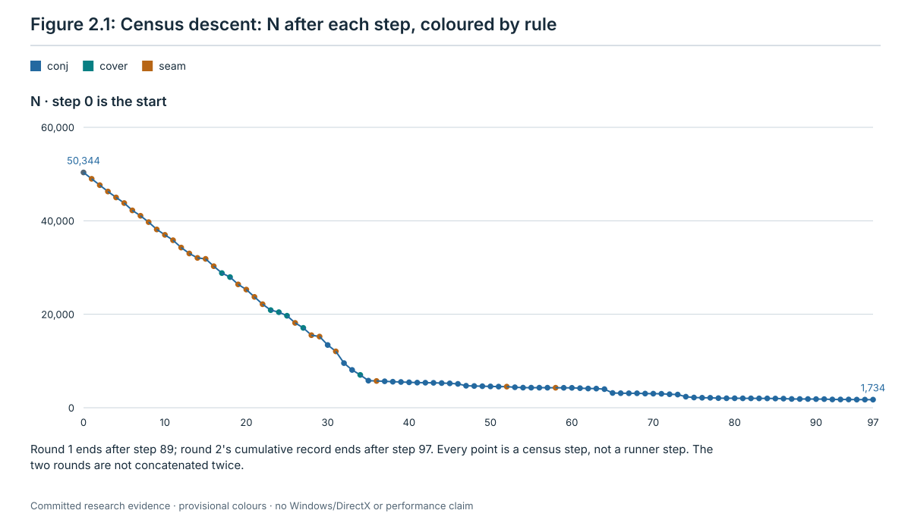
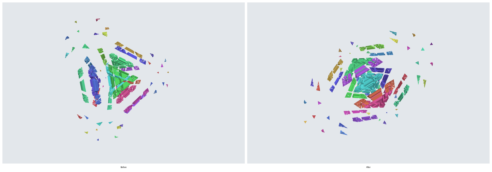
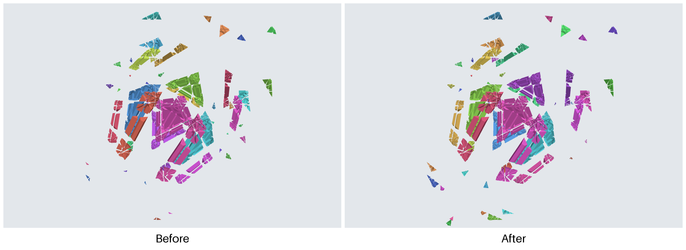
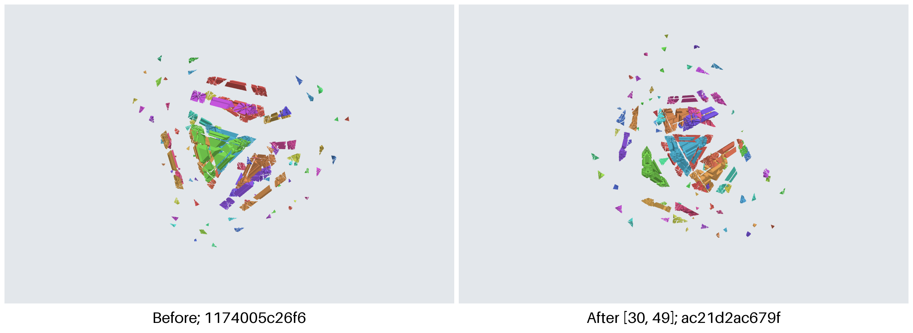
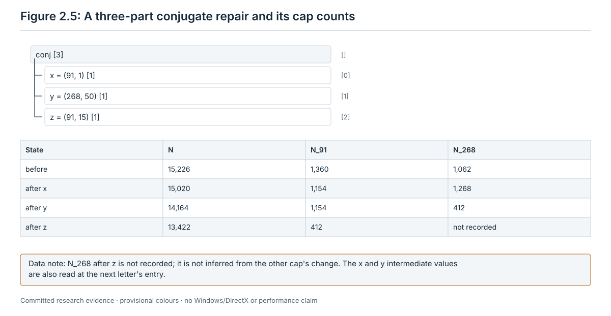

# 2. The bulk descent

The bulk is the first phase of the tutorial. It starts at the scrambled state and plays short words, one to three
letters each, that lower the total misalignment N. It ends when N = 0, which happens exactly when every piece is on the
lattice (M3, section 2.3), or when none of its seven rules finds a word. Every rule is a function of the current
state: none reads the scramble, the record or the twists played before. Section 2.1 says how the code caches values
of the state between steps, and what that relies on.

The machine that follows this chapter is the bulk child of the tutorial runner
[`runner.py`](../restoration/13-tutorial-runner/scripts/runner.py) (`bulk_child`,
`research/jumbling/restoration/13-tutorial-runner/scripts/runner.py:1516-1583`). The child has its own loop. The loop
calls the rule methods of [`seams.py`](../theory/seams.py) and [`restore.py`](../theory/restore.py) in a fixed order
(`runner.py:46-48`). These are the rules that the census of [stage 11](../restoration/11-scramble-census/README.md)
ran, without reopen (section 2.11). The runner does not run the census script. The theory behind the rules is section
3 of the [restoration theory](../theory/restoration.md) (U1 to U7). The manual for a person is
[chapter 2 of the manual](../manual/02-descent.md).

**Citations.** Code citations give `path:line` from the repository root, at commit `88dacaf`. The files `runner.py`,
`runner_api.py`, `seams.py`, `restore.py`, `rim.py` and `acceptance-config.json` are the same at `35c3d4f`, the commit
that chapter 1 cites. In `check_run.py`, every line after line 966 is one line lower at `35c3d4f`. After its first
citation, a file is cited by its name alone. Each name stands for one path:

| Name | Path |
| --- | --- |
| `runner.py`, `runner_api.py`, `check_run.py` | `research/jumbling/restoration/13-tutorial-runner/scripts/` |
| `acceptance-config.json` | `research/jumbling/restoration/13-tutorial-runner/` |
| `seams.py`, `restore.py`, `rim.py` | `research/jumbling/theory/` |
| `census_seams.py` | `research/jumbling/restoration/11-scramble-census/scripts/` |
| `ch02_examples.py` | `research/jumbling/tutorial/scripts/` |

**The chapter's script and record.** [`scripts/ch02_examples.py`](scripts/ch02_examples.py) and
[`records/ch02-examples.json`](records/ch02-examples.json) are new with this chapter. The script is read-only. It
imports the simulator, the theory modules and two constants of the runner (`BULK_ORDER` and the solved digest), plays
the bulk rules on seeds 7001 and 7106 the way `bulk_child` does, and compares every step with the committed D0 records
(section 2.4). It runs in about 7.5 minutes on a cloud machine:
`python3 -I -B research/jumbling/tutorial/scripts/ch02_examples.py --out <new file> --cache <new directory>`. The
record has three sections:

| Section | What it holds | Script |
| --- | --- | --- |
| A | the bulk of seeds 7001 (10 twists) and 7106 (20 twists): every step's rule, word, N, off count and digest, compared with the D0 records | `ch02_examples.py:114-167` |
| B | the state of seed 7106 before and after step 18 (index 17) | `ch02_examples.py:91-111`, `:130-137`, `:149-150` |
| C | after every bulk step of both seeds, every value the playing restorer keeps in its caches, against a fresh restorer | `ch02_examples.py:71-88`, `:151-152`, `:168-173` |

**Step numbers.** A step number counts from 1, as the census README, the manual and the manual's example output print
them. A runner record's `index`, its word and tree file numbers, and positions in a JSON list count from 0. This
chapter writes those as "index". So step 17 of seed 7101 is index 16 of the `steps` list of its census record.

**Terms.** These are defined in chapter 1 and used here without repeating them: cap c (0 to 599); the menu I_a and
its items 0 to 59 (item 0 is the identity, items 1 to 11 are the other retained items, items 12 to 59 are jumble
items); the inverse item ī (section 1.2); a letter (c, i) and a word; an admissible cap, a blocked cap, an uncertain
letter and the inside set of a cap (section 1.4); a domain (section 1.5); a cut cell, N_c, N, the scores and the
survey (section 1.7); the balance, the face pieces and the cover relation (section 1.8); the off count; the state
digest; entry tests and transitions (section 1.12); step trees (section 1.13). Chapter 6 covers the lattice phase and
chapter 7 the record.

**Evidence labels.** **computed** (an exact computation with a replayable record or script), **proved (model review
only)** (a proof checked by models, not yet by a person), **run on one instance** and **measured** (a result on finite
inputs). A statement that comes from exploratory runs whose scripts and records were not kept is called an
*unreplayed lead*. It carries no label and is not evidence.

## 2.1 What the bulk reads

Every rule reads the following, and nothing else. All of it is a function of the current state X.

| Name | What it is | Where in the code |
| --- | --- | --- |
| S, the survey | the caps c = 0, 1, ..., 599, in increasing order, that are admissible and certain at X (not blocked, not uncertain; `scores(c)` is not `None`) and have N_c > 0 | `restore.py:161-167`, `:112-117` |
| N_c | the misalignment of c's cut at X | `restore.py:144-159`; `rim.py:152-174`, `:190-194` |
| after_c(i) | N_c after the letter (c, i), for every item i = 0, ..., 59, computed exactly without playing the letter | `restore.py:156-157`; `rim.py:195-205` |
| N | the total misalignment, counted over every cut cell of every domain | `restore.py:173-175`; `rim.py:176-188` |
| NEAR(c) | the caps whose pole makes an angle below 55.7 degrees with c's pole, computed in floating point. It is exactly c and the 80 caps that meet c (see the evidence below the table) | `restore.py:55-57` |
| inside(c) | the pieces inside cap c, or `None` when c is blocked or uncertain; the poses of these pieces are read from the state | `restore.py:112-117` |
| In_c, Out_c, A_c | the balance: the cut cells of c's cut covered by inside pieces, by outside pieces, and on both sides by one domain (the aligned cells) | `seams.py:107-119` |
| face pieces of c | the pieces with a face on c's cut, each with its side (inside or outside) and whether its cut cell is aligned | `seams.py:130-159` |
| float centroids | the centre of every piece in floating point: its home centroid (chapter 1, section 1.8) times the transpose of its pose matrix rounded to floats. Only cover uses them | `seams.py:70-91` |

**NEAR is exact.** An exact check of all 359,400 ordered pairs of caps shows that each cap meets exactly 80 others,
at angles up to 49.12 degrees, that the next angle is 56.01 degrees, and that the caps within 55.7 degrees are exactly
the caps that meet it (**computed**, [stage 12 README](../restoration/12-low-height/README.md) lines 367-370,
[`eb6_meet.py`](../restoration/12-low-height/scripts/eb6_meet.py), record
[`runs/eb6-meet.json`](../restoration/12-low-height/runs/eb6-meet.json); chapter 1, section 1.2). So NEAR(c) has 81
caps, c included, and the float threshold decides no case.

Five derived numbers are used again and again. For a cap c in S:
- best_c = the smallest after_c(i) over all 60 items;
- drop_c = N_c − best_c, the most that one letter of c lowers N_c;
- B_c = the items i with after_c(i) = best_c (the best items);
- Z_c = the items i with after_c(i) = 0 (the closing items);
- floor_c = |In_c − Out_c|.

Item 0 is the identity, so after_c(0) = N_c and drop_c ≥ 0.

**The floor.** N_c = In_c + Out_c − 2·A_c, by the definitions of chapter 1 (sections 1.7 and 1.8), and
A_c ≤ min(In_c, Out_c).
A letter of c turns the inside faces about c's pole and leaves the outside faces in place, so it keeps In_c and Out_c.
Hence no letter of c brings N_c below floor_c (**proved (model review only)**:
[open problems](../theory/open-problems.md), "Floor (joint attack ...)"; [manual](../manual/02-descent.md), section
2.1). Record B shows the identity N_c = In_c + Out_c − 2·A_c at three caps (**computed**, section 2.4).

By M2 of the restoration theory, a letter of cap c changes N by exactly the change of N_c: N after (c, i) is
N − N_c + after_c(i) (**proved (model review only)**, [restoration](../theory/restoration.md) section 2, M2). M2 is a
statement about N, not about each N_d: a letter of c can change N_d for another cap d, and those changes cancel in N
(section 2.4 has an example). This is why every test below is a sum of after-values, and no rule needs a full count of
N before it decides.

**Caches.** The rules are defined on the current state, but the code keeps three per-cap caches from one step to the
next: the scores (`_sv`) and the inside sets (`_cls`) of `Restorer` (`restore.py:99-100`), and the balances (`_bal`) of
`SeamRestorer` (`seams.py:99`). After every twist of a cap c, and after every undo, it drops the entries of the 81
caps of NEAR(c) and the domains (`restore.py:124-141`, `seams.py:101-104`). The bulk child keeps one restorer for the
whole bulk (`runner.py:1534`). So a cached value is the value at the current state only if a twist of c changes the
inside set, the scores and the balance of no cap outside NEAR(c), that is, of no cap that does not meet c.
- The source states this locality (`restore.py:236-238`), and [PROOFS-B](../restoration/12-low-height/PROOFS-B.md),
  R22D-90, notes that NEAR is used to drop cached cap data. No proof of it is in the repository (open, section 2.18).
- It holds at the 28 states after the bulk steps of seeds 7001 and 7106: every value that the playing restorer had
  cached there, 14,532 scores, 14,532 inside sets and 193 balances, equals the value of a fresh restorer at the same
  state (**computed** at those 28 states, record C).

## 2.2 Shared tie-breaks

Four orders and two item choices appear in several rules. Each is total: two different candidates never tie.

| Name | Order | Used by | Where in the code |
| --- | --- | --- | --- |
| by drop | largest drop_c first; on equal drops the smaller cap number | seam, cover, improve | `seams.py:181-192`; `restore.py:223-226` |
| by N_c | largest N_c first; on equal N_c the smaller cap number | close, conj, lock and shift for their first cap; lock also for its second cap d (by N_d) and its third cap e (by N_e) | `restore.py:192-195`, `:241`, `:257`, `:261`, `:279`; `seams.py:223` |
| openings | items 1, 2, ..., 59 in this order. Item 0 is skipped, as the only item whose rotation is the identity, so the 11 retained items come first. A letter the simulator refuses is skipped | conj, lock, shift | `seams.py:229-235`; `restore.py:249-255`, `:282-288` |
| second cap | conj tries every candidate d in increasing cap number. lock tries only the first two candidates d in the order by N_d. shift takes, among the candidates d that pass, the one with the largest drop_d, the smaller cap number on a tie | conj, lock, shift | `seams.py:225`, `:237`; `restore.py:245`, `:257`; `:291-294` |

**Landing L(c, I).** Given a cap c and a set I of items, play the item of I that brings the most pieces of inside(c)
home, that is, to the identity pose; on a tie, the smallest item number. It reads inside(c) and the pose of each of
its pieces: item i brings a piece with pose M home when E(c, i)·M is the identity. A solver sees this from the labels.
Used by seam, cover, close, improve, lock and shift (`restore.py:197-208`).

**Lowest value V(c).** The item with the smallest after_c(i); on a tie, the smallest item number. Used only by conj,
for its second and third letters (`seams.py:242`, `:249`). It does not use the labels. When no letter of c lowers N_c,
V(c) = 0, the identity: it moves nothing, but it is played and counted like any other letter
([PROOFS-B](../restoration/12-low-height/PROOFS-B.md), R22D-90, "Item 0 of the menu is the identity").

## 2.3 The loop

The bulk repeats one step until it ends. A step is:

1. Count N at the current state (`runner.py:1541`). If N = 0, the bulk ends with the result `lattice`
   (`:1542-1544`).
2. If a step budget is set and reached, the bulk ends with `budget` (`:1545-1547`; development mode only, section
   2.13).
3. Try the rules in the order of the table below (`:1552-1555`). The first rule that returns a word takes the step.
   The rule has already played that word, twist by twist, on the state. A rule that returns nothing leaves the state
   as it found it.
4. If no rule returns a word, the bulk ends with `stuck` (`:1556-1558`).
5. Count N again. The word must be non-empty and N must be lower than in item 1. Otherwise the child raises an error
   and the run ends `error` (`:1559-1563`; section 2.12).
6. Write the word file, the bulk-end table, the step tree and the record row (`:1564-1580`), and go back to item 1.

N = 0 exactly when no piece is off (**proved (model review only)**, [restoration](../theory/restoration.md) M3). The
child does not test the off count itself, unlike `SeamRestorer.run` (`seams.py:318-321`). The checker fails a record
whose bulk ends `lattice` with a piece off (fail `phase_result`, `check_run.py:729-732`).

| Order | Rule | Theory name | Letters | Step tree |
| ---: | --- | --- | ---: | --- |
| 1 | seam | U1a, face match | 1 | one span `seam` |
| 2 | cover | U1b, cover order | 1 | one span `cover` |
| 3 | close | U2, close a cut | 1 | one span `close` |
| 4 | conj | U5″, conjugate repair | 3 | `conj` with three parts `x`, `y`, `z` of one letter each (no run has written one yet; section 2.14) |
| 5 | lock | U4, open, close (and close) | 2 or 3 | one span `lock` |
| 6 | improve | U5, improve a cut | 1 | one span `improve` |
| 7 | shift | U5′, open, then improve | 2 | one span `shift` |
| – | reopen | U7, reopen a bookmark | – | left out (section 2.11) |

Sources: the order is `BULK_ORDER` (`runner.py:48`, with its reason at `:46-47`). The bulk child builds one
`SeamRestorer` with the recorded order (`:1534`), asserts that the order is `BULK_ORDER` and has no reopen (`:1535`),
maps the names to the methods (`:1536-1538`; `close` is `level1` and `lock` is `level2` of `restore.py`), and runs the
loop (`:1540-1581`). The theory names are those of [restoration](../theory/restoration.md) section 3.

Some rules search by playing a trial letter, reading the state after it, and taking it back (`Restorer.apply` and
`Restorer.undo`, `restore.py:130-141`). A trial that is taken back is not part of the word. The word of a step is
exactly the letters that stay: the child reads the restorer's list of moves before the rules (`runner.py:1551`) and
after them (`:1559`).



## 2.4 seam (U1a, the face match)

**Reads.** S; for each c in S: N_c, after_c(·), and In_c, Out_c and A_c; for the cap that is taken, inside(c) and the
poses of its pieces (for the landing).

**Candidates and order.**
1. The face caps: the caps c of S that pass the face test below, in increasing cap number (`seams.py:121-128`).
2. The face caps in the order *by drop* (`seams.py:181-192`). The first one is taken.

**Test.** Cap c passes when drop_c ≥ 2·(In_c − A_c) > 0 (`seams.py:126`). In words: some inside face of the cut is
not aligned yet, and the best single letter of c lowers N_c by at least twice the number of unaligned inside cells.
- A face cap has In_c ≤ Out_c. When In_c > Out_c, the largest possible drop is N_c − floor_c = 2·(Out_c − A_c), which
  is less than 2·(In_c − A_c).
- So the drop of a face cap is exactly 2·(In_c − A_c), and its best letter brings N_c down to Out_c − In_c, its floor.
  When In_c = Out_c, that letter closes the cut.

These two consequences are **proved (model review only)**: they follow from the floor (section 2.1). Every face cap
has drop_c > 0, so the first one always gives a step.

**Step played (tree).** One letter, (c, L(c, B_c)): the landing among the best items of the first face cap
(`seams.py:205-214`). Tree: `{"name": "seam", "letters": 1, "span": [0, 1]}`.

**Contract.** N falls by drop_c > 0 (M2).

**No step.** No cap of S passes the test. Go to cover.

**Evidence.**
- If the last twist (c, h) of a word from solved to X left c's cut closed before it and misaligned after it, then
  (c, h⁻¹) closes the cut again (**proved (model review only)**, [restoration](../theory/restoration.md) M5). So the
  face match can read the scramble's top twist off the seams.
- At the true scramble states of the I_a fixtures of 20, 40 and 60 twists, call a misaligned cap a top cap when
  undoing its latest scramble twist gives the scramble replayed without that twist. 30 caps passed the test, and 29 of
  them were top caps; the test missed 9 top caps (**computed**: `seams.py facecheck`, record
  [`results/seams-facecheck-I_a.json`](../theory/results/seams-facecheck-I_a.json), true positives, false positives
  and misses 10/0/1, 13/1/2 and 6/0/6; [restoration](../theory/restoration.md) section 3, U1a).
- In the scramble census, seam took every step of the 10-, 20- and one of the 40-twist scrambles (seed 7107), and 27
  of the 97 steps of the other 40-twist scramble (seed 7101) (**measured**,
  [census](../restoration/11-scramble-census/README.md), rounds 1 and 2).
- In the D0 runs of the runner on commit `cd5e6e8`, every bulk step of seeds 7001 (9 steps) and 7106 (19 steps) is a
  seam step (**run on one instance** each, section 2.15).

**Where in the code.** `seams.py:107-128` (balance and the test), `:181-192` (the order), `:205-214` (the step).

### Example: ten twists undone by nine face matches (seed 7001, depth 10)

The scramble leaves 26,519 pieces off and N = 13,270. Seven misaligned caps can turn, and six pass the face test.
The bulk makes nine seam steps and ends at the solved digest. Step 1: the first face cap in the order *by drop* is
cap 72, with drop 1,566. Its cut has In = Out = 783 and no aligned cell, 12 of its letters close it, and the
landing picks (72, 18). N falls to 11,704 and the off count to 23,422.

| Step (index) | Letter | N_c before | Closing letters | N after | Off after |
| ---: | --- | ---: | ---: | ---: | ---: |
| 1 (0) | (72, 18) | 1,566 | 12 | 11,704 | 23,422 |
| 2 (1) | (380, 38) | 1,566 | 12 | 10,138 | 20,325 |
| 3 (2) | (519, 26) | 1,566 | 12 | 8,572 | 17,228 |
| 4 (3) | (11, 18) | 1,360 | 1 | 7,212 | 14,466 |
| 5 (4) | (279, 12) | 1,360 | 1 | 5,852 | 11,764 |
| 6 (5) | (120, 24) | 1,566 | 12 | 4,286 | 8,667 |
| 7 (6) | (310, 57) | 1,360 | 3 | 2,926 | 5,859 |
| 8 (7) | (151, 35) | 1,360 | 1 | 1,566 | 3,097 |
| 9 (8) | (194, 58) | 1,566 | 12 | 0 | 0 |

Sources:
- The counts, N_c and the closing letters: **computed**, `research/jumbling/manual/scripts/examples.py`, output
  `research/jumbling/manual/scripts/examples.out`, lines 1 to 9.
- The steps: **computed**, record A. Played from `restore.scramble(I_a, 10, 7001)` in `BULK_ORDER`, the bulk gives
  these nine rules, words, N values, off counts and digests, and its last digest is the solved digest.
- The same nine steps are in the D0 record
  [`runs/dev/d0-s7001/run/run.json`](../restoration/13-tutorial-runner/runs/dev/d0-s7001/run/run.json): format
  `runner-run/3`, acceptance mode, made from commit `cd5e6e8` (**run on one instance**). The checker passes it
  (`runs/dev/d0-s7001/check.jsonl` of stage 13). Record A compares every step with it.
- The older format 1 record `runs/depth10-seed7001/run.json` of stage 13 has the same words. Its runner had reopen
  last in its order, and reopen never fired.



### Example: a face match that closes a cut and puts no piece on the lattice (seed 7106, step 18)

Seed 7106 at depth 20 starts with N = 26,942 and 51,828 pieces off. Its bulk makes 19 seam steps. Before step 18
(index 17), N = 1,772 and 3,097 pieces are off. All 3,097 lie inside cap 523: it holds 3,386 pieces, and 3,097 of them
are off. S has three caps, and N is the sum of their N_c here (1,463 + 103 + 206 = 1,772):

| Cap | N_c | In_c | Out_c | A_c | floor_c | 2·(In_c − A_c) | drop_c | Face test |
| ---: | ---: | ---: | ---: | ---: | ---: | ---: | ---: | --- |
| 523 | 1,463 | 886 | 783 | 103 | 103 | 1,566 | 1,360 | fails: 1,360 < 1,566 |
| 550 | 103 | 680 | 783 | 680 | 103 | 0 | 0 | fails: every inside cell is aligned |
| 592 | 206 | 680 | 680 | 577 | 0 | 206 | 206 | passes |

Only cap 592 passes. Its best items are 2, 9 and 11, and all three close its cut (B_592 = Z_592 = {2, 9, 11}). The
landing picks item 9. The letter (592, 9) closes cap 592's cut: N_592 goes from 206 to 0, and N from 1,772 to 1,566, a
fall of exactly N_592 (M2).

The step moves seams, not pieces onto the lattice:
- Item 9 is a retained item. A retained letter keeps every piece on or off the lattice as it was
  ([PROOFS-B](../restoration/12-low-height/PROOFS-B.md), R22D-91, **proved (model review only)**). The 2,808 pieces
  inside cap 592 are all on the lattice, before and after. The off count stays 3,097.
- The letter also closes cap 550's cut (N_550 from 103 to 0) and raises N_523 from 1,463 to 1,566. Those two changes
  cancel in N, as M2 says they must.
- After the step, S = {523}. Cap 523 holds exactly the 3,097 off pieces, with In = Out = 783 and A = 0.

Step 19 (index 18), the seam letter (523, 33), then closes cap 523's cut: N and the off count fall to 0. The bulk ends
on the lattice at the digest `1b263d3e…`, which is not the solved digest. The lattice phase takes it from there
(chapter 6). In acceptance mode it restores this state with the restorer `schedule11` in 1,516,410 twists, in 35
steps and with no correction (**run on one instance**, the D0 record
[`runs/dev/d0-s7106/run/run.json`](../restoration/13-tutorial-runner/runs/dev/d0-s7106/run/run.json), commit
`cd5e6e8`). The restorer `late`, now available only in development mode, took 8,701,310 twists in the same 35 steps
(**run on one instance**: an earlier D0 run on an uncommitted candidate, made before E5 named `schedule11` the
acceptance restorer; that record is not in the repository;
[stage 13 README](../restoration/13-tutorial-runner/README.md) section 9).

Sources: the table, the items and the counts of pieces are **computed** (record B). The 19 steps are **computed** in
record A and agree with the D0 record, step by step (**run on one instance**). The older format 1 record
`runs/depth20-seed7106/run.json` of stage 13, with reopen last in its order, and the census record
`runs/round1/ia-k20-s7106.json` of stage 11 have the same words.



## 2.5 cover (U1b, the cover order)

**Reads.** S; for each c in S: N_c, after_c(·), and its face pieces (side and aligned flag); NEAR(c); the float
centroid of every face piece; the float poles of the caps; for the cap that is taken, inside(c) and the poses of its
pieces (for the landing).

**Candidates and order.**
1. The cover relation. Take c in S and a cap d in NEAR(c) other than c: any cap, misaligned or not, in increasing
   order.
   - Let m be the face pieces of c's cut whose float centroid p satisfies p · n_d > κ (`seams.py:174`).
   - Here n_d is d's pole in floats (`restore.py:55`, `seams.py:64`), and κ = (121/125)·|n|² in floats
     (`seams.py:65`; chapter 1, section 1.2).
   - p is the piece's home centroid times the transpose of its pose matrix rounded to floats (`seams.py:83-91`). The
     home centroid is the mean of the exact vertices of the piece's home region, rounded to floats (chapter 1, section
     1.8).
   - Count i_in and i_out, the inside and outside face pieces in m, and a_in and a_out, the aligned ones among them.
   - Cap d **covers** c when i_in ≥ 10 and i_in = i_out = a_in = a_out (`seams.py:177`).
2. The tops: the caps c of S that no cap covers and that cover at least one cap of S, in increasing cap number
   (`seams.py:194-197`).
3. The tops with drop_c > 0, in the order *by drop*. The first one is taken (`seams.py:181-192`, `:216-217`).

**Test.** drop_c > 0.

**Step played (tree).** One letter, (c, L(c, B_c)). Tree: `{"name": "cover", "letters": 1, "span": [0, 1]}`.

**Contract.** N falls by drop_c > 0 (M2).

**No step.** No top, or no top with a lowering letter. Go to close.

**Evidence.**
- Cover steps were 7 of the 97 bulk steps at depth 40 (seed 7101), 15 of 117 at depth 60 and 33 of 231 at depth 1000
  after two rounds (**measured**, [census](../restoration/11-scramble-census/README.md), rounds 1 and 2; the step
  counts are seam + cover + conj of each row).
- *Unreplayed lead*: on a 60-twist S4 fixture, the cover order twice picked a cap whose latest scramble twist was not
  yet free to come off ([restoration](../theory/restoration.md) section 3, "The invisible order", from exploratory
  runs whose scripts were not kept). No record replays it.
- **Floating point.** The side test compares float centroids with κ. Where a centroid lies exactly on d's cut plane,
  the result depends on rounding, which can depend on the BLAS kernel.
  - The runner runs its children with one BLAS thread (`runner.py:430-433`).
  - It points the cache of home centroids at its own cache directory (`runner.py:245`, `:433`); the default is a new
    directory `cache` in the run's empty output directory (`runner.py:390`, `:1655-1656`).
  - `seams.home_centroids` reads an existing cache file without a check (`seams.py:74-75`).
  - So which word cover offers is evidence for the recorded machine only. No recorded computation checks whether an
    exact tie decides one of the recorded cover offers, and an exact tie-break for this test is open
    ([PROOFS-B](../restoration/12-low-height/PROOFS-B.md), R22D-90, "Floating point in cover").
  - The finiteness of the bulk does not depend on it (section 2.12; **proved (model review only)**).

**Where in the code.** `seams.py:65` (the cut depth), `:70-91` (centroids), `:130-159` (face pieces), `:161-179`
(cover relation), `:194-197` (tops), `:216-217` (the step).

### Example: a cap that cannot pass but lies on top (seed 7101, step 17)

After 16 seam steps, N = 30,286 and 28 misaligned caps can turn; none passes the face test. Cap 30 has In = 840,
Out = 737 and no aligned cell, so N_30 = 1,577 and floor_30 = 103. It cannot pass: 2·(In − A) = 1,680 is more than
N_30 = 1,577, and drop_30 ≤ N_30. Cap 30 covers caps 2 and 9, and no cap covers it. Four caps are tops, with drops
1,474 (cap 30), 1,154 (cap 91), 856 (cap 210) and 438 (cap 495), so cap 30 comes first. Its letter (30, 49) brings N_30
down to its floor, 103: N goes from 30,286 to 28,812.

Sources: **computed**, `research/jumbling/manual/scripts/examples.out`, line 10 (step 17). The word and the N values
are also in the census record
[`runs/round2/ia-k40-s7101.json`](../restoration/11-scramble-census/runs/round2/ia-k40-s7101.json), index 16. Chapter
1 computes the same four tops (section 1.8).



## 2.6 close (U2, close a cut)

**Reads.** S; N_c and after_c(·) for each c in S; for the cap that is taken, inside(c) and the poses of its pieces
(for the landing).

**Candidates and order.** The caps c of S with at least one closing item (Z_c not empty), in the order *by N_c*. The
first one is taken (`restore.py:192-195`, `:210-217`).

**Test.** Z_c is not empty.

**Step played (tree).** One letter, (c, L(c, Z_c)). Tree: `{"name": "close", "letters": 1, "span": [0, 1]}`.

**Contract.** N falls by N_c > 0 (M2; by M4 a closing letter lowers N by N_c ≥ 1,
[restoration](../theory/restoration.md) section 2, **proved (model review only)**).

**No step.** No cap of S can close. Go to conj.

**Evidence.** In the bulk order, close can never take a step.
- A cap c with a closing item has floor_c = 0, so In_c = Out_c and N_c = 2·(In_c − A_c) > 0.
- Its closing letter lowers N_c by N_c = 2·(In_c − A_c), so c passes the face test.
- seam comes first and takes a step whenever a face cap exists. When close is reached, no cap of S has a closing
  item.

This is **proved (model review only)**: it follows from the floor (section 2.1) and the test of section 2.4; see also
the [manual](../manual/02-descent.md), section 2.4. The census agrees: close never took a step (**measured**,
[census](../restoration/11-scramble-census/README.md), "What the runs show", item 2).

**Where in the code.** `restore.py:192-195`, `:197-208`, `:210-217`.

## 2.7 conj (U5″, the three-letter repair)

**Reads.** At X: S, N_c and after_c(·), NEAR. At the state X·x after the opening: the scores of each candidate d
(whether it is admissible and certain, N_d and after_d(·)). At X·x·y: the scores of c.

**Candidates and order.** Four nested loops, outermost first:
1. c over S in the order *by N_c* (`seams.py:222-224`). Skip c when no other cap of S lies in NEAR(c). Let nb(c) be
   the caps of S, read at X, in NEAR(c) other than c, in increasing cap number (`:225-227`).
2. The opening x = (c, i) over the *openings* i = 1, ..., 59. Play x (`:229-235`).
3. d over nb(c), in increasing cap number (`:237`). At X·x, skip d if it is not admissible and certain, or if N_d = 0
   (`:238-240`). Let j = V(d), the lowest-value item of d at X·x (`:242`). Skip d if after_d(j) ≥ N_d: no letter of
   d lowers N_d (`:243-244`). Otherwise play y = (d, j) (`:245`).
4. At X·x·y, if c is not admissible and certain, or N_c = 0, take y back and go to the next d (`:246-247`, `:253`;
   when N_c = 0 the scores hold no after-values, `restore.py:156`). Otherwise let k = V(c), the lowest-value item of c
   at X·x·y (`seams.py:249`). k = 0, the identity, when no letter of c lowers N_c. This gives z = (c, k).

**Test.** Δ < 0, where Δ is the sum of three own-cut changes (`seams.py:250`):
- after_c(i) − N_c, read at X (the change of the opening);
- after_d(j) − N_d, read at X·x (the change of y);
- after_c(k) − N_c, read at X·x·y (the change of z).

By M2, Δ is exactly N(X·x·y·z) − N(X). If the test passes, play z and stop (`:251-252`). If it fails, take y back and
try the next d (`:253`). After the last d, take x back and try the next opening (`:254`). After the last opening, try
the next c.

**Step played (tree).** Three letters x, y, z: (c, i)(d, j)(c, k). Tree:

```json
{"name": "conj", "letters": 3, "parts": [
  {"name": "x", "letters": 1, "span": [0, 1]},
  {"name": "y", "letters": 1, "span": [1, 2]},
  {"name": "z", "letters": 1, "span": [2, 3]}]}
```

The parts: x opens cap c; y is the lowest-value letter of a misaligned neighbour d; z is the lowest-value letter of c
afterwards. The theory writes the repair at cap 0 as (0, q)(d, a)(0, q⁻¹) ([restoration](../theory/restoration.md)
section 3, U5″). In this chapter's letters that is the case k = ī, the inverse item of i (chapter 1, section 1.2):
(c, i)(d, j)(c, ī). The tree does not mark that case. This tree is what the source writes (`runner.py:1569-1573`,
`runner_api.py:145-158`). No test and no run has written a bulk `conj` tree yet
([stage 13 README](../restoration/13-tutorial-runner/README.md) section 6), so the census records are the only
evidence of conj steps.

**Contract.** N falls by −Δ > 0.

**No step.** No (c, x, d) passes. Go to lock.

**Evidence.**
- conj took most steps of the deeper census runs: 63 of 97 at depth 40 (seed 7101), 197 of 231 at depth 1000 after
  two rounds, and 241 of 252 at depth 3000 (seed 7307) (**measured**,
  [census](../restoration/11-scramble-census/README.md), tables of rounds 1 and 2 and of the four longer descents).
- In round 1 the median conj step lowered N by 50 to 146 after a search of 20 to 52 seconds; in round 2 by 2 to 50
  after 91 to 269 seconds; one search took 25 minutes (**measured**, cloud timings of research code, census "What the
  runs show", item 3).
- Over the seven census records with repairs (592 repairs), 359 (61%) use retained letters only, and in 236 (40%)
  z = x⁻¹ (**measured**, census, "What a person would have to try", last item; the rule tries retained openings
  first, so this counts what was found first).
- z is the identity (item 0) in some census steps. Step 38 (index 37) of seed 7101 is (593, 2)(537, 3)(593, 0). After
  x and y, N_593 = 585 and no letter of cap 593 lowers it. The step lowers N from 5,658 to 5,570 (**run on one
  instance**, the census record [`runs/round2/ia-k40-s7101.json`](../restoration/11-scramble-census/runs/round2/ia-k40-s7101.json),
  index 37; the census findability record `runs/findability/ia-k40-s7101-steps.jsonl`, row `"step": 38`).

**Where in the code.** `seams.py:220-255`; the tree: `runner.py:1569-1573` and `api.flat`, `runner_api.py:145-158`.

### Example: a twist buried under a later one (seed 7101, step 30)

After 29 steps, N = 15,226, with 25 misaligned caps that can turn; no cap passes the face test and no cover step
exists. Cap 91 has the largest N_c (1,360), so conj tries it first. Its first opening, item 1, gives a repair with the
neighbour 268, the third of its three misaligned neighbours that conj tries. At 15 of the 63 repair steps of this run,
conj made at most 10 openings, each time at the cap with the largest N_c: the repair steps among steps 30 to 43 (11
steps) and steps 70 to 73 (**measured**, [census](../restoration/11-scramble-census/README.md), "What a person would
have to try", "Repairs are found by search").

| Part | Letter | What it does | Change of N |
| --- | --- | --- | ---: |
| x | (91, 1) | opens cap 91: N_91 from 1,360 to 1,154; it also moves N_268 from 1,062 to 1,268 | −206 |
| y | (268, 50) | lowest-value letter of cap 268 at X·x: N_268 from 1,268 to 412 | −856 |
| z | (91, 15) | lowest-value letter of cap 91 at X·x·y: N_91 from 1,154 to 412 | −742 |

N goes from 15,226 to 13,422, a drop of 1,804 (**computed**, `research/jumbling/manual/scripts/examples.out`, line
11). At the start a single letter of cap 91 would have brought N_91 to 366 (the same line, `best_single_N_c_after`),
but improve comes after conj in the order and never runs here. The place of cap 91, the first opening and the third
neighbour are in the findability record (`runs/findability/ia-k40-s7101-steps.jsonl` of stage 11, row `"step": 30`:
`rank_c` 1, `openings_before` 0, `index_d` 3, `neighbours_of_c` 3; **measured**).



### Example: a repair in the tail (seed 7101, step 89)

N = 1,868, with 39 misaligned caps that can turn. Caps 552 and 400 are both at their floor: N_552 = 36 =
|754 − 718| and N_400 = 12 = |774 − 762|. The repair (552, 2)(400, 2)(552, 5): x raises N_552 from 36 to 94 and moves
N_400 from 12 to 14; y brings N_400 back to 12; z brings N_552 back to 36. N falls by 2 (**computed**,
`research/jumbling/manual/scripts/examples.out`, line 12). Here z is the inverse letter of x, the case k = ī
(**measured**, findability record, row `"step": 89`, `z_inverse_of_x`).

## 2.8 lock (U4, open, close and close)

**Reads.** At X: S, N_c and after_c(·), NEAR. At X·x: the scores of the caps of nbrs(c) (admissible and certain, N_d,
the closing items), and for the landing of y, inside(d) and the poses of its pieces. At X·x·y: the scores of the caps
of reach (below), and for the landing of z, inside(e) and the poses of its pieces.

**Candidates and order.**
1. c over S in the order *by N_c* (`restore.py:240-243`). Skip c when no other cap of S lies in NEAR(c). Let nbrs(c) be
   the caps of S, read at X, in NEAR(c) other than c, in increasing cap number (`:244-247`).
2. The opening x = (c, i) over the *openings*. Play x (`:249-255`).
3. At X·x, take the caps of nbrs(c) that are admissible and certain, have N_d > 0 and have a closing item, in the
   order *by N_d*. Only the first two are tried (`:257`). For each such d: play y = (d, L(d, Z_d)) (`:258-259`).
4. At X·x·y, let reach be the caps of NEAR(c) ∪ NEAR(d) that are in S read at X (the state before the opening), or
   equal to c, in increasing cap number (`:260`). Survey them at X·x·y. Let e be the first of them, in the order *by
   N_e*, that is admissible and certain, has N_e > 0 and has a closing item (`:261`). There may be none.

**Test.** (after_c(i) − N_c at X) − (N_d at X·x) − (N_e at X·x·y, or 0 when there is no e) < 0 (`:262`). By M2 this
is the change of N over the word.
- If the test passes with no e, the word is x y (`:263-264`).
- If it passes with e, play z = (e, L(e, Z_e)); the word is x y z (`:265-268`).
- If it fails, take y back and try the second d (`:269`). Then take x back and try the next opening (`:270`). Then
  try the next c.

**Step played (tree).** Two or three letters: (c, i)(d, j) or (c, i)(d, j)(e, k), where y closes d's cut and z
closes e's. Tree: one span, `{"name": "lock", "letters": 2, "span": [0, 2]}` or the same with 3.

**Contract.** N falls (the test).

**No step.** No (c, x, d) passes. Go to improve.

**Evidence.** lock never took a step in the census (**measured**, census "What the runs show", item 2). The idea: when
no cut can close, a later overlapping twist has covered a seam; opening its cap exposes the twist underneath
([restoration](../theory/restoration.md) section 3, U4 and M5).

**Where in the code.** `restore.py:234-271`.

## 2.9 improve (U5, improve a cut)

**Reads.** S; N_c and after_c(·) for each c in S; for the cap that is taken, inside(c) and the poses of its pieces
(for the landing).

**Candidates and order.** The caps c of S with drop_c > 0, in the order *by drop*: the code goes through S in
increasing cap number and replaces its choice only on a larger drop (`restore.py:223-226`). The first one is taken.

**Test.** drop_c > 0.

**Step played (tree).** One letter, (c, L(c, B_c)) (`restore.py:229-232`). Tree:
`{"name": "improve", "letters": 1, "span": [0, 1]}`.

**Contract.** N falls by drop_c (M2).

**No step.** No letter of any cap of S lowers its N_c. Go to shift.

**Evidence.**
- *Its place after lock* is on purpose: taken before U4, an improvement can leave the reverse path
  ([restoration](../theory/restoration.md) section 3, U5). The case given there, one mixed S4 scramble that improve
  led to a state where no short step lowered N, is an *unreplayed lead*: no record was kept.
- *Its place after conj* comes from the order of `seams.py` (`seams.py:95`), which puts conj before lock because a
  lowering conj word was found in one to three minutes where lock and shift took about 25 minutes per step
  ([restoration](../theory/restoration.md) section 3, "Order"; cloud timings of research code). No source gives a
  reason of its own for improve after conj.
- In the census improve never took a step, although single letters that lower N existed at the first repair steps
  of seed 7101: at 5 to 11 caps at steps 30 to 35, and at 1 to 3 caps at steps 37 to 39 (**measured**, census, "What
  a person would have to try", "Single twists run out").

**Where in the code.** `restore.py:197-208`, `:219-232`.

## 2.10 shift (U5′, open, then improve)

**Reads.** At X: S, N_c and after_c(·), NEAR. At X·x: the scores of the caps near c (admissible and certain, N_d,
after_d(·)), and for the landing of y, inside(d) and the poses of its pieces.

**Candidates and order.**
1. c over S in the order *by N_c* (`restore.py:278-279`). Let near(c) be NEAR(c) without c, in increasing cap number:
   every nearby cap, misaligned at X or not (`:281`).
2. The opening x = (c, i) over the *openings*. Play x. Let δ = after_c(i) − N_c, read at X (`:282-289`).
3. At X·x, take the caps d of near(c) that are admissible and certain and have N_d > 0, in increasing cap number
   (`:291`). Among those with δ − drop_d < 0 (drop_d read at X·x), take the one with the largest drop_d, the smaller
   cap number on a tie (`:292-294`).

**Test.** Such a d exists (`:295`). If none does, take x back and try the next opening (`:300`), then the next c.

**Step played (tree).** Two letters: (c, i)(d, L(d, B_d)), with B_d read at X·x (`:296-299`). Tree: one span,
`{"name": "shift", "letters": 2, "span": [0, 2]}`.

**Contract.** N falls by drop_d − δ > 0 (M2).

**No step.** No opening and neighbour pass. This was the last rule: the bulk ends `stuck`.

**Evidence.** shift never took a step in the census (**measured**, census "What the runs show", item 2). An opening
that leaves N_c unchanged can still free a lowering letter next door. [Restoration](../theory/restoration.md) section
3, U5′, reports such a case on the S4 fixture of 60 twists: the retained letter (46, 4) left N at 7,472 and (43, 2)
then lowered it to 7,440. That case is an *unreplayed lead*: it is on menu S4, in the rule order of `restore.py`
without conj, and the record [`results/restore-fixture-S4.json`](../theory/results/restore-fixture-S4.json) holds
only the stop at N = 7,472, not these letters.

**Where in the code.** `restore.py:273-301`.

## 2.11 reopen (U7): left out

Reopen inverts one of the solver's own earlier twists, most recent first, and then makes up to six single-letter
steps (`seams.py:285-308`). It reads `Restorer.moves`, the twists the solver has played (`restore.py:104`, `:135`),
so it does not read only the current state. The owner's reading of 20 October 2026 is that every rule of a chapter
reads only the current state
([decision](../../../docs/wiki/decisions/owner-decisions-2026-10-20-tutorial-acceptance.md), "Two readings"). Under
it, the integrator's default leaves reopen out of the bulk (same page, "Integrator default under item 3"). The runner
asserts that reopen is not in its order (`runner.py:46-48`, `:1535`). The census loop ran reopen last
(`census_seams.py:39`, `:77`), and so did the runner before record format 3: its format 1 records name it last in
`config.bulk_order`.

What this costs: in every census run reopen never took a step, since an earlier rule always found one first
(**measured**, [census](../restoration/11-scramble-census/README.md), "What the runs show", item 2). Whether reopen
would ever find a step where the seven rules find none is not known.

## 2.12 The contract, and why the bulk ends

**The contract of every bulk step.** The word is not empty, and N after the word is lower than N before it, with both
counted over every cut cell (`rim.Domains.total_misalignment`). The bulk child checks this after every step and raises
an error otherwise (`runner.py:1559-1563`). A bulk step has no other contract: it does not keep lattice pieces on the
lattice and does not guard heights (below).

**What the checker checks.** The independent checker
[`check_run.py`](../restoration/13-tutorial-runner/scripts/check_run.py) shares only the definition of the puzzle with
the runner, the cut geometry used to count N included
([decision](../../../docs/wiki/decisions/owner-decisions-2026-10-20-tutorial-acceptance.md), "Two readings", item 1).
For every bulk row it:

| Check | Fail name | Where in the code |
| --- | --- | --- |
| the word's input digest is the replayed state before the row | `input_digest` | `check_run.py:1308-1310` |
| it recounts N before the row, with `rim.Domains.total_misalignment`, and compares it with the recorded N | `before_N` | `check_run.py:213-218`, `:233-235`, `:1303-1307` |
| it replays the word twist by twist on its own copy; every letter must be admissible and certain | `admissible` | `check_run.py:1340-1349` |
| it recounts N after the row and compares it with the recorded N | `after_N` | `check_run.py:1365-1367` |
| the word's output digest is the replayed state | `output_digest` | `check_run.py:1372-1373` |
| both recorded N values are present and fell, and the recounted N fell | `N_decrease` | `check_run.py:1379-1383` |
| the rule is in `config.bulk_order` | `bulk_order` | `check_run.py:478-479` |
| the step tree expands to exactly the word | `tree_*` | `check_run.py:523-615`, called at `:1226` |

After the last bulk row, it checks the bulk's end snapshot and that `tables/bulk-end.json` loads to the replayed state
(fails `bulk_end_*`, `bulk_table`, `bulk_table_digest`; `check_run.py:1264-1277`, `:1394-1395`). A bulk row carries no
per-step table. The per-step table check (fail `table`, `check_run.py:979-988`, `:1368-1369`) applies only to a row
that names one, and the name must be `tables/<index:05d>.json`. A played lattice phase names one on its last row only
(`runner.py:1453`; chapter 6). The checker's other checks of 22 October, the lattice report (fail `lattice_report`)
and the D19 digest of every high row (fail `kernel_d19`), belong to chapters 6 and 4.

Each rule's own test is the exact change of N by M2, so the contract never fails if M2 holds (**proved (model review
only)**, [restoration](../theory/restoration.md) M2). The recount is a second check of each step on an independent
replay. It passed on every bulk row of the two D0 records (**computed**, `check.jsonl` in
`runs/dev/d0-s7001/` and `runs/dev/d0-s7106/` of stage 13).

**Why the bulk ends.** Every recorded step lowers N, a whole number, by at least 1, or the child raises an error. So
the bulk ends after at most N(start) steps and 3·N(start) letters, and it can never return to an earlier state
(**proved (model review only)**, from the contract above). For the states R22D-90 covers, reachable states with left
heights at most 6, N ≤ 600 · 177,121 = 106,272,600
([PROOFS-B](../restoration/12-low-height/PROOFS-B.md), R22D-90, "Finite"; **proved (model review only)**). Its
counting argument does not use the heights: each counted cell is incident to an occupied chamber or the fixed core,
each of degree at most 600. Each step's search is finite too: finitely many caps, items and neighbours. This bounds
the number of steps. It says nothing about how long the searches take, and nothing about whether the bulk ends on the
lattice.

**What the bulk does not guard.** No bulk rule tests a height or keeps a lattice piece on the lattice. One step raises
a left height by at most 2 (seam, cover, close, improve), 4 (shift) or 6 (lock, conj) (**proved (model review only)**,
[PROOFS-B](../restoration/12-low-height/PROOFS-B.md), R22D-91).
- An instance: at the probe state `c450bb2f…` of stage 12 (seed 7102 after the letter (61, 15); 33,604 pieces off,
  all at height 2; N = 33,818), cover's first word is (61, 44). It raises 70 pieces from height 2 to 4 and takes 182
  lattice pieces off. It ends at `f0290f93…` with 31,425 pieces off and N = 32,762.
- Source: **computed**, `research/jumbling/restoration/12-low-height/scripts/round22/r22d94_height2_probe.py`, output
  `research/jumbling/restoration/12-low-height/runs/round22/r22d94_height2_probe.txt`, line 4; PROOFS-B, R22D-91,
  "Instances", and R22D-94.
- This is a probe state of stage 12, not a state that the runner's bulk reached.

## 2.13 Phase results

| Result | When | What the run does next |
| --- | --- | --- |
| `lattice` | N = 0 at the top of the loop (`runner.py:1541-1544`), or no piece is off at the start (no child, `:572-573`) | Height, high and tail are `not_applicable`: their entry tests fail (`:625-631`). Then, if the state has the solved digest, the run ends `solved` and the lattice phase is not entered (`:1302-1305`); seed 7001 ends so. Otherwise the lattice phase runs (chapter 6). In development mode, `--no-lattice` makes the run end `budget` instead (`:1306-1309`). |
| `stuck` | none of the seven rules returns a word (`:1556-1558`) | The later phases run in their order from this state: height (chapter 3), high (chapter 4), tail (chapter 5). Each phase's entry test decides whether it acts (`:1470-1477`, `:705-716`). |
| `budget` | development mode only: the step budget `--bulk-steps` is reached (`:1545-1547`), or is 0 (no child, `:572-573`) | As `stuck`, and the run is marked a component run (`config.component` = `bulk_budget`, `:615-617`). |
| `timeout` | development mode only: a runner clock cuts the bulk, `--bulk-seconds` (the whole bulk; default 0, off) or `--bulk-step-seconds` (one step; default 3,600 s) (`:588-597`) | As `budget`. The step in progress is not recorded. |
| run `error` | the contract fails or the bulk child crashes (`:610-611`), or a signal stops the run (`:584-587`, `:618`) | The run ends `error` (`:1479-1486`). The recorded steps stand. |

**The rebuild.** After every bulk child, whatever its result, the parent reads the record and rebuilds the state from
`start-table.json` and the recorded words (`runner.py:604-609`). Then it writes the bulk-end table and records the
result and the end (`:612-614`). So a step that a clock or a crash cut leaves no trace in the state.

Sources: `runner.py:571-619` (the parent), `:1540-1581` (the child), `:1593-1595` (the bulk options and their
defaults), `:1463-1477` (the later phases run after any bulk result), `:625-631` (the entry tests); chapter 1, section
1.12 (all transitions). The checker accepts only these four bulk results, fails a `lattice` end with a piece off, and
requires a component label after `budget` or `timeout` (`check_run.py:729-734`).

**Acceptance mode.** Acceptance mode freezes every runner option that
[`acceptance-config.json`](../restoration/13-tutorial-runner/acceptance-config.json) names. The runner refuses any
other value (`runner.py:54-57`, `:145-158`, called at `:447`), and the file's values are also the runner's defaults
(`runner.py:1593-1615`). For this chapter:
- `bulk_steps` is null and `no_lattice` is false, and acceptance mode lifts the runner's clocks (`runner.py:591-592`).
  So in an acceptance run the bulk ends only `lattice` or `stuck`, or the run ends `error`.
- The lattice restorer is `schedule11`, the schedule of round 11: at most 20,866,844 retained twists plus at most
  25,852 for the corrections. The restorer `late`, at most 1,324,660,182 retained twists plus at most 25,852, is
  available only in development mode, with `--lattice-restorer late` (`runner.py:1608-1609`). Both bounds are
  **proved (model review only)** ([METHOD](../restoration/09-general-method/METHOD.md), "Lattice-phase length", line
  175).

**Where the next phase starts.** The bulk's end state is written to `tables/bulk-end.json` and recorded in
`phases.bulk.end` (`runner.py:612-614`; the child also writes both after every step, `:1568`, `:1578-1579`). The bulk
never runs again in the same run. A signal ends the run `error` in every phase. In the lattice phase it also leaves
one attempt row with outcome `error` and reason `cancelled`, and the phase records no result (`runner.py:1313-1317`;
`research/jumbling/restoration/13-tutorial-runner/scripts/lattice_phase.py:468-471`; chapter 1, section 1.12, and
chapter 6).

## 2.14 What the record holds for a bulk step

Each bulk step is one row of `run.json` (`runner.py:1574-1577`):

| Field | Value |
| --- | --- |
| `index`, `phase`, `subphase` | the row number from 0, `"bulk"`, `null` |
| `rule` | the rule's name |
| `word` | the word file `words/NNNNN.json`: the letters as `[cap, item]` pairs, with `input_digest` and `output_digest` (`runner.py:1564-1567`, `:204-224`) |
| `letters`, `encoding`, `word_sha256` | the word's length, `"json"`, and the sha256 of `json.dumps` of the letters (`runner.py:106-107`) |
| `tree` | `{file, sha256, size}` (below) |
| `standing` | `"rule"` |
| `before`, `after` | each with the digest, the off count and N |
| `seconds` | the step's time |

A bulk row has no `contract`, `gate`, `attempts` or `table` field. The checker requires the first three only outside
the bulk (`check_run.py:74-76`, `:455-457`), and checks a `table` only where a row has one (section 2.12). Chapter 7
describes the record and the checker in full.

**The step tree.** The file is `step-trees/NNNNN.json.gz`: gzip, with modification time 0, of the compact JSON of the
tree followed by a newline. `sha256` is taken over the uncompressed bytes, and `size` is the number of parts, the root
included (`runner.py:732-735`; `runner_api.py:175-214`). A `conj` step's tree is a group of three one-letter spans
`x`, `y`, `z` (size 4); every other bulk step's tree is one span named by its rule (size 1) (`runner.py:1569-1573`).
Every bulk word has at most three letters, so every tree expands to single twists at once.
- The 28 bulk rows of the two D0 records have the tree `{"name":"seam","letters":1,"span":[0,1]}`, size 1, sha256
  `22f912e3…` (**run on one instance** each).
- D1's interrupted record holds the first runner `conj` and `cover` rows with their trees: 63 conj and 7 cover rows
  (`runs/dev/d1-dev-s7101/run1-interrupted/`; **run on one instance**, not checked, since the run was killed).
  Appendix A.1 shows the conj tree of index 29.

## 2.15 What the bulk achieved on the development inputs

| Scramble (twists, seed) | Off after the scramble | Steps: seam / cover / conj | End of the bulk | Source |
| --- | ---: | --- | --- | --- |
| 10 (7001) | 26,519 | 9 / 0 / 0 | the solved digest; the lattice phase is not entered | census round 1; D0 record `runs/dev/d0-s7001` |
| 20 (7106) | 51,828 | 19 / 0 / 0 | on the lattice (`1b263d3e…`), not solved; the lattice phase restores it in 1,516,410 twists with `schedule11` (8,701,310 with `late`) | census round 1; D0 record `runs/dev/d0-s7106`; section 2.4 |
| 40 (7101) | 90,441 | 27 / 7 / 63 | 1,193 off after two rounds with 75-minute budgets; the second was killed at 110 minutes, 49 minutes into a search | census rounds 1 and 2 |
| 40 (7101), runner D1 | 90,441 | 27 / 7 / 63 | `stuck` at `7e128820…`: the census's 97 steps exactly, then no 98th step; 1,193 off, all at height 2 | D1 record `runs/dev/d1-dev-s7101/run1-interrupted` |
| 3000 (7302) | 118,821 | 0 / 7 / 102 | 100,584 off after 75 minutes | census, "A descent from 3000 twists" |
| 3000 (7304 to 7307) | 116,870 to 123,181 | see the census table | 95,569 to 108,823 off after 5.25 hours each | census, "Four longer descents" |
| 3000 (7303), runner D2 | 116,111 | 0 / 10 / 124 | `timeout` on the 18,900 s bulk clock after 134 steps: 96,817 off, N 113,022 | D2 record `runs/dev/d2-s7303/run2` |
| 3000 (7305), runner D2 from the census stop | 105,437 at the stop | 0 / 1 / 79 | `timeout` on the 21,600 s bulk clock after 80 steps: 101,937 off, N 131,542 → 126,592, n4 2,297 unchanged | D2 record `runs/dev/d2-s7305/full-interrupted` |

Labels:
- The census rows are **measured** ([census](../restoration/11-scramble-census/README.md)). The census ran reopen last
  in its order, and reopen never took a step.
- The D0 records are **run on one instance** each: acceptance mode, commit `cd5e6e8`, under
  `research/jumbling/restoration/13-tutorial-runner/runs/dev/`. The `late` count comes from an earlier D0 run on an
  uncommitted candidate ([stage 13 README](../restoration/13-tutorial-runner/README.md) section 9).
- Every census record passes an exact replay check (**computed**, `check_records.py` of stage 11). Its outputs are
  `runs/check.out`, `runs/round3/check.out` and `runs/heights/check.out` (the descent from 3000 twists of seed 7302)
  of stage 11, and `runs/round22/cloud-k3000-check.out` and `cloud-k3000-check-s7305.out` of stage 12.
- The checker passes both D0 records (`check.jsonl` in each D0 directory).
- The three runner rows are **run on one instance** each, in development mode (source commits `35c3d4f` and, for seed
  7303, `13dcbd2`), under `runs/dev/` of stage 13. The checker passes the seed 7303 record (`run2/check.jsonl`: pass
  true, all 139 steps). The seed 7305 run was stopped by a signal on the integrator's instruction four steps into its
  height phase; the checker replays and passes all 84 of its steps but fails the record on the height phase's totals
  (`phase_steps`, `phase_twists`: after the signal the runner left the parent phase's counts at 0;
  `full-interrupted/check.jsonl`). The D1 run was killed by a container restart in its tail and has no check; its 97 bulk steps agree with the
  census record step by step in rule, twists, N and off (`bulk-comparison.md`; the census never searched past that
  point for as long).

What the runs show:
- **No census run got stuck.** Every run that did not reach the lattice was stopped by its clock, and every step it
  took lowered N (**measured**, census, "What the runs show", item 1). So the result `stuck` has not been seen in the
  census. The runner's D1 record shows the first `stuck` bulk: after the census's 97 steps no rule found a 98th step,
  with 1,193 pieces off, all at height 2, and the run went on to the tail (section 5.18). From 3000 twists, the
  runner's bulk for seed 7303 was still lowering N when its 18,900 s clock ended it, and from seed 7305's census stop
  the bulk ran its whole 21,600 s clock: 80 more steps, 3,500 more pieces back (105,437 → 101,937 off), no hand-over.
- **Three rules did all the work**: seam, cover and conj (**measured**, item 2).
- **A fast start, then a slow tail.** Broadly, the deeper the scramble, the sooner single-letter steps run out, but not
  in strict order of depth. The first conj step came after 29 steps at depth 40, 27 at 60, 9 and 19 at 100 (two
  seeds), 10 at 200, 11 at 400, 3 at 1000 and 1 at 3000 (**measured**, item 3).
- **Depth 3000 is slow.** Four bulk runs of 5.25 hours from 3000-twist scrambles put back 9.8% to 21.0% of the off
  pieces (**measured**, "Four longer descents").

These are results on finite inputs. They do not show that the bulk, or the tutorial, restores every scramble, and no
uniform bound on a restoration exists ([stage 10](../restoration/10-x1-unbounded/README.md)).

## 2.16 Limits of this chapter

- **Floating point in one place.** cover's side test uses float centroids, and its result can depend on rounding at
  an exact tie. The cache of home centroids is read without a check when the file exists (section 2.5). An exact
  tie-break is open (R22D-90). NEAR also uses a float threshold, but the exact check of section 2.1 certifies it:
  R22D-90 still calls its angles "an integrator's check that is not in the repository", and the stage 12 README's
  exact check now covers them. Every other test of the bulk is exact.
- **Caches.** The rules read cached per-cap values. They equal the current state's values if a twist of c changes no
  cap outside NEAR(c). That is checked at 28 states and not proved (section 2.1).
- **The checker checks words, not choices.** It replays each bulk word, checks that N fell and that the recorded
  rule is in `config.bulk_order`. It accepts as `config.bulk_order` any list of distinct names from the seven, in any
  order (`check_run.py:65`, `:363-365`, `:478-479`). So it checks neither the order of the rules nor that the word is
  the one the rules choose at that state. Only the runner asserts its order (`runner.py:1535`).
- **N = 0 and the lattice.** The bulk child stops at N = 0 and relies on M3 for "on the lattice"; the checker tests
  the off count (section 2.3).
- **Search cost.** The number of steps is bounded (section 2.12); the time a search takes is not measured beyond the
  census timings above.

## 2.17 Where in the code

| Part | Code |
| --- | --- |
| Rule order, reopen left out | `runner.py:46-48`, `:1535` |
| Bulk child: restorer, method map, loop, contract, word file, tree, record row | `runner.py:1516-1583` (`:1534-1538`, `:1540-1581`, `:1559-1563`, `:1564-1567`, `:1569-1573`, `:1574-1577`) |
| Bulk phase in the parent: no child, clocks, rebuild, result, component | `runner.py:571-619` |
| Acceptance options; bulk options and defaults | `runner.py:54-57`, `:145-158`, `:447`; `:1593-1595`, `:1605-1609` |
| After the bulk: later phases, entry tests, solved digest, `--no-lattice` | `runner.py:1463-1477`, `:705-716`, `:625-631`, `:1301-1309` |
| Survey, scores, after-values, N | `restore.py:144-175`; `rim.py:152-205` |
| Caches | `restore.py:99-100`, `:124-141`; `seams.py:99-104` |
| NEAR | `restore.py:55-57` |
| Landing | `restore.py:197-208` |
| seam | `seams.py:107-128`, `:181-192`, `:205-214` |
| cover | `seams.py:64-66`, `:70-91`, `:130-179`, `:194-197`, `:216-217` |
| close | `restore.py:192-195`, `:210-217` |
| conj | `seams.py:220-255` |
| lock | `restore.py:234-271` |
| improve | `restore.py:219-232` |
| shift | `restore.py:273-301` |
| reopen (not used) | `seams.py:285-308` |
| Tree helpers | `runner_api.py:130-214`; `runner.py:732-735` |
| Checker, bulk rows | `check_run.py:65`, `:74-76`, `:213-235`, `:363-365`, `:478-479`, `:523-615`, `:729-734`, `:1264-1277`, `:1303-1310`, `:1340-1349`, `:1365-1373`, `:1379-1383`, `:1394-1395` |
| This chapter's examples | `ch02_examples.py` (record sections A, B and C) |

## 2.18 Open questions

1. **Cache locality.** The rules read per-cap values that the code refreshes only for the caps of NEAR(c) after a
   twist of c (section 2.1). A proof that a twist of c changes the inside set, the scores and the balance of no cap
   that does not meet c is not in the repository. Record C checks it at 28 states only.
2. **An exact tie-break for cover.** Until there is one, cover's choices are defined by the runner's float
   arithmetic and the BLAS kernel of the recorded machine (R22D-90).
3. **No runner record with lock, improve or shift.** The D0 records have only seam steps; the D1 and D2 records add
   cover and conj steps (D1 repeats the census's first 97 steps exactly). No runner record has a lock, improve or
   shift step yet.
4. **Reopen.** Whether reopen would ever find a step where the seven rules find none is not known (section 2.11).
5. **The pinned commit.** Every line number refers to `88dacaf`, chapter 1's to `35c3d4f`. The two agree for every
   file cited here except `check_run.py` after line 966. The tutorial's citations are to be re-pinned to one commit,
   the one that merges the tutorial.
6. **The chapter's script and record.** [`scripts/ch02_examples.py`](scripts/ch02_examples.py) and
   [`records/ch02-examples.json`](records/ch02-examples.json) are new with this chapter. Every value labelled
   **computed** with record A, B or C as its source depends on them, so they are committed with the chapter.
