# 3. Height: from heights 6 and 4 down to height 2

The height phase comes after the bulk (chapter 2) and before the high phase (chapter 4). It works on states where no
piece is above left height 6 and some pieces are at height 4 or 6. It tries to bring every off piece down to left
height 2, one or two letters at a time, with rules from stage 12. It runs three sub-phases in a fixed order, `r22d75`,
`r22d81` and `h4`, and never goes back to an earlier one. Each step reads only the current state.

The machine that follows this chapter is the tutorial runner,
[`runner.py`](../restoration/13-tutorial-runner/scripts/runner.py), with its height plugin
[`rules_height.py`](../restoration/13-tutorial-runner/scripts/rules_height.py). The plugin does not implement the
rules itself. For each step it writes the current state to a snapshot file, starts rule programs of
[stage 12](../restoration/12-low-height/README.md) on it, and reads the first step they print (section 3.2). There are
five programs:

| Program | Rule | Proof section in [`PROOFS-B.md`](../restoration/12-low-height/PROOFS-B.md) |
| --- | --- | --- |
| [`r22d75_from_snapshot.py`](../restoration/12-low-height/scripts/round22/cloud/height4-descent-bbef1c8e/r22d75_from_snapshot.py) | R22D-75, the height-first letters | R22D-75 |
| [`r22d81_rule.py`](../restoration/12-low-height/scripts/round22/r22d81_rule.py) | R22D-81, the unlock rule at height 6 | R22D-81, R22D-80 |
| [`r22d81_pairs.py`](../restoration/12-low-height/scripts/round22/r22d81_pairs.py) | R22D-88, the unlock families U and U2 for a fixed target | R22D-88, R22D-89 |
| [`h4_unlock.py`](../restoration/12-low-height/scripts/round22/cloud/height4-descent-bbef1c8e/h4_unlock.py) | H4-unlock, R22D-81 two heights lower | "H4-unlock" |
| [`two_letter_u.py`](../restoration/12-low-height/scripts/round22/cloud/height4-descent-bbef1c8e/two_letter_u.py) | the pair step of H4-unlock | "H4-unlock" |

**Citations.** Code citations give `path:line` from the repository root. Every line number refers to commit
`35c3d4f`, the commit that chapter 1 cites, unless the citation names another commit. The files `runner.py`,
`runner_api.py`, `rules_height.py`, `check_contracts.py`, `test_rules_height.py`, `test_check_contracts.py`,
`acceptance-config.json` and the five rule programs are the same at `88dacaf`. In `check_run.py`, every line from 966
on is one line higher at `88dacaf`. The stage 13 README is cited at `35c3d4f` unless the citation names `88dacaf`; the
D0 records are those committed at `88dacaf`. After its first citation, a file is cited by its name alone. Each name
stands for one path:

| Name | Path from the repository root |
| --- | --- |
| `runner.py`, `runner_api.py`, `rules_height.py`, `check_contracts.py`, `check_run.py`, `test_rules_height.py`, `test_check_contracts.py` | `research/jumbling/restoration/13-tutorial-runner/scripts/` |
| `acceptance-config.json`, "stage 13 README" (`README.md`), `packets/P1.md` | `research/jumbling/restoration/13-tutorial-runner/` |
| `r22d81_rule.py`, `r22d81_pairs.py` | `research/jumbling/restoration/12-low-height/scripts/round22/` |
| `r22d75_from_snapshot.py`, `h4_unlock.py`, `two_letter_u.py` | `research/jumbling/restoration/12-low-height/scripts/round22/cloud/height4-descent-bbef1c8e/` |
| `PROOFS-B.md`, "stage 12 README" (`README.md`) | `research/jumbling/restoration/12-low-height/` |
| `RESULT.md`, `h4_unlock_run*.txt`, `two_letter_u_*.txt` | `research/jumbling/restoration/12-low-height/runs/round22/cloud/height4-descent-bbef1c8e/` |
| `runs/round22/…` | `research/jumbling/restoration/12-low-height/runs/round22/…` |
| `ch03_examples.py` | `research/jumbling/tutorial/scripts/` |

**The chapter's script and record.** [`scripts/ch03_examples.py`](scripts/ch03_examples.py) and
[`records/ch03-examples.json`](records/ch03-examples.json) are new with this chapter. The script is read-only. It
builds two states of the R22D-36 fixture with the runner's own mechanics, runs committed rule programs on them from
the repository root, and hands each log to the plugin's own `_call`, the function the runner uses for every program
call. It never runs the runner, the census or any acceptance seed. It ran in 37 s on a cloud machine:
`python3 -I -B research/jumbling/tutorial/scripts/ch03_examples.py --out <new file> --work <new directory>`. The record
has four sections:

| Section | What it holds | Script |
| --- | --- | --- |
| A | real program runs, each log mapped by `_call` with the arguments `next_step` passes: A0 `r22d81_rule.py` at Z36 in acceptance mode; A1 `r22d81_pairs.py --target 35` at S2, where u = 0; A2 `r22d81_pairs.py --target 0 --cpu 0.001` at S2; A3 `r22d81_rule.py` at Z36 with a CPU budget that stops it after its START (2.2 s here) | `ch03_examples.py:83-150` |
| B | `_call` on 23 end lines written in the programs' own print formats, one for each kind of program end in section 3.2 | `:152-236` |
| C | the rule code of the other R22D-75 scripts, from `def info` to the end, compared with `r22d75_from_snapshot.py` | `:238-259` |
| D | the committed cloud-line scripts against the sha256 table of `RESULT.md` | `:261-271` |

Z36 is the R22D-36 fixture state and S2 is Z36 after the letter (12, 14) (section 3.8.1).

**Terms.** These are defined in chapter 1 and used here without repeating them: cap c (0 to 599) and its pole n_c; the
menu I_a and its items 0 to 59 (item 0 is the identity, items 1 to 11 are the other retained items, items 12 to 59
are the jumble items); a letter (c, i) and a word; an admissible cap, a blocked cap, an uncertain letter and the
inside set of a cap (section 1.4); the left height of a piece and the height histogram with max, n4 and n6 (section
1.6); the digest (section 1.10); snapshots (section 1.11); entry tests and transitions (section 1.12); step trees
(section 1.13). An "index" counts from 0, as in the runner's record; a step number counts from 1.

**Evidence labels.** As in chapter 1: **computed** (an exact computation with a replayable record or script),
**proved (model review only)** (a proof checked by models, not yet by a person), **run on one instance** (a result on
one input) and **measured** (a result on finite inputs, such as a set of runs). No finite test shows that every
scramble is restored, and no uniform bound on the length of a restoration exists
([stage 10](../restoration/10-x1-unbounded/README.md); chapter 1, section 1.1). Every finiteness argument in this
chapter says that a rule stops. None of them says that it stops with all pieces at height 2.

**A defect of the pinned runner.** At `35c3d4f`, three ends that the rule programs really print do not get the result
the plugin intends. R22D-81's `BUDGET` line after its `START`, and the pair program's `UNLOCKED` and `BUDGET` lines,
each with zero steps, end the sub-phase `error`, reason `malformed_output`, instead of `budget` or `stuck`. The
`UNLOCKED` case can occur in acceptance mode. No run is known to have reached any of the three. Section 3.2, "The
zero-step ends", gives the details.

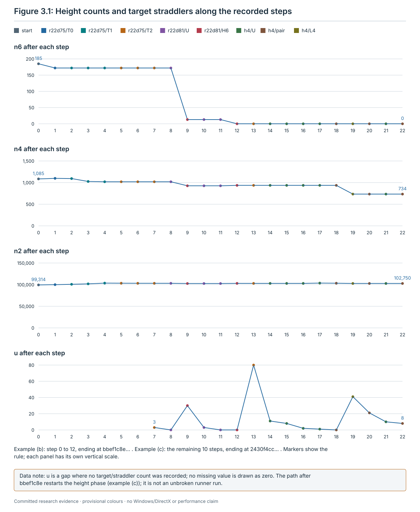

## 3.1 What the height phase reads

Every rule of this chapter reads the following, and nothing else. All of it is a function of the current state.

| Name | What it is | Where in the code |
| --- | --- | --- |
| n6, n4, n2 | the numbers of off pieces at left heights 6, 4 and 2 | `research/jumbling/restoration/12-low-height/scripts/round22/r22d81_rule.py:102-108` |
| max | the largest left height of an off piece | `research/jumbling/restoration/13-tutorial-runner/scripts/runner.py:621-623` |
| left factor l_p | for an off piece p with pose matrix M, the quaternion l of chapter 1, section 1.6: `trees.factors(M)[0]`. Its tree distance `trees.dist(l_p)` is the left height | `r22d81_rule.py:93-99`; `research/jumbling/theory/trees.py:70-86`, `:196-198` |
| item factor l(c, j) | for a jumble item j of cap c, `trees.factors(E(c, j))[0]`; none for a retained item, which lies in K⁺ | `r22d81_rule.py:121-125` |
| branch of a piece | for an off piece, the index 0 to 4 of the first edge of the path from the root to l_p (`trees.branch`); −1 on the lattice | `trees.py:254-265`; `r22d81_rule.py:93-99` |
| branch of a cap | the branch of the pole n_c read as a quaternion | `r22d81_rule.py:80` |
| clean, blocked | a cap is **clean** when no piece straddles its cut and **blocked** otherwise, by the simulator's exact classification with `stop_at_straddle` (section 1.4) | `r22d81_rule.py:183-185` |
| held whole | a piece is **held whole** by cap c when the simulator's own group and anchor tests label it `in` at the cut of c. The test runs per piece, at clean and blocked caps alike | `labels`, `r22d81_rule.py:128-145` |
| straddlers S_c | the off pieces that straddle the cut of c, each tested on its own | `eb6.straddler_set`, `research/jumbling/restoration/12-low-height/scripts/eb6.py:119-137` |
| count prediction | the change of (n6, n4, n2) that a jumble letter at a clean cap causes (3.1.1) | `research/jumbling/restoration/12-low-height/scripts/round22/cloud/height4-descent-bbef1c8e/r22d75_from_snapshot.py:61-83` |
| target τ, k(c), u | the cap a sub-phase works towards, and its number of straddlers (3.1.2) | `r22d81_rule.py:148-174`; `research/jumbling/restoration/12-low-height/scripts/round22/cloud/height4-descent-bbef1c8e/h4_unlock.py:147-173` |

**New left height of a moved piece.** A letter (c, j) moves exactly the pieces inside cap c. With a jumble item, a
moved off piece p gets the left height `trees.dist(trees.qmul(l(c, j), l_p))`, and a moved lattice piece gets
`trees.dist(l(c, j))`, which is 2. Pieces of c's own branch keep their height or fall by 2; pieces of other branches
rise by 2. A retained item changes no left height. These facts are **proved (model review only)**
(`research/jumbling/restoration/12-low-height/PROOFS-B.md:2692-2695`, `:2904-2905`). The programs compute new heights
in this way: `r22d75_from_snapshot.py:78-80`, `r22d81_rule.py:205-209`, `h4_unlock.py:197-206` and
`research/jumbling/restoration/12-low-height/scripts/round22/r22d81_pairs.py:156-159`.

### 3.1.1 The count prediction (R22D-75)

- **Reads**: the inside set of a clean cap c; the left height, branch and left factor of every piece in it; the item
  factor l(c, j).
- **Definition**: for a jumble item j, count inside cap c:

  | Symbol | Pieces inside c |
  | --- | --- |
  | F_h | off pieces of a branch other than c's at height h (h = 2, 4, 6) |
  | O_h | off pieces of c's own branch at height h |
  | r_h | own-branch pieces at height h that item j lowers by 2 (r_h ≤ O_h; `PROOFS-B.md` writes L_h) |
  | L₀ | lattice pieces |

  After the letter n8 = F₆, and

  Δ(n6, n4, n2) = (F₄ − r₆, F₂ + r₆ − F₄ − r₄, L₀ + r₄ − F₂ − r₂).

- **Cap bound.** Since r_h ≤ O_h, no jumble item of c both keeps every height at most 6 and makes (n6, n4, n2) fall
  lexicographically when

  F₆ > 0, or F₄ > O₆, or (F₄ = O₆ and (F₂ > O₄ or (F₂ = O₄ and L₀ ≥ O₂))).

  Such a cap is skipped whole ("cap bound prune").
- **Value**: the predicted triple. Where it is checked differs by program:

  | Program | Prediction checked against the simulator |
  | --- | --- |
  | `r22d75_from_snapshot.py` | after every letter it plays (`:97`) |
  | `r22d81_rule.py` | after H6, H4 and H2 letters. A U letter carries no prediction (`:271`, `:297-298`) |
  | `h4_unlock.py` | after every letter, U and retained letters included; a retained item is predicted to keep every count (`:196-206`, `:307-309`) |
  | `r22d81_pairs.py` | not used. It predicts the new heights of the moved pieces from left factors and, after it plays a letter, checks heights and u (`:156-159`, `:178-187`) |
  | `two_letter_u.py` | not used. It applies every letter to a copy and reads the heights there (`research/jumbling/restoration/12-low-height/scripts/round22/cloud/height4-descent-bbef1c8e/two_letter_u.py:153-155`, `:185`, `:210`) |

- **Undefined**: for a retained item, which changes no left height. R22D-75 skips retained items
  (`r22d75_from_snapshot.py:76`), and so do the H6, H4 and H2 candidates of R22D-81 (`r22d81_rule.py:202-204`) and the
  L4 and L2 candidates of H4-unlock (`h4_unlock.py:212-214`).
- **Evidence**: the height changes and the exactness of the cap bound are **proved (model review only)**
  (`PROOFS-B.md:2692-2696`). Each own-branch case is asserted at run time (`r22d75_from_snapshot.py:79`).
- **Where in the code**: `r22d75_from_snapshot.py:61-83` (prune at `:68`); the same computation in
  `r22d81_rule.py:186-213` and `h4_unlock.py:186-223`.

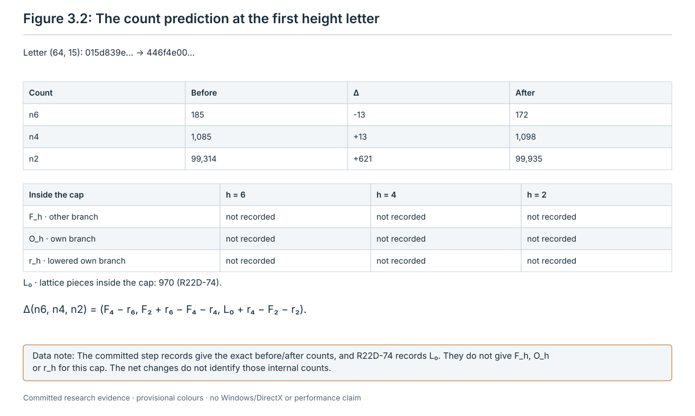

### 3.1.2 The target τ and its straddler count u

The sub-phases `r22d81` and `h4` work towards one cap at a time, the **target** τ. They read it from the pieces at the
top height H: H = 6 in `r22d81`, H = 4 in `h4`.

- **Reads**: the pieces at height H, with their exact poses, left factors and branches; the 600 caps; the item factors
  of each cap's jumble items.
- **Order**: caps 0 to 599; items 1 to 59, of which the retained items are skipped.
- **Definition**:
  1. For each cap c, clean or blocked, let P_c be the height-H pieces that c holds whole. Skip c when P_c is empty,
     or when a piece of P_c has a branch other than c's.
  2. k(c) is the largest number of pieces of P_c that one jumble item of c lowers to height H − 2, by exact products
     (`trees.qmul`, `trees.dist`).
  3. The **target table** lists (c, k(c)) for every cap with k(c) > 0, in increasing c.
  4. τ is the cap of the table with the largest k(c), ties to the lower cap index.
  5. u is the number of straddlers of τ, |S_τ|.
- **Value**: (τ, u, table). The programs print them as follows:

  | Program | τ and u | The table |
  | --- | --- | --- |
  | `r22d81_rule.py` | on START and on every STEP and STUCK line (`:244`, `:293`, `:304-305`) | on START, and on the STEP line of an H6 letter (`:305`) |
  | `h4_unlock.py` | on START and on every STEP, STUCK and BUDGET line (`:259`, `:305`, `:315`, `:320`) | on START, on the STEP line of an L4 letter (`:316`), and on STUCK (`:305`) |
  | `r22d81_pairs.py` | τ, its `--target`, on every line; u on START, STEP and STUCK (`:174`, `:196`, `:284`, `:291`) | never |
  | `two_letter_u.py` | on its CONTEXT line, recomputed from the state (`two_letter_u.py:160`, `:171`) | on its CONTEXT line |

  After an H6 or L4 letter the program computes τ, u and the table again. After any other letter it counts u again at
  the same τ (`r22d81_rule.py:300-303`, `h4_unlock.py:311-314`).
- **Undefined**: with an empty table, τ is null and u = 0.
- **Facts**: τ depends only on the height-H pieces and their exact poses, so it stays the same while they do. It does
  not change when τ becomes clean (**proved (model review only)**, `PROOFS-B.md:2870-2871`). k counts lowered pieces,
  not the net change of n_H: other-branch pieces inside τ can rise to height H. So a clean τ with u = 0 may still have
  no lowering letter. This is the second "stuck end by design" of R22D-81 (`PROOFS-B.md:2901-2913`).
- **Evidence**: at `1ff0061f…` (seed 7302, after the seven letters of section 3.8.2) the table is (104, 13),
  (150, 84), (274, 159), (290, 13), (311, 13), so τ = 274 with u = 3. Cap 118 holds whole all 159 height-6 pieces that
  cap 274's best item lowers, but they are not of cap 118's branch, so it is skipped (**computed**,
  `PROOFS-B.md:2914-2915`; `research/jumbling/restoration/12-low-height/runs/round22/r22d81_rule.txt:2`). At
  `0ad859c2…` (example (c)) the height-4 table has 18 caps and τ = 482 (k = 284) with u = 80 (**computed**,
  `research/jumbling/restoration/12-low-height/runs/round22/cloud/height4-descent-bbef1c8e/h4_unlock_run1.txt:2`, a run
  of the committed `h4_unlock.py`). An earlier revision printed the same table, τ and u at `bbef1c8e…`
  (`h4_unlock_run0_prediction_assert.txt:2`).
- **Where in the code**: height 6: `r22d81_rule.py:148-174`; height 4: `h4_unlock.py:147-173`, and a copy in
  `two_letter_u.py:120-141`, which assumes a non-empty table: the plugin starts it only after a STUCK line with a table
  (section 3.5.4). The checker counts u with its own function, `straddlers`
  (`research/jumbling/restoration/13-tutorial-runner/scripts/check_contracts.py:21-41`).

## 3.2 The frame: sub-phases, programs, results

**Order and entry tests.** The height phase runs its three sub-phases in the order `r22d75` → `r22d81` → `h4`
(`research/jumbling/restoration/13-tutorial-runner/scripts/runner_api.py:22`; `runner.py:705-716`). Each runs only when
its entry test holds where it starts; otherwise its result is `not_applicable` (`runner.py:625-631`, `:649-650`).

| Sub-phase | Entry test | Families at each step, in the runner's order |
| --- | --- | --- |
| `r22d75` | max ≤ 6 and n4 + n6 > 0 | T0, T1, T2 (section 3.3) |
| `r22d81` | max ≤ 6 and n6 > 0 | H6, U, H4, H2; when these have no letter and τ exists, R22D-88's pair program, of which only U2 can fire there (section 3.4) |
| `h4` | max ≤ 4 and n4 > 0 | L4, U, L2; when these have no letter and τ exists, the pair step (section 3.5) |

**What one step runs.**

| Sub-phase | Programs started for one step |
| --- | --- |
| `r22d75` | `r22d75_from_snapshot.py`, once |
| `r22d81` | `r22d81_rule.py`; after its STUCK line with a target, `r22d81_pairs.py --target τ`, one after the other |
| `h4` | `h4_unlock.py`; after its STUCK line with a target and a table, n processes of `two_letter_u.py` at once, one per shard, with n = `pair_shards` (4) |

**One step in order.** The plugin's `next_step` does the following
(`research/jumbling/restoration/13-tutorial-runner/scripts/rules_height.py:534-572`):

1. It checks that max ≤ 6 (≤ 4 in `h4`). Otherwise the sub-phase ends `error`, reason `invariant_height_above_6` or
   `invariant_height_above_4` (`:540-542`).
2. It writes the current state as a snapshot file in the step's work directory (`:543-545`, format `:117-130`) and
   starts the program with `--snapshot`, `--expect` (the digest) and `--cpu` (`:375-381`). Every program asserts the
   digest after loading (`r22d75_from_snapshot.py:34`, `r22d81_rule.py:75-76`, `r22d81_pairs.py:68-69`,
   `h4_unlock.py:76-77`, `two_letter_u.py:47-48`).
3. The runner kills the program at its first `STEP` line, and in `h4` also at a `START` line whose τ is null
   (`:363-372`; `runner.py:520-540`). The plugin reads the log only up to that line (`rules_height.py:216-218`,
   `:226-228`). So no program's own loop runs past one step, and τ is recomputed from the state at every call.
4. It reads the log (below) and turns a `STEP` into one proposal: the rule name, the literal word, the end digest and
   the fields of section 3.6 (`:154-195`, `:469-475`).
5. If the program printed `STUCK`: in `r22d81` with a target it starts the pair program, and in `h4` with a target and
   a table it starts the shards. In `r22d75`, or with no target, the sub-phase ends (`:553-568`).

The snapshot file is deleted after the step (`:571-572`). The runner then plays the proposed word twist by twist. Each
letter must be admissible and certain and the end digest must equal the claimed one; otherwise the run ends `error`
(`runner.py:737-753`, `:289-297`). It records the step with its word, its tree and a table of the state after it,
`tables/<index:05d>.json` (`:757-765`). After every step it tests the entry test again. The sub-phase ends `handoff`
when the test fails, and `lattice` when no piece is off (`:654-656`, `:670-671`). The runner decides these two
results itself. A plugin that claims `handoff` or `lattice` against the state, or claims `not_applicable`, makes the
runner raise an error (`:678-684`).

**How the plugin reads a program's log** (`_call`, `rules_height.py:375-466`). The checks come in this order:

1. If a signal stopped the program, the result is `error`, reason `cancelled` (`:392-393`).
2. It parses complete lines only. A `Traceback` line means a crash; lines with unknown tags are skipped; a known tag
   whose payload is not a JSON object is malformed (`:133-151`). For a rule program it stops at the first `STEP`, and
   in `h4` at a `START` with τ null (`:198-238`).
3. A `START` (for a shard, its `CONTEXT`) must carry the state's digest; otherwise `digest_mismatch` (for a shard,
   `inconsistent_output`). When the caller expects values, the line must carry them; otherwise `inconsistent_output`
   (`:402-407`). The pair program is expected to report the τ and u of R22D-81's `STUCK` line (`:563-564`); a shard,
   the τ and u of `h4`'s `STUCK` line, its shard number and n (`:498`). Because every program asserts the digest
   itself, a wrong state shows up as a crash before any `START`.
4. A first `STEP` gives the proposal, and an `h4` `START` with τ null gives `stuck`, `no_target` (`:408-410`,
   `:549-552`).
5. A parse status `malformed`, `mismatch`, `missing_step` or `crash` is an error with that reason. It is decided before
   the clock, so a killed child keeps its parse status (`:411-412`).
6. For a shard that ended `DONE`, the indices of its `FIRST` lines must be exactly its share of the order
   (`:413-418`; section 3.5.5).
7. A kill by the runner's wall clock gives `timeout`, reason `wall_clock` (`:419-420`).
8. An end line with exit code 0 (`:425-458`):
   - `NOT_APPLICABLE` gives `error`, reason `invariant_height_above_6` (`:428-431`);
   - every end line needs a `START` before it, except a plain `BUDGET`; otherwise `truncated` (`:434-440`);
   - an end line with steps ≠ 0 gives `missing_step`, except two `BUDGET` lines with one step: R22D-81's with an
     unreported H6 letter, and `h4`'s with families {L4: 1} (`:434-438`, `:441-442`);
   - with zero steps the end line's digest must be the state's (`digest_mismatch`, `:443-444`);
   - with zero steps after a `START`, except in `r22d75`, the end line must carry τ and u equal to the `START`'s, and
     for the pair program τ must equal `--target` (`:445-450`);
   - then `HEIGHT2` or `HANDOFF` gives `handoff`, `BUDGET` gives `budget` with `cpu_budget`, `UNLOCKED` gives `stuck`
     with `unlocked_without_step`, and `STUCK` gives `stuck` with `no_step` (`:452-458`).
9. A kill by `SIGXCPU` at or past the CPU budget gives `budget`, reason `cpu_rlimit` (`:459-460`).
10. Otherwise a `Traceback` or a non-zero exit code gives `crash`, and anything else `truncated` (`:461-463`).

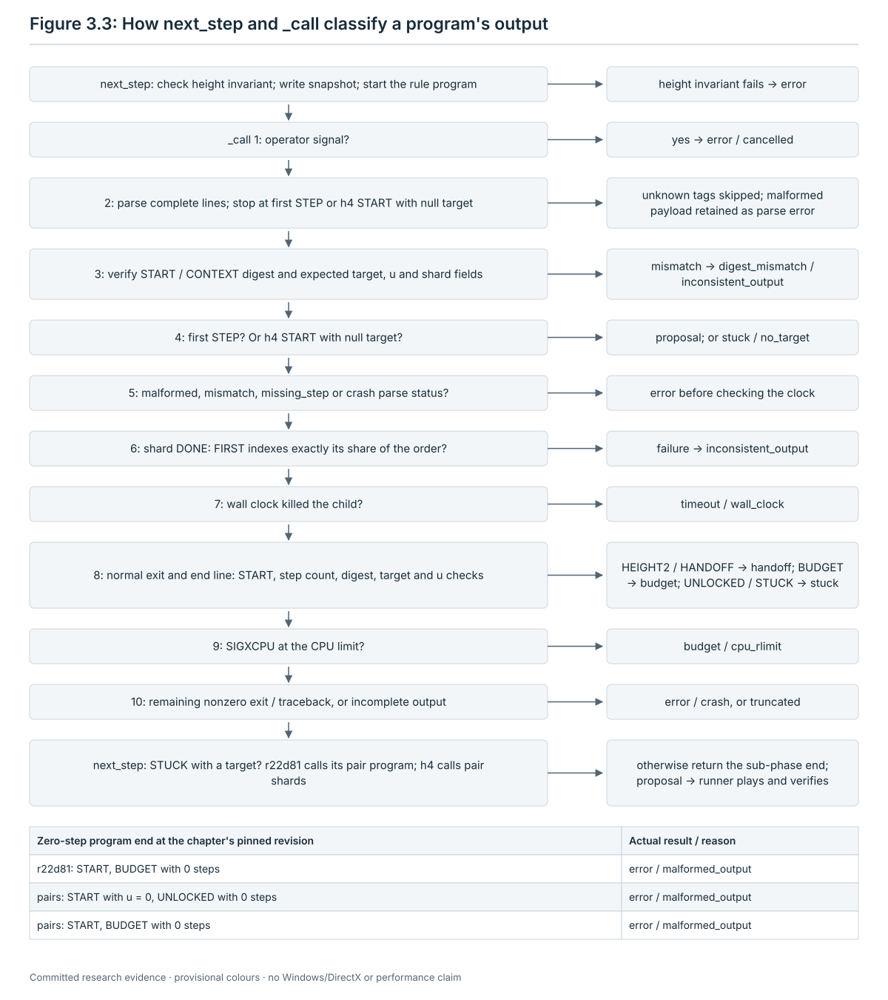

**The zero-step ends.** The check in item 8 reads τ and u from the end line through `_target_fields`, which raises
`malformed_output` when the line has no `tau` key or no integer `u` (`:78-80`, `:445-448`). Three ends that the
programs print lack these fields:

| Program end, zero steps | Its fields | Result at `35c3d4f` | Intended result |
| --- | --- | --- | --- |
| `r22d81_rule.py`: `BUDGET` after `START` | steps, limit_cpu, digest and counts; no τ, no u (`r22d81_rule.py:310`, `:219-222`) | `error`, `malformed_output` | `budget`, `cpu_budget` |
| `r22d81_pairs.py`: `UNLOCKED` | steps, held6, the items' lowering counts, τ, digest and counts; no u (`r22d81_pairs.py:298`, `:172-175`) | `error`, `malformed_output` | `stuck`, `unlocked_without_step` |
| `r22d81_pairs.py`: `BUDGET` | steps, limit_cpu, τ, digest and counts; no u (`:300`) | `error`, `malformed_output` | `budget`, `cpu_budget` |

All three were run with the real programs and mapped by `_call` (**computed**, record section A: A1 `UNLOCKED`, A2 the
pair program's `BUDGET`, A3 R22D-81's `BUDGET`; `research/jumbling/tutorial/scripts/ch03_examples.py:138-150`). So the
branch that returns `unlocked_without_step` (`rules_height.py:456-457`) cannot be reached. The stage 13 README still
lists that reason (`research/jumbling/restoration/13-tutorial-runner/README.md:931-934`). The check came with a fix of
packet P1 (stage 13 README :937, "P1-falsepass-03"). Its tests use end lines that always carry τ and u (the helper
`end`, `research/jumbling/restoration/13-tutorial-runner/scripts/test_rules_height.py:86-89`;
`test_17_zero_step_end_identity`, :752-767). The one test that runs the real pair program to `UNLOCKED` reads its log
with `parse_log`, not with `_call` (`ExactTests.test_02_real_clock_sentinel`, :934-949).

When it matters:

- **Acceptance mode.** The CPU budget is the sentinel 10⁹ s, so no `BUDGET` line is expected. But at R22D-81's second
  stuck end (`STUCK` with τ and u = 0, `PROOFS-B.md:2901-2913`) the plugin starts the pair program. Its `START` has
  u = 0, so its loop does not run and its next line is `UNLOCKED` (`r22d81_pairs.py:195-198`, `:293-298`). The run
  then ends `error` instead of the sub-phase ending `stuck`.
- **Development mode.** A `BUDGET` of R22D-81 after its `START`, or any `BUDGET` of the pair program (its budget test
  runs only after its `START`, `:194-202`), ends the run `error` instead of `budget`. R22D-81's `BUDGET` before its
  `START`, during the target computation (`r22d81_rule.py:155`, `:243`), still gives `budget`.

**Results of a height sub-phase.** The record's sub-phase block keeps the result, the reason, the details and every
attempt (`runner.py:688-691`). Record section B maps one end line of each kind through `_call` (**computed**,
`ch03_examples.py:182-236`).

| Result | Reason | When | What happens next |
| --- | --- | --- | --- |
| `handoff` | – | after a step, the entry test fails (`runner.py:654-656`). A program's `HEIGHT2` or `HANDOFF` line also maps to `handoff`, but it cannot be the first end line the plugin reads: with zero steps it would need the entry test to fail at the start | the next sub-phase |
| `not_applicable` | – | the entry test fails where the sub-phase starts (`runner.py:649-650`) | the next sub-phase |
| `lattice` | – | no piece is off after a step (`runner.py:670-671`) | the later sub-phases and the high phase are `not_applicable`; then tail and lattice (chapters 5 and 6) |
| `stuck` | `no_step` | `r22d75` prints `STUCK`, or the pair program of `r22d81` prints `STUCK` (`rules_height.py:458`, `:553-554`, `:566-568`) | the next sub-phase; after `h4`, the high phase (chapter 4) |
| `stuck` | `no_target` | `r22d81` prints `STUCK` with τ null (`:556-559`); `h4` prints `START` with τ null (`:551-552`), or `STUCK` with τ null or no table (`:558-559`; this cannot follow a `START` with τ, section 3.5.4) | as above |
| `stuck` | `pair_exhausted` | every shard of the `h4` pair search ends `DONE`, every first letter is seen and no pair succeeds (`:521-522`) | as above |
| `stuck` | `unlocked_without_step` | intended for the pair program's `UNLOCKED` with zero steps (`:456-457`); not reached at `35c3d4f` (the zero-step ends) | – |
| `budget` | `cpu_budget` | `r22d75` prints `BUDGET`; `r22d81` prints `BUDGET` before its `START`, or with one step and an unreported H6 letter; `h4` prints `BUDGET` (before its `START`, after it with zero steps, or with one step and families {L4: 1}); a shard prints `BUDGET` (`:425-455`, `:525-527`) | the run ends `budget`; no later phase runs |
| `budget` | `cpu_rlimit` | a program or shard is killed by `SIGXCPU` at or past its CPU budget (`:459-460`, `:526`) | the run ends `budget` |
| `timeout` | `wall_clock` | the runner's wall clock kills a program or a shard; development mode only (`:419-420`, `:523-524`) | the run ends `budget` |
| `error` | `malformed_output` | a known line is not a JSON object, or lacks a field or has a wrong type; also the three zero-step ends above | the run ends `error` |
| `error` | `digest_mismatch` | a `START` digest differs from the state; a `STEP`'s input digest differs from the line before; a zero-step end line's digest differs; the live state changed before a pair is proposed (`:158`, `:404-405`, `:443-444`, `:518`, `:482`) | the run ends `error` |
| `error` | `inconsistent_output` | the pair program's `START` τ or u differs from R22D-81's `STUCK`; a zero-step end line's τ or u differs from the `START`'s, or the pair program's τ from `--target` (`:406-407`, `:447-450`); a shard check fails (3.5.5) | the run ends `error` |
| `error` | `missing_step` | an end line with steps ≠ 0 outside the two `BUDGET` exceptions; a `STEP` numbered other than 1 (`:222-223`, `:441-442`) | the run ends `error` |
| `error` | `crash` | a `Traceback`, or a non-zero exit code without an end line (`:139-141`, `:461-462`); also a shard stopped after another shard's error (3.5.5) | the run ends `error` |
| `error` | `truncated` | exit code 0 without an end line; an end line without a `START`, except a plain `BUDGET` (`:439-440`, `:463`) | the run ends `error` |
| `error` | `cancelled` | a signal stopped the program (`:392-393`; `runner.py:507-547`). The attempt keeps outcome `cancelled`, but the runner records no result for the sub-phase: it saves the attempts and stops (`runner.py:661-665`) | the run ends `error`, with the error text `signal N` (`runner.py:1479-1486`) |
| `error` | `invariant_height_above_6`, `invariant_height_above_4` | before a call, a piece is above height 6 (4 in `h4`) (`rules_height.py:540-542`); or a program prints `NOT_APPLICABLE` (`:428-431`), which the check before the call makes impossible | the run ends `error` |

A `BUDGET` is a stop, not exhaustion, so it never counts as `stuck` (`PROOFS-B.md:3698-3700`). One `BUDGET` with one
step is not an error: `r22d81` or `h4` played an H6 or L4 letter and ran out of time while recomputing τ, before
printing the step. The runner records `budget`, and the letter is not played, since the program worked on its own
copy (`rules_height.py:434-438`).

**The result of the height phase as a whole** (`runner.py:705-724`). An `error` ends the run at once: the runner sets
the height phase's result to `error` itself and raises (`:698-702`), so the rule below never sees an `error`. A
`budget` or `timeout` stops the sub-phase loop (`:710-711`). Then the outer result goes by a fixed priority, not by
the order in which the sub-phases ran: `error` if any sub-phase returned it, else `budget`, else `timeout`, else
`lattice`; otherwise the last result that is not `not_applicable`; otherwise `not_applicable` (`:718-724`). A
`budget` or `timeout` makes the run end `budget` (`:714-715`, `:1471-1473`).

**Path dependence.** The sub-phases never return. A run that reaches `bbef1c8e…` inside `r22d81` does not go back to
`r22d75`, although R22D-75 has a letter there, (23, 14) (stage 13 README :90-97). Section 3.8.2 shows the effect.

**Clocks and the acceptance configuration.**

| Option | Development mode | Acceptance mode |
| --- | --- | --- |
| `--height-cpu`: the `--cpu` a program receives | 3,600 s by default | the sentinel 10⁹ s, whatever the option says (`runner_api.py:26-28`, `:111-121`) |
| `--height-seconds`: the runner's wall clock per program | 3,600 s by default | none (`runner_api.py:107-109`) |
| `--pair-shards`: concurrent shards of the `h4` pair search | 4 by default | 4, frozen |

Sources: `runner.py:1610-1612`. In acceptance mode the record keeps both clocks as null (`runner_api.py:124-127`,
`runner.py:483-484`). Acceptance mode freezes every option that
[`acceptance-config.json`](../restoration/13-tutorial-runner/acceptance-config.json) names, eleven in all; the runner
refuses any other value (`runner.py:145-158`). The file's values are the runner's defaults. Of them only `pair_shards`
matters in this chapter. Another is the lattice restorer, `schedule11`: at most 20,866,844 retained twists plus at
most 25,852 for the corrections. The restorer `late` (at most 1,324,660,182 plus 25,852) runs only in development
mode, with `--lattice-restorer late` (`runner.py:1608-1609`;
`research/jumbling/restoration/09-general-method/METHOD.md:175`). On the depth 20 scramble of seed 7106 the lattice
phase played 8,701,310 twists with `late` and 1,516,410 with `schedule11` (**run on one instance**, stage 13 README at
`88dacaf`, :1559-1562). With complete shards the shard count does not change the chosen pair (section 3.5.5).

## 3.3 r22d75: R22D-75's height-first letters (rules T0, T1, T2)

- **Reads**: the counts (n6, n4, n2); every cap's clean or blocked status and inside set; the count prediction.
- **Candidates and order**: the letters (c, j), c from 0 to 599 and j from 1 to 59, at clean caps that the cap bound
  keeps; retained items are skipped. A candidate's **tier** is the first coordinate of (n6, n4, n2) that its
  prediction changes. The program scans tier 0, then tier 1, then tier 2; within a tier, caps in increasing order;
  within a cap, items in increasing order. It plays the first candidate it meets (`r22d75_from_snapshot.py:85-89`).

  | Tier | Rule name | What falls |
  | --- | --- | --- |
  | 0 | `r22d75/T0` | n6 |
  | 1 | `r22d75/T1` | n4, with n6 unchanged |
  | 2 | `r22d75/T2` | n2, with n6 and n4 unchanged |

- **Test**: the cap is clean (so the letter is admissible), the item is a jumble item, the cap passes the cap bound,
  and the predicted triple is lexicographically smaller than the current one. Letters that keep all three counts are
  not candidates. There is no other guard: the letter may take lattice pieces off and change other off poses.
- **Step played (tree)**: one letter; the tree is one span named by the rule, for example `r22d75/T1 [1]`
  (`runner.py:751`). The program asserts that the letter is applied and certain and that the simulator's counts equal
  the prediction (`r22d75_from_snapshot.py:96-97`). The plugin reads the tier from the counts: the first coordinate
  that changed (`rules_height.py:161-166`).
- **Contract**: (n6, n4, n2) falls lexicographically, first at the tier's coordinate; max ≤ 6 before and after; the
  τ and u fields are null (section 3.6).
- **No step**: when no candidate is left, the program prints `STUCK`. The sub-phase ends `stuck`, reason `no_step`,
  and `r22d81` comes next. `HEIGHT2` (n6 = n4 = 0) never comes first: after the step that gets there, the runner's
  entry test fails (`handoff`).
- **Evidence**: the rule is finite: R = n6·B² + n4·B + n2 with B = 177,121 falls with every letter (**proved (model
  review only)**, `PROOFS-B.md:2689-2691`; section 3.7). Runs: section 3.8, examples (a) to (d).
- **Where in the code**: `r22d75_from_snapshot.py:54-90` (candidates and order), `:91-100` (loop and end lines);
  `rules_height.py:161-166`; `check_contracts.py:104-106`, `:229-236`.

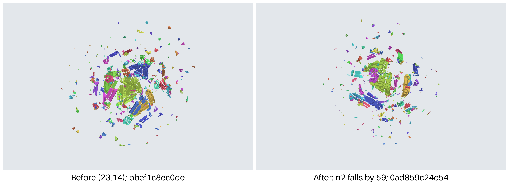

## 3.4 r22d81: the unlock rule at height 6 (R22D-81) and its pairs (R22D-88)

After the seed 7302 stop, R22D-75 stopped with 172 pieces still at height 6. There, cap 274, whose best item lowers
159 of them, was blocked by three straddlers (**run on one instance**, section 3.8.2; `PROOFS-B.md:2710-2713`,
`:2914-2915`). No general statement of when R22D-75 stops is proved. R22D-81 adds a target and an **unlock** family U: letters that change no height-6 piece but lower u, the number of pieces that block τ. At each
step the program reads τ and u (section 3.1.2), then tries four families in order, H6, U, H4 and H2, and plays the
first letter it finds. Every letter must be admissible and certain and leave no piece above height 6. When none of
the four has a letter and τ exists, the plugin starts R22D-88's pair program at the same state (section 3.4.4).

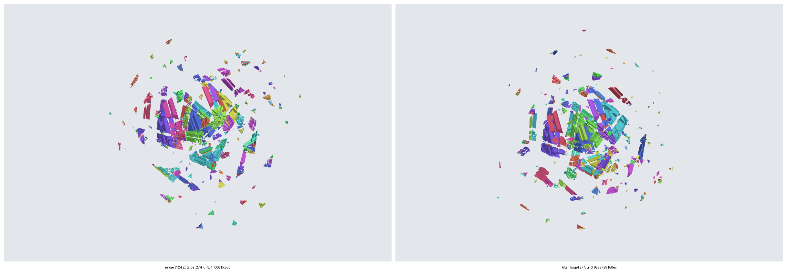

### 3.4.1 r22d81/H6

- **Reads**: as R22D-75 (section 3.3).
- **Candidates and order**: R22D-75's tier-0 candidates; caps in increasing order, items in increasing order
  (`r22d81_rule.py:249-254`).
- **Test**: as T0 of section 3.3. τ and u are not tested.
- **Step played (tree)**: one letter, one span `r22d81/H6 [1]`. The program checks the counts against the prediction
  (`:297-298`), computes τ, u and the table again (`:300-301`) and prints them on the `STEP` line (`:304-305`).
- **Contract**: n6 falls; max ≤ 6; τ before and after may be null, and τ may change; u before and after are each
  counted at their own τ.
- **No step**: the U family (section 3.4.2).
- **Evidence**: example (b) plays (274, 13) and (104, 14) (**computed**, `runs/round22/r22d81_rule.txt:5`, `:10`). At
  Z36 the program's first letter is H6 (12, 14) (**computed**, record section A0).
- **Where in the code**: `r22d81_rule.py:249-254`, `:294-305`.

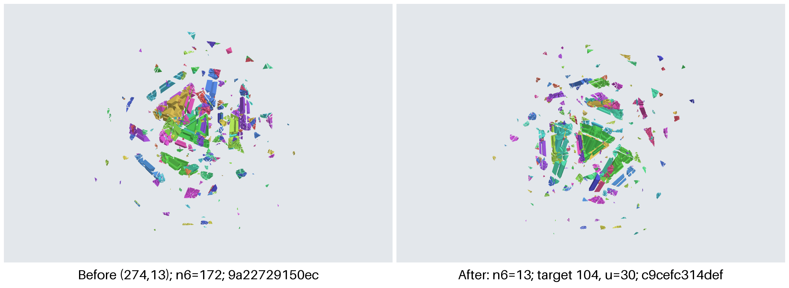

### 3.4.2 r22d81/U

- **Reads**: τ, u, S_τ, the height-6 pieces and their exact poses, compared by pose keys.
- **Candidates and order**: only when τ exists. Caps in increasing order that are clean, hold a straddler of τ whole,
  and hold no height-6 piece whole (`:255-264`). At such a cap, items 1 to 59, retained items included. The program
  tries all 59 items of the cap, prints their u values as a `U_ITEMS` line, and takes the first item that passes
  (`:265-274`).
- **Test**: the letter is applied to a copy of the state. It must be admissible and certain. Afterwards max ≤ 6, n6 is
  unchanged, every height-6 piece keeps its exact pose, and u, counted again at the same τ, is strictly lower
  (`:225-235`).
- **Step played (tree)**: one letter, one span `r22d81/U [1]`. It has no count prediction (section 3.1.1).
- **Contract**: n6 kept; every height-6 pose kept; u falls at the same τ, which must not be null.
- **No step**: H4 (section 3.4.3).
- **Evidence**: the cap restriction loses nothing. A letter fixes every piece outside its cap, so a clean cap that
  holds no straddler of τ whole cannot lower u, and a non-identity letter changes the pose of every piece inside its
  cap (**proved (model review only)**, `PROOFS-B.md:2931-2934`). The rule takes the first item that lowers u, not the
  one that lowers it most (**computed**: at `c9cefc31…` item 2 of cap 46 takes u from 30 to 0, but item 1 (u = 3)
  comes first, `PROOFS-B.md:2926-2927`). Figure 3.5 shows (124, 2) at `1ff0061f…`.
- **Where in the code**: `r22d81_rule.py:225-235` (the guard), `:255-274`.

### 3.4.3 r22d81/H4 and r22d81/H2

- **Reads**: as R22D-75, and τ, u, the height-6 pieces and their exact poses.
- **Candidates and order**: R22D-75's tier-1 candidates (H4), then its tier-2 candidates (H2), at caps that hold no
  height-6 piece whole; caps in increasing order, items in increasing order (`:275-291`).
- **Test**: the guard of U with "u does not rise" in place of "u falls": applied to a copy, admissible and certain,
  max ≤ 6, n6 and every height-6 pose kept, u at most its value before (`:287`). With τ null, u = 0 throughout
  (`:234`).
- **Step played (tree)**: one letter, one span `r22d81/H4 [1]` or `r22d81/H2 [1]`; the counts are checked against the
  prediction (`:297-298`).
- **Contract**: H4: n6 kept, n4 falls, every height-6 pose kept, u does not rise. H2: n6 and n4 kept, n2 falls, every
  height-6 pose kept, u does not rise. τ may be null and does not change.
- **No step**: the program prints `STUCK` with τ and u (`:292-293`); section 3.4.5 says what follows.
- **Evidence**: H4 and H2 are narrower than R22D-75's T1 and T2, and U comes before them, so R22D-81 and R22D-75 can
  choose different letters at the same state (`PROOFS-B.md:2893-2900`). No record has an H4 or H2 step with a real
  target. With the target forced absent (`--no-target`, a test option that the runner never passes;
  `r22d81_rule.py:16-17`), the program played R22D-75's six letters after (64, 15) as three H4 and three H2 letters
  and reached the same state `1ff0061f…` (**computed**, `runs/round22/r22d81_no_target.txt`).
- **Where in the code**: `r22d81_rule.py:275-291`.

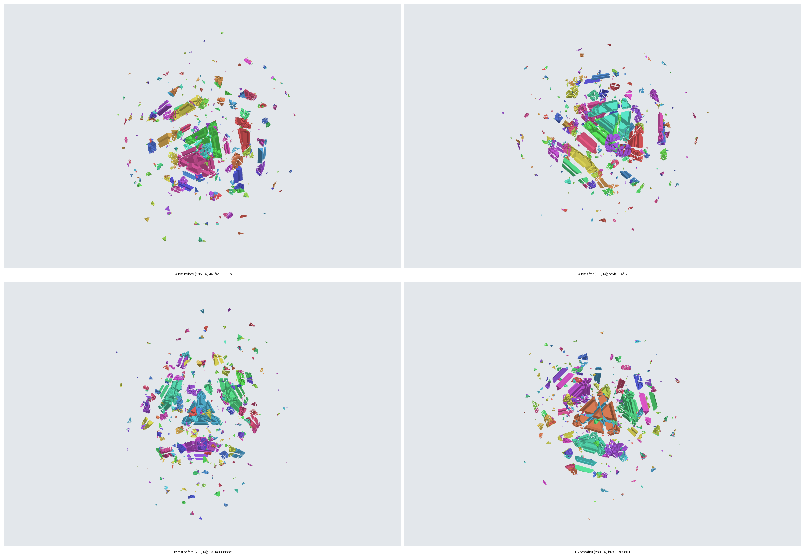

### 3.4.4 r22d88/U and r22d88/U2: the pair program

When `r22d81_rule.py` prints `STUCK` with τ present, the plugin starts `r22d81_pairs.py --target τ` on the same state
(`rules_height.py:563-568`). Its `START` must report the state's digest, and τ and u equal to the `STUCK` line's
(`:402-407`, `:564`). A τ or u that differs ends the sub-phase `error`, reason `inconsistent_output`. A digest that
differs would give `digest_mismatch`. But the program asserts the digest itself after loading the snapshot
(`r22d81_pairs.py:68-69`), so a wrong state shows up as a crash before `START`. The program lowers u with two
families, U and U2, and the plugin takes its first step.

- **Reads**: τ (fixed by `--target`); S_τ; the height-6 pieces and their pose keys; every cap's classification and
  inside set; the left factors of the pieces it moves; the item factors; the poles n_c.

**First caps.** Both families start at the clean caps that hold no height-6 piece whole, in increasing order. Every
cap is classified exactly, and the program asserts that none is uncertain (`r22d81_pairs.py:201-205`).

**How a candidate letter is evaluated.** On a copy that moves only the inside pieces of the letter's cap, with the
simulator's own composition (`move`, `:148-162`). The new left heights of the moved pieces are predicted from left
factors (section 3.1); the largest of them is the letter's **top**. The moved pieces are labelled at the cut of τ
with the simulator's own tests (`stradded`, `:165-169`). The copy runs no admissibility test: a first cap is clean.

**r22d88/U.**

- **Candidates and order**: the first caps that hold a straddler of τ whole; items 1 to 59 (`:209-222`).
- **Test**: top ≤ 4, and u after the letter strictly lower (`:218-222`). Since no height-6 piece is inside the cap,
  top ≤ 4 keeps max ≤ 6, n6 and every height-6 pose.
- **Step played (tree)**: one span `r22d88/U [1]`. The program replays it with the simulator's apply and checks the
  heights, the height-6 poses and u (`:178-187`).
- **Contract**: as `r22d81/U`.
- **No step**: U2.
- **Evidence: it never fires at the runner's call.** The runner starts this program only after `r22d81_rule.py`
  printed `STUCK` at the same state, so R22D-81's U family had no letter there. R22D-88's U tries the same caps (clean,
  holding a straddler of τ whole and no height-6 piece whole) and the same items, and its test is equivalent. No
  height-6 piece is inside the cap, so "top ≤ 4" holds exactly when max ≤ 6, n6 is kept and every height-6 pose is
  kept. The u counts agree, since pieces outside the cap keep their poses. The letter is admissible and certain: the
  cap is clean and certainly classified (`:203`), and the simulator's apply calls a letter uncertain only for an
  unrepresentable twist or an uncertain classification (`research/jumbling/sim/state.py:343-344`, `:354-355`). So at
  the runner's call r22d88/U has no letter, and the first step, if any, is U2 (**proved (model review only)**: the
  argument of this paragraph, from the code). At `fe273a8c…` the program's self-check found the copy's u and guard
  equal to a full apply for all 59 items of cap 364 (**run on one instance**,
  `runs/round22/r22d81_pairs_cap311_tail.txt:2`; `PROOFS-B.md:3709-3710`). The checker keeps a contract for
  `r22d88/U` (section 3.6).
- **Where in the code**: `r22d81_pairs.py:148-169` (the copy), `:209-234`.

**r22d88/U2.**

- **Candidates and order**: only when U has no letter. Pairs (c, g), (d, h) in lexicographic order of (c, g, d, h):
  c a first cap, g from 1 to 59, d from 0 to 599 with d ≠ c, h from 1 to 59 (`:235-276`).
- **Test**, in the program's order:
  1. **First letter.** Top ≤ 4 (`:241-243`). u after it, **u_mid**, may stay or rise.
  2. **New straddlers.** newA is the set of pieces moved by (c, g) that straddle τ after it. It is computed only when
     c meets τ; otherwise it is empty, since no piece that c moves can then straddle τ (`:245`; exact,
     `PROOFS-B.md:3673-3674`). With rest = S_τ minus c's inside set, the straddler set after the first letter is
     Sa = rest ∪ newA, and δ = |Sa| − u, which is u_mid − u.
  3. **Meet test.** d must meet c inside the ball: (NN + n_c·n_d)·R² − 2·KAPPA² ≥ 0. The program evaluates it exactly
     in Q(√5) by its sign, so equality counts as meeting (`r22d81_pairs.py:88-92`, `:238`; `PROOFS-B.md:3669-3670`).
     NN = |n|² = 12 + 4√5 and KAPPA = κ = (121/125)·|n|² (`research/jumbling/sim/model.py:37-40`; chapter 1, section
     1.2). R² is the largest |v|² over the model's representative vertices, which the program asserts to be 96 − 32√5
     (`r22d81_pairs.py:74-75`). Two caps that do not meet commute, and a pair of them that ended below u would contain
     a U letter (`PROOFS-B.md:3670-3673`).
  4. **Blockers of d.** If d is blocked before the pair, its straddling piece, and then every piece that straddles d,
     must be inside c (`:247-253`).
  5. **Count bound.** The end value is u + δ − r + t, with r the straddlers of τ that d holds whole after the first
     letter and t ≥ 0 (`PROOFS-B.md:3678-3681`), so r > δ is needed. The program first bounds r from above by
     |rest ∩ hold(d)| + |newA|, where hold(d) is the set of straddlers of τ that d held whole before the pair
     (`:206`, `:254-255`).
  6. If a piece of newA straddles d after the first letter, d is blocked there, and d is skipped (`:256-258`).
  7. Then the program counts r: |rest ∩ hold(d)| plus the pieces of newA inside d, and needs r > δ (`:259-260`).
  8. d is clean after the first letter, holds no height-6 piece whole, and holds more than δ pieces of Sa whole
     (`:261-267`).
  9. **Second letter.** Top ≤ 4, and u after the pair strictly below u before it (`:268-276`).
- **Step played (tree)**: two letters. The tree is a root `r22d88/U2 [2]` with the spans `first letter [1]` and
  `second letter [1]` (`rules_height.py:471`). The record also keeps `u_mid` (`:177-179`). The program replays both
  letters with the simulator's apply and checks the guard after each, and u_mid and u (`r22d81_pairs.py:178-187`).
- **Contract**: as `r22d81/U`, with the guard (max ≤ 6, n6 and the height-6 poses kept) also after the first letter,
  and `u_mid` checked (section 3.6).
- **No step**: the program prints `STUCK` with u and `best_pair`, the smallest end u among the pairs it evaluated
  (`:283-286`). The sub-phase ends `stuck`, reason `no_step`.
- **Evidence**: each prune is exact (**proved (model review only)**, `PROOFS-B.md:3666-3684`). So the prunes do not
  change the chosen pair; only `best_pair` on a `STUCK` line depends on which pairs were evaluated. `--no-meet-prune`
  was not run (`PROOFS-B.md:3711`). An exhaustive pass tests at most 35,400 single letters and 1,253,160,000 ordered
  pairs (`:3694-3696`). u_mid can rise. At `9e6b991b…`, the seed 7302 stop after R22D-75's seven letters and (136, 2),
  (136, 6), with τ = 290 fixed by hand, the first step is (136, 1), (301, 1), with u 38 → 61 → 37 (**computed**,
  `runs/round22/r22d81_pairs_cap290.txt:1`, `:3`, parsed by `CommittedTests.test_01_r22d81_and_pairs`,
  `test_rules_height.py:171-213`; a review replayed the pair, `PROOFS-B.md:3711-3713`). No state is known where the
  runner reaches U2. Section 3.8.5 and Figure 3.8 show the mechanics.
- **Where in the code**: `r22d81_pairs.py:88-92` (meet), `:235-282` (pairs), `:178-187` (replay of the chosen
  letters with the guard at every prefix).

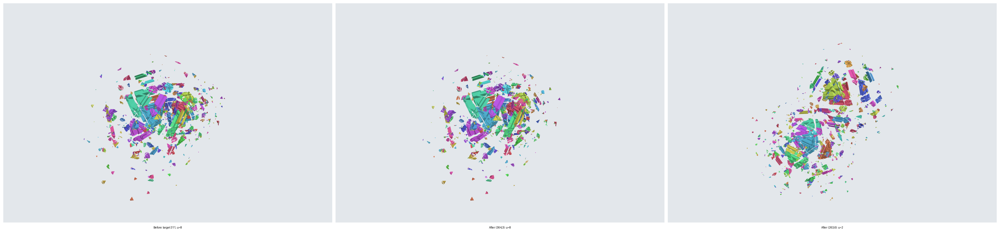

**Ends of the pair program at the runner's call.** The runner stops the program at its first `STEP`. Before any step
it can end in four ways:

| Line | When | Result at `35c3d4f` |
| --- | --- | --- |
| `STUCK` | U and U2 have no step (`:283-286`) | `stuck`, `no_step` |
| `UNLOCKED` | u = 0 at `START`, so the loop does not run (`:197`, `:293-298`): R22D-81's second stuck end | `error`, `malformed_output` (the zero-step ends, section 3.2; intended `stuck`, `unlocked_without_step`) |
| `BUDGET` | the CPU budget is past (`:83-85`, `:299-300`); in practice development mode only | `error`, `malformed_output` (intended `budget`, `cpu_budget`) |
| `NOT_APPLICABLE` | a piece above height 6 (`:191-193`); the plugin's own check comes first (`rules_height.py:540-542`) | `error`, `invariant_height_above_6` |

### 3.4.5 How the r22d81 sub-phase ends, and its effective order

| `r22d81_rule.py` prints | The plugin does | Sub-phase result |
| --- | --- | --- |
| a `STEP` | proposes that letter | the step is played; `handoff` when n6 = 0 after it |
| `STUCK`, τ null | nothing more | `stuck`, `no_target` |
| `STUCK`, τ present | starts the pair program | a step of `r22d88/U2`; or `stuck`, `no_step`; or `error` (section 3.4.4); in development mode also `timeout` or `budget`, `cpu_rlimit`, when a clock kills the pair program |
| `BUDGET` before `START` | nothing more | `budget`, `cpu_budget` |
| `BUDGET` after `START`, zero steps | nothing more | `error`, `malformed_output` (the zero-step ends, section 3.2) |
| `BUDGET` with one step and an unreported H6 letter | nothing more | `budget`, `cpu_budget`; the letter is not played |
| `NOT_APPLICABLE` | nothing more | `error`, `invariant_height_above_6` (cannot occur after the plugin's check) |

Sources: `rules_height.py:546-568`, `:425-458`. A clock kill, a crash, a cancelled call or a malformed line of
either program gives the results of section 3.2. So the runner's order inside one step is H6, U, H4, H2, then U2.
R22D-88 states the order H6, U, U2, H4, H2 (`PROOFS-B.md:3657`). The runner therefore plays an H4 or H2 letter where
R22D-88 would play a pair. The potential falls at every step in either order (section 3.7). The two orders can choose
different steps; this chapter knows no state where they do.

## 3.5 h4: the unlock rule at height 4, with pair steps

H4-unlock is R22D-81 two heights lower. Its target and u are read from the height-4 pieces (section 3.1.2, H = 4). Its
families L4, U and L2 are R22D-81's H6, U and H4 with every height two lower; R22D-81's H2 has no counterpart
(`PROOFS-B.md:3910-3913`). Every letter must be admissible and certain and leave no piece above height 4. The program
checks the count prediction after every letter it plays, U and retained letters included (`h4_unlock.py:306-309`).

### 3.5.1 h4/L4

- **Reads**: as R22D-75 (section 3.3); n6 = 0 here.
- **Candidates and order**: R22D-75's tier-1 candidates; caps in increasing order, items in increasing order
  (`:264-269`).
- **Test**: as T1 of section 3.3. With n6 = 0 the cap bound keeps only caps with F₄ = 0 (`:207`), so no piece rises
  above height 4.
- **Step played (tree)**: one span `h4/L4 [1]`. After it the program computes τ, u and the table again (`:311-312`).
- **Contract**: max ≤ 4; n4 falls; τ may be null and may change.
- **No step**: U (section 3.5.2).
- **Evidence**: in example (c), (482, 15) at `391490f7…` takes n4 from 936 to 734, and τ moves from 482 to 597 with
  u = 41 (**computed**, `h4_unlock_run2.txt:2-4`). In example (a), at S2 the plugin proposes `h4/L4` (35, 13) (**run on
  one instance**, section 3.8.1).
- **Where in the code**: `h4_unlock.py:264-269`, `:306-316`.

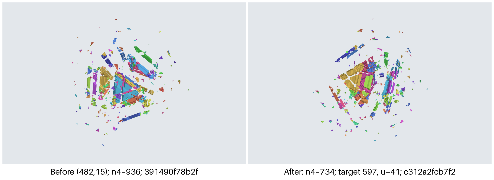

### 3.5.2 h4/U

- **Reads**: τ, u, S_τ, the height-4 pieces and their pose keys.
- **Candidates and order**: only when τ exists. Clean caps in increasing order that hold a straddler of τ whole and no
  height-4 piece whole; items 1 to 59, retained items included. The program prints all 59 u values as a `U_ITEMS` line
  and takes the first item that passes (`:270-288`).
- **Test**: on a copy: admissible and certain; max ≤ 4; n4 unchanged; every height-4 piece keeps its exact pose; u
  strictly lower at the same τ (`:235-245`).
- **Step played (tree)**: one span `h4/U [1]`. The counts are checked against the prediction, which is "unchanged" for
  a retained item (`:196-206`, `:307-309`).
- **Contract**: max ≤ 4; n4 and every height-4 pose kept; u falls; τ not null and unchanged.
- **No step**: L2 (section 3.5.3).
- **Evidence**: at `0ad859c2…` cap 357's items 1 to 11 give u = 11, 8, 41, 34, 8, 57, 45, 8, 8, 108, 13, and its
  jumble items fail the guard. The program plays (357, 1), with u 80 → 11 (**computed**, `h4_unlock_run1.txt:3-4`).
  Five of the six `h4` letters of example (c) are U letters.
- **Where in the code**: `h4_unlock.py:235-245` (the guard), `:270-288`.

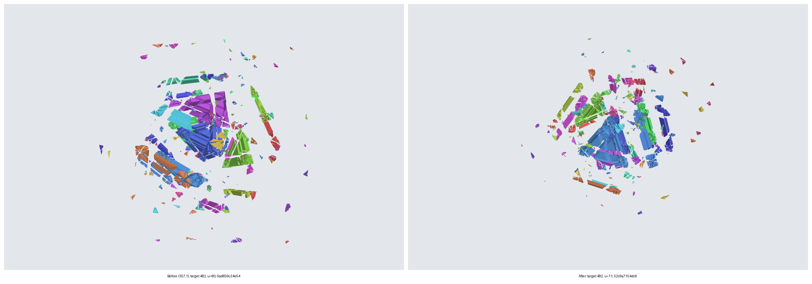

### 3.5.3 h4/L2

- **Reads**: as R22D-75, and τ, u, the height-4 pieces and their pose keys.
- **Candidates and order**: R22D-75's tier-2 candidates at caps that hold no height-4 piece whole; caps in increasing
  order, items in increasing order (`:289-303`).
- **Test**: the guard of U with "u does not rise" (`:299`).
- **Step played (tree)**: one span `h4/L2 [1]`.
- **Contract**: max ≤ 4; n4 and every height-4 pose kept; n2 falls; u does not rise; τ not null and unchanged.
- **No step**: the program prints `STUCK` with τ, u and the table (`:304-305`); section 3.5.4 says what follows.
- **Evidence**: no record has an `h4/L2` step (`RESULT.md` gives "L2 0" for its run,
  `research/jumbling/restoration/12-low-height/runs/round22/cloud/height4-descent-bbef1c8e/RESULT.md:278`).
- **Without a target.** With τ null the program would skip U and try L2, and after an L2 letter it would fail at
  `h4_unlock.py:314`, which counts u at τ. The runner never lets it get there. It stops the program at a `START` line
  with τ null and ends the sub-phase `stuck`, reason `no_target`, with the note "no target; L2 is not run without a
  target (h4_unlock.py:314)" (`rules_height.py:44`, `:551-552`). So the runner does not play L2 letters that the
  program could find at such a state. The sub-phase would end stuck in any case. With no target there is no L4
  letter, since a cap with an L4 candidate is in the table; and an L2 letter keeps every height-4 pose, so the table
  stays empty (**proved (model review only)**: the argument of packet P1,
  `research/jumbling/restoration/13-tutorial-runner/packets/P1.md:636-646`). The end state can differ: the program's
  L2 letters would have lowered n2 first.
- **Where in the code**: `h4_unlock.py:289-303`.

### 3.5.4 How the h4 sub-phase ends

| `h4_unlock.py` prints | The plugin does | Sub-phase result |
| --- | --- | --- |
| `START` with τ null | stops the program | `stuck`, `no_target` |
| a `STEP` | proposes that letter | the step is played; `handoff` when n4 = 0 after it |
| `STUCK` with τ and a table | starts the pair search (section 3.5.5) | an `h4/pair` step; or `stuck`, `pair_exhausted`; or `budget`, `timeout` or `error` |
| `STUCK` with τ null or no table | nothing more | `stuck`, `no_target`. This cannot follow a `START` with τ: τ and the table change only after an L4 letter, and the runner stops at that letter's `STEP` |
| `BUDGET`, before `START`, after it with zero steps, or with one step and families {L4: 1} | nothing more | `budget`, `cpu_budget` |

`h4_unlock.py` prints no `NOT_APPLICABLE`. It asserts max ≤ 4 when it counts (`:105-107`), and the plugin's own check
comes first (`rules_height.py:540-542`). Sources: `rules_height.py:546-562`, `:425-458`, `:490-531`. A clock kill, a
crash, a cancelled call or a malformed line gives the results of section 3.2.

### 3.5.5 h4/pair: the two-letter U step

- **Reads**: τ, u (written u₀ here), S_τ, every cap's clean status and inside set, the height-4 pieces and their pose
  keys. The program recomputes τ and u from the state (`two_letter_u.py:160`); the plugin checks them against the
  `STUCK` line (below).
- **Candidates and order** (`two_letter_u.py:161-170`):
  1. **Holders**: the caps that hold a straddler of τ whole. **Blocked holders**: the holders that are blocked.
  2. **First caps**: the clean caps that hold no height-4 piece whole.
  3. **Class A**: the first caps that hold whole a straddler of some blocked holder. **Class B**: the other first
     caps. Only a class-A letter can **free** a blocked holder, that is, make it clean.
  4. **First letters**: class-A caps in increasing order, each with items 1 to 59, then class-B caps in increasing
     order, each with items 1 to 59. This list is numbered from 0. Shard i of n takes the indices equal to i modulo n
     (`:179-181`).
- **Test of a first letter** (c, j), on a copy: admissible and certain; max ≤ 4; n4 and every height-4 pose kept
  (`:183-188`). If it passes, the program records u_t (u after it) and, for a class-A letter, `freed`: the blocked
  holders that have no straddler after it (`:189-190`).
- **Second letters**: at every cap h, in increasing order, that after the first letter holds a straddler of τ whole,
  is clean and holds no height-4 piece whole; but not at a cap that was clean before and holds the same pieces in the
  same poses (such a letter would act as at the start, where U is exhausted) (`:192-205`). Items 1 to 59, each on a
  copy, under the same guard. The pair **succeeds** when u after it is below u₀ (`:206-215`).
- **Choice** (`rules_height.py:324-342`), read from all shards' `FIRST` lines:
  1. If some class-A first letter frees a blocked holder and has a success: the smallest such first letter in
     (grip, item) order (`by: freeing`).
  2. Otherwise, once every class-A first letter is known: the smallest first letter with a success, in (grip, item)
     order over both classes (`by: first_success`).
  3. The second letter is that first letter's first success in (cap, item) order.

  A choice is made only when the letters it depends on have all been seen: for rule 1 every class-A first letter
  before it, for rule 2 every first letter before it. When every first letter has been seen, no pair succeeds and
  every shard ended `DONE`, the result is `pair_exhausted` (`:521-522`).
- **Shard checks.** The plugin checks every shard's output before it chooses:
  1. `CONTEXT`: one line; its digest is the state's; its τ is not null; τ and u equal the `STUCK` line's; shard and n
     equal the call's (`:402-407`, `:498`). Its lists of first caps and class-A caps are sorted lists of distinct caps,
     class A lies within the first caps, and first_letters, n and shard are integers with shard < n (`:253-265`).
  2. `DONE`: the indices of the shard's `FIRST` lines are exactly {k < first_letters : k mod n = shard}, and
     first_letters_done counts them (`:413-418`).
  3. Across shards: a malformed or crashed shard is an error (`:281-283`). All `CONTEXT` lines agree on digest, τ, u,
     the caps, class A, first_letters and n (`:288-289`). The order rebuilt from the caps and class A has
     first_letters entries (`:291-293`). Every `FIRST` row has an index in range and of its shard, with the order's
     letter and class (`:302-306`). A valid row has an integer u_t, `freed` as a list for class A and null for class
     B, and successes sorted and distinct, each with an end u below u₀ (`:307-320`). A row seen twice must be
     identical (`:321-322`).
  4. The first shard whose call ends `error` stops the others at their next line; they end `crash`, with `stopped`
     set in their attempt rows. The sub-phase ends `error` with the first error's reason (`:500-512`;
     `test_18_shard_crash_stops_sibling`, `test_rules_height.py:768-789`).
  5. If no choice rule decides, a shard killed by the wall clock gives `timeout`, a shard over its budget gives
     `budget`, and anything else gives `error`, `inconsistent_output` (`:523-528`).

  A failed check gives `malformed_output` or `inconsistent_output`.
- **Step played (tree)**: two letters, a root `h4/pair [2]` with `first letter [1]` and `second letter [1]`
  (`:471`). The program prints no end digest. The plugin checks that the live state still has the snapshot's digest,
  and replays the pair on a fresh copy of the current table to get it (`:518-519`, `:478-487`). The record keeps
  u_mid = u_t and `pair_choice`: the order index, the class, `freed`, `by`, the number of shards and the number of
  first letters (`:345-351`).
- **Contract**: max ≤ 4 after each letter; n4 and every height-4 pose kept after each letter; u falls; u_mid checked;
  τ not null and unchanged.
- **No step**: `stuck`, reason `pair_exhausted`; the high phase comes next.
- **Shards and the choice.** The plugin waits for every shard to end; it does not stop them once the order has fixed
  the pair (`:494-509`). In acceptance mode nothing else stops them, so every first letter is tried. Each `FIRST` row
  depends only on the state and its first letter (`two_letter_u.py:179-217`), and the choice reads the rows by their
  order index. So with complete shards the number of shards does not change the choice.
- **Evidence**: the prune of unchanged second caps is exact (**proved (model review only)**, `PROOFS-B.md:3924-3928`;
  an audit found the prune and termination arguments sound, `:3953-3956`). The pair's end meets every condition of a U
  letter, so the potential still falls (`:3917-3918`). Read by the plugin's choice rule, the recorded outputs of the
  three pair rounds of example (c) give the same pairs as the cloud line, and the fourth gives `exhausted`
  (**computed**, `CommittedTests.test_04_pair_rounds`, `test_rules_height.py:274-305`). This shows the choice rule on
  recorded outputs, not that the committed program prints those outputs (section 3.8.3).
- **Where in the code**: `two_letter_u.py:158-176` (holders, classes, order), `:179-217` (first and second letters),
  `:218-220` (end lines); `rules_height.py:246-275` (shard parse), `:278-351` (checks and choice), `:490-531`
  (shards).

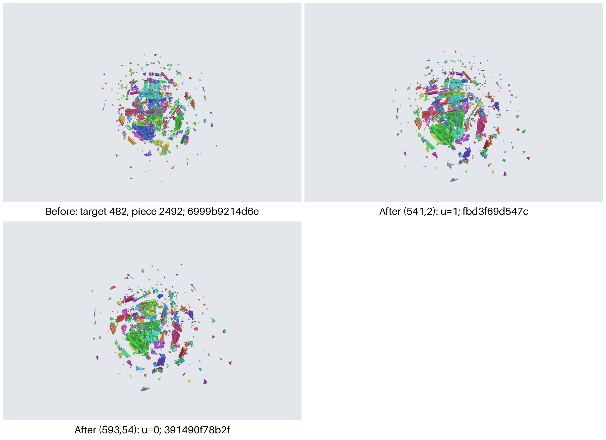

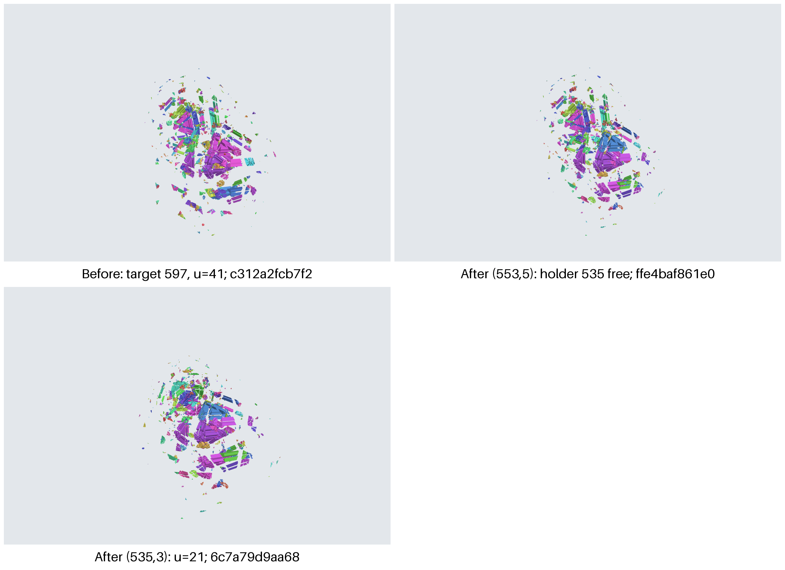

## 3.6 The contracts the checker tests

The checker [`check_run.py`](../restoration/13-tutorial-runner/scripts/check_run.py) replays every recorded word
letter by letter. Each letter must be admissible and certain (fail `admissible`,
`research/jumbling/restoration/13-tutorial-runner/scripts/check_run.py:1339-1348`). For a height row it calls the
contract hooks: `prepare` before the word, `on_letter` after each letter and `finish` at the end (`:1329-1363`). The
hooks apply the contract named by the row's rule (`check_contracts.py:103-119`, `:130-165`, `:207-255`). They read
heights from exact left factors (`:53-75`) and count u with their own `straddlers` function (`:21-41`).

| Rule | Letters | max | Counts | Poses kept | τ | u |
| --- | --- | --- | --- | --- | --- | --- |
| `r22d75/T0`, `T1`, `T2` | 1 | ≤ 6 | (n6, n4, n2) falls lexicographically, first at the tier | – | all τ and u fields null | – |
| `r22d81/H6` | 1 | ≤ 6 | n6 falls | – | may be null; may change | recorded, not ordered |
| `r22d81/U`, `r22d88/U` | 1 | ≤ 6 | n6 kept | height 6 | not null; unchanged | falls |
| `r22d81/H4` | 1 | ≤ 6 | n6 kept, n4 falls | height 6 | may be null; unchanged | does not rise |
| `r22d81/H2` | 1 | ≤ 6 | n6 and n4 kept, n2 falls | height 6 | may be null; unchanged | does not rise |
| `r22d88/U2` | 2 | ≤ 6, also after letter 1 | n6 kept, also after letter 1 | height 6, also after letter 1 | not null; unchanged | falls; u_mid equals the count after letter 1 |
| `h4/L4` | 1 | ≤ 4 | n4 falls | – | may be null; may change | recorded, not ordered |
| `h4/U` | 1 | ≤ 4 | n4 kept | height 4 | not null; unchanged | falls |
| `h4/L2` | 1 | ≤ 4 | n4 kept, n2 falls | height 4 | not null; unchanged | does not rise |
| `h4/pair` | 2 | ≤ 4, also after letter 1 | n4 kept, also after letter 1 | height 4, also after letter 1 | not null; unchanged | falls; u_mid as for U2 |

In every row except T0 to T2, the recorded `u_before` and `u_after` must equal the checker's own counts at the
recorded τ. A violation adds a named failure: `height_rule`, `height_length`, `height_fields`, `height_tau`,
`height_u`, `height_guard`, `height_max`, `height_counts`, `height_tier`, `height_poses` or `height_u_progress`.

**The per-step table.** When a row carries a `table`, it must be `tables/<index:05d>.json` and must load to the state
the checker replayed after that row; otherwise the row fails `table` (`check_run.py:978-987`, called at
`:1367-1368`). The runner writes such a table after every height step (`runner.py:757-758`). At the same commit the
checker also checks the lattice phase's report (fail `lattice_report`) and the D19 hash of every high row (fail
`kernel_d19`); chapters 6 and 4 describe them.

**Phases.** The checker fails a record in which a phase or sub-phase is entered again (`phase_order`,
`check_run.py:1293-1297`). It recomputes each sub-phase's `not_applicable`, `handoff` and `lattice` claims from its own
snapshots (`entry_test`, `:661-706`), and checks the height phase's outer result (`:746-759`).

**What the checker does not check.** It does not check that τ is the target the rule would choose, that the step is
the first candidate in the rule's order, or any `stuck` or `no_target` claim. The hooks "do not choose rules or verify
stuck claims" (`check_contracts.py:1-7`), and `check_run.py` recomputes the entry-test claims but not stuck
(`:693-694`). A wrong choice that still meets its contract passes.

**Evidence**: the 11 tests in `test_check_contracts.py` passed in three recorded runs (**measured**): 127 s as packet
P4's acceptance check (stage 13 README :1342), 109.7 s as the acceptance check of the fix call on `8ae8c4a`
(:1131-1135), and 117.1 s on the final candidate `cd5e6e8` (stage 13 README at `88dacaf`, :1157). The 27 tests in
`test_rules_height.py` passed in 94.6 s and 97.5 s in the last two of these runs (:1132; at `88dacaf`, :1157). None of
these tests covers the zero-step ends of section 3.2.

## 3.7 Why each sub-phase stops (termination, not coverage)

Let B = 177,121, one more than the number of pieces, so every count is below B.

| Sub-phase | Potential | Why it falls at every step |
| --- | --- | --- |
| `r22d75` | R = n6·B² + n4·B + n2 | every letter lowers (n6, n4, n2) lexicographically |
| `r22d81` (with R22D-88) | Φ = n6·B³ + u·B² + n4·B + n2 | H6 lowers n6. U, H4, H2 and U2 keep n6 and every height-6 pose, so τ is unchanged and u is counted at the same cap; U and U2 lower u, H4 keeps u or lowers it and lowers n4, H2 keeps u or lowers it and lowers n2 |
| `h4` (with pairs) | Φ₄ = n4·B² + u·B + n2 | the same argument one coordinate shorter; a pair ends as a U letter would |

All three are **proved (model review only)** for the programs' own order (`PROOFS-B.md:2689-2691`, `:2883-2892`,
`:3691-3694`, `:3913-3918`). They also hold for the runner. Φ and Φ₄ are functions of the state, since τ is. The
runner plays only steps of these families, recomputes τ at every call, and in `r22d81` tries H4 and H2 before U2
(section 3.4.5). Every step it plays is one the argument covers, whatever the order, so the potential falls at every
runner step (**proved (model review only)**, a corollary of the same proofs). So each sub-phase plays at most as many
steps as its potential at its start. Values (**computed** from the recorded counts):

| State | Potential | Value |
| --- | --- | --- |
| seed 7302 stop `015d839e…`, (185, 1,085, 99,314) | R | 5,803,984,274,184 |
| `1ff0061f…`, (172, 1,019, 103,103), u = 3 | Φ | 955,737,565,236,655,817 |
| `0ad859c2…`, (0, 936, 102,901), u = 80 | Φ₄ | 29,364,064,600,557 |

These are bounds, not running times. That a sub-phase stops is not coverage: `stuck` is a possible end, and nothing
here says when the end is a `handoff` (`PROOFS-B.md:2891-2892`, `:3698-3700`).

## 3.8 Worked examples

### 3.8.1 Example (a): a constructed state with one height-6 piece (R22D-36)

The fixture state Z36 is the solved state after a fixed 26-letter word (`PROOFS-B.md:2206-2211`): 5,800 off pieces,
5,799 at height 2 and one, piece 58388, at height 6; digest `8733a0aa…`. The runner, started from Z36 with no bulk,
plays:

| Step | Sub-phase | Rule | Letter | After: off, heights | Digest |
| --- | --- | --- | --- | --- | --- |
| 1 | `r22d75` | `r22d75/T0` | (12, 14) | 3,098: {2: 3,097, 4: 1} | `7cd868f6…` (S2) |
| 2 | `r22d75` | `r22d75/T1` | (35, 13) | 5,405: {2: 5,405} | `3ab25d21…` |

After step 2 the entry test of `r22d75` fails, so it ends `handoff`. `r22d81` and `h4` are `not_applicable`, the
height phase ends `handoff`, and the high phase is `not_applicable`. Both steps have null τ and u fields. At step 2
the off count rises by 2,307: the rule lowers heights, not the off count. Called directly at S2, the `h4` plugin
proposes `h4/L4` (35, 13), with τ 35 → null and u 0 → 0, and reaches the same digest `3ab25d21…`.

**Evidence**: **run on one instance**. `ExactTests.test_01_r22d36_and_h4` runs the real runner, plugin and programs
on Z36 and asserts these steps, results and fields (`test_rules_height.py:863-918`); it passed in the recorded test
runs (section 3.6). At Z36, R22D-81's program would also take (12, 14) first, as an H6 letter (**computed**, record
section A0); the runner does not call it there, since `r22d75` comes first.

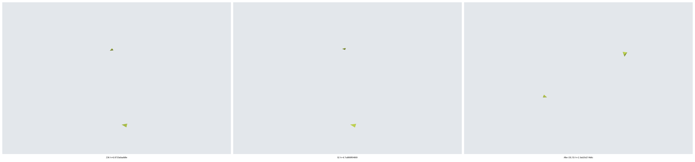

### 3.8.2 Example (b): from the seed 7302 census stop

Start: `015d839e…`, the stop of the census descent of a 3000-twist scramble (seed 7302), with (n6, n4, n2) =
(185, 1,085, 99,314), 100,584 off pieces and N = 130,386 (`PROOFS-B.md:2697`). This example assumes that the height
phase starts here. The census stopped on its clock, so whether the runner's bulk hands over at this state is not
known.

`r22d75` plays seven letters (`runs/round22/r22d75_height_first.txt:2-8`; `PROOFS-B.md:2700-2708`):

| Step | Rule | Letter | (n6, n4, n2) after | Digest |
| --- | --- | --- | --- | --- |
| 1 | T0 | (64, 15) | (172, 1,098, 99,935) | `446f4e00…` |
| 2 | T1 | (185, 14) | (172, 1,093, 100,797) | `cc5fa964…` |
| 3 | T1 | (357, 12) | (172, 1,026, 101,801) | `3a4c0a56…` |
| 4 | T1 | (471, 12) | (172, 1,019, 103,525) | `0251a333…` |
| 5 | T2 | (263, 14) | (172, 1,019, 103,304) | `fd7a61a6…` |
| 6 | T2 | (407, 13) | (172, 1,019, 103,146) | `4f58b063…` |
| 7 | T2 | (523, 12) | (172, 1,019, 103,103) | `1ff0061f…` |

Then it is stuck: of the 35,400 letters, 33,158 are at the 562 blocked caps, 649 at the 11 caps the bound prunes, 297
are retained letters at the other 27 clean caps, and 1,296 do not lower the counts (**run on one instance**,
`PROOFS-B.md:2710-2713`, recounted at `:2915-2917`; `runs/round22/r22d75_height_first.txt:9`). Result `stuck`,
`no_step`. This is a stop of this rule at this state, not a statement about height 6.

**Provenance.** The record was made by `r22d75_height_first.py`, which the integrator re-ran with the same outputs
(stage 12 README, `research/jumbling/restoration/12-low-height/README.md:1115-1118`) and replayed with its own script
(`PROOFS-B.md:2713-2715`). The committed `r22d75_from_snapshot.py` was not run on this state. From `def info` on, the
two scripts' rule code is the same except three lines: the loop runs while n6 > 0 there and while n6 + n4 > 0 here,
the end tag is `HANDOFF_R22D25` there and `HEIGHT2` here, and the `BUDGET` line reports a fixed limit there (record
section C). The loop difference does not matter on this run: n6 stays at 172 until the program is stuck.

`r22d81` starts at `1ff0061f…` with τ = 274, u = 3 and plays five letters (`runs/round22/r22d81_rule.txt:2-11`;
`PROOFS-B.md:2825-2831`):

| Step | Rule | Letter | τ, u after | (n6, n4, n2) after | Digest |
| --- | --- | --- | --- | --- | --- |
| 1 | `r22d81/U` | (124, 2) | 274, 0 | (172, 1,019, 103,103) | `9a227291…` |
| 2 | `r22d81/H6` | (274, 13) | 104, 30 | (13, 926, 102,593) | `c9cefc31…` |
| 3 | `r22d81/U` | (46, 1) | 104, 3 | (13, 926, 102,593) | `7465613d…` |
| 4 | `r22d81/U` | (46, 3) | 104, 0 | (13, 926, 102,593) | `198e936f…` |
| 5 | `r22d81/H6` | (104, 14) | null, 0 | (0, 936, 102,960) | `bbef1c8e…` |

The τ and u after an H6 letter are the recomputed ones that the `STEP` line prints. The three U letters are retained
letters. They change no height and move the blockers off τ's cut. After step 5, n6 = 0, so `r22d81` ends `handoff` at
`bbef1c8e…` with 103,896 off and N = 132,930. The pair program is never called. The record was made by
`r22d81_rule.py`, whose header names it (`r22d81_rule.py:18-19`); a later fix, SU2-02, changed only its `BUDGET` line
(`PROOFS-B.md:3715-3716`). The four census lines of example (d) printed the same digests, counts, tables and
`U_ITEMS` vectors with the draft of the script (`PROOFS-B.md:3866-3868`).

`h4` then starts at `bbef1c8e…`, not at the state that R22D-75 would reach from there (path dependence, section 3.2):
`r22d75` has already ended. Only one record of `h4_unlock.py` at `bbef1c8e…` exists: run 0, made with an earlier
revision whose digest is not recorded. Its `START` gives τ = 482, u = 80 and 18 targets. L4 has no letter, and the
first cap that U tries is 357, whose items 1 to 11 give u = 11, 8, 41, 34, 8, 57, 45, 8, 8, 108, 13. Run 0 then failed
its own after-letter check and printed no step (`h4_unlock_run0_prediction_assert.txt:2-8`; `RESULT.md:82-90`). The
audit reads its U letter as (357, 1), the first item that lowers u (stage 12 README :1882). The committed revision was
not run at `bbef1c8e…`, so it is not shown that the runner's first `h4` step there would be `h4/U` (357, 1). Nothing
after it has been computed on this path.

**Evidence**: **computed** for the `r22d75` and `r22d81` letters. These are records of the rule programs run to their
own ends, not runner records. They are what the runner would play: it takes the first step at each state, and τ
recomputed at each call equals the τ the program keeps (sections 3.1.2 and 3.7).

**The order of the sub-phases matters.** R22D-81 run from the stop itself, without R22D-75 first, plays (64, 15),
then the U letter (124, 2) instead of R22D-75's (185, 14), then (274, 13), (46, 1), (46, 3) and (104, 14). It hands
over at `e108778e…` with (0, 1,015, 99,701) and 100,716 off, a different state (**computed**,
`runs/round22/r22d81_from_stop.txt`, parsed by `CommittedTests.test_01_r22d81_and_pairs`,
`test_rules_height.py:171-213`). The runner never plays this sequence, since `r22d75` comes first.

### 3.8.3 Example (c): a height phase that starts at bbef1c8e…

This is the cloud line of `RESULT.md`, read step by step as the runner would play it if the height phase started at
`bbef1c8e…`.

| # | Sub-phase | Rule | Letters | τ, u | (n6, n4, n2) after | Digest after |
| --- | --- | --- | --- | --- | --- | --- |
| 1 | `r22d75` | T2 | (23, 14) | – | (0, 936, 102,901) | `0ad859c2…` |
| – | `r22d75` | stuck, `no_step` | | | | |
| – | `r22d81` | `not_applicable` (n6 = 0) | | | | |
| 2 | `h4` | U | (357, 1) | 482, 80 → 11 | (0, 936, 102,901) | `52c9a715…` |
| 3 | `h4` | U | (357, 3) | 482, 11 → 8 | (0, 936, 102,901) | `e13f5264…` |
| 4 | `h4` | U | (593, 3) | 482, 8 → 2 | (0, 936, 102,901) | `c7d5be22…` |
| 5 | `h4` | U | (593, 43) | 482, 2 → 1 | (0, 936, 103,571) | `6999b921…` |
| 6 | `h4` | pair, `first_success` | (541, 2), (593, 54) | 482, 1 → 1 → 0 | (0, 936, 103,282) | `391490f7…` |
| 7 | `h4` | L4 | (482, 15) | 482 → 597, u 0 → 41 | (0, 734, 102,750) | `c312a2fc…` |
| 8 | `h4` | pair, `freeing` | (553, 5), (535, 3) | 597, 41 → 41 → 21 | (0, 734, 102,750) | `6c7a79d9…` |
| 9 | `h4` | U | (535, 6) | 597, 21 → 10 | (0, 734, 102,750) | `b2651c24…` |
| 10 | `h4` | pair, `first_success` | (363, 10), (535, 8) | 597, 10 → 10 → 8 | (0, 734, 102,750) | `2430f4cc…` |
| – | `h4` | stuck, `pair_exhausted` | | | | |

Sources: `RESULT.md:260-276`; `h4_unlock_run1.txt` to `h4_unlock_run4.txt`. In the pair rows the three u values are
u before, u_mid and u after. Notes:

- Step 6: at `6999b921…` τ's one straddler, piece 2492, is held whole by eight blocked caps and the clean cap 593.
  Class A is 357, 370, 541, 552, 590, 591, 593, and there are 2,065 first letters, 1,825 of them valid. No first
  letter frees a blocked holder. 250 pairs succeed, all with the second letter at cap 593, so the first success in
  (grip, item) order is taken (`RESULT.md:138-152`).
- Step 7: the one L4 letter lowers n4 by 202, and τ moves to cap 597 (k = 205) (`PROOFS-B.md:3941-3942`).
- Step 8: at `c312a2fc…` all ten holders of τ's 41 straddlers are blocked. Ten items of cap 553 free cap 535, and
  (553, 5) is the first of them. Some of their pairs reach u = 0, for example (553, 27), (535, 21), but the rule takes
  the first success, not the lowest u (`RESULT.md:184-199`).
- End: at `2430f4cc…` τ = 597 has 8 straddlers. Its holders are the clean cap 535 and the blocked caps 578, 583, 588
  and 595, which have 1,123 straddlers of their own. All 1,947 first letters were tried and 1,707 are valid. None
  frees a blocked holder, the only second cap the prune keeps is 535, and no pair ends below u = 8
  (`RESULT.md:238-248`). The sub-phase ends `stuck` and the high phase starts there. The R22D-25 kernel of chapter 4
  is also stuck at `2430f4cc…` (stage 12 README :1442, :1447-1448).

In total: one `r22d75` step and nine `h4` steps, 13 letters. n4 falls from 936 to 734. On the way 2,289 lattice
pieces go off and 2,701 off pieces come on (`RESULT.md:281-283`), and N rises from 132,930 to 133,818
(`RESULT.md:285`). The phase is not protected.

**Provenance.** The `r22d75` step and the `h4` runs 1 to 4 were made with scripts whose sha256 in `RESULT.md` equal
the committed files (`RESULT.md:22-23`; record section D). The pair search has two kinds of records:

| Outputs | Script | Re-run by the integrator |
| --- | --- | --- |
| round 1, parts 1 and 2 (indices 0 to 510 at `6999b921…`, including the chosen first letter (541, 2), index 119, `two_letter_u_shard2_part1.txt:41`) | earlier revisions of `two_letter_u.py` that compared pose ids, part 1 without `--from-index`; their digests are not recorded (`RESULT.md:119-121`; stage 12 README :1882) | no |
| round 1, part 3, and rounds 2 to 4 | the final revision; its sha256 (`RESULT.md:24`) equals the committed file (record section D) | round 4 only (`PROOFS-B.md:3951-3953`) |

The cloud runs used three shards and stopped rounds 2 and 3 once the order had fixed the pair; the runner would use
four and run every shard to its end.

**Evidence**: **computed**. The integrator replayed the 25 letters from the stop, and the replay printed the cloud
line's `end_summary.txt` byte for byte; H4-unlock from the stop with the 25 letters as prefix is stuck at
`2430f4cc…` with no letter; and the full pair search at `2430f4cc…` printed round 4's outputs again
(`PROOFS-B.md:3950-3953`). The plugin's choice rule, applied to the recorded outputs, gives the same three pairs and
`exhausted` (`CommittedTests.test_04_pair_rounds`, `test_rules_height.py:274-305`). That the committed `two_letter_u.py`
prints the same rows for indices 0 to 510 at `6999b921…` is not shown. The runner itself was not run from
`bbef1c8e…`.

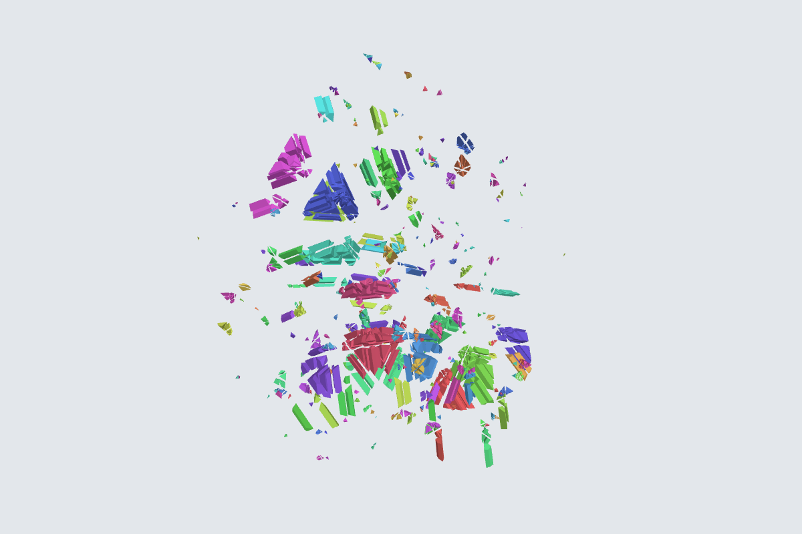

### 3.8.4 Example (d): the other 3000-twist census stops (seeds 7304 to 7307)

`r22d75` from each census stop (`PROOFS-B.md:3870-3875`; parsed by `CommittedTests.test_02_census_tiers`,
`test_rules_height.py:215-246`):

| Seed | Letters (tier) | End: (n6, n4, n2), off |
| --- | --- | --- |
| 7304 | (170, 12), (395, 12), (500, 12), (540, 12) T1; (217, 15), (148, 15) T2 | (0, 797, 95,674), 96,471 |
| 7305 | (10, 12), (10, 15), (67, 14), (134, 13), (195, 14), (233, 15), (421, 12), (421, 12), (484, 15) T1; (122, 12), (175, 14) T2 | (0, 1,419, 108,453), 109,872 |
| 7306 | (208, 12) T0; (76, 13), (90, 12), (109, 12), (233, 15), (387, 15), (485, 13) T1; (403, 13), (512, 15) T2 | (0, 2,591, 108,641), 111,232 |
| 7307 | (275, 14), (516, 13) T0; (50, 15), (474, 13), (494, 15) T1; (147, 14) T2 | (0, 1,585, 98,984), 100,569 |

Each ends stuck with n6 = 0 and almost every cap blocked: 559, 578, 574 and 562 of 600 (`PROOFS-B.md:3881-3882`,
`:3890`). At seed 7305 the same letter (421, 12) is the first candidate twice in a row. In the runner, `r22d81` would
be `not_applicable` at each end and `h4` would start there. What `h4` does at these states has not been computed.

**Provenance.** The records (`runs/round22/cloud/census-k3000-s7304/r22d75_census_k3000.txt`, the same file name for
seeds 7306 and 7307, and `census-k3000-s7305/r22d75.txt`) were made by the lines' copies of `r22d75_census.py`,
`r22d75_census_k3000.py`. From `def info` on, their rule code equals that of `r22d75_from_snapshot.py` except the
limit on the `BUDGET` line (record section C). The integrator re-ran the copies and got the same outputs, the `cpu`
fields aside (`PROOFS-B.md:3897-3899`).

**Evidence**: **computed** (one scramble per seed; each census stopped on its clock).

### 3.8.5 Example (e): the mechanics of a U2 step

At `fe273a8c…` (R22D-75's seven letters and (185, 1), (263, 1), (263, 3) from the seed 7302 stop), with τ fixed by
hand to cap 311 and u = 8, U has no letter: cap 364, the only clean cap that holds a blocker, leaves u at 8 or more.
The pair program takes 1,312 first letters (48 more fail the height guard), prunes 7,278 combinations of a first
letter and a second cap by the count, classifies 105 second caps at a middle state and evaluates 6,142 pairs. It plays
`r22d88/U2` (364, 3), (263, 6), with u 8 → 8 → 2, then `r22d88/U` (263, 40), u 2 → 0 (**computed**, R22D-89 run
(iii), `PROOFS-B.md:3730-3742`; `runs/round22/r22d81_pairs_cap311_tail.txt`).

The runner would not play this. The three letters after `1ff0061f…` are U letters for τ = 311, which keep every
height-6 pose (`PROOFS-B.md:3727-3728`). τ depends only on the height-6 pieces and their poses (`:2870-2871`), so the
runner's target at `fe273a8c…` is 274, as at `1ff0061f…`, not 311 (**proved (model review only)**, from these two
statements). No state is known where the runner itself reaches R22D-88.

## 3.9 Limits of this chapter

- No finite run shows that the height phase brings every scramble to height 2. Example (c) ends stuck at height 4
  with 734 pieces there, and the high phase is stuck at the same state.
- No runner run from a scramble or a census stop has taken a height step (stage 13 README at `88dacaf`, :1183-1187).
  The D0 acceptance runs on the committed head, seeds 7001 (depth 10) and 7106 (depth 20), have only height-2 pieces
  after the bulk, so all three height sub-phases are `not_applicable` (**run on one instance** each; their records
  `research/jumbling/restoration/13-tutorial-runner/runs/dev/d0-s7001/run/run.json` and
  `research/jumbling/restoration/13-tutorial-runner/runs/dev/d0-s7106/run/run.json`; stage 13 README at `88dacaf`,
  :1545-1557). The examples are records of the rule programs, one plugin test and this chapter's record.
- At `35c3d4f` three zero-step ends of the programs end the run `error` (section 3.2). One of them, R22D-81's second
  stuck end, can occur in acceptance mode.
- The rules are not protected: they take lattice pieces off and can raise N.
- Headless Linux only; no Windows, DirectX or performance claim. Times in this chapter are development timings, not
  performance evidence.

**Before-and-after figures by rule.**

| Rule | Figure | State |
| --- | --- | --- |
| `r22d75/T0` | 3.2, 3.13 | `015d839e…` (64, 15); Z36 (12, 14) |
| `r22d75/T1` | 3.13 | S2 (35, 13) |
| `r22d75/T2` | 3.4 | `bbef1c8e…` (23, 14) |
| `r22d81/H6` | 3.6 | `9a227291…` (274, 13) |
| `r22d81/U` | 3.5 | `1ff0061f…` (124, 2) |
| `r22d81/H4`, `r22d81/H2` | missing | no development state is known where the runner plays them, and no record has them with a real target. Figure 3.7 shows their tests at `446f4e00…` (185, 14) and `0251a333…` (263, 14) with the target forced absent: a figure of the test, not of a runner step |
| `r22d88/U` | missing | the runner cannot play it (section 3.4.4); with τ fixed by hand it fired in R22D-89, for example (263, 40) after the U2 step of example (e) |
| `r22d88/U2` | missing | no development state is known where the runner reaches it. Figure 3.8 shows a pair at `fe273a8c…` with τ = 311 fixed by hand: a figure of the mechanics, not of a runner step |
| `h4/L4` | 3.9 | `391490f7…` (482, 15) |
| `h4/U` | 3.10 | `0ad859c2…` (357, 1) |
| `h4/L2` | missing | no development record has an `h4/L2` step |
| `h4/pair` | 3.11, 3.12 | `6999b921…`, `c312a2fc…` |

## 3.10 Where in the code

| What | Where |
| --- | --- |
| sub-phase order, results, clock sentinel, child clocks | `research/jumbling/restoration/13-tutorial-runner/scripts/runner_api.py:21-28`, `:107-127` |
| entry tests, sub-phase loop, phase result | `research/jumbling/restoration/13-tutorial-runner/scripts/runner.py:625-631`, `:642-703`, `:705-724` |
| playing and recording a step | `runner.py:737-766`, `:289-298` |
| a signal during a call; the run's end | `runner.py:507-547`, `:661-665`, `:1463-1492` |
| clocks, shard count, acceptance options | `runner.py:51-57`, `:145-158`, `:1606-1612`; `research/jumbling/restoration/13-tutorial-runner/acceptance-config.json` |
| programs and their end lines | `research/jumbling/restoration/13-tutorial-runner/scripts/rules_height.py:24-44` |
| reading a program's log, end mapping | `rules_height.py:133-238`, `:375-466` |
| one step per call | `rules_height.py:363-372`, `:534-572` |
| rule names and record fields | `rules_height.py:154-195`, `:469-475` |
| pair shards, checks and choice | `rules_height.py:246-351`, `:478-531` |
| R22D-75 | `research/jumbling/restoration/12-low-height/scripts/round22/cloud/height4-descent-bbef1c8e/r22d75_from_snapshot.py:54-100` |
| R22D-81 | `research/jumbling/restoration/12-low-height/scripts/round22/r22d81_rule.py:148-310` |
| R22D-88 | `research/jumbling/restoration/12-low-height/scripts/round22/r22d81_pairs.py:74-300` |
| H4-unlock | `research/jumbling/restoration/12-low-height/scripts/round22/cloud/height4-descent-bbef1c8e/h4_unlock.py:147-320` |
| two-letter U | `research/jumbling/restoration/12-low-height/scripts/round22/cloud/height4-descent-bbef1c8e/two_letter_u.py:120-220` |
| straddlers | `research/jumbling/restoration/12-low-height/scripts/eb6.py:119-137`; the checker's own `research/jumbling/restoration/13-tutorial-runner/scripts/check_contracts.py:21-41` |
| contracts | `check_contracts.py:90-119`, `:130-165`, `:207-255` |
| checker: replay, hooks, table, phases | `research/jumbling/restoration/13-tutorial-runner/scripts/check_run.py:1329-1368`, `:978-987`, `:661-706`, `:746-759`, `:1293-1297` |
| tests | `research/jumbling/restoration/13-tutorial-runner/scripts/test_rules_height.py` (`CommittedTests` :159-330, `StubTests` :347-810, `ExactTests` :826-971); `research/jumbling/restoration/13-tutorial-runner/scripts/test_check_contracts.py` |
| proofs | `research/jumbling/restoration/12-low-height/PROOFS-B.md` R22D-75 (:2683), R22D-80 (:2816), R22D-81 (:2862), R22D-88 (:3653), R22D-89 (:3719), census lines (:3859), H4-unlock (:3904) |
| this chapter's examples | `research/jumbling/tutorial/scripts/ch03_examples.py`; `research/jumbling/tutorial/records/ch03-examples.json` |

## 3.11 Open questions

1. **The zero-step ends.** At `35c3d4f`, R22D-81's `BUDGET` after its `START` and the pair program's `UNLOCKED` and
   `BUDGET` end the run `error`, `malformed_output` (section 3.2). The fix belongs to the runner's integrator: either
   the plugin compares τ and u only when the end line carries them, or the programs print them. A test through `_call`
   with the real programs' lines would cover it; record section A has three such logs.
2. Whether the committed `h4_unlock.py` chooses (357, 1) at `bbef1c8e…`, as the audit reads run 0 of an earlier
   revision (section 3.8.2).
3. Whether the committed `two_letter_u.py` prints the recorded rows for indices 0 to 510 at `6999b921…`, which earlier
   revisions made (section 3.8.3).
4. Whether the committed `r22d75_from_snapshot.py` prints the recorded letters at the seed 7302 stop and at the census
   stops, which scripts with the same rule code made (sections 3.8.2 and 3.8.4).
5. Whether the runner's bulk hands over at any census stop, and what `h4` does at the stops of seeds 7304 to 7307.
6. Whether the runner's order in `r22d81` (H4 and H2 before U2) and R22D-88's order (U2 before H4 and H2) ever choose
   different steps.
7. Figures for the rules that no development run of the runner's order has played: `r22d81/H4`, `r22d81/H2` and
   `r22d88/U2` (Figures 3.7 and 3.8 show their tests with a forced target only), `r22d88/U`, which the runner cannot
   play, and `h4/L2`. Under the integrator's reading of the owner's figure decision of 22 October 2026, they stay
   listed as missing until a development state is found where the runner plays them.
8. Coverage: whether the height phase reaches n4 = 0 from any scramble. Example (c) ends stuck, and no run has
   tested more.
