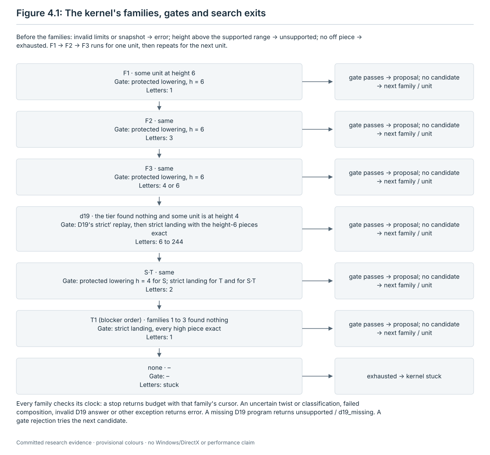
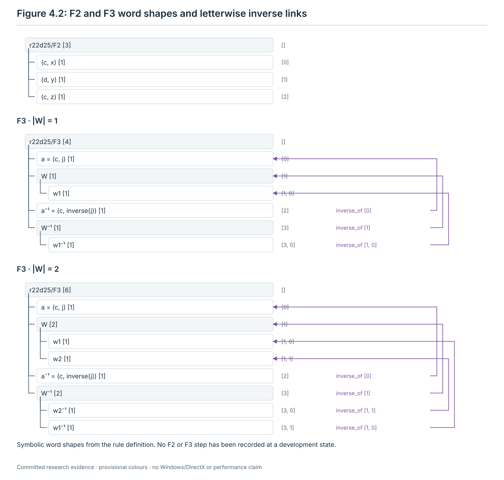
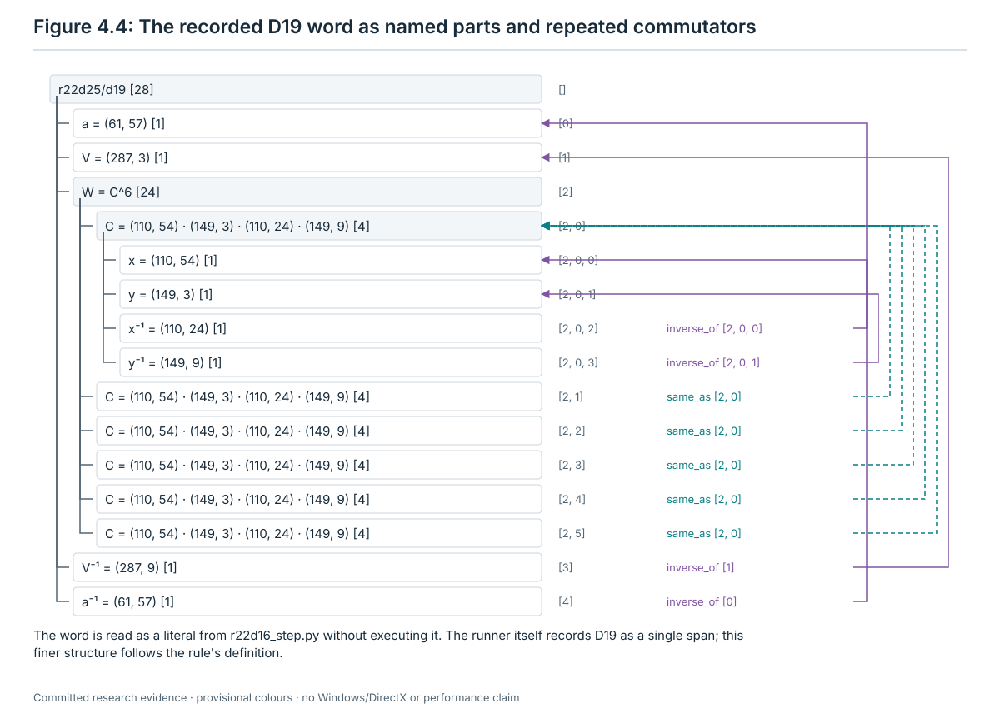
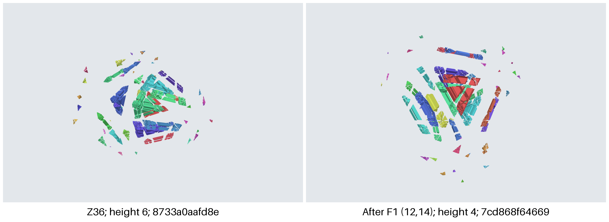
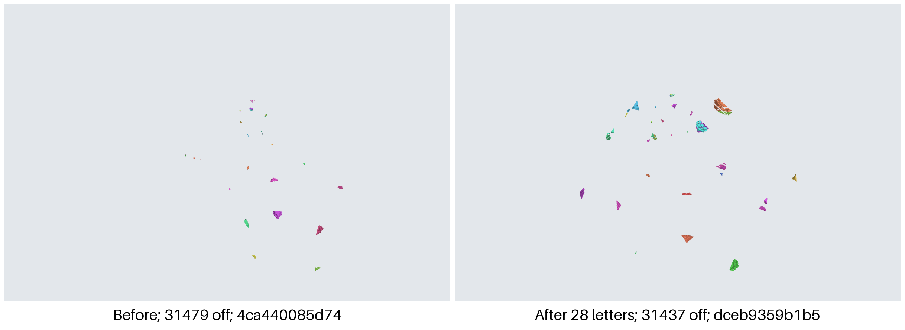
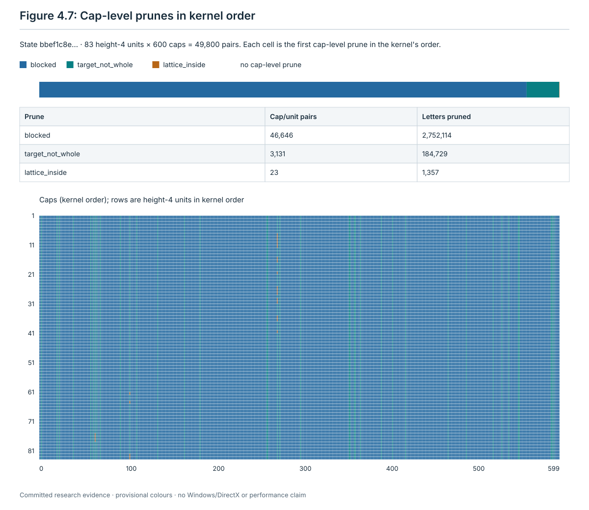

# 4. High: the kernel for what height leaves

The high phase is the third phase of the run, after the bulk (chapter 2) and the height phase (chapter 3), and before
the tail (chapter 5) and the lattice (chapter 6). It takes the off pieces that are still at left height 4 or 6 when the
height phase finds no step, and tries to lower or land them with one fixed catalogue of words, `r22d25-cat/1`. The
catalogue is the **R22D-25 kernel** of [stage 12](../restoration/12-low-height/README.md) with its height-6 tier
(R22D-37) and its height-4 rule **D19** (R22D-19). The kernel is
[`r22d25_search.py`](../restoration/12-low-height/scripts/round22/r22d25_search.py) with
[`r22d25_state.py`](../restoration/12-low-height/scripts/round22/r22d25_state.py); D19 is
[`r22d19_rule.py`](../restoration/12-low-height/scripts/round22/r22d19_rule.py). The runner calls the kernel through
the plugin [`rules_kernel.py`](../restoration/13-tutorial-runner/scripts/rules_kernel.py), one step per call.

This chapter states every rule of that phase so that a program that reads only the current state can follow it: what
each rule reads, its candidates in their exact order, the test a candidate must pass, the word that is played and its
tree of named parts, the contract the step satisfies, and what happens when no candidate passes. Where the code and a
stage 12 text differ, the code is the rule the runner follows, and the chapter says so.

**Citations.** Code citations give `path:line` from the repository root, at commit `88dacaf`. The files `runner.py`,
`runner_api.py`, `rules_kernel.py`, `check_contracts.py`, `check_r22d25.py`, `test_rules_kernel.py`,
`acceptance-config.json`, the stage 12 scripts and `PROOFS-B.md` are the same at `35c3d4f`, the commit that chapter 1
cites. In `check_run.py`, every line after line 966 is one line lower at `35c3d4f`; `test_runner.py` and the stage 13
`README.md` differ more. After its first citation, a file is cited by its name alone. Each name stands for one path:

| Name | Path |
| --- | --- |
| `runner.py`, `runner_api.py`, `rules_kernel.py`, `check_run.py`, `check_contracts.py`, `check_r22d25.py`, `test_rules_kernel.py`, `test_runner.py` | `research/jumbling/restoration/13-tutorial-runner/scripts/` |
| `acceptance-config.json`, "stage 13 `README.md`", `packets/P2.md`, `packets/P2-report.md` | `research/jumbling/restoration/13-tutorial-runner/` |
| `r22d25_search.py`, `r22d25_state.py`, `r22d19_rule.py`, `test_r22d25.py` | `research/jumbling/restoration/12-low-height/scripts/round22/` |
| `PROOFS-B.md`, "stage 12 `README.md`", `runs/round22/…` | `research/jumbling/restoration/12-low-height/` |
| `buffer.py`, `e3_class.py` | `research/jumbling/theory/` |
| `ch04_examples.py` | `research/jumbling/tutorial/scripts/` |

**The chapter's script and record.** [`scripts/ch04_examples.py`](scripts/ch04_examples.py) and
[`records/ch04-examples.json`](records/ch04-examples.json) are new with this chapter. The script is read-only. It
imports the kernel and one function of the plugin (`_stop_family`), rebuilds the R22D-36 test state from its 26
letters, and writes one record; every cache file goes to `--cache`. It ran in 86.4 s on a cloud machine (record field
`seconds`; **measured**):
`python3 -I -B research/jumbling/tutorial/scripts/ch04_examples.py --out <new file> --cache <new directory>`. The
record holds the sha256 of the four programs it imported (`scripts`) and three sections:

| Section | What it holds | Script |
| --- | --- | --- |
| A | the R22D-36 test state Z36: its snapshot; F1's cap-level test of caps 0 to 12 and letter-level test of items 1 to 14 at cap 12; one `search_step` of the kernel at Z36 with its whole ledger; the gate of R22D-36's letter (12, 45) | `ch04_examples.py:112-143` |
| B | the state after F1's word, rebuilt as the kernel's run loop rebuilds it; one `search_step` there with the real D19 program and a 60-second clock, its ledger, and the stop family that the plugin reads from that ledger | `ch04_examples.py:145-154` |
| C | the kernel's table of inverse items, and the number of home chambers of every cap at the solved state | `ch04_examples.py:156-161` |

**Terms.** These are defined in chapter 1 and used here without repeating them: cap (grip) c from 0 to 599; the menu
I_a and its items 0 to 59 (item 0 is the identity, items 1 to 11 are the other retained items, items 12 to 59 are
jumble items); the inverse item ī (section 1.2); a letter (c, i) and a word; admissible, blocked and uncertain letters
and the inside set of a cap (section 1.4); a domain (section 1.5); the left height of a piece, the height histogram
with max, n4 and n6, and the fact T5 that one twist changes a left height by −2, 0 or +2 (section 1.6); blocks and
units (section 1.9); the digest (section 1.10); snapshots (section 1.11); entry tests (section 1.12); step trees
(section 1.13). These are defined in chapter 3, section 3.1: the branch of a piece and of a cap, clean and blocked
caps, a piece held whole by a cap, and the straddlers of a cap. Two words are used differently from chapter 1: here a
**cell** is a set of caps of one branch, and a **content** is a cell with a label (section 4.10). Chapter 1 uses
"class cell" for a set of off pieces (section 1.9).

**Evidence labels.** **computed** (an exact computation with a replayable record or script), **proved (model review
only)** (a proof checked by models, not yet by a person), **run on one instance** and **measured** (a result on finite
inputs). A statement of what the code does is a statement of the rule, with its `path:line`; it needs no label.

## 4.1 What the phase is for, in one paragraph

At the end of the height phase some off pieces can still be at left height 4 or 6. The high phase works on them
before the tail (chapter 5). Each word it accepts does one of three things. It lowers a whole height-6 unit to height 4
(F1, F2, F3). It lands a whole height-4 unit (d19, S·T). Or it lands a height-2 unit while every piece at height 4 or
more keeps its exact pose (T1 in blocker order). In every case no lattice piece goes off, and every other off piece
keeps its exact pose or lands; lattice pieces may move to other lattice poses (section 4.5). Each accepted word lowers
the number n6 of height-6 pieces or the off count, and raises neither, so the phase plays a bounded number of letters
(section 4.13). The phase ends when no piece is off (`lattice`), when n4 + n6 = 0 (`handoff`), when the catalogue has
no word at the current state (`stuck`), or on a clock or an error. The catalogue is finite, but it is not complete: at
all six height-4 stops where it was run it found no step (section 4.15).

## 4.2 Entry, loop and exit

**Reads.** Only the current state: the histogram of left heights of the off pieces and the off count
(`Runner.heights` and `Runner.entry`, `research/jumbling/restoration/13-tutorial-runner/scripts/runner.py:621-631`).

| Test | Holds when | Code |
| --- | --- | --- |
| entry of `high` | max ≤ 6 and n4 + n6 > 0 | `runner.py:630` |

The entry test of `high` is the same as that of the first height sub-phase `r22d75` (`runner.py:629`).

**Where the phase starts.** The runner goes through the phases in the fixed order bulk → height (`r22d75` → `r22d81`
→ `h4`) → high → tail → lattice and never goes back
(`research/jumbling/restoration/13-tutorial-runner/scripts/runner_api.py:21-22`; `runner.py:705-716`, `:1463-1478`).
The high phase starts at the state where the last height sub-phase ended. If a height sub-phase ended `budget` or
`timeout`, the high phase does not run and the run ends `budget` (`runner.py:708-715`, `:1471-1473`).

**Options in the two modes.** Acceptance mode (`--mode acceptance`) refuses to start when any of eleven options differs
from `research/jumbling/restoration/13-tutorial-runner/acceptance-config.json` (`runner.py:54-57`, `:145-158`). The
values in that file are the runner's defaults (`runner.py:1593-1615`). For this phase that means `--high-steps` is
null: there is no step budget. Acceptance mode also lifts every clock: the kernel receives the sentinel 10⁹ seconds as
its clock and the runner sets no wall clock on the call (section 4.3). In both modes the lattice phase that follows
uses the restorer `schedule11`, unless a development run asks for `--lattice-restorer late` (`runner.py:1608-1609`;
chapter 6).

**The loop** (`Runner.plugin_phase`, `runner.py:642-703`):

1. Record the start snapshot (digest, off count, heights). If the entry test fails here, the result is
   `not_applicable` and nothing runs (`:647-650`).
2. If at least one step was taken and the entry test now fails, the result is `handoff` (`:654-656`).
3. If `--high-steps` is set and reached, the phase ends with `End('budget', 'high_steps')` (`:657-658`). In
   acceptance mode it is null, so this never happens.
4. Otherwise call the plugin once: `rules_kernel.next_step` (`:660`). It returns one proposed step or an end.
5. If a signal arrived during the call, the runner keeps the call's attempt rows and ends the run (`:661-665`;
   section 4.3, "Signals").
6. A proposed step is played twist by twist by the runner itself and recorded with its word, its tree and the table of
   the state after it, `tables/<index:05d>.json` (`record_step`, `:737-766`; the play is at `:753`, the table at
   `:757-758`). If no piece is off afterwards, the result is `lattice` (`:670-671`). Otherwise go back to 2.
7. An end gives the phase result. A plugin may not claim `handoff` or `lattice` against the state (`:677-681`). The
   phase records its result, its end snapshot, and the end's reason, details and attempt rows (`:688-691`).

**Exit.** What the run does after each result of the high phase:

| High result | When | Next |
| --- | --- | --- |
| `lattice` | a step left no piece off | the tail is `not_applicable` (`runner.py:1259-1262`); then the lattice phase (chapter 6) |
| `handoff` | after a step, n4 + n6 = 0 and some piece is off | the tail (chapter 5) |
| `not_applicable` | the entry test fails where the phase starts | the tail |
| `stuck` | the kernel exhausted its catalogue at this state | the tail |
| `budget` | the kernel's own clock stopped it (`kernel_clock`), or `--high-steps` was reached (`high_steps`) | the run ends `budget` (`runner.py:714-715`, `:1471-1473`) |
| `timeout` | the runner killed the kernel call on its wall clock (development mode only) | the run ends `budget` |
| `error` | a kernel error (sections 4.5 and 4.6), a malformed record, a failed replay in the runner, any crash | the run ends `error` (`runner.py:701-702`, `:1479-1486`) |
| none | a signal during a kernel call | the run ends `error` (section 4.3) |

A `budget` or `timeout` never reads as `stuck`: a search cut off by time does not show that the catalogue is exhausted
(R22D-25 item 7, `research/jumbling/restoration/12-low-height/PROOFS-B.md:2020-2021`).

## 4.3 One step per call: the plugin

**Reads.** The current pose table (`ctx.table`), the snapshot `{digest, off, heights}` (`ctx.snapshot()`), the mode and
the clocks. Nothing else from earlier steps (`next_step`,
`research/jumbling/restoration/13-tutorial-runner/scripts/rules_kernel.py:132-227`).

**What one call does.**

1. Make a new, empty directory in the attempt folder `attempts/<index:05d>-high/` (`runner.py:636-637`): `kernel`, or
   the first free `kernel-<n>` (`rules_kernel.py:135-142`). A file from an earlier call can never be read as this
   call's evidence.
2. Compute the sha256 of D19's file, or null when it is missing (`:159-162`).
3. Make the call's own cache folder and link the runner's precomputed `home_centroids.npy` into it, or copy it when a
   link fails (`:163-170`).
4. Run the kernel once, as a child process, with exactly these arguments (`:171-176`):

   ```
   python3 -I -B research/jumbling/restoration/12-low-height/scripts/round22/r22d25_search.py run \
       --table <current pose table> --out <new directory> --cache <its cache> \
       --seconds <kernel clock> --d19 research/jumbling/restoration/12-low-height/scripts/round22/r22d19_rule.py \
       --max-steps 1
   ```

5. Read only `<new directory>/run.json` and, for a step, `<new directory>/words/00000.json`, and map the result (table
   below).

The kernel recomputes everything from the pose table at every call: units, cap classifications, holes. This is the
refresh rule of R22D-25 item 6: no vacancy witness or ledger is reused after a word is accepted (`PROOFS-B.md:2017-2019`).
With `--max-steps 1` the kernel stops after one accepted word
(`research/jumbling/restoration/12-low-height/scripts/round22/r22d25_search.py:553-561`).

**Clocks** (`rules_kernel.py:155-158`; `runner_api.py:28`, `:107-121`):

| Mode | Kernel `--seconds` | Runner's wall-clock kill |
| --- | --- | --- |
| development | `--kernel-seconds` (default 3,600) | `--kernel-seconds` + `--kernel-wall-margin` (default 600) |
| acceptance | the sentinel 10⁹ | none |

The defaults are at `runner.py:1613-1614`. The kernel passes the time it has left to D19, both as D19's `--seconds`
and as the timeout of D19's process (`r22d25_search.py:344-350`). In acceptance mode that is a finite number above
10⁸ (test c02, `research/jumbling/restoration/13-tutorial-runner/scripts/test_rules_kernel.py:802-846`).

**Test (the plugin's checks before it proposes a step).** The record must pass every check of `_check_record`
(`rules_kernel.py:81-89`):

- format `r22d25-run/1` and catalogue `r22d25-cat/1`;
- a start digest and off count equal to the current snapshot's;
- `steps` a list of at most one step;
- a ledger whose rows each have a string status, with a row for each of the seven families F1, F2, F3, d19, S, ST, T1,
  and no path or forbidden key (`_ledger_status`, `:57-63`);
- the limits `{direct: 244, S: 244, T: 720, ST: 964}`, all integers;
- `seconds` a finite number ≥ 0.

A step must pass every check of `_read_step` (`:92-129`):

- index 0 and word file `words/00000.json`;
- a family among F1, F2, F3, d19, ST, T1; a kind `landing` or `lowering`; `high_exact` a boolean;
- a target that is a nonempty, sorted list of integers;
- `off_before` and `input_digest` equal to the current snapshot's; `off_after` an integer ≥ 0; `output_digest` 64
  lowercase hexadecimal digits;
- `letters` an integer > 0 and `seconds` a finite number ≥ 0;
- `heights_after` a map from digit strings to integers ≥ 0;
- `params` a map, and no copied field holding an absolute path or a forbidden key (`_safe`, `:44-54`);
- progress: a landing has `off_after < off_before`; a lowering has fewer height-6 pieces after than the snapshot has;
- a word file with exactly the keys `word`, `input_digest`, `output_digest`, its digests equal to the row's, its length
  equal to `letters`, and every letter a pair (c, i) with 0 ≤ c < 600 and 0 ≤ i < 60 (`api.ia16_code`);
- for ST, `params.S_length` and `params.T_length` integers ≥ 1 that add up to `letters`.

Any failed check, and any `OSError`, `ValueError`, `KeyError` or `TypeError` while reading, gives
`End('error', 'kernel_record_invalid')` (`:197-227`).

**Step played.** The plugin returns a proposal with phase `high`, rule `r22d25/<family>`, contract `kernel_landing` or
`kernel_lowering` from the step's kind, gate `r22d25` and standing `rule`. Its tree is one span `r22d25/<family>` over
the whole word, or for ST two child spans `S` and `T` (`:122-129`). Its fields are the kernel's `family, kind, target,
params, high_exact, off_before, off_after, heights_after`, and a call record `kernel`: catalogue, limits, the kernel's
result, the clock passed, `max_steps` 1, `d19_sha256`, `record_sha256`, the directory, and the step's and the call's
seconds (`:204-214`). The runner then plays the word twist by twist. An inadmissible or uncertain twist, or an end
digest other than the claimed one, raises, and the run ends `error` (`Mechanics.apply_word`, `runner.py:289-298`,
called at `:753`). The runner never trusts the kernel's end state.

**The mapping of kernel outcomes**, in the order the code tests them (`rules_kernel.py:174-227`; packet P2, section
4.4, `research/jumbling/restoration/13-tutorial-runner/packets/P2.md:272-329`):

| Order | Kernel outcome | Plugin returns | `timed_out` |
| --- | --- | --- | --- |
| 1 | the child cannot be started (`OSError`) | `End('error', 'kernel_exit')` | false |
| 2 | the runner's wall clock killed the child | `End('timeout', 'kernel_wall_clock')` | true |
| 3 | a signal: the runner cancelled the child | `End('error', 'cancelled')` | false |
| 4 | no readable `run.json`, nonzero exit | `End('error', 'kernel_exit')` | false |
| 4 | no readable `run.json`, exit 0 | `End('error', 'kernel_record_missing')` | false |
| 5 | nonzero exit, record says `error` | `End('error', 'kernel_error')` | false |
| 5 | nonzero exit otherwise | `End('error', 'kernel_exit')` | false |
| 6 | `lattice` with one step and `off_after` 0 | a proposal | – |
| 6 | `budget` with one step and a ledger cursor holding `max_steps` | a proposal | – |
| 7 | `budget`, no step, no `max_steps` cursor, a stop family (below) | `End('budget', 'kernel_clock')` | true |
| 8 | `stuck`, no step, every ledger row `exhausted` | `End('stuck', 'kernel_exhausted')` | false |
| 9 | `unsupported`, reason `d19_missing` | `End('error', 'd19_missing')` | false |
| 9 | `unsupported`, reason `height_above_6` | `End('error', 'invariant_height_above_6')` | false |
| 9 | `unsupported`, another reason | `End('error', 'kernel_unsupported')` | false |
| 10 | any other shape, or a failed check above | `End('error', 'kernel_record_invalid')` | false |

The kernel exits 1 exactly when its result is `error` (`r22d25_search.py:640`). The **stop family** is the last
family, in ledger order, whose row has status `budget` and a cursor that is a map with none of the keys `phase`,
`next_unit`, `max_steps`, `middle_digest` (`_stop_family`, `rules_kernel.py:66-73`). Every end carries one attempt row:
rule `r22d25`, catalogue, outcome, reason, `timed_out` (true exactly for `kernel_wall_clock` and `kernel_clock`), the
call's seconds, the kernel's seconds, the ledger statuses and the stop family (`:148-153`). A proposal carries no
attempt row.

**Signals.** When the operator sends SIGTERM or SIGHUP during a kernel call, the runner kills the child
(`runner.py:533-540`) and the plugin returns `End('error', 'cancelled')` with its one attempt row
(`rules_kernel.py:183-184`). The runner keeps that row in the phase's `attempts`, records no phase result, and ends the
run `error`, with the signal named in the record's `error` (`runner.py:661-665`, `:426-428`, `:1479-1486`). If the
signal arrives after the child has ended, the call's answer is not played either.

**Evidence.** The plugin's tests: 28 tests, one skipped (`KERNEL_SLOW=1`, the real D19 after the F1 step, not run)
(stage 13 `README.md:1134`, `:1630`). They passed in 63.8 s in the FIX call, before the integrator's test edits, and in
71.4 s on commit `cd5e6e8` with them (stage 13 `README.md:1150-1152`, `:1157`; **measured**, headless Linux). Test d
runs the real kernel at the R22D-36 test state through the runner (`test_rules_kernel.py:848-882`; section 4.14.1).
Test c02 runs the real kernel in acceptance mode with a stand-in D19 that answers `budget` (`:802-846`; section
4.14.3).

**Where in the code.** `rules_kernel.py:132-227`; `runner.py:642-703`, `:737-766`.

## 4.4 What the kernel reads at a state

At each call the kernel loads the pose table, checks that the model is complete (`r22d25_search.py:497-512`), and takes
one snapshot (`snapshot`, `research/jumbling/restoration/12-low-height/scripts/round22/r22d25_state.py:204-240`).
Everything below is computed from the current poses only.

| Quantity | Definition | Code (`r22d25_state.py`) |
| --- | --- | --- |
| left height of a piece | 0 on the lattice; otherwise the left-tree distance of its pose. Menu I_a needs right height 0 | `pose_info` :50-55, `heights` :58-60 |
| inside labels | for every piece and every cap: out, in or straddle, by exact classification; an uncertain classification raises | `all_labels` :68-100 |
| straddlers of a cap | the pieces that straddle it | `snapshot` :210 |
| clean cap | a cap with no straddler | :211 |
| cap branch | the branch of the cap's pole, 0 to 4 | `model_classes` :107 |
| lattice inside a cap | the number of lattice pieces inside the cap | :234 |
| exact | two poses are the same when their stable pose keys are equal | :235; compared in `_gate` :298-304 |
| high unit | the off pieces at height ≥ 4 with the same exact pose and the same inside vector over all 600 caps; sorted by least piece; each records its pieces, height, branch and the caps that hold it whole (`caps_whole`) | `high_units` :125-141 |
| height-2 unit | the blocks of all off pieces (section 1.9), split by domain, kept only when every piece is at height 2; sorted by least piece | `height2_units` :144-171 |

Fixed tables of menu I_a:

- Item 0 is the identity, items 1 to 11 are retained and items 12 to 59 are the 48 jumble items
  (`nonretained_items`, `r22d25_state.py:361-363`).
- The kernel computes the inverse item ī of each item from the exact matrices (`inverse_items`,
  `r22d25_search.py:309-318`), and D19 computes it from the transposed matrices (`r22d19_rule.py:345-347`). The
  kernel's table equals chapter 1's table (section 1.2) item for item (**computed**, record C `inverse_items`). The
  inverse of a word is its letters in reverse order, each with its inverse item.

## 4.5 The two gates

Every candidate word of the kernel is decided by one of two gates. Both replay the whole word, twist by twist, on a
fresh copy of the full state (`play`, `r22d25_state.py:259-269`; `_gate`, `:272-335`). "Exact" means the same stable
pose key, that is the same exact pose matrix (`:298-304`).

Inputs: the state Z, the target U (a set of off pieces), the word, and a high-exact setting. The setting is one of:
off; "all", every non-target piece at height ≥ 4 at Z; or an explicit list of pieces.

| Check, in this order | Reason when it fails | Protected lowering gate (height h) | Strict landing gate |
| --- | --- | --- | --- |
| Z's digest is the snapshot's; the word is a list of letters (c, i), 0 ≤ c < 600, 0 ≤ i < 60 | `input_digest`, `invalid_letter` | yes | yes |
| the target is nonempty, of valid pieces, all off at Z | `invalid_target`, `target_not_off` | yes | yes |
| every target piece is at height h at Z, with h ≥ 4 | `target_height` | yes | – |
| replay: no twist is uncertain | none: the kernel ends `error` (below) | yes | yes |
| replay: every twist is admissible | `inadmissible_prefix_<k>`, k the letter's position from 0 | yes | yes |
| no piece that was on the lattice at Z is off at the end | `lattice_pieces_off` | yes | yes |
| every other off piece of Z is on the lattice at the end or exact | `other_off_pose` | yes | yes |
| every high-exact piece other than the target is exact | `high_exact` | yes | yes |
| at the end, every target piece is on the lattice, or every target piece is at height h − 2 | `target_not_lowered` | yes | – |
| at the end, every target piece is on the lattice | `target_not_landed` | – | yes |
| Z itself is unchanged | `input_changed` | yes | yes |

Kind of the step: the strict landing gate gives `landing`. The protected lowering gate gives `landing` when the whole
target landed and `lowering` when the whole target is at h − 2 (`:321-329`). The two gates are `protected_lowering`
(`:342-343`) and `strict_step` (`:338-339`). The strict landing gate is the strict′ contract of chapter 5 with the
high-exact clause added.

**Inadmissible and uncertain twists.** The replay stops at the first twist that is uncertain or inadmissible, and tests
uncertainty first (`:264-268`). An inadmissible twist fails the gate with `inadmissible_prefix_<k>`, and the candidate
is pruned under that name. An uncertain twist gives the reason `uncertain_prefix`, and every family turns it into an
exception (`r22d25_search.py:150-151`, `:184-185`, `:218-219`, `:264-265`, `:299-300`, `:439-440`, `:466-467`).
`search_step` then returns `error` (`:492-494`), the kernel's record says `error` and the kernel exits 1 (`:566-568`,
`:640`), and the plugin returns `End('error', 'kernel_error')` (`rules_kernel.py:195-196`): the run ends `error`.
R22D-37 says that an uncertain prefix rejects a candidate (`PROOFS-B.md:2226`); the code ends the run instead, and the
code is the rule the runner follows. Inside D19's own replay an uncertain twist is a failed replay, not an error
(section 4.10, step 5).

## 4.6 The order of families at one state

The kernel's search at one state is `search_step` (`r22d25_search.py:385-494`). The first candidate that passes its
gate is the step. If a family has no candidate, the next one is tried.



Before the families, in this order (`:389-406`): invalid limits or a snapshot that is not the state's give `error`;
max > 6 gives `unsupported` (`height_above_6`); no off piece gives `exhausted`. Then the families that apply are marked
`budget` with the cursor `{phase: not_reached}`: F1, F2, F3 when max = 6; d19, S, ST when some unit is at height 4; T1
when some high or height-2 unit exists.

| Order | Family | Runs when | Targets, in order | Candidates per target | Gate | Letters |
| --- | --- | --- | --- | --- | --- | --- |
| 1a | F1 | some unit at height 6 | height-6 units by least piece; for each unit F1, then F2, then F3 | single letters | protected lowering, h = 6 | 1 |
| 1b | F2 | same | same | (c, x)·(d, y)·(c, z) | protected lowering, h = 6 | 3 |
| 1c | F3 | same | same | a·W·a⁻¹·W⁻¹ | protected lowering, h = 6 | 4 or 6 |
| 2 | d19 | the tier found nothing and some unit is at height 4 | D19's own order over all high units | a·V·W·V⁻¹·a⁻¹ with W = [x, y]^e | D19's strict′ replay, then strict landing with the height-6 pieces exact | 6 to 244 |
| 3 | S·T | same | height-4 units by least piece | S one letter 4 → 2, then T1 at Z·S | protected lowering h = 4 for S; strict landing for T and for S·T | 2 |
| 4 | T1 (blocker order) | families 1 to 3 found nothing | height-2 units in blocker order | single letters | strict landing, every high piece exact | 1 |
| 5 | none | – | – | – | – | stuck |

Notes on the order:

- The tier 1a to 1c goes unit by unit: all of F1, F2 and F3 for the first height-6 unit, then for the next (`tier`,
  `:190-306`).
- Families 2 and 3 run only after the tier found nothing (`:407-415`, `:416-473`). They hold every height-6 piece
  exact (the list `h6` of height-6 pieces, `:411`).
- Family 4 runs only after every earlier family is exhausted (`:474-483`).
- Inside a family, a candidate that a prune removes or that fails its gate is counted under the reason's name in the
  family's ledger row, and the next candidate is tried.
- Three things stop the search early. The clock: before every cap and every candidate the family checks its clock
  (`Budget.check`, `:71-73`), and when it has run out `search_step` returns `budget` with the stopped family's cursor
  (`:489-491`). An error: an uncertain twist (section 4.5), an uncertain classification in F2 (section 4.8), a T target
  that is not all at height 2 in one branch (sections 4.11 and 4.12), a failed S·T composition gate (section 4.11), a
  d19 error (section 4.10), or any other exception (`:492-494`). And a missing D19 program, which gives `unsupported`
  (section 4.10).
- When every family is done with no candidate, every row is marked `exhausted` and the result is `exhausted`
  (`:484-488`), which the kernel records as `stuck` (`:566`).

## 4.7 F1: one letter lowers a height-6 unit to height 4

**Reads.** The height-6 units; for each cap c: clean or not, which pieces are inside, the lattice count inside; the
exact pose of every off piece inside c.

**Candidates and order.** For each height-6 unit U (by least piece), for c = 0 to 599 (`r22d25_search.py:192-206`):

1. The cap-level test, in this order (`:200-205`). A cap that fails counts 59 letters under the name: `blocked` (c is
   not clean), `target_not_whole` (a piece of U is not inside c), `lattice_inside` (c holds a lattice piece).
2. For j = 1 to 59, the letter-level test `single_letter_prune` with lowering on (`:210`;
   `r22d25_state.py:366-393`). Its first checks repeat the cap-level ones and never fire here. Then, in order:
   `retained` (j is one of items 1 to 11); then, for each group of pieces inside c that share one pose, with the
   group's new pose its pose after (c, j): `target_height` (the group holds a piece of U, the new pose is off, and its
   left height is not 6 − 2 = 4); `other_off_pose` (the group holds a piece not in U and the new pose is off). The
   groups are taken in the simulator's group order; that order decides only which name a pruned letter gets.
3. A letter that passes is counted as tried and goes to the gate.

**Test.** The protected lowering gate with h = 6 and high-exact off (`r22d25_search.py:215`). A pass is the step. An
uncertain twist ends the kernel with `error` (`:218-219`). Any other failure prunes the letter under the gate's reason,
and the next letter is tried (`:220`).

**Step played (tree).** One letter.

```
r22d25/F1 (1)
└─ (c, j)                      1
```

**Contract.** `kernel_lowering`: the whole unit goes from height 6 to height 4; no lattice piece goes off; every other
off piece lands or stays exact; n6 falls. If the whole unit landed, the kind would be `landing`. One letter cannot do
that from height 6, since one twist changes a left height by −2, 0 or +2 (chapter 1, section 1.6, T5; **proved (model
review only)**). Recorded `params`: `{height: 6}` (`:217`).

**No step.** Go to F2 for the same unit.

**Evidence.** The single-letter criterion of R22D-36 (**proved (model review only)**, `PROOFS-B.md:2199-2205`): (c, g)
is a protected H → H − 2 step for U exactly when c is clean and holds U, g takes every target pose to height H − 2, c
holds no lattice piece, and every other off piece inside c lands. F1's cap-level and letter-level prunes are these
conditions; the gate replays every survivor. At the R22D-36 test state F1 gives the letter (12, 14) (section 4.14.1;
**computed**, record A).

**Where in the code.** `r22d25_search.py:194-224`; `r22d25_state.py:366-393`.

## 4.8 F2: three letters (c, x)·(d, y)·(c, z)

**Reads.** As F1, and the straddle tests of caps d and c at the intermediate states.

**Candidates and order.** For the same unit U, these loops nested in this order: c = 0 to 599; x = 1 to 59; d = 0 to
599 with d ≠ c; y = 1 to 59; z = 1 to 59; the word (c, x)·(d, y)·(c, z) (`r22d25_search.py:225-266`). The items run
over 1 to 59, retained items included. Prunes and errors, in the order the loops meet them:

- c not clean at Z: the whole subtree is pruned, 59 · 599 · 59 · 59 words, as `blocked_first` (`:230-232`).
- (c, x) is played on a copy of Z (`:234`). Cap d is classified there. An uncertain classification ends the kernel with
  `error` (`:242-243`). A straddler of d prunes 59 · 59 words as `blocked_second` (`:244-246`).
- (d, y) is played on a copy of Z·(c, x) (`:248`). Cap c is classified there. An uncertain classification ends the
  kernel with `error` (`:250-251`). A straddler of c prunes 59 words as `blocked_third` (`:252-254`).
- Playing (c, x) or (d, y) on these copies uses `play`, which also ends the kernel with `error` on an uncertain twist
  (`r22d25_state.py:265-266`).

**Test.** The protected lowering gate with h = 6 (`r22d25_search.py:261`). An uncertain twist ends the kernel with
`error` (`:264-265`); any other failure prunes the word (`:266`).

**Step played (tree).**

```
r22d25/F2 (3)
├─ (c, x)                      1
├─ (d, y)                      1
└─ (c, z)                      1
```

**Contract.** As F1: `kernel_lowering`, or `kernel_landing` if the whole unit landed. `params`: `{height: 6}`
(`:263`).

**No step.** Go to F3 for the same unit.

**Evidence.** No F2 step has been recorded at any state. The loops give at most 600 · 599 · 59³ words per unit; R22D-37
gives the same count and labels the tier "proved safe and finite" (**proved (model review only)**,
`PROOFS-B.md:2216`, `:2237-2238`).

**Where in the code.** `r22d25_search.py:225-270`.

## 4.9 F3: a·W·a⁻¹·W⁻¹

**Reads.** As F1, and the exact pose of the unit's first piece after a.

**Candidates and order.** For the same unit U (`r22d25_search.py:271-301`):

1. a = (c, j). For c in the caps that hold U whole (`caps_whole`), ascending: if c is not clean or its branch is not
   U's branch, 59 letters are pruned as `not_clean_own_branch` (`:273-276`). For j = 1 to 59: compute the pose of U's
   first piece after a by a matrix product, with no replay (`moved_pose`, `r22d25_state.py:357-358`). If that pose is
   on the lattice or its left height is not 4, prune a as `a_not_whole_unit_lowering` (`r22d25_search.py:281-284`).
   All pieces of U share one pose and lie inside c, so a moves the whole unit to that pose.
2. The branch Q reached: the branch of that pose (`:286`). The alphabet: every letter (d, y) with d a cap of branch Q
   and y = 1 to 59, ordered by d, then by y (`:287`). A branch has 120 caps (`r22d19_rule.py:118-119`), so the
   alphabet has 120 · 59 = 7,080 letters.
3. W: first every one-letter word, then every two-letter word, in the alphabet's lexicographic order (`:288-289`).
4. The word a·W·a⁻¹·W⁻¹, with a⁻¹ = (c, j̄) and W⁻¹ the letters of W in reverse order, each with its inverse item
   (`:294`). No cap-level prune applies to the letters of W; the gate's replay decides them.

The order puts a before the length of W. R22D-37 states "by length and then lexicographically"
(`PROOFS-B.md:2223-2225`); the code's order is the rule the runner follows (review finding R22D25-contract-05,
stage 12 `README.md:1382`).

**Test.** The protected lowering gate with h = 6 (`r22d25_search.py:296`). An inadmissible letter anywhere in the word
prunes the word as `inadmissible_prefix_<k>`. An uncertain twist ends the kernel with `error` (`:299-300`).

**Step played (tree).** With W of length k = 1 or 2:

```
r22d25/F3 (2 + 2k)
├─ a = (c, j)                  1
├─ W = w1 [, w2]               k
├─ a⁻¹ = (c, j̄)                1     inverse of a
└─ W⁻¹ = [w2⁻¹,] w1⁻¹          k     inverse of W
```

**Contract.** As F1. `params`: the cursor `{unit, a, W_length, W}` and `reached_branch` (`:298`).

**No step.** Go to the next height-6 unit, starting again with F1. After the last unit, leave the tier.

**Evidence.** No F3 step has been recorded at any state. Per unit at most (120 · 12) · (7,080 + 7,080²) words (R22D-37,
**proved (model review only)**, `PROOFS-B.md:2237-2238`).

**Where in the code.** `r22d25_search.py:271-305`.



## 4.10 d19: the height-4 rule D19

D19 is the rule R22D-19 as a program
(`research/jumbling/restoration/12-low-height/scripts/round22/r22d19_rule.py`). The kernel runs it as a child on the
current pose table (`direct`, `r22d25_search.py:321-382`). D19 reads only the current poses; it uses no certificate,
no random order and no comparison of pose-table indices (`r22d19_rule.py:9-12`).

**Reads.** At the state Z: the off pieces at height ≥ 4, their exact poses and inside vectors over all 600 caps; the
clean caps; the cap branches. After each lowering letter a, at Y = Z·a: the off pieces at height 2 of the branch Q of
the case, with their cells and labels; the free and SAFE grips; the holes (the home chambers that no lattice piece
occupies, `research/jumbling/theory/buffer.py:72-85`); the point model of branch Q.

**The point model of branch Q.** Steps 2 to 4 below are tests on this model. Each line is a function of Y.

| Term | Definition | Code (`r22d19_rule.py`) |
| --- | --- | --- |
| Q's caps | the 120 caps whose branch is Q, in increasing order | `ClassGeometry` :118-120 |
| adjacent caps | two of Q's caps whose poles are nearest neighbours in the 600-cell: the unit taking one pole to the other has real part φ/2. Every cap of Q has exactly 12 (asserted) | :147-154 |
| cell | a set of Q's caps that is empty, a single cap, an edge (2 adjacent caps), a triangle (3) or a tetrahedron (4 pairwise adjacent caps): 1 + 120 + 720 + 1,200 + 600 = 2,641 cells (asserted). A cell is written as the list of its caps, for example [149, 169, 325] | :155-162 |
| home cell, home chambers | the home cell of a chamber x is the set of Q's caps whose cap holds x. A cell is a home cell when it is the home cell of at least one chamber; those chambers are its home chambers. Every home cell is one of the 2,641 cells (asserted) | :137-142, :162 |
| label | five representatives r0 to r4 of the left cosets of the units, r0 a unit (:126-134). The label of a left factor l is the k with r̄k·l a unit (:164-168). Label 0 is the lattice coset | :126-134, :164-168 |
| cell and label of a piece | for an off piece at height 2 with right height 0 in branch Q, pose with left factor l: its cell is the set of Q's caps that hold it at Y, computed exactly by pulling each cap back to the piece's home chamber; its label is the label of l, never 0 | `Lowered.contents` :182-211 |
| content | a pair (cell, label) that holds at least one such piece; its pieces are those with that cell and label | :205-209 |
| point, home point | a point is a pair (cell, label), for every cell and every label 0 to 4: 2,641 · 5 = 13,205 points. A home point is (home cell, 0) | `PointModel` :284-292 |
| action of a letter (c, i) on points | c is a free grip of Q (below). Let g be the letter's matrix and l its left factor. A cell that does not contain c is fixed, with every label. A cell s that contains c goes to the cell made of the images of its caps: cap d goes to the cap of Q whose pole is g·n_d; label k goes to the label of l·rk. A word acts letter by letter, the first letter first | `letter_row` :302-322; `e3_class.py:211-217`, `:228-234` |
| acts as the identity | a word whose action fixes all 13,205 points | :518 |
| Bad(W) | the home chambers of every home cell whose home point W sends to a point with a nonzero label | `bad` :328-332; counted at :529 |
| free grip of Q | a cap of branch Q, clean at Y, such that every piece inside it is on the lattice or an off piece at height 2 with right height 0 in branch Q | `Lowered.alphabets` :213-238 |
| SAFE grip | a cap clean at Y with only lattice pieces inside | :233-234; `buffer.py:139-148` |
| SAFE letters, image of a chamber | the letters (c, i) with c a SAFE grip and i one of the retained items 1 to 11, ordered by grip, then by item. Under a SAFE letter a chamber inside its cap moves to its image under the letter's lattice element; any other chamber stays | `buffer.py:151-163`, `:221-227` |


**Candidates and order.** D19 goes through these loops in this order and stops at the first word that passes its replay
(`run_rule`, `r22d19_rule.py:602-670`):

1. **Units, caps, items** (`Rule.discover`, `:363-408`). Units: the off pieces at height ≥ 4 at Z, grouped by exact
   pose and inside vector over all 600 caps, ordered by least piece (`:366-385`). For each unit, its caps, ascending:
   the caps of the unit's branch that hold it inside and are clean at Z (`:388-398`). For each cap c, its lowering
   items, ascending: the items i = 1 to 59 that take the unit's pose to height h − 2, where h is the unit's height.
   There are exactly 12 (asserted, `:399-404`).
2. **Filter of the case** (unit, c, i), with a = (c, i) played on a scratch copy Y = Z·a and undone afterwards
   (`filter_case`, `:410-452`). Reject, in this order:
   - `split_cells`: the unit's pieces at Y do not share one (height, right height, branch); or that common triple is
     not (2, 0, b) for a branch b, and b is then the branch Q of the case; or the pieces do not lie in one content D of
     branch Q, the case's target (`:430-440`);
   - `not_original_off`: some piece of D was on the lattice at Z (`:441-442`);
   - `no_free_grip`: no cap of D's cell is a free grip of Q (`:443-447`);
   - `fixed_occupied`: some home chamber of D's cell is not a hole and lies in no SAFE cap (R22D-15,
     `PROOFS-B.md:1806-1825`; `:448-451`).

   A height-6 unit always fails with `split_cells`, since after a it is at height 4 (`:434-435`).
3. **Middle W = C^e, with C = x·y·x⁻¹·y⁻¹** (`search_case`, `:498-535`):
   - grip pairs: the ordered pairs (c₁, c₂) of distinct free grips of Q that lie together in one cell, that is
     adjacent caps, with c₁ or c₂ a cap of D's cell. Both orders are taken, in increasing (c₁, c₂) (`Model.adjacent`,
     `research/jumbling/theory/e3_class.py:236-243`; `:504`);
   - for each pair, x = (c₁, 1) to (c₁, 59), and for each x, y = (c₂, 1) to (c₂, 59) (`:509-514`). Retained items are
     included;
   - C = x, y, x⁻¹, y⁻¹ with x⁻¹ = (c₁, ī) and y⁻¹ = (c₂, j̄) (`comm`, `e3_class.py:225-226`). Skip C when it acts as
     the identity (`:516-519`);
   - e = 1 to 60, W = C^e (`:521-522`). Keep W only when all three hold (`:526-532`): (i) D's point (D's cell, D's
     label) goes to a home point; (ii) every one of the five points (cell, label 0 to 4) of the cell of every other
     content of branch Q at Y is fixed by W (`protected`, `:324-326`; R22D-19 step 3 and R22D-51,
     `PROOFS-B.md:1885-1887`, `:2352-2353`). This is the whole fibre, not only that content's point. It includes D's
     own cell when another content shares it, and then every power of the case fails; (iii) |Bad(W)| < 3,097
     chambers. A W that fails counts as `no_landing_power`. 3,097 is the number of home chambers of
     every cap (**computed**, record C `home_chambers_per_cap`: least and largest over the 600 caps are both 3,097;
     `PROOFS-B.md:514` gives it for cap 91).
4. **Preparation V** (`:537-545`): first V empty, then each SAFE letter in the SAFE order. Keep V when every chamber of
   V⁻¹(Bad(W)), the chambers that V moves onto Bad(W), is a hole at Y (`:542-545`). Then every Bad chamber is empty
   after V. A V that fails counts as `no_vacator`.
5. **Replay** (`check_step5`, `:468-495`): the word a·V·W·V⁻¹·a⁻¹ (`:547-551`) is played from Z, twist by twist. It
   passes when every twist is admissible and certain, every piece of the unit is on the lattice, no lattice piece of Z
   went off, and every other off piece of Z is exact or landed (strict′). An inadmissible or uncertain twist fails the
   replay; it does not end D19 (`:480-482`). A failure counts as `replay_failed`, and the next V is tried
   (`:553-557`).

**Test.** D19's replay (step 5). Then the kernel's adapter checks D19's answer (`r22d25_search.py:351-382`). Every
problem it finds is a kernel `error`, never a pruned candidate:

| D19's answer, or the adapter's check | Kernel's d19 row | `search_step` returns | The run |
| --- | --- | --- | --- |
| the D19 program is missing | `unsupported` | `unsupported`, `d19_missing` (`:326-329`) | `error` (`d19_missing`) |
| D19 exits nonzero | – | `error`, `d19_exit` (`:351-352`) | `error` (`kernel_error`) |
| no readable report, or a report with no result | – | `error`, `d19_invalid_output` (`:353-355`, `:381-382`) | `error` |
| result `budget`, or D19's process outlives the kernel's clock | `budget` | `budget` (`:349-350`, `:356-357`) | `budget` (`kernel_clock`, stop family d19) |
| result `stuck` | `exhausted` | goes on to S·T (`:358-360`) | – |
| a result other than `step`, `stuck`, `budget` | – | `error`, `d19_invalid_output` (`:361-362`) | `error` |
| a word file that is unreadable or has keys other than `word`, `input_digest`, `output_digest` | – | `error`, `d19_invalid_output` (`:363-365`) | `error` |
| the step's unit is not one of the kernel's height-4 units | `invalid_unit` pruned | `error`, `d19_invalid_output` (`:369-371`) | `error` |
| the word has more than 244 letters | `length` pruned | `error`, `d19_invalid_output` (`:372-374`) | `error` |
| the strict landing gate, with every height-6 piece exact, fails | the gate's reason pruned | `error`, `d19_rejected` (`:375-378`) | `error` |
| the gate passes | `tried` 1 | the d19 candidate (`:379-380`) | a proposal |

In the run column, `error` means `End('error', 'kernel_error')` (section 4.3).

**Step played (tree).** With e from 1 to 60 and |V| = 0 or 1, the length is 2 + 4e + 2|V| ≤ 244 (asserted,
`r22d19_rule.py:551`):

```
r22d25/d19 (2 + 4e + 2|V|)
├─ a = (c, i)                  1     the lowering letter
├─ V                           |V|   empty or one SAFE letter
├─ W = C^e                     4e
│   ├─ C (1st) = x, y, x⁻¹, y⁻¹   4
│   ├─ …
│   └─ C (e-th)                4     same as the 1st
├─ V⁻¹                         |V|   inverse of V
└─ a⁻¹ = (c, ī)                1     inverse of a
```

The parts can be read back from the word alone: the length is 2 mod 4 exactly when V is empty, so |V| and e follow
from the length; a is the first letter, V the second when it is not empty, and x and y the next two.

The runner records this step's tree as one span `r22d25/d19` (`rules_kernel.py:127-128`); the finer tree above is the
rule's own structure.



**Contract.** `kernel_landing`: the whole height-4 unit is on the lattice; no lattice piece went off; every other off
piece is exact or landed; every height-6 piece is exact. The off count falls. `params`: `{unit, high_exact_pieces}`,
with `high_exact_pieces` the height-6 pieces (`r22d25_search.py:379`).

**No step.** D19 writes `stuck` after every case is enumerated (`r22d19_rule.py:666`); the kernel marks d19
`exhausted` and goes on to S·T (`r22d25_search.py:358-360`). D19's clock gives `budget`, and the kernel ends `budget`.
Every other outcome is in the table above.

**Evidence.**

- Finite: per lowering case at most 120 · 119 ordered grip pairs, 59 · 59 item pairs, 60 powers and 1 + 11 · 600 =
  6,601 choices of V, from the loop ranges (`r22d19_rule.py:504-545`; `buffer.py:151-163`). R22D-19 gives the same
  count and labels itself "(rule; bounded)" (`PROOFS-B.md:1877`, `:1895-1896`). Finite does not mean practical or
  complete.
- A d19-shaped word exists: the 28-letter step R22D-16 at the depth 100 stop of seed 7102 (section 4.14.2;
  **computed**, replayed by `stepchk.py`). D19 restricted to that case plays exactly this word (**run on one
  instance**, D19's tests, stage 12 `README.md:1331-1333`). The unrestricted D19 search at that stop has not been run
  (stage 12 `README.md:1340-1341`).
- D19's tests: 10 tests, one skipped, 1,925 s (**measured**, stage 12 `README.md:1339-1340`).
- At the six height-4 stops D19 found no case that passes (section 4.15; **measured**).

**Where in the code.** `r22d19_rule.py:115-563`, `:602-670`; the adapter `r22d25_search.py:321-382`.

## 4.11 S·T: one protected letter to height 2, then one landing letter

**Reads.** As F1, at Z for S and at Y = Z·S for T; the list h6 of height-6 pieces at Z.

**Candidates and order** (`r22d25_search.py:416-470`). For each height-4 unit U (by least piece):

1. **S** = (c, j) for c = 0 to 599. The cap-level test as in F1, counted on the S row: `blocked`, `target_not_whole`,
   `lattice_inside`, 59 letters each (`:418-427`). For j = 1 to 59, `single_letter_prune` with lowering on and h6 as
   the high-exact list (`:432`): `retained`; `target_height` (a group of target pieces whose pose after (c, j) is off
   and not at height 2); `other_off_pose`; `high_exact` (a group of other pieces that lands holds a piece of h6).
2. S must pass the protected lowering gate with h = 4 and h6 exact (`:437`). An uncertain twist ends the kernel with
   `error` (`:439-440`); any other failure prunes S (`:441`). S must leave U at height 2: an S that lands U is pruned as
   `S_not_height_2` (`:444-446`).
3. **T** at Y = Z·S, by T1 (`t_family`, `:112-153`). U must be all at height 2 at Y, in one branch; otherwise the kernel
   ends with `error` (`T_target_height`, `T_target_branch`, `:116-121`). For c = 0 to 599: the cap-level test at Y,
   counted on the T1 row. For j = 1 to 59, `single_letter_prune` at Y with lowering off and h6 as the high-exact list
   (`:142`): `retained`; `inside_not_landed` (any group inside c, target or not, whose pose after (c, j) is off);
   `high_exact` (a group of other pieces that lands holds a piece of h6). Then the strict landing gate at Y with h6
   exact (`:147`); an uncertain twist ends the kernel with `error` (`:150-151`), any other failure prunes T. The first
   T that passes is taken. If T1 has none, the external T providers are tried; the kernel's command line registers
   none (`:638`). Then the next S is tried, and the ST row counts `T_exhausted` (`:450-454`).
4. **S·T.** A word over the ST limit of 964 letters is pruned as `length` (`:457-459`); with two letters this cannot
   happen. S·T must pass the strict landing gate at Z with h6 exact (`:460`). An uncertain twist ends the kernel with
   `error` (`:466-467`). Any other failure also ends it with `error` (`ST_composition_gate`, `:468-470`), because each
   part's gate implies the whole gate.

**Test.** As in 2 to 4.

**Step played (tree).** The runner records the two parts (`rules_kernel.py:123-126`):

```
r22d25/ST (2)
├─ S = (c, j)                  1     protected 4 → 2
└─ T = (c′, j′)                1     strict landing at Z·S
```

**Contract.** `kernel_landing`: the whole unit is on the lattice; no lattice piece went off; every other off piece is
exact or landed; every height-6 piece is exact. `params`: `{split: 1, S_length: 1, T_length, middle_digest, T_family,
high_exact_pieces}` (`r22d25_search.py:462-465`).

**No step.** After the last unit, S and ST are `exhausted` (`:471-473`); go to T1 in blocker order.

**Evidence.** No S·T step has been recorded at any state. At the six height-4 stops every pair of a unit and a cap was
pruned at the cap level, so S tried no letter (section 4.15; **measured**). The limits S ≤ 244, T ≤ 720 and S·T ≤ 964
are the catalogue's (`:34`). In `r22d25-cat/1` S and T are single letters; a longer T can come only from a T provider,
and the runner registers none.

**Where in the code.** `r22d25_search.py:112-153`, `:416-473`.

## 4.12 T1 in blocker order: land a height-2 unit, every high piece exact

This is step 5 of R22D-25: when no high step exists, land height-2 pieces that block the caps the high units would
need (`PROOFS-B.md:2014-2016`), in the order of R22D-52 (`PROOFS-B.md:2371-2373`, a design).

**Reads.** The high units and their `caps_whole`; the cap branches; the straddlers of every cap and their heights; the
height-2 units.

**Candidates and order** (`blocker_order`, `r22d25_state.py:396-408`; `r22d25_search.py:474-483`):

1. The **eligible caps**: for each high unit, the caps that hold it whole, are of its branch, have at least one
   straddler, and have only height-2 straddlers (`r22d25_state.py:399-402`). Take their union, ascending (`:403`).
2. The **unit order**: each height-2 unit gets the key (the first eligible cap, in ascending order, that has a
   straddler in the unit, or 600 when there is none; the unit's least piece) (`:405-407`). Units are taken in
   increasing key (`:408`). So units that block an eligible cap come first, by that cap, and then every other height-2
   unit by least piece.
3. For each unit, **T1** as in section 4.11 step 3, at Z, with high-exact "all": every non-target piece at height ≥ 4
   at Z is held exact (`r22d25_search.py:477`). The letter-level prunes are `retained`, `inside_not_landed` and
   `high_exact` (a group of other pieces that lands holds a piece at height ≥ 4). The unit must be all at height 2 in
   one branch, or the kernel ends with `error` (`:116-121`). Every unit of `height2_units` is all at height 2 by
   construction (`r22d25_state.py:166-168`), and its pieces lie in one domain, so in one branch (chapter 1, section
   1.5, T6; **proved (model review only)**); the check is a guard.

**Test.** The strict landing gate with high-exact "all" (`r22d25_search.py:147`). An uncertain twist ends the kernel
with `error` (`:150-151`); any other failure prunes the letter.

**Step played (tree).**

```
r22d25/T1 (1)
└─ (c, j)                      1
```

**Contract.** `kernel_landing`: the whole height-2 unit is on the lattice; no lattice piece went off; every other off
piece is exact or landed; every off piece at height ≥ 4 is exact. The row's `high_exact` is true. `params`:
`{blocker_cap, high_exact_pieces}`, with `blocker_cap` null for a unit whose key is 600, and `high_exact_pieces` every
piece at height ≥ 4 (`:479`). The high entry test still holds after such a step, so the next call follows.

**No step.** After the last unit, every family is marked `exhausted` and the kernel ends `stuck` (`:484-488`).

**Evidence.** At the six height-4 stops every pair of a height-2 unit and a cap was pruned at the cap level (section
4.15; **measured**). No T1 step has been recorded at a real stop.

**Where in the code.** `r22d25_search.py:112-153`, `:474-488`; `r22d25_state.py:396-408`.

## 4.13 Contracts and the letter bound

**The two contracts.**

| Contract | Target | Others | Progress |
| --- | --- | --- | --- |
| `kernel_lowering` | every target piece at height 6 before and at height 4 after | no lattice piece goes off; every other off piece exact or landed; the high-exact pieces exact | n6 falls |
| `kernel_landing` | every target piece on the lattice after | the same | the off count falls |

F1, F2 and F3 use the protected lowering gate, so they give a lowering, or a landing when the whole unit lands (not
possible for F1, section 4.7). d19, S·T and T1 always give landings. Only T1 in blocker order has `high_exact` true;
d19, S·T and T1 list their protected pieces in `params.high_exact_pieces`.

Three places check the contracts:

- The gate checks the whole contract for every candidate during the search (`_gate`, `r22d25_state.py:272-335`).
- The kernel's run loop replays the accepted word and checks only this: the input state is unchanged and the end
  digest is the claimed one (`r22d25_search.py:571-574`); the letter bound (`:583-585`, below); and progress, a
  landing lowers the off count and a lowering lowers n6 (`:586-589`). It does not check the target, collateral, others
  or high-exact clauses again. If one of its checks fails, or anything else raises after the search accepted a word,
  the kernel ends with result `error` and reason `accepted_replay_failed` (`:600-602`), and the plugin returns
  `End('error', 'kernel_error')`.
- The runner plays the word twist by twist and checks the end digest (section 4.3). The checker replays it again and
  checks every clause from its own states (`_finish_kernel`,
  `research/jumbling/restoration/13-tutorial-runner/scripts/check_contracts.py:258-286`; section 4.16).

**The potential.** A lowering makes no new off piece and lowers n6. A landing lowers the off count and makes no new
height-6 piece. So at every step at least one of the two counts falls and neither rises (R22D-37, **proved (model
review only)**, `PROOFS-B.md:2239-2243`).

**The letter bound.** Over the whole high phase, with off₀ and n6₀ the off count and the number of height-6 pieces
where the phase starts:

> letters played in the high phase ≤ 6 · n6₀ + 964 · off₀.

Why: there are at most n6₀ lowerings and at most off₀ landings; a lowering word has at most 6 letters (F3 with two
letters in W) and a landing word at most 964 (the S·T limit). **proved (model review only)** (R22D-25 and R22D-37,
`PROOFS-B.md:2022-2025`, `:2239-2243`).

Where it is checked:

- The kernel's run loop counts the letters it played since its own start and compares them with the bound computed
  there (`r22d25_search.py:544-546`, `:583-585`). Over the bound, the kernel ends with result `error` and reason
  `accepted_replay_failed` (`:600-602`); no record carries a reason `termination_bound`. With one step per call this
  check covers only that call.
- The checker sums the letters of all high rows and compares them with the bound computed from its own snapshot of the
  high phase's start (`check_high_phase`, `check_contracts.py:299-314`, called from
  `research/jumbling/restoration/13-tutorial-runner/scripts/check_run.py:781-793`). It applies whenever the phase
  played a step, also in a run that ended in an error. Over the bound the run fails `kernel_letter_bound`; a crash of
  the check fails `contract` (`check_run.py:790-791`).

What the bound does not say: it bounds the phase, not the run. It says nothing about whether the phase reaches the
lattice; the phase may end `stuck` after a few letters. In `r22d25-cat/1` without T providers the longest landing word
is a d19 word of 244 letters, so no word the runner can play reaches 964; the checked bound stays 964.

## 4.14 Worked examples

### 4.14.1 F1 at the R22D-36 test state

The state Z36 (a committed fixture): from the solved state play the 26 letters (0, 12), (74, 8), (188, 4), (74, 4),
(188, 8), (188, 4), (188, 4), (74, 8), (188, 8), (74, 4), (188, 8), (178, 1), (188, 4), (74, 8), (188, 4), (74, 4),
(188, 8), (188, 8), (188, 4), (74, 8), (188, 8), (74, 4), (178, 1), (0, 45), (14, 12), (12, 12)
(`research/jumbling/restoration/12-low-height/scripts/round22/test_r22d25.py:39-42`; `PROOFS-B.md:2206-2211`). Its
digest is `8733a0aa…`, with 5,800 off pieces, 5,799 at height 2 and one, piece 58388, at height 6 (**computed**,
record A `snapshot`).

What the kernel does at Z36 (**computed**, record A):

| Item | Value | Record A field |
| --- | --- | --- |
| high units | one, {58388}: height 6, branch 1, held whole by the 8 caps 0, 10, 12, 35, 38, 45, 67, 91 | `snapshot.high_units` |
| clean caps; height-2 units | 556; 57 | `snapshot` |
| caps 0 to 11 | all fail the cap-level test: 0, 1, 3, 4, 5, 6, 8, 9, 10 `blocked`; 2, 7, 11 `target_not_whole`; 12 · 59 = 708 letters | `caps_0_to_12` |
| cap 12 | clean; holds 58388 whole; no lattice piece; 2,702 other off pieces, all at height 2 | `cap_12` |
| items 1 to 14 at cap 12 | 1 to 11 `retained`; 12 and 13 `target_height`; 14 passes the letter-level test and the gate | `cap_12_items_1_to_14` |
| F1's ledger row | tried 1; pruned 531 `blocked`, 177 `target_not_whole`, 11 `retained`, 2 `target_height` | `search_step.ledger.F1` |
| the step | family F1, kind `lowering`, target [58388], word (12, 14), `params` {height: 6} | `search_step` |
| after the step | digest `7cd868f6…`; 3,098 off pieces, 3,097 at height 2 and one at height 4; 2,702 others landed, 3,097 others exact, collateral 0 | `search_step.gate` |

531 = 9 · 59 and 177 = 3 · 59, the twelve caps 0 to 11. F1 takes the first letter that passes, (12, 14). Packet P2's
own run chose the same letter and reached the same digest
(`research/jumbling/restoration/13-tutorial-runner/packets/P2-report.md:37`; **run on one instance**); that report
records the word, the digest and the call's time, 37.689 s (**measured**), not the counts. R22D-36 records the later
letter (12, 45) of the same cap, which ends at `d79c0367…` (END36) with the same counts (`PROOFS-B.md:2212-2214`);
record A's gate of (12, 45) gives exactly those counts and END36 (`gate_12_45`; **computed**).

The plugin's test d plays this step through the runner with `--high-steps 1`. It accepts any first letter up to
(12, 45), checks the snapshot after it, and expects the high phase to end `budget` with reason `high_steps`
(`test_rules_kernel.py:848-882`). `ExactTests.test_11` plays it after a stand-in height plugin and has the checker
pass the record (`research/jumbling/restoration/13-tutorial-runner/scripts/test_runner.py:3016-3072`).

To replay the kernel's step from the command line (from the repository root, with a fresh directory `<dir>` and a record
file holding the 26 letters as `{"history": [...], "moves": []}`):

```
python3 -I -B research/jumbling/restoration/12-low-height/scripts/round22/r22d25_search.py run \
    --record <dir>/z36.json --out <dir>/k36 --cache <dir>/cache --seconds 600 --max-steps 1
```

Its `run.json` and `words/00000.json` give the word, the digests and the counts after the step. They do not give the
prune counts: after an accepted step the run loop replaces the ledger with a fresh one, and with `--max-steps 1` the
record keeps that fresh ledger with a `max_steps` cursor on the d19 row (`r22d25_search.py:557-561`, `:595`). The
prune counts above come from record A, which calls `search_step` directly.



### 4.14.2 A d19 word: R22D-16

At the depth 100 stop of seed 7102 (`4ca44008…`, 31,479 off pieces), the 28-letter word below lands unit 391
(`PROOFS-B.md:1827-1843`; the word is `WORD16`, `test_r22d25.py:37`):

```
r22d25/d19 (28)
├─ a = (61, 57)                                   1     lowering letter
├─ V = (287, 3)                                   1     SAFE letter
├─ W = C^6                                       24
│   └─ C = (110, 54), (149, 3), (110, 24), (149, 9)     4   (x, y, x⁻¹, y⁻¹), six times
├─ V⁻¹ = (287, 9)                                 1
└─ a⁻¹ = (61, 57)                                 1     item 57 is its own inverse
```

2 + 4 · 6 + 2 · 1 = 28. The inverse items are 54 ↔ 24 and 3 ↔ 9, and 57 is its own inverse (chapter 1, section 1.2).
The grips 110 and 149 are adjacent free grips, and 110 is a cap of the target's cell [18, 84, 110]
(`PROOFS-B.md:1818-1819`, `:1834`). Bad(W) is the 111 home chambers of the cell [149, 169, 325], all occupied before V
and all holes after it (`PROOFS-B.md:1833-1834`). The step lands unit 391 and 41 other height-4 pieces, takes no
lattice piece off, and keeps the other 31,437 off pieces exact: 31,479 → 31,437 off pieces, end digest `dceb9359…`
(**computed**, strict′ by `stepchk.py`; `runs/round22/r22d16_step.txt`).

This word was found before D19 existed, by a search that stopped at its first success (`PROOFS-B.md:1839-1841`). D19
restricted to its case plays it letter for letter (section 4.10, Evidence).



### 4.14.3 One call after (12, 14): a budget, not a stuck

At `7cd868f6…` there is one piece at height 4 and none at height 6; 573 caps are clean and there are 29 height-2 units
(**computed**, record B `snapshot`). The tier has no unit, so the kernel calls D19 first. Record B runs `search_step`
there with the real D19 program and a 60-second clock. The result is `budget` with no step. The d19 row has status
`budget` and the cursor `{adapter: d19, state: 7cd868f6…}`; S, ST and T1 were not reached; and the stop family that
the plugin reads from this ledger is `d19` (**run on one instance**, record B). In the runner this is
`End('budget', 'kernel_clock')` with `timed_out` true, and the run ends `budget`.

A 60-second clock says nothing about a longer one. In acceptance mode the kernel's clock is 10⁹ seconds, so the call
waits for D19 to finish. Test c02 checks that path at END36 with a stand-in D19 that answers `budget` at once: the
plugin returns `End('budget', 'kernel_clock')` with stop family d19, and D19 receives a finite clock above 10⁸ seconds
(`test_rules_kernel.py:802-846`). The test runs in acceptance mode with test-only options (no bulk step, no lattice),
so the plugin's tests switch off the check against `acceptance-config.json` (`test_rules_kernel.py:53-58`). What the
real D19 finds at these states with no clock is not known: the test that runs it after the F1 step (`KERNEL_SLOW=1`)
has not been run (stage 13 `README.md:1630`).

## 4.15 Results

All results below are on finite inputs. None shows that the high phase works at every state, and no uniform bound on a
restoration exists (stage 10, [`10-x1-unbounded/README.md`](../restoration/10-x1-unbounded/README.md)).

**Tests** (**measured**, headless Linux):

| Suite | Result | Source |
| --- | --- | --- |
| kernel (`test_r22d25.py`) | 19 tests, 2 skipped, 663 s; 561 s with D19 in the tree (the tests drive D19 only with stand-ins) | stage 12 `README.md:1375-1379` |
| D19 (`test_r22d19_rule.py`) | 10 tests, 1 skipped, 1,925 s | stage 12 `README.md:1339-1340` |
| plugin (`test_rules_kernel.py`) | 28 tests, 1 skipped: 63.8 s in the FIX call; 71.4 s on `cd5e6e8` | stage 13 `README.md:1134`, `:1150-1152`, `:1157` |
| checker contracts (`test_check_contracts.py`) | 11 tests: 109.7 s in the FIX call; 117.1 s on `cd5e6e8` | stage 13 `README.md:1143`, `:1154`, `:1157` |

Before part I1, the packets' own runs gave 26 tests, one skipped, in 102 s for the plugin and 11 tests in 127 s for the
checker contracts (stage 13 `README.md:1359`, `:1361`).

**The kernel with D19 at six height-4 stops** (**measured**, exact geometry; 20 October 2026; stage 12
`README.md:1388-1499`; records in `runs/round22/kernel-d19/`). The six states lie on the lines of seeds 7302, 7304,
7305, 7306 and 7307 (two on seed 7302's line), each reached from a census stop by height letters (chapter 3). n6 = 0
at all six.

| State | (n2, n4) | off | height-4 units | height-2 units | blocked caps | D19 cases | kernel |
| --- | --- | --- | --- | --- | --- | --- | --- |
| `bbef1c8e…` | (102,960, 936) | 103,896 | 83 | 2,033 | 562 | 24 | stuck |
| `2430f4cc…` | (102,750, 734) | 103,484 | 66 | 2,039 | 563 | 96 | stuck |
| `ac127dc3…` | (95,674, 797) | 96,471 | 46 | 1,776 | 559 | 60 | stuck |
| `cc5ef7ec…` | (108,453, 1,419) | 109,872 | 134 | 1,777 | 578 | 240 | stuck |
| `16c4aefe…` | (108,641, 2,591) | 111,232 | 193 | 2,313 | 574 | 60 | stuck |
| `895b45de…` | (98,984, 1,585) | 100,569 | 107 | 1,731 | 562 | 312 | stuck |

- At every state D19 ended `stuck` after enumerating every case. Of its 792 lowering cases 674 failed `no_free_grip`
  and 108 `split_cells`; the ten that reached the commutators found no landing power or no vacating V, and the SAFE
  alphabet had no grip after both lowering letters concerned (stage 12 `README.md:1426-1446`, `:1475-1478`).
- S and T1 tried no letter: every pair of a unit and a cap was pruned at the cap level. At `bbef1c8e…` the S row
  prunes 2,752,114 letters as `blocked`, 184,729 as `target_not_whole` and 1,357 as `lattice_inside`, which is
  59 · (46,646 + 3,131 + 23) = 59 · 83 · 600: all 49,800 pairs of the 83 units and the 600 caps (**computed** from
  `runs/round22/kernel-d19/bbef1c8e/kernel/run.json`). The T1 row prunes 59 · 2,033 · 600 letters in the same way.
- At each state every clean cap that holds a height-4 unit whole also holds a lattice piece (the `lattice_inside`
  pairs: 23, 29, 5, 20, 6 and 30; stage 12 `README.md:1464-1465`).
- The independent checker `check_r22d25.py` passed at all six. It re-derives the exhaustion of F1, the exhaustion of
  T1 at the last state, and the number of protected S letters (0), and requires the S row to have tried at least that
  many. T exhaustion after S, and the verdicts of F2, F3, ST and d19, are listed as claimed, not re-verified
  (`research/jumbling/restoration/13-tutorial-runner/scripts/check_r22d25.py:393-415`; stage 12
  `README.md:1466-1474`).



What this does not show: that no strict′ step exists at these states. "Stuck" covers only D19's case set and the
catalogue `r22d25-cat/1`. Which of these six states a runner run reaches depends on its path; no runner run has
reached them.

**Inside the runner.** No runner run from a scramble or a census stop has taken a high step yet (stage 13
`README.md:1183-1192`, `:1634-1636`). Through the runner, the real kernel has taken a step only at Z36: one F1 step in
the plugin's test d and one in `ExactTests.test_11` (section 4.14.1). Test c02 runs it at END36 with a stand-in D19 and
takes no step (section 4.14.3). The README's list of tests that take the real high plugin through the runner names only
`ExactTests.test_11` (`:1187-1190`); the plugin's own tests d and c02 do so too (`test_rules_kernel.py:782-786`).

On 22 October 2026 the owner's decision page records the integrator's expectation, from the six stops above, that
depth 100 and the deeper batches need new rules for height 4 → 2
(`docs/wiki/decisions/owner-decisions-2026-10-22-tutorial-first.md:46-51`, "Not decided").

**Figures that are missing.** F2, F3, S·T and T1 in blocker order have no before-and-after figure, because no state is
known where they fire (sections 4.8, 4.9, 4.11 and 4.12). The phase's complete worked example, drawn as a sequence from
a development seed, is missing too, because no runner run from a development seed has taken a high step. Under the
owner's figure decision such a figure is listed as missing until a development state where the rule fires exists, and
no other figure stands in for it
(`docs/wiki/decisions/owner-decisions-2026-10-22-figures-and-merge.md:24-30`, `:45-47`).

## 4.16 What the checker checks for a high step

The checker replays every high row twist by twist with its own simulator and checks it from its own states
(`check_run.py:1330-1364`). Before the replay it calls `prepare` (`check_contracts.py:194-204`), after each letter
`on_letter`, which does nothing for a high row (`:207-210`), and after the last letter `finish` (`:289-296`). If a
letter is inadmissible or uncertain, the row fails `admissible` and `finish` is not called (`check_run.py:1340-1349`,
`:1356`). A hook that crashes fails `contract` (`:1336-1337`, `:1353-1355`, `:1361-1362`). Every row also gets the
checks of chapter 7 (word digest, snapshots, end digest).

| Failure name | Meaning | Code |
| --- | --- | --- |
| `contract` | the row's contract is not `kernel_landing` or `kernel_lowering`, or its gate is not `r22d25`; or a hook crashed | `check_run.py:482-487` |
| `admissible` | a letter is inadmissible or uncertain in the checker's replay | `check_run.py:1340-1349` |
| `kernel_fields` | rule, family, kind, contract, `high_exact`, `params` or the counts malformed, or `subphase` not null | `check_contracts.py:168-183` |
| `kernel_target` | the target is empty, out of range, or not all off at the start | `:185-191` |
| `kernel_collateral` | a lattice piece of the start is off at the end | `:260-261` |
| `kernel_others` | another off piece of the start is still off with a different pose | `:265-267` |
| `kernel_high_exact` | `high_exact` true and an off non-target piece at height ≥ 4 changed its pose | `:268-271` |
| `kernel_high_exact_pieces` | a piece listed in `params.high_exact_pieces`, not in the target, changed its pose | `:272-274` |
| `kernel_target_height` | a lowering whose target was not all at 6 before, or not all off and at 4 after | `:275-278` |
| `kernel_target_landed` | a landing whose target is not all on the lattice | `:279-280` |
| `kernel_progress` | a landing that does not lower the off count, or a lowering that does not lower n6 | `:281-283` |
| `kernel_counts` | the row's `off_before`, `off_after` or `heights_after` differ from the replay | `:284-286` |
| `kernel_letter_bound` | the phase's letters exceed 6 · n6₀ + 964 · off₀ | `:299-314`; `check_run.py:781-793` |
| `kernel_d19` | the configuration records D19, and the row's `kernel.d19_sha256` is missing, not a digest, or differs from `config.kernel.d19.sha256` | `check_run.py:490-495` |
| `table` | the row has a table that is not `tables/<index:05d>.json`, or that does not load to the state the checker replayed after the row (the runner records a table with every high row, section 4.2) | `check_run.py:979-988`, `:1368-1369` |

For the whole run, `config.kernel` must record `max_steps` 1, and in acceptance mode a null `seconds` (fail name
`config`, `check_run.py:349-358`). `config.kernel.d19` must be `{file: <path of r22d19_rule.py>, sha256: <this
checkout's sha256>}`: always in acceptance mode, and in development mode whenever it is recorded (fail name
`kernel_d19`, `check_run.py:326-337`). `ExactTests.test_11` checks that a row whose `d19_sha256` is missing, null or
another digest, or that has no `kernel` block, fails `kernel_d19` (`test_runner.py:3060-3072`).

The checker shares no code with the runner, the plugin or the kernel; it shares only the puzzle's definition (owner,
20 October 2026, `docs/wiki/decisions/owner-decisions-2026-10-20-tutorial-acceptance.md:70-76`, "Two readings"). It
checks contracts, not the kernel's claims of `stuck` or `budget` (`check_contracts.py:1-6`).

## 4.17 Where in the code

| Part | File and lines |
| --- | --- |
| entry test | `runner.py:625-631` |
| phase loop | `runner.py:642-703` |
| order of height and high | `runner.py:705-716`, `:1463-1478` |
| acceptance options | `runner.py:54-57`, `:145-158`; `acceptance-config.json` |
| one call, mapping | `rules_kernel.py:132-227` |
| record checks, trees | `rules_kernel.py:81-129` |
| kernel command line and run loop | `r22d25_search.py:531-640` |
| family order | `r22d25_search.py:385-494` |
| F1, F2, F3 | `r22d25_search.py:190-306` |
| d19 adapter | `r22d25_search.py:321-382` |
| T1 and S·T | `r22d25_search.py:112-187`, `:416-473` |
| snapshot, gates, letter prunes, blocker order | `r22d25_state.py:204-408` |
| D19 | `r22d19_rule.py:115-563`, `:602-670` |
| point model helpers | `e3_class.py:211-243`; `buffer.py:72-85`, `:119-227` |
| checker contracts and bound | `check_contracts.py:168-314`; `check_run.py:326-337`, `:482-495`, `:781-793`, `:979-988`, `:1330-1369` |
| this chapter's examples | `ch04_examples.py`; `records/ch04-examples.json` |
| rules and designs in stage 12 | `PROOFS-B.md:1877-1898` (R22D-19, rule; bounded), `:2002-2028` (R22D-25, rule; proved safe and finite), `:2199-2214` (R22D-36, computed; proved), `:2216-2249` (R22D-37, rule; proved safe and finite), `:2318-2376` (R22D-50 to R22D-52, design), `:2413-2424` (R22D-55, estimate) |

## 4.18 Open questions

1. **Coverage at height 4.** At all six height-4 stops the catalogue found no step (section 4.15). The integrator
   expects new rules for height 4 → 2; which family reaches a first step there is open (stage 12 `README.md:1489-1499`).
2. **D19's stuck verdicts** have no independent check: `check_r22d25.py` lists d19, F2, F3, ST and T exhaustion after S
   as claimed.
3. **The state after (12, 14).** What the real D19 finds at `7cd868f6…` with no clock is not known; the slow test that
   would show it (`KERNEL_SLOW=1`) has not been run (section 4.14.3).
4. **Code and text differ.** An uncertain twist ends the run with `error`, where R22D-37 rejects the candidate; F3 puts
   a before the length of W, where R22D-37 orders by length first. The tutorial follows the code. Whether the stage 12
   text or the code changes is open.
5. **Rules that never fired.** No runner run from a scramble has taken a high step. F2, F3, S·T and T1 in blocker order
   have never fired at any state, so their figures are missing (section 4.15). The F1 and D19 figures come from
   committed fixtures (the R22D-36 test state and seed 7102's depth 100 stop), not from runner development runs.
6. **The pinned commit.** Every line number refers to `88dacaf`; chapter 1's refer to `35c3d4f`. The two agree for
   every file cited here except `check_run.py` after line 966, `test_runner.py` and the stage 13 `README.md`. The
   tutorial's citations are to be re-pinned to one commit, the one that merges the tutorial.
7. **The chapter's script and record.** [`scripts/ch04_examples.py`](scripts/ch04_examples.py) and
   [`records/ch04-examples.json`](records/ch04-examples.json) are new with this chapter. Every value labelled
   **computed** or **run on one instance** with record A, B or C as its source depends on them, so they are committed
   with the chapter.
