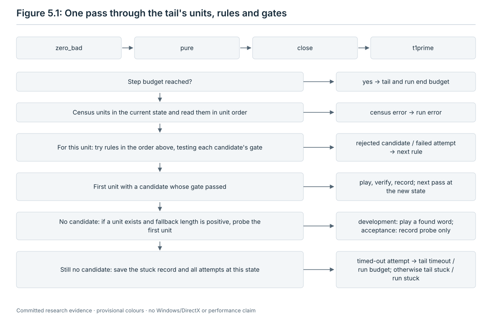
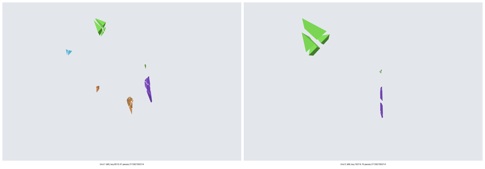
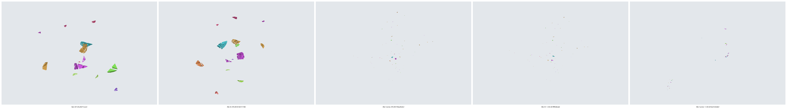
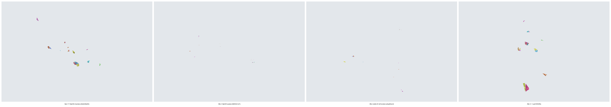
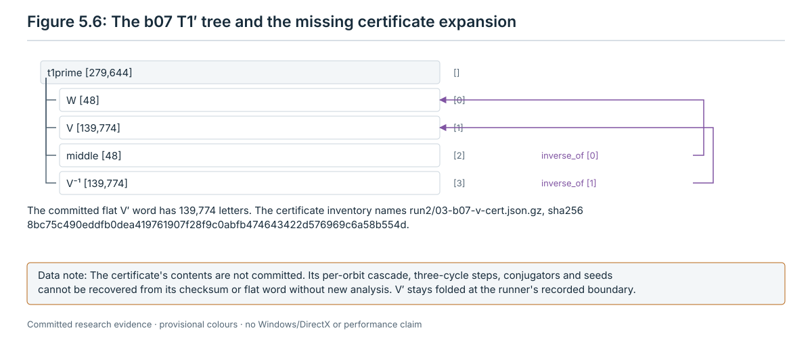
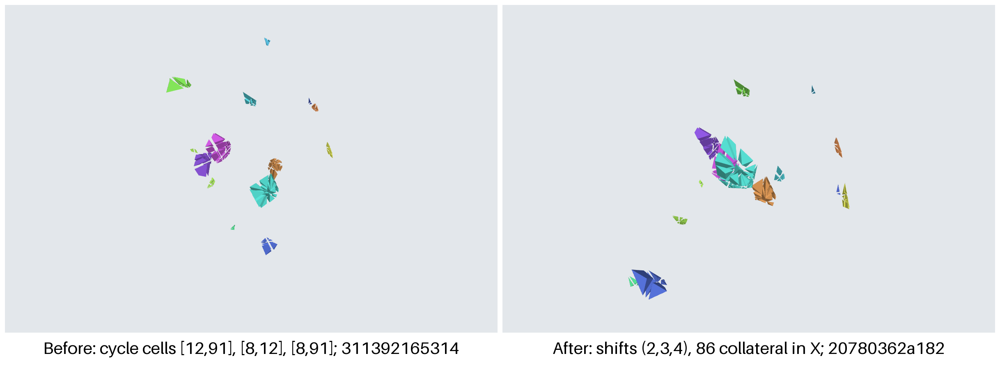
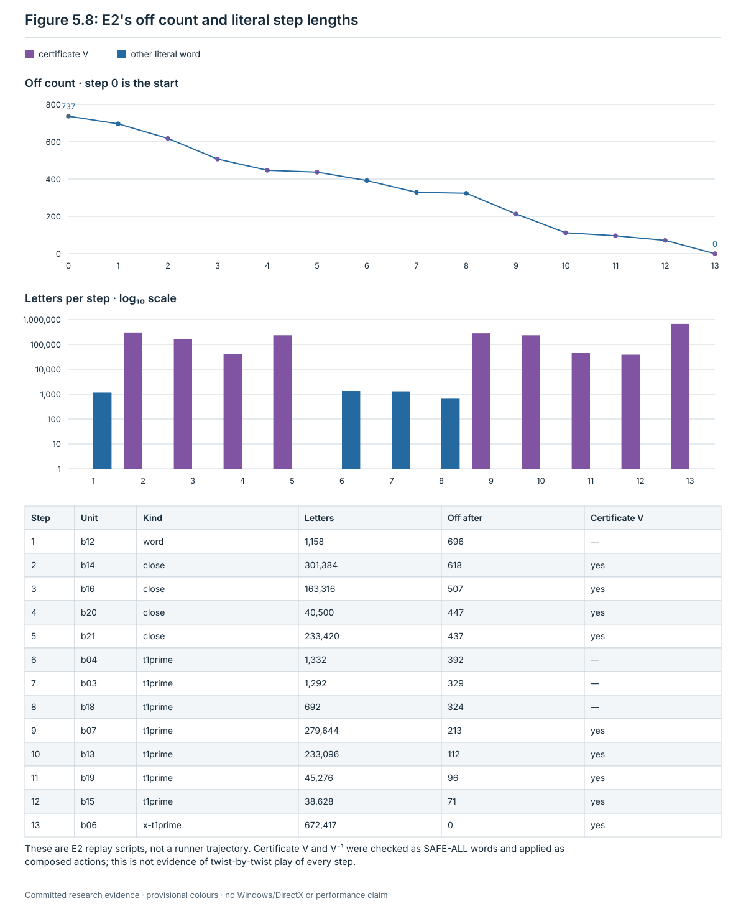

# 5. The tail: units and literal steps

The tail is the fourth phase of the run, after the bulk (chapter 2), the height phase (chapter 3) and the high phase
(chapter 4), and before the lattice phase (chapter 6). It takes the pieces that are still off the lattice and lands
them **one unit per step**. Every step is one literal word of twists. A rule gives a step only when its whole word
passes a gate at the current state. For a rule step the gate requires **strict′**: the unit ends on the lattice, no
lattice piece leaves the lattice, and every other off piece ends at its exact pose or on the lattice. The one exception
is a fallback step, which only development mode plays; its contract is weaker (section 5.13).

The tail ends in one of these ways (sections 5.2 and 5.14):

| End | Tail result | Run result |
| --- | --- | --- |
| every piece is on the lattice | `lattice` | the lattice phase follows (chapter 6) |
| no piece was off when the tail was reached | `not_applicable` | the lattice phase follows |
| `--tail-steps` steps taken (development only; acceptance mode fixes 0, no budget) | `budget` | `budget` |
| no unit has a step, and no attempt at this state timed out | `stuck` | `stuck` |
| no unit has a step, and some attempt at this state timed out | `timeout` | `budget` |
| an error: a crash, a digest mismatch, malformed evidence, a signal (section 5.15) | stays null | `error` |

This chapter states every rule of the tail so that a program that reads only the current state can follow it: what
each rule reads, its candidates in their exact order, the test a candidate must pass, the word that is played and its
tree of named parts, the contract the step satisfies, and what happens when no candidate passes. It ends with worked
examples from committed records and with the questions the repository does not settle.

**Citations.** Code citations give `path:line` from the repository root. Every line number refers to commit
`35c3d4f`, for every file, as in chapter 1. `check_run.py` and `test_runner.py` changed after `35c3d4f`; their lines
here are those of `35c3d4f`, and the named function governs. The one exception is the stage 13 `README.md`, cited at
commit `88dacaf`, because the D0 runs and the final test results were added after `35c3d4f`; its text is the same at
the current head. After its first citation, a file is cited by its name alone, and within one paragraph `:123` means
line 123 of the file named last. Each name stands for one path:

| Name | Path |
| --- | --- |
| `runner.py`, `runner_api.py`, `check_run.py`, `lattice_phase.py`, `test_runner.py` | `research/jumbling/restoration/13-tutorial-runner/scripts/` |
| `acceptance-config.json`, stage 13 `README.md` | `research/jumbling/restoration/13-tutorial-runner/` |
| `mkblocks2.py`, `tclose2.py`, `vacate2.py`, `fallback.py`, `mstar.py` | `research/jumbling/restoration/09-general-method/scripts/gm/` |
| `vacate.py`, `conjprep.py` | `research/jumbling/restoration/09-general-method/scripts/echain/` |
| `METHOD.md` | `research/jumbling/restoration/09-general-method/` |
| `cellpure5.py`, `r22b10_cert.py`, `check_r22b10.py`, `expand_slp.py`, `slp_apply.py` | `research/jumbling/restoration/12-low-height/scripts/` |
| `transport_census.py`, `stepchk.py`, `prep_t1prime.py`, `jordan_target.py` | `research/jumbling/restoration/12-low-height/scripts/round22/` |
| `PROOFS-B.md`, stage 12 `README.md`, `runs/round22/line-a/…` | `research/jumbling/restoration/12-low-height/` |
| `PROOFS-U.md` | `research/jumbling/restoration/08-units-and-clean-steps/` |
| `classes.py`, `e3_class.py`, `buffer.py`, `buffer-transport.md` | `research/jumbling/theory/` |
| `ch05_examples.py` | `research/jumbling/tutorial/scripts/` |

**The chapter's script and record.** [`scripts/ch05_examples.py`](scripts/ch05_examples.py) and
[`records/ch05-examples.json`](records/ch05-examples.json) are new with this chapter. The script is read-only. It
drives the runner's own methods (`Runner.units`, `Runner.script`, `Runner.require`, `Runner.close`,
`Runner.t1prime`, `Runner.execute`) on one committed table, in development mode with the default options. Every child
program runs through the runner's `--_script` wrapper with the arguments the runner passes, in fresh directories. The
record holds the sha256 of the input table and of the ten programs it uses (each equal to that file at `35c3d4f`),
the commit it ran on, and four sections (`units`, `census`, `pure`, `close_t1prime`). It ran in 306.7 s on a
four-core cloud machine, four jobs at once:
`python3 -I -B research/jumbling/tutorial/scripts/ch05_examples.py --out <new file> --work <new directory> --cache <new directory>`.
Its times are **measured** and depend on the machine; its other values are **computed**.

**Words.** This chapter uses these words of chapter 1 without defining them again: pose, lattice, off piece, chamber,
hole, cap, grip, item, letter, word, admissible, domain, representative, K⁺, block, movers, unit, key, free set,
digest, pose table, snapshot, step tree. A letter is a pair (grip, item): the grip is a cap number from 0 to 599 and
the item a menu element from 0 to 59 of menu I_a, item 0 the identity. The inverse of a word reverses its letters and
replaces each item by the item with the inverse matrix at the same grip (`Mechanics.inverse_word`,
`runner.py:300-303`). Section 5.4.1 defines the class cell model that two rules read: class, hub, sign vector,
content, label, cell, point, kind, free grip, owner, home cell. A **cell** in this chapter is a cell of that model, not
a cell of the polytope (chapter 1, section 1.2) or a cut cell (section 1.7).

**Evidence labels**, as in chapter 1, section 1.1:

- **computed**: an exact computation with a replayable record or script;
- **proved (model review only)**: a proof checked by models, not yet by a person;
- **run on one instance** / **measured**: a result on finite inputs.

A statement of what the code does is a statement of the rule, with its `path:line`; it needs no label. A finite test
never shows that every scramble is restored. A uniform bound on the length of a restoration, or on the length of one
clean step, does not exist (**proved (model review only)**,
[stage 10](../restoration/10-x1-unbounded/README.md), line 25).

## 5.1 Where the tail sits, and what follows it

The phases run in a fixed order and never go back: bulk, height, high, tail, lattice (`PHASE_ORDER`,
`runner_api.py:21`).

| Question | Answer | Where in the code |
| --- | --- | --- |
| When is the tail reached? | After the high phase, unless a height sub-phase or the high phase ended `budget` or `timeout`; then the run ends `budget` and the tail does not run | `Runner.phases_between`, `runner.py:705-716`; `Runner.run`, :1471-1475 |
| After a bulk `budget` or `timeout` | the run is marked `component` (`bulk_budget`); the later phases, the tail included, still run | `Runner.bulk`, :615-617 |
| Entry test | the off count is positive; it reads the current state only | `Runner.entry`, :625-631 |
| Entry test fails (off count 0) | the tail's result is `not_applicable` | `Runner.tail`, :1259-1262 |
| Loop | while the off count is positive: one pass (section 5.2) | :1263-1297 |
| Normal end | off count 0: the tail's result is `lattice` | :1298-1299 |
| What follows | the lattice phase, only when the off count is 0 when the tail returns | `Runner.run`, :1476-1477 |

**The hand-off to the lattice phase.** When the tail ends with every piece on the lattice, the runner plays the
lattice phase (chapter 6; `Runner.lattice`, `runner.py:1301-1367`). Its restorer is the option `--lattice-restorer`.
The default is `schedule11`, the round 11 schedule, and acceptance mode freezes that value with every other option
(`runner.py:1608-1609`; `acceptance-config.json:7`). The `late` restorer is available only in development mode, with
`--lattice-restorer late`. On the committed cascade `schedule11` needs at most 20,866,844 retained twists and `late` at
most 1,324,660,182; the corrections add at most 25,852 twists to either (**proved (model review only)**,
`METHOD.md:175`). The D0 runs on seed 7106 (depth 20) played 8,701,310 lattice twists with `late` (in acceptance
mode, before E5, when `acceptance-config.json` still named `late`) and 1,516,410 with `schedule11` (in development
mode), on uncommitted candidates; the `schedule11` run was repeated in acceptance mode on commit `cd5e6e8` with the
same count (**run on one instance**; stage 13 `README.md:1513-1557`, bounds :1559-1562, the choice E5 :1564-1568).
In every D0 run the bulk ended on the lattice, so the tail was `not_applicable` (:1516-1517, :1521-1522, :1536,
:1548, :1551). A tail that ends `stuck`, `timeout` or `budget` leaves off pieces, and the lattice phase does not run.

**What a strict′ step keeps.** A strict′ step keeps every other off piece at its exact pose or lands it, so it never
changes the pose of a piece that stays off. In particular it never raises a left height (chapter 1, section 1.6) of a
piece that stays off. A fallback step (section 5.13, development mode only) has a weaker contract and can move other
off pieces.

**Options that acceptance mode freezes.** Acceptance mode refuses any option that differs from
`acceptance-config.json`, and the file's values are the runner's defaults (`acceptance_config`, `runner.py:145-158`;
`ACCEPTANCE_OPTIONS`, :56-57; defaults :1596-1609). For the tail: the rules `zero_bad`, `pure`, `close`, `t1prime`;
`--tail-steps 0`; `--literal-limit 10000000`; `--seeds atlas`; `--fallback-max-length 1`; `--par 1`
(`acceptance-config.json:4-12`). Its clocks are lifted instead (section 5.10).

## 5.2 One pass of the tail loop

Each pass reads the current state and does the following (`Runner.tail`, `runner.py:1257-1299`).

| # | What the runner does | Where in the code |
| --- | --- | --- |
| 1 | If `--tail-steps` is positive and the tail has taken that many steps: the tail and the run end `budget`. The default and the acceptance value are 0 (no budget) | `runner.py:1264-1267`, :1597 |
| 2 | Unit census at the current state: the units in order (section 5.3). A census error ends the run `error` | :1270, :768-776 |
| 3 | For each unit in order, the tail rules in order until one gives a candidate that passes its gate; the first unit with a candidate takes the step (section 5.4) | `Runner.choose`, :1116-1159; `Runner.try_unit`, :1041-1114 |
| 4 | A candidate: play its word, check it, record the step (section 5.11), and start the next pass | `Runner.advance`, :1178-1231 |
| 5 | No candidate, at least one unit and `--fallback-max-length` positive: the exhaustive fallback for the first unit only. Development mode plays its word as a step; acceptance mode only records it as a probe (section 5.13) | :1273-1283, :1161-1176 |
| 6 | Still no candidate: write the stuck record; the tail ends `timeout` if any attempt at this state timed out, else `stuck`, and the run ends `budget` or `stuck` (section 5.14) | :1284-1296 |



## 5.3 Units and their order

**Reads.** The current pose table only.

**Computation.** The runner runs `mkblocks2.py` on the current table (`mkblocks2.py:24-47`; called at
`runner.py:768-772`; chapter 1, section 1.9):

1. The blocks of the off pieces: two off pieces are joined when no cap has one inside and the other outside; a block is
   a connected component.
2. A block whose pieces all lie in one domain is one unit. Its key is its smallest piece index.
3. A block whose pieces lie in several domains gives one unit per domain: the pieces of that domain, with key the
   smallest of them. The rest of the block is written as the unit's free set (`mkblocks2.py:41-46`).

**Order.** Decreasing size, then increasing key (`runner.py:775-776`). Keys are distinct, so the order is total.

**Checks and errors.** The census prints one JSON line with the state's digest. If its digest differs from the
current state's, the runner raises an error (`runner.py:772-774`). The census runs as a child under the rule clock in
development mode. A crash or a timeout of the census also ends the run `error`: the tail does not catch a failure of
`units` (`runner.py:770-771`, :561-562, :1270, :1479-1486; chapter 1, section 1.9).

**What the tail does not use.** The runner keeps a unit's free file (`Unit.free`, `runner.py:307-312`) but never
passes it to a rule. `tclose2.py` would accept it as `--free` (`tclose2.py:18-20`), but the runner does not give it.
So the rest of a split block counts as other off pieces: a strict′ step must keep them at their exact poses or land
them.

**Example** (**computed**, record section `units`). E2's table after its b15 step,
`runs/round22/line-a/literal/run2b/z-04-b15.json.gz` (digest `31139216…`, 71 off pieces). E2 is the stage 12 replay
that descends from the depth 40 stop of seed 7101. `Runner.units` finds two blocks, each in one domain, so two units.
In unit order:

| Order | Block | Unit (E2's name) | Size | Key | Movers | Free file |
| --- | --- | --- | --- | --- | --- | --- |
| 1 | 0 | b05 | 61 | 9013 | 5 | none |
| 2 | 1 | b06 | 10 | 16314 | 4 | none |

Each unit holds the same pieces as E2's unit file of that name (`runs/round22/line-a/units/eb5-k40-k00-b05.json` and
`…-b06.json`; record field `units.order[].e2_unit`). The census took 15.8 s (**measured**).



## 5.4 Rules, the class cell model, and the choice of the step

**The rules and their order.** The option `--tail-rules` lists the rules to try, in order. The default and the
acceptance value are `zero_bad`, `pure`, `close`, `t1prime` (`TAIL_RULES`, `runner.py:49`; `parse_args`, :1596;
`acceptance-config.json:6`). The option takes the names separated by commas, each of the four at most once, in any
order (`runner.py:1619-1621`). Acceptance mode refuses any other value (`acceptance_config`, `runner.py:145-158`).

### 5.4.1 The class cell model

Two programs read the state through a model of one class of caps: `transport_census.py` (for `zero_bad` and the second
core of `close`) and `cellpure5.py` (for `pure`, the first core of `close`, and `t1prime`). Both build the class
`Model2` of `cellpure5.py`; `transport_census.py` executes its source lines (`transport_census.py:51-54`). The model is
built at the current state for one class P.

| Term | Definition | Where in the code |
| --- | --- | --- |
| class | The 600 caps form five classes of 120. Caps c and d are in one class when n_c⁻¹·n_d is one of the 120 icosian units. Classes are numbered by their least cap; each lists its caps in increasing order | `classes`, `classes.py:86-97` |
| hub | For a domain with representative γ: the pairs (Q, P) of classes such that γ sends the pole of every cap of class Q to the pole of a cap, all in class P | `hub`, `classes.py:171-178` |
| the unit's class P | P of the single hub pair of the unit's domain. Both programs require exactly one pair (a screen, section 5.4.2) | `cellpure5.py:189-192`; `transport_census.py:110` |
| own pieces | the lattice pieces and the pieces of every domain whose single hub class is P (the class-P fragments) | `cellpure5.py:72-80` |
| sign vector | of a piece or chamber: 120 bits, one per cap of class P in the class's order, set when the cap holds it inside | `cellpure5.py:81-86` |
| free grip | a cap of class P that no piece straddles and that holds only own pieces inside. A cap that a piece straddles is **blocked**; a cap with a foreign piece inside and no straddler is neither | `cellpure5.py:83-91` |
| content | the own pieces of one domain with one sign vector. Contents are numbered by their least piece | `cellpure5.py:92-95` |
| label | one of five values 0 to 4: the five left cosets of class P; label 0 is the lattice. A content's label is that of its domain, from the left factor of the domain's representative | `cellpure5.py:101-122` |
| cell | a sign vector: the content sign vectors first, in content order, then every sign vector that a free twist reaches, found by a depth-first search with a stack (pop the last cell; for each free grip in increasing order whose cap holds it, each item 0 to 59, append the image if new). Cells are numbered in that order | `cellpure5.py:136-150` |
| point | cell number × 5 + label. A content sits at one point | `cellpure5.py:152-160`, :168 |
| kind | the number of class-P caps that hold the cell: 0 outer, 1 vertex, 2 edge, 3 triangle, 4 tetrahedron | `cellpure5.py:151`; `KIND`, :288 |
| home cell | a cell whose sign vector is that of a chamber. Lattice pieces sit at label 0 of home cells | `cellpure5.py:299-304`; `transport_census.py:125-128` |
| generator | a letter (c, i) at a free grip c, item i, whose permutation of the 120 caps of class P or whose action on the five labels is not the identity. Generators are ordered by grip, then item. The letters at grip c are its generators in increasing item order (`byc`) | `cellpure5.py:135`, :172-174 |
| inverse generator | the generator whose action is the inverse permutation; when several have that action, the last in generator order. It need not be the twist's inverse item | `cellpure5.py:161-167` |
| commutator | [x, y] is the word x, y, x⁻¹, y⁻¹ with x⁻¹, y⁻¹ the inverse generators; [x, y]^k is that word k times, 4k letters. A word acts on points letter by letter, first letter first | `comm`, `run`, `e3_class.py:225-230` |
| adjacent pairs | for a set `near` of grips: every ordered pair (a, b), a ≠ b, of free grips that are both caps of one cell, with a or b in `near`, in increasing (a, b) order | `adjacent`, `e3_class.py:236-243` |

**Owners** (`transport_census.py` only, :130-158). The census marks which points belong to whom:

1. A lattice content owns its point (H, 0) (:131-134).
2. An off content of class P owns every point of its cell that a lattice content does not own (:135-143). A point
   that a second off content also claims gets the owner **SPECIAL** (:142-143). A third off content of class P in the
   same cell makes the census crash (it reads the domain of SPECIAL at :142, which does not exist), and the run ends
   `error`.
3. Every point of a cell that holds a piece of a foreign domain (an off domain that is not a class-P fragment) gets
   the owner SPECIAL (:145-157).
4. A point is **owned** when it has any owner, SPECIAL included (:158). A home cell's label-0 point with no owner is
   **vacant** (:183-186).
5. A unit is **glued** when its cell has a point with an owner other than its own content: a lattice content at
   label 0, another off content, or SPECIAL (:169-170).

**Example** (**computed**, record sections `pure` and `census`; class 3 at the state with 71 off pieces). All 120 caps
of class 3 are free grips, none is blocked. There are 1,443 contents (1,441 lattice contents and the two off contents
of b05 and b06), 2,641 cells, 1,441 home cells and 7,080 generators, that is 59 nonidentity items at each of the 120
free grips. b05's content sits at label 3 of the edge cell whose caps are 12 and 91; that cell holds 147 own pieces, the
61 of b05 and 86 lattice pieces. b06's content sits at label 3 of the vertex cell of cap 91; that cell holds 389 own
pieces, the 10 of b06 and 379 lattice pieces. The census's class line: 1,449 owned points, no foreign cell, two off
contents, and no vacant home point of any kind. Since 1,449 = 1,441 + 4 + 4, each off content owns four points: label 0
of each of their cells belongs to a lattice content. So both units are glued (inferred from the class line; the
census's per-unit rows are not in the record, section 5.17.4).


### 5.4.2 Two shared searches, screens and crashes

Two searches are shared by the rules of one unit. Each runs at most once per trial of a unit (one call of
`try_unit`), and its result or its failure is cached for the rest of that trial (`dependency`, `runner.py:1046-1068`):

| Name | Program, as the runner calls it | Used by | Result kept |
| --- | --- | --- | --- |
| `transport` | `transport_census.py <table> <out> <unit>` (section 5.5) | `zero_bad`; `close` (second core) | the unit's row: its `zero_bad` and `small_bad` entries |
| `pure` | `cellpure5.py <theory> <table> <unit> <out> --search` (section 5.6) | `pure`; `close` (first core); `t1prime` (its W) | the word file `<out>-word.json`; no file means `no word` |

The runner passes no other option, so the census uses its defaults (all pairs, at most 10 powers on a path) and the
pure search its defaults (powers up to 60, at most 12 exact tries). A failure of a shared search (`no word`,
`not applicable`, `timeout`) is cached, and every later rule of the same trial that needs the search fails with the
same outcome (`runner.py:1064-1067`).

**Applicability screens.** Both programs write some applicability tests as Python asserts. A failed assert at one of
five pinned lines means "the rule does not apply to this unit" and gives the outcome `not applicable` (`SCREENS`,
`runner.py:61-65`; `failed_assert`, :114-127; `require`, :556-569):

| Line | What it asserts |
| --- | --- |
| `cellpure5.py:191` | the unit's domain has exactly one hub pair |
| `cellpure5.py:207` | exactly one content of the unit's domain meets the unit, and holds all of it |
| `cellpure5.py:212` | the unit's content is not at label 0 of its cell |
| `transport_census.py:110` | the unit is one domain, not the lattice, with exactly one hub pair |
| `transport_census.py:165` | exactly one content of the unit's domain meets the unit, and holds all of it |

**Crashes.** Any other failed assert, any other exception, and any other nonzero exit of a child is a crash: the run
ends `error` (`runner.py:568-569`). The search programs have such branches, for example: three off contents of class
P in one cell (`transport_census.py:142`); a transport word whose model replay does not land the unit or does not
take off the predicted pieces (`cellpure5.py:349`); a pair tool that turns a cell by something other than a power of
the cell's first observed 5-cycle (:403-407); two ratios for one pair of edge cells (:446-447); no exponent of the
unit cell's 5-cycle that takes its label to 0 (:477).

### 5.4.3 One unit, then all units

**One unit** (`Runner.try_unit`, `runner.py:1041-1114`). For one unit the runner tries the rules in order. The first
rule that returns a candidate that passed its gate ends the trial. A rule that finds nothing records a failed attempt
(section 5.15) and the next rule is tried. The rule `close` tries its two cores in a fixed order, `pure` then
`transport`, even when the user leaves out a rule (:1092-1108); each failed core is one attempt, its reason prefixed
`pure: ` or `transport: ` (:1070-1074).

**All units** (`Runner.choose`, `runner.py:1116-1159`). The runner starts one trial per unit, at most `--par` at
once, and reads their results in unit order (:1121-1137). The first unit whose trial has a candidate takes the step.
With `--par 1` (the default, and the value acceptance mode freezes) the trials run one after another, so each shared
search runs at most once per unit and state. With `--par K`, K > 1 (development only), two more rules apply:

- every unit read before the chosen one whose trial has no candidate and a timed-out attempt is tried again alone,
  with a fresh cache, after all other trials have stopped. If such a retry gives a candidate, the first retried unit
  in unit order with a candidate takes the step instead (:1138-1139, :1149-1156);
- an error in a unit's trial stops the reading; it is raised only if no retry gives a candidate (:1129-1132,
  :1157-1158).

The clocks are wall clocks (`execute`, :533-540), and trials that run at once compete for the machine. A unit whose
step comes from a later rule after an earlier rule timed out keeps that step and is not retried. So `--par K` is
designed to take the step that `--par 1` would take, and does so when every attempt has the same clock outcome in both
runs.

**Discarded trials.** When the step is chosen, the runner cancels the trials it has not read (:1140-1146). A cancelled
child gives `cancelled` inside a trial whose result is never read, so no record row carries the outcome `cancelled`
(`require`, :563-564). A signal is different: it ends the run `error` (section 5.15).

## 5.5 Rule `zero_bad`: a transport that takes nothing off

**Reads.** The current pose table and the unit's pieces, through `transport_census.py <table> <out> <unit>`
(`transport_census.py:1-17`): the class cell model of the unit's class P (section 5.4.1), its free grips, the owners,
the vacant home points.

**Candidates and order.** There is at most one candidate: the word of the first path found by this search.

1. **Screens** (`not applicable`): `transport_census.py:110`, :165.
2. **Owners** as in section 5.4.1 (:130-158).
3. **Commutators** (:213-247). The pairs are the adjacent pairs (c, d) of all free grips with c < d, in increasing
   (c, d) order (:214). For each pair, each letter x at c and each letter y at d, in generator order: the cycles of
   A = [x, y] on the points, each cycle listed from its least point (:222-235). A cycle is **owned** when one of its
   points has an owner.
4. **Base power** (:248-258). L = the least common multiple of the lengths of the owned cycles (1 when none). A^L fixes
   every owned point. It is kept when it moves some point, that is when some cycle length does not divide L; then it
   moves free points only. The points of each moved cycle are joined in groups, one per orbit of A^L on that cycle
   (gcd(n, L) orbits on a cycle of length n).
5. **Unit power** (:259-267). For each owned cycle whose only owner is the unit's content o: Lo = the least common
   multiple of the lengths of the owned cycles whose owner set is not {o}. A^Lo is kept when the length of the unit's
   cycle does not divide Lo, so that A^Lo moves the unit's point and fixes every other owner.
6. **Component** (:276-301). For a unit that is not glued and has a unit power: the points joined to the unit's point
   by the groups of every kept base power and of the unit's own unit powers (each under its Lo).
7. **Targets** (:364). The vacant home label-0 points of cells of the unit's kind that lie in the component.
8. **Path** (`bfs`, :376-397). Breadth first from the unit's point, at most 10 powers deep (`MAXD`, :38). From a point
   q the moves are tried in this order: the kept base powers that move q, in the order they were kept, then the
   unit's unit powers that move q, in the same way. A move applies A^L (or A^Lo) to q; a point already reached is
   not queued again. The first target taken from the queue ends the search, so the path has the fewest powers, and
   ties go to the first found.
9. **Word** (:399-404, :413). The powers of the path, one after another, each A^L as [x, y]^L (4L letters), as
   (grip, item) letters.

**Test.** The census replays the word exactly on the simulator and marks it `strict` when the whole unit lands, no
piece goes newly off, and every other off piece keeps its exact pose (:411-420). The runner requires a `zero_bad`
entry with `strict` true, else `no word`, and then passes the word through the gate `stepchk.py` (section 5.7.1) with
the strict′ contract (`runner.py:1081-1085`).

**Step played (tree).** The word: the powers of the path, one after another. The tree is one span named by the rule:

```
zero_bad [n]
```

**Contract.** strict′.

**No step.**

| Census result for the unit | Runner outcome |
| --- | --- |
| a screen fails (:110, :165) | `not applicable` |
| glued: its cell holds another owner (:348-353) | `no word` |
| no unit power moves it (:354-359) | `no word` |
| no vacant home point of its kind in its component (no `zero_bad` entry, :406) | `no word` |
| no path within 10 powers (:409) | `no word` |
| a path whose exact replay is not `strict` | `no word` |
| a strict word that fails the gate | `not strict_prime` |
| the census runs past `--rule-seconds` (development) | `timeout`, `timed_out` true |
| any other failure of the census (section 5.4.2) | `error`; the run ends |

Then the next rule.

**Evidence.** R22A-03, the transport lemma (**proved (model review only)**, `PROOFS-B.md:130-160`): under its
hypotheses H1 to H4, the word of such a path is admissible and a strict step that takes no lattice piece off. The
runner does not rely on the lemma: the census replays each word exactly and the gate checks it, so a step taken is
strict′ (checked for each step). That a path exists for a given unit is not proved.

**Where in the code.** `runner.py:1059-1063`, :1081-1085; `transport_census.py:110`, :130-170, :183-186, :213-301,
:343-421.

## 5.6 Rule `pure`: the class-cell pure word

**Reads.** The current pose table and the unit's pieces, through `cellpure5.py <theory> <table> <unit> <out> --search`
(`cellpure5.py:1-30`): the class cell model of the unit's class (section 5.4.1), the unit's content at the point
(X, ℓ) with ℓ ≠ 0, every other content's point, the home cells.

**Candidates and order.**

1. **Screens** (`not applicable`): `cellpure5.py:191`, :207, :212.
2. **Branch by the kind of X** (:382-384): outer (0 caps) gives no word (:294-298); edge (2 caps) takes the **edge
   branch**; vertex, triangle or tetrahedron takes the **transport branch**.
3. **Transport branch** (`transport`, :292-380).
   - Tracked points: the unit's point, then the points of the other off contents of class P, then the points of the
     lattice contents, each in content order (:305-310).
   - Pairs: the adjacent pairs (c, d) with `near` = the caps of X, both orientations, in increasing (c, d) order
     (:312). For each pair, each letter x at c and y at d, in generator order: w = [x, y] (4 letters) (:316-321).
   - Powers: for n = 1 to 60 (`--max-power`, :289), the image of the tracked points under w^n. Stop at the first n
     where every tracked point is back (:323-326). w^n is a candidate when it takes the unit's point to label 0 of a
     home cell and every other off content's point back to itself (:327-331).
   - Order: the candidates are sorted by the key (number of pieces of the lattice contents that w^n moves off home
     label-0 points, whether c or d is a cap of the cell of another off content, 4n, x, y, n), smallest first (:332,
     :334).
   - Exact tries: in that order, at most 12 (`--max-exact`, :252). For each: the word [x, y]^n (4n letters); the
     expected set = the pieces of the lattice contents it moves off home label-0 points (:345-348); an exact replay.
     The first that lands the whole unit, keeps every other off piece's exact pose and takes off exactly the expected
     set is the word (:351-361).
4. **Edge branch** (:386-570; the search `search_f48` of `e3_class.py`, with E = X).
   - Goal points: the point of every content except the unit's, and (X, 0). The non-edge goal points are those in
     cells that are not edge cells (:387-392).
   - Grips: `near` = the caps of X and every free grip adjacent to one of them; the pairs are the adjacent pairs with
     both grips in `near`, both orientations, in increasing order (:410-412).
   - Pair tools (:415-433). For each pair (a, b), each x at a and y at b, in generator order, w = [x, y] is a pair tool
     when: w moves some edge point and moves every edge point within its own cell; n, the least common multiple of
     the lengths of w's cycles through moved non-edge points, is not a multiple of 5 and is at most 100; and w turns
     exactly two edge cells u < z, each by a nonzero power of that cell's 5-cycle ρ. A cell's ρ is the first turn of it
     observed in this enumeration (:427-430).
   - Ratio (:434-435): v_z · v_u⁻¹ mod 5, where v_s is the exponent by which w turns cell s.
   - Shifts (:436-444). For k = 1 to n, k not a multiple of 5, when w^k maps every non-edge goal point to a goal point
     (a test on the set, not a fixed-point test): the shift λ = v_u · k mod 5 of the smaller cell u. The word
     [x, y]^k gives the shift λ of the pair (u, z), and [y, x]^k gives −λ. For each (pair, shift) the shortest word
     is kept, the first found on ties.
   - Sums (:463-470). For each pair, over the words kept above in the order they were first kept: the sum of two words
     (shift l1 + l2 mod 5, nonzero) fills a missing shift or replaces a longer word for that shift.
   - If no pair tool turns X: no word (:471-476). Else the target exponent: the least e in 0 to 4 with ρ_X^e(ℓ) = 0
     (:477).
   - Cycles (:503-514): for a in the neighbours of X in increasing order, for b in the neighbours of a in increasing
     order: first the triangle [X, a, b] when b ≠ X and b is a neighbour of X; then, when b ≠ X, the 4-cycles
     [X, a, b, c] for c in the neighbours of b in increasing order with c ∉ {X, a} and c a neighbour of X (b need not
     be a neighbour of X). Two cells are neighbours when a kept word joins them. Each cycle appears in both
     orientations.
   - Solution of a cycle (`solve`, :484-500). The edges are the sorted pairs (cyc_j, cyc_j+1), j = 0 to k − 1,
     cyclically. A shift t_j on edge j turns its smaller cell by t_j and its larger cell by ratio · t_j. Over all
     (t_1, …, t_k) in 0 to 4, in lexicographic order: X must turn by the target exponent and every other cell of the
     cycle by 0, and every nonzero t_j must have a kept word. The word is the kept words of the nonzero t_j in edge
     order. The shortest wins, the first found on ties.
   - Order of solutions: stably by length, so the cycle order above breaks ties (:515).
   - Model check (:521-530): the unit's content ends at (X, 0), every other off content at its own point, and a
     lattice content may end off label 0 only if it started in cell X. A solution that fails it is skipped and does
     not count as a try (:540-543).
   - Exact tries (:539-554): at most 12, in order. The first whose exact replay lands the whole unit, keeps every
     other off piece's exact pose and takes off exactly the lattice pieces of X is the word.
5. **Output.** The program writes the word, with its input and output digests, to `<out>-word.json` (:376-377,
   :567-568). No file means `no word` (`runner.py:1054-1056`).

**Test.** The gate `stepchk.py` with the strict′ contract (`runner.py:1086-1087`). The search already requires that
the word takes off exactly its expected set: in the transport branch the pieces of the lattice contents that the word
moves off home label-0 points, in the edge branch the lattice pieces of X (`exact_replay`, `cellpure5.py:256-284`). So
the rule gives a step exactly when that set is empty. Otherwise the outcome is `not strict_prime`, and the same word is
the first core of `close` and the landing word W of `t1prime`.

**Step played (tree).** The word; one span:

```
pure [n]
```

**Contract.** strict′.

**No step.**

| Search result | Runner outcome |
| --- | --- |
| a screen fails (:191, :207, :212) | `not applicable` |
| outer cell; transport branch: no candidate, or none of the first 12 passes; edge branch: no pair tool turns X, no cycle solution, none passes the model check, or none of the first 12 exact tries passes | `no word` |
| a word that fails the gate | `not strict_prime` |
| the search runs past `--rule-seconds` (development) | `timeout`, `timed_out` true |
| any other failure (section 5.4.2) | `error`; the run ends |

Then the next rule.

**Evidence.** Each step is checked by the gate. The search is finite and is not shown complete.

**Where in the code.** `runner.py:1050-1057`, :1086-1087; `cellpure5.py:66-176`, :185-215, :252-284, :287-380,
:386-570.

## 5.7 What strict′ means, and the two gates

### 5.7.1 The strict′ contract and the gate `stepchk.py`

**Reads.** The pose table of the current state, the unit's pieces and a literal word.

**What it does** (`stepchk.py:36-67`). It plays the word twist by twist on the simulator; a letter that is not
admissible stops it with an error. Then it reports:

| Field | Meaning |
| --- | --- |
| `unit_on_lattice` | pieces of the unit on the lattice at the end |
| `collateral` | pieces off at the end that were on the lattice at the start |
| `others` | off pieces at the start outside the unit |
| `others_exact` | of those, the ones still off at the end at their exact start pose |
| `others_landed` | of those, the ones on the lattice at the end |
| `off_before`, `off_after` | off counts |
| `strict_prime` | `unit_on_lattice` = unit size, `collateral` = 0 and `others_exact` + `others_landed` = `others` (:56-57) |

**How the runner uses it** (`Runner.checked`, `runner.py:778-794`). It writes the word with the current digest, runs
`stepchk.py` with an end table, and requires the report, the end table, the start digest and the end digest to agree,
or the run ends `error` (:786-791). A crash of `stepchk.py`, such as an inadmissible letter, also ends the run `error`
(:785). If strict′ is required and false, the attempt fails with `not strict_prime` (:792-793).

**Consequence.** After a strict′ step the off count is off_before − |U| − others_landed (from the definition). Lemma U
says the same for every clean step (**proved (model review only)**, `PROOFS-U.md:152-161`). So every tail step lowers
the off count by at least the unit's size. A fallback step does too (section 5.13). So the tail takes at most as many
steps as there were off pieces when it began.

### 5.7.2 The certificate gate `slp_apply.py --unit`

A closure whose V was built from a certificate (section 5.8.2) can be long. Its gate is `slp_apply.py --unit`
(`Runner.slp_checked`, `runner.py:951-998`; `slp_apply.py:434-460`):

1. The runner cuts its literal word into its parts (`W`, `V`, `middle`, `V_inverse`) and writes each part as a file.
   V and V⁻¹ are `safe_word_file` segments; the others are `word_file` segments (`runner.py:956-968`).
2. `slp_apply.py` plays each `word_file` segment twist by twist and requires every twist to be admissible
   (`slp_apply.py:412-427`). For a `safe_word_file` segment it rebuilds the SAFE-ALL alphabet at the current state
   and requires every letter to be a SAFE-ALL letter there: a letter at a grip that no piece straddles and that holds
   no off piece inside, whose item acts on the cap's chambers as a nonidentity element of K⁺ (`buffer.py:139-163`).
   Then it composes the letters' exact cap actions into one action and applies it once (`slp_apply.py:370-393`). It
   reports one line per segment and the same strict′ fields as `stepchk.py` (:458).
3. A letter that is not admissible or not SAFE-ALL, or any other error, makes `slp_apply.py` exit 1 (:479-481); the
   runner treats that as a crash, and the run ends `error` (`runner.py:970`, :568-569).
4. The runner checks, before it reads strict′ (`runner.py:971-990`): a summary line exists; the start digest; the end
   table's digest; one segment line per part, in order, with its kind and length; on the V and V⁻¹ lines a
   `word_sha256` equal to the runner's own hash of that part; for T1′, the W part ending at Z1's digest; the last
   segment ending at the end digest. Any mismatch ends the run `error`.
5. Only then a false strict′ fails the attempt with `not strict_prime` (:993-994). The candidate's gate is `slp_apply`
   (:995).

In development mode the runner then takes the state from the gate's end table. In acceptance mode it plays the whole
word twist by twist (section 5.11).

## 5.8 Rule `close`: the closure V·W·V⁻¹

**Reads.** The current pose table, the unit's pieces, the two shared searches, and the literal limit
(`--literal-limit`, default and acceptance value 10,000,000; `runner.py:1600`).

**Candidates and order.** Two cores, always in this order, even when the user leaves out a rule
(`runner.py:1092-1108`):

| # | Source | Core | Fails when |
| --- | --- | --- | --- |
| 1 | `pure` | P = [], Q = the pure search's word | the pure search failed: `no word`, `not applicable` or `timeout`, cached from its first use (:1097-1098, :1064-1067) |
| 2 | `transport` | P = [], Q = the census's `small_bad` word | the census failed (`not applicable`, `timeout`, cached), or its row has no `small_bad` entry with `W_ok` true: `no word` (:1099-1103) |

With P empty, W = P·Q·P⁻¹ = Q, and the **middle** of the closure is Q. For each core the runner builds V (sections
5.8.1 and 5.8.2) and gates the whole word. The first core whose word passes gives the step. A failure is recorded per
core, its reason prefixed `pure: ` or `transport: ` (:1070-1074, :1106-1108).

**The second core: `small_bad`** (`transport_census.py:302-341`, :422-450). It exists only for a unit that is live
(not glued, with a unit power) and whose cell is a triangle or a tetrahedron (:304).

1. **Entry owners** (:178-182). The lattice contents at label 0 of home cells whose kind is 3 or 4 and is the kind of a
   unit in the census (the runner passes one unit, so its kind).
2. **Entry powers** (:310-341). Over the same pairs and letters as section 5.5, in the same order: for each owned cycle
   of A = [x, y] whose only owner is an entry owner h, with h at the point (H, 0): Lo = the least common multiple of
   the lengths of the other owned cycles (all owners, the unit's content included). A^Lo is kept when the length of
   h's cycle does not divide Lo; it then fixes every owner except h and moves (H, 0) along its orbit `sub` under
   A^Lo. It is an entry for the unit when `sub` meets the unit's component and the kind of H is the unit's kind
   (:333). For each h the census keeps the entry with the least Lo, the first found on ties (:337-340), with
   ord(A), the least common multiple of all of A's cycle lengths (:336).
3. **Order** (:423-424). The home contents h by (number of pieces of h, Lo), stably over the order in which they were
   first kept; the first three are tried.
4. **Word** (:425-434). The breadth-first path of section 5.5 to the points of `sub` that lie in the component (a home
   cell with no path is skipped). With q the unit's point after the path, k = (position of (H, 0) − position of q)
   in `sub`, mod |sub|, and e = Lo·k mod ord(A): the word is the path's powers followed by A^e = [x, y]^e (4e
   letters). A^e carries the unit's point to (H, 0).
5. **Test** (:438-450). Exact replay: `W_ok` when the whole unit lands, the pieces that go newly off are exactly the
   pieces of h, and every other off piece keeps its exact pose. The first word with `W_ok` is the core; a word that
   fails is recorded as rejected and the next home content is tried.

This is the entry word of R22A-06 (**proved (model review only)**, conditional on its hypotheses;
`PROOFS-B.md:204-216`).

**Bad(W).** The lattice chambers in the union of W's caps whose content the play of W would take off the lattice
(`tclose2.py:86-93`, :107 for its digest). V must make every chamber of Bad(W) a hole, including chambers that are
vacant now, because V can move lattice pieces into them.

**The closure theorem** (R22A-06, closure part; **proved (model review only)**, `PROOFS-B.md:217-226`). Let W be a
word that lands the unit and returns every other protected off piece to its exact pose (the ghost premises of section
5.8.1; R22A-06 states it for its entry word). If V is a SAFE-ALL word at Z and Bad(W) ⊆ holes(Z·V), then V·W·V⁻¹ is a
strict step of 2|V| + |W| letters. The runner does not rely on the theorem: it gates every word.

### 5.8.1 V from `tclose2.py` (a literal V)

`Runner.closure` (`runner.py:796-849`) runs
`tclose2.py <theory> <echain> <table> <unit> <core> <out> --greedy-seconds G` (G = `--greedy-seconds`, default 60 s;
in acceptance mode the sentinel 10⁹ s; :801-803). `tclose2.py` does, in order (`tclose2.py:60-247`):

1. **Ghost premises** of W at the state (:85-115): the unit T is on the lattice at the end of W, and every protected
   off piece (every off piece outside T) is back at its exact content. If either fails: result `ghost premises fail`,
   no V.
2. **SAFE-ALL menu and condition** at the state (:122-139): the SAFE-ALL grips, their letters and their orbits on the
   chambers, and the condition of `buffer.condition` for the target Bad(W) (`buffer.py:757-781`):
   - **N1** (`fixed_vacant`): every chamber of Bad(W) that lies in a one-chamber orbit is already a hole;
   - **N2** (`necessary`): N1 holds, and in every orbit that meets Bad(W), the holes in that orbit are at least as
     many as the chambers of Bad(W) in it.
3. **V, from the first source that gives one** (:140-194):
   - empty, when Bad(W) holds no lattice piece now (:143-144);
   - when N2 holds: the peeling certificate of Theorem B and its prepared word (:145-165; below);
   - when N2 holds and that gives none: the two-pass greedy search of `vacate2.py`, under a wall clock of G seconds
     (:166-189; below);
   - otherwise result `no V` (:191-194).
4. **Replay** of V, P, Q, P⁻¹, V⁻¹ on the simulator, every twist checked admissible (:196-222), and the whole word to
   `word-full.json` (:240-242).

**The peeling certificate** (`conjprep.py:75-141`). `generic_certificate` sets apart the targets in one-chamber
orbits; for the others, `buffer.Transport.peel` chooses an order of the target chambers with a macro for each, and
`close_routes` builds each one's route tree (`buffer.py:317-615`). `generic_prepare` then requires N1 and, in every
orbit, at least the certificate's threshold of holes. For each row in the certificate's order whose target chamber is
occupied, it takes the reached hole that is nearest in the row's weighted tree (the least chamber number on ties) and
appends the route to that hole followed by the row's macro (`conjprep.py:113-133`). V is the concatenation. When the
thresholds fail there is no V from this source. `tclose2.py` catches any exception of these two functions, records its
text as `certificate_error` and goes on (`tclose2.py:163-165`). This chapter does not restate `buffer.py`'s peeling
order and route trees: a V from this source is the word that `tclose2.py` returns.

**The greedy search** (`vacate2.py:14-62`, with `vacate.py:23-109`). It works on the occupancy of the chambers only:
every chamber is occupied except the holes, and the targets are the chambers of Bad(W).

| Part | Rule |
| --- | --- |
| Loop | while some target chamber is occupied and fewer than 500 steps were taken: take the occupied target chambers in increasing order and try pass 1 on each; if none gives a word, try pass 2 on each; apply the first word found. If no word is found for any target, or 500 steps were taken, the search fails (`vacate2.py:36-62`) |
| Letters at t | the SAFE-ALL letters at the SAFE-ALL grips whose cap holds chamber t, grip by grip in increasing order, each grip's letters in item order (`vacate.py:32-35`) |
| Gain | of a word: the occupied target chambers on its support (the chambers of its caps) before it, minus after it (`vacate.py:44-59`) |
| Pass 1 at t | the first letter at t with a positive gain; else, for x at t and y at t or at x(t) (sorted, at another grip than x), the words [x, y, x⁻¹, y⁻¹] and [y, x, y⁻¹, x⁻¹]: the one with the largest positive gain, the first found on ties (`vacate2.py:15-34`) |
| Pass 2 at t | the letters and commutators of pass 1 again, then the conjugates [z⁻¹, x, y, x⁻¹, y⁻¹, z]: z over the letters of the first 60 SAFE-ALL grips (in increasing order) whose caps share a chamber with the cap of the first letter at t, skipping z with z⁻¹(t) = t; x at z⁻¹(t); y at z⁻¹(t) or at x(z⁻¹(t)), at another grip. The first with a positive gain (`vacate.py:70-109`) |
| Clock | every gain first checks a wall-clock deadline G seconds after the search began; past it the search stops with no V and `pre.json` records `greedy.timed_out` true (`tclose2.py:171-186`) |

**What the runner requires** (`runner.py:819-835`). The child exits 0 (a crash ends the run `error`; in development a
child that runs past `--rule-seconds` gives `timeout`). `pre.json` is readable, else `error`. If `tclose2.py` wrote a
word, it must be V·middle·V⁻¹ with middle = P·Q·P⁻¹ and the last part the letter-by-letter inverse of the first, else
`error`. The runner records the parts [V, n], [middle, m], [V_inverse, n], `V_source: tclose2`, `V_letters` and
`V_sha256`, and gates the word with `stepchk.py` (`Runner.closure_checked`, :929-945). If that word fails strict′, the
attempt fails `not strict_prime`; the runner does not try a certificate V for that core.

**A greedy clock marks the attempt.** When `tclose2.py`'s greedy search stopped on its clock, the runner sets
`timed_out` in the attempt's details (`runner.py:815-818`). Any later failure of the same closure carries it
(:844-846, :943-945, :1037-1039), and `attempt_row` records `timed_out` true whatever the outcome (:166-170):
`no literal closure`, `certificate_needed`, `over literal limit` or `not strict_prime`. A stop at that state is then a
timeout, and the run ends `budget` (:1286, :1293-1294). This matters in development mode, where G is 60 s.

**Machine dependence.** In development mode the greedy source depends on the wall clock: on a slower machine the
search can stop before it finds a V, and then the runner goes on to the certificate path (section 5.8.2) or fails.
In acceptance mode G is 10⁹ s.

### 5.8.2 V from an R22B-10 certificate

When `tclose2.py` wrote no word, the runner builds V itself at the same state, but only if all of these hold
(`runner.py:836-843`):

- `--literal-limit` is positive;
- the ghost premises hold: `T_on_lattice_at_end` = `T_size`, and `protected_exact_at_end` is true;
- `tclose2.py` did not report N1 or N2 false.

Otherwise the attempt fails `no literal closure` (in both modes), with `tclose2.py`'s result as its reason (`no V`,
`ghost premises fail`). The construction (`Runner.certificate_word`, `runner.py:851-927`):

| # | Program | What the runner requires | If not |
| --- | --- | --- | --- |
| 1 | — | T = Bad(W) from `pre.json`: distinct integers, sorted, sha256 of its JSON equal to `badW_digest` (:853-856) | `error` |
| 2 | `jordan_target.py <target> <table>` (`jordan_target.py:1-31`) | a `CONDITION` line; N1 = `fixed_vacant` and N2 = `necessary`, both true (:861-879) | no line and the 840-second CPU cap hit (exit 124, a kill after at least 840 s, or the line `CUT_SHORT_CPU_840_SECONDS`): `timeout`; in development also the rule clock: `timeout`; no line otherwise: `error`; N1 or N2 false: `no literal closure`, with the deficits |
| 3 | `r22b10_cert.py table <table> <target> <cert> --seconds S --seeds <seeds>` | exit 0; `complete` true; the certificate's state digest; an integer `V_length` n ≥ 0 (:880-895) | exit 1 (a `FAIL:` line) or another exit: `error`; the rule clock (development): `timeout`; incomplete on a clock (below): `timeout`; incomplete otherwise: `certificate_needed` (acceptance) or `no literal closure` (development); digest or length wrong: `error` |
| 4 | `check_r22b10.py table <table> <target> <cert>` | exit 0 and last token `PASS` (:896-907) | exit 1 whose last line starts `FAIL: ` and names none of a digest, `N1 fails`, `N2 fails`, `incomplete certificate`: `certificate_needed` or `no literal closure`; exit 1 with such a name, or exit 1 without a `FAIL: ` line: `error`; exit 0 without `PASS`, or another exit: `error` |
| 5 | — | p + 2n + m ≤ the literal limit, checked before anything is expanded (m: the middle's length; p: W's length for T1′, 0 for `close`) (:908-909) | `certificate_needed` (acceptance) or `over literal limit` (development), with n as a decimal string |
| 6 | `expand_slp.py <cert> <V file> --limit L` | the expansion's length n and sha256 equal the runner's (:910-923) | exit 3 with `over_limit`: as in row 5; another failure or a mismatch: `error` |

`<seeds>` is `--seeds`: `atlas` by default and in acceptance mode, `default` allowed in development (`runner.py:1601`).
S is `--cert-seconds` (default 3600 s; in acceptance mode the sentinel 10⁹ s).

**Incomplete on a clock** (`cert_timed_out`, `runner.py:173-185`). An incomplete certificate counts as ended on a clock
when any of these holds:

- (a) a JSON line of the builder's log has `timeout` true (the builder writes it when its deadline fired,
  `r22b10_cert.py:886-889`);
- (b) an entry of `missing` has a reason that contains `wall-clock budget exhausted`, `serialization budget exhausted`
  or `exceeded budget` (`CERT_DEADLINE_PHRASES`, `runner.py:60`);
- (c) the certificate's `seconds` (or the child's measured time, when that value is not a finite number) is at least
  S − min(10, S/10), the builder's own reserve (`r22b10_cert.py:866`).

The word is V·middle·V⁻¹, with parts [V, n], [middle, m], [V_inverse, n], `V_source: certificate`, the T size and
digest, N1, N2, V's length and sha256, and the certificate's sha256 (`runner.py:924-927`). It is gated by
`slp_apply.py --unit` (section 5.7.2). The certificate never enters the record; only the literal word does.

**Corollary A1** (**proved (model review only)**; `buffer-transport.md:37`): if every orbit meeting T outside the
fixed chambers has a Jordan certificate, a SAFE-ALL word that clears T exists exactly when N1 and N2 hold.
`jordan_target.py` reads N1 and N2 for T; the runner uses only that line, and the builder supplies the witness.

**How V is built** (`build`, `r22b10_cert.py:726-837`; stage 12). The orbits are those of the SAFE-ALL group; "first"
means the least chamber number.

| # | Step | Rule | Where |
| --- | --- | --- | --- |
| 1 | Orbit order | `--seeds atlas`: the orbits with more than one chamber that meet T, by the rank of the orbit's type in the lattice cascade order `CASCADE` (types not in it last), then by least chamber. `--seeds default`: every orbit that meets T, by decreasing size, then least chamber | :45-46, :750-756 |
| 2 | Early ends | a target chamber in a one-chamber orbit that holds a piece stays pending (N1 fails). If N2 fails, the builder stops, with every orbit that has fewer holes than target chambers pending | :757-772 |
| 3 | Time share | for each orbit with more than one chamber, in order: share = the time left / the number of such orbits left; the orbit's end = min(deadline, now + share). The deadline is the start + S − min(10, S/10) | :779-780, :866 |
| 4 | Degree | an orbit of fewer than 5 chambers raises a `ValueError` and stays pending | :784-785, :824-825 |
| 5 | Seed | a word whose action on the orbit is a three-cycle: the atlas seed for this orbit (with `--seeds atlas`); else a commutator seed, searched until min(orbit end, now + min(8 s, 0.12·share)); else a Jordan seed | :787-795 |
| 6 | Seed checks | the seed moves exactly three chambers of the orbit, in one three-cycle a → b → c; it fixes every chamber of every earlier orbit in the order (pending ones included). A failure raises `AssertionError`: the builder prints `FAIL:` and exits 1, and the run ends `error` | :796-809, :827, :890-892 |
| 7 | Tables | two tables of short words on the orbit, B and Q | :811 (`tables`, :612-640) |
| 8 | Three-cycles | `anchored_cycle(x, y)` = U·seed·U⁻¹ with U = (B's path to x)⁻¹·(Q's path to w)⁻¹, w the image of y under (B's path to x)⁻¹. A three-cycle on (p, q, r) is one such conjugate when the seed's first anchor is among p, q, r (for the two chambers after it in the cyclic order p, q, r), else the conjugates for (p, q) and (r, p) | :643-657 |
| 9 | Vacating | while a target chamber of the orbit is occupied: t = the first occupied target chamber; z = the first hole outside the target; r = the first chamber outside the target other than z, or, when there is none, the first chamber other than z and t; the three-cycle on [z, t, r] if r is occupied, else on [z, r, t]. It moves the content of each chamber of the triple to the next one, cyclically, so t becomes a hole; the builder checks that the step is exactly that three-cycle | `vacate_orbit`, :660-685 |
| 10 | V | the vacating steps of every orbit, in the orbit order; the certificate is complete when no orbit is pending; V's length must not exceed the recomputed bound (else `AssertionError`, exit 1) | :817, :830-832 |
| 11 | Caps | 1,000,000 program nodes, and a cap on word-table generators: reaching one raises a `ValueError`, and that orbit stays pending | :122-123, :315-316 |
| 12 | Randomness | the Jordan pool, the commutator seeds, the Jordan seeds and the tables draw from a pseudo-random generator seeded with `--seed`, default 2210. The runner passes no `--seed` | :726, :762-764, :854; `runner.py:882-883` |

So V is fixed by the state, T, `--seeds`, the seed 2210 and the clocks. The 8-second commutator-seed search is a wall
clock in both modes, so V can depend on the machine (section 5.18). The runner records V as one span (section 5.12),
although V has a natural tree: orbit, then step, then conjugator, seed and inverse conjugator.

## 5.9 Rule `t1prime`: W·V′·W⁻¹·V′⁻¹

**Reads.** The current table, the unit, the pure search's word W (the landing word), and at Z1 (the state after W)
the same programs as `close`.

**Candidates and order.** One W: the pure search's word (`runner.py:1088-1089`). No word means the pure search's
cached failure (`no word`, `not applicable` or `timeout`). Then (`Runner.t1prime`, :1000-1039):

1. **Landing.** Gate W with `stepchk.py`, strict′ not required (:1006). W must land the whole unit and leave every
   other off piece exact or landed, else `no landing word` (:1008-1010).
2. **W alone.** If W is already strict′, the step is W, with parts [W, |W|] (:1011-1013).
3. **Preparation.** `prep_t1prime.py <table> <W> t1 <work>` writes Z1's table, the set H_W of lattice pieces that W
   took off (file `t1-Q.json`), and the core P = [], Q = W⁻¹, with each inverse item found by its exact matrix
   (`prep_t1prime.py:20-33`). The runner requires Z1's digest to equal the landing's end digest and the core to be
   exactly W⁻¹, else `error` (`runner.py:1016-1026`).
4. **Closure at Z1.** The runner builds the closure of section 5.8 at Z1, with H_W as the target unit (key: the unit's
   key) and core W⁻¹, with prefix length |W| for the literal limit (:1027-1028). Its V is called V′ here; it vacates
   Bad(W⁻¹) at Z1, which contains the chambers where the unit has just landed.
5. **Whole word.** W followed by V′·W⁻¹·V′⁻¹, with parts [W, |W|], [V, n], [middle, |W|], [V_inverse, n]
   (:1030-1035). It is gated at the original state with the original unit: `slp_apply.py` if V′ came from a
   certificate (with the W part required to end at Z1's digest), else `stepchk.py` (:1036).

**Test.** strict′ of the whole word at the current state.

**Step played (tree).**

```
t1prime [|W| + 2n + |W|]
├── W [|W|]
├── V [n]
├── middle [|W|]       inverse_of: W
└── V⁻¹ [n]            inverse_of: V
```

**Contract.** strict′.

**No step.** `no word`, `not applicable`, `no landing word`, `no literal closure`, `certificate_needed`,
`over literal limit`, `not strict_prime`, `timeout`; the errors of sections 5.8.1 and 5.8.2 end the run.

**Evidence.** Each step is checked by its gate. The checker also checks that the middle is W inverted letter by
letter and V⁻¹ is V inverted (`check_v2_step`, `check_run.py:426-433`).

## 5.10 Acceptance and development mode for closures

The mode is `--mode development` (the default) or `--mode acceptance` (`runner.py:1606-1607`). Acceptance mode also
requires the options of `acceptance-config.json` (`runner.py:145-158`).

| | Development | Acceptance |
| --- | --- | --- |
| The runner's own clock per child (`--rule-seconds`, default 3600 s) | on: every child of the tail (`Runner.script`, `runner.py:549-554`) | off |
| Child clock arguments (`--greedy-seconds` 60 s, `--cert-seconds` 3600 s) | as given | the sentinel 10⁹ s (`child_clock`, `runner_api.py:115-121`) |
| Clocks inside the children | `jordan_target.py`'s 840-second CPU cap (`jordan_target.py:10-14`); the commutator-seed search of at most 8 s per orbit (`r22b10_cert.py:790`); the greedy deadline G; the builder's deadline from S | `jordan_target.py`'s 840-second CPU cap; the 8-second commutator-seed search |
| A clock ends an attempt | `timeout`, `timed_out` true; a stop at that state is a budget end | the same, for the two clocks that remain |
| A closure whose certificate V is complete, checked and within the literal limit | the gate's end table is loaded; `standing: certificate` | played twist by twist; `standing: rule`, `construction: certificate` |
| A certificate that is incomplete (not on a clock), rejected by its checker, or over the literal limit | `no literal closure` or `over literal limit` | `certificate_needed` (`Runner.needed`, `runner.py:408-410`) |
| A closure whose premises fail (`tclose2.py`'s ghost premises, N1 or N2, or literal limit 0) | `no literal closure` | `no literal closure` |
| No unit has a step | the fallback plays a step: `standing: fallback` | the fallback runs once as a probe; its word is never played |

**Why a step known only by a certificate counts as stuck.** The owner's acceptance test plays every word literally,
twist by twist, and counts "a step known only by a certificate" as stuck
([owner decision, 20 October 2026](../../../docs/wiki/decisions/owner-decisions-2026-10-20-tutorial-acceptance.md),
item 3). A certificate is a straight-line program, and its expanded length can be far beyond any play. E2's first
replay (1,193 to 0 off pieces in 21 strict′ steps) recorded certificate steps whose explicit lengths have 147 to 164
digits; these are existence bounds, not words to play (**run on one instance**, stage 12 `README.md:924-926`). The
literal runs of section 5.17.5 rebuilt V with `--seeds atlas` and a literal limit. The runner implements the rule in
two places:

1. In acceptance mode, a certificate from which no literal word within 10⁷ letters comes out gives the attempt
   `certificate_needed`. It is not a step. If no other rule or unit has a step and the probe finds nothing, the run
   ends `stuck` and the verdict is `stuck`, unless an attempt at that state timed out (then the run and the verdict
   are `budget`; section 5.14).
2. In development mode, a certificate step whose end state is taken from the gate's end table, not reached by the
   runner's own play, has `standing: certificate`, and any such step makes the verdict `stuck` (`verdict`,
   `runner.py:188-201`), even when the run reaches the solved state, unless the run's result is `error` or the run is
   marked `component`: those verdicts come first (section 5.16).

A complete, checked certificate whose whole step is within the limit gives a literal word. In acceptance mode that
word is played and the step counts as a rule step (A2, the integrator's amendment; stage 13 `README.md:265-270`).

## 5.11 Playing the step and its record

`Runner.advance` (`runner.py:1178-1231`) does, in order:

1. The unit must be distinct current off pieces, else `error` (:1184-1186).
2. The literal word with the current digest and the gate's end digest (:1187).
3. **Play.** A certificate-gated step in development mode: load the gate's end table and check its digest
   (:1188-1192). Every other step, and every step in acceptance mode: play the word twist by twist on the runner's
   state (`Mechanics.apply_word`, :1195); an inadmissible letter or another end digest is an error (:289-298).
4. **Checks** (:1196-1200): the off count equals the gate's `off_after`; the gate's end table has the played digest;
   the new off set is inside the old off set minus the unit. Any failure ends the run `error`.
5. **Files**: the word (gzipped JSON above 100,000 letters), the unit file, the end table `tables/<index:05d>.json`
   (exported from the played state in acceptance mode, copied from the gate in development mode), and the step tree
   (:1201-1212).
6. **Row** (:1213-1229). Its keys:

| Key | Value |
| --- | --- |
| `index`, `phase`, `subphase` | the step number; `tail` (or `fallback` for a fallback step); null |
| `rule`, `unit`, `unit_key`, `unit_size` | the rule; the unit file; its key and size |
| `word`, `letters`, `encoding`, `word_sha256` | the word file, its length, `json`, the hash of its letters |
| `tree` | the tree file, its sha256 and size (section 5.12) |
| `contract` | `strict_prime` (`fallback` for a fallback step) |
| `gate` | `stepchk` or `slp_apply` |
| `standing` | `rule`; `certificate` (development, certificate gate); `fallback` |
| `before`, `after`, `table` | the snapshots and the end table |
| `landed`, `others_landed` | the unit size; the other off pieces that landed |
| `attempts`, `seconds` | the failed attempts at this state before the step, across the units tried; the time |
| `parts` | for closures and T1′ steps |
| `V_source`, `V_letters`, `V_sha256` | for closures, and for T1′ steps with a closure (not for a T1′ step of W alone) (:936-941) |
| `T_size`, `T_digest`, `N1`, `N2` | for certificate closures only |
| `construction`, `certificate_sha256` | `certificate` and the certificate's hash, for `slp_apply` steps |

**The checker.** `check_run.py` replays every tail step twist by twist, a certificate step included. For each tail row
it checks the gate and the certificate keys, the closure keys and parts, `V_sha256`, that V⁻¹ is V inverted and, for
T1′, that the middle is W inverted (`check_v2_step`, `check_run.py:373-433`); the standing and construction labels
(`check_v3_step`, :451-477); the tree (`check_tree`, :523-615); the unit, `landed`, `others_landed`, no collateral,
the unit landed, the contract, and the exact pose of every other piece that stays off (`check_unit`, :618-652; called
at :1384). Since `35c3d4f` it also checks every row's `table`: it must be `tables/<index:05d>.json` and load to the
state the checker replayed after that row (fail name `table`; `check_step_table`, :978-987, called at :1367-1368). A
played lattice phase has a table on its last row only (`runner.py:1451-1453`; `check_run.py:1443-1446`). The
checker's other new checks, `lattice_report` and `kernel_d19`, concern the lattice phase (chapter 6) and the high
phase (chapter 4).

## 5.12 Step trees of the tail

`Runner.step_tree` (`runner.py:1233-1244`) builds the tree from the parts the rule already split (tree rules: chapter
1, section 1.13):

| Step | Tree | References |
| --- | --- | --- |
| `zero_bad`, `pure`, `fallback` | one span named by the rule | — |
| `t1prime` with W alone | `t1prime` → [W] | — |
| `close` | `close` → [V, middle, V⁻¹] | V⁻¹ `inverse_of` V |
| `t1prime` with a closure | `t1prime` → [W, V, middle, V⁻¹] | middle `inverse_of` W; V⁻¹ `inverse_of` V |

A span may have length 0 (`span`, `runner_api.py:133-136`): when Bad(W) is already vacant, V is empty and the tree
still names V and V⁻¹ with 0 letters.

The tree stops at these parts. A V from `tclose2.py` or from a certificate is one span; its orbits, seeds and
conjugators (section 5.8.2) are not named. A `zero_bad` or `pure` word is one span; its commutator powers are not
named. Every part still expands to the twists played, so the owner's rule that every macro expands to single twists
holds, but the finer structure is only in this chapter's text (section 5.18).

**Example** (**run on one instance**, `test_03_stored_literal_t1prime`, `test_runner.py:2738-2775`): the T1′ step for
E2's unit b04 at E2's replay 2 state with 437 off pieces (section 5.17.1):

```
t1prime [1,254]
├── W [288]
├── V [339]
├── middle [288]       inverse_of: W
└── V⁻¹ [339]          inverse_of: V
```

Chapter 1, section 1.13, draws the trees of the b20 closure and the b07 T1′ step.

## 5.13 When no unit has a step: the fallback and the probe

**Reads.** The current table and the first unit in unit order only (`runner.py:1273-1274`).

**Candidates and order** (`fallback.py:1-21`; `word_search`, `mstar.py:66-111`): the words of length 1, then 2, up to
`--fallback-max-length` (default and acceptance value 1); within one length, lexicographic over letters (c, i) with
grip c from 0 to 599 and item i from 1 to 59 (item 0 is the identity); no two consecutive letters at one grip. A
blocked grip is skipped with all its items. Length 1 has at most 35,400 letters.

**Test.** The first word after which every off piece was off before and is outside the unit: the unit lands and no
lattice piece goes off. Other off pieces may move. The runner checks the word with `stepchk.py` without strict′ and
requires collateral 0 and the whole unit on the lattice, else `error` (`runner.py:1170-1175`).

**Step played (tree).** One span `fallback [n]`.

**Contract.** `fallback` (`fallback_kept`, `check_run.py:655-658`, used by `check_unit` at :651-652).

**No step.**

| Result | Outcome |
| --- | --- |
| exit 3 of `fallback.py`, not on a clock: no word within the length bound | `bound exhausted`, added to the first unit's attempts (`runner.py:1165-1166`, :1278-1280) |
| the child runs past `--rule-seconds` (development) | `timeout`, `timed_out` true, added to the first unit's attempts; the stop is then a timeout and the run ends `budget` (:1167, :561-562, :1278-1280, :1286, :1293-1294) |
| another exit, no `word-full.json`, or a word that does not land the unit without collateral | `error`; the run ends (:1167-1175) |

**Modes.**

- Development: a found word is played as a step with phase `fallback` and `standing: fallback` (:1181, :1213-1214).
- Acceptance: the word is written to `probe/word.json` and `probe/unit.json`, named in `stuck.probe` with the fields
  `unit`, `unit_key`, `word`, `letters`, `input_digest`, `output_digest`, and never played (`write_probe`,
  :1246-1255; :1281-1283). `acceptance.probe` is true when it found a word, false when it ran and found none, and null
  when it did not run (:1291-1292). The checker replays a probe word on a copy of the end state under the fallback
  contract (`check_probe`, `check_run.py:908-943`).

**Evidence.** Theorem M* (**proved (model review only)**, 15 October 2026, no human review; `METHOD.md:34-39`): with
a fallback that has no length bound, every reachable configuration is restored from the current state alone; the
theorem gives no bound on the length of a fallback step. The runner's fallback stops at length 1, so it is a probe of
coverage, not the complete search of M*. Length 2 has about 1.25 × 10⁹ words; at the 0.02 s per letter measured in
`fallback.py`'s test it would take about 300 days (an estimate from a **measured** rate; `fallback.py:13-15`).

## 5.14 The stuck record and the tail's results

When no unit has a step and the fallback does not supply one, the runner writes `stuck` (`runner.py:1284-1296`):

| Field | Value |
| --- | --- |
| the snapshot fields | the current state's snapshot (chapter 1, section 1.11) |
| `phase` | `tail` |
| `reason` | `timeout` if any attempt at this state timed out, else `no_rule` |
| `units` | one entry per unit read: `unit_key`, `size`, `attempts` (the fallback's attempt added to the first unit) |
| `probe` | acceptance mode, when the probe found a word (section 5.13) |

| Tail result | Run result | When |
| --- | --- | --- |
| `lattice` | (lattice phase follows) | the off count reached 0 |
| `not_applicable` | (lattice phase follows) | the off count was already 0 |
| `budget` | `budget` | `--tail-steps` reached |
| `stuck` | `stuck` | no step, no timed-out attempt |
| `timeout` | `budget` | no step, and some attempt timed out |
| null | `error` | an error (section 5.15) |

An attempt counts as timed out when a clock ended it (`timeout`) or when its closure's greedy search stopped on its
clock (section 5.8.1). A timed-out attempt does not show that the rules are exhausted, so a stop with one is a budget
end, never `stuck` (stage 13 `README.md:211-216`, rule 4; `PROOFS-B.md` R22D-55).

## 5.15 Failed attempts and errors

A failed attempt is a row with `unit_key`, `rule`, `seconds`, `outcome`, `reason`, the premise details it read (`N1`,
`N2`, `deficits`, `T_size`, `T_digest`, `V_length`) and `timed_out` (`attempt_row` and `premise_details`,
`runner.py:161-170`).

| Outcome | Rule | Meaning |
| --- | --- | --- |
| `no word` | `zero_bad`, `pure`, `close`, `t1prime` | the search found no word (or no strict zero-Bad word, or no `W_ok` core) |
| `not applicable` | any rule using a search | a pinned applicability screen failed (section 5.4.2) |
| `not strict_prime` | `zero_bad`, `pure`, `close`, `t1prime` | the whole word fails strict′ at its gate |
| `no landing word` | `t1prime` | W does not land the unit with every other off piece exact or landed |
| `no literal closure` | `close`, `t1prime` | ghost premises, N1 or N2 fail, the literal limit is 0, or (development) the certificate is incomplete or rejected |
| `certificate_needed` | `close`, `t1prime` | acceptance mode: a certificate gives no literal word within the limit |
| `over literal limit` | `close`, `t1prime` | development mode: the whole step would exceed the literal limit |
| `bound exhausted` | `fallback` | no word up to `--fallback-max-length` |
| `timeout` | any | a clock ended the attempt |

`timed_out` is true for every `timeout` row, and also for a row of another outcome whose closure's greedy search
stopped on its clock (section 5.8.1). The outcome `cancelled` exists in the code but never reaches the record
(section 5.4.3).

**Errors** end the run `error` at once; no later rule, unit or phase runs, and the tail's result stays null
(`RuleFailure`, `RunError`, `runner.py:342-350`; `Runner.run`, :1479-1486). The errors of the tail:

- a child that crashes or exits with an undeclared code: the unit census, `transport_census.py` and `cellpure5.py`
  (their crash branches, section 5.4.2), `stepchk.py`, `tclose2.py`, `prep_t1prime.py`, `jordan_target.py` without a
  `CONDITION` line and not capped, `r22b10_cert.py` (exit 1 with `FAIL:`, for example a seed that moves an earlier
  orbit), `check_r22b10.py` (exit 1 without a `FAIL: ` line, or naming what the runner already established),
  `expand_slp.py`, `slp_apply.py` (exit 1, for example a V letter that is not SAFE-ALL), `fallback.py`;
- in development mode, a timeout of the unit census (section 5.3);
- a missing or unreadable `pre.json`, end table or summary line; a word from `tclose2.py` that is not V·middle·V⁻¹;
  a Bad(W), certificate state, certificate length or expansion mismatch; any `slp_apply.py` mismatch; inputs of
  `prep_t1prime.py` that do not match; a fallback word that does not land the unit without collateral; a unit census
  or a replay whose digest disagrees.

**A signal.** A signal (SIGTERM or SIGHUP) kills the running child. `require` checks the signal before anything else
and raises (`runner.py:556-560`, :426-428), so the attempt is not recorded, the tail's result stays null, and the run
ends `error` with the signal's number (:1479-1486). The lattice phase differs: its plugin turns a cancelled child into
one attempt row (outcome `error`, reason `cancelled`), the runner keeps that row in the lattice phase's attempts, and
the phase records no result (`lattice_phase.py:468-471`; `runner.py:1313-1317`; chapter 6).

## 5.16 Verdicts

At the end of every run the runner computes `acceptance.verdict`, and the checker computes it again (`verdict`,
`runner.py:188-201`; `Runner.finish`, :1494-1513; the checker's chain `check_run.py:878-890`, in `check_acceptance`,
:844-899). The first match wins:

| # | Verdict | Condition |
| --- | --- | --- |
| 1 | `error` | the run's result is `error` |
| 2 | `component` | `config.component` is set: a phase ran as a stub, or the bulk ended `budget` or `timeout` (`bulk_budget`; `Runner.component`, `runner.py:412-414`, :615-617) |
| 3 | `stuck` | some step has `standing: certificate` |
| 4 | `coverage_failure` | some step has `standing: fallback`, or the probe found a word |
| 5 | `budget` | the result is `budget`, or the result is `stuck` and an attempt at the final state timed out |
| 6 | the result | `stuck`, or `solved` |

`certificate_steps`, `fallback_steps` and `timed_out_attempts` are counted over the record (`runner.py:1498-1506`);
the attempts at the final state are those of the stuck record, of a plugin phase that ended at the final digest, and
of the lattice phase (:1502-1511). In acceptance mode `certificate_steps` is always 0, because certificate closures
are played (`standing: rule`), and `fallback_steps` is always 0, because the fallback only probes. So an acceptance
run of the tail ends `solved` (through chapter 6), `stuck`, `coverage_failure` (the probe found a word where the rules
found none), `budget`, `component` (after a bulk budget or a stub) or `error`.

## 5.17 Worked examples

### 5.17.1 A T1′ step with a literal V: unit b04 at 437 off pieces

**run on one instance** (`test_03_stored_literal_t1prime`, `test_runner.py:2738-2775`). The test files of stage 13
passed on 22 October 2026 on commit `cd5e6e8` (stage 13 `README.md:1078`), a later commit than `35c3d4f`; there the
three tests of sections 5.17.1 to 5.17.3 have the same text, seven lines lower.

| Item | Value |
| --- | --- |
| State | E2's replay 2 after b21: table `runs/round22/line-a/replay2/run1/z-b21.json.gz`, digest `a3fef11c…`, 437 off |
| Unit | b04, 45 pieces, key 2198 |
| W | `replay2/inputs/b04-cp4-W.json`, 288 letters, given to `t1prime` directly |
| V′ | from `tclose2.py`, 339 letters. Its own result says `V_source: certificate`: its peeling certificate gave V′; the runner records `V_source: tclose2` (:2764, :2768) |
| Word | 288 + 339 + 288 + 339 = 1,254 letters |
| Gate | `stepchk`; strict′ |
| After | 392 off, digest `fee07e63…`, equal to the first row of E2's `replay2/run2/seq.jsonl`, the record the test compares with (:2757-2762) |

The test passes `--greedy-seconds 0` (:2745-2747). `tclose2.py` tries its peeling certificate before the greedy
search, so that option did not decide this V′.



### 5.17.2 A closure with a certificate V: unit b20 at 507 off pieces

**run on one instance** (`test_05_certificate_closure_at_current_state`, `test_runner.py:2787-2810`):

| Item | Value |
| --- | --- |
| State | E2's literal run 1 after b16: `runs/round22/line-a/literal/run1/z-02-b16.json.gz`, digest `fde9e0fd…`, 507 off |
| Unit | b20, 60 pieces, key 1201 |
| Core | `replay2/inputs/cores/b20-core.json`, middle 36 letters, given to `close` directly |
| T = Bad(W) | 111 chambers, digest `395d1d21…`; N1 and N2 true |
| V | from an R22B-10 certificate, 20,232 letters, sha256 `2a5e1a1c…` |
| Word | 20,232 + 36 + 20,232 = 40,500 letters, sha256 `197d582c…` |
| Gate | `slp_apply`; strict′ |
| After | 447 off, digest `aab10f25…`; development mode, so `standing: certificate` |

The test runs the runner with `--greedy-seconds 0` (`certificate_runner`, `test_runner.py:2777-2785`): `tclose2.py`'s
peeling certificate gave no V, and its greedy search stopped at once, so the runner took the certificate path. With
the default of 60 s, or the acceptance value of 10⁹ s, the greedy search runs first and may return a literal V, gated
by `stepchk.py`; that case is not tested at this state. If the certificate path is taken in acceptance mode, the
runner plays the 40,500-letter word twist by twist and records `standing: rule` (A2). No test plays a certificate step
of this size in acceptance mode; the A2 tests play a five-letter stub closure (stage 13 `README.md:1209-1210`).

The same 40,500-letter word was also played twist by twist by `stepchk.py`: strict′, the same end digest, 470 s
(**measured**, cloud timing of research code; `runs/round22/line-a/literal/run1/03-b20-stepchk.json`; stage 12
`README.md:1870`).



### 5.17.3 A T1′ step with a certificate V′: unit b07 at 324 off pieces

**run on one instance** (`test_06_certificate_t1prime_at_z1`, `test_runner.py:2812-2830`; also run with
`--greedy-seconds 0`): state `runs/round22/line-a/literal/run2/z-02-b18.json.gz` (digest `b1a6b4eb…`, 324 off); unit
b07 (key 7); W of 48 letters (`replay2/inputs/b07-W.json`); at Z1 a target of 198 chambers (digest `c74506ed…`), N1
and N2 true; V′ of 139,774 letters (sha256 `384e924e…`); the word 48 + 139,774 + 48 + 139,774 = 279,644 letters; gate
`slp_apply`; after: 213 off, digest `cc03b2f9…`.



In all three tests the core or W is E2's, given to the rule directly. Whether the runner's own rules, in unit order,
find these steps at these states is not tested (stage 13 `README.md:1202-1205`).

### 5.17.4 What the rules give at 71 off pieces

The state after E2's b15 step (section 5.3; digest `31139216…`, 71 off pieces, two units, both of class 3). The rows
below come from this chapter's record, which ran the runner's own programs with the arguments the runner passes
(**computed**; times **measured**, four jobs at once). Two parts are inferred and marked so:

- the transport census was stopped after its class line (record section `census`; it wrote that line after 149 s of
  its own clock). Its per-unit rows, which `zero_bad` and the second core of `close` read, are not in the record. The
  class line has no vacant home point of any kind, and it shows that both units are glued (section 5.4.1). So the
  census's row for either unit is `glued: its cell holds another owner`, with no `zero_bad` and no `small_bad` entry
  (inferred). In development mode a census that runs past 3,600 s gives `timeout` instead; whether the full census
  ends within that time is not known;
- `close` and `t1prime` were run for b05 only, with E2's 432-letter word as the core and as W; the record shows that
  this word equals the pure search's word for b05 (`pure.9013.word_equals_e2`).

**Unit b05** (61 pieces, key 9013, first in order):

| Rule | Result |
| --- | --- |
| `zero_bad` | `no word` (inferred: glued, and no vacant home point) |
| `pure` | X is the edge cell of caps 12 and 91, label 3; its 86 chambers all hold lattice pieces. Edge branch: 27,200 pair tools on 425 pairs of 148 edge cells; X has a pair tool; 90 cycle solutions; target exponent 3. The first solution passes the model check and the exact replay: the cycle of the cells of caps {12, 91}, {8, 12}, {8, 91}, shifts (2, 3, 4), 432 letters, sha256 `3550c001…`. The unit lands (61 of 61), the 10 other off pieces keep their exact poses, and the 86 lattice pieces of X go off (71 → 96 off, digest `20780362…`). The gate gives strict′ false with collateral 86 (the same `stepchk.py` check is the landing check of `t1prime` below), so `not strict_prime`. The word equals E2's, `runs/round22/line-a/literal/run2b/05-b05-cp4-word.json`. 284.0 s |
| `close`, core `pure` | `tclose2.py` at this state: the ghost premises hold (61 of 61 on the lattice, the protected pieces exact); Bad(W) has 86 chambers, all occupied, digest `df3025ac…`; the SAFE-ALL menu has 590 grips (10 blocked), 6,490 letters (11 per grip) and 713 orbits (678 of one chamber), and there are 71 holes. N1 is false (6 target chambers in one-chamber orbits are occupied), N2 is false (15 orbits have fewer holes than target chambers). The greedy search did not run, and the result is `no V`. The attempt: outcome `no literal closure`, reason `pure: no V`, `timed_out` false. 63.3 s |
| `close`, core `transport` | `transport: transport found no W_ok core`, outcome `no word` (inferred): b05 is glued, and its cell is an edge cell, while `small_bad` exists only for triangle and tetrahedron cells (`transport_census.py:304`) |
| `t1prime` | Landing: W, the same 432 letters, lands the whole unit with the 10 others exact; collateral 86, so not W alone. Z1 has digest `20780362…`, and H_W has 86 pieces. At Z1: the ghost premises hold (86 of 86); Bad(W⁻¹) is the same 86 chambers (digest `df3025ac…`), 61 of them occupied by the landed unit; 586 SAFE-ALL grips (14 blocked), 6,446 letters, 848 orbits (813 of one chamber), 96 holes. N1 false (31 occupied target chambers in one-chamber orbits), N2 false (31 orbits short). Outcome `no literal closure`, reason `no V`. 132.7 s. E2's own run found N1 and N2 false at Z1 for the same target (**run on one instance**, `runs/round22/line-a/literal/run2b/seq.jsonl`, step 5) |

**Unit b06** (10 pieces, key 16314, second):

| Rule | Result |
| --- | --- |
| `zero_bad` | `no word` (inferred: glued, and no vacant home point) |
| `pure` | X is the vertex cell of cap 91, label 3; it has 385 chambers. Transport branch: 24 ordered grip pairs and 83,544 commutators (24 × 59 × 59), powers up to 60; no power takes the unit's point to label 0 of a home cell (0 landing powers), so `no candidate` and `no word`. 210.0 s |
| `close` | `pure: pure search found no word` (cached); `transport: transport found no W_ok core` (inferred: glued, and a vertex cell) |
| `t1prime` | `no word` (the pure search's failure, cached) |

So no tail rule has a step for either unit at this state, provided both transport censuses end without an error
(inferred, as above). The runner would then try the fallback of length 1 for b05 (not run here). In development mode
it plays a word if the fallback finds one, and otherwise stops `stuck`. In acceptance mode it stops `stuck`, or
`coverage_failure` if the probe finds a word. If a census times out in development mode, the stop is a timeout and the
run ends `budget`. E2's trajectory does not continue under the runner's rules at this state.

E2 finished this state with one step for b06 and b05 together: a three-letter SAFE-ALL preparation
(178, 7)(170, 1)(75, 1), the one-letter landing word (91, 14), V′ of 336,206 letters for the 3,097 chambers of cap 91,
the landing word's inverse and V′⁻¹: 3 + 1 + 336,206 + 1 + 336,206 = 672,417 letters, 71 → 0 off, end digest
`02a27279…` (**run on one instance**; `runs/round22/line-a/literal/run3/t1/seq.jsonl` and
`runs/round22/line-a/literal/run3/t1.out`; stage 12 `README.md:934-938`, :1870). The runner has no rule that makes
such a preparation, and it lands one unit per step.



### 5.17.5 E2's tail, 737 to 0 off pieces, as literal words

**run on one instance** (E2 played as literal words, R22B-34; `runs/round22/line-a/literal/run1/seq.jsonl`,
`literal/run2/seq.jsonl`, `literal/run2b/seq.jsonl`, `literal/run3/t1/seq.jsonl` and `literal/run3/t1.out`; stage 12
`README.md:934-938`, :1870). This trajectory was built by E2's replay scripts, not by the runner, and its cores and
landing words were chosen there. Each certificate step was built as one literal word and applied with
`slp_apply.py --unit`: W and the middle twist by twist, V and V⁻¹ checked letter by letter to be SAFE-ALL and applied
as one composed action (stage 12 `README.md:1868`, :1870). Only the b20 step was also played twist by twist
(section 5.17.2). So it shows that literal tail steps of these kinds exist at one trajectory's states; it does not show
a twist-by-twist play of all of them.

| # | Unit | Kind of step | Certificate V letters | Step letters | Off before → after |
| --- | --- | --- | --- | --- | --- |
| 1 | b12 | literal word | — | 1,158 | 737 → 696 |
| 2 | b14 | closure | 150,662 | 301,384 | 696 → 618 |
| 3 | b16 | closure | 81,622 | 163,316 | 618 → 507 |
| 4 | b20 | closure | 20,232 | 40,500 | 507 → 447 |
| 5 | b21 | closure | 116,668 | 233,420 | 447 → 437 |
| 6 | b04 | T1′ | — | 1,332 | 437 → 392 |
| 7 | b03 | T1′ | — | 1,292 | 392 → 329 |
| 8 | b18 | T1′ | — | 692 | 329 → 324 |
| 9 | b07 | T1′ | 139,774 | 279,644 | 324 → 213 |
| 10 | b13 | T1′ | 116,488 | 233,096 | 213 → 112 |
| 11 | b19 | T1′ | 22,554 | 45,276 | 112 → 96 |
| 12 | b15 | T1′ | 18,882 | 38,628 | 96 → 71 |
| 13 | b06 with b05 | prepared T1′ | 336,206 | 672,417 | 71 → 0 |

13 strict′ steps, 2,012,155 letters in all (**computed**, the sum of the rows; the same total in stage 12
`README.md:936`). Row 6 is not the step of section 5.17.1: the literal run reached 437 off pieces at another state
(digest `2581250b…`), where the same 288-letter W needs a V′ of 378 letters, so 288 + 378 + 288 + 378 = 1,332
(`runs/round22/line-a/literal/run2/00-b04-c2.log`). The 9 steps with an entry in the certificate column used a
certificate V (their certificates' sha256 in `runs/round22/line-a/literal/certificates.json`; the certificates
themselves are left out of the repository). The lattice phase from the end (digest `02a27279…`) is chapter 6.



## 5.18 What the tail does not settle

- **Coverage.** No runner run from a scramble or a census stop has taken a tail, fallback or certificate step; the D0
  runs never entered the tail (stage 13 `README.md:1634-1636`, section 5.1). The acceptance batches have not been run
  (:1228-1233). That the rules find a step at every state is not proved; a finite test never shows it. At E2's state
  with 71 off pieces no rule has a step for either unit, provided both transport censuses end without an error
  (**computed** for `pure`, `close` with the pure core and `t1prime` for b05, and `pure` for b06; inferred from the
  census's class line for `zero_bad` and the transport core; section 5.17.4). A run that reaches that state stops
  there unless the fallback of length 1 finds a word, or ends `budget` if a census times out in development mode.
- **Higher heights.** Both search programs screen out a unit whose domain does not have exactly one hub pair
  (`cellpure5.py:191`, `transport_census.py:110`), and they work in one class at a time. What they do with a unit that
  a stuck high phase leaves at a higher left height is not tested.
- **Preparations.** E2's last step needed a three-letter SAFE-ALL preparation; the runner has no such rule.
- **Several units at once.** E2's last step landed two units; the runner takes one unit per step.
- **Free sets.** The free set of a split block is never used (section 5.3).
- **Fallback.** Length 1 only, so the runner is not the complete method M*.
- **Trees.** A certificate V, a `tclose2.py` V and a `zero_bad` or `pure` word are single spans; their orbits, seeds,
  conjugators and commutator powers are not named in the record.
- **The peeling certificate.** This chapter gives its outline only; its order and route trees are those of
  `buffer.py:317-615` (section 5.8.1).
- **Literal limit.** It bounds only a certificate-built step; a `tclose2.py` word and the searches' words have no
  length limit.
- **A `tclose2.py` word that fails strict′** ends that core's attempt; the certificate path is not tried for it.
- **Machine dependence.** Both modes keep the 8-second commutator-seed search of `r22b10_cert.py:790` and the
  840-second CPU cap of `jordan_target.py:10-14`; development mode adds the greedy deadline (60 s), the certificate
  deadline and the rule clock. V, its length and the outcome at the literal limit can therefore depend on the machine.
  V also depends on the builder's pseudo-random seed 2210, which the runner does not set.
- **`--par K`.** It takes the step of `--par 1` only when every attempt has the same clock outcome (section 5.4.3).
- **Crash branches.** A cell with three off contents of class P makes the census crash, and a few asserts of the pure
  search end the run `error` instead of `not applicable` (section 5.4.2). No test reaches them.
- **Inverse generators.** The class cell model takes the inverse of a generator by its action on the model's points
  (section 5.4.1). A word built from it is checked by exact replay, so a step is still exact, but a candidate can be
  lost when that letter is not the twist's inverse item.
- **Play time.** At the rate measured for b20 (40,500 letters in 470 s with `stepchk.py`), a step at the literal limit
  of 10⁷ letters would take about 1.2 × 10⁵ s (an estimate from a **measured** rate); the runner's own play speed for
  tail steps is not measured.

## 5.19 Where in the code

All paths are repository-relative; the names are those of the table at the start of this chapter. Every line refers
to commit `35c3d4f`.

| What | Where |
| --- | --- |
| Tail rules and their order | `runner.py:49`, :1596, :1619-1621; `acceptance-config.json:6` |
| Acceptance options | `acceptance-config.json`; `runner.py:55-57`, :145-158, :1596-1609 |
| Entry test, hand-off to the lattice phase | `runner.py:625-631`, :1471-1477, :1301-1367 |
| Tail loop | `runner.py:1257-1299` |
| Unit census and order | `runner.py:768-776`; `mkblocks2.py:24-47` |
| Rules per unit, shared searches | `runner.py:1041-1114` |
| Choice across units, `--par` | `runner.py:1116-1159` |
| Child processes, clocks, screens and exits | `runner.py:507-569`, :60-70, :114-127 |
| Class cell model | `cellpure5.py:66-176`; `classes.py:86-97`, :171-178; `e3_class.py:225-243` |
| strict′ gate | `runner.py:778-794`; `stepchk.py:36-67` |
| Certificate gate | `runner.py:951-998`; `slp_apply.py:361-460`, :479-481; `buffer.py:139-163` |
| `zero_bad` search | `transport_census.py:110`, :130-170, :183-186, :213-301, :343-421 |
| `small_bad` core | `transport_census.py:178-182`, :302-341, :422-450 |
| `pure` search | `cellpure5.py:185-215`, :252-284, :287-380, :386-570 |
| Closure, literal V | `runner.py:796-849`; `tclose2.py:60-247`; `conjprep.py:75-141`; `vacate2.py:14-62`; `vacate.py:23-109` |
| Closure, certificate V | `runner.py:851-927`, :173-185; `jordan_target.py:1-31`; `r22b10_cert.py:643-685`, :726-837, :847-892; `check_r22b10.py:481-485`; `expand_slp.py:45-58` |
| N1 and N2 | `buffer.py:757-781` |
| Closure gate and metadata | `runner.py:929-949` |
| T1′ | `runner.py:1000-1039`; `prep_t1prime.py:20-33` |
| Playing and recording a step | `runner.py:1178-1231` |
| Step trees | `runner.py:1233-1244`; `runner_api.py:133-162` |
| Fallback and probe | `runner.py:1161-1176`, :1246-1255, :1273-1283; `fallback.py`; `mstar.py:66-111` |
| Stuck record | `runner.py:1284-1296` |
| Attempts, outcomes, errors, signals | `runner.py:161-185`, :342-354, :408-410, :426-428, :1479-1486; `lattice_phase.py:468-471` |
| Clocks and the sentinel | `runner.py:50-52`, :69-70, :549-554; `runner_api.py:28`, :115-121; `jordan_target.py:10-14`; `r22b10_cert.py:788-792`, :866; `tclose2.py:171-186` |
| Verdict | `runner.py:188-201`, :1494-1513; `check_run.py:844-899` |
| Checker for tail steps | `check_run.py:373-433`, :451-477, :523-615, :618-658, :908-943, :978-987 |
| Tests of the tail | `test_runner.py:2738-2830` |
| This chapter's script and record | `research/jumbling/tutorial/scripts/ch05_examples.py`; `research/jumbling/tutorial/records/ch05-examples.json` |
