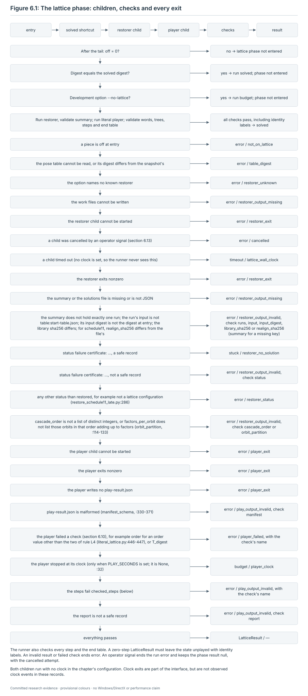
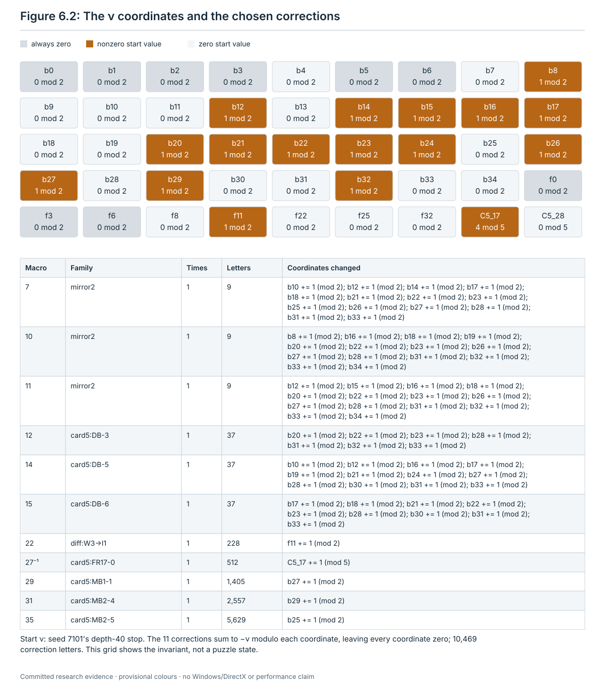
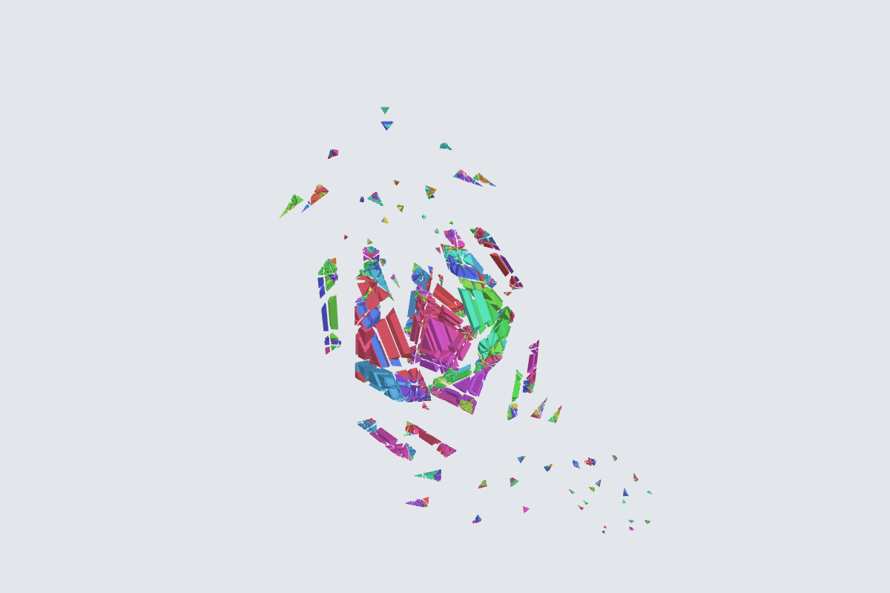
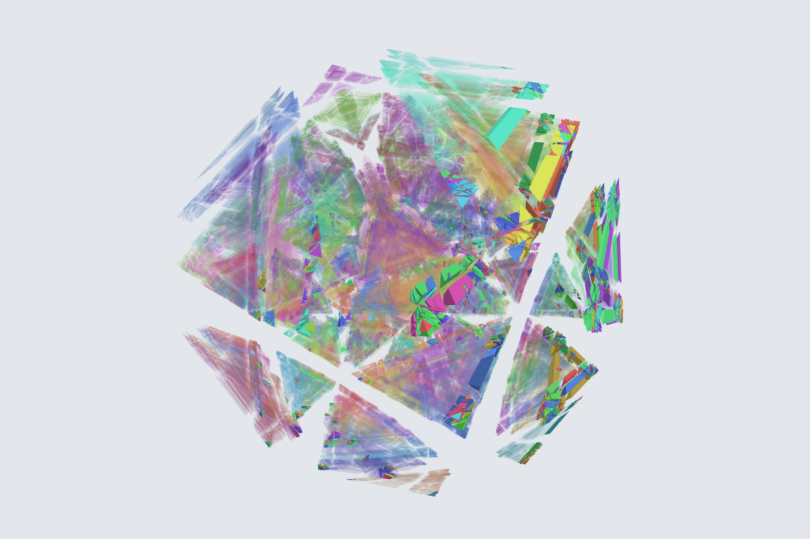
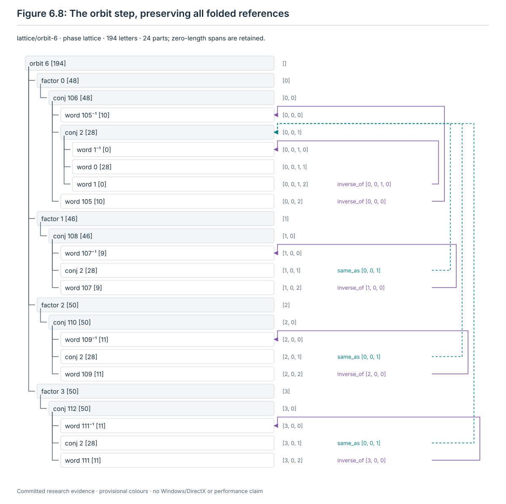
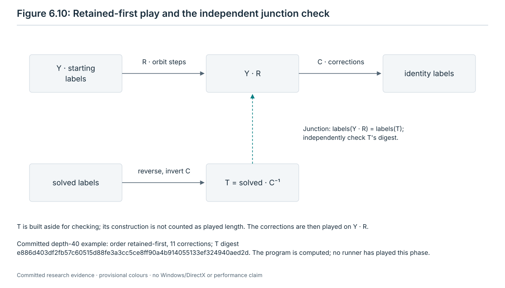
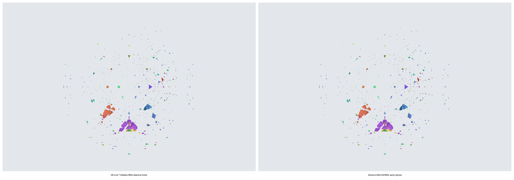
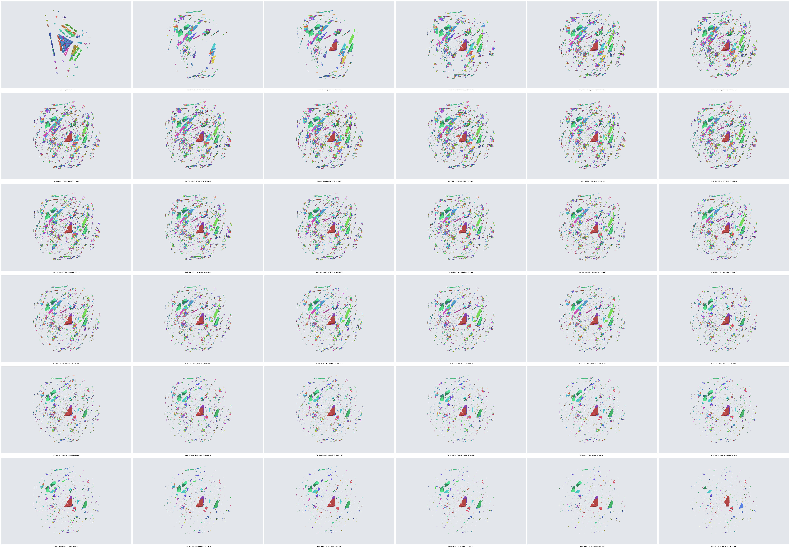
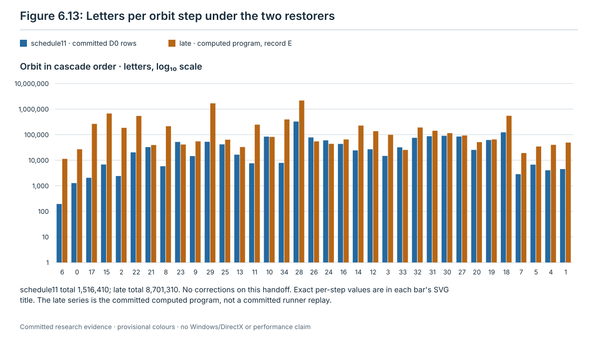

# 6. The lattice phase

The lattice phase is the last phase of the run. It comes after the bulk (chapter 2), the height phase (chapter 3), the
high phase (chapter 4) and the tail (chapter 5), and it starts only when every piece is on the lattice. It ends when
the labels of all 259,800 stickers are the identity. Unlike the earlier phases, it does not search state by state. A
**restorer** reads the start state of the phase once and computes the whole phase as a program: a few
**corrections** and a **cascade** of retained words, one block per orbit. The runner's plugin
[`lattice_phase.py`](../restoration/13-tutorial-runner/scripts/lattice_phase.py) then plays this program twist by
twist through the literal player [`literal_lattice.py`](../restoration/13-tutorial-runner/scripts/literal_lattice.py),
cuts it into steps (one per orbit and one per correction), and hands the steps to the runner.

Two restorers exist. The runner's option `lattice_restorer` picks one:

| Restorer | Program | When it runs | Bound (retained + corrections) |
| --- | --- | --- | --- |
| `schedule11`, the schedule of round 11 | [`restore_schedule11_late.py`](../restoration/09-general-method/scripts/schedule11/restore_schedule11_late.py) with [`sched11.py`](../restoration/09-general-method/scripts/schedule11/sched11.py) | the runner's default and every acceptance run (below) | 20,866,844 + 25,852 |
| `late`, the committed cascade | [`restore_lattice_late.py`](../restoration/09-general-method/scripts/lattice/scripts/restore_lattice_late.py) with [`kit.py`](../restoration/09-general-method/scripts/lattice/scripts/kit.py) | development mode only, with `--lattice-restorer late` | 1,324,660,182 + 25,852 |

The default is `schedule11`
(`research/jumbling/restoration/13-tutorial-runner/scripts/runner.py:1608-1609`). Acceptance mode freezes every runner
option to the committed file
[`acceptance-config.json`](../restoration/13-tutorial-runner/acceptance-config.json), whose values are the runner's
defaults; its `lattice_restorer` is `schedule11`
(`research/jumbling/restoration/13-tutorial-runner/acceptance-config.json:7`). An acceptance run refuses every option
that differs from that file, so it cannot run `late` (`acceptance_config`, `runner.py:145-158`, called at :446-447),
and the checker fails a record whose restorer differs from it (section 6.16). The integrator chose `schedule11` from
the development runs D0 (stage 13 `README.md:1564-1568`). This chapter teaches `schedule11` as rule L3 (section 6.7)
and the late restorer as rule L3′ (section 6.8). Everything else is shared: ν, the corrections (rule L1), the cascade
order (rule L2), the order of the steps and the junction (rule L4), the player, the step names and the rules that build
the step trees.

This chapter states every rule of the phase so that a program that reads only the current state can follow it: what
each rule reads, its candidates in their exact order with every tie-break, the test, the word played and its tree of
named parts, the contract the step satisfies, and what happens when the rule finds nothing. It also says how a step is
played, what the plugin, the runner and the checker check, which bounds hold and what was measured.

Words that this chapter uses without defining them (pose, lattice, off piece, sticker, label, identity labels, digest,
pose table, snapshot, grip, item, retained and jumble letters, ia16 word, step tree) are defined in chapter 1. A letter
is a pair (grip, item) of menu I_a; an ia16 word stores it as the code 60 · grip + item
(`research/jumbling/restoration/13-tutorial-runner/scripts/runner_api.py:226`). Section 6.2 defines the words that
belong to this chapter.

Evidence labels in this chapter:

- **computed**: an exact computation with a replayable record or script;
- **proved (model review only)**: a proof checked by models, not yet by a person;
- **run on one instance** / **measured**: a result on finite inputs.

A statement of what the code does is a statement of the rule, with its `path:line`; it needs no label.

**Citations.** Code citations give `path:line` from the repository root, at commit `88dacaf` (22 October 2026). The
later commits up to `41cc08d` change only the figure tools of `research/jumbling/viewer/`, the figure list
`research/jumbling/tutorial/figures/figures.json` and three wiki pages, no file that this chapter cites. After its
first citation, a file is cited by its name alone. A bare `:N` refers to the file last cited with a line number before
it; in a table whose column heading names a file, it refers to that file. Each name stands for one path:

| Name | Path |
| --- | --- |
| `runner.py`, `runner_api.py`, `lattice_phase.py`, `literal_lattice.py`, `check_run.py`, `check_lattice.py`, `test_lattice_phase.py` | `research/jumbling/restoration/13-tutorial-runner/scripts/` |
| `acceptance-config.json`, "stage 13 `README.md`", `runs/…` | `research/jumbling/restoration/13-tutorial-runner/` |
| `sched11.py`, `restore_schedule11_late.py` | `research/jumbling/restoration/09-general-method/scripts/schedule11/` |
| `restore_lattice_late.py`, `kit.py`, `nucoords.py`, `rlib.py` | `research/jumbling/restoration/09-general-method/scripts/lattice/scripts/` |
| `METHOD.md`, `SENIOR-REVIEW.md`, `data/…` | `research/jumbling/restoration/09-general-method/` |
| `ch06_examples.py` | `research/jumbling/tutorial/scripts/` |

The schedule11 restorer imports `kit.py`, `rlib.py` and `nucoords.py` from
`research/jumbling/restoration/03-retained-group-and-lattice-restorer/scripts/`
(`restore_schedule11_late.py:41-47`). Those three files are byte for byte the stage 09 copies named above (equal
sha256, record section A of the chapter's script), so the citations of the stage 09 copies hold for both restorers.

**The chapter's script and record.** [`scripts/ch06_examples.py`](scripts/ch06_examples.py) and
[`records/ch06-examples.json`](records/ch06-examples.json) are new with this chapter. The script is read-only. It
imports both restorers' libraries, the plugin and the player, loads the lattice start of the committed D0 record of
seed 7106 (`runs/dev/d0-s7106/run/tables/bulk-end.json`), reruns both restorers' orbit solves there without their slow
library check, and compares what they build with the committed records. It plays nothing in the simulator and writes
nothing under the repository; every cache file goes to `--cache`. It ran in 82.6 s on a cloud machine (record field
`seconds`; **measured**):
`python3 -I -B research/jumbling/tutorial/scripts/ch06_examples.py --out <new file> --cache <new directory>`. The
record holds the sha256 of the ten programs it reads (`scripts`) and these sections:

| Section | What it holds | Script |
| --- | --- | --- |
| A | coll(o) of the 35 committed seeds; the cascade built in rounds; the list a one-pass scan would give instead; both compared with `data/realign.json.gz` and the two records | `ch06_examples.py:120-148` |
| B | per orbit: N_o, its tree positions, A, B, C, stickers per piece k, frame group, both seed lengths, route maxima, return length h, swap length and the T11-05 term | :554-576 |
| C | schedule11 at the D0 lattice start: per orbit the plan, the factor counts, the plan costs and the set-order picks; the program's sha256 against the committed report; every word's and tree's sha256 against the committed rows | :150-549 |
| D | every factor of orbits 6, 0, 17, 34 and 32 and the first factors of 15 and 21 under schedule11: kind, positions, setup parts, chosen frame elements, length and tree | :297-552 |
| E | the late restorer at the same state: its program against the committed format 1 record, per orbit letters and tree parts, the trees of orbit 6 | :578-650 |
| F | the committed stage 12 program at the depth 40 stop of seed 7101: rules, corrections, nodes, factors, tree sizes | :652-677 |
| G | the correction library: kinds, lengths and the bound of AU-05 | :679-697 |
| H | the frame group of every frame orbit as each restorer builds it, and r0 of the C5 orbits | :699-730 |
| I | the set-order picks of both restorers at the D0 state, the slot model of section 6.7.3 against them, and a fuzz test of that model | :732-742 |

## 6.1 What the phase is for, in one paragraph

When the tail ends with no piece off, every piece sits in a position of its own orbit, but some or many pieces are in
the wrong position or sit there with the wrong frame: 3,091 of the 176,520 moving pieces at the depth 20 handoff of
seed 7106 and 60,046 at the depth 40 stop of seed 7101 (**run on one instance** each; section 6.17). Retained twists
alone can solve such a configuration only when its invariant ν is zero, and a jumbled history can leave ν nonzero
(section 6.4). So the phase first picks the corrections that cancel ν (rule L1), then solves the 35 orbits one after
another with retained words, in a fixed order (rules L2 and L3), and plays the corrections last (rule L4). Every step
starts and ends on the lattice. The last step leaves identity labels on every sticker; the digest can still differ from
the solved digest by rotations that no label shows (section 6.14). Theorem R says that, with the corrections last, the
retained part has to solve a configuration with ν = 0, and that the committed cascade does so for every reachable
configuration on the lattice (**proved (model review only)**, `METHOD.md:106-110`). For schedule11 the review of round
11 bounds its construction for every input (T11-05, **proved (model review only)**, `SENIOR-REVIEW.md:1945-1958`).
Each restorer also checks its own result before it writes it. The phase has a bound for every input (section 6.15); a
whole restoration has none (stage 10). The finite runs of section 6.17 show that the phase works on those inputs, not
on every scramble.

## 6.2 Words of this chapter

| Word | Meaning | Code or source |
| --- | --- | --- |
| orbit | one of the 35 classes of the 176,520 moving pieces. A retained twist moves a piece only within its orbit. Orbit o has N_o positions, from 120 to 7,200 (table in section 6.6) | `research/jumbling/manual/04-lattice.md:21-27` |
| position, home | a slot of an orbit, named by the id of the piece whose home it is; the home of a piece is the position where it belongs. cur[P] is the home of the piece now at P | `kit.py:248-251`; `sched11.py:421` |
| labels L | L[slot] is the home slot of the sticker now in slot. The labels are the identity when every sticker is at home | `literal_lattice.py:215-221` |
| buffers A, B; third position C | three fixed positions of each orbit: A and B are the tree's `buffers`, C its `third`, the root of the execution tree | `kit.py:102-103` |
| execution tree | per orbit, a tree of retained moves whose root (node 0) sits at C; every node has a position, and the path from the root to a node is a retained word. A and B are not nodes of the tree, so the tree has N_o − 2 distinct positions (**computed**, record section B) | `kit.py:104-131`; `assets/execution_trees.json.gz` |
| sticker order lab[P] | the fixed order of the k stickers of position P: for A and B the frames 0 and 1 of the orbit's entry in `assets/seed_atlas.json`; for every other position the frame stored with the first tree node at P. C is node 0, and its order equals the atlas frame 2 | `kit.py:105-111` |
| frame, frame group H_o | the way a piece sits in its position, an index map of its k stickers (section 6.4). H_o is the set of frames a retained word can leave at home: trivial on 24 orbits, C2 on O00, O03, O08, O11, O22, O25 and O32, C5 on O17 and O28, D5 on O06 and A5 on O34 | `restore_lattice_late.py:56`; manual `04-lattice.md:25-27` |
| seed c_o | a retained word that cycles the pieces at A, B and C (A → B → C → A) and may move orbits that come later in the cascade. The two restorers use different seeds (table below) | `restore_lattice_late.py:70-79`; `sched11.py:400-417` |
| program, node, factor | the restorer's output is a straight-line program of nodes `word` (a list of moves), `path` (a tree path), `conj` (x, u, us) and `prod` (a list of signed nodes). A factor is one signed node; the factors of an orbit, in order, solve that orbit | `restore_schedule11_late.py:400-411`; `literal_lattice.py:115-160` |
| cascade | the fixed order of the 35 orbits (rule L2) | |
| ν | the invariant of section 6.4 | |
| correction | one of the 36 macros of the correction library: a fixed word of menu letters that starts and ends on the lattice and changes ν | `data/library-merged.json.gz` |
| T | the target solved · C⁻¹, when the corrections C are played last | `restore_schedule11_late.py:319-332` |

The two restorers' seeds:

| Restorer | Seed of orbit o | Its length s_o | Code |
| --- | --- | --- | --- |
| schedule11 | for 31 orbits the realigned word w of `data/realign.json.gz`, as `conj(word w, empty word)`; for orbits 10, 24, 25 and 26 the committed seed conjugated by its relocation word, as below | from 24 (O17) to 1,546 (O28); 28 on O06, 584 on O00 | `sched11.py:401-409`; **computed**, record section B |
| late | the committed seed word of the execution tree, conjugated by its relocation word r: `conj(word seed, word r)`, played r⁻¹ · seed · r | seed + 2 · relocation, from 56 to 12,294 (O34) | `restore_lattice_late.py:61-62`, :71-75 |

The realigned file also fixes, for each replaced seed, the orbits it may move (`choice.collateral`), and the restorer
checks them (`sched11.py:410-413`).

## 6.3 Entry, shortcut and exit

**Reads.** The current state: its off count and its digest.

| Test | Holds when | Code |
| --- | --- | --- |
| entry of `lattice` | off = 0 after the tail | `runner.py:1475-1477`; the same test as `entry('lattice')`, :625-631 |
| solved shortcut | digest = SOLVED, the sha256 of no bytes (e3b0c442…) | `runner.py:45`, :1302-1305 |
| no lattice phase | the option `--no-lattice` is set (development mode only) | `runner.py:1306-1309` |

**Where the phase starts.** The runner goes through the phases in the fixed order bulk → height → high → tail →
lattice and never goes back (`Runner.run`, `runner.py:1463-1477`). After the tail, the lattice phase runs only when no
piece is off. If the phases between the bulk and the tail ended `budget`, the run ends `budget` and neither the tail nor
the lattice phase runs (:1471-1473).

**The call.** At the solved digest the run ends `solved` and the phase does not run. With `--no-lattice` the run ends
`budget`; acceptance mode forbids that option (`acceptance-config.json:14`; `check_run.py:321`). Otherwise the runner
calls the plugin once, `plugin.play(ctx)` (`runner.py:1310-1312`). The context gives the current pose table, a fresh
snapshot, the work directory `attempts/<NNNNN>-lattice` and the option `lattice_restorer` (`runner.py:633-640`),
`schedule11` by default and in every acceptance run (introduction).

**No clock.** The plugin starts both of its children with no clock (`seconds=None`, `lattice_phase.py:510`, :548;
meaning of `None`: `runner.py:507-511`), and the player has no budget of its own (`PLAY_SECONDS = None`,
`lattice_phase.py:32`). So the phase runs to its end. Only an operator signal stops it (section 6.13).

**Exit.** What the plugin returns decides the run's result:

| Plugin returns | The runner | Run result | Code (`runner.py`) |
| --- | --- | --- | --- |
| a `LatticeResult` with one or more steps | checks every step and the end table, moves the files into the record (section 6.13) | `solved` | :1318-1320, :1392-1461 |
| a `LatticeResult` with no step | checks that nothing was played and that the labels are already the identity | `solved` | :1403-1417 |
| `End('stuck', …)` | writes `stuck` = the snapshot, phase `lattice`, the reason and no units | `stuck` | :1369-1384 |
| `End('budget' or 'timeout', …)` | records the reason | `budget` | :1369-1384 |
| `End('error', …)` | records the reason and raises | `error` | :1378-1380 |
| any other result | raises: no other result is possible with every piece on the lattice | `error` | :1321-1324, :1371-1372 |
| anything, when an operator signal arrived during the call | copies the plugin's attempts into `phases.lattice.attempts` (a cancelled child leaves one, section 6.12), saves, and stops the run with the error `signal N`; the phase keeps result null | `error` | :1313-1317, :426-428, :1479-1486 |

The acceptance verdict is the first match in a fixed order: `error`, `component`, `stuck` when any step has standing
`certificate`, `coverage_failure`, `budget` (also for `stuck` when a final attempt timed out), and otherwise the run's
result (`verdict`, `runner.py:188-201`; the record is the subject of chapter 7). The attempts of a lattice `End` count
as attempts at the final state (:1510-1511).

*Example of the shortcut* (**run on one instance**): the D0 record of seed 7001, depth 10
(`runs/dev/d0-s7001/run/run.json`, format `runner-run/3`, mode `acceptance`), reaches the solved digest after 9 bulk
steps of one `seam` letter each. Its lattice phase is not entered: result null, 0 steps, twists null. The checker's
line `runs/dev/d0-s7001/check.jsonl` reads pass true, verdict `solved`, end digest e3b0c442…, `lattice_twists` null
(stage 13 `README.md:1548-1549`).



## 6.4 What the phase reads: labels, positions, frames and ν

**Reads.** At the start state Y of the phase, and only there:

- the labels L of all 259,800 stickers, read from the pose table; every sticker frame must agree (`state_labels`,
  `literal_lattice.py:215-221`; `labels_of`, `restore_lattice_late.py:183-186`);
- for each orbit and position P, the home cur[P] of the piece at P: the position of the slot L[lab[P][0]], the home
  slot of P's first sticker (`kit.py:248-251`; `sched11.py:421`). All stickers of a piece share one home, so the first
  sticker suffices;
- for each position P, the frame of the piece at P, defined next.

**Frames and values.** All frames, values and fibres in this chapter are index maps over sticker orders (section 6.2)
and use one convention:

| Map | Definition | Code |
| --- | --- | --- |
| frame e of the piece at P, with home Q = cur[P] | e[j] = the index in lab[Q] of the home slot L[lab[P][j]] of the sticker now in the j-th slot of P | `kit.py:284-285` (when Q = P); `needed(L, P, Q)`, `sched11.py:213-216` |
| value of an element at X | for an element that maps position X to itself: v[j] = the index in lab[X] of the slot to which the element moves the slot lab[X][j] | `value_at`, `kit.py:165-169`; `edge`, `sched11.py:201-205` |
| fibre of a word from X to Y | for a word that moves the piece at X to Y: the index in lab[Y] of the slot to which it moves lab[X][j] | `fibre`, `sched11.py:195-199` |
| product x · y | chronological: first x, then y; (x · y)[i] = y[x[i]] | `mul`, `sched11.py:17-22` |
| inverse x⁻¹ | x⁻¹[x[i]] = i | `inv`, `sched11.py:25-26` |
| order on maps | lexicographic order of the tuples (e[0], e[1], …) | Python tuple order, `sorted` and `min` in the cited lines |

A piece at its home is solved when its frame is the identity. An element with value e at P moves the sticker in
slot j of P to slot e[j], its home slot, so it repairs frame e: this is why the frame pass of rule L3′ plays an element
whose value is the frame itself (`kit.py:284-287`).

**The invariant ν** (`nu`, `restore_lattice_late.py:140-168`; the same function in `restore_schedule11_late.py`;
frame tables `ab_maps`, `restore_lattice_late.py:94-134` and `restore_schedule11_late.py:81-111`). ν reads the inverse
of the frame: v = e⁻¹, so v[t] is the index at P of the sticker whose home index is t
(`restore_lattice_late.py:160-166`).

| Coordinates | How each is read | Values |
| --- | --- | --- |
| b0 to b34, one per orbit | the parity of the permutation of positions: the sum over its cycles of (length − 1), modulo 2 | 0 or 1 |
| f0, f3, f8, f11, f22, f25, f32 (the C2 orbits) | the number of positions whose v is not the identity, modulo 2 | 0 or 1 |
| f6 (O06, D5) | the number of positions whose v has order 2, modulo 2 | 0 or 1 |
| C5_17 and C5_28 (the C5 orbits) | the sum over positions of i, where v = r0^i, modulo 5; r0 is the lexicographically least element of order 5 of H_o, and r0^i is r0 applied i times (x ↦ (r0[x[0]], r0[x[1]], …)) | 0 to 4 |
| O34 (A5) and the 24 orbits with trivial H_o | no frame coordinate | — |

Both restorers use the same H_o: the late restorer closes the values of its pairs under products
(`restore_lattice_late.py:102-114`), schedule11 takes the values of its tree returns
(`restore_schedule11_late.py:90-91`; section 6.7.2). The two sets are equal on all 11 frame orbits, and r0 is
(1, 3, 0, 4, 2) on O17 and (1, 2, 4, 0, 3) on O28 (**computed**, record section H). The C2 and D5 coordinates do not
depend on the direction of the map (e and e⁻¹ have the same order); the C5 coordinate does: e = r0^i gives v = r0^(−i).

As a vector, ν has 43 coordinates over F2 (the 35 sign bits, then the frame bits in the order 0, 3, 6, 8, 11, 22, 25,
32) and 2 over F5 (orbits 17 and 28) (`vec`, `nucoords.py:109-123`).

**What ν can be.** ν_o is a homomorphism (**proved (model review only)**), and its value on each of the 1,200 retained
generators is 0 (**computed**) (card 1, F1,
`research/jumbling/theory/cards/card-1-retained-group.md:38`). So every retained word keeps ν. Retained twists solve
every reachable lattice configuration with ν = 0 (**computed**: the retained group is the kernel of ν, a certificate of
stage 03; manual `research/jumbling/manual/04-lattice.md:45-50`). After a jumbled history ν takes exactly the values of
A_J = C2^34 × C5^2: 34 bits can be 0 or 1 and both C5 values can be anything; the nine coordinates b0, b1, b2, b3, b5,
b6, f0, f3 and f6 are always 0 (manual `04-lattice.md:58-66`). The lower bound on A_J is **computed** (a certificate of
40 words); the upper bound is **proved (model review only)** (`METHOD.md:111-115`).



## 6.5 Rule L1: choose the corrections

Both restorers run this rule with the same code (`restore_lattice_late.py:311-353`;
`restore_schedule11_late.py:290-332`).

**Reads.** ν(Y) at the start state, and the 36 macros of the correction library `data/library-merged.json.gz` (sha256
of the decompressed file 8a13eb6c…), each with its stored ν. Before it reads any input, the restorer requires that
macro 0 is w9, plays every macro from the solved state, and requires that it ends on the lattice with the stored ν
(`restore_lattice_late.py:176-180`, :197-210).

The library (**computed** from the file, record section G):

| Kind | Macros | Twists |
| --- | --- | --- |
| change only bits | 34 (all but 27 and 30) | 22,012 in all; 5 to 5,629 each |
| change only a C5 value | 27 (`card5:FR17-0`, C5_17 by 4) and 30 (`card5:FR28-0`, C5_28 by 1) | 512 and 1,408 |
| change both | none | — |

The full list, with each macro's ν, is table 4.7.2 of the manual.

**Candidates and order.**

1. If ν(Y) = 0, there is no correction. Go to rule L3.
2. Otherwise eliminate. The library's vectors enter the span in index order, 0 to 35, over F2 and over F5 separately
   (`restore_lattice_late.py:201-209`; `Span.add`, `nucoords.py:133-168`). Solve for a combination whose ν is −ν(Y)
   (`Span.solve`, `nucoords.py:170-196`; `restore_lattice_late.py:315-317`). Each macro i gets a multiplicity n_i from
   0 to 9 with n_i ≡ (its F2 coefficient) mod 2 and n_i ≡ (its F5 coefficient) mod 5 (`nucoords.py:189-195`).
3. For each macro i with n_i ≠ 0, in increasing index order (`restore_lattice_late.py:329-337`): its order is 2 for a
   bit macro and 5 for a C5 macro; n = n_i mod order; skip it if n = 0; play it inverted when n > order // 2;
   times = order − n when inverted, n otherwise.

So a bit macro is played at most once, forward. A C5 macro is played as follows:

| n | Played |
| --- | --- |
| 1 | once, forward |
| 2 | twice, forward |
| 3 | twice, inverted |
| 4 | once, inverted |

**Test.** The restorer builds T = solved · C⁻¹ in the exact simulator: from solved it plays the corrections in reverse
order, each with its direction flipped (`restore_lattice_late.py:340-346`). It requires ν(T) = ν(Y), and it requires
ν = 0 for the relabelled state L_T⁻¹ ∘ L_Y that the cascade then solves (:347-353). After the cascade it plays C on T
and requires the solved digest and identity labels (:363-372). Every twist of a macro must be admissible
(`apply_macro`, :213-220).

**Step played (tree).** One step per correction k, in list order, named `lattice/correction-<k>-<macro>`, with the
fields `correction`, `macro`, `family`, `times`, `inverse` and `macro_letters` (`lattice_phase.py:264-274`). The word
is the macro, or its inverse (every twist inverted, in reverse order), repeated `times` times
(`literal_lattice.py:406-438`). Its tree (`correction_tree`, `lattice_phase.py:197-201`):

```
correction k                          times · m
├─ macro i <family>[⁻¹]               m
└─ macro i <family>[⁻¹]               m      same_as [0]   (only when times = 2)
```

**Contract.** `lattice_literal`, gate `player`, standing `rule`. Every twist is an element of menu I_a, admissible and
not uncertain; the state is on the lattice after every repetition (`literal_lattice.py:421-432`). The step's snapshots
have off 0 and no heights. After all corrections, ν = 0 relative to the solved state.

**No step.** When ν(Y) = 0 there is no correction step. When −ν(Y) is outside the span of the library, the restorer
writes the status `failure certificate: nu outside the span of the correction library` with the residual coordinates
(`restore_lattice_late.py:317-328`). The plugin then ends `stuck` with the reason `restorer_no_solution` and one attempt
(`lattice_phase.py:533-536`), and the run ends `stuck`.

**Evidence.**
- The library spans A_J: rank 34 over F2 and 2 over F5 (**computed**; the restorer prints both ranks at every start,
  `restore_lattice_late.py:210`; `METHOD.md:99-100`, :111). With A_J = C2^34 × C5^2, the failure certificate cannot
  occur at a reachable configuration (Theorem R, **proved (model review only)**, `METHOD.md:106-110`).
- A correction is admissible from every reachable lattice configuration and moves the labels the same way from each
  (**proved (model review only)**; stage 03 report section 3.2, quoted in manual section 4.3).
- The corrections need at most 25,852 twists: the 34 bit macros once each (22,012) and each C5 macro at most twice
  (2 · 512 + 2 · 1,408 = 3,840) (bound AU-05, **proved (model review only)**, `SENIOR-REVIEW.md:450-454`; the sum
  **computed** again from the library, record section G).
- Measured lengths of C: 8,129, 21,888, 21,660 and 21,888 twists on four research inputs (`METHOD.md:462-464`), and
  10,469 at the depth 40 stop of seed 7101 (section 6.17.3) (**run on one instance** each).

**Where in the code.** `restore_lattice_late.py:311-353`; `restore_schedule11_late.py:290-332`; `nucoords.py:109-196`.




## 6.6 Rule L2: the cascade order

**Reads.** The model files only: the 35 committed seeds. Nothing of the state.

**Candidates and order.** For each orbit o, coll(o) is the set of other orbits that its raw committed seed word moves
(`restore_lattice_late.py:59-63`). The list is built in rounds (:64-68). Each round takes the orbits not yet listed,
in increasing o, whose coll(o) lies inside the list as it stood when the round began, and appends them all. An orbit
that one round frees therefore waits for the next round. The cascade is the final list reversed (:69). The rounds
(**computed**, record section A):

| Round | Orbits appended |
| ---: | --- |
| 1 | 1, 4, 5, 7, 18, 19, 20, 27, 30, 31, 32, 33 |
| 2 | 3, 12, 14, 16, 24, 26, 28, 34 |
| 3 | 10, 11, 13, 25, 29 |
| 4 | 9, 23 |
| 5 | 8, 21, 22 |
| 6 | 2, 15, 17 |
| 7 | 0, 6 |

The cascade is the same for every input:

6, 0, 17, 15, 2, 22, 21, 8, 23, 9, 29, 25, 13, 11, 10, 34, 28, 26, 24, 16, 14, 12, 3, 33, 32, 31, 30, 27, 20, 19, 18,
7, 5, 4, 1

A scan that appends each orbit as soon as it is free, inside the same pass, gives a different list from place 11 to
place 23 (for example coll(29) = {24, 26, 27, 31, 32, 33} becomes free in the pass that adds 24, 26 and 27). That is
not the rule. The schedule11 restorer does not rebuild the list: it reads the same list from the `cascade_order` of
`data/realign.json.gz` and checks that it is a permutation of 0 to 34 (`sched11.py:396-397`). The two lists are equal
(**computed**, record section A).

**Test.** Late restorer: each relocated seed must cycle the stickers of A, B and C: the atlas frame of A to that of B,
B's to C's, C's to A's (`restore_lattice_late.py:76-78`). Schedule11: each seed has the length the realigned file
states, moves no orbit other than its own outside the orbits after it in the cascade, moves on its own orbit only A, B
and C, and takes A to B, B to C and C to A (`sched11.py:409-417`).

**Step played (tree).** None of its own. The order fixes the order of the orbit steps. The plugin checks that the
summary's `cascade_order` is a list of distinct integers and that `factors_per_orbit` lists the orbits in that order
and adds up to the number of factors (`orbit_partition`, `lattice_phase.py:114-133`).

**Contract.** A seed disturbs only orbits solved after its own (`restore_lattice_late.py:69`; `sched11.py:410-411`).
In the late kit, `check_support` checks pairs and singles (`kit.py:179`, :228; :200-207). Its stars and the
conjugated pairs of `pair_to` are not checked; they move only the seed's orbits because they are conjugates of the seed
by retained words, which is an argument, not a check. Schedule11 checks every factor it builds (`check`,
`sched11.py:207-211`). So an orbit solved stays solved.

**No step.** Not applicable.

**Evidence.** The order is **computed** (record section A). It equals the `cascade_order` of `data/realign.json.gz`, of
the committed late record and of the committed D0 report (record section A).

**Where in the code.** `restore_lattice_late.py:58-79`; `sched11.py:392-417`.

The orbits in cascade order (**computed**, record section B; s_o as in section 6.2; the term is the orbit's share of
the bound T11-05, section 6.15):

| Place | Orbit | N_o | H_o | k | s_o (schedule11) | s_o (late) | Seed replaced | Term (T11-05) |
| ---: | ---: | ---: | --- | ---: | ---: | ---: | --- | ---: |
| 1 | 6 | 720 | D5 | 5 | 28 | 398 | yes | 70,326 |
| 2 | 0 | 1,200 | C2 | 2 | 584 | 2,218 | yes | 753,462 |
| 3 | 17 | 1,440 | C5 | 5 | 24 | 1,546 | yes | 99,380 |
| 4 | 15 | 2,400 | 1 | 1 | 106 | 11,574 | yes | 170,400 |
| 5 | 2 | 2,400 | 1 | 1 | 314 | 9,230 | yes | 444,000 |
| 6 | 22 | 3,600 | C2 | 2 | 38 | 776 | yes | 297,054 |
| 7 | 21 | 7,200 | 1 | 1 | 56 | 104 | yes | 331,200 |
| 8 | 8 | 3,600 | C2 | 2 | 114 | 1,544 | yes | 513,408 |
| 9 | 23 | 7,200 | 1 | 2 | 54 | 56 | yes | 316,800 |
| 10 | 9 | 7,200 | 1 | 2 | 202 | 394 | yes | 878,400 |
| 11 | 29 | 2,400 | 1 | 1 | 158 | 9,220 | yes | 225,600 |
| 12 | 25 | 3,600 | C2 | 2 | 56 | 56 | no | 313,346 |
| 13 | 13 | 7,200 | 1 | 1 | 68 | 152 | yes | 374,400 |
| 14 | 11 | 3,600 | C2 | 2 | 68 | 776 | yes | 362,002 |
| 15 | 10 | 7,200 | 1 | 1 | 776 | 776 | no | 2,930,400 |
| 16 | 34 | 120 | A5 | 20 | 202 | 12,294 | yes | 29,982 |
| 17 | 28 | 1,440 | C5 | 5 | 1,546 | 3,080 | yes | 2,282,710 |
| 18 | 26 | 7,200 | 1 | 1 | 56 | 56 | no | 331,200 |
| 19 | 24 | 7,200 | 1 | 1 | 56 | 56 | no | 324,000 |
| 20 | 16 | 7,200 | 1 | 2 | 86 | 296 | yes | 439,200 |
| 21 | 14 | 7,200 | 1 | 2 | 162 | 1,544 | yes | 712,800 |
| 22 | 12 | 7,200 | 1 | 1 | 72 | 776 | yes | 388,800 |
| 23 | 3 | 3,600 | C2 | 2 | 566 | 1,110 | yes | 2,115,138 |
| 24 | 33 | 2,400 | 1 | 1 | 50 | 56 | yes | 98,400 |
| 25 | 32 | 3,600 | C2 | 2 | 74 | 106 | yes | 362,036 |
| 26 | 31 | 7,200 | 1 | 1 | 56 | 152 | yes | 324,000 |
| 27 | 30 | 7,200 | 1 | 2 | 56 | 104 | yes | 324,000 |
| 28 | 27 | 7,200 | 1 | 1 | 66 | 104 | yes | 360,000 |
| 29 | 20 | 7,200 | 1 | 2 | 46 | 152 | yes | 295,200 |
| 30 | 19 | 7,200 | 1 | 1 | 106 | 152 | yes | 511,200 |
| 31 | 18 | 7,200 | 1 | 1 | 248 | 1,546 | yes | 1,015,200 |
| 32 | 7 | 7,200 | 1 | 1 | 82 | 298 | yes | 453,600 |
| 33 | 5 | 7,200 | 1 | 1 | 166 | 562 | yes | 770,400 |
| 34 | 4 | 7,200 | 1 | 1 | 74 | 562 | yes | 432,000 |
| 35 | 1 | 3,600 | 1 | 1 | 608 | 2,212 | yes | 1,216,800 |
| | total | 176,520 | | | | | 31 | 20,866,844 |

k is the number of stickers per piece, the length of lab[P]. For the kept orbits 10, 24, 25 and 26 both restorers use
the same seed, so both columns agree.

## 6.7 Rule L3: one orbit step under schedule11 (default and acceptance)

For each orbit o in cascade order, schedule11 computes the factors that solve orbit o in the relabelled state, applies
them to that state at once, and goes on with the next orbit (`Schedule11.solve`, `sched11.py:497-498`; `solve_orbit`,
:419-495). The plugin then plays the factors of one orbit as one step. This section states the rule. Sections 6.7.1 to
6.7.4 give its parts: the routes and the setup word, the frame tables, the position loop, and the seven constructions.
Section 6.7.5 works one orbit through.

**Reads.**

- The labels L of the relabelled state: L = L_T⁻¹ ∘ L_Y when there are corrections, L = L_Y when there are none
  (`restore_schedule11_late.py:288`, :326-331), after the orbits before o in the cascade have been solved in L. Each
  factor is applied to L as soon as it is built (`apply`, `sched11.py:427-437`).
- The model data of orbit o, the same for every input: A, B, C, the execution tree, the sticker orders (section 6.2),
  the seed c_o of length s_o, the routes (section 6.7.1) and the frame tables (section 6.7.2).
- From L, before the first factor of the orbit: cur[P] for every position P (section 6.4), and the list F of **fixed
  errors**. F holds the positions P other than A, B and C with cur[P] = P and a frame that is not the identity
  (`sched11.py:421-423`).

**Position order.** cur and F list the positions in the kit's order: A, B, then every other position in the order of
its first node in the execution tree. C is node 0, so it comes third (`kit.py:105-110`). Python dictionaries keep this
insertion order.

**Candidates and order.** The factors of orbit o, in the order in which they are built and played:

| Part | Orbits | Factors, in order | Code (`sched11.py`) |
| --- | --- | --- | --- |
| 1 | H_o trivial (24 orbits) | Two plans of three-cycles: the position loop (section 6.7.3) and the fewest three-cycles (below). A three-cycle (X, Y, Z) costs s_o + 2·\|g\|, where g = setup(X, Y, Z) (section 6.7.1). The plan with the smaller total cost is played, the position loop on a tie (`min` keeps the first). Each three-cycle becomes one **direct cycle** | :439-447 |
| 1′ | the 11 frame orbits | one **twisted cycle** for each three-cycle of the position loop, in loop order (below) | :449-462 |
| 2 | O06, O17 | for each X in F, in order: a **direct pair** at X if the frame of X is not the identity | :467-471 |
| 2′ | the 7 C2 orbits, O28, O34 | F taken in pairs (1st, 2nd), (3rd, 4th), …: a **C2 pair** on a C2 orbit, a **frame triple** on O28 and O34. If F has an odd length, its last position gets a **direct pair** | :472-483 |
| 3 | the 11 frame orbits | a **cleanup at A** if the frame of A is not the identity; then a **cleanup at B** if the frame of B is not the identity | :484-487 |
| 4 | the 11 frame orbits | a **single** at C if the frame of C is not the identity. Only O06 and O34 may need it | :488-491 |

On the 24 trivial orbits a piece at home is solved, so parts 2 to 4 do not occur there.

*Three-cycles.* A triple (X, Y, Z) names the three-cycle that moves the piece at X to Y, the piece at Y to Z and the
piece at Z to X (the expected edges of `direct_cycle`, `sched11.py:280-281`).

*The fewest three-cycles* (`_fewest_cycles`, :144-168):

1. Take the positions P in position order, skipping every position already seen.
2. Follow the cycle of P under cur: c0 = P, c1 = cur[c0], c2 = cur[c1], …, until it returns to P. A position at its
   home is a cycle of length 1.
3. For j = 1, 3, 5, … while j < (cycle length) − 1, append the triple (c0, c_j, c_(j+1)).
4. If the cycle has even length, note the transposition (c0, c_last).
5. When every position is seen, take the noted transpositions two at a time, in the order noted. For (a, b) and
   (c, d), append (a, c, d) and then (a, c, b). An odd number of transpositions is an odd position permutation
   (assert, :162).

*Twisted cycles on the frame orbits* (:452-462). Each triple of the position loop has the form (A, X, Y). X is
**finalized** if cur[A] = X, that is, the piece at A goes home. Y is finalized if cur[X] = Y. The twisted cycle moves
the three pieces as a direct cycle would, and it also gives every finalized position the identity frame (section
6.7.4). Then cur is updated as in the loop.

**Test.**

- Every factor passes `check` (:207-211). On its own orbit it may move only the positions it lists, and off its orbit
  only the orbits after o in the cascade (`check_support`, `kit.py:200-207`, with the seed's collateral as the allowed
  set, `sched11.py:410-414`). For each listed position X, the factor must take the stickers of X to the stated
  position with the stated fibre (`edge`, :201-205). Section 6.7.4 lists the expected values.
- The constructions assert their tables and choices: :239, :244-248, :251-261, :272-273 (section 6.7.2) and
  :298-300 (finalized frames).
- After part 1′, every position other than A, B, C and the fixed errors must have the identity frame (:464-466).
- After the orbit, every sticker of the orbit must hold its own label (:492-493).
- After all 35 orbits, L is the identity (`restore_schedule11_late.py:342`). The 35 orbit terms must add up to
  20,866,844, each orbit's length must be within its term, and the retained length within 20,866,844 (:343-344, :363).

**Step played (tree).** One step for each orbit with at least one factor, in cascade order. Its rule is
`lattice/orbit-<o>`, with the fields `orbit`, `factor_first`, `factor_count`, `tree_folded` and `tree_folded_depth`
(`lattice_phase.py:248-256`). The last step of the phase also gets `labels_identity` (:309-310). The word is the
factors in order, each expanded to retained letters in chronological order (section 6.10). The tree has one part
`factor i` per factor, which holds the factor's node (section 6.11). Section 6.7.4 gives the tree of each
construction.

**Contract.** `lattice_literal`, gate `player`, standing `rule`. Every letter is a retained letter, and the step starts
and ends on the lattice (`_close`, `lattice_phase.py:236-246`). In the restorer's label model, the step solves orbit o
relative to T and leaves the earlier orbits solved (`check` on every factor). The plugin, the runner and the checker do
not check this per step. They check the chain of digests, the files and identity labels at the end of the phase
(sections 6.12, 6.13 and 6.16).

**No step.** An orbit with no factor gets no step. That happens when every position holds its own piece with the
identity frame. The plugin lists the orbit in `skipped_orbits` (`lattice_phase.py:574`). Each failure below stops the
restorer with a nonzero exit. The plugin then ends `error` with `restorer_exit` (`lattice_phase.py:474-475`), and the
run ends `error`:

| Failure | Code (`sched11.py`) |
| --- | --- |
| a check or an assert fails | the lines under **Test** |
| no element of H satisfies a choice (`next` with no match raises `StopIteration`) | :291-292, :306, :332-333, :342, :350 |
| odd position permutation | `ValueError`, :131; assert, :162 |
| the value at C has no single choice | `KeyError`, :357 |

The round 11 review proves that on every reachable input with ν = 0 the construction leaves no position and no frame
unsolved (T11-01 to T11-05, **proved (model review only)**, `SENIOR-REVIEW.md:1870-1958`). On such inputs none of
these failures should occur.

**Evidence.**

- The bound. The construction needs at most 20,866,844 retained twists on every input (T11-05,
  **proved (model review only)**, `SENIOR-REVIEW.md:1945-1958`). The restorer recomputes the 35 orbit terms at every
  start (`_Orbit11.bound`, `sched11.py:363-389`, through `orbit_bounds`, :500-501) and asserts their sum
  (`restore_schedule11_late.py:115-116`). The terms are **computed**; they are listed in section 6.6.
- The depth 20 handoff of seed 7106. The program has 35 orbit steps, 12,215 factors and 1,516,410 letters, and it was
  played and checked (**run on one instance**; section 6.17.1). The chapter's script rebuilds the same program from
  the same start. The solutions file's sha256 da275140… equals the one in the committed report, and all 35 words and
  trees equal the committed rows (**computed**, record section C).
- Two synthetic inputs: 15,761,436 and 15,760,112 retained twists (`METHOD.md:537-538`; **run on one instance**
  each).

**Where in the code.** `sched11.py:29-501`; `restore_schedule11_late.py:62-116`, :334-366.

### 6.7.1 Routes and the setup word

**Move order.** The 2,400 signed retained moves are taken in the order 1, −1, 2, −2, …, 1,200, −1,200 (the
dictionary `pm`, `sched11.py:46-55`). A move acts on the positions of the orbit as a permutation: pm[m][P] is the
position to which m takes the piece at P. A move fixes P when pm[m][P] = P (:56, :87).

**A shortest route.** For a root position and a set of allowed moves, the route of P is a shortest word of allowed
moves that takes the piece at P to the root (`bfs`, :58-80). The search runs backwards from the root in rounds. In
round d, for each allowed move m in move order, every position not yet reached from which m leads into the positions
of round d − 1 gets distance d and the move m. So the first move in move order wins every tie. The route of P is that
move m, followed by the route of pm[m][P]. Every position other than the excluded ones must be reached (:73).

| Route | Root | Allowed moves | Excluded | Used by | Code |
| --- | --- | --- | --- | --- | --- |
| `a` | A | all 2,400 | — | the setup word | :83 |
| `e` | B | the moves that fix A | A | the setup word | :84 |
| `b` | C | all 2,400 | — | the C2 pair | :86 |
| `f` | B | the moves that fix C | C | the direct pair and the C2 pair | :87 |

The routes `b` and `f` and the swap word exist only on the frame orbits (:85).

**The swap word** (:88-111) exchanges the pieces at B and C and leaves A in place:

1. Search forwards from B over the moves that fix A, in move order, until C is reached; the first move in move order
   wins every tie. Follow the search back from C to get w, a shortest word that takes the piece at C to B.
2. Let z be the position to which w takes the piece at B.
3. swap = w followed by the inverse of the tree path to the first node at z.

The restorer asserts that the swap fixes A with the identity fibre and takes B to C and C to B (:251-253).

**The setup word** g = setup(X, Y, Z) takes the pieces at X, Y and Z to A, B and C (`setup`, :218-225):

1. w1 = the empty word if X = A, otherwise the route `a` of X.
2. y = the position to which w1 takes the piece at Y; w2 = the route `e` of y. It takes that piece to B and keeps A.
3. z = the position to which w1 and then w2 take the piece at Z; n = the first tree node at z (`node_at`,
   `kit.py:106-110`).
4. g = w1 + w2 + (the tree path to n)⁻¹. The inverse path takes the piece at z to C.

So |g| = |w1| + |w2| + (the depth of n). *Examples* (**computed**, record section D): on orbit 6, setup(4944, 97924,
98021), with A = 4944, has |g| = 0 + 4 + 3 = 7. On orbit 15, setup(377, 20374, 20175) has |g| = 1 + 4 + 3 = 8.

### 6.7.2 Frame tables

Each of the 11 frame orbits builds these tables once (`prepare`, `sched11.py:227-274`). The maps follow the
conventions of section 6.4; the products are chronological.

| Table | How it is built | Code |
| --- | --- | --- |
| returns r_v | Start with r_identity = the empty word. For each tree node n at C, in node order, let w be the tree path to n and x its fibre from C to C. The candidates (x, w) and (x⁻¹, w⁻¹) are taken in this order; each is kept when its value is new or its word is strictly shorter than the one kept. Every such path keeps A and B with the identity fibre (asserted) | :230-242 |
| H | the values of the returns in lexicographic order. It must have 2 (C2), 5 (C5), 10 (D5) or 60 (A5) elements and be closed under products | :243-248 |
| h | the length of the longest return | :249 |
| swap, b→c | the swap word (section 6.7.1) and its fibre from B to C | :250-253 |
| at_B[v] | For each return (z, r_z): v = b→c · z · (b→c)⁻¹, and at_B[v] = swap + r_z + swap⁻¹, or the empty word when z is the identity. This word keeps A and C with the identity fibre and has value v at B (asserted). Its keys are again all of H | :254-261 |
| α, β, γ | the fibres of the seed c_o from A to B, from B to C and from C to A | :262 |
| single choices (O06 and O34 only) | For x in H (the outer loop) and y in H (the inner loop): z = x · y, value x⁻¹ · y⁻¹ · x · y, cost \|r_x\| + \|r_y\| + \|r_z\|. For each value the first choice of least cost is kept. There must be 5 values on O06 and 60 on O34, with largest cost 8 and 5 | :263-273 |

*Example* (**computed**, record section B). Orbit 6 has 9 tree nodes at C besides the root, h = 4 and a swap of 13
moves. Orbit 34 has 59 such nodes, h = 3 and a swap of 8 moves.

### 6.7.3 The position loop and the set-order picks

The position loop (`_loop_cycles`, `sched11.py:116-141`) is the loop of the late kit's position pass (`kit.py:251-278`,
section 6.8), planned on cur without touching stickers:

1. Build the set U of unsolved positions, {P : cur[P] ≠ P}, by adding them one by one in position order
   (`sched11.py:119`).
2. While U is not empty:
   1. Let h = cur[A].
   2. If h = A: X = the first element of U in **set order** (below), and Y = cur[X] (:123-125).
   3. Otherwise X = h and Y = cur[X]. If Y = A, Y becomes the first element of U in set order that is neither A nor X.
      If there is none, the loop stops with "odd position permutation" (:127-131).
   4. Append the triple (A, X, Y): the piece at A goes to X, the piece at X to Y, the piece at Y to A.
   5. Set cur[A], cur[X], cur[Y] to the old cur[Y], cur[A], cur[X]. Then, for P = A, X, Y in this order, discard P
      from U if cur[P] = P and add P to U otherwise (:134-139).

**Set order.** U is a Python set of integers, and "first in set order" is the first element that its iterator gives.
In CPython that is not the least element. At the D0 state, 277 of the 312 picks of schedule11's loop and 226 of the 271
picks of the late kit's loop are not the least candidate (**computed**, record section I; schedule11's count covers the
loop of all 35 orbits, also where the fewest three-cycles are played). On orbit 6, for example, the first pick is
97,924, while the least unsolved position is 53,038 (record section C). So the rule must state the set's iteration
order. For CPython 3.13 it is the slot order of an open-addressing table. Here the hash of a key is the key itself,
since every key is a non-negative integer below 2^61 − 1:

| Part | Rule |
| --- | --- |
| table | m slots, m a power of two, at first 8. A slot is empty, holds a key, or is deleted. `used` counts the keys; `fill` counts the keys and the deleted slots |
| probe sequence of key p | i = p mod m and perturb = p. Visit the slots i, i + 1, …, i + 9 if i + 9 ≤ m − 1, otherwise slot i alone. Then perturb = ⌊perturb / 32⌋ and i = (5i + 1 + perturb) mod m, and repeat |
| add p | Walk the probe sequence until a slot holds p (then nothing changes) or a slot is empty. If a deleted slot was passed, put p into the last deleted slot passed. Otherwise put p into the empty slot and add 1 to `fill`; then rebuild if 5 · fill ≥ 3 · (m − 1) |
| rebuild | The new m is the least power of two, at least 8, that is greater than 4 · used (2 · used when used > 50,000). Put the keys, in their old slot order, each into the first empty slot of its probe sequence in the new table. Then fill = used |
| discard p | Walk the probe sequence until a slot holds p and mark that slot deleted (`used` − 1). If an empty slot comes first, nothing changes |
| iteration | the keys in slot order 0, 1, …, m − 1 |

U starts empty and receives its keys by `add`, in position order (:119; `kit.py:252`).

**Evidence for the model** (**computed**, record section I). On CPython 3.13.16, the model matches the interpreter's
set after every operation of 40 random sequences of 3,000 adds and discards each. It also gives all 583 picks of both
restorers at the D0 state. It models one implementation of the language. Another version may order the set
differently, and the code does not pin the interpreter (section 6.18). The committed D0 record does not name its
interpreter; the chapter's script, run on CPython 3.13.16, rebuilds its program exactly (record section C).

### 6.7.4 The seven constructions

Notation: c is the seed node of the orbit and s = s_o its length (section 6.2). For a word w, |w| is its length and
w⁻¹ its inverse: the moves in reverse order, each negated. r_x is the return of x, and at_B[y] the word of section
6.7.2. A node conj(x, u) plays u⁻¹ · x · u (section 6.10). "Fibre" and "frame" are as in section 6.4.

| Construction | Used for | Node | Played | Length | Code (`sched11.py`) |
| --- | --- | --- | --- | --- | --- |
| direct cycle of (X, Y, Z), g = setup(X, Y, Z) | part 1 | conj(c, word g⁻¹) | g · c · g⁻¹ | s + 2\|g\| | :276-281 |
| twisted cycle of (A, X, Y), g = setup(A, X, Y), r = at_B[y] + r_x | part 1′ | conj(c, word (r + g⁻¹)) | g · r⁻¹ · c · r · g⁻¹ | s + 2(\|r\| + \|g\|) | :283-301 |
| pair at (X, Y) by g, which takes X to B and Y to C | through the next two rows | conj(prod[conj(c, word r_x), c⁻¹], word g⁻¹) | g · r_x⁻¹ · c · r_x · c⁻¹ · g⁻¹ | 2s + 2\|r_x\| + 2\|g\| | :303-313 |
| direct pair at X: the pair at (X, C) with g = route `f` of X | parts 2 and 2′ | as the pair | as the pair | as the pair | :315-317 |
| C2 pair at (X, Y): the pair with g = route `b` of Y, then route `f` of the image of X | part 2′ | as the pair | as the pair | as the pair | :319-325 |
| frame triple at (X, Y), g = setup(X, Y, C), r = at_B[y] + r_x | part 2′ | conj(prod[conj(c, word r), c⁻¹], word g⁻¹) | g · r⁻¹ · c · r · c⁻¹ · g⁻¹ | 2s + 2(\|r\| + \|g\|) | :327-338 |
| cleanup at A | part 3 | prod[c⁻¹, conj(c, word r_x)] | c⁻¹ · r_x⁻¹ · c · r_x | 2s + 2\|r_x\| | :340-346 |
| cleanup at B | part 3 | prod[conj(c, word r_x), c⁻¹] | r_x⁻¹ · c · r_x · c⁻¹ | 2s + 2\|r_x\| | :348-353 |
| single at C, with the single choice (x, y, z) of its value | part 4 | prod[conj(c, word r_x), c⁻¹, conj(c, word r_y), conj(c, word r_z)⁻¹] | r_x⁻¹ · c · r_x · c⁻¹ · r_y⁻¹ · c · r_y · r_z⁻¹ · c⁻¹ · r_z | 4s + 2(\|r_x\| + \|r_y\| + \|r_z\|) | :355-361 |

**The choices and the expected values** (the `check` of each factor). Let m0, m1 and m2 be the fibres of g from the
first, second and third position of the triple to A, B and C. "The first x in H" means the first element of H, in its
lexicographic order, that satisfies the equation.

| Construction | Choice | Expected after the factor (checked) |
| --- | --- | --- |
| direct cycle | none | X → Y with fibre m0 · α · m1⁻¹; Y → Z with m1 · β · m2⁻¹; Z → X with m2 · γ · m0⁻¹ |
| twisted cycle | Let u = α and v = β. If X is finalized, u = m0⁻¹ · e_A · m1, where e_A is the frame of the piece at A with home X. If Y is finalized, v = m1⁻¹ · e_X · m2, where e_X is the frame of the piece at X with home Y. Then y = the first y in H with α · y = u, and x = the first x in H with y⁻¹ · β · x = v | A → X with m0 · (α · y) · m1⁻¹; X → Y with m1 · (y⁻¹ · β · x) · m2⁻¹; Y → A with m2 · (x⁻¹ · γ) · m0⁻¹. A finalized position gets its piece with the identity frame (asserted, `sched11.py:298-300`) |
| pair | a = the fibre of g from X to B, δ = the fibre from Y to C; x = the first x in H with a · β · x · β⁻¹ · a⁻¹ = v | X keeps its piece and gets frame value v; Y keeps its piece and gets δ · x⁻¹ · δ⁻¹. A C2 pair also asserts that this equals the value needed at Y (`sched11.py:311-312`) |
| frame triple | a, b = the fibres of g from X to A and from Y to B; y = the first y in H with a · α · y · α⁻¹ · a⁻¹ = v_X; x = the first x in H with b · y⁻¹ · β · x · β⁻¹ · b⁻¹ = v_Y | X gets v_X, Y gets v_Y, and C gets c′ · x⁻¹ · c′⁻¹, where c′ is the fibre of g from C to C |
| cleanup at A | x = the first x in H with γ⁻¹ · x⁻¹ · γ = v | A gets v, C gets x |
| cleanup at B | x = the first x in H with β · x · β⁻¹ = v | B gets v, C gets x⁻¹ |
| single at C | the single choice of v (section 6.7.2) | C gets v |

Here v, v_X and v_Y are the frames needed at those positions: the frame of the piece now there (section 6.4). A factor
whose expected value at a position is that frame repairs it. Each equation fixes its unknown uniquely among all index
maps, so "the first" only sets the order of the search. If that map is not in H, the search finds nothing and the
restorer stops (rule L3, **No step**).

**Trees.** The plugin builds each factor's tree with the rules of section 6.11. Under schedule11 the seed is
`conj(word w, word ∅)`, a group of three parts: the empty relocation inverted, the seed word, and the empty relocation
again with `inverse_of`. On the four kept orbits 10, 24, 25 and 26 the relocation is not empty. In the trees below,
"seed" stands for that group of three at its first use in the step. Every later use of the same node with the same sign
is one span with `same_as` the path of its first use. Lengths are in brackets.

| Construction | Tree of `factor i` |
| --- | --- |
| direct cycle | conj [s + 2\|g\|] → (word⁻¹ [\|g\|] = g; seed [s]; word [\|g\|] `inverse_of` the first child) |
| twisted cycle | conj [s + 2\|r\| + 2\|g\|] → (word⁻¹ [\|r\| + \|g\|] = g · r⁻¹; seed [s]; word [\|r\| + \|g\|] `inverse_of`) |
| pair, direct pair, C2 pair, frame triple | conj → (word⁻¹ [\|g\|] = g; prod [2s + 2\|r\|] → (conj [s + 2\|r\|] → (word⁻¹ [\|r\|]; seed [s]; word [\|r\|] `inverse_of`); seed⁻¹ [s]); word [\|g\|] `inverse_of`), with r = r_x for a pair |
| cleanup at A | prod [2s + 2\|r_x\|] → (seed⁻¹ [s]; conj [s + 2\|r_x\|] → (word⁻¹ [\|r_x\|]; seed [s]; word [\|r_x\|] `inverse_of`)) |
| cleanup at B | prod [2s + 2\|r_x\|] → (conj [s + 2\|r_x\|]; seed⁻¹ [s]) |
| single at C | prod → (conj [s + 2\|r_x\|]; seed⁻¹ [s]; conj [s + 2\|r_y\|]; conj⁻¹ [s + 2\|r_z\|]) |

*Examples* (**computed**, record section D; each length equals the formula):

| Orbit, factor | Construction | Parts of the length | Length |
| --- | --- | --- | ---: |
| 15, factor 0 | direct cycle (377, 20374, 20175) | 106 + 2 · 8 | 122 |
| 6, factor 0 | twisted cycle (4944, 97924, 98021) | 28 + 2 · (3 + 7) | 48 |
| 17, factor 27 | direct pair at 53053 | 2 · 24 + 2 · 2 + 2 · 4 | 60 |
| 17, factor 28 | cleanup at A | 2 · 24 + 2 · 2 | 52 |
| 32, factor 704 | C2 pair at (46768, 13427) | 2 · 74 + 2 · 2 + 2 · (3 + 4) | 166 |
| 34, factor 3 | frame triple at (238, 23444) | 2 · 202 + 2 · 20 + 2 · 5 | 454 |
| 34, factor 17 | single at C, returns of 1, 1 and 2 moves | 4 · 202 + 2 · (1 + 1 + 2) | 816 |

The frame triple of orbit 34, as a tree (from the record):

```
factor 3 [454]
  conj 5793 [454]                           g · r⁻¹ · c · r · c⁻¹ · g⁻¹
    word 5792⁻¹ [5]                         g
    prod 5791 [444]
      conj 5790 [242]                       r⁻¹ · c · r
        word 5789⁻¹ [20]                    r⁻¹
        conj 47 [202]        same_as [0, 0, 1]
        word 5789 [20]       inverse_of [3, 0, 1, 0, 0]
      conj 47⁻¹ [202]                       c⁻¹, the seed's first inverse use
        word 46⁻¹ [0]        same_as [0, 0, 1, 0]
        word 45⁻¹ [202]
        word 46 [0]          inverse_of [3, 0, 1, 1, 0]
    word 5792 [5]            inverse_of [3, 0, 0]
```


### 6.7.5 Example: orbit 6 at the depth 20 handoff of seed 7106

The first lattice step of the committed D0 record is row 19, `lattice/orbit-6`, with 194 letters and a tree of 24
parts (`runs/dev/d0-s7106/run/run.json`; **run on one instance**). It solves orbit 6. The factors and their choices
below are **computed** (record sections C and D).

- Orbit 6 has 720 positions, k = 5 stickers per piece and H_o = D5 with 10 elements. Its buffers are A = 4944 and
  B = 153202, its third position is C = 29398, and its realigned seed has 28 letters.
- At the lattice start, six positions of orbit 6 are unsolved, and F is empty. The piece at A is at home.

The position loop gives four triples, and each becomes a twisted cycle:

| Factor | Triple (A, X, Y) | How X was found | Finalized | \|g\| = \|w1\| + \|w2\| + depth | y, x (index in H) | \|r\| | Length |
| ---: | --- | --- | --- | --- | --- | ---: | ---: |
| 0 | (4944, 97924, 98021) | piece at A home: first in set order (97,924; the least is 53,038) | 98021 | 0 + 4 + 3 = 7 | 0, 2 | 3 | 28 + 2 · 10 = 48 |
| 1 | (4944, 64042, 97924) | cur[A] | 64042, 97924 | 0 + 5 + 4 = 9 | 0, 0 | 0 | 28 + 2 · 9 = 46 |
| 2 | (4944, 53038, 68278) | piece at A home: first in set order (53,038, also the least) | 68278 | 0 + 5 + 3 = 8 | 0, 9 | 3 | 28 + 2 · 11 = 50 |
| 3 | (4944, 98010, 53038) | cur[A] | 53038, 98010 | 0 + 5 + 3 = 8 | 0, 9 | 3 | 50 |
| | | | | | | total | 194 |

In each factor y is the identity (index 0 of H), so at_B[y] is empty and r = r_x. In factor 0, for example, X is not
finalized, so u = α and y is the identity. Y is finalized, so x is the element of H that gives the piece now at X the
identity frame at Y; it is element 2 of H, (1, 0, 3, 2, 4), whose return has 3 moves.

The step's tree (`runs/dev/d0-s7106/run/step-trees/00019.json.gz`, size 24, sha256 7ec1f0e9…):

```
orbit 6 [194]
  factor 0 [48]
    conj 106 [48]                           twisted cycle g · r⁻¹ · c · r · g⁻¹
      word 105⁻¹ [10]                       g · r⁻¹ (the stored word is r + g⁻¹)
      conj 2 [28]                           the seed c
        word 1⁻¹ [0]                        the empty relocation
        word 0 [28]                         the realigned seed word
        word 1 [0]           inverse_of [0, 0, 1, 0]
      word 105 [10]          inverse_of [0, 0, 0]
  factor 1 [46]
    conj 108 [46]
      word 107⁻¹ [9]                        g (r is empty)
      conj 2 [28]            same_as [0, 0, 1]
      word 107 [9]           inverse_of [1, 0, 0]
  factor 2 [50]
    conj 110 [50]
      word 109⁻¹ [11]
      conj 2 [28]            same_as [0, 0, 1]
      word 109 [11]          inverse_of [2, 0, 0]
  factor 3 [50]
    conj 112 [50]
      word 111⁻¹ [11]
      conj 2 [28]            same_as [0, 0, 1]
      word 111 [11]          inverse_of [3, 0, 0]
```

The node numbers index the phase's solutions file, which the committed record does not keep (section 6.11). Played,
the step takes the state from 1b263d3e… to 949da503… (the row's `before` and `after`). Besides the pieces of orbit 6
at A and the six unsolved positions, each copy of the seed moves pieces of later orbits, its collateral
(`sched11.py:410-411`). Under the late restorer, the same orbit at the same state takes 13 factors and 11,306 letters,
with a tree of 92 parts (record section E; section 6.17.2).






## 6.8 Rule L3′: one orbit step under the late restorer (development mode only)

With `--lattice-restorer late`, in development mode only, the plugin runs the late restorer instead
(`lattice_phase.py:28-29`, :504-505). Acceptance mode refuses this option (introduction). The two rules share ν and the
choice of corrections (rule L1, the same code), the values of the cascade order (rule L2), the order of the steps and
the junction (rule L4), the player, the step names and fields, and the rules of `orbit_tree`. They differ in the
following:

| | schedule11 (rule L3) | late (rule L3′) |
| --- | --- | --- |
| cascade order | read from `data/realign.json.gz` | built in rounds from coll(o) (section 6.6) |
| seed | for 31 orbits the realigned word, `conj(word w, word ∅)` | the committed seed, `conj(word seed, word relocation)` |
| positions | the cheaper of two plans on the trivial orbits; direct or twisted cycles conjugated by setup `word` nodes | the position loop only; stars, conjugates of the seed by execution-tree `path` nodes |
| frames | set inside the position loop; the fixed errors two at a time; cleanups; a single | one frame pair for each position after the position loop; a single at C |
| support checks | every factor (`check`) | pairs and singles only (rule L2, **Contract**) |
| summary keys | also `realign_sha256`, `bound`, `length_per_orbit`, `method_per_orbit`, `counts_per_orbit` (`restore_schedule11_late.py:357-361`, :373) | — |
| seed 7106, depth 20 handoff | 12,215 factors, 1,516,410 letters | 10,731 factors, 8,701,310 letters |

**Reads.** As rule L3, with the late kit of the orbit (`OrbitKit`, `kit.py:94-124`): A, B, C, the committed seed
relocated by its relocation word (`restore_lattice_late.py:70-79`), the execution tree, and the sticker orders. It
reads the labels L of the relabelled state after the earlier orbits (`restore_lattice_late.py:347-353`, :358-361).

**Candidates and order.** Three passes (`OrbitKit.solve`, `kit.py:236-296`).

*The position pass* (:251-278). The position loop of section 6.7.3, with the same two set-order picks: the set is
built at :252 and picked at :260 and :267. Each triple (A, X, Y) is played at once, and cur is read again from L at A,
X and Y (:273-278). Its factors use the star of a position X: star(X) = u_X⁻¹ · c · u_X, where u_X is the tree path to
the first node at X. It moves the piece at A to B, the piece at B to X and the piece at X to A, and star(C) = c
(`star`, :144-152). The factors of the cycle A → X → Y → A (`cycle_factors`, :154-162):

| Case | Factors |
| --- | --- |
| X = B | star(Y) |
| Y = B | star(X)⁻¹ |
| otherwise | star(X)⁻¹, then star(Y) |

*The frame pass* (:279-289). Take the positions in position order and skip C. If the frame e of the piece at P is not
the identity, play `pair_to(e, P)`, an element with value e at P whose only other effect on the orbit is at C
(:184-198). Then the frame at P must be the identity (:288-289).

- The pairs (`_pairs`, :171-182): for each tree node n at C other than the root, in node order,
  q_n = conj(c, path n) · c⁻¹. For sign +1 and then −1, the value of q_n^sign at B is recorded unless that value
  already has a pair. So the first pair found for each value wins.
- The factor for value e at P, where q is the pair of value e and base is q, or the product of q⁻¹ when q was found
  with sign −1:

| P | Factor | Played |
| --- | --- | --- |
| B | base | base |
| A | conj(base, star(Z), −1), where Z is the first position other than A, B and C in position order (`some_other`, :209-212) | star(Z) · base · star(Z)⁻¹ |
| any other | conj(base, star(P)) | star(P)⁻¹ · base · star(P) |

*The single at C* (:290-293). If the frame e at C is not the identity, play `single_at_C(e)` (:214-233). Let the
values be the pair values other than the identity, in the order found. For x in the values (the outer loop) and y in
the values (the inner loop), form a = pair_to(x, B), b = pair_to(y, Z) and the commutator a⁻¹ · b⁻¹ · a · b. Play the
first one whose value at C is e. Because ν = 0, a frame left at C can occur only on O06 and O34, the two frame orbits
where ν does not count it (manual section 4.3; schedule11 asserts the same, `sched11.py:490`).

**Test.** After each frame factor, the frame at P must be the identity (`kit.py:288-289`). `pair_to` asserts its value
(:197). A pair may move only B and C on its orbit, and a single only C (`check_support`, :179, :228; :200-207).
Collateral is allowed only on later orbits. After the orbit, every sticker of the orbit must hold its own label
(:294-295). After all 35 orbits, the labels must be the identity (`restore_lattice_late.py:362`).

**Step played (tree).** As rule L3. The factors are stars, their inverses and frame elements, so the trees hold `path`
nodes. Section 6.11 shows an example.

**Contract.** As rule L3.

**No step.** An orbit with no factor gets no step (`skipped_orbits`). Each failure below stops the restorer with a
nonzero exit. The plugin then ends `error` with `restorer_exit` (`lattice_phase.py:474-475`):

| Failure | Code (`kit.py`) |
| --- | --- |
| the position pass needs more than 10 · N_o + 9 rounds | assert, :256-257 |
| odd position permutation | `ValueError`, :268-269 |
| no pair has the needed value | `KeyError`, :187 |
| no commutator has the needed value at C | `RuntimeError`, :233 |
| any other check | :179, :197, :228, :289, :295; `restore_lattice_late.py:362` |

On a reachable configuration with ν = 0, Theorem R excludes these failures (**proved (model review only)**,
`METHOD.md:106-110`).

**Evidence.**

- Theorem R (**proved (model review only)**): with a library that spans A_J, the restorer solves every reachable
  lattice configuration.
- The depth 20 handoff of seed 7106. With the late restorer the phase has 35 orbit steps of 8,701,310 letters, played
  and checked on an uncommitted candidate of the runner (**run on one instance**; stage 13 `README.md:1519-1531`; the
  record is not in the repository, :1574-1577). The program is **computed**: the chapter's script rebuilds the
  committed record `runs/depth20-seed7106/lattice/solutions.json.gz` exactly from the same lattice start (record
  section E).
- On research inputs the committed cascade took 1.5 to 2.3 × 10^8 twists (**measured**, `METHOD.md:116-117`).

**Where in the code.** `kit.py:93-296`; `restore_lattice_late.py:58-79`, :355-362.


## 6.9 Rule L4: the order of the steps and the junction

**Reads.** The restorer summary: its `order`, its corrections and `T_digest`.

**Candidates and order** (`expected_steps`, `lattice_phase.py:374-389`):

| Restorer output | Order | Steps, in played order |
| --- | --- | --- |
| corrections (ν(Y) ≠ 0) | `retained-first`, written by both restorers (`restore_schedule11_late.py:317`; `restore_lattice_late.py:338`) | the orbit steps in cascade order, then the correction steps in list order |
| no corrections (ν(Y) = 0) | no `order` key; the player reads `corrections-first` with an empty list (`literal_lattice.py:446`) | the orbit steps only |
| corrections and `corrections-first` (older restorers only) | `corrections-first` | the correction steps, then the orbit steps |

**Test (the junction).** In `retained-first` order, after the last orbit step, the player builds T on its own. From
solved it plays the corrections in reverse order with their direction flipped (`corrections(target=True)`,
`literal_lattice.py:406-438`, :569-571). It requires T's digest to equal the summary's `T_digest` (:572-573), and all
259,800 labels of the played state Y · R to equal T's labels (:574-575). Then it plays C on the played state Y · R,
not on T (:576-580).

**Step played (tree).** No word of its own. Building T is checking work and never counts as played length
(:435-438).

**Contract.** After the orbit steps, the labels are those of T. After the correction steps, they are the identity.

**No step.** A failed junction is a player failure (`T_digest` or `junction_labels`). An `order` value other than the
two above is also one (`order`, `literal_lattice.py:446-447`). The plugin then ends `error` with `player_failed` and
the failure's name (`lattice_phase.py:562-563`).

**Evidence.** Both orders are correct (**proved (model review only)**; stage 03 report sections 3.1 and 3.2, quoted in
manual section 4.3). Two fixtures of the plugin's tests have a correction and are played `retained-first`:

- `corrected`, run in acceptance mode with a stub that stands for schedule11: the steps `lattice/orbit-23`,
  `lattice/orbit-34` and `lattice/correction-0-0` (`test_lattice_phase.py:645-661`);
- `invisible`, one correction step of w9 (:695-711).

Both passed on commit `cd5e6e8` (**run on one instance** each; stage 13 `README.md:1157`). The depth 40 program of
section 6.17.3 is `retained-first` with eleven corrections. There the restorer built T and played C on T for its own
check, but no runner has played that phase.

**Where in the code.** `literal_lattice.py:524-590`; `lattice_phase.py:374-389`.



## 6.10 The literal player: how a step's letters are made

**Reads.** The plugin starts the player as a child process in the work directory `attempts/<NNNNN>-lattice`, where
NNNNN is the number of steps before the phase: `python -I -B lattice_phase.py --_play restore start-table.json
library-merged.json play` (`lattice_phase.py:543-548`; `main`, :583-593). The child (`play_child`, :296-316) calls the
player's `play` with an observer (`literal_lattice.py:383-613`). Before it plays a letter, the player reads and checks:

| Input | Checked before play | Code (`literal_lattice.py`) |
| --- | --- | --- |
| `restore/restore-summary.json` | one run with status `restored`; its `order` is `retained-first` or `corrections-first`, and `corrections-first` when the key is absent | :442-448 |
| `restore/solutions.json` | format `lattice-restoration-v1`; it lists the four model files `assets/model.npz`, `assets/primitives.npz`, `assets/seed_atlas.json` and `assets/execution_trees.json.gz`, and each has the listed sha256 | :39-40, :449-462 |
| the run's factors and the program's nodes | every node valid and listed after its children (`Program`, :115-167); the number of factors and the retained length equal the summary's | :463-471 |
| `assets/execution_trees.json.gz` | the tree paths that `path` nodes name | :133-144, :464 |
| `library-merged.json` | its sha256 equals the summary's; menu I_a; every correction valid; the correction length equals the summary's `correction_twists` when that key is present | :473-499 |
| `start-table.json` | it loads, it is on the lattice, and its digest and label sha256 equal the summary's input digest and labels | :501-518 |

**Candidates and order.** The factors, in order. Each factor expands to its leaves in chronological order, without
recursion (`Program.leaves`, :169-191):

| Node, sign s | Expands to |
| --- | --- |
| `word` w | a leaf: its moves |
| `path` (orbit, node) | a leaf: the moves of the execution tree from the root to that node (:133-144) |
| `conj` (x, u, us) | (u, −us), then (x, s), then (u, us) |
| `prod` f, s = +1 | the factors of f in order |
| `prod` f, s = −1 | the factors of f in reverse order, each sign negated |

A leaf with sign −1 plays its moves in reverse order, each negated (:534-536). A move m is a retained primitive: the
generator k = |m| − 1 on grip k // 2, inverted when m < 0 (`research/jumbling/sim/twists.py:347-357`). Its letter is
(grip, item), where item is the one menu element whose base matrix equals F⁻¹ · M · F, with M the twist's matrix and F
the grip's frame; the code is 60 · grip + item (`ObserverLetters.code`, `literal_lattice.py:239-248`). The codes of
all moves ±1 to ±1,200 are computed once (:235-236). A correction twist gets its code the same way, kept per grip and
matrix (:250-254).

**Test.** While it plays, the player requires:

| Check | Fails as | Code (`literal_lattice.py`) |
| --- | --- | --- |
| every correction twist is in menu I_a | `correction_menu` | :422 |
| every correction twist is applied and not uncertain | `correction_admissible` | :425-426 |
| the state is on the lattice after every repetition of a macro | `correction_lattice` | :432 |
| every factor plays exactly its length | `factor_played_length` | :563 |
| the exact state rebuilt at a step's end has the played labels | `pose_transport` | :368 |
| the retained letters played equal the scheduled retained length | `retained_played_length` | :568 |
| at a `retained-first` junction: T's digest and all labels (rule L4) | `T_digest`, `junction_labels` | :569-575 |
| at the end: identity labels | `final_labels_identity` | :584-588 |
| the correction letters played equal the scheduled correction length | `correction_played_length` | :589 |

A failed check ends the play with result `failed` and the check's name (:594-595); a malformed input gives
`input_format` (:596-599). A clock (`--seconds`) can stop the play with result `budget` (:399-404, :521, :592-593),
but the plugin passes none, because `PLAY_SECONDS` is `None` (`lattice_phase.py:32`, :545-546).

**Step played (tree).** The observer (`PlayerObserver`, `lattice_phase.py:204-287`) cuts the play into steps:

| Event in the player | Observer call | What it does |
| --- | --- | --- |
| the play starts | `begin`, `lattice_phase.py:213-216` | lists the orbits that have at least one factor, in cascade order |
| a leaf of an orbit's factor has been played | `leaf`, `lattice_phase.py:232-234`, called after the leaf's last letter (`literal_lattice.py:541-562`) | opens the orbit's step if none is open (`_orbit`, `lattice_phase.py:226-230`; `_open`, :218-224), then writes the leaf's letter codes to `words/<k>.ia16.gz` |
| a factor ends | `factor_end`, `lattice_phase.py:248-256` | after the orbit's last factor: builds the orbit's tree (section 6.11) and closes the step |
| a correction twist has been applied | `correction_twist`, `lattice_phase.py:258-262`, called after the twist (`literal_lattice.py:423-431`) | opens the correction's step if none is open, then writes the code |
| a correction ends | `correction_end`, `lattice_phase.py:264-274` | builds the correction's tree (rule L1) and closes the step |
| the play ends | `final`, `lattice_phase.py:276-279` | requires that no step is open and that every factor and correction was seen |

k is the step's index in the phase, in five digits. Closing a step (`_close`, `lattice_phase.py:236-246`) rebuilds
the exact state (`LatticePlay.state`, `literal_lattice.py:358-369`), requires it on the lattice, records `after` =
{digest, off 0, heights {}}, closes the word file, writes the tree to `step-trees/<k>.json.gz` (`write_tree` checks it
first, `runner_api.py:210-214`) and records the step's `seconds`. The next step's `before` is this `after`.

*Timing.* `_open` starts the step's clock (`lattice_phase.py:224`). An orbit step opens only after its first leaf has
been played, and a correction step after its first twist. So a step's `seconds` leaves out that first leaf or twist, and
it includes the rebuild of the state and the writing of the tree at its end. *Example* (**measured**): in the D0 record
of seed 7106 the 35 rows' `seconds` add up to 56.69 s, while the player's retained play took 56.93 s
(`runs/dev/d0-s7106/run/run.json`; `runs/dev/d0-s7106/run/lattice/report.json`).

When the play is solved, the child writes the end state to `end-table.json` (`lattice_phase.py:307-308`) and adds
`labels_identity` to the last step's fields (:309-310). It always writes `play-result.json` with the player's report
and the steps (:313-314).

**Contract.** Labels move literally, one gather of the labels per primitive (`LatticePlay.play`,
`literal_lattice.py:311-315`). With the observer, poses also move twist by twist (:540-542), so every `after` is the
digest of an exact simulator state, rotations that no label shows included (:1-13, :257-263, :358-369).

**No step.** When the play fails or stops at a clock, the child deletes every step file it wrote (`discard`,
`lattice_phase.py:281-287`; `discard_play`, :290-293; called at :311-312), and the plugin ends the phase with an `End`
(section 6.12). A phase is recorded whole or not at all.

**Evidence.** Each line is **measured**, as cloud timings of research code on machines shared with other jobs:

| Run | Retained twists | Retained play | Rate | Source |
| --- | ---: | ---: | ---: | --- |
| D0, seed 7106, schedule11, committed head | 1,516,410 | 56.9 s (child 65.5 s) | about 26,600 per second | `runs/dev/d0-s7106/run/lattice/report.json`; stage 13 `README.md:1554` |
| D0, seed 7106, late, uncommitted candidate | 8,701,310 | 236.7 s (child 244.8 s) | about 36,800 per second | stage 13 `README.md:1525`, :887 |
| two test fixtures, one plain and one with nine w9 twists | 16,184,022 each | 560 s and 641 s | about 28,900 and 25,250 per second | stage 13 `README.md:886` |

The rates measured so far range from about 25,250 to 92,000 twists per second (stage 13 `README.md:888`).

**Where in the code.** `literal_lattice.py:115-200`, :224-369, :383-613; `lattice_phase.py:204-316`, :543-548,
:583-593.

## 6.11 Step trees

A lattice step's word can be long: 325,790 letters for orbit 28 in the D0 record, and 2,162,410 for the same orbit
under the late restorer at the same state (section 6.17). Its tree names the parts down to the program's leaves. The
orbit tree is built by `orbit_tree` (`lattice_phase.py:136-194`):

```
orbit o                                   all letters of the step
├─ factor 0
│  └─ <op> j[⁻¹]                          the factor's node, at depth 3
│     ├─ …                                its children, as in the table below
├─ factor 1
│  └─ …
└─ factor n − 1
```

**Names.** A part is named by the kind of its node and the node's index j in the phase's solutions file: `word j`,
`path j`, `conj j` or `prod j`, with `⁻¹` for sign −1 (:148-149). All steps of a phase index the same file,
`attempts/<NNNNN>-lattice/restore/solutions.json` (:517). The runner does not keep it: the committed D0 record leaves
out `attempts/` (stage 13 `README.md:1570-1574`), and `lattice/report.json` keeps only its sha256
(`solutions_sha256`, `lattice_phase.py:572`). To resolve a name in a committed record, run the restorer again at the
phase's start. For the D0 record of seed 7106 the chapter's script does this and gets the same file, sha256 da275140…
(**computed**, record section C).

**Rules.** For each node, the first row that applies decides its part:

| Node, at depth d | Part | Code (`lattice_phase.py`) |
| --- | --- | --- |
| the same node with the same sign was used before in this step | a span with `same_as` the index path of its first use | :163-165 |
| a `word` or `path` node, or a node of length 0 | a span of its letters | :167-168 |
| d = 64 | a span; counted in `tree_folded_depth` | :169-171 |
| a group of its children would pass 10^6 committed parts | a span; counted in `tree_folded` | :176-178 |
| `conj` (x, u, us), sign s | a group of three: the node (u, −us), the node (x, s), and a span of (u, us) with `inverse_of` the first child | :172-173, :180-186 |
| `prod`, sign +1 | a group of its factors in order | :174-175 |
| `prod`, sign −1 | a group of its factors in reverse order, signs negated | :174-175 |

Before any node, a step with 1 + 2 · (factors) > 10^6 becomes one span `orbit o` with `tree_folded` = 1 (:142-145).
"Committed parts" counts the parts already made and those promised to pending siblings: it starts at 1 + 2 · (factors)
for the root, the factor groups and their node parts (:143), and it grows by the number of children of each group made
(:179). So a later sibling always has room (:139-141). The limits are `TREE_PART_LIMIT = 10**6`
(`lattice_phase.py:33`) and `TREE_MAX_DEPTH = 64` (`runner_api.py:29`). The record of first uses starts empty for
each step (`lattice_phase.py:146`), so the references stay inside the step: a node used in two steps is expanded in
both. A correction tree is the one of rule L1 (`correction_tree`, :197-201).

**References.** A part with `inverse_of` has the letters of the earlier part in reverse order, each replaced by its
inverse letter on the same grip. A part with `same_as` has the same letters and the same name as the earlier part.
Either reference names an earlier part of the same length that ends before this part starts (`check_tree`,
`runner_api.py:179-207`). The checker compares both with the word, letter by letter (section 6.16). A reference is the
index path from the root: [0, 0, 1, 0] is factor 0, its node, the node's second child, and that child's first child.

*Example under schedule11.* The tree of `lattice/orbit-6` in the D0 record is printed in section 6.7.5; the tree shape
of each construction is in section 6.7.4.

*Example under the late restorer* (**computed**: the tree that `orbit_tree` builds from the committed late program at
the D0 lattice start, record section E; 92 parts, 11,306 letters, sha256 58a2f168…). Factors 0 to 3 and factor 8 of
`lattice/orbit-6`, one line per part:

```
orbit 6 [11306]
  factor 0 [406]
    conj 166⁻¹ [406]                       star(X)⁻¹
      path 165⁻¹ [4]
      conj 36⁻¹ [398]                      the seed c, inverted
        word 35⁻¹ [8]                      relocation
        word 6⁻¹ [382]                     seed word
        word 35 [8]          inverse_of [0, 0, 1, 0]
      path 165 [4]           inverse_of [0, 0, 0]
  factor 1 [404]
    conj 168 [404]                         star(Y)
      path 167⁻¹ [3]
      conj 36 [398]
        word 35⁻¹ [8]        same_as [0, 0, 1, 0]
        word 6 [382]
        word 35 [8]          inverse_of [1, 0, 1, 0]
      path 167 [3]           inverse_of [1, 0, 0]
  factor 2 [406]
    conj 170⁻¹ [406]
      path 169⁻¹ [4]
      conj 36⁻¹ [398]        same_as [0, 0, 1]
      path 169 [4]           inverse_of [2, 0, 0]
  factor 3 [406]
    conj 166 [406]
      path 165⁻¹ [4]         same_as [0, 0, 0]
      conj 36 [398]          same_as [1, 0, 1]
      path 165 [4]           inverse_of [3, 0, 0]
  …
  factor 8 [1610]
    conj 178 [1610]                        star(P)⁻¹ · base · star(P)
      conj 172⁻¹ [404]       same_as [4, 0]
      prod 177 [802]                       base: the pair q = prod 113, inverted
        prod 113⁻¹ [802]
          conj 36 [398]      same_as [1, 0, 1]
          conj 112⁻¹ [404]
            path 111⁻¹ [3]
            conj 36⁻¹ [398]  same_as [0, 0, 1]
            path 111 [3]     inverse_of [8, 0, 1, 0, 1, 0]
      conj 172 [404]         inverse_of [8, 0, 0]
  …
```

Factors 0 to 7 are four three-cycles of positions, each star(X)⁻¹ then star(Y) (rule L3′). Factors 8 to 12 come from
the frame pass. Factor 8 repairs the frame at a position P other than A, B and C: it plays star(P)⁻¹ · base · star(P),
where star(P) = `conj 172`. The pair q = `prod 113` is conj(c, path n) · c⁻¹ = `conj 112` · `conj 36`⁻¹. It was found
with sign −1, so base is q inverted, wrapped in the one-factor product `prod 177` (`pair_to`, `kit.py:184-198`; the
wrapper at :191).

## 6.12 What the plugin checks, and how it ends

The plugin (`play`, `lattice_phase.py:456-580`) runs in the runner's process. It starts two children, the restorer
and then the player, both with no clock.

**The restorer child.** Before it, the plugin writes the pose table to `start-table.json` and the decompressed
library to `library-merged.json` in the work directory (:490-500). The command is `python -I -B <script> <arguments>
library-merged.json restore table:start-table.json`, where the script is the one that `lattice_restorer` names
(`RESTORERS`, :28-29). schedule11 gets the repository root, `research/jumbling` and `data/realign.json.gz` as
arguments; late gets its script directory, the repository root and `research/jumbling` (:502-510).

**Exits.** Every exit other than a played phase is an `End`. `end` (:460-466) first deletes the play outputs
(`discard_play`, :290-293). An `End` marked "yes" carries one attempt `{rule: lattice/<restorer>, outcome, reason,
timed_out, seconds}`: `timed_out` is true for `budget` and `timeout`, and `seconds` is the children's time so far
(:463-465, :513, :551). The plugin tests these in the order of the table. The three rows on a child's end (cancelled,
timed out, nonzero exit) apply to the restorer at :514 and to the player at :552 (`child_end`, :468-476).

| Situation | Result | Reason | Attempt | Code (`lattice_phase.py`) |
| --- | --- | --- | --- | --- |
| a piece is off at entry | `error` | `not_on_lattice` | no | :478-480 |
| the pose table cannot be read, or its digest differs from the snapshot's | `error` | `table_digest` | no | :481-486 |
| the option names no known restorer | `error` | `restorer_unknown` | no | :487-489 |
| the work files cannot be written | `error` | `restorer_output_missing` | no | :490-500 |
| the restorer child cannot be started | `error` | `restorer_exit` | no | :509-512 |
| a child was cancelled by an operator signal (section 6.13) | `error` | `cancelled` | yes | :469-471 |
| a child timed out (no clock is set, so the runner never sees this) | `timeout` | `lattice_wall_clock` | yes | :472-473 |
| the restorer exits nonzero | `error` | `restorer_exit` | no | :474-475 |
| the summary or the solutions file is missing or is not JSON | `error` | `restorer_output_missing` | no | :517-522 |
| the summary does not hold exactly one run; the run's input is not `table:start-table.json`; its input digest is not the digest at entry; the library sha256 differs; for schedule11, `realign_sha256` differs from the file's | `error` | `restorer_output_invalid`, check `runs`, `input`, `input_digest`, `library_sha256` or `realign_sha256` (`summary` for a missing key) | no | :523-532, :541-542 |
| status `failure certificate: …`, a safe record | `stuck` | `restorer_no_solution` | yes | :533-536 |
| status `failure certificate: …`, not a safe record | `error` | `restorer_output_invalid`, check `status` | no | :535, :541-542 |
| any other status than `restored`, for example `not a lattice configuration` (`restore_schedule11_late.py:286`) | `error` | `restorer_status` | no | `lattice_phase.py:537-539` |
| `cascade_order` is not a list of distinct integers, or `factors_per_orbit` does not list those orbits in that order adding up to `factors` (`orbit_partition`, :114-133) | `error` | `restorer_output_invalid`, check `cascade_order` or `orbit_partition` | no | :540-542 |
| the player child cannot be started | `error` | `player_exit` | no | :547-550 |
| the player exits nonzero | `error` | `player_exit` | no | :474-475 |
| the player writes no `play-result.json` | `error` | `player_exit` | no | :555-556 |
| `play-result.json` is malformed (`manifest_schema`, :330-371) | `error` | `play_output_invalid`, check `manifest` | no | :557-560 |
| the player failed a check (section 6.10), for example `order` for an `order` value other than the two of rule L4 (`literal_lattice.py:446-447`), or `T_digest` | `error` | `player_failed`, with the check's name | no | `lattice_phase.py:562-563` |
| the player stopped at its clock (only when `PLAY_SECONDS` is set; it is `None`, :32) | `budget` | `player_clock` | yes | :564-565 |
| the steps fail `checked_steps` (below) | `error` | `play_output_invalid`, with the check's name | no | :566-569 |
| the report is not a safe record | `error` | `play_output_invalid`, check `report` | no | :578-579 |
| everything passes | `LatticeResult` | — | — | :570-580 |

A safe record has no forbidden key and no string that looks like a private path (`safe_record`, :86-94).

**`checked_steps`** (:392-445) requires, in this order:

| Check | Fails as | Code (`lattice_phase.py`) |
| --- | --- | --- |
| the player's report: result `solved`, failure and position null, model files checked, input digest equal to the digest at entry, order equal to the summary's (`corrections-first` when absent), played retained and correction counts equal to the scheduled ones, final labels identity | `report` | :394-400 |
| as many steps as rule L4 expects (`expected_steps`, :374-389) | `steps` | :401-402 |
| each step's rule is the expected rule and starts with `lattice/`; the keys contract, gate, standing and encoding, where present, are `lattice_literal`, `player`, `rule` and `ia16` | `step` | :403-405 |
| `before` and `after` are lattice snapshots (off 0, no heights), and `before` equals the previous step's `after`, the first one the snapshot at entry | `snapshots` | :406 |
| `seconds` is finite and at least 0 | `seconds` | :407 |
| the fields are exactly the expected ones (rule L1 or L3), plus `tree_folded` and `tree_folded_depth` on an orbit step and `labels_identity`, true, on the last step; equal values and types; no forbidden key | `fields` | :408-415 |
| the word file's sha256 and length | `word_sha256` | :416-420 |
| the tree file's sha256 and size; every part has known keys, an integer length, a name that is not a private path, a nonempty `parts` list where it has one, and integer lists for `span`, `inverse_of` and `same_as` | `tree` | :421-433 |
| the steps' letters add up to the played total | `letters` | :437 |
| the end table's digest equals the player's final digest and the last `after` | `end_table` | :438-444 |

**The report** that the runner keeps as `lattice/report.json` (:570-577) holds `restorer`, `restorer_script`,
`restore_seconds`, `play_seconds`, `restore_summary_sha256`, `solutions_sha256`, `library_sha256`, `realign_sha256`
(schedule11 only, otherwise null), `cascade_order`, `skipped_orbits`, `step_counts` (orbit and correction),
`tree_folded`, `tree_folded_depth` and `player`, the player's whole report.

*Example* (**run on one instance**, `runs/dev/d0-s7106/run/lattice/report.json`): restorer `schedule11`;
`restore_seconds` 611.5 and `play_seconds` 65.5; `solutions_sha256` da275140…, `library_sha256` 8a13eb6c…,
`realign_sha256` c4d5d543…; no skipped orbit; 35 orbit steps and 0 correction steps; nothing folded. The player's
report: order `corrections-first` (the summary has no `order` key), 1,516,410 retained twists and 0 correction twists
played, all of them scheduled, input digest 1b263d3e…, final digest 71dbda5c… with identity labels.

**Where in the code.** `lattice_phase.py:296-316`, :330-445, :456-580.

## 6.13 What the runner checks and records

**An operator signal comes first.** A SIGTERM or SIGHUP sets the runner's signal number (`on_signal`,
`runner.py:422-424`). A child that is running then is killed and reported as cancelled, and a child not yet started is
not started (`execute`, :507-547). After the plugin returns, whatever it returned, the runner copies the plugin's
attempts into `phases.lattice.attempts`, saves the record and raises `signal N` (:1313-1317, :426-428). The run ends
with result `error` and error `signal N` (:1479-1486). `phases.lattice.result` stays null, its value since the start
(:499). When a child was cancelled, the plugin's `End` holds one attempt (outcome `error`, reason `cancelled`,
`timed_out` false, the seconds so far), and the record keeps it. `finish` counts the lattice attempts as attempts at
the final state (:1510-1511), and the verdict is `error` (:191-192).

**An `End`** (`lattice_end`, :1369-1384): the result must be `stuck`, `budget`, `timeout` or `error` (:1371-1372),
and every attempt must record `timed_out` as a boolean (:1373-1374). The runner records the result, the reason, the
details and the attempts in `phases.lattice`; steps stay 0 and twists null (:1376-1377). The run's result follows the
table of section 6.3.

**A played phase** (`played_lattice`, :1392-1461). The runner checks everything before it changes anything:

1. With no step: the player played 0 letters, the end table has the current digest, the player saw identity labels,
   and the runner's own `labels_identity` of the current state holds (:1403-1417). The phase is then `solved` with
   0 steps and 0 twists, and its report is kept.
2. For every step: contract `lattice_literal`, gate `player`, standing `rule` and encoding `ia16`; a rule that starts
   with `lattice/`; `before` equal to the previous `after`, the first one the snapshot at entry (:1402); `after` a
   lattice snapshot (off 0, no heights; `lattice_snapshot`, :227-231); fields with no row key and no forbidden key;
   finite seconds ≥ 0 (:1418-1424).
3. Each word file matches its sha256 and length, and each tree file its sha256 and size (:1425-1430).
4. The last step has `labels_identity` true (:1431-1432).
5. The end table's digest equals the last `after` digest, and the table loads to that snapshot (:1433-1437).

A failed check raises an error, and the run ends `error` (:1479-1486). Then the runner moves each word to
`words/<index>.ia16.gz` and each tree to `step-trees/<index>.json.gz`, where index is the row's index in the run in
five digits, and appends one row per step with the step's fields and no attempts. It moves the end table to
`tables/<index>.json` of the last row and sets `table` on that row only. It writes the plugin's report to
`lattice/report.json` with its sha256, sets `phases.lattice` to `solved` with its steps and twists, sets
`totals.lattice_twists`, and sets the run's result to `solved` (:1438-1461).

The runner does not replay the lattice words. It loads the end table, which must reach the last step's digest; the
checker replays every word (:1393-1397).

**Where in the code.** `runner.py:422-428`, :507-547, :1301-1325, :1369-1461, :1463-1513.

## 6.14 The end test: identity labels, not the digest

Restored means identity sticker labels (owner decision, 15 October 2026; `Mechanics.labels_identity`,
`runner.py:277-284`): no piece off, every sticker frame agrees, and label i sits at slot i for all 259,800 slots. The
digest hashes exact poses. A piece can be turned in a way that moves no sticker label, an invisible rotation
(chapter 1). So the end state can have identity labels and a digest that is not SOLVED.

The runner ends a played phase `solved` by the labels and never compares the digest with SOLVED (:1431-1432,
:1459-1461). The player plays C on the played state Y · R, not on T, so its final digest is that of the state actually
played (`literal_lattice.py:576-580`). The checker takes the replayed digest as the end digest (`check_run.py:1448`),
requires identity labels on the last lattice row (:1441-1443), and recomputes them in its replay
(`check_lattice.py:475-485`).

| Run | End digest | Labels | Evidence |
| --- | --- | --- | --- |
| D0, seed 7106, schedule11, committed | 71dbda5c…, not SOLVED | identity | **run on one instance**: `runs/dev/d0-s7106/run/run.json`, row 53; `runs/dev/d0-s7106/check.jsonl` |
| D0, seed 7106, late, uncommitted candidate | a71580bf…, not SOLVED | identity | **run on one instance**: stage 13 `README.md:1527-1531` |
| the w9 fixture `invisible` of the plugin's tests: one correction step of 9 letters from a lattice state with an invisible rotation | asserted not SOLVED (`test_lattice_phase.py:704-705`) | identity | `test_lattice_phase.py:695-711`; passed on `cd5e6e8`, **run on one instance** (stage 13 `README.md:1157`) |

The two D0 runs start from the same state and solve the orbits in the same order. Both end with identity labels, in
different invisible rotations (stage 13 `README.md:1540-1541`).



## 6.15 Bounds and measured lengths

The bounds hold for one lattice phase at a reachable configuration. They bound the word, not the run time. A whole
restoration has no uniform bound: the reachable set of I_a is infinite and left heights are unbounded
(**proved (model review only)**, stage 10, `research/jumbling/restoration/10-x1-unbounded/README.md:18-22`; no person
has reviewed the proof, :132).

| Quantity | Mode | Twists | Evidence | Source |
| --- | --- | ---: | --- | --- |
| schedule11 R, every input (T11-05) | default and acceptance | 20,866,844 | **proved (model review only)**; the 35 orbit terms **computed** and asserted at every start | `SENIOR-REVIEW.md:1945-1958`; `sched11.py:13`, :363-389; `restore_schedule11_late.py:115-116` |
| corrections C, every input (AU-05) | both restorers | 25,852 | **proved (model review only)**; **computed** again from the library | `SENIOR-REVIEW.md:450-454`; record section G |
| schedule11 R and C | default and acceptance | 20,892,696 | as above | `SENIOR-REVIEW.md:2392`; stage 13 `README.md:1559-1562` |
| schedule11 R, expected length for a uniform input on G, at most | default and acceptance | 17,010,356 | **proved (model review only)** | `SENIOR-REVIEW.md:1956`; `METHOD.md:143` |
| late R, every input (AU-05) | development only | 1,324,660,182 | **proved (model review only)**; the integer re-run **computed** | `SENIOR-REVIEW.md:452`; `METHOD.md:175` |
| late R and C | development only | 1,324,686,034 | as above | `SENIOR-REVIEW.md:454` |
| late R without the frame passes of the 24 trivial orbits (M2-04) | development only | 771,844,512 | **proved (model review only)** | `SENIOR-REVIEW.md:753` |
| late R as it runs, exact count (R7-03) | development only | 356,666,844 | **proved (model review only)** | `SENIOR-REVIEW.md:1248` |
| some input needs at least this many retained twists, with any construction (M2-02) | — | 224,601 | **proved (model review only)** | `METHOD.md:176` |
| floor for cascades that solve one orbit at a time with conjugates of the seeds (T11-06): seed twists on some input | — | 15,643,520 | **proved (model review only)**; not a bound on a freely reduced word | `SENIOR-REVIEW.md:1982`, :2395 |

schedule11's bound is 63 times smaller than late's (stage 13 `README.md:1567`). The late bounds of M2-04 and R7-03
bound the same committed cascade more tightly than AU-05.

| Input | Restorer | R + C | Evidence | Source |
| --- | --- | --- | --- | --- |
| seed 7106, depth 20 handoff (D0) | schedule11 | 1,516,410 + 0 | **run on one instance**: played and checked, committed | `runs/dev/d0-s7106/check.jsonl`; section 6.17.1 |
| the same | late | 8,701,310 + 0 | **run on one instance**: played and checked on an uncommitted candidate; the program **computed** (record section E) | stage 13 `README.md:1519-1531`; section 6.17.2 |
| uniform:1 and uniform:2, synthetic inputs uniform on G | schedule11 | 15,761,436 and 15,760,112, R only | **run on one instance** each, checked by the stage 03 checker | `METHOD.md:537-538` |
| the same | late | 229,763,734 and 230,484,810, R only | **run on one instance** each, checked by the stage 03 checker | `METHOD.md:521-522` |
| four research inputs (stop62, X, I1, I2) | late | 151,011,430 to 224,683,850, plus 8,129 to 21,888 | **run on one instance** each | `METHOD.md:116-117`, :462-464 |
| seed 7101, depth 40 stop | late | 166,777,936 + 10,469 | **run on one instance**: computed by the restorer and checked by composition in stage 12, not played by a runner | section 6.17.3 |

On D0, schedule11 played 5.7 times fewer lattice twists than late (stage 13 `README.md:1565-1566`).

## 6.16 What the checker replays and checks

The checker `check_run.py` shares only the definition of the puzzle with the runner: the model assets, the simulator,
menu I_a and the scramble (owner, 20 October 2026, "Two readings", item 1,
`docs/wiki/decisions/owner-decisions-2026-10-20-tutorial-acceptance.md:74-76`). It checks each lattice row on its own
replayed state, then the phase and the run.

**Configuration**, once per record:

| Check | Fails as | Code (`check_run.py`) |
| --- | --- | --- |
| `config.lattice.restorer` is `late` or `schedule11` | `config` | :351-352 |
| acceptance mode: `config.acceptance_config` names `acceptance-config.json`, with the sha256 and the options of the checker's copy; the options have exactly the expected names and `no_lattice` false; the run's recorded options, `lattice_restorer` among them, equal the file's. Development mode: no `acceptance_config` | `acceptance_config` | :297-323, called at :366 |
| in acceptance mode, or whenever it is recorded, `config.kernel.d19` names this checkout's D19 rule and its sha256 (chapter 4) | `kernel_d19` | :326-337, called at :367 |
| every high row's `kernel.d19_sha256` equals `config.kernel.d19.sha256` (chapter 4) | `kernel_d19` | :490-495 |

So an acceptance record whose restorer is not `schedule11` fails `acceptance_config`.

**Row shape** (`check_v3_step`): encoding `ia16` (`check_run.py:463-464`); contract `lattice_literal` and gate `player`
(:482-487); `labels_identity` only on lattice rows, as a boolean (:488-489).

**Replay** (`replay_lattice_step`, `check_lattice.py:392-504`, called at `check_run.py:1319-1328`):

1. The row names encoding `ia16`, an integer length and a sha256, and the word file has that length and sha256
   (`check_lattice.py:415-430`).
2. The tree is well formed, and every `inverse_of` and `same_as` range matches the word letter by letter
   (`check_tree_ranges`, :130-205; :431-435).
3. Every letter is played in order. A retained letter on a lattice state goes through the checker's own label and pose
   model (`fast_letter`, :223-225; `LatticeModel`, :268-327). Any other letter goes through the simulator and must be
   applied and not uncertain (:437-462).
4. The letters played have the row's count and sha256 (:463-466).
5. After the step: no piece off and the digest equal to the row's `after` (:468-474); identity labels recomputed and
   compared with the row's `labels_identity` (:475-485).

**Tables** (I1R-02). A row with a `table` must name `tables/<index>.json`, with its own index in five digits, and that
table must load to the state replayed after the row (`check_step_table`, `check_run.py:979-988`, called at
:1368-1369; fails `table`). In a played lattice phase the last row must have a table and no other lattice row may
(:1446-1447).

**Phase result** (`check_v3_phases`): the lattice phase is entered only with no piece off (`entry_test`, :801-802);
its `steps` equal its rows (:799-800); a played phase is `solved`, and a phase with no row is null, `solved`, `stuck`,
`budget`, `timeout` or `error` (`phase_result`, :803-805).

**Run level** (:1430-1482):

- With at least one lattice row:
  - the record has no `lattice` block of the older composition path (:1437-1438; fails `lattice`);
  - the last row's `labels_identity` is a boolean, and in a solved run it is true and no piece is off (:1441-1443;
    fails `labels_identity`);
  - the tables, as above (:1446-1447);
  - the end digest is the replayed digest (:1448);
  - the kept report (`check_lattice_report`, :955-976, called at :1449-1451): the record's `report` is exactly
    {file, sha256}; the file is `lattice/report.json` and has that sha256; its `restorer` equals
    `config.lattice.restorer`; the player's input digest equals the replayed digest where the phase starts
    (`lattice_start`, :1370-1371), and its final digest the replayed end digest; final labels identity; player result
    `solved` with failure null; retained + corrections = total = the phase's replayed twists; scheduled equal to
    played. Fails `lattice_report`.
- With no lattice row, the phase `solved` and no `lattice` block (nothing scheduled): the checker tests the labels of
  the current state itself (`labels_identity`, :946-952) and calls `check_lattice_report` with 0 twists and the current
  digest as both start and end (:1452-1459).
- `phases.lattice.twists` equals the replayed lattice twists (:1471-1474; fails `phase_twists`).

The output line's `lattice_checked` belongs to the older composition path (:1460-1470), in which a stub ran the late
restorer and a verifier composed its program. For a played phase it stays false (:1160).

**What it does not check.** It does not compare an orbit step's word with the restorer's program, or a correction
step's word with the library macro, and it does not check that each orbit step solves its orbit. It runs no restorer.
A step passes when its letters are legal, its tree matches its word, its digests chain and its table, if any, loads to
the replayed state. The phase passes when its last row reaches identity labels and the report agrees with the replay.

**Evidence** (**run on one instance**). The checker's last line for the D0 record of seed 7106
(`runs/dev/d0-s7106/check.jsonl`): pass true, result and verdict `solved`, 54 steps, 19 bulk twists, 1,516,410
lattice twists, end digest 71dbda5c…, `lattice_checked` false, 0 unchecked contracts; 81 s (stage 13
`README.md:1556-1557`).

**Where in the code.** `check_run.py:297-337`, :351-352, :463-495, :794-805, :946-988, :1319-1328, :1368-1371,
:1430-1482; `check_lattice.py:130-205`, :223-327, :392-504.

## 6.17 Worked examples

### 6.17.1 The default phase: the D0 record of seed 7106, depth 20

*The handoff* (**run on one instance**). The committed record `runs/dev/d0-s7106/run/` has format `runner-run/3`,
mode `acceptance` and restorer `schedule11`, and it ran on commit `cd5e6e8` with no uncommitted change
(`config.source`). The scramble of depth 20 of seed 7106 starts at digest 9ad04d45… with 51,828 pieces off
(`runs/dev/d0-s7106/run/start-table.json`; stage 13 `README.md:1520`). The 19 bulk steps, one `seam` letter each
(`runs/dev/d0-s7106/run/words/00000.json` to `00018.json`), reach the lattice at 1b263d3e…
(`runs/dev/d0-s7106/run/tables/bulk-end.json`).
Height, high and tail are `not_applicable`.

*What the restorer found there* (**computed**, record section C: the chapter's script rebuilds the program, and its
solutions sha256 da275140… equals the committed report's). ν(Y) = 0, so there is no correction and no `order` key.
3,091 pieces are not solved, that is, in a wrong position or with a wrong frame (`moved_pieces_input`, the pieces with
a sticker label out of place, `restore_schedule11_late.py:292`). The program has 24,596 nodes and 12,215 factors:
10,369 direct cycles, 1,822 twisted cycles, 12 frame triples, 4 direct pairs, 4 cleanups at A, 3 C2 pairs and
1 single. It solves the 35 orbits in 1,516,410 retained letters and skips none.

*Times* (**measured**): restorer 611.5 s. Its log (`runs/dev/d0-s7106/run/logs/lattice-restore-00019-lattice.log`)
gives 6.3 s to load, 5.1 s for the run itself (the summary's `seconds`) and 609.5 s up to `done`. The rest goes to the
setup between those lines, which builds the schedule with its frame tables and the orbit bounds and checks the library
by playing its 36 macros (`restore_schedule11_late.py:62-189`), and to writing the files. Player 65.5 s, of which
56.9 s for the retained play; runner 750 s in all (`runs/dev/d0-s7106/runner.out`); checker 81 s (stage 13
`README.md:1554-1557`).

*The steps.* Rows 19 to 53 of the record, one per orbit in cascade order. Wrong positions and fixed errors are counted
in the restorer's label model when the orbit's turn comes (**computed**, record section C). The letters, tree parts and
digests are the committed rows', and the chapter's script rebuilds all 35 words and trees exactly (record section C).
Kinds: dc direct cycle, tc twisted cycle, dp direct pair, c2 C2 pair, ft frame triple, cA cleanup at A, si single
(section 6.7.4).

| k | Row | Rule | H_o | Wrong positions | Fixed errors | Factors | Kinds | Letters | Tree parts | after |
| ---: | ---: | --- | --- | ---: | ---: | ---: | --- | ---: | ---: | --- |
| 0 | 19 | `lattice/orbit-6` | D5 | 6 | 0 | 4 | 4 tc | 194 | 24 | 949da503… |
| 1 | 20 | `lattice/orbit-0` | C2 | 3 | 0 | 2 | 2 tc | 1,274 | 14 | af85bc76… |
| 2 | 21 | `lattice/orbit-17` | C5 | 48 | 1 | 29 | 27 tc, 1 dp, 1 cA | 2,054 | 159 | 240b5378… |
| 3 | 22 | `lattice/orbit-15` | 1 | 111 | 0 | 55 | 55 dc | 6,786 | 279 | bd8583c6… |
| 4 | 23 | `lattice/orbit-2` | 1 | 20 | 0 | 7 | 7 dc | 2,406 | 39 | 92372793… |
| 5 | 24 | `lattice/orbit-22` | C2 | 524 | 0 | 268 | 268 tc | 20,272 | 1,344 | 58d273bc… |
| 6 | 25 | `lattice/orbit-21` | 1 | 923 | 0 | 465 | 465 dc | 32,570 | 2,329 | 877dbddd… |
| 7 | 26 | `lattice/orbit-8` | C2 | 68 | 0 | 38 | 38 tc | 5,828 | 194 | 9f1e61f9… |
| 8 | 27 | `lattice/orbit-23` | 1 | 1,493 | 0 | 753 | 753 dc | 51,808 | 3,769 | 5d73f1da… |
| 9 | 28 | `lattice/orbit-9` | 1 | 135 | 0 | 64 | 64 dc | 14,480 | 324 | 8a71f014… |
| 10 | 29 | `lattice/orbit-29` | 1 | 613 | 0 | 307 | 307 dc | 52,530 | 1,539 | d63d8afb… |
| 11 | 30 | `lattice/orbit-25` | C2 | 953 | 2 | 481 | 480 tc, 1 c2 | 41,688 | 2,417 | 0f962329… |
| 12 | 31 | `lattice/orbit-13` | 1 | 382 | 0 | 187 | 187 dc | 16,478 | 939 | d5eceaa5… |
| 13 | 32 | `lattice/orbit-11` | C2 | 138 | 0 | 71 | 71 tc | 7,570 | 359 | db607440… |
| 14 | 33 | `lattice/orbit-10` | 1 | 221 | 0 | 105 | 105 dc | 83,700 | 529 | 9f7ef7ec… |
| 15 | 34 | `lattice/orbit-34` | A5 | 7 | 25 | 18 | 3 tc, 12 ft, 1 dp, 1 cA, 1 si | 7,854 | 174 | 2ce2129e… |
| 16 | 35 | `lattice/orbit-28` | C5 | 394 | 1 | 203 | 201 tc, 1 dp, 1 cA | 325,790 | 1,029 | 691f3078… |
| 17 | 36 | `lattice/orbit-26` | 1 | 2,235 | 0 | 1,121 | 1,121 dc | 77,828 | 5,609 | 37ecd3fe… |
| 18 | 37 | `lattice/orbit-24` | 1 | 1,694 | 0 | 850 | 850 dc | 59,828 | 4,254 | e05d3965… |
| 19 | 38 | `lattice/orbit-16` | 1 | 840 | 0 | 427 | 427 dc | 43,348 | 2,139 | 4ae673ae… |
| 20 | 39 | `lattice/orbit-14` | 1 | 276 | 0 | 132 | 132 dc | 24,266 | 664 | bce5e525… |
| 21 | 40 | `lattice/orbit-12` | 1 | 599 | 0 | 305 | 305 dc | 26,778 | 1,529 | ac0023e6… |
| 22 | 41 | `lattice/orbit-3` | C2 | 37 | 0 | 24 | 24 tc | 14,726 | 124 | baef86a5… |
| 23 | 42 | `lattice/orbit-33` | 1 | 1,006 | 0 | 508 | 508 dc | 31,938 | 2,544 | 27b40ccd… |
| 24 | 43 | `lattice/orbit-32` | C2 | 1,402 | 5 | 708 | 704 tc, 2 c2, 1 dp, 1 cA | 75,218 | 3,564 | c07843df… |
| 25 | 44 | `lattice/orbit-31` | 1 | 2,474 | 0 | 1,239 | 1,239 dc | 86,470 | 6,199 | 81c0ed21… |
| 26 | 45 | `lattice/orbit-30` | 1 | 2,602 | 0 | 1,299 | 1,299 dc | 90,234 | 6,499 | b10527bb… |
| 27 | 46 | `lattice/orbit-27` | 1 | 2,089 | 0 | 1,049 | 1,049 dc | 84,332 | 5,249 | 5ac790e9… |
| 28 | 47 | `lattice/orbit-20` | 1 | 823 | 0 | 418 | 418 dc | 25,308 | 2,094 | 9f2e0bbb… |
| 29 | 48 | `lattice/orbit-19` | 1 | 1,006 | 0 | 509 | 509 dc | 61,658 | 2,549 | dff8ef7e… |
| 30 | 49 | `lattice/orbit-18` | 1 | 923 | 0 | 459 | 459 dc | 123,108 | 2,299 | 86fd0e11… |
| 31 | 50 | `lattice/orbit-7` | 1 | 61 | 0 | 27 | 27 dc | 2,850 | 139 | 3de9e507… |
| 32 | 51 | `lattice/orbit-5` | 1 | 77 | 0 | 35 | 35 dc | 6,706 | 179 | d888dcba… |
| 33 | 52 | `lattice/orbit-4` | 1 | 95 | 0 | 41 | 41 dc | 4,034 | 209 | 2c4264ca… |
| 34 | 53 | `lattice/orbit-1` | 1 | 20 | 0 | 7 | 7 dc | 4,498 | 39 | 71dbda5c… |
| | | total | | 24,298 | 34 | 12,215 | | 1,516,410 | 61,343 | |

Row 19's `before` is 1b263d3e…, and each later row's `before` is the `after` of the row above it. Row 53 has
`labels_identity` true and the only `table` of the phase, `tables/00053.json`.

What the table shows:

- The wrong positions add up to 24,298, far more than the 3,091 pieces unsolved at the start. Each copy of a seed also
  moves pieces of orbits later in the cascade (its collateral, rule L2), so a later orbit has more to do when its turn
  comes.
- A step's length is about its number of factors times their average length, which grows with s_o. Orbit 28 has the
  longest step, 325,790 letters: 203 factors of about 1,605 letters each, because its seed has 1,546 letters, the
  longest under schedule11 (section 6.6). Orbit 31 has the most factors, 1,239, of about 70 letters each (s_o = 56).
- Fixed errors are rare: 34 in all, on five frame orbits. Orbit 34 has 25 of them, which give 12 frame triples and one
  direct pair for the odd one left over (rule L3, part 2′).

On the 24 orbits with trivial H_o, rule L3 plays the cheaper of the two plans, the position loop on a tie. The plans'
costs at this state (**computed**, record section C; the cost of the plan played equals the step's letters):

| Orbit | Position loop | Fewest three-cycles | Played |
| ---: | ---: | ---: | --- |
| 15 | 7,018 | 6,786 | fewest |
| 2 | 4,376 | 2,406 | fewest |
| 21 | 32,570 | 33,838 | loop |
| 23 | 51,808 | 53,376 | loop |
| 9 | 16,058 | 14,480 | fewest |
| 29 | 52,530 | 54,988 | loop |
| 13 | 16,506 | 16,478 | fewest |
| 10 | 94,236 | 83,700 | fewest |
| 26 | 77,828 | 79,438 | loop |
| 24 | 59,828 | 64,622 | loop |
| 16 | 43,348 | 45,660 | loop |
| 14 | 25,996 | 24,266 | fewest |
| 12 | 26,778 | 27,386 | loop |
| 33 | 31,938 | 32,374 | loop |
| 31 | 86,470 | 88,262 | loop |
| 30 | 90,402 | 90,234 | fewest |
| 27 | 84,332 | 89,242 | loop |
| 20 | 25,308 | 26,702 | loop |
| 19 | 61,658 | 62,288 | loop |
| 18 | 123,354 | 123,108 | fewest |
| 7 | 3,618 | 2,850 | fewest |
| 5 | 8,214 | 6,706 | fewest |
| 4 | 5,308 | 4,034 | fewest |
| 1 | 8,258 | 4,498 | fewest |

Each plan wins on 12 orbits; no tie occurs here.



### 6.17.2 The same handoff under the late restorer (development mode)

*The program* (**computed**, record section E). From the same lattice start, the chapter's script rebuilds the
committed late program `runs/depth20-seed7106/lattice/solutions.json.gz` exactly: ν(Y) = 0, no correction, 10,731
factors, 8,701,310 retained letters and 20,347 nodes (70 word, 9,645 path, 10,512 conj and 120 prod). The phase has 35
orbit steps and skips none. The trees have 55,060 parts in all; the largest has 5,236 (orbit 30), and nothing is
folded. Step 0's word has sha256 124f2b4a… and its tree 58a2f168… (the excerpt of section 6.11).

*Played* (**run on one instance**, stage 13 `README.md:1519-1534`). The first D0 run of seed 7106 played this program
step by step in acceptance mode, on an uncommitted candidate of the runner, when `acceptance-config.json` still named
`late`: 35 steps and 8,701,310 twists; restorer 544.6 s; player 244.8 s, of which 236.7 s for the retained play; runner
857 s; final digest a71580bf… with identity labels; the checker passed it in about 270 s. That record is not in the
repository (:1574-1577). The committed format 1 record `runs/depth20-seed7106/run.json` holds the same program, checked
by composition, not played (stage 13 `README.md:1533-1534`).

| k | Rule | N_o | H_o | Factors | Letters | Tree parts |
| ---: | --- | ---: | --- | ---: | ---: | ---: |
| 0 | `lattice/orbit-6` | 720 | D5 | 13 | 11,306 | 92 |
| 1 | `lattice/orbit-0` | 1,200 | C2 | 6 | 26,820 | 42 |
| 2 | `lattice/orbit-17` | 1,440 | C5 | 74 | 263,782 | 455 |
| 3 | `lattice/orbit-15` | 2,400 | 1 | 58 | 671,736 | 291 |
| 4 | `lattice/orbit-2` | 2,400 | 1 | 20 | 184,784 | 107 |
| 5 | `lattice/orbit-22` | 3,600 | C2 | 360 | 539,442 | 1,968 |
| 6 | `lattice/orbit-21` | 7,200 | 1 | 356 | 39,316 | 1,763 |
| 7 | `lattice/orbit-8` | 3,600 | C2 | 72 | 213,832 | 399 |
| 8 | `lattice/orbit-23` | 7,200 | 1 | 656 | 41,130 | 3,278 |
| 9 | `lattice/orbit-9` | 7,200 | 1 | 136 | 54,624 | 681 |
| 10 | `lattice/orbit-29` | 2,400 | 1 | 182 | 1,679,182 | 911 |
| 11 | `lattice/orbit-25` | 3,600 | C2 | 538 | 63,492 | 2,945 |
| 12 | `lattice/orbit-13` | 7,200 | 1 | 204 | 32,682 | 1,015 |
| 13 | `lattice/orbit-11` | 3,600 | C2 | 155 | 246,464 | 862 |
| 14 | `lattice/orbit-10` | 7,200 | 1 | 104 | 81,448 | 512 |
| 15 | `lattice/orbit-34` | 120 | A5 | 9 | 393,486 | 110 |
| 16 | `lattice/orbit-28` | 1,440 | C5 | 301 | 2,162,410 | 1,797 |
| 17 | `lattice/orbit-26` | 7,200 | 1 | 879 | 54,424 | 4,396 |
| 18 | `lattice/orbit-24` | 7,200 | 1 | 692 | 43,656 | 3,452 |
| 19 | `lattice/orbit-16` | 7,200 | 1 | 214 | 64,916 | 1,059 |
| 20 | `lattice/orbit-14` | 7,200 | 1 | 146 | 226,662 | 719 |
| 21 | `lattice/orbit-12` | 7,200 | 1 | 174 | 136,302 | 871 |
| 22 | `lattice/orbit-3` | 3,600 | C2 | 46 | 98,472 | 251 |
| 23 | `lattice/orbit-33` | 2,400 | 1 | 407 | 25,270 | 2,021 |
| 24 | `lattice/orbit-32` | 3,600 | C2 | 854 | 190,378 | 4,702 |
| 25 | `lattice/orbit-31` | 7,200 | 1 | 894 | 141,966 | 4,459 |
| 26 | `lattice/orbit-30` | 7,200 | 1 | 1,047 | 115,046 | 5,236 |
| 27 | `lattice/orbit-27` | 7,200 | 1 | 837 | 92,866 | 4,180 |
| 28 | `lattice/orbit-20` | 7,200 | 1 | 322 | 50,936 | 1,602 |
| 29 | `lattice/orbit-19` | 7,200 | 1 | 409 | 65,060 | 2,049 |
| 30 | `lattice/orbit-18` | 7,200 | 1 | 352 | 547,058 | 1,755 |
| 31 | `lattice/orbit-7` | 7,200 | 1 | 62 | 19,048 | 311 |
| 32 | `lattice/orbit-5` | 7,200 | 1 | 60 | 34,412 | 301 |
| 33 | `lattice/orbit-4` | 7,200 | 1 | 70 | 39,934 | 351 |
| 34 | `lattice/orbit-1` | 3,600 | 1 | 22 | 48,968 | 117 |
| | total | 176,520 | | 10,731 | 8,701,310 | 55,060 |

N_o is the number of positions (section 6.6). Here too a step's length is about its number of factors times their
average length. Orbit 28 has 301 factors of about 7,184 letters each. Orbit 34 has the longest seed, s_o = 12,294,
but only 9 factors, so its step has 393,486 letters (**computed**, record sections B and E).



### 6.17.3 A phase with corrections: the depth 40 stop of seed 7101

No runner has played a phase with corrections from a development scramble yet. The only committed lattice program
with corrections is the stage 12 record
`research/jumbling/restoration/12-low-height/runs/round22/line-a/literal/lattice/restore-summary.json`, computed by the
late restorer at the state where E2's literal steps end, the depth 40 stop of seed 7101 (**run on one instance**).
There 60,046 pieces are not solved, and ν(Y) has 15 sign bits (b8, b12, b14, b15, b16, b17, b20, b21, b22, b23, b24,
b26, b27, b29 and b32), f11 = 1 and C5_17 = 4 (record section F). Rule L1 gives eleven corrections:

| k | Rule | Macro | Family | Times | Inverted | Letters |
| ---: | --- | ---: | --- | ---: | --- | ---: |
| 0 | `lattice/correction-0-7` | 7 | `mirror2` | 1 | no | 9 |
| 1 | `lattice/correction-1-10` | 10 | `mirror2` | 1 | no | 9 |
| 2 | `lattice/correction-2-11` | 11 | `mirror2` | 1 | no | 9 |
| 3 | `lattice/correction-3-12` | 12 | `card5:DB-3` | 1 | no | 37 |
| 4 | `lattice/correction-4-14` | 14 | `card5:DB-5` | 1 | no | 37 |
| 5 | `lattice/correction-5-15` | 15 | `card5:DB-6` | 1 | no | 37 |
| 6 | `lattice/correction-6-22` | 22 | `diff:W3->I1` | 1 | no | 228 |
| 7 | `lattice/correction-7-27` | 27 | `card5:FR17-0` | 1 | yes | 512 |
| 8 | `lattice/correction-8-29` | 29 | `card5:MB1-1` | 1 | no | 1,405 |
| 9 | `lattice/correction-9-31` | 31 | `card5:MB2-4` | 1 | no | 2,557 |
| 10 | `lattice/correction-10-35` | 35 | `card5:MB2-5` | 1 | no | 5,629 |
| | total | | | | | 10,469 |

C5_17 = 4 needs a change of +1. Macro 27 changes C5_17 by 4, so n = 4 and rule L1 plays it once, inverted. Rule L1 is
the same code in both restorers (section 6.5), so schedule11 picks the same eleven corrections and the same T here.
Its orbit steps would differ; this chapter does not compute them.

The rule names and fields are what `expected_steps` gives for this summary (**computed**, `lattice_phase.py:374-389`;
record section F). In played order (`retained-first`, rule L4) the phase has 46 steps: the 35 orbit steps (166,777,936
letters, 146,226 factors, no skipped orbit), then these eleven. The program's solutions file has 277,888 nodes. Its
largest orbit tree has 35,681 parts (orbit 30), and nothing is folded (**computed** with `orbit_tree`, record section
F). The restorer's run took 493.6 s, of which 243.2 s built T and 237.6 s played C on T for its own check; T has digest
e886d403…, and T · C reached the solved digest (**measured**, the summary's `seconds`, `T_seconds`, `C_seconds`,
`T_digest` and `final_digest`). The stage 12 verifier composed the program and passed it (`verify-report.json` in the
same directory). T is the input of figures 6.3 and 6.4.

## 6.18 Limits

- **Two set-order picks.** In both restorers the position loop picks a position by the iteration order of a set of
  integers in two cases: when the piece at A is at home, and when Y = A must be replaced (`sched11.py:124`, :129;
  `kit.py:260`, :267). Section 6.7.3 states that order for CPython 3.13 and checks it on CPython 3.13.16 (**computed**,
  record section I). The code does not pin the interpreter, and the committed D0 record does not name its version.
  Another implementation may pick other positions and so build other words. The bounds of section 6.15 hold whichever
  position is picked: the loop runs the same number of three-cycles for any pick (`SENIOR-REVIEW.md:755`), and T11-05
  charges every three-cycle its longest setup.
- **The phase is computed, then played.** The restorer reads the start state of the phase once and plans every step.
  The owner's second reading names the lattice phase among those that already read only the current state
  (`docs/wiki/decisions/owner-decisions-2026-10-20-tutorial-acceptance.md:77-80`). By the code, each orbit's factors
  depend only on the labels when the orbit's turn comes and on the corrections chosen at the start, which retained
  twists do not change (`sched11.py:419-495`; `kit.py:236-296`). So each step could be recomputed at its own start. No
  run has done this.
- **Per-step contracts are not checked.** No check outside the restorer confirms that an orbit step solves its orbit,
  or that a correction step plays the library macro (section 6.16). The runner and the checker check the final
  identity labels, the digest chain, the files and the report.
- **Folding has not been seen.** No tree of the D0 record (section 6.17.1) or of the depth 40 program (section 6.17.3)
  is folded. The folding rules are tested only by the plugin's unit tests (`test_lattice_phase.py:532-552`).
- **Time.** The phase has no clock. The only measured plays of a whole phase are those of section 6.10. At the rates
  measured so far, 25,250 to 92,000 twists per second (stage 13 `README.md:888`), the play would take the times
  below. They are estimates, not runs:

| Word | Twists | Estimated play |
| --- | ---: | --- |
| schedule11 bound, R and C | 20,892,696 | about 4 to 14 minutes |
| late bound, R and C | 1,324,686,034 | about 4.0 to 14.6 hours |
| late on research inputs | 1.5 to 2.3 × 10^8 | about 0.45 to 2.5 hours |
| the depth 40 program of seed 7101 (late) | 166,777,936 | about 0.5 to 1.8 hours (stage 13 `README.md:888`) |

- **Gaps in the runs.** No runner run has played a correction step from a development scramble or census stop, or
  ended its lattice phase with an `End` or with nothing scheduled (stage 13 `README.md:1634-1636`); the plugin's
  fixtures cover them (sections 6.9 and 6.14). D1 (seed 7101, depth 40) and D2 are running and have no recorded result
  (:1578). The slow test `LATTICE_PHASE_SLOW=1`, schedule11 on the rebuilt seed 7106 handoff
  (`test_lattice_phase.py:1052-1076`), has not been run (stage 13 `README.md:1631`).
- **Finite evidence.** The runs of this chapter show the phase on a few inputs. They do not show that every scramble is
  restored.

## 6.19 Where in the code

| Part | File and lines |
| --- | --- |
| default restorer and acceptance options | `runner.py:145-158`, :446-447, :1608-1609; `acceptance-config.json:7` |
| entry, shortcut, call, signal, exits | `runner.py:422-428`, :1301-1325, :1369-1384, :1463-1513 |
| played phase: checks and record | `runner.py:1386-1461` |
| identity labels | `runner.py:277-284` |
| schedule11: routes, plans, frame tables, constructions, solve, bounds | `sched11.py:13-501` |
| schedule11 restorer: frame tables, ν, library, corrections, run, output | `restore_schedule11_late.py:62-116`, :119-200, :247-414 |
| late restorer: cascade, ν, library, corrections, run | `restore_lattice_late.py:56-379` |
| late orbit kit: stars, pairs, single, solve | `kit.py:93-296` |
| ν coordinates and elimination | `nucoords.py:109-196` |
| plugin: children, End mapping, report | `lattice_phase.py:456-580` |
| plugin: partition, trees, observer, play child | `lattice_phase.py:114-316` |
| plugin: manifest and step checks | `lattice_phase.py:330-445` |
| literal player | `literal_lattice.py:115-200`, :224-369, :383-613 |
| tree helpers and checks | `runner_api.py:130-224` |
| checker: configuration, rows, tables, report, run level | `check_run.py:297-337`, :463-495, :794-805, :946-988, :1319-1371, :1430-1482 |
| checker: lattice replay and trees | `check_lattice.py:130-205`, :223-327, :392-504 |
| primitives | `research/jumbling/sim/twists.py:347-357` |
