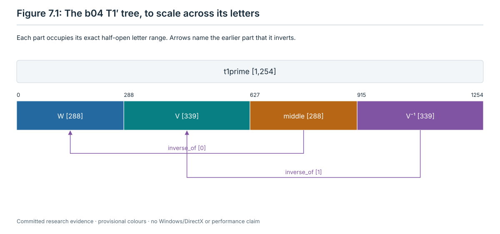
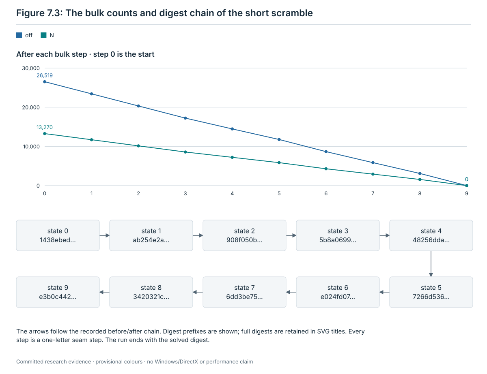

# 7. Records, trees and the independent check

This chapter says what the runner writes down for every step it plays, how a step's word and its tree of named parts
are stored, how a run's result and its acceptance verdict are computed, how acceptance mode differs from development
mode, and what the independent checker replays. Chapters 1 to 6 define the state, the phases and their rules. This
chapter refers to them by number and does not repeat them.

The record format is `runner-run/3` (`research/jumbling/restoration/13-tutorial-runner/scripts/runner_api.py:20`). The
runner is [runner.py](../restoration/13-tutorial-runner/scripts/runner.py) and its plugin interface is
[runner_api.py](../restoration/13-tutorial-runner/scripts/runner_api.py). Its three phase plugins are
[rules_height.py](../restoration/13-tutorial-runner/scripts/rules_height.py) (chapter 3),
[rules_kernel.py](../restoration/13-tutorial-runner/scripts/rules_kernel.py) (chapter 4) and
[lattice_phase.py](../restoration/13-tutorial-runner/scripts/lattice_phase.py) (chapter 6). The checker is
[check_run.py](../restoration/13-tutorial-runner/scripts/check_run.py) with its two helpers
[check_contracts.py](../restoration/13-tutorial-runner/scripts/check_contracts.py) and
[check_lattice.py](../restoration/13-tutorial-runner/scripts/check_lattice.py).

**Citations.** Code citations give `path:line` from the repository root. Every line number refers to commit
`35c3d4f`, unless a later commit is named beside the citation. After its first full citation, a file is named by its
short name:

| Short name | Path |
| --- | --- |
| `runner.py`, `runner_api.py`, `rules_height.py`, `rules_kernel.py`, `lattice_phase.py`, `literal_lattice.py`, `check_run.py`, `check_contracts.py`, `check_lattice.py`, `test_runner.py`, `test_check_run.py`, `test_rules_height.py`, `test_lattice_phase.py` | `research/jumbling/restoration/13-tutorial-runner/scripts/` |
| `acceptance-config.json`, `README.md` (the stage 13 README), `runs/dev/d0-s7001/`, `runs/dev/d0-s7106/`, `runs/depth10-seed7001/`, `runs/depth20-seed7106/` | `research/jumbling/restoration/13-tutorial-runner/` |
| `verify_late.py` | `research/jumbling/restoration/09-general-method/scripts/lattice/checker/` |
| `METHOD.md` | `research/jumbling/restoration/09-general-method/` |
| `test_r22d25.py`, `r22d19_rule.py` | `research/jumbling/restoration/12-low-height/scripts/round22/` |
| `ch07_examples.py` | `research/jumbling/tutorial/scripts/` |
| `ch07-examples.json` | `research/jumbling/tutorial/records/` |

**The chapter's script and record.** [scripts/ch07_examples.py](scripts/ch07_examples.py) makes the examples of sections
7.6.2 and 7.12, and [records/ch07-examples.json](records/ch07-examples.json) keeps them (format
`tutorial-ch07-examples/1`, committed in `dd43945`). The script writes nothing into the repository. It runs the committed
runner and checker as child processes with `python3 -I -B`, in new directories given by `--work` and `--cache`. It uses
development seed 7001 and the committed R22D-36 word only. It checks the committed record `runs/dev/d0-s7001/run` and
four changed copies of it, runs the runner twice in development mode, and prints three trees with the runner's own tree
helper. Command, from the repository root:
`python3 -I -B research/jumbling/tutorial/scripts/ch07_examples.py --out <new file> --work <new dir> --cache <new dir>`.
The recorded run took 119.3 s on headless Linux with Python 3.13.16 and NumPy 2.5.3 (**measured**, record keys
`seconds` and `versions`). The record keeps selected source hashes: `runner.py`, `runner_api.py`, `check_run.py`,
`check_contracts.py`, `check_lattice.py`, `acceptance-config.json`, and the committed `run.json` and `check.jsonl` of
`runs/dev/d0-s7001`. It also keeps the sha256 of the repository's `git status` (ignored files included) before and
after the run; the two are equal. The runner and checker used for those examples match `cd5e6e8`; the checker includes
the later report-filename check described in Rule R7.9.

**Evidence labels.** **computed**: an exact computation with a replayable record or script. **proved (model review
only)**: a proof checked by models, not yet by a person. **run on one instance**: a result on the finite inputs named.
**measured**: a time or a count measured on one machine. A sentence that says what the code does is a reading of the
cited lines. Where tests exercise that code, they are named. The last recorded full stage 13 test run passed on
22 October 2026 on commit `cd5e6e8` (**measured**, finite inputs;
`research/jumbling/restoration/13-tutorial-runner/README.md:1078`, `:1124`, `:1157`, `:1172-1173` at `88dacaf`,
section 5). All nine test files passed. They were not run again for this chapter. Their timings are omitted here;
the numerical examples below come from the chapter's record or committed files under `runs/`.

## 7.1 Why the record exists

Five decisions shape the record.

| Decision | What it asks of the record |
| --- | --- |
| Owner, 18 October, item 3 ([page](../../../docs/wiki/decisions/owner-decisions-2026-10-18-machine-tutorial.md)) | The machine plays only literal words, twist by twist. A step that exists only as a certificate counts as stuck. Every step's length is recorded as it is. |
| Owner, 20 October, items 3 and 4 ([page](../../../docs/wiki/decisions/owner-decisions-2026-10-20-tutorial-acceptance.md)) | Every word is played literally, the lattice phase included. A step known only by a certificate counts as stuck, and a step of the exhaustive fallback counts as a failure of coverage. Every step records the rule that fired, the word, its length and the digests before and after. An independent checker that shares no code with the runner replays every record twist by twist. |
| Owner, 20 October, item 5 (same page) | A batch passes when every one of its scrambles reaches the solved state and the checker passes every record (section 7.8.1). |
| Reading 1 of 20 October, accepted by the owner the same day (same page, "Two readings") | The checker shares only the definition of the puzzle (section 7.11.1). |
| The integrator's reading, accepted with the owner's content decision of 20 October (same page) | The owner asked for detailed illustrations and for every macro to expand down to single twists. The integrator read this as a tree of named parts with their lengths for every step. The runner records the tree, and the checker checks that it expands to exactly the word it replays. |

The record is what makes a run checkable by a second program. The checker reads the record, the files it names, two
files of its own checkout (`acceptance-config.json` and the D19 rule) and the puzzle definition. It plays every letter
again on the exact simulator.

## 7.2 The run directory

The runner writes into one directory, given by `--out`. The directory must be new or empty
(`research/jumbling/restoration/13-tutorial-runner/scripts/runner.py:1655-1656`), and its path may not contain `.json`
(`runner.py:388-389`, `:1617-1618`).

Two kinds of path occur in the record:

- Paths to the run's own files are relative to the run directory (`runner.py:435-436`). The checker requires each to
  stay inside it (`research/jumbling/restoration/13-tutorial-runner/scripts/check_run.py:130-139`, `:148-170`).
- Three configuration paths are relative to the repository: `config.acceptance_config.file` (`runner.py:157`),
  `config.kernel.d19.file` (`runner.py:477`) and the keys of `config.scripts` (`runner.py:490-491`). The checker
  compares the first two with the paths of its own checkout (`check_run.py:79`, `:84`; section 7.11.2) and checks only
  the spelling of the third (`check_run.py:159-166`).

| Path | What it holds | Written by | Read by the checker |
| --- | --- | --- | --- |
| `run.json` | The record. Rewritten atomically after every step and at every phase end. | `runner.py:438-443`, `:89-98` | yes |
| `start-table.json` | The start state as a pose table. | `runner.py:457` | yes |
| `tables/bulk-end.json` | The state where the bulk ended. Written at the start, rewritten by the bulk child after every bulk step, and exported again at the bulk's end. | `runner.py:458-459`, `:1568`, `:612` | yes |
| `tables/NNNNN.json` | The state after step `NNNNN`: every height, high, tail and fallback step; in the lattice phase only its last step. | `runner.py:757-758`, `:1206-1210`, `:1451-1453` | yes |
| `words/NNNNN.json` | The word of step `NNNNN` as JSON letters; `words/NNNNN.json.gz` above 100,000 letters. | `runner.py:726-730`, `:1201-1204`, `:1565-1567` | yes |
| `words/NNNNN.ia16.gz` | The word of a lattice step as `ia16` codes (section 7.5). | `research/jumbling/restoration/13-tutorial-runner/scripts/lattice_phase.py:218-224`, moved at `runner.py:1441-1443` | yes |
| `step-trees/NNNNN.json.gz` | The tree of step `NNNNN` (section 7.6). | `runner.py:732-735`; lattice trees `lattice_phase.py:241-242`, moved at `runner.py:1442-1444` | yes |
| `units/NNNNN.json` | A copy of the unit a tail or fallback step landed. | `runner.py:1203-1205` | yes |
| `probe/word.json`, `probe/unit.json` | Acceptance mode only: the word the fallback found but did not play, and its unit (section 7.9). | `runner.py:1246-1255` | yes |
| `lattice/report.json` | The lattice plugin's report; its sha256 is in `phases.lattice.report`. | `runner.py:1386-1390` | yes |
| `lattice/library-merged.json`, `lattice/restore-summary.json` and the other files of the composition path | Only when a stub lattice plugin answered (section 7.11.5). | `runner.py:1329-1350` | through `research/jumbling/restoration/09-general-method/scripts/lattice/checker/verify_late.py` |
| `bulk-progress.json` | The bulk child's heartbeat, read for the bulk step clock. | `runner.py:575`, `:1549`, `:1581-1582` | no |
| `attempts/` | Working files of every rule, census and gate call. | `runner.py:636`, `:1269` | no |
| `logs/` | Child logs, `logs/bulk.log`, and after an error `logs/runner.log` with the traceback. They can name absolute paths and are scrubbed before publication. | `runner.py:512`, `:579`, `:1482` | no |
| `cache/` | The simulator cache, only when `--cache` is not given. | `runner.py:390` | no |

`NNNNN` is the step's index in `steps`, written with five digits. The index counts all steps of the run, from 0. The
runner makes the directories `words`, `units`, `tables`, `attempts`, `logs` and `step-trees` at once, so some may stay
empty (`runner.py:391-392`). On the composition path the checker writes its own `check/` directory (section 7.11.5).

## 7.3 The record file

`run.json` has these top-level keys (`runner.py:478-504`).

| Key | Content |
| --- | --- |
| `format` | `runner-run/3`. |
| `menu` | `I_a`. |
| `start` | How the start was made (`kind: scramble` with `k` and `seed`, or `kind: table` with `file: start-table.json`), and its snapshot: `digest`, `off`, `heights`. |
| `config` | The run's configuration (table below). |
| `phases` | One block per phase in the fixed order, with results, step counts, twists, start and end snapshots (section 7.7). |
| `steps` | One row per step, in played order (section 7.4). |
| `stuck` | Null, or the state where the tail or the lattice phase found no step (section 7.7). |
| `lattice` | Null. It is set only on the composition path of a stub lattice plugin (section 7.11.5). |
| `result` | `solved`, `stuck`, `budget` or `error` (section 7.7). |
| `error` | Null, or the reason of an error. A reason that contains `/` or `\` is replaced by `see child log`, and a signal gives `signal N` (`runner.py:101-103`, `:1485`). |
| `acceptance` | `verdict`, `certificate_steps`, `fallback_steps`, `probe`, `timed_out_attempts` (section 7.8). |
| `totals` | `bulk_twists`, `height_twists`, `high_twists`, `tail_twists`, `fallback_twists`, `lattice_twists`, `seconds`. `lattice_twists` is null until the lattice phase plays or schedules nothing. |

The keys of `config` (`runner.py:479-491`):

| Key | Content |
| --- | --- |
| `literal_only` | Always true. |
| `mode` | `acceptance` or `development` (section 7.9). |
| `component` | Null, or the first reason the run is only a component run (section 7.8). |
| `bulk_order` | The seven bulk rules in order: `seam`, `cover`, `close`, `conj`, `lock`, `improve`, `shift`. No `reopen` (chapter 2; `runner.py:46-48`). |
| `phase_order`, `subphase_order` | `bulk`, `height`, `high`, `tail`, `lattice`; and `{"height": ["r22d75", "r22d81", "h4"]}`. |
| `tail_rules` | The tail rules in order. The default and the acceptance value are `zero_bad`, `pure`, `close`, `t1prime` (chapter 5). |
| `budgets` | Fourteen values: the step budgets `bulk_steps`, `tail_steps` and `high_steps`; the eight clocks of section 7.10; `pair_shards`, `fallback_max_length` and `par` (`runner.py:460-463`). `bulk_seconds` 0 and `tail_steps` 0 mean no budget and are recorded as null in both modes (`runner.py:464-465`). In acceptance mode the eight clocks are null (`runner_api.py:124-127`). |
| `clock_sentinel` | 10⁹ in acceptance mode, null in development mode (`runner.py:484`). |
| `kernel` | `seconds` (null in acceptance mode), `wall_margin`, `d19` (`file` and `sha256` of the D19 rule that the high plugin names) and `max_steps: 1` (chapter 4; `runner.py:469-477`, `:485-486`). |
| `lattice` | `restorer`: `schedule11`, the default and the only value acceptance mode accepts; or `late`, in development mode only, with `--lattice-restorer late` (chapter 6; `runner.py:1608-1609`, `:153-156`). |
| `literal_limit`, `seeds` | Limits of the certificate path of the tail: 10,000,000 letters and `atlas` by default (chapter 5). |
| `acceptance_config` | Acceptance mode: `file` (repository-relative), `sha256` and `options` of `acceptance-config.json`. Null in development mode (`runner.py:157-158`, `:488`). |
| `source` | `commit`; `status_sha256`, the sha256 of the output of `git status --porcelain=v1 --untracked-files=all -- research/jumbling`; and `dirty`, true when that output is not empty. Taken before the run writes anything (`runner.py:130-142`, `:448`). |
| `scripts` | The sha256 of every script the steps depend on, keyed by repository-relative path: the runner's own list (`runner.py:74-81`) and each plugin's `SCRIPTS` (`runner.py:466-467`, `:490-491`). |

In the committed acceptance record of seed 7001 (section 7.12.1), `scripts` has 49 entries: 22 from the runner's list
and 27 more from the plugins' lists of 8 (`rules_height`), 10 (`rules_kernel`) and 12 (`lattice_phase`) paths, after
three paths named twice (`restore_lattice_late.py`, `eb6.py`, `runner_api.py`) are merged. Every key is
repository-relative, and every sha256 equals that of the file in the checkout (**computed**, `ch07-examples.json`, key
`A_d0.scripts`).

## 7.4 What every step records

Every step is one row of `steps`. Four writers write rows, and the row keys differ a little by phase.

### Rule R7.1: record a step

**Reads.** The current state; the proposed word with its claimed end digest; the step's phase, sub-phase, rule,
contract, gate, standing, attempts and tree; for a tail step, the unit and the gate's evidence (chapter 5); for the
lattice phase, the plugin's word files, trees, end table and report (chapter 6).

**Order.** The writers, by phase:

| Phase | Writer | Who plays the word | Lines |
| --- | --- | --- | --- |
| bulk | the bulk child writes the row | the bulk child; the runner then replays every bulk word from the start table | `runner.py:1516-1583`, `:604-609` |
| height, high | `record_step` | the runner | `runner.py:737-766` |
| tail, fallback | `advance` | the runner; a development-mode certificate step loads the gate's end table instead | `runner.py:1178-1231` |
| lattice | `played_lattice` | the lattice plugin's child, through the literal player; the runner loads the end table | `runner.py:1392-1461` |

**Test.** Before a row is written:

1. The word is literal: a list of letters `[grip, item]` with integers 0 ≤ grip < 600 and 0 ≤ item < 60, and the word
   document has no key `segments`, `slp` or `certificate` (`runner.py:204-224`). A certificate never enters the record.
2. The word's input digest is the current digest, and the word claims an output digest (`runner.py:747-749`; tail and
   fallback steps take the gate's end digest, `:1187`; bulk steps their own before and after digests, `:1567`).
3. A plugin's proposal (height and high) matches its phase and sub-phase; its standing is `rule`, `certificate` or
   `fallback`; its own fields reuse no row key (`ROW_KEYS`, `runner.py:72-73`) and no forbidden key (`segments`,
   `slp`, `certificate`, `node`); and every attempt has a boolean `timed_out` (`runner.py:740-743`).
4. The tree is well formed for the word's length (Rule R7.3). Height and high steps check it before the word is played
   (`runner.py:751-752`). Tail, fallback and bulk steps check it when the tree file is written, after the word was
   played (`runner.py:1212`, `:1571-1573`). Lattice steps check the plugin's tree file (`runner.py:1427-1429`).
5. The word is played twist by twist by `Mechanics.apply_word` (`runner.py:289-298`): every twist must be admitted and
   certain, and the end digest must equal the claimed one. Bulk words are played by the bulk child and replayed by the
   runner (`runner.py:604-609`). Two kinds of step load an end table instead of being played by the runner: a
   development-mode certificate step (`runner.py:1189-1192`; section 7.9) and the lattice steps, which the plugin's
   child played (`runner.py:1395-1397`, `:1433-1437`). The checker replays both.
6. Tail and fallback steps. Before the word: the unit's pieces are distinct, there are `unit_size` of them, and all of
   them are off (`runner.py:1184-1186`). After the word: the off count equals the gate's count, the gate's end table
   has the played digest, and the off set is inside the off set before the step minus the unit
   (`runner.py:1196-1200`).
7. Bulk steps: the word is not empty and N strictly decreases (`runner.py:1562-1563`).
8. Lattice steps, for each row in order (`runner.py:1418-1437`): the labels are `lattice_literal`, `player`, `rule` and
   `ia16`; the rule begins with `lattice/`; `before` equals the previous row's `after` (the first equals the current
   state); `after` is a lattice snapshot (`off` 0, `heights` empty); the row's own fields reuse no row key and no
   forbidden key; `seconds` is finite and not negative; the `ia16` file's sha256 and length match the row; the tree's
   sha256 and size match the row. Then the last row has `labels_identity: true`, and the end table has the last
   `after` digest and loads to that snapshot. A lattice phase with no row must have scheduled and played nothing,
   kept the state, and reported identity labels, and the runner's own label test must pass (`runner.py:1403-1411`).

**Step played (tree).** The word file and the tree file are written, the row is appended and `run.json` is saved. The
state after the step is kept as a table:

| Phase | Table |
| --- | --- |
| bulk | no table per step; the bulk child rewrites `tables/bulk-end.json` after every step (`runner.py:1568`) |
| height, high | `tables/NNNNN.json`, exported from the played state (`runner.py:757-758`) |
| tail, fallback | `tables/NNNNN.json`: exported from the played state in acceptance mode, a copy of the gate's end table in development mode (`runner.py:1206-1210`) |
| lattice | only the last row has a table: the plugin's end table, moved to `tables/NNNNN.json` (`runner.py:1451-1453`) |

The row's keys:

| Key | bulk | height | high | tail | fallback | lattice |
| --- | --- | --- | --- | --- | --- | --- |
| `index`, `phase`, `subphase`, `rule` | yes | yes | yes | yes | yes | yes |
| `word`, `letters`, `encoding`, `word_sha256` | yes, `json` | yes, `json` | yes, `json` | yes, `json` | yes, `json` | yes, `ia16` |
| `tree` (`file`, `sha256`, `size`) | yes | yes | yes | yes | yes | yes |
| `standing` | `rule` | `rule` | `rule` | `rule`, or `certificate` in development mode | `fallback` | `rule` |
| `before`, `after` | `digest`, `off`, `N` | `digest`, `off`, `heights` | same | same | same | same, with `off` 0 and `heights` empty |
| `contract` | none | the rule's name, for example `r22d75/T0` | `kernel_landing` or `kernel_lowering` | `strict_prime` | `fallback` | `lattice_literal` |
| `gate` | none | the rule program, for example `r22d75_from_snapshot` | `r22d25` | `stepchk` or `slp_apply` | `stepchk` | `player` |
| `attempts` | none | the plugin's attempts for the call, the call that gave the step included | `[]` | every failed attempt at this state (section 7.4.1) | same | `[]` |
| `table` | none | `tables/NNNNN.json` | same | same | same | last row only |
| `seconds` | yes | yes | yes | yes | yes | yes |
| Own fields | none | `tau_before`, `tau_after`, `u_before`, `u_after`, `rule_script`; `u_mid` on two-letter steps; `pair_choice` on `h4/pair` | `family`, `kind`, `target`, `params`, `high_exact`, `off_before`, `off_after`, `heights_after`, `kernel` (with `d19_sha256`) | `unit`, `unit_key`, `unit_size`, `landed`, `others_landed`; `parts` on closures and on a T1′ step of W alone; on closures `V_source`, `V_letters`, `V_sha256`; on certificate closures also `T_size`, `T_digest`, `N1`, `N2`, `construction`, `certificate_sha256` | `unit`, `unit_key`, `unit_size`, `landed`, `others_landed` | `orbit`, `factor_first`, `factor_count`, `tree_folded`, `tree_folded_depth`; or `correction`, `macro`, `family`, `times`, `inverse`, `macro_letters`; `labels_identity` on the last row |

Sources: bulk `runner.py:1574-1577`; height and high `runner.py:759-764`,
`research/jumbling/restoration/13-tutorial-runner/scripts/rules_height.py:154-195`, `:345-351`, `:469-475`,
`research/jumbling/restoration/13-tutorial-runner/scripts/rules_kernel.py:30-31`, `:204-214`; tail and fallback
`runner.py:1215-1228`, `:929-945`, `:1011-1013`; lattice `runner.py:1445-1453`,
`lattice_phase.py:253-254`, `:271-273`, `:310`.

The `letters` key is the step's length: the number of twists in its word. It is recorded as it is, however large
(18 October, item 3).

**Contract.** After the row is saved, the state is the state the word reaches from the state before it, and the row's
`after` is its snapshot. The contract named in the row is the one the phase's chapter states: the bulk's decrease of N
(chapter 2; not written as a key), the height contracts (chapter 3), the kernel contracts (chapter 4), strict′ and the
fallback contract (chapter 5), and `lattice_literal` (chapter 6).

**No step.** Any failed test raises an exception, and no row is written for that step. The run ends `error`; the steps
before it stand (`runner.py:1479-1486`; section 7.7). For a tail, fallback or bulk step whose tree fails (item 4), the
state has already changed and the word, unit and table files may exist; the record is not saved with them, and the run
ends `error`.

**Evidence.** Reading of the code. Tests: `research/jumbling/restoration/13-tutorial-runner/scripts/test_runner.py` (`RecordTests`, `PhaseTests`, `LatticeTests`,
`IntegrityTests`, `ExactTests`, `LatticeEndToEndTests`). The committed records of seeds 7001 and 7106 and the
chapter's development and height records carry rows of the bulk, height and lattice kinds and pass the checker (**run
on one instance**, section 7.12).

**Where in the code.** `runner.py:737-766` (`record_step`), `:1178-1231` (`advance`), `:1392-1461`
(`played_lattice`), `:1516-1583` (`bulk_child`), `:204-224` (`literal`), `:289-298` (`apply_word`).

### 7.4.1 Attempts

An attempt is one recorded call of a rule, a gate or a child program. In the tail an attempt is a call that did not give
the step. A height plugin also records the call that gave the step, with `outcome: step` (section 7.12.3). Every
attempt carries a boolean `timed_out`: true when any clock ended it (`runner.py:166-170`). Tail attempts also carry
`unit_key`, `rule`, `seconds`, `outcome`, `reason` and, where the rule read them, `N1`, `N2`, `deficits`, `T_size`,
`T_digest`, `V_length` (`runner.py:161-163`, `:1070-1074`). The tail's outcomes are listed in chapter 5. Plugin
attempts carry the plugin's own keys; a height attempt has `script`, `tag`, `shard`, `outcome`, `reason`, `rc`,
`seconds`, `stopped` and `timed_out` (`rules_height.py:375-389`).

Where attempts are kept:

| Place | Which attempts | Lines |
| --- | --- | --- |
| a tail or fallback row's `attempts` | every failed attempt at the state of that step: the attempts of the units tried in order, up to and including the unit that gave the step, with that unit's rules that failed before the rule that fired. With `--par` above 1, a unit with a timed-out attempt is tried again serially and its new attempts are added; when such a retry gives the step, the list also holds the attempts of the units after it. | `runner.py:1116-1159` (`:1133`, `:1135-1137`, `:1149-1156`), `:1222` |
| a height row's `attempts` | the plugin's attempts for the call that gave the step, that call included | `rules_height.py:375-466`, `:469-475` |
| a high row's `attempts` | none: the kernel plugin passes no attempts with its proposal | `rules_kernel.py:212-214` |
| a lattice row's `attempts` | none | `runner.py:1449` |
| `phases.height.sub.<name>.attempts`, `phases.high.attempts` | the attempts of the plugin's `End` that closed the sub-phase or phase; after a signal during a call, the attempts of that call | `runner.py:690-691`, `:661-665` |
| `phases.lattice.attempts` | the attempts of a lattice `End`; after a signal, those of the cut call | `runner.py:1377`, `:1313-1317` |
| `stuck.units[k].attempts` | every attempt at the final state for unit k; a failed fallback attempt goes to `stuck.units[0]` | `runner.py:1134`, `:1279-1280`, `:1286-1288` |

A signal (SIGTERM or SIGHUP) during a lattice child cancels it. The plugin then returns one attempt,
`{rule: lattice/<restorer>, outcome: error, reason: cancelled, timed_out: false, seconds}`, which the runner keeps in
`phases.lattice.attempts`. The phase records no result, and the run ends `error` with `error: signal N`
(`lattice_phase.py:468-471`; `runner.py:1313-1317`, `:1479-1486`; `test_runner.py:3098-3130`).

## 7.5 Words: `json` and `ia16`

### Rule R7.2: write and read a word

**Reads.** The step's letters, its input digest and its output digest.

**Order.** Two encodings:

| Encoding | Used by | File | Content | `word_sha256` |
| --- | --- | --- | --- | --- |
| `json` | every step outside the lattice phase | `words/NNNNN.json`, or `.json.gz` above 100,000 letters | `{"word": [[grip, item], ...], "input_digest": ..., "output_digest": ...}`, written as `json.dumps(doc, indent=1)` and a newline, in UTF-8; the `.gz` form is gzip with mtime 0 of the same bytes | sha256 of `json.dumps(letters)` with Python's default separators (`", "` and `": "`), in ASCII |
| `ia16` | lattice steps | `words/NNNNN.ia16.gz` | gzip with mtime 0 of little-endian unsigned 16-bit codes, one per letter: code = 60 · grip + item | sha256 of the uncompressed bytes |

Sources: `runner.py:89-98`, `:106-107`, `:726-730`; `runner_api.py:226-290`.

A `json` word's hash is taken over the letters only, not over the file's bytes. The file is written with an indent, so
its bytes differ from the hashed string. An `ia16` file holds no digests: the row's `before` and `after` carry them.

**Test.** A letter is valid when grip and item are integers with 0 ≤ grip < 600 and 0 ≤ item < 60. An `ia16` code is
valid when it is below 600 · 60 = 36,000 (`runner_api.py:31`, `:228-231`, `:247-248`). An `ia16` file is gzip with
mtime 0 (its bytes 4 to 7 are zero) and holds whole 16-bit codes (`runner_api.py:268-290`). Decoding is
grip = code div 60, item = code mod 60 (`research/jumbling/restoration/13-tutorial-runner/scripts/check_lattice.py:93`).

**Step played (tree).** The word itself is the leaf level of every tree: each span of the tree names a range of these
letters (section 7.6).

**Contract.** Reading the file and hashing it as above gives the row's `word_sha256` and `letters`.

**No step.** The runner writes no word that fails these tests; it raises, and the run ends `error`. A word file that
does not match its row fails the checker (`word_file`, `word_literal`, `word_digest`, `word_sha256`, `letters`, and
`encoding` for a lattice row that is not `ia16`).

**Evidence.** Reading of the code. Example (**computed**, `ch07-examples.json`, key `A_d0`): step 0 of the committed
seed 7001 record has the word `[[72, 18]]`, and the sha256 of the string `[[72, 18]]` is
`29f68591e0449ffcaa85682de50e992a4f2d8a8439335e3835a21c54ca9e6e9e`, the row's `word_sha256`. The chapter's script
recomputed the `word_sha256` of all nine rows from their files, and each equals the row's.

**Where in the code.** Writers: `runner.py:726-730`, `runner_api.py:234-265` (`Ia16Writer`). Readers:
`runner_api.py:268-290` (`ia16_digest`, the runner's own check); in the checker, `check_run.py:498-520`
(`load_word_v3`, which reads a `json` word before the replay and checks its `word_sha256`) and `check_lattice.py:45-96`
(`ia16_chunks`, `ia16_info`, `read_ia16`). A lattice row's `ia16` word is read only during the replay, by
`check_lattice.replay_lattice_step` (section 7.11.4).

## 7.6 Step trees

Each step's word is shown as a tree of named parts, each with its length. Every part expands to its parts and finally
to the twists played (the integrator's reading of the owner's content decision of 20 October 2026; section 7.1).

### Rule R7.3: write a tree

**Reads.** The step's word length and the tree its rule gives. A height or high step whose rule gives no tree gets one
span named by the rule (`runner.py:751`); the trees of the other phases are in section 7.6.1.

**Order.** A part is one of two kinds (`runner_api.py:130-162`):

- a group `{"name", "letters", "parts": [part, ...]}`, whose letters are the sum of its parts' letters;
- a span `{"name", "letters", "span": [from, to]}`: letters `from` to `to − 1` of the step's word.

A part may also carry one of:

- `inverse_of`: the index path from the root to an earlier part of the same length. This part's letters are that
  part's letters inverted (Rule R7.4).
- `same_as`: the index path to an earlier part with the same name and the same length. This part's letters are that
  part's letters. It marks a macro used again, so that the tutorial names it once.

The index path of a part is the list of child positions from the root: `[]` is the root, `[1]` its second child,
`[1, 0]` the first child of that.

**Test.** The runner checks (`runner_api.py:179-207`, `check_tree`):

1. Walking the parts depth first, children left to right, the spans tile the word: the first starts at 0, each starts
   where the one before it ended, and the last ends at the word's length.
2. Each span's `letters` is `to − from`; each group's `letters` is the sum of its children's.
3. The root's `letters` is the word's length.
4. The depth is at most 64, counting the root as depth 1 (`runner_api.py:29`, `:165-172`). Every name is a non-empty
   string.
5. No part has both `inverse_of` and `same_as`. The part named by a reference starts and ends before the referring part
   starts, and has the same length; for `same_as`, also the same name.
6. No part has a key `segments`, `slp`, `node` or `certificate` (`runner_api.py:30`).

The checker adds four rules that the runner's check does not test (section 7.11.3): a part has no keys other than
`name`, `letters`, `parts`, `span`, `inverse_of` and `same_as`; a group's `parts` list is not empty; the row's `tree`
has exactly the keys `file`, `sha256` and `size`; and `size` is the number of parts (`check_run.py:85`, `:529-531`,
`:561-567`, `:580-583`, `:593-594`). A plugin tree that breaks one of them is written by the runner and fails the
checker.

**Step played (tree).** The file `step-trees/NNNNN.json.gz` is gzip with mtime 0 of the compact JSON of the root
followed by a newline: `json.dumps(root, separators=(',', ':'), allow_nan=False)` and `\n`, in UTF-8. Keys keep the
order in which the helpers write them (`name`, `letters`, then `span` or `parts`, then a reference), and a character
outside ASCII is written as a `\u` escape (`⁻¹` as `\u207b\u00b9`). The row's `tree.sha256` is the sha256 of the
uncompressed bytes, and `tree.size` is the number of parts, the root included (`runner_api.py:210-214`).

**Contract.** The tree expands to exactly the step's word (Rule R7.4). The runner checks the structure only. The
checker checks the expansion: against the recorded `json` word before the replay, and against the `ia16` codes during
the replay for lattice steps (section 7.11.3).

**No step.** A malformed tree raises an error, and the run ends `error`. For height and high steps the error comes
before the state changes (`runner.py:751-752`). For tail, fallback and bulk steps it comes after the word was played
and its files written, but before the row is saved (`runner.py:1212`, `:1571-1573`). For lattice steps it comes before
any file is moved into the record (`runner.py:1427-1429`).

**Evidence.** Reading of the code. Tests: `test_runner.py` (`TreeTests`, `test_runner.py:1615`: malformed trees
refused; a closure's tree names V and its inverse), `research/jumbling/restoration/13-tutorial-runner/scripts/test_check_run.py` (`test_v3_tree_failures`, `:1320`;
`test_v3_tree_same_as`, `:1378`), `research/jumbling/restoration/13-tutorial-runner/scripts/test_lattice_phase.py` (orbit and correction trees, `:505-561`). A changed tree
fails the checker (**run on one instance**, section 7.12.4).

**Where in the code.** `runner_api.py:130-223`; `runner.py:732-735`, `:751-752`, `:1233-1244`, `:1569-1573`;
`lattice_phase.py:136-201`; `check_run.py:523-615`.

### Rule R7.4: expand a tree to single twists

This is the procedure a reader follows to go from a tree to the twists played.

1. Start at the root. Visit the parts depth first, children in order.
2. A span `[from, to]` stands for letters `from` to `to − 1` of the step's word file.
3. A group stands for its children, in order.
4. A part with `same_as p` has the letters of the earlier part at path `p`.
5. A part with `inverse_of p` has the letters of the earlier part at path `p`, inverted: the letters in reverse order,
   each letter `(c, i)` replaced by `(c, i′)`, where `i′` is the menu item whose exact matrix is the transpose of item
   `i`'s matrix. The grip `c` does not change (`runner.py:300-303`; `check_run.py:440-443`, `:610-615`).
6. The concatenation of the spans, in the order of step 1, is the word. Steps 4 and 5 say how a repeated or inverted
   part relates to the part it names; the span still points into the word, so the word file holds every twist.

### 7.6.1 The trees of each rule

The tree depends on the phase, the rule and, for bulk and height steps, the word's length.

| Phase | Step | Tree | Lines |
| --- | --- | --- | --- |
| bulk | rule `conj` with a word of exactly three letters | `conj` → `x` (1), `y` (1), `z` (1) | `runner.py:1569-1572` |
| bulk | every other step, `conj` with a word of another length included | one span named by the rule | `runner.py:1571-1572` |
| height | a word of exactly two letters (for example `r22d88/U2`, `h4/pair`) | rule → `first letter` (1), `second letter` (1) | `rules_height.py:471` |
| height | a word of any other length | one span named by the rule | `rules_height.py:471`; `runner.py:751` |
| high | family `ST` (`r22d25/ST`) | rule → `S` (s), `T` (t), with s = `params.S_length` and t = `params.T_length`, both at least 1, s + t the word's length | `rules_kernel.py:122-126` |
| high | every other family | one span named by the rule | `rules_kernel.py:127-128` |
| tail | `zero_bad`, `pure` (no parts) | one span named by the rule | `runner.py:1236-1237` |
| tail | `close` | `close` → `V`, `middle`, `V⁻¹` (`inverse_of [0]`) | `runner.py:1238-1244` |
| tail | `t1prime` with a closure | `t1prime` → `W`, `V`, `middle` (`inverse_of [0]`), `V⁻¹` (`inverse_of [1]`) | `runner.py:1238-1244` |
| tail | `t1prime` whose W alone passes strict′ | `t1prime` → `W` | `runner.py:1011-1013`, `:1244` |
| fallback | `fallback` | one span named `fallback` | `runner.py:1236-1237` |
| lattice | `lattice/orbit-o` | `orbit o` → `factor i` → the program's nodes (below) | `lattice_phase.py:136-194` |
| lattice | `lattice/correction-k-m` | `correction k` → `times` spans named `macro m <family>` (with `⁻¹` when the correction is inverted), each of the macro's length; every span after the first has `same_as [0]` | `lattice_phase.py:197-201` |

In a closure, `middle` is the core word P·Q·P⁻¹ of chapter 5 as one span. In a T1′ step the core is W⁻¹, so `middle`
names `W` by `inverse_of` (`runner.py:1024-1026`, `:1240-1242`).

**The tree of a lattice orbit step.** It follows the restorer's program (chapter 6; `research/jumbling/restoration/13-tutorial-runner/scripts/literal_lattice.py:115-160`). The
program has nodes j, each with an `op` (`word`, `path`, `conj` or `prod`) and a length; the `word` and `path` nodes are
the program's words. A step plays the factors `factor_first` to `factor_first + factor_count − 1` of its orbit, each a
pair (j, sign). The tree is built as follows (`lattice_phase.py:136-194`):

1. The root is a group `orbit o`. Its children are groups `factor i` for i = 0, 1, …, `factor_count − 1`; i counts
   within this step, and the program's factor number is `factor_first + i`. Each `factor i` has one child, the node of
   its factor, at depth 3 (the root has depth 1).
2. A node (j, sign) is named `<op> j`, with `⁻¹` appended when sign is negative.
3. Parts are made depth first, children in order, and each span takes the next letters of the word. For each node the
   first case that applies is used:
   1. (j, sign) was met earlier in this step, as a span or as a group: the node is a span with `same_as` the path of
      the first one (`:163-165`).
   2. j is a `word` or `path` node, or its length is 0: the node is a span (`:167-168`).
   3. The node is at depth 64: it is a span, and `tree_folded_depth` grows by 1 (`:169-171`).
   4. Otherwise its children are listed. For `conj`, with fields u, us and x, they are (u, −us), (x, sign) and
      (u, us). For `prod` they are its factors f in order when sign is positive, and in reverse order with each sign
      negated when sign is negative (`:172-175`).
   5. If the running part count plus the number of children would exceed 10⁶, the node is a span and `tree_folded`
      grows by 1 (`:176-178`). Otherwise the count grows by the number of children, and the node is a group of its
      children, each made by these cases at depth + 1. The third child of a `conj` is the exception: it is always a
      span with `inverse_of` the path of the `conj`'s first child, and it is never expanded (`:179-188`).
4. The running part count starts at 1 + 2 · `factor_count` (the root, the factor groups and their nodes). If that alone
   exceeds 10⁶, the whole tree is one span named `orbit o`, with `tree_folded` 1 (`:143-145`).
5. The row records `tree_folded` and `tree_folded_depth`, and the lattice report sums them over the phase
   (`lattice_phase.py:253-254`, `:570-580`).

### 7.6.2 Examples

**Three tail trees.** These come from the runner's own tree helper (`runner.py:1233-1244`), called by the chapter's
script with the part lengths that `test_runner.py` asserts for three steps of stage 12's line (a) fixtures
(`ch07-examples.json`, key `E_trees`; **computed**). Two caveats apply to the steps themselves:

- In these tests the words W (b04, b07) and the core (b20) are read from stage 12's `replay2/inputs` files and passed to
  `t1prime` or `close` directly. The tutorial's rules did not choose them at that state.
- b20 and b07 go through the gate `slp_apply` in development mode, so their rows have `standing: certificate`
  (asserted for b20 at `test_runner.py:2810`). Such a step gives the verdict `stuck` (section 7.8, row 3); in
  acceptance mode it would be played with `standing: rule`.

The steps are test results in development mode (**run on one instance**, in the test run of 22 October 2026 on
`cd5e6e8`).

The T1′ step for the unit b04 at the state of 437 off pieces (`test_runner.py:2738-2775`,
`test_03_stored_literal_t1prime`, which asserts this tree at `:2773-2775`): 1,254 letters, from 437 to 392 off; size
5; sha256 `24f8659857bb9938de44c7d07e1a4f62be7f7309050e2735f9b708b241350304`.

```json
{"name": "t1prime", "letters": 1254, "parts": [
  {"name": "W",      "letters": 288, "span": [0, 288]},
  {"name": "V",      "letters": 339, "span": [288, 627]},
  {"name": "middle", "letters": 288, "span": [627, 915],  "inverse_of": [0]},
  {"name": "V⁻¹",    "letters": 339, "span": [915, 1254], "inverse_of": [1]}]}
```

The file holds this tree in the compact form of Rule R7.3, with `V\u207b\u00b9` for `V⁻¹`.

The closure for b20 at the state of 507 off, whose V is built as a certificate and expanded (`test_runner.py:2787-2810`,
`test_05_certificate_closure_at_current_state`): V 20,232, middle 36, V⁻¹ 20,232 (`inverse_of [0]`); 40,500 letters;
from 507 to 447 off; size 4; sha256 `d8c15bdfd26794501667cecdb064d1769cf251772191619db825a60aaa085985`.

The T1′ step for b07 at the state of 324 off (`test_runner.py:2812-2830`, `test_06_certificate_t1prime_at_z1`): W 48,
V 139,774, middle 48 (`inverse_of [0]`), V⁻¹ 139,774 (`inverse_of [1]`); 279,644 letters; from 324 to 213 off; size 5;
sha256 `1e4eb4dc5e4cb138211d162920379135f2320c9c168991133817264b327b1e43`.



**A lattice orbit tree.** Row 19 of the committed record of section 7.12.2 (`runs/dev/d0-s7106/run`,
`step-trees/00019.json.gz`): rule `lattice/orbit-6`, 194 letters, `factor_first` 0, `factor_count` 4, tree size 24,
sha256 `7ec1f0e9ee9b664975a9ae57c07de743e93c0d42207ff0d9ef0f925336259769`, nothing folded (**run on one instance**;
read from the committed file). Each factor is a `conj` whose middle child is the same `conj 2`; factors 1 to 3 name it
by `same_as [0, 0, 1]`. The nodes `word 1⁻¹` and `word 1` have length 0 and are empty spans.

```json
{"name": "orbit 6", "letters": 194, "parts": [
 {"name": "factor 0", "letters": 48, "parts": [
  {"name": "conj 106", "letters": 48, "parts": [
   {"name": "word 105⁻¹", "letters": 10, "span": [0, 10]},
   {"name": "conj 2", "letters": 28, "parts": [
    {"name": "word 1⁻¹", "letters": 0, "span": [10, 10]},
    {"name": "word 0", "letters": 28, "span": [10, 38]},
    {"name": "word 1", "letters": 0, "span": [38, 38], "inverse_of": [0, 0, 1, 0]}]},
   {"name": "word 105", "letters": 10, "span": [38, 48], "inverse_of": [0, 0, 0]}]}]},
 {"name": "factor 1", "letters": 46, "parts": [
  {"name": "conj 108", "letters": 46, "parts": [
   {"name": "word 107⁻¹", "letters": 9, "span": [48, 57]},
   {"name": "conj 2", "letters": 28, "span": [57, 85], "same_as": [0, 0, 1]},
   {"name": "word 107", "letters": 9, "span": [85, 94], "inverse_of": [1, 0, 0]}]}]},
 {"name": "factor 2", "letters": 50, "parts": [
  {"name": "conj 110", "letters": 50, "parts": [
   {"name": "word 109⁻¹", "letters": 11, "span": [94, 105]},
   {"name": "conj 2", "letters": 28, "span": [105, 133], "same_as": [0, 0, 1]},
   {"name": "word 109", "letters": 11, "span": [133, 144], "inverse_of": [2, 0, 0]}]}]},
 {"name": "factor 3", "letters": 50, "parts": [
  {"name": "conj 112", "letters": 50, "parts": [
   {"name": "word 111⁻¹", "letters": 11, "span": [144, 155]},
   {"name": "conj 2", "letters": 28, "span": [155, 183], "same_as": [0, 0, 1]},
   {"name": "word 111", "letters": 11, "span": [183, 194], "inverse_of": [3, 0, 0]}]}]}]}
```

The cases of section 7.6.1 give this tree. In `conj 106`, the first child (105, −1) is a word node, so it is a span;
the middle child (2, +1) is met for the first time and expanded; the third child is the span `word 105` with
`inverse_of [0, 0, 0]`. In factor 1 the middle child (2, +1) was met at path `[0, 0, 1]`, so it is a span with
`same_as [0, 0, 1]`. Parts: the root, 4 factor groups, 4 `conj` nodes, their 12 children and the 3 children of the
first `conj 2`, 24 in all.


## 7.7 Phase blocks, the stuck block and the run's result

`phases` has one block per phase (`runner.py:492-499`):

| Block | Keys |
| --- | --- |
| `bulk` | `result`, `steps`, `twists`, `end` (snapshot and `table: tables/bulk-end.json`) |
| `height` | `result`, `steps`, `twists`, `start`, `end`, and `sub` with `r22d75`, `r22d81`, `h4`, each `result`, `steps`, `start`, `end` |
| `high` | `result`, `steps`, `twists`, `start`, `end` |
| `tail` | `result`, `steps` |
| `lattice` | `result`, `steps`, `twists` (null until the phase plays or schedules nothing); `report` (`file`, `sha256`) after a played phase and after a phase that scheduled nothing |

A height sub-phase, the high phase or the lattice phase that a plugin's `End` closed also has `reason`, `details` and
`attempts` (`runner.py:690-691`, `:1377`). After a signal during a plugin call, the block keeps that call's
`attempts` and no result (`runner.py:661-665`, `:1313-1317`). A phase the run never reached keeps `result: null`.

The results of each block:

| Block | Result | When | Lines |
| --- | --- | --- | --- |
| `bulk` | `lattice` | N = 0: no piece is off | `runner.py:572-573`, `:1541-1544` |
| `bulk` | `stuck` | no bulk rule fires | `runner.py:1552-1558` |
| `bulk` | `budget` | `--bulk-steps` reached (0 skips the bulk); also the placeholder kept after a signal (section 7.8) | `runner.py:572-573`, `:1545-1547`, `:604-605` |
| `bulk` | `timeout` | a bulk clock ended the child (development mode only) | `runner.py:591-597` |
| height sub-phase, `high` | `not_applicable`, `handoff`, `lattice` | decided by the runner from the state: the entry test fails before any step, fails after a step, or no piece is off after a step | `runner.py:649-656`, `:670-671` |
| height sub-phase, `high` | `stuck`, `budget`, `timeout`, `error` | the plugin's `End`; a false `handoff` or `lattice` claim, or a real plugin's `not_applicable`, is an error | `runner.py:677-687`, `:701-702` |
| `height` | the first of `error`, `budget`, `timeout`, `lattice` among its sub-phase results; otherwise the last sub-phase result that is not `not_applicable`; otherwise `not_applicable` | | `runner.py:705-724` |
| `tail` | `not_applicable`, `lattice`, `stuck`, `timeout`, `budget` | no piece off at the start; every unit placed; no candidate and no timed-out attempt; no candidate with a timed-out attempt; the step budget reached | `runner.py:1257-1299` |
| `lattice` | `solved` | the plugin played its steps, or scheduled nothing | `runner.py:1403-1417`, `:1455-1461` |
| `lattice` | `stuck`, `budget`, `timeout`, `error` | the plugin's `End`; nothing was played, `steps` stays 0 and `twists` null | `runner.py:1369-1384` |

`runner_api.py:23` lists the phase results `lattice`, `handoff`, `not_applicable`, `stuck`, `budget`, `timeout` and
`error`. The lattice phase adds `solved`, which only it uses.

`stuck` is set when the tail stops with pieces off, or when the lattice plugin ends `stuck`. It holds the snapshot of
the final state (`digest`, `off`, `heights`), `phase` (`tail` or `lattice`), `reason` and `units`:

- In the tail, `reason` is `no_rule`, or `timeout` when an attempt at the final state timed out. `units` lists every
  unit tried, each with `unit_key`, `size` and `attempts`. In acceptance mode `probe` is added when the probe found a
  word (`runner.py:1284-1292`).
- In the lattice phase, `reason` is the plugin's and `units` is empty (`runner.py:1381-1382`).

### Rule R7.5: the run's result

**Reads.** The phase results, in the fixed order.

**Order.** The first match, in the order the phases run:

| Run result | When | Lines |
| --- | --- | --- |
| `error` | any exception: a crash, malformed child output, a digest mismatch, a false claim by a plugin, an `End('error')`, a signal | `runner.py:1479-1486`, `:701-702`, `:1378-1380` |
| `budget` | a height sub-phase or the high phase ends `budget` or `timeout`; the tail and the lattice phase are not entered | `runner.py:705-716`, `:1471-1473` |
| `budget` | the tail reaches `--tail-steps` | `runner.py:1264-1267` |
| `budget` | the tail stops with no candidate and a timed-out attempt at the final state (tail result `timeout`) | `runner.py:1284-1294` |
| `stuck` | the tail stops with no candidate and no timed-out attempt at the final state (tail result `stuck`) | `runner.py:1284-1294` |
| `solved` | no piece is off and the digest is the solved digest; the lattice phase is not entered | `runner.py:1302-1305` |
| `budget` | no piece is off, the state is not solved, and `--no-lattice` was given | `runner.py:1306-1309` |
| `solved` | the lattice plugin played its steps and they end with identity labels, or it scheduled nothing and the labels are the identity | `runner.py:1403-1417`, `:1455-1461` |
| `stuck` | the lattice plugin ends `stuck` | `runner.py:1381-1383` |
| `budget` | the lattice plugin ends `budget` or `timeout` | `runner.py:1383` |
| `error` | the composition path of a stub lattice plugin fails its verification (`lattice verification failed`, no exception) | `runner.py:1363-1366` |

The solved digest is `e3b0c44298fc1c149afbf4c8996fb92427ae41e4649b934ca495991b7852b855`, the sha256 of no bytes
(`runner.py:45`; `check_run.py:48`). A played lattice phase is solved by identity labels. Its end digest may differ from
the solved digest by rotations the labels do not see (chapter 6; `runner.py:1459`; section 7.12.2).

A `budget` or `timeout` of the bulk does not end the run. The later phases run, and the run becomes a component run with
reason `bulk_budget` (`runner.py:615-617`). A bulk that ends `stuck` does not end the run either and sets no component
reason: the height, high and tail phases start from its end state.

**Test.** Each run result is the first that applies. `run.json` starts with the placeholder `result: budget`
(`runner.py:500`), so a run killed in a way the runner cannot catch keeps `budget` (`README.md:1273-1274` at
`88dacaf`, RUN3-false-pass-01).

**Step played (tree).** None.

**Contract.** The checker recomputes the agreement of the phase results with the run's result (section 7.11.3).

**No step.** Not applicable.

**Evidence.** Reading of the code. Tests: `test_runner.py` (`PhaseTests`, `test_runner.py:1090`: one test per phase
result; `LatticeTests`, `:1391`; `LatticeEndToEndTests`, `:3074`), `test_check_run.py` (`test_v3_phase_order`,
`:1480`; `test_v3_omitted_phases`, `:1491`; `test_v3_interrupted_phase_entry`, `:1538`; `test_v3_lattice_ends`,
`:1836`).

**Where in the code.** `runner.py:1463-1492` (`run`), `:571-619` (`bulk`), `:642-724`, `:1257-1299`, `:1301-1461`.

## 7.8 The acceptance verdict

### Rule R7.6: compute the verdict

**Reads.** Only the record: `result`, `config.component`, every row's `standing`, the probe, and the attempts at the
final state.

**Order.** The counts first:

| Count | Value | Lines |
| --- | --- | --- |
| `certificate_steps` | rows with `standing: certificate` | `runner.py:1498` |
| `fallback_steps` | rows with `standing: fallback` | `runner.py:1499` |
| `probe` | set by the tail, and only when it stops with no candidate, in acceptance mode, with `fallback_max_length` above 0 and at least one unit: true when the probe found a word, false when the fallback ran and found none; null otherwise | `runner.py:1273`, `:1281-1292` |
| `timed_out_attempts` | attempts with `timed_out: true`, over all rows, the stuck units, the height sub-phases, the high phase and the lattice phase | `runner.py:1500-1506` |

The attempts at the final state are the stuck units' attempts, the attempts of every height sub-phase or high phase
whose `end` digest is the final digest, and the lattice phase's attempts. The final digest is the last row's `after`
digest, or the bulk's end digest when there is no row (`runner.py:1502-1511`).

Then the verdict is the first match (`runner.py:188-201`):

| Order | Verdict | When |
| --- | --- | --- |
| 1 | `error` | the result is `error` |
| 2 | `component` | `config.component` is set |
| 3 | `stuck` | some row has `standing: certificate` |
| 4 | `coverage_failure` | some row has `standing: fallback`, or the probe found a word |
| 5 | `budget` | the result is `budget`, or the result is `stuck` and an attempt at the final state timed out |
| 6 | `stuck` | the result is `stuck` |
| 7 | the result | otherwise; that is `solved` |

Why each row is where it is:

- Row 3: a development-mode step that loaded the gate's end table instead of playing its V twist by twist counts as a
  step known only by a certificate (18 October, item 3; 20 October, item 3).
- Row 4: the fallback is the exhaustive search; a step it finds means the tutorial's rules missed a step (20 October,
  item 3).
- Row 5: a stop where an attempt ran out of time is not shown to be exhausted (`README.md`, section 1, rule 4; R22D-55).
  So such a stop gives `budget` unless an earlier row applies: `error` (row 1), `component` (row 2), a certificate step
  (row 3, `stuck`), or a fallback step or probe word (row 4, `coverage_failure`). Row 6 never gives such a stop
  `stuck`. In acceptance mode no row has `standing: certificate` or `standing: fallback` (section 7.9).

`config.component` keeps the first reason only (`runner.py:412-414`): `bulk_budget` (section 7.7), `height_stub` or
`high_stub` (a stub plugin answered `not_applicable` where its entry test held, `runner.py:682-687`), or
`lattice_composition` (a stub lattice plugin, section 7.11.5). With the real plugins only `bulk_budget` can occur. In
acceptance mode the bulk has no step budget and no clock (section 7.9), so `bulk_budget` arises there only after a
signal during the bulk. The runner then kills the bulk child, keeps the placeholder bulk result `budget`, sets
`bulk_budget`, and ends the run `error` (`runner.py:584-587`, `:604-605`, `:610-618`). The verdict is then `error` by
row 1, but the record shows a bulk result `budget` that no budget caused.

**Test.** The verdict is computed at the end of every run, error runs included, in a `finally` block
(`runner.py:1487-1491`).

**Step played (tree).** None.

**Contract.** The checker recounts the block and computes the verdict again in the same order
(`check_run.py:844-899`). It fails `acceptance` when a count or the probe flag differs, and `verdict` when the
verdict differs.

**No step.** Not applicable.

**Evidence.** Reading of the code. Tests: `test_runner.py` (`test_component_run_that_ends_stuck_is_component`,
`:1255`; `test_verdict_order`, `:1286`; `test_probe_word_is_coverage_failure`, `:1307`), `test_check_run.py`
(`test_v3_verdict_timed_out_attempt`, `:1604`; `test_v3_verdict_earlier_timeout`, `:1622`; `test_v3_verdict_order`,
`:1629`; `test_v3_probe`, `:1700`).

**Where in the code.** `runner.py:188-201`, `:1273-1292`, `:1494-1513`; `check_run.py:844-899`.

### 7.8.1 What the acceptance test reads

The owner's pass condition is that every scramble of a batch reaches the solved state and the checker passes every
record (20 October, item 5). In terms of the record and the checker's output, a scramble passes when:

| Where | Value |
| --- | --- |
| `run.json` `start` | `kind: scramble` with the batch's `k` and `seed` |
| `run.json` `config.mode` | `acceptance` |
| `run.json` `config.acceptance_config.sha256` | the sha256 of the committed `acceptance-config.json`: `3e042b0b…` at the pinned commit, the file whose restorer is `schedule11` |
| `run.json` `result` and `acceptance.verdict` | `solved` |
| checker's final row `pass` | `true`, without `--allow-unchecked-contracts` |
| checker's final row `verdict` | `solved` |
| checker's final row `unchecked_contracts` | 0 |

Read both `pass` and `verdict`. When the checker replays the record to the end, it writes its own verdict even when
`pass` is false: in the changed copy b of section 7.12.4 the final row has `pass: false` and `verdict: solved` (**run
on one instance**). When the checker stops before the replay (Rule R7.9, step 4), its `verdict` and `end_digest` are
null (copies a, c and d). An exception can also leave them null if they have not yet been computed. The checker's
`end_digest` need not be the solved digest: a
played lattice phase ends with identity labels at a digest that may differ from it (section 7.12.2). This table is the
integrator's reading of item 5 for this chapter, not a separate owner decision.

## 7.9 Acceptance mode and development mode

`--mode acceptance` or `--mode development`; the default is development (`runner.py:1606-1607`).

### Rule R7.7: run in acceptance mode

**Reads.** The command line and `acceptance-config.json` (`runner.py:55-57`).

**Order.** In acceptance mode the runner reads `acceptance-config.json` before it writes any file of the record
(`runner.py:446-447`). It refuses to start when the file is malformed: not a JSON object, a `format` other than
`acceptance-config/1`, or `options` that are not exactly the eleven names below (`runner.py:150-152`). It refuses to
start when any of the eleven options differs from the file: `literal_limit`, `seeds`, `tail_rules`,
`lattice_restorer`, `fallback_max_length`, `par`, `pair_shards`, `bulk_steps`, `tail_steps`, `high_steps`, `no_lattice`
(`runner.py:153-156`). The file's values are the runner's defaults (`test_runner.py:1568-1579`,
`test_committed_options_are_the_defaults`), so `runner.py --scramble <k> <seed> --mode acceptance` needs no other
option:

| Option | Value |
| --- | --- |
| `literal_limit` | 10,000,000 |
| `seeds` | `atlas` |
| `tail_rules` | `zero_bad`, `pure`, `close`, `t1prime` |
| `lattice_restorer` | `schedule11` |
| `fallback_max_length` | 1 |
| `par` | 1 |
| `pair_shards` | 4 |
| `bulk_steps`, `high_steps` | null (no budget) |
| `tail_steps` | 0 (no budget) |
| `no_lattice` | false |

Source: `research/jumbling/restoration/13-tutorial-runner/acceptance-config.json`, sha256
`3e042b0b510dbe326a4195460173339e84dc66f615265bb5bee350bd90bf7d34` at the pinned commit (**computed**,
`ch07-examples.json`, key `sources`). The record keeps the file's repository-relative path, its sha256 and its options
in `config.acceptance_config` (`runner.py:157-158`, `:488`). So `--mode acceptance --lattice-restorer late` is
refused. The late restorer runs only in development mode, with `--lattice-restorer late`.

**Test.** The two modes differ in these points:

| Point | Development | Acceptance | Lines |
| --- | --- | --- | --- |
| The eleven options | any valid values | the values of `acceptance-config.json`; others are refused | `runner.py:145-158` |
| A malformed `acceptance-config.json` | not read | refused before any file of the record is written | `runner.py:150-152` |
| `config.acceptance_config` | null | `file`, `sha256`, `options` | `runner.py:488` |
| The runner's own clocks (`bulk_seconds`, `bulk_step_seconds`, `rule_seconds`, `height_seconds`, the kernel wall clock) | as given | off | `runner_api.py:107-109`; `runner.py:553`, `:591-592` |
| Child clock arguments | as given | the sentinel 10⁹ s | `runner_api.py:111-121` |
| `config.budgets` | every value as given (`bulk_seconds` 0 and `tail_steps` 0 recorded as null) | the eight clocks null | `runner.py:460-465`, `:483`; `runner_api.py:124-127` |
| `config.clock_sentinel` | null | 10⁹ | `runner.py:484` |
| `config.kernel.seconds` | `--kernel-seconds` | null | `runner.py:485` |
| `config.kernel.d19` | recorded when the high plugin names a D19 file; the checker accepts null | recorded; the checker requires it | `runner.py:469-477`; `check_run.py:326-337` |
| A closure whose V is built from a certificate and expanded within `literal_limit` | gate `slp_apply`; the runner loads the gate's end table; `standing: certificate`; `construction: certificate` with `certificate_sha256` | gate `slp_apply`; the runner plays the word twist by twist; `standing: rule`; `construction: certificate` with `certificate_sha256` | `runner.py:929-998`, `:1188-1195`, `:1213-1214`, `:1227-1228` |
| The table of a tail or fallback step | a copy of the gate's end table | an export of the played state | `runner.py:1206-1210` |
| A closure whose certificate is incomplete (not on a clock), rejected by its checker, or over `literal_limit` | `no literal closure` or `over literal limit` | `certificate_needed` | `runner.py:408-410`, `:851-927` |
| Fallback | plays a step, `standing: fallback` | runs once, for the first unit, as a probe when no rule gives a step; its word is written to `probe/` and never played | `runner.py:1273-1283` |
| The checker: `budgets.cert_seconds` | a positive number | null | `check_run.py:355-360` |
| The checker: `acceptance_config` | must be null | must match the checkout's file | `check_run.py:297-323` |
| The checker: a `probe` in the stuck block | fails `probe` | replayed under the fallback contract | `check_run.py:1423-1428`, `:908-943` |
| The checker: standings | `certificate` exactly on `slp_apply` rows; `fallback` exactly on fallback rows | neither may occur | `check_run.py:470-474` |

The certificate path and the tail's outcomes are in chapter 5. In both modes the gate `slp_apply` checks a certificate
closure (`runner.py:929-933`, `:951-998`); only what follows the gate differs.

**Step played (tree).** In acceptance mode every word outside the lattice phase is played twist by twist by the runner
or the bulk child, and every lattice word by the plugin's child through the literal player (chapter 6). The runner
checks each lattice word file, tree and the digest chain, and loads the end table (Rule R7.1, item 8). The checker
replays every word.

**Contract.** An acceptance record carries no `standing: certificate` and no `standing: fallback`. A certificate the
runner builds is used only to expand V into a literal word within `literal_limit`; only the literal word enters the
record (chapter 5). The checker fails `standing` on either standing in an acceptance record (`check_run.py:470-474`),
and `acceptance_config` when the recorded file, sha256, options or restorer differ from its checkout
(`check_run.py:297-323`).

**No step.** When the file is malformed or an option differs, the runner raises before it writes `run.json`. It has
made its empty directories and writes no file (`runner.py:150-156`, `:1480-1481`; `test_runner.py:1581-1601`,
`test_acceptance_mode_refuses_other_options_before_any_write`).

**Evidence.** Reading of the code. Tests: `test_runner.py` (`AcceptanceConfigTests`, `:1562-1612`; the certificate
closure played in acceptance mode, `CertificateTests`, `:1899`; the probe, `:1307`; the clock adapter, `:2173`). The
seed 7001 runs of section 7.12.1 in both modes reach the same digests after every step (**run on one instance**).

**Where in the code.** `runner.py:145-158`, `:445-505`, `:1178-1231`, `:1257-1299`, `:1606-1609`;
`runner_api.py:107-127`; `acceptance-config.json`; `check_run.py:297-337`, `:340-370`.

## 7.10 Clocks

No time limit is set, and every run's time is recorded: a default the integrator applies, which the owner may change
(20 October 2026, "Defaults the integrator applies"). There are two kinds of clock: the runner's own, which stop a
child, and a child's own, passed as a command-line number.

### Rule R7.8: the clocks

**Reads.** `--mode` and the clock options.

**Order.**

| Clock | Kind | What it bounds | Development default | Acceptance |
| --- | --- | --- | --- | --- |
| `bulk_seconds` | the runner's own | the whole bulk child | 0, no clock (recorded as null) | off |
| `bulk_step_seconds` | the runner's own | one bulk step, read from the child's heartbeat `bulk-progress.json` | 3,600 s | off |
| `rule_seconds` | the runner's own | every child started through `script()` that is not marked unlimited: the tail rules and their programs, the unit census `mkblocks2.py`, the gates `stepchk.py` and `slp_apply.py`, `tclose2.py`, the certificate tools and `fallback.py` | 3,600 s | off |
| `height_seconds` | the runner's own, in the plugin | each height child process, so each shard of `h4/pair` has its own | 3,600 s | off |
| `kernel_seconds` plus `kernel_wall_margin` | the runner's own, in the plugin | the wall clock of a kernel call | 3,600 s plus 600 s | off |
| `greedy_seconds` | a child's | `tclose2.py --greedy-seconds` | 60 s | 10⁹ s |
| `cert_seconds` | a child's | `r22b10_cert.py --seconds` | 3,600 s | 10⁹ s |
| `height_cpu` | a child's | `--cpu` of the height programs | 3,600 s | 10⁹ s |
| `kernel_seconds` | a child's | `r22d25_search.py --seconds` | 3,600 s | 10⁹ s |
| `jordan_target.py`'s CPU cap | fixed in the child | the Jordan target search | 840 s | 840 s |
| none | | the lattice restorer and player | no clock | no clock |

Sources: defaults `runner.py:1593-1615`, recorded `:460-465`; the list of lifted clocks `runner.py:51-52`; the adapter
`runner_api.py:107-127`; the bulk clocks `runner.py:591-597`; `rule_seconds` `runner.py:549-554`, with the census at
`:770`, the gates at `:784` and `:969`, `tclose2.py` at `:803` and the fallback at `:1163`; the greedy clock
`runner.py:802`; the certificate clock `runner.py:881-883`; the plugins `rules_height.py:376-380`,
`rules_kernel.py:155-158`; `jordan_target.py` `runner.py:69-70`, `:866-872`; the lattice phase `lattice_phase.py:32`,
`:510`, `:545-548`.

The sentinel is a finite number because the child programs take their clocks as command-line numbers: null cannot be
passed and most of them reject infinity (`runner_api.py:26-28`). The cap of
`jordan_target.py` is the one clock acceptance mode cannot lift. When it cuts the search before its condition line, the
attempt ends `timeout` with `timed_out: true` (`runner.py:871-872`).

**Test.** An attempt that ends on any clock records `timed_out: true` (section 7.4.1). In acceptance mode only the cap
of `jordan_target.py` can still cut an attempt.

**Step played (tree).** None.

**Contract.** A stop with a timed-out attempt at the final state gives the verdict `budget`, unless an earlier row of
the verdict order applies: `error`, `component`, `stuck` for a certificate step, or `coverage_failure` (section 7.8).
A timed-out attempt at a state where another rule or unit took the step does not change the verdict.

**No step.** Not applicable.

**Evidence.** Reading of the code. Tests: `test_runner.py` (`ClockTests`, `:2155`: the adapter gives the sentinel in
acceptance mode, `:2173`; the greedy clock is a timed-out attempt, `:2208`; the Jordan search's cap before its
condition is a timed-out attempt, `:2230`; the certificate deadlines, `:2266`; a run with no clock lets a child
finish, `:1743`).

**Where in the code.** `runner_api.py:107-127`; `runner.py:51-52`, `:507-554`, `:571-619`, `:866-872`, `:1593-1615`;
`rules_height.py:376-380`; `rules_kernel.py:155-158`; `lattice_phase.py:510`, `:548`.

## 7.11 The independent checker

`check_run.py` reads a run directory and replays its record. It reads formats 1, 2 and 3. This section describes
format 3. Its command is `python3 -I -B check_run.py RUN [--out FILE] [--verify-seconds S]
[--allow-unchecked-contracts]` (`check_run.py:3`). It writes one JSON line per row and a final line.

### Rule R7.9: check a record

**Reads.** `run.json`; the files it names (words, trees, units, tables, the probe, the lattice report); two files of the
checker's own checkout, `acceptance-config.json` and the D19 rule `r22d19_rule.py` (section 7.11.2); and the puzzle
definition (section 7.11.1). It never reads `attempts/`, `logs/`, `bulk-progress.json` or `cache/`. A lattice block in
formats 1 and 2, or on the composition path of a stub lattice plugin, also makes it run `verify_late.py` and write a
new `check/` directory (section 7.11.5).

**Order.** The checker works in this order (`check_run.py:1151-1506`):

1. Read `run.json`; a duplicate JSON key fails (`check_run.py:108-121`). Check that the record is an object and its
   format is known (`check_run.py:1180-1187`).
2. Check `config` (section 7.11.2). Then check `menu: I_a`, the run result (`solved`, `stuck`, `budget` or `error`),
   and that no forbidden key occurs anywhere (`forbidden_key`). Check every path: run paths relative and inside the
   run directory, with no absolute, home, Windows or parent path in any string (`path`; `check_run.py:124-170`,
   `:1190-1207`).
3. For each row, before any replay (`check_run.py:1210-1231`): load a `json` word and check its `word_sha256`
   (`load_word_v3`, `:498-520`); for a lattice row, check only that its word path is inside the run directory
   (`:1212-1218`); check the closure keys of tail rows; check the row's labels (section 7.11.3); check the tree and,
   for a `json` word, its expansion against the word (`:1225`; section 7.11.3); and check that a strict′ row landed its
   whole unit (`landed`, `:1228-1230`).
4. If steps 1 to 3 found any failure, stop before rebuilding the start state (`check_run.py:1232-1243`). Each row's
   line then lists the row's own failures, or else the run's failures, or else `record`. The final row has
   `end_digest` null, every non-lattice twist count 0, `lattice_twists` null, `lattice_checked` false and `verdict` null.
5. Rebuild the start: the census scramble `restore.scramble(menu, k, seed)`, or the stored start table through the
   checker's own table loader. Compare the start snapshot (`check_run.py:1244-1254`, `:173-190`).
6. Replay every row in order (`check_run.py:1282-1394`):
   - its `index`, its rule and its phase, and its position in the fixed order, which may not be earlier than the row
     before it (`phase_order`; `:1285-1301`);
   - its `before` snapshot: the digest and the off count; the heights for every row outside the bulk; N instead of the
     heights for bulk rows (`:1302-1306`). Then the word's input digest, `letters` and `parts` (`:1307-1317`);
   - every letter on the exact simulator, each admitted and certain (`admissible`; `:1339-1348`). A lattice row goes to
     the lattice helper instead (section 7.11.4; `:1318-1327`);
   - for height and high rows, the contract hooks: `prepare` before the replay, `on_letter` after each letter,
     `finish` after the last (`check_run.py:1329-1363`, calling `research/jumbling/restoration/13-tutorial-runner/scripts/check_contracts.py`);
   - its `after` snapshot (`check_run.py:1365-1366`). If the row has `table`, the table is `tables/NNNNN.json` with the
     row's own index and loads to the replayed state (`table`; `:1367-1368`, `:978-987`). Then the word's output
     digest (`:1371-1372`);
   - its contract: N strictly decreases for bulk rows (`N_decrease`; `:1378-1382`); strict′ for tail rows and the
     fallback contract for fallback rows (`check_unit`; `:1383-1385`, `:618-658`); the height and kernel contracts
     through the hooks (chapters 3 and 4).
7. After the last bulk row, or at once when there is none, check the bulk's end: its snapshot, its table
   `tables/bulk-end.json`, and that the table loads to the replayed state (`bulk_end_digest`, `bulk_end_off`,
   `bulk_end_heights`, `bulk_table`, `bulk_table_digest`; `:1263-1276`, `:1393-1394`).
8. Check the phases (section 7.11.3; `check_v3_phases`, `:709-841`), with the kernel's letter bound over the whole high
   phase (`:781-793`; chapter 4).
9. Check the stuck block's snapshot and shape, and replay the probe on a copy of the end state under the fallback
   contract (`stuck`, `probe`; `:1416-1428`, `:908-943`).
10. Check the end (`:1429-1469`):
    - a played lattice phase: the record's `lattice` is null (`lattice`); the last lattice row has a boolean
      `labels_identity`, and for a solved run it is true and no piece is off (`labels_identity`); only the last
      lattice row has `table` (`table`, `:1443-1446`); and the lattice report agrees with the replay (`lattice_report`,
      below);
    - a lattice phase with result `solved` and no row: no piece is off and the checker's own label test passes
      (`labels_identity`; `:946-952`, `:1451-1455`), and the report is checked as below, with 0 twists and the current
      digest as both start and end (`:1456-1457`);
    - otherwise a solved run must end at the solved digest (`solved_digest`; `:1465-1466`), and a composition block goes
      to `verify_late.py` (section 7.11.5).

    The report check (`check_lattice_report`, `check_run.py:955-975`) passes only when all of these hold:
    `phases.lattice.report` has exactly the keys `file` and `sha256`; the sha256 of the named file's bytes is `sha256`;
    the report's `restorer` is `config.lattice.restorer`; `player.input.digest` is the
    replayed digest where the lattice phase starts, and `player.final.digest` the replayed end digest;
    `player.final.labels_identity` is true; `player.result` is `solved` and `player.failure` is null;
    `player.played.retained` and `player.played.corrections` are non-negative integers whose sum is
    `player.played.total`, which equals the lattice rows' replayed letters; and `player.scheduled` is
    `{retained, corrections}` of `player.played`. Otherwise the record fails `lattice_report`. At `cd5e6e8` the check
    also requires `file` to be exactly `lattice/report.json` (`check_run.py:955-976` at that commit). The pinned check
    accepts an identical report at another path inside the run directory. This later condition applies to both a
    played phase and a phase that scheduled nothing; the examples in section 7.12 use the later checker.
11. Check `phases.lattice.twists` and the lattice phase's result (`phase_twists`, `phase_result`;
    `check_run.py:1470-1481`), and
    the totals against the replayed letters (`bulk_twists` and the other twist names, `lattice_twists`;
    `:1482-1489`).
12. Recount the acceptance block and recompute the verdict (`acceptance`, `verdict`; `:1490-1491`, `:844-899`).

**Test.** Each check that fails adds a failure name. A row's line (`index`, `phase`, `subphase`, `rule`, `pass`,
`fails`, `unchecked`) lists that row's failures. The final row lists every failure, the rows' failures included
(`check_run.py:1164-1177`). `record` on a row's line means the row was not checked: the checker stopped at another
row's or the run's failure (step 4), or the record could not be read.

**Step played (tree).** The checker plays every letter of every row again, twist by twist. That includes a
development-mode certificate step, whose end table the runner loaded, and every lattice word, which the runner did not
replay.

**Contract.** A record passes when no check fails. The final row is
`{pass, result, steps, bulk_twists, height_twists, high_twists, tail_twists, fallback_twists, lattice_twists,
end_digest, lattice_checked, fails, verdict, unchecked_contracts}` (`check_run.py:1499-1506`). For format 3,
`end_digest` is the replayed digest at the end, or null on the composition path (`:1467-1469`). Both `end_digest` and
`verdict` stay null when the record could not be replayed (step 4), or an exception prevented their computation.
`lattice_checked` is true only when `verify_late.py`
passed a composition block. `verdict` is null unless the phases had the format 3 shape after a full replay
(`check_run.py:1192`, `:1490-1491`).

**No step.** A malformed record still gets a failing final row: an exception adds `record` to the run's failures, and
every row not yet written gets `record` (`check_run.py:1492-1495`). The checker exits 0 when the record passes and 1
otherwise (`check_run.py:1538`).

**Evidence.** Reading of the code. `test_check_run.py` has 100 tests; its last recorded full pass was on `cd5e6e8`
(preamble). Among them are
`test_v3_acceptance_config` (`:1231`), `test_v3_played_lattice` (`:1729`; the report `:1748-1786`, the table
`:1788-1807`), `test_v3_lattice_with_no_step` (`:1866`) and `RunnerRecordTests.test_dispatcher_record`
(`:2024-2053`); the per-row `kernel_d19` check in `test_runner.py:3053-3065`; `test_check_contracts.py`;
`test_check_lattice.py`. The committed records of seeds 7001 and 7106 pass, the chapter's development and height
records pass, and four changed copies fail (**run on one instance**, section 7.12).

**Where in the code.** `check_run.py:1151-1506` (`check_run`, `finish`), `:451-495`, `:523-615`, `:709-841`,
`:844-899`, `:955-987`; `check_lattice.py:392-504`.

### 7.11.1 What the checker may share with the runner

Only the definition of the puzzle (reading 1 of 20 October 2026, accepted by the owner): the model assets, the simulator
`sim/`, the I_a menu, `element` and `scramble` of `theory/restore.py`, the trees, and the cut geometry that counts N.
The checker imports no runner, rule, gate, player or verifier code.

| Shared | How the checker uses it |
| --- | --- |
| the simulator `sim/` (with the model assets it loads) | replay, snapshots, labels, the kernel contracts' exact tests |
| `restore.menu`, `restore.element`, `restore.scramble` | the I_a menu, the twist of each letter, the census scramble |
| `restore.ctx`, `restore.to_tuple`, `restore.transpose` | names `restore` re-exports from the simulator: the simulator context, and the exact matrix tools for inverse letters |
| `trees` | the left height of each off piece |
| `rim.Domains(state).total_misalignment()` | N of bulk rows (`check_run.py:213-218`) |
| `numpy` | arrays |

Not imported: `runner.py`, `runner_api.py`, the rule plugins, `lattice_phase.py`, `literal_lattice.py`, `eb6`, `seams`,
`orient`, `buffer`, the kernel modules and `verify_late.py`. The checker has its own table loader
(`check_run.py:173-190`), its own tree checks (`check_run.py:523-615`), and its own `ia16` reader and label model
(`check_lattice.py:45-96`, `:268-327`).

One program of the lattice line is run, not imported. For a lattice block in formats 1 and 2, and for the composition
path of a stub lattice plugin, the checker runs `verify_late.py` as a child process (`check_run.py:3-6`, `:52`, `:1105`; section
7.11.5). It is the same verifier the runner runs on that path (`runner.py:43`, `:1346`). A format 3 record made with the
real lattice plugin never reaches it. The import scan does not establish independence for this child process.

A scan of the source enforces the import boundary for `check_run.py`, `check_contracts.py` and `check_lattice.py`
(`test_check_run.py:2067-2127`, `IndependenceTests`):

- imports outside the standard library must be one of `numpy`, `sim`, `restore`, `trees`, `rim`, `check_contracts`,
  `check_lattice`; relative imports are refused;
- imports whose names begin with `runner`, `rules_`, `lattice_phase`, `literal_lattice`, `eb6`, `seams`, `orient`,
  `buffer`, `r22d25_` or `verify_late` are refused (`test_check_run.py:2074-2075`);
- only `menu`, `element`, `scramble`, `ctx`, `to_tuple` and `transpose` of `restore`, and `Domains` of `rim`, may be
  used, and neither module may be used as a value (`:2111-2112`);
- the names `__import__`, `importlib`, `runpy`, `exec` and `eval` are refused (`:2108-2109`).

The scan reads imports and names only. It does not see a program started as a child process.

### 7.11.2 Configuration checks

For a format 3 record (`check_run.py:340-370`):

- `mode` is `acceptance` or `development`; `literal_limit` is an integer; `seeds` is `atlas` or `default`; `budgets`,
  `source` and `kernel` are objects; `kernel.max_steps` is 1; `lattice.restorer` is `late` or `schedule11`;
  `component` is null or a non-empty reason without `/` (`config`).
- Acceptance mode: the eight lifted clocks are present and null in `budgets`, `clock_sentinel` is 10⁹ and
  `kernel.seconds` is null. Development mode: `clock_sentinel` is null and `budgets.cert_seconds` is a positive number
  (`config`).
- `phase_order` and `subphase_order` are the fixed orders (`phase_order`). `bulk_order` lists distinct rules from the
  seven bulk rules, so never `reopen` (`bulk_order`; `check_run.py:65`).
- Acceptance mode (`acceptance_config`; `check_run.py:297-323`): `config.acceptance_config` has exactly `file`,
  `sha256` and `options`; `file` is `research/jumbling/restoration/13-tutorial-runner/acceptance-config.json`; `sha256`
  is the sha256 of that file in the checker's checkout; `options` are that file's options, which name the eleven
  options with `no_lattice` false; and the options the record used (`literal_limit`, `seeds`, `tail_rules`,
  `lattice.restorer`, and `fallback_max_length`, `par`, `pair_shards`, `bulk_steps`, `tail_steps` and `high_steps` from
  `budgets`) equal them, a `tail_steps` of 0 read as null. So a record that ran `late`, or that names the sha256 of
  another version of the file, fails. Development mode: `acceptance_config` is null (`check_run.py:300-302`).
- `kernel.d19` is `{file: research/jumbling/restoration/12-low-height/scripts/round22/r22d19_rule.py, sha256}` with the
  sha256 of that file in the checker's checkout. An acceptance record must name it; a development record may leave it
  null (`kernel_d19`; `check_run.py:326-337`).
- `source` has a 40-digit commit or null, a status sha256 or null, and `dirty` a boolean or null (`config`;
  `check_run.py:279-287`). `error` is a string without a path, and only when the result is `error` (`error`;
  `check_run.py:290-294`).

### 7.11.3 Labels, trees, tables and phases

**Row labels** (`check_run.py:451-495`):

- the row keys `index`, `phase`, `subphase`, `rule`, `word`, `letters`, `encoding`, `word_sha256`, `tree`, `standing`,
  `before`, `after` and `seconds`, and also `contract`, `gate` and `attempts` outside the bulk; `seconds` finite and not
  negative (`step_keys`);
- the phase and sub-phase (`phase`, `subphase`); the encoding is `json` or `ia16`, with `ia16` required on lattice
  rows (`encoding`); `word_sha256` a sha256 (`word_sha256`);
- the standing: `fallback` exactly on fallback rows and only in development mode; `certificate` exactly on `slp_apply`
  rows in development mode (`standing`);
- `construction: certificate` exactly on `slp_apply` rows, each with a `certificate_sha256` (`certificate_keys`);
- every bulk rule in `bulk_order` (`bulk_order`); outside the bulk, a list of attempts with a boolean `timed_out` on
  every attempt (`attempts`);
- the contract and gate: non-empty on height, high and lattice rows; `kernel_landing` or `kernel_lowering` with
  `r22d25` on high rows; `lattice_literal` with `player` on lattice rows (`contract`);
- `labels_identity` only on lattice rows, and a boolean (`labels_identity`);
- on every high row, when `config.kernel.d19` is set, `kernel.d19_sha256` is a sha256 equal to
  `config.kernel.d19.sha256` (`kernel_d19`; `check_run.py:490-495`).

**Trees** (`check_run.py:523-615`), checked before the replay:

- the row's `tree` has exactly `file`, `sha256` and `size`, and the file exists (`tree_missing`);
- the file is gzip with mtime 0 (`tree_malformed`), and the sha256 of its uncompressed bytes is `tree.sha256`
  (`tree_sha256`);
- the JSON has no duplicate key; every part has only the keys `name`, `letters`, `parts`, `span`, `inverse_of` and
  `same_as`, a non-empty name, an integer `letters`, exactly one of `span` and `parts`, not both references, and a
  non-empty `parts` list; the depth is at most 64, counting the root as 1 (`tree_malformed`; a forbidden key also
  fails `forbidden_key`);
- `tree.size` is the number of parts (`tree_malformed`);
- each span's and each group's `letters`, and the root's length against the row's `letters` (`tree_length`);
- the spans tile the word with no gap or overlap (`tree_expansion`);
- every reference names a part wholly before it, of the same length, and for `same_as` of the same name
  (`tree_malformed`);
- for a `json` word, every `inverse_of` range equals the inverse of the range it names, letter by letter through the
  menu's inverse table, and every `same_as` range equals the range it names (`tree_expansion`;
  `check_run.py:610-615`).

For a lattice row the checker holds no word before the replay, so it checks the structure only (`check_run.py:526-527`).
`check_lattice.py` checks the ranges on the `ia16` codes during the replay (`check_lattice.py:130-205`).

**Tables** (`check_step_table`, `check_run.py:978-987`, called at `:1367-1368`): a row's `table` must be
`tables/NNNNN.json` with the row's own index, and that file must load, through the checker's own table loader, to the
state the checker replayed after the row (`table`). A played lattice phase has `table` on its last row only
(`check_run.py:1443-1446`).

**Lattice end and report.** After a played phase, `record.lattice` must be null (`lattice`), and its last row must
have a boolean `labels_identity`; for a solved run it must be true and no piece may be off (`labels_identity`;
`check_run.py:1429-1450`). A phase that scheduled nothing needs no piece off and the checker's own label test to
pass (`labels_identity`; `:1451-1458`). Both branches check the report (`lattice_report`; `:955-975`):

| Field | Required value |
| --- | --- |
| `phases.lattice.report` | exactly `file` and `sha256` |
| Report bytes | their sha256 equals the recorded `sha256` |
| `restorer` | `config.lattice.restorer` |
| `player.input.digest`, `player.final.digest` | the replayed lattice start and end digests; the current digest for both when nothing was scheduled |
| `player.final.labels_identity` | true |
| `player.result`, `player.failure` | `solved`, null |
| `player.played.retained`, `player.played.corrections` | non-negative integers whose sum equals `player.played.total` and the replayed lattice twists; all zero when nothing was scheduled |
| `player.scheduled` | exactly the `retained` and `corrections` counts of `player.played` |

The runner writes `lattice/report.json`. The checker also requires that exact filename from `cd5e6e8`
(`check_run.py:955-976` at that commit); the pinned check permits another path inside the run directory. A played
phase's table checks are the ones above (`table`).

**Phases** (`check_run.py:709-841`):

- `phases` has exactly the five blocks, and `height.sub` the three sub-phases (`phase`).
- The bulk's result is `lattice`, `stuck`, `budget` or `timeout`, and `lattice` only when no piece is off at its end
  (`phase_result`; `:730-732`). A bulk `budget` or `timeout` needs a component reason (`component`; `:733-734`).
- The `steps` and `twists` of the bulk, height and high blocks match the rows (`phase_steps`, `phase_twists`;
  `:740-745`).
- Each height sub-phase and the high phase: its `start` and `end` against the checker's snapshots
  (`<name>_start_digest`, `<name>_end_off` and the like). Every `not_applicable`, `handoff` and `lattice` claim is
  recomputed from those snapshots with the entry tests of chapter 1 (`entry_test`; `:661-667`, `:693-705`); a `stuck`
  claim is not (`:693-694`). A sub-phase with no result is accepted only when it was not reached, or when an error cut
  it off; then a recorded start is checked, and its entry test must hold if it has rows (`:675-687`).
- The height block's result agrees with its sub-phases: an `error`, `budget` or `timeout` among them gives one of those;
  a `lattice` among them, with none of those, gives `lattice`. Its start and end are checked (`phase_result`;
  `:746-759`).
- The tail's result is `not_applicable`, `lattice`, `stuck`, `timeout` or `budget`. It is `not_applicable` exactly when
  no piece is off at its start; otherwise pieces were off at its start, and it is `lattice` exactly when none is off at
  its end (`phase_result`, `entry_test`; `:760-780`).
- The kernel's letter bound over the whole high phase (`kernel_letter_bound`; `:781-793`).
- The lattice phase is entered only with no piece off (`entry_test`; `:801-802`). A played phase has the result
  `solved`; with no row its result is null, `solved`, or one of `stuck`, `budget`, `timeout`, `error` (`phase_result`;
  `:803-805`).
- A phase left out (null result, no rows) must follow a result that ends the run: an error, a `budget` or `timeout`
  after the bulk, or a stuck tail. A solved state or `--no-lattice` may leave out the lattice phase (`phase_result`;
  `:806-818`). A phase that ran after one that did not, or after one that ended the run, fails `phase_order`
  (`:819-821`).
- The run's result agrees with the phases (`result`; `:822-836`): an `error` of a height sub-phase, the high phase or
  the lattice phase gives `error`. Otherwise a `budget` or `timeout` of those or of the tail gives `budget`; a stuck tail
  or lattice phase gives `stuck`, and only they do; a solved lattice phase gives `solved`.
- A composition block requires a non-null `config.component`. The reason `lattice_composition` requires a composition
  block (`component`; `:837-840`). The checker permits an earlier reason such as `bulk_budget` on a composition run;
  the runner keeps the first reason (`runner.py:412-414`).

### 7.11.4 Lattice steps

A lattice word can be long, so the checker streams it from its `ia16` file (`check_lattice.py:392-504`,
`replay_lattice_step`):

1. The row's `encoding` is `ia16`, `letters` a non-negative integer and `word_sha256` a sha256. The file's code count
   and the sha256 of its uncompressed bytes match the row (`encoding`, `letters`, `word_sha256`). The file is gzip with
   mtime 0 and holds whole 16-bit codes, each below 36,000.
2. Read the tree, check its sha256 and size, and check every `inverse_of` and `same_as` range on the codes
   (`check_lattice.py:350-384`, `:130-205`).
3. Play every code. A letter of a retained item, while every piece is on the lattice, is played on the checker's own
   label model: the sticker labels move by the letter's primitive moves, and the exact poses move place by place
   (`check_lattice.py:223-225`, `:268-327`). Every other letter is played by the simulator and must be admitted and
   certain (`admissible`). No net permutation of a whole word is used.
4. After the last code, rebuild the exact state from the model and require that its labels and frames agree
   (`model_labels`). Check the count and the sha256 of the codes played (`letters`, `word_sha256`), `after` (no piece
   off, `after_off`; the digest, `after_digest`) and, where the row has it, `labels_identity` against the played state
   (`labels_identity`).

A crash inside the helper fails the row as `lattice_step` (`check_run.py:1320-1325`). The lattice phase as a whole is
then checked at the end (Rule R7.9, step 10).

### 7.11.5 Records of formats 1 and 2, and the composition path

The checker also reads records of formats 1 and 2. Their lattice phase was not played twist by twist: `verify_late.py`
checked the retained part of the lattice word by composing permutations and played only the corrections. The checker
runs `verify_late.py` as a child process with a time limit, `--verify-seconds` (default 7,200 s), and writes its report
in a new `check/` directory of the run directory, or of the `--out` file's parent (`check_run.py:3-6`, `:990-1148`,
`:1513-1514`).

In format 3 this path is used only when a stub lattice plugin answered `not_applicable`. The runner then runs the late
restorer and `verify_late.py` itself (`runner.py:1326-1367`). It requests the component reason `lattice_composition`,
keeping an earlier component reason if one was set (`runner.py:412-414`, `:1327`). Its
lattice result is the run's result, `solved` or `error` (`lattice verification failed`, `runner.py:1363-1366`); and the
checker's `end_digest` is null (`check_run.py:1459-1469`). With the real lattice plugin, a format 3 run plays its
lattice phase and the checker replays it.

`--allow-unchecked-contracts` lets a record pass when a contract hook leaves a row unchecked. Such rows are counted in
`unchecked_contracts` and marked `unchecked: true` (`check_run.py:1164-1177`, `:1515-1517`). With the real hooks, every
hook names failures or nothing (`check_contracts.py:289-296`; `check_lattice.py:392-504`), and the height rows of
section 7.12.3 report `unchecked: false` (**run on one instance**). An acceptance check runs without the option.

### 7.11.6 What the checker does not check

The checker checks the words played, not the runner's choices (`check_run.py:8`). It does not check:

- that the rule that fired was the first rule, in the tutorial's order, that fires at that state, or that the
  candidates before it fail. That needs rule code, which the checker may not share;
- a `stuck` claim: that no rule of the phase has a step (`check_run.py:693-694`);
- a claimed `budget` or `timeout`: evidence for it is deferred (`README.md:1340-1345` at `88dacaf`, "Deferred by
  decision");
- the content of attempts, beyond their shape and their `timed_out` count;
- the runner's times;
- the lattice report beyond the fields of Rule R7.9, step 10; for example `cascade_order` and the restorer's own
  hashes.

So a passing record shows: every word is literal and legal; each step meets the contract its row names; the phases come
in the fixed order and every entry claim holds; the end state is the one recorded (solved, for a solved run); and the
verdict follows from the record. That the runner chose its steps by the tutorial's rules rests on the runner's code, the
rules of chapters 2 to 6 and the runner's tests, not on the checker.

## 7.12 Examples

Sections 7.12.1 and 7.12.2 use the committed D0 records, made on 22 October 2026 on commit `cd5e6e8` in acceptance
mode, with `config.source.dirty` false (`README.md:1545-1557`, `:1570-1578` at `88dacaf`). Sections 7.12.1, 7.12.3 and 7.12.4 also
use runs and checks made by the chapter's script on 22 October 2026, on the head `41cc08d` with `config.source.dirty`
false; their values are in `ch07-examples.json`. The `scripts` map of the chapter's development run equals that of the
committed record (**computed**, key `C_dev7001.scripts_equal_to_d0`). Every example is **run on one instance**. Times
are **measured** on headless Linux. The cited records keep the values; a time with no such record is omitted.

### 7.12.1 Seed 7001 at depth 10, acceptance mode

The committed record `runs/dev/d0-s7001/run/run.json`, made by `runner.py --scramble 10 7001 --mode acceptance`
(`README.md:1548-1549` at `88dacaf`; `ch07-examples.json`, key `A_d0`).

- Start: digest `1438ebed…`, 26,519 pieces off, all at height 2; N = 13,270.
- `config`: `mode: acceptance`, `component` null, `lattice.restorer: schedule11`, `acceptance_config.sha256`
  `3e042b0b…` (equal to the committed file); every clock null in `budgets`, `clock_sentinel` 10⁹, `kernel.seconds`
  null, `kernel.d19.sha256` `587bfc4b…`; `source.commit` `cd5e6e8c81c078f042fa4544cbf8f3c11d6b445e`, `dirty: false`;
  `scripts` with 49 entries (section 7.3).
- Nine bulk steps, all of rule `seam` with `standing: rule`, one letter each. Every tree is the one span
  `{"name":"seam","letters":1,"span":[0,1]}`, size 1, sha256 `22f912e3…`.
- The letters: (72, 18), (380, 38), (519, 26), (11, 18), (279, 12), (120, 24), (310, 57), (151, 35), (194, 58).

| Step | Off before | N before | Off after | N after |
| --- | --- | --- | --- | --- |
| 0 | 26,519 | 13,270 | 23,422 | 11,704 |
| 1 | 23,422 | 11,704 | 20,325 | 10,138 |
| 2 | 20,325 | 10,138 | 17,228 | 8,572 |
| 3 | 17,228 | 8,572 | 14,466 | 7,212 |
| 4 | 14,466 | 7,212 | 11,764 | 5,852 |
| 5 | 11,764 | 5,852 | 8,667 | 4,286 |
| 6 | 8,667 | 4,286 | 5,859 | 2,926 |
| 7 | 5,859 | 2,926 | 3,097 | 1,566 |
| 8 | 3,097 | 1,566 | 0 | 0 |

- The bulk ends `lattice` at the solved digest. The height sub-phases, the high phase and the tail are
  `not_applicable`. The lattice phase is not entered, because the state is solved (`phases.lattice.result` null,
  `twists` null).
- `result: solved`; `acceptance: {verdict: solved, certificate_steps: 0, fallback_steps: 0, probe: null,
  timed_out_attempts: 0}`; `totals.bulk_twists` 9, `totals.lattice_twists` null; `totals.seconds` 41.9.
- The committed `check.jsonl` passes it: `pass: true`, `verdict: solved`, `end_digest` the solved digest,
  `unchecked_contracts` 0. The chapter's script ran the checker again on a copy of the run
  directory: exit 0 in 9.2 s, with lines equal to the committed ones.
- The chapter's script recomputed every row's `word_sha256` from its word file, and found the tree bytes of step 0
  equal to the compact JSON of its root and a newline (**computed**).
- The same command in development mode, run by the chapter's script (key `C_dev7001`), gives the same nine rules,
  words and digests in 46.5 s. Its `config` differs only in `mode`; `budgets`, which hold the clock values
  (`bulk_step_seconds`, `rule_seconds`, `cert_seconds`, `height_seconds`, `height_cpu` and `kernel_seconds` 3,600,
  `greedy_seconds` 60, `bulk_seconds` null); `clock_sentinel` null; `kernel.seconds` 3,600; `acceptance_config` null;
  and `source` (commit `41cc08d…`). The checker passes it (7.8 s).
- The committed format 1 record of the same scramble (`runs/depth10-seed7001/run.json`, 19 October 2026) has the same
  rules, words and digests after every step; its `bulk_order` ends with `reopen` (**computed**, key
  `A_d0.format1_record`).



### 7.12.2 Seed 7106 at depth 20: a played lattice phase

The committed record `runs/dev/d0-s7106/run/run.json` and its checker output `runs/dev/d0-s7106/check.jsonl`, made by
`runner.py --scramble 20 7106 --mode acceptance` (`README.md:1550-1557` at `88dacaf`). The values below were read from the
committed files.

- Start: digest `9ad04d45…`, 51,828 pieces off, all at height 2.
- 19 bulk steps (rows 0 to 18), all of rule `seam`, one letter each. The bulk ends `lattice` at `1b263d3e…` with no
  piece off. Height, high and tail are `not_applicable`.
- The lattice phase, with restorer `schedule11` from `acceptance-config.json`: 35 orbit steps (rows 19 to 53), one per
  orbit of the cascade in the cascade order (6, 0, 17, …, 4, 1), and no correction step. `phases.lattice` is
  `{result: solved, steps: 35, twists: 1516410, report: {file: lattice/report.json, sha256: 7b46d506…}}`.
- Every lattice row has `encoding: ia16`, `contract: lattice_literal`, `gate: player`, `standing: rule`,
  `attempts: []`, `tree_folded: 0` and `tree_folded_depth: 0`. Only the last row, 53 (`lattice/orbit-1`, 4,498
  letters, `factor_first` 12,208, `factor_count` 7), has `labels_identity: true` and `table: tables/00053.json`. Row 19
  is the tree of section 7.6.2.
- The report: `restorer: schedule11`; `step_counts` 35 orbits and 0 corrections; `skipped_orbits` empty;
  `tree_folded` 0; `player.input.digest` `1b263d3e…`, the bulk's end; `player.final.digest` `71dbda5c…` with
  `labels_identity: true`; `player.result: solved`, `player.failure: null`; `player.played` 1,516,410 retained, 0
  corrections, total 1,516,410; `player.scheduled` the same.
- `result: solved`; `acceptance.verdict: solved`; `totals.bulk_twists` 19, `totals.lattice_twists` 1,516,410;
  `totals.seconds` 749.6.
- The end digest `71dbda5c…` is not the solved digest. The run is solved by identity labels; the digest differs by
  rotations the labels do not see (chapter 6; section 7.7).
- The committed checker output passes it: `pass: true`, `verdict: solved`, `end_digest` `71dbda5c…`, `lattice_twists`
  1,516,410, `unchecked_contracts` 0. The checker replayed all 54 words twist by twist.

### 7.12.3 Two height steps from the R22D-36 state, development mode

The R22D-36 state is made from the solved state by the committed 26-letter word `WORD36` (`research/jumbling/restoration/12-low-height/scripts/round22/test_r22d25.py:39-42`): 5,800
pieces off, 5,799 at height 2 and one at height 6, digest `8733a0aa…` (`test_r22d25.py:285-286`). The chapter's script
plays the word, exports the state as a table and runs `runner.py --table <R22D-36 table> --bulk-steps 0
--fallback-max-length 0 --tail-rules '' --out <new dir> --cache <new dir>` in development mode (record key `D_z36`).
These options skip the bulk and give the tail no rule, to show the height rows quickly.

- The bulk ends `budget` at once (`--bulk-steps 0`), so the run is a component run, `bulk_budget`.
- Sub-phase `r22d75` plays two steps:

| Step | Rule = contract | Gate | Letter | Before | After |
| --- | --- | --- | --- | --- | --- |
| 0 | `r22d75/T0` | `r22d75_from_snapshot` | (12, 14) | 5,800 off; heights {2: 5,799, 6: 1} | 3,098 off; {2: 3,097, 4: 1}; digest `7cd868f6…` |
| 1 | `r22d75/T1` | `r22d75_from_snapshot` | (35, 13) | 3,098 off; {2: 3,097, 4: 1} | 5,405 off; {2: 5,405}; digest `3ab25d21…` |

- Step 1 raises the off count. Its contract is about the counts at heights 6, 4 and 2, not the off count (chapter 3).
- Each row has `tau_before`, `tau_after`, `u_before` and `u_after` (all null for `r22d75`), `rule_script` (the
  `r22d75_from_snapshot.py` program of stage 12), a table `tables/0000N.json`, a one-span tree, and one attempt: the
  child call that gave the step, `{script: r22d75, shard: null, outcome: step, reason: step, rc: -9, stopped: true,
  timed_out: false}`, of 10.4 s and 12.2 s. The runner stopped the child at its first STEP line, so `rc` is −9
  (chapter 3).
- After the steps the entry test of `r22d75` fails, so it ends `handoff`. `r22d81`, `h4` and the high phase are
  `not_applicable`. The height block's result is `handoff`.
- The tail, with no rule, ends `stuck` at 5,405 off: `stuck.reason` is `no_rule`, with 54 units of sizes 1 to 385 and
  no attempt. `phases.lattice.result` stays null.
- `result: stuck`; `acceptance.verdict: component` (row 2 of the verdict order); `totals.height_twists` 2;
  `totals.seconds` 69.0.
- The checker passes it, with both height contracts checked (`unchecked: false`): `pass: true`, `verdict: component`,
  `unchecked_contracts` 0 (7.2 s).
- `test_check_run.py:2024-2053` (`test_dispatcher_record`) makes the same run and asserts the same two words, the end
  digest `3ab25d21…`, the sub-phase results, the component `bulk_budget` and the checker's verdict `component`.
  `research/jumbling/restoration/13-tutorial-runner/scripts/test_rules_height.py:863-886` (`test_01_r22d36_and_h4`) asserts the two steps' digests, off counts and heights.


### 7.12.4 Four changed copies

The chapter's script copied the committed record of section 7.12.1 four times, changed each copy, and ran the checker
on it (record key `B_tampered`). Each check exited 1.

| Copy | Change | Row lines | Final row | Replay |
| --- | --- | --- | --- | --- |
| a | the item of step 3's letter (11, 18) raised to (11, 19) in its word file; `word_sha256` not updated | step 3: `word_sha256`; every other row: `record` | `fails: [word_sha256]`; `end_digest` and `verdict` null; `bulk_twists` 0 | none: stopped before the simulator |
| b | the same change, with step 3's `word_sha256` updated to match | steps 0 to 2 pass; step 3: `after_digest`, `after_off`, `after_N`, `output_digest`, `N_decrease`; steps 4 to 8: `before_digest`, `before_off`, `before_N`, `input_digest`, `after_digest`, `after_off`, `after_N`, `output_digest` | the rows' failures and `bulk_end_digest`, `bulk_end_off`, `bulk_end_heights`, `bulk_table_digest`, `phase_result`, the start and end failures of `r22d75`, `r22d81`, `h4`, `height` and `high`, `entry_test`, `solved_digest`; `end_digest` `16c4a6fa…`; `bulk_twists` 9; `verdict: solved`; `pass: false` | played; the replay leaves the recorded path at step 3 |
| c | step 2's tree span moved from [0, 1] to [1, 2], with the tree's sha256 updated | step 2: `tree_expansion`; every other row: `record` | `fails: [tree_expansion]`; `end_digest` and `verdict` null | none |
| d | `config.lattice.restorer` and `config.acceptance_config.options.lattice_restorer` set to `late`, and `config.acceptance_config.sha256` replaced by the hash of the file with `schedule11` replaced by `late` | every row: `acceptance_config` | `fails: [acceptance_config]`; `end_digest` and `verdict` null | none |

In copies a and c the rows without a failure of their own read `record`: they were not checked, because the checker
stopped (Rule R7.9, step 4). In copy d the run's failure, `acceptance_config`, stands on every row. Copy d is a record
as an acceptance run would have written it before `acceptance-config.json` named `schedule11`; the current checker
refuses it. In copy b the final row reads `pass: false` and `verdict: solved` (section 7.8.1). The tests of these
failure names are `test_check_run.py:1301` and `:1740` (`word_sha256`) and `:1336-1343` and `:1397`
(`tree_expansion`).


## 7.13 What a record shows

- A passing record of a solved run shows that the recorded words, played twist by twist from the recorded start, reach
  a state with no piece off and identity labels, and that each step meets the contract it names (**computed** for that
  run, by the replay). When no lattice row was played, that state is the solved digest itself.
- A finite set of records shows nothing about scrambles outside it. No uniform bound on the length of a restoration
  exists (**proved (model review only)**; [stage 10](../restoration/10-x1-unbounded/README.md), through
  [METHOD](../restoration/09-general-method/METHOD.md) section 5, T15-04).
- The lattice phase has bounds for every input (chapter 6; `research/jumbling/restoration/09-general-method/METHOD.md:175`, "Lattice-phase length"; **proved (model
  review only)**). The default restorer, required in acceptance mode, is the round 11 schedule `schedule11`
  (`runner.py:1608-1609`; `acceptance-config.json`), needs at most 20,866,844 retained twists. The late restorer on
  the committed cascade, available only in development mode with `--lattice-restorer late`, needs at most
  1,324,660,182. The corrections add at most 25,852 twists to either. These bound the lattice phase's total, the sum of
  the `letters` of its rows (`phases.lattice.twists`, equal to `totals.lattice_twists`); the record keeps each row's
  actual length.
- The committed format 1 record of seed 7106 at depth 20 (`runs/depth20-seed7106/run.json`, `totals.lattice_twists`)
  records 8,701,310 lattice twists with the late restorer, checked by composition. The committed acceptance record of
  section 7.12.2 records 1,516,410 with `schedule11`, replayed twist by twist (**run on one instance** each). These
  records use different formats and different checks; they do not measure the effect of choosing a restorer alone.

## 7.14 Code index

| What | Where |
| --- | --- |
| Format, phase order, results, standings, modes, sentinel, tree depth, forbidden keys | `runner_api.py:20-31` |
| `Proposal`, `End`, `LatticeStep`, `LatticeResult`, `Ctx` | `runner_api.py:34-112` |
| Clock adapter | `runner_api.py:107-127` |
| Tree helpers and the runner's tree check | `runner_api.py:130-223` |
| `ia16` writer and reader | `runner_api.py:226-290` |
| Bulk order, lifted clocks, plugins, acceptance options, row keys, scripts | `runner.py:46-57`, `:69-81` |
| Source identity | `runner.py:130-142` |
| Acceptance options check | `runner.py:145-158`; `acceptance-config.json` |
| Verdict | `runner.py:188-201`, `:1494-1513` |
| Literal word test | `runner.py:204-224` |
| Record skeleton | `runner.py:445-505` |
| Bulk phase and child | `runner.py:571-619`, `:1516-1583` |
| Plugin phases and the height block's result | `runner.py:642-724` |
| Step writers | `runner.py:737-766`, `:1178-1231`, `:1392-1461`, `:1516-1583` |
| Tail step trees | `runner.py:1233-1244` |
| Probe and tail | `runner.py:1246-1299` |
| Lattice phase, its ends and report | `runner.py:1301-1390` |
| Run result | `runner.py:1463-1492` |
| Options and their defaults | `runner.py:1586-1634` |
| Lattice step trees | `lattice_phase.py:136-201` |
| Lattice plugin, its ends and its report | `lattice_phase.py:456-580` |
| Checker | `check_run.py:1151-1506` |
| Checker: configuration, acceptance options, D19 | `check_run.py:279-370` |
| Checker: row labels, trees, phases, verdict, probe | `check_run.py:451-495`, `:523-615`, `:709-841`, `:844-899`, `:908-943` |
| Checker: labels, lattice report, step tables | `check_run.py:946-987` |
| Checker: composition path | `check_run.py:990-1148` |
| Contract hooks | `check_contracts.py:194-314` |
| Lattice replay | `check_lattice.py:45-96`, `:130-205`, `:268-327`, `:392-504` |
| Independence scan | `test_check_run.py:2067-2127` |
