# Appendix A. Macros

A macro is a step whose word has named parts: a conjugate, a commutator, a pair, a cycle. A rule that plays one
letter is not a macro; its figures are in its chapter. Each entry gives the rule and shape, then the committed
example, step tree and action region that the evidence permits. An abstract shape is labelled as such when there
is no committed step; it has no invented before-and-after state.

Notation as in [chapter 1](01-state.md): a letter is (cap, item); a word is read left to right; W⁻¹ is the inverse
word, its letters' inverses in reverse order. Named parts are the nodes of the step tree
([section 1.13](01-state.md#113-step-trees)); `inverse_of` and `same_as` mark a part that repeats an earlier one.
Positions below are zero-based, end-exclusive letter spans [start, end). A runner **index** is zero-based; a
chapter's numbered **step** is usually one-based. File sha256 values below hash the file's bytes, including gzip
where present; a runner's `word_sha256` instead hashes its canonical JSON word or the uncompressed ia16 tape.

Paths in the examples are repository-relative. For compactness, `RUNS` means
`research/jumbling/restoration/13-tutorial-runner/runs`, and `ROUND` means
`research/jumbling/restoration/12-low-height/runs/round22`. These abbreviations also apply to linked files.
[`figures/figdata.py`](figures/figdata.py) checks the appendix's computed data; its `appa-inventory` data set lists
all 14 committed non-reserved runner/kernel `run.json` files and all 15 stage-11 census step records. None has a
lock, shift, F2, F3 or S·T step. The chapter evidence below supplies the corresponding older-stage checks. Reserved
seeds are excluded before opening files. All this is headless research evidence.

## Bulk

### A.1 conj: (c, x)·(d, y)·(c, z)

- **Rule**: the bulk's three-letter repair U5″ ([section 2.7](02-bulk.md#27-conj-u5-the-three-letter-repair)).
- **Shape**: three one-letter parts named x, y and z; caps c and d are neighbours; the first and last letters turn
  the same cap.

**Example.** `RUNS/dev/d1-dev-s7101/run1-interrupted/run.json`, index **29** (chapter 2's step 30).
Its three-letter word is **(91, 1), (268, 50), (91, 15)**. The bulk measure N falls **15,226 → 13,422**; off falls
25,783 → 21,731. The source word is
[`words/00029.json`](../restoration/13-tutorial-runner/runs/dev/d1-dev-s7101/run1-interrupted/words/00029.json).
The record's before and after digests are `b48842271623…` and `0fc676b52af1…`.

**Step tree.** [Figure 2.5](02-bulk.md#27-conj-u5-the-three-letter-repair) draws this actual word, x [1] at [0, 1),
y [1] at [1, 2), z [1] at [2, 3), and the cap counts after each part. There is no inverse reference: z is not the
inverse of x in this example. The runner's `step-trees/00029.json.gz` stores these same three spans.

**Region.** Figure A.1 uses the same state and the same moved pieces in both panels; the local stereographic view
is centred on the first cap, 91.

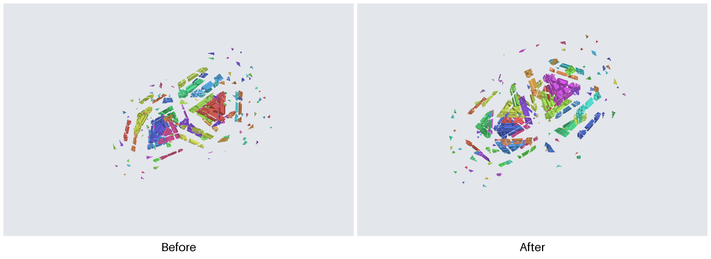

Figure A.1. Before and after N = 15,226 → 13,422. Recipes `appa-conj-region-before` and `appa-conj-region-after`
carry the full state digests. The two-panel sheet awaits capture.

### A.2 lock: open, close, close

- **Rule**: U4 ([section 2.8](02-bulk.md#28-lock-u4-open-close-and-close)).
- **Shape**: an opening letter x at cap c, then a closing letter y at a neighbouring cap, and, when found, a second
  closing letter z; the runner stores the two- or three-letter word as one span named `lock`.

**Example.** No committed step. Section 2.8 cites the census measurement that lock never fired;
`appa-inventory` confirms its absence from every committed non-reserved runner record and census step record.
There is no measured before/after N or actual word to give.

**Step tree.** Figure A.2 shows both abstract shapes. The named logical parts explain the rule; an actual runner
tree would be a single `lock` span [0, 2) or [0, 3), without references.

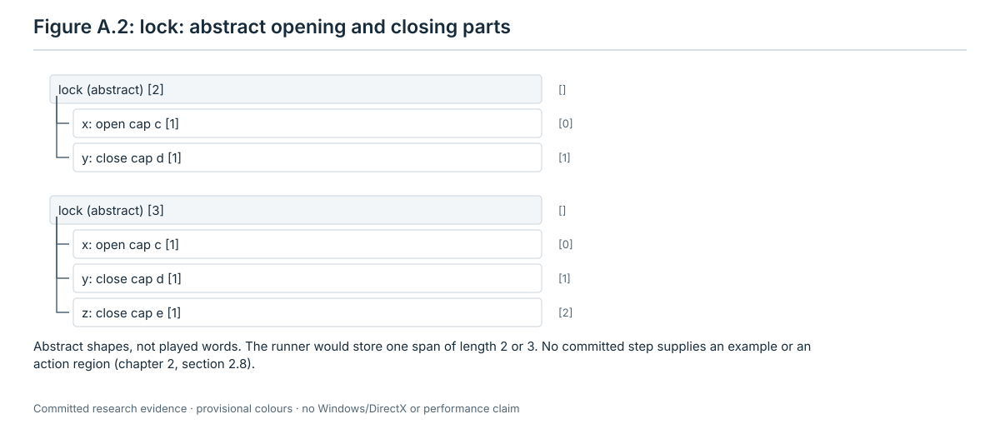

Figure A.2. Abstract rule diagram from section 2.8. No runner record holds this step.

**Region.** No before-and-after region can be attached without a committed step; Figure A.2 is the abstract substitute.

### A.3 shift: open, then improve

- **Rule**: U5′ ([section 2.10](02-bulk.md#210-shift-u5-open-then-improve)).
- **Shape**: an opening letter x at cap c, then one improving letter y at a cap near c; one span in the record.

**Example.** No committed step. Section 2.10 cites the census measurement that shift never fired, and
`appa-inventory` finds none in any committed non-reserved runner record or census step record. No actual word or
before/after N is available.

**Step tree.** Figure A.3 gives the abstract parts. The runner would store one `shift` span [0, 2), with no references.

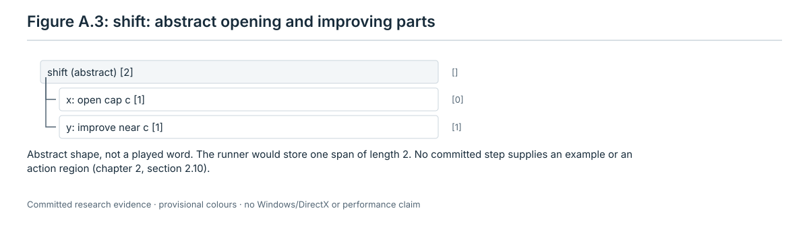

Figure A.3. Abstract rule diagram from section 2.10. No runner record holds this step.

**Region.** No committed step supplies a before-and-after region; the abstract diagram is the substitute.

## Height

### A.4 r22d88/U2: a pair

- **Rule**: the pair program of r22d81 ([section 3.4.4](03-height.md#344-r22d88u-and-r22d88u2-the-pair-program)).
- **Shape**: two letters, `first letter` and `second letter`, that lower u, the number of straddlers of the target
  τ, where neither letter alone would.

**Example.** The first `STEP` of
[`ROUND/r22d81_pairs_cap311_tail.txt`](../restoration/12-low-height/runs/round22/r22d81_pairs_cap311_tail.txt),
the fixed-τ = 311 experiment used in Figure 3.8. It is a recorded pair-program step, **not a runner step**: τ was
fixed by hand. The word is **(364, 3), (263, 6)**, two letters, and u is **8 → 8 → 2**. The heights (n6, n4, n2)
stay (172, 1,019, 103,103) and off stays 104,294. Before/after digests are `fe273a8c88d8…` and `be3ce23095a9…`.
The literal letters and all three full digests are also in
[`cloud/unlock-cap311-cap290/drive311_after75.json`](../restoration/12-low-height/runs/round22/cloud/unlock-cap311-cap290/drive311_after75.json),
`letters[0:2]`. `appa-u2-tree` checks that the two records agree.

**Step tree.** Figure A.4 applies `rules_height._proposal` to those committed letters. The two leaves cover
[0, 1) and [1, 2); there are no references.

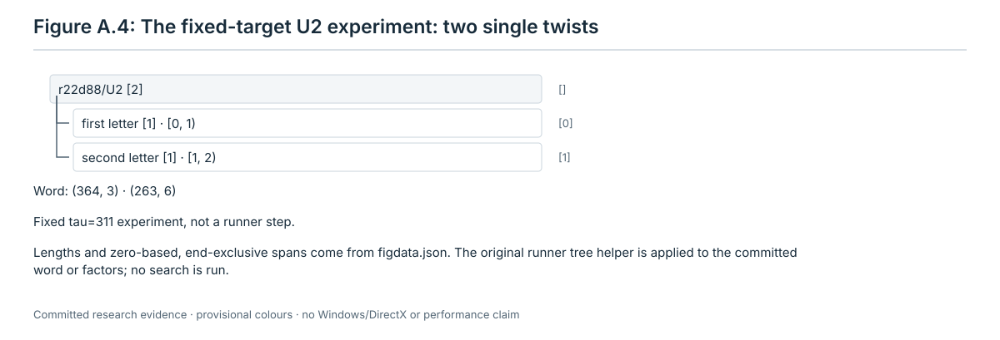

Figure A.4. Computed tree `appa-u2-tree`. No runner record holds this fixed-target step.

**Region.** [Figure 3.8](03-height.md#344-r22d88u-and-r22d88u2-the-pair-program) already gives its actual before,
middle and after states, with the same moved-piece emphasis; read its first and third panels as the region pair.

### A.5 h4/pair: the two-letter U step

- **Rule**: h4 ([section 3.5.5](03-height.md#355-h4pair-the-two-letter-u-step)).
- **Shape**: a first letter at a class-A cap that frees a blocked holder, then a second letter at that holder.

**Example.** The freeing pair used in Figure 3.12: **(553, 5), (535, 3)**, two letters, at `c312a2fcb7f2…`.
For fixed τ = 597, **u = 41 → 41 → 21**. The first letter frees holder 535; (n6, n4, n2) remains
(0, 734, 102,750) and off remains 103,484. Source:
[`ROUND/cloud/height4-descent-bbef1c8e/end_summary.txt`](../restoration/12-low-height/runs/round22/cloud/height4-descent-bbef1c8e/end_summary.txt),
`LETTER` 21 and 22, with after digest `6c7a79d9aa68…`. The three `two_letter_u_round2_shard*.txt` files in that
directory supply the choice: `_pair_choice` selects class A, order index 299, by `freeing`, with `freed: [535]`.
`appa-h4-pair-tree` recomputes that choice from all three files. This is a committed cloud line, not a runner record.

**Step tree.** The original `rules_height._proposal` builds Figure A.5 from that pair: `first letter [1]`, then
`second letter [1]`, covering [0, 1) and [1, 2), without references.

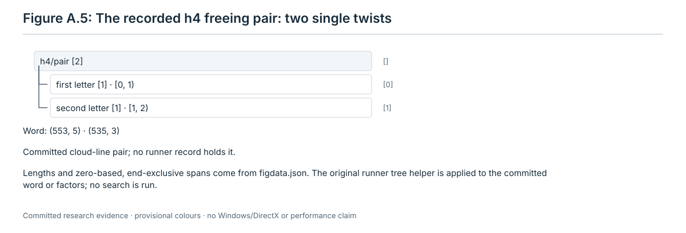

Figure A.5. Computed tree `appa-h4-pair-tree`. No runner record holds this cloud-line step.

**Region.** [Figure 3.12](03-height.md#355-h4pair-the-two-letter-u-step) already shows this example before, between
and after its letters, with the moved pieces opaque. Its first and last panels are the region pair.

## High

### A.6 F2: (c, x)·(d, y)·(c, z)

- **Rule**: the kernel's second family ([section 4.8](04-high.md#48-f2-three-letters-c-xd-yc-z)).
- **Shape**: three named one-letter parts; the third letter turns the first cap again.

**Example.** No committed F2 step. Section 4.8 explicitly records that none is known at any state; the stage-12
height-6 tier is a rule and safety argument, rather than a played F2 witness. `appa-inventory` also finds none in
any committed non-reserved runner record. There is no word or measured n6 before/after to publish.

**Step tree.** Figure A.6 is the abstract three-letter shape. The kernel plugin would record one span of length 3;
the named logical parts here follow the chapter definition.

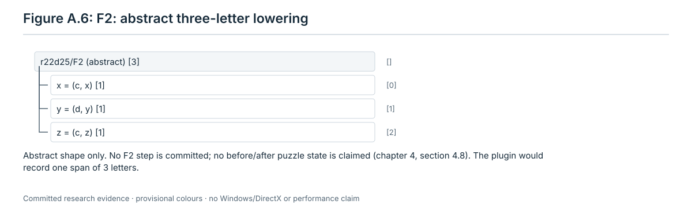

Figure A.6. Abstract diagram from section 4.8; no runner record holds this step.

**Region.** No committed step supplies an actual before-and-after state; the abstract shape is the substitute.

### A.7 F3: a·W·a⁻¹·W⁻¹

- **Rule**: the kernel's third family ([section 4.9](04-high.md#49-f3-awa¹w¹)).
- **Shape**: a commutator of the letter a with a word W; the parts a⁻¹ and W⁻¹ are `inverse_of` a and W.

**Example.** No committed F3 step. Section 4.9 states that none is recorded at any state, and `appa-inventory`
confirms none in any committed non-reserved runner record. There is no measured n6 before/after or actual word.

**Step tree.** Figure A.7 gives both allowed lengths: |W| = 1 gives 4 letters; |W| = 2 gives 6. It marks the inverse
parts and reverses W's letters. The plugin itself would store one span over the whole word.

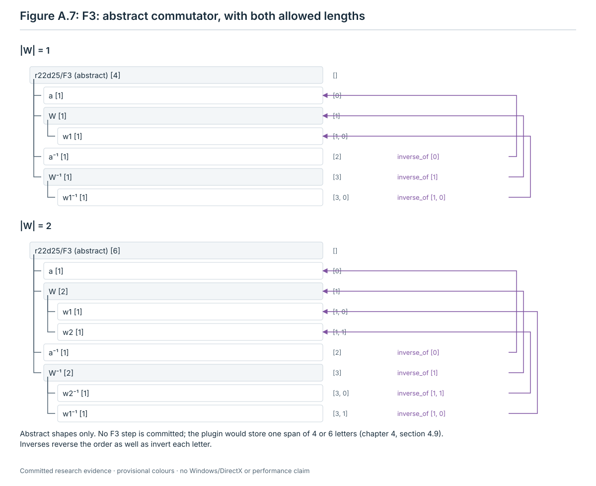

Figure A.7. Abstract diagram from section 4.9; no runner record holds this step.

**Region.** No committed step supplies an actual before-and-after state; the abstract shape is the substitute.

### A.8 D19: a·V·C⁶·V⁻¹·a⁻¹

- **Rule**: the height-4 rule D19 ([section 4.10](04-high.md#410-d19-the-height-4-rule-d19)); worked example R22D-16
  ([section 4.14.2](04-high.md#4142-a-d19-word-r22d-16)), 28 letters.
- **Shape**: a lowering letter a, a setup V, six copies of a commutator C, then V⁻¹ and a⁻¹.

**Example.** The R22D-16 step at the depth-100 stop of seed 7102, from
[`ROUND/r22d16_step.txt`](../restoration/12-low-height/runs/round22/r22d16_step.txt) and the literal `word` in
[`scripts/round22/r22d16_step.py`](../restoration/12-low-height/scripts/round22/r22d16_step.py).
It lands unit 391 and 41 other height-4 pieces, with **off 31,479 → 31,437**, taking no lattice piece off and keeping
the other off pieces exact. Digests: `4ca440085d74…` → `dceb9359b1b5…`. Its **28 letters**, in full, are:

```text
(61,57), (287,3),
(110,54), (149,3), (110,24), (149,9),
(110,54), (149,3), (110,24), (149,9),
(110,54), (149,3), (110,24), (149,9),
(110,54), (149,3), (110,24), (149,9),
(110,54), (149,3), (110,24), (149,9),
(110,54), (149,3), (110,24), (149,9),
(287,9), (61,57)
```

**Step tree.** [Figure 4.4](04-high.md#410-d19-the-height-4-rule-d19) draws this actual word: a [1] at [0, 1), V [1]
at [1, 2), C⁶ [24] at [2, 26), V⁻¹ [1] at [26, 27), a⁻¹ [1] at [27, 28). It expands the first C as x, y, x⁻¹, y⁻¹;
the five other copies are `same_as` C. Both final inverse parts point back to their originals. The finer tree is
chapter-defined: there is no committed runner step for D19 (the plugin would use one span).

**Region.** [Figure 4.6](04-high.md#4142-a-d19-word-r22d-16) already shows this exact example before and after,
including the 42 landed pieces and the unchanged off pieces.

### A.9 S·T: a protected letter, then a landing letter

- **Rule**: [section 4.11](04-high.md#411-st-one-protected-letter-to-height-2-then-one-landing-letter).
- **Shape**: S lowers the unit to height 2 while every height-6 piece stays exact; T lands it.

**Example.** No committed S·T step. Section 4.11 records none at any state: at all six stage-12 height-4 stops S
was pruned before trying a letter. `appa-inventory` finds no ST step in any committed non-reserved runner record.
In the catalogue `r22d25-cat/1`, S and T are single letters, and the kernel registers no provider of a longer T.
No actual word or off-count change is available.

**Step tree.** Figure A.8 shows S [1] then T [1], the two child spans the plugin would record in this catalogue.

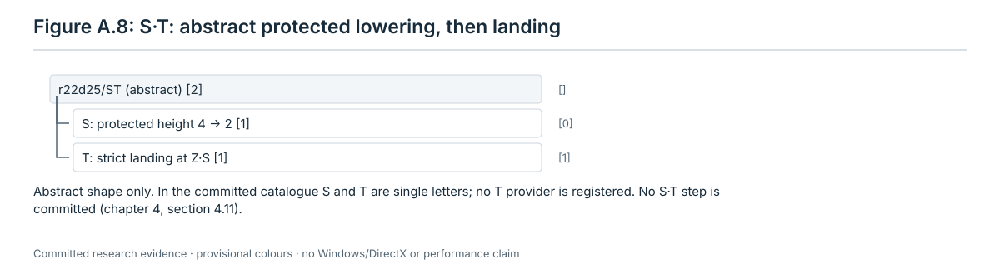

Figure A.8. Abstract diagram from section 4.11; no runner record holds this step.

**Region.** No committed step supplies an actual before-and-after state; the abstract shape is the substitute.

## Tail

### A.10 zero_bad: a transport that takes nothing off

- **Rule**: [section 5.5](05-tail.md#55-rule-zero_bad-a-transport-that-takes-nothing-off).
- **Shape**: the word of the first path the transport search finds; one span.

**Example.** `RUNS/dev/d1-dev-s7101/run1-interrupted/run.json`, index **97**: the accepted `zero_bad` step for
unit key 2198, 111 pieces. Its **60 letters** lower **off 1,193 → 1,082**, with every other off piece exact and no
new off piece (`strict_prime`, gate `stepchk`). Before/after: `7e128820541a…` → `cc41accae7ca…`.
The complete word is [`words/00097.json`](../restoration/13-tutorial-runner/runs/dev/d1-dev-s7101/run1-interrupted/words/00097.json),
file sha256 `182712d38a07684eb53da256ac6731ad64ae04f7f2ef9d1b96c46e2f7aceca75`.
The only named part is `zero_bad [60]`, [0, 60); the file gives every (cap, item) letter.

**Step tree.** Figure A.9 reads the original `step-trees/00097.json.gz`; `trees.json` names this runner index.
There are no inverse or repeated-part references.

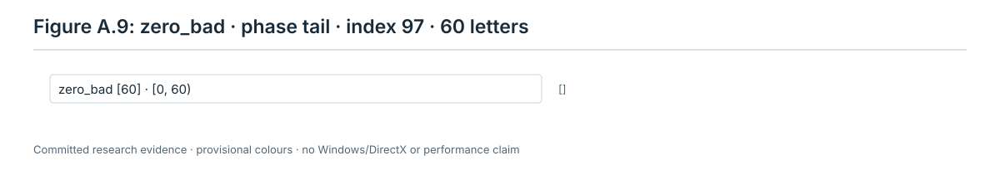

Figure A.9. Recorded tree `appa-zero-bad-tree`, covering [0, 60). A single span still expands to the committed
60 individual twists.

**Region.** Figure A.10 shows the same 111 pieces whose exact poses the word changes, before and after.

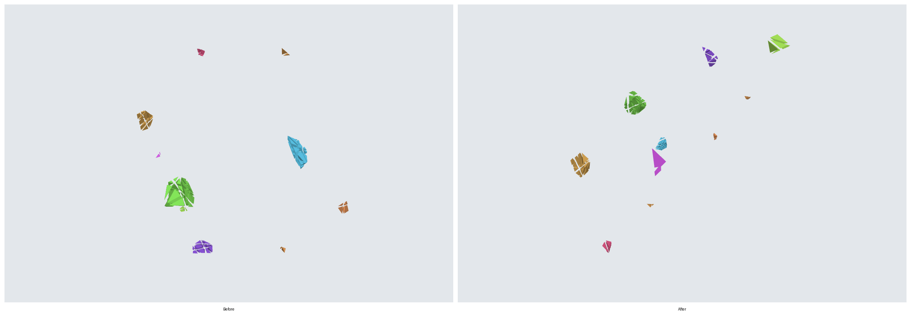

Figure A.10. Recipes `appa-zero-bad-region-before` and `appa-zero-bad-region-after`, local stereographic at the
first cap, 12. The two-panel sheet awaits capture.

### A.11 pure: the class-cell pure word

- **Rule**: [section 5.6](05-tail.md#56-rule-pure-the-class-cell-pure-word).
- **Shape**: a word in the class cell model that moves the unit's content home and takes no lattice piece off
  outside its cells.

**Example.** An accepted pure-cell replay, rather than the rejected b05 candidate of Figure 5.7:
[`ROUND/line-a/replay/steps/b17-pure.json`](../restoration/12-low-height/runs/round22/line-a/replay/steps/b17-pure.json).
From table `line-a/replay/tables/823.json.gz`, its **432 letters** land all 86 pieces of b17 and take no lattice
piece off: **off 823 → 737**, with the other 737 off pieces exact. The record says `strict_prime: true` and
`output_digest_matches: true`. Digests: `743992e866eb…` → `2e3b8f990229…`. The pure-cell search in this older
record is `cellpure4.py`; this is a committed instance of the chapter's pure-cell construction, not a new run of
the current `cellpure5.py` provider. The cycle uses the edge cells {542,593}, {542,570}, {570,593}
(stage 12, `PROOFS-B.md`, R22A2-06).
The full word is [`line-a/replay/words/b17.json`](../restoration/12-low-height/runs/round22/line-a/replay/words/b17.json),
file sha256 `c50dea8e51de97ad3efb77ec1e17986cf75498884dd25e2f45a0ad483406a9c2`.
Its runner-named part is `pure [432]`, [0, 432). `appa-pure-tree` replays it against both committed table digests
and checks the off, collateral and exact-pose counts.

**Step tree.** Figure A.11 applies `Runner.step_tree` to that committed word, preserving its one-span structure.

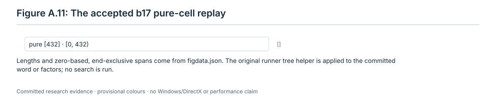

Figure A.11. Computed tree `appa-pure-tree`. No runner record holds this older pure-cell step.

**Region.** Figure A.12 uses the actual table of 823 and the literal replay, with all 86 changed pieces opaque.

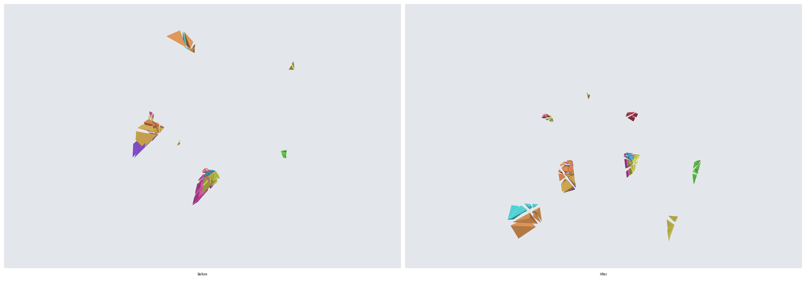

Figure A.12. Recipes `appa-pure-region-before` and `appa-pure-region-after`, local stereographic at the first cap,
570. The two-panel sheet awaits capture.

### A.12 close: V·W·V⁻¹

- **Rule**: [section 5.8](05-tail.md#58-rule-close-the-closure-vwv¹).
- **Shape**: V vacates the chambers Bad(W) that the landing word W would disturb, W lands the unit, V⁻¹ puts the
  vacated pieces back; V⁻¹ is `inverse_of` V.

**Example.** The b20 closure of [section 5.17.2](05-tail.md#5172-a-closure-with-a-certificate-v-unit-b20-at-507-off-pieces),
`ROUND/line-a/literal/run1/seq.jsonl`, b20 row (also `03-b20-stepchk.json`). Its **40,500 letters** give
**off 507 → 447**, landing b20's 60 pieces with strict′. Digests: `fde9e0fde60b…` → `aab10f250f0a…`.
The whole word expands from
[`line-a/literal/run1/03-b20-program.json`](../restoration/12-low-height/runs/round22/line-a/literal/run1/03-b20-program.json),
file sha256 `57c27076e4bfef65c15a77e9282dbe3e09ed58a6da7adcd3b5884774e24df91a`.
Its segments name the committed SAFE word, core and inverse; the core expands as P·Q·P⁻¹. Named positions:

| Part | Length | Span | Reference |
|---|---:|---|---|
| V | 20,232 | [0, 20,232) | — |
| middle W | 36 | [20,232, 20,268) | — |
| V⁻¹ | 20,232 | [20,268, 40,500) | `inverse_of [0]` |

**Step tree.** [Figure 1.9](01-state.md#113-step-trees) already draws the b20 tree from
`records/ch07-examples.json`, `E_trees.b20`, computed with `Runner.step_tree`. It has the three parts above.

**Region.** [Figure 5.5](05-tail.md#5172-a-closure-with-a-certificate-v-unit-b20-at-507-off-pieces) already shows
its actual before and after, with the intermediate V and W states. Use the first and last panels.

### A.13 t1prime: W·V′·W⁻¹·V′⁻¹

- **Rule**: [section 5.9](05-tail.md#59-rule-t1prime-wvw¹v¹).
- **Shape**: a commutator of the landing word W with a vacating word V′; W⁻¹ and V′⁻¹ are `inverse_of` W and V′.

**Example.** The b04 step of [section 5.17.1](05-tail.md#5171-a-t1-step-with-a-literal-v-unit-b04-at-437-off-pieces),
`ROUND/line-a/replay2/run2/seq.jsonl`, first row. Its **1,254 letters** give **off 437 → 392**, landing 45 pieces
with strict′. Digests: `a3fef11ccce3…` → `fee07e63a8cf…`. This is the literal-V′ example asserted by
`test_03_stored_literal_t1prime`, not the different 1,332-letter b04 word later used in E2's literal line.
The complete word expands from
[`line-a/replay2/run2/00-b04-program.json`](../restoration/12-low-height/runs/round22/line-a/replay2/run2/00-b04-program.json),
file sha256 `98b62b6be99c69a43f329c185dff744bba2dd6d10bdf952e4aa50f696bf84bf2`.
Its segments name W, V′ and their inverse/core files. The V′ letters are committed; no missing certificate
expansion is needed for this example.

| Part (record name) | Length | Span | Reference |
|---|---:|---|---|
| W | 288 | [0, 288) | — |
| V′ (`V`) | 339 | [288, 627) | — |
| W⁻¹ (`middle`) | 288 | [627, 915) | `inverse_of [0]` |
| V′⁻¹ (`V⁻¹`) | 339 | [915, 1,254) | `inverse_of [1]` |

**Step tree.** [Figure 7.1](07-records.md#76-step-trees) already draws this exact 1,254-letter tree to scale,
from `records/ch07-examples.json`, `E_trees.b04` (the original `Runner.step_tree` helper).

**Region.** [Figure 5.4](05-tail.md#5171-a-t1-step-with-a-literal-v-unit-b04-at-437-off-pieces) shows the actual
start, each part boundary and the end. Its first and last panels give the region pair.

## Lattice

### A.14 Corrections

- **Rule**: L1 ([section 6.5](06-lattice.md#65-rule-l1-choose-the-corrections)).
- **Shape**: a macro of the correction library, played from its first cap; each changes stated coordinates of ν.

**Example.** Correction 0, macro **7** (`mirror2`), of
[`ROUND/line-a/literal/lattice/restore-summary.json`](../restoration/12-low-height/runs/round22/line-a/literal/lattice/restore-summary.json),
`runs[0].corrections[0]`: once, forward, **9 letters**. There is no committed runner correction row. The chapter's
record `records/ch06-examples.json`, `F_depth40`, verifies this program, and `appa-correction-tree` reads its
checked library and translates its exact records to I_a. The word, in full, is:

```text
(374,51), (161,43), (68,13), (19,59), (16,11), (19,29), (68,47), (161,19), (374,16)
```

The lattice measure is ν, with off **0 → 0**. Retained play preserves ν, so the input ν in the summary is also ν
before the first correction. Macro 7 flips these sign coordinates (all others stay as in `F_depth40.nu_input`):

| Coordinate | Before | After | Coordinate | Before | After |
|---|---:|---:|---|---:|---:|
| b10 | 0 | 1 | b12 | 1 | 0 |
| b14 | 1 | 0 | b17 | 1 | 0 |
| b18 | 0 | 1 | b21 | 1 | 0 |
| b22 | 1 | 0 | b23 | 1 | 0 |
| b25 | 0 | 1 | b26 | 1 | 0 |
| b27 | 1 | 0 | b28 | 0 | 1 |
| b31 | 0 | 1 | b33 | 0 | 1 |

In particular f11 = 1 and C5_17 = 4 stay unchanged. The entire before/after vectors, including zero coordinates,
are in `figdata.json`, `appa-correction-tree.nu_before` and `.nu_after`. A correction need not lower the number of
nonzero coordinates; the selected list cancels ν as a whole.

**Step tree.** Figure A.13 applies `lattice_phase.correction_tree` to the actual summary entry and library macro:
one `macro 7 mirror2 [9]` span [0, 9). This example has no repetition and hence no `same_as` reference.

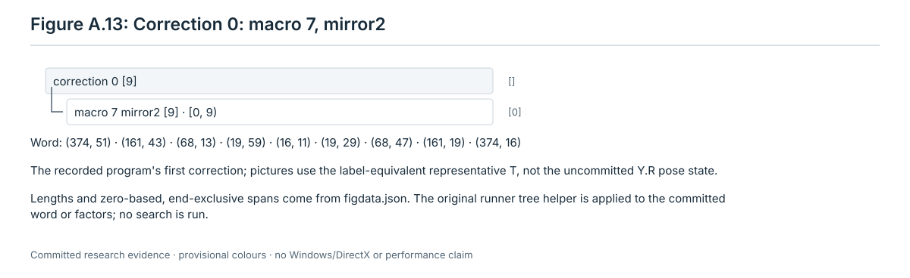

Figure A.13. Computed tree `appa-correction-tree`. No runner record holds this correction step.

**Region.** [Figures 6.3 and 6.4](06-lattice.md#65-rule-l1-choose-the-corrections) already show the legal
representative **T = solved·C⁻¹**, digest `e886d403df2f…`, and T after macro 7, `3a5d02b192cb…`, with its moved
pieces opaque. Their labels equal the labels before and after the program's actual retained-first correction
(rule L4); the uncommitted pose state Y·R is not claimed to be T. This is the chapter's explicit representative,
not evidence of a runner playing the 166,777,936-letter prefix.

### A.15 An orbit step under schedule11

- **Rule**: L3 ([section 6.7](06-lattice.md#67-rule-l3-one-orbit-step-under-schedule11-default-and-acceptance)).
- **Shape**: the factors that solve one orbit, each a twisted cycle g·r⁻¹·c·r·g⁻¹ with a setup g, a route r and a
  cycle c; factors of one orbit can share one seed (`same_as`).

**Example.** `RUNS/dev/d0-s7106/run/run.json`, index **19**, `lattice/orbit-6`: **194 retained letters**, off
**0 → 0**, orbit-6 misplaced positions **6 → 0**, and its frames exact at the end. This is the actual example of
section 6.7, checked by `records/ch06-examples.json`, `C_s11` and `D_factors.log.6`. The digests are
`1b263d3e9e0b…` → `949da5035110…`. The full word is
[`words/00019.ia16.gz`](../restoration/13-tutorial-runner/runs/dev/d0-s7106/run/words/00019.ia16.gz), file sha256
`21f18faab1b68ceb71a9648ca612a6b97bf05430fa18b5fdd28a5c5738d98bcb`.
Decode each little-endian uint16 as `60*cap + item`. The four factors have these parts, in order:

| Factor | Span | g, r⁻¹, c, r, g⁻¹ lengths | Total |
|---:|---|---|---:|
| 0 | [0, 48) | 7, 3, 28, 3, 7 | 48 |
| 1 | [48, 94) | 9, 0, 28, 0, 9 | 46 |
| 2 | [94, 144) | 8, 3, 28, 3, 8 | 50 |
| 3 | [144, 194) | 8, 3, 28, 3, 8 | 50 |

The stored tree combines g·r⁻¹ into setup spans of 10, 9, 11, 11 letters, then the seed c [28], then the inverse
setup. Factor 0's seed contains its zero-length relocation and inverse; the later seed spans are
`same_as [0,0,1]`. Each inverse setup is `inverse_of` its own first setup.

**Step tree.** [Figure 6.8](06-lattice.md#67-rule-l3-one-orbit-step-under-schedule11-default-and-acceptance)
already draws the full recorded tree, including all 24 parts and zero spans. `trees.json` also already lists it
as `tree-7106-19`; [Figure 6.5](06-lattice.md#67-rule-l3-one-orbit-step-under-schedule11-default-and-acceptance)
expands the first factor into g, r⁻¹, c, r, g⁻¹ and gives its exact support and collateral.

**Region.** [Figures 6.6 and 6.7](06-lattice.md#67-rule-l3-one-orbit-step-under-schedule11-default-and-acceptance)
already give this exact step before and after in global perspective, with the same changed pieces opaque.
Collateral on later orbits is included; solving orbit 6 does not mean that the other orbits stay fixed.

### A.16 A three-cycle of the late restorer

- **Rule**: L3′, development mode only
  ([section 6.8](06-lattice.md#68-rule-l3-one-orbit-step-under-the-late-restorer-development-mode-only)).
- **Shape**: star(X)⁻¹·star(Y), each star a cycle through a tree path; the seed is the cycle A → B → C → A.

**Example.** The first position-cycle pair (factors **0 and 1**, orbit 6) of
[`RUNS/depth20-seed7106/lattice/solutions.json.gz`](../restoration/13-tutorial-runner/runs/depth20-seed7106/lattice/solutions.json.gz),
file sha256 `7b64a499970183eb65ed567f3534e3fe428dfeba66333585fa1294e9508a6465`.
`records/ch06-examples.json`, `E_late.orbit6.first_four_factors[0:2]`, gives their trees: **406 + 404 = 810 letters**.
This is a replay of committed program factors, **not a committed runner step**. `appa-late-cycle-tree` checks the
whole first orbit's word and tree hashes against that chapter record before selecting the two factors.
From the same handoff `1b263d3e9e0b…`, off is **0 → 0** and the orbit's misplaced-position count is **6 → 8 → 6**
at the two boundaries; the individual cycle is not a monotone count step. Its after digest is `d112f1dafe51…`.
The full before, middle and after digests and the exact support are recomputed in `appa-late-cycle-tree`.

For direct single-twist expansion, [`figures/figdata.json`](figures/figdata.json) has a top-level **`word`** array
containing exactly these 810 (cap, item) letters, expanded from the committed DAG without search. Its file sha256
is `305f6f11dd457e9f087083780a243b94c1d44311106620201bd93429c1d632ac`.
The selected factors in the source DAG are `[166,-1]` and `[168,1]`; `literal_lattice.Program.expand` defines their
chronological expansion. The named spans are:

| Part | Span | Length |
|---|---|---:|
| star(X)⁻¹, factor 0 | [0, 406) | 406 |
| path 165⁻¹ | [0, 4) | 4 |
| seed conjugate 36⁻¹ | [4, 402) | 398 = 8 + 382 + 8 |
| path 165 | [402, 406) | 4 |
| star(Y), factor 1 | [406, 810) | 404 |
| path 167⁻¹ | [406, 409) | 3 |
| seed conjugate 36 | [409, 807) | 398 = 8 + 382 + 8 |
| path 167 | [807, 810) | 3 |

**Step tree.** Figure A.14 applies `lattice_phase.orbit_tree` to those two factors. It preserves all the inner
word spans and the runner's `same_as` and `inverse_of` links. Figure 6.9 explains the seed/star geometry; it is not
this full tree. The chapter's late tree uses a 382-letter original seed plus its 8-letter relocation and inverse,
rather than schedule11's shorter realigned seed.

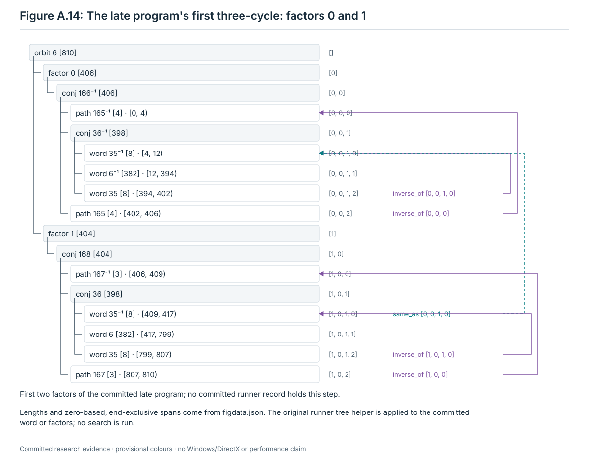

Figure A.14. Computed tree `appa-late-cycle-tree`; no runner record holds this step. The two root factors are
star(X)⁻¹ [406] and star(Y) [404], not the entire 11,306-letter orbit step.

**Region.** Figure A.15 replays those 810 letters from the actual committed handoff table. The caps span the puzzle,
so both panels use global perspective, with the same 280 pieces whose exact poses change drawn opaque.

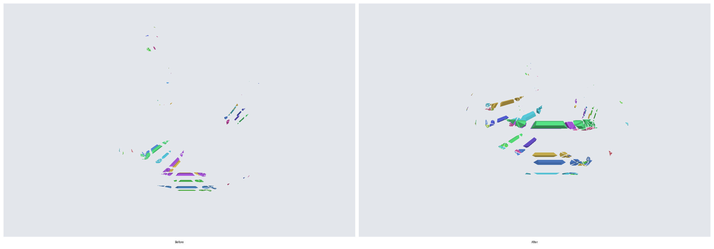

Figure A.15. Recipes `appa-late-cycle-region-before` and `appa-late-cycle-region-after`, full digests
`1b263d3e9e0b9dcd2feece889acf0d20c8c96492e2a5e895034be3dd9c46578e` and
`d112f1dafe5123ec397502941e35192d482678b747c1e21dba728210673a9633`. The two-panel sheet awaits capture.
